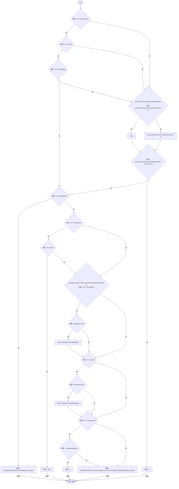
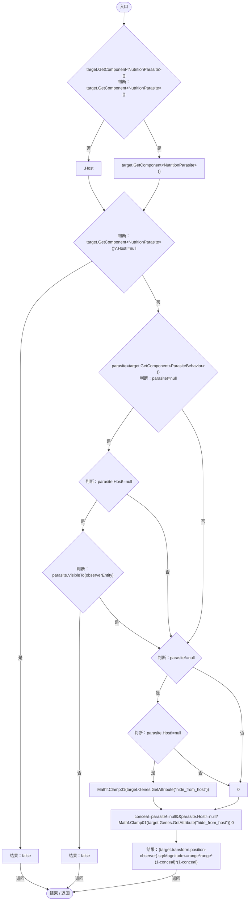

```mermaid
flowchart TD
  b0(["入口"])
  b1{"genes.GetComponent&lt;NutritionParasite&gt;()<br/>判断：genes.GetComponent&lt;NutritionParasite&gt;()"}
  b2[".Host"]
  b3["genes.GetComponent&lt;NutritionParasite&gt;()"]
  b4{"判断：genes.GetComponent&lt;NutritionParasite&gt;()?.Host!=null"}
  b5{"genes.GetComponent&lt;ParasiteBehavior&gt;()<br/>判断：genes.GetComponent&lt;ParasiteBehavior&gt;()"}
  b6[".Active"]
  b7["genes.GetComponent&lt;ParasiteBehavior&gt;()"]
  b8{"判断：genes.GetComponent&lt;ParasiteBehavior&gt;()?.Active==true"}
  b9{"genes.GetComponent&lt;EggIncubation&gt;()<br/>判断：genes.GetComponent&lt;EggIncubation&gt;()"}
  b10[".Incubating"]
  b11["genes.GetComponent&lt;EggIncubation&gt;()"]
  b12{"判断：genes.GetComponent&lt;EggIncubation&gt;()?.Incubating==true"}
  b13["AntColonyWorker.IsCarried(genes.GetComponent&lt;DarwinEntity&gt;())"]
  b14["genes.GetComponent&lt;NutritionParasite&gt;()?.Host!=null&#124;&#124;genes.GetComponent&lt;ParasiteBehavior&gt;()?.Active==true&#124;&#124;genes.GetComponent&lt;EggIncubation&gt;()?.Incubating==true&#124;&#124;AntColonyWorker.IsCarried(genes.GetComponent&lt;DarwinEntity&gt;())"]
  b15["结果：genes.GetComponent&lt;NutritionParasite&gt;()?.Host!=null&#124;&#124;genes.GetComponent&lt;ParasiteBehavior&gt;()?.Active==true&#124;&#124;genes.GetComponent&lt;EggIncubation&gt;()?.Incubating==true&#124;&#124;AntColonyWorker.IsCarried(genes.GetComponent&lt;DarwinEntity&gt;())"]
  b16(["结束 / 返回"])
  b0 --> b1
  b1 -->|"否"| b2
  b1 -->|"是"| b3
  b2 --> b4
  b3 --> b4
  b4 -->|"否"| b5
  b4 -->|"是"| b14
  b5 -->|"否"| b6
  b5 -->|"是"| b7
  b6 --> b8
  b7 --> b8
  b8 -->|"否"| b9
  b8 -->|"是"| b14
  b9 -->|"否"| b10
  b9 -->|"是"| b11
  b10 --> b12
  b11 --> b12
  b12 -->|"否"| b13
  b12 -->|"是"| b14
  b13 --> b15
  b14 --> b15
  b15 -->|"返回"| b16

```

```mermaid
flowchart TD
  b0(["入口"])
  b1{"target=null;<br/>point=genes.transform.position;<br/>multiplier=1;<br/>判断：CombatIntent.Destination(genes,out point,out target)"}
  b2["结果：true"]
  b3{"rts=genes.GetComponent&lt;RtsOrderController&gt;()<br/>判断：rts!=null"}
  b4{"判断：rts.Destination(out point,out target)"}
  b5["结果：true"]
  b6{"ant=genes.GetComponent&lt;AntColonyMember&gt;()<br/>判断：ant!=null"}
  b7{"判断：ant.Destination(out point,out target,out multiplier)"}
  b8["结果：true"]
  b9{"energy=genes.GetComponent&lt;EnergyBlockMetabolism&gt;()<br/>判断：energy!=null"}
  b10{"判断：energy.Destination(out point)"}
  b11["结果：true"]
  b12{"genes.GetComponent&lt;NutritionParasite&gt;()<br/>判断：genes.GetComponent&lt;NutritionParasite&gt;()"}
  b13[".Destination(out point)"]
  b14["genes.GetComponent&lt;NutritionParasite&gt;()"]
  b15{"判断：genes.GetComponent&lt;NutritionParasite&gt;()?.Destination(out point)==true"}
  b16["结果：true"]
  b17{"genes.GetComponent&lt;CorpseFeeding&gt;()<br/>判断：genes.GetComponent&lt;CorpseFeeding&gt;()"}
  b18[".Destination(out point)"]
  b19["genes.GetComponent&lt;CorpseFeeding&gt;()"]
  b20{"判断：genes.GetComponent&lt;CorpseFeeding&gt;()?.Destination(out point)==true"}
  b21["结果：true"]
  b22{"territory=genes.GetComponent&lt;TerritoryBehavior&gt;()<br/>判断：territory!=null"}
  b23{"判断：territory.Active"}
  b24{"判断：territory.EvictionRemaining&gt;0"}
  b25["结果：territory.Destination(out point,out multiplier)"]
  b26{"population=genes.GetComponent&lt;PopulationBehavior&gt;()<br/>判断：population!=null"}
  b27{"判断：population.Destination(out point,out target)"}
  b28["结果：true"]
  b29{"判断：territory!=null"}
  b30{"判断：territory.Destination(out point,out multiplier)"}
  b31["结果：true"]
  b32{"判断：PatrolRhythm.Defensive(genes)"}
  b33{"genes.GetComponent&lt;EntityStateController&gt;()<br/>判断：genes.GetComponent&lt;EntityStateController&gt;()"}
  b34[".Current.Behavior"]
  b35["genes.GetComponent&lt;EntityStateController&gt;()"]
  b36{"判断：genes.GetComponent&lt;EntityStateController&gt;()?.Current.Behavior==EntityStateBehavior.TerritoryPatrol"}
  b37["territory.PatrolDestination(out point);"]
  b38["结果：true"]
  b39{"判断：PatrolRhythm.Resting(genes)"}
  b40["point=genes.transform.position;<br/>结果：true"]
  b41["结果：EntityStateMotion.Directive(genes,out point,out target,out multiplier)"]
  b42(["结束 / 返回"])
  b0 --> b1
  b1 -->|"是"| b2
  b1 -->|"否"| b3
  b2 -->|"返回"| b42
  b3 -->|"是"| b4
  b3 -->|"否"| b6
  b4 -->|"是"| b5
  b4 -->|"否"| b6
  b5 -->|"返回"| b42
  b6 -->|"是"| b7
  b6 -->|"否"| b9
  b7 -->|"是"| b8
  b7 -->|"否"| b9
  b8 -->|"返回"| b42
  b9 -->|"是"| b10
  b9 -->|"否"| b12
  b10 -->|"是"| b11
  b10 -->|"否"| b12
  b11 -->|"返回"| b42
  b12 -->|"否"| b13
  b12 -->|"是"| b14
  b13 --> b15
  b14 --> b15
  b15 -->|"是"| b16
  b15 -->|"否"| b17
  b16 -->|"返回"| b42
  b17 -->|"否"| b18
  b17 -->|"是"| b19
  b18 --> b20
  b19 --> b20
  b20 -->|"是"| b21
  b20 -->|"否"| b22
  b21 -->|"返回"| b42
  b22 -->|"是"| b23
  b22 -->|"否"| b26
  b23 -->|"是"| b24
  b23 -->|"否"| b26
  b24 -->|"是"| b25
  b24 -->|"否"| b26
  b25 -->|"返回"| b42
  b26 -->|"是"| b27
  b26 -->|"否"| b29
  b27 -->|"是"| b28
  b27 -->|"否"| b29
  b28 -->|"返回"| b42
  b29 -->|"是"| b30
  b29 -->|"否"| b32
  b30 -->|"是"| b31
  b30 -->|"否"| b32
  b31 -->|"返回"| b42
  b32 -->|"是"| b33
  b32 -->|"否"| b39
  b33 -->|"否"| b34
  b33 -->|"是"| b35
  b34 --> b36
  b35 --> b36
  b36 -->|"是"| b37
  b36 -->|"否"| b38
  b37 --> b38
  b38 -->|"返回"| b42
  b39 -->|"是"| b40
  b39 -->|"否"| b41
  b40 -->|"返回"| b42
  b41 -->|"返回"| b42

```

```mermaid
flowchart TD
  b0(["入口"])
  b1{"判断：PredationSizePolicy.Allows(genes,target)"}
  b2{"判断：AntColonyCombat.CanAttack(genes.GetComponent&lt;DarwinEntity&gt;(),target)"}
  b3{"判断：AntColonyWorker.IsCarried(target)"}
  b4["结果：false"]
  b5{"genes.GetComponent&lt;PopulationBehavior&gt;()<br/>判断：genes.GetComponent&lt;PopulationBehavior&gt;()"}
  b6[".SameGroup(target)"]
  b7["genes.GetComponent&lt;PopulationBehavior&gt;()"]
  b8{"判断：genes.GetComponent&lt;PopulationBehavior&gt;()?.SameGroup(target)==true"}
  b9["结果：false"]
  b10{"member=genes.GetComponent&lt;AntColonyMember&gt;()<br/>判断：member!=null"}
  b11{"判断：member.Active"}
  b12["结果：ColonyActivityRange.Contains(member.Population,target.transform.position)"]
  b13["territory=genes.GetComponent&lt;TerritoryBehavior&gt;()"]
  b14{"判断：territory==null"}
  b15["territory.AllowsTarget(target.transform.position)"]
  b16["territory==null"]
  b17["结果：territory==null&#124;&#124;territory.AllowsTarget(target.transform.position)"]
  b18(["结束 / 返回"])
  b0 --> b1
  b1 -->|"是"| b2
  b1 -->|"否"| b4
  b2 -->|"是"| b3
  b2 -->|"否"| b4
  b3 -->|"是"| b4
  b3 -->|"否"| b5
  b4 -->|"返回"| b18
  b5 -->|"否"| b6
  b5 -->|"是"| b7
  b6 --> b8
  b7 --> b8
  b8 -->|"是"| b9
  b8 -->|"否"| b10
  b9 -->|"返回"| b18
  b10 -->|"是"| b11
  b10 -->|"否"| b13
  b11 -->|"是"| b12
  b11 -->|"否"| b13
  b12 -->|"返回"| b18
  b13 --> b14
  b14 -->|"否"| b15
  b14 -->|"是"| b16
  b15 --> b17
  b16 --> b17
  b17 -->|"返回"| b18

```

# EcologyMotion.cs

[返回总索引](../README.md) · `Runtime` · `Assets/DarwinPark/Entities/Ecology/EcologyMotion.cs`

[源文件](../../../Assets/DarwinPark/Entities/Ecology/EcologyMotion.cs) · 源码校验：`cc6fd8fa3689237733ccadbb2808e39e495ee39b4c39835a2c844d60ab8af5ce`

方法按源文件位置排列。事件/回调引用不表示立即执行；分支与异常说明见总索引。完整源码与可点击关系图请打开离线手册。

## Immobilized · L9

`public static bool Immobilized(EntityGeneController genes)`

### Editor / Player · Roslyn编译器控制流

项目内调用/回调引用：

- [NutritionParasite.Host.get · L19](4a18785b7c1e1484.md#me3131db9b6e16399)（访问器）
- [AntColonyWorker.IsCarried · L140](8a0cca2020271b6f.md#mf552b19f9aeffe97)（方法）

## Directive · L10

`public static bool Directive(EntityGeneController genes,out Vector3 point,out DarwinEntity target,out float multiplier)`

### Editor / Player · Roslyn编译器控制流

项目内调用/回调引用：

- [CombatIntent.Destination · L20](34193b994b2c0894.md#m035f73e50a1d8387)（方法）
- [RtsOrderController.Destination · L44](cac3b6501f41ca35.md#mcd43bb5d0e0b78ed)（方法）
- [AntColonyMember.Destination · L134](baebd85c05598377.md#m8fbd14b933818c86)（方法）
- [EnergyBlockMetabolism.Destination · L32](123c1bf82bdb8ea2.md#m661cc728cc4df83a)（方法）
- [NutritionParasite.Destination · L51](4a18785b7c1e1484.md#m2d3e306e8ca983aa)（方法）
- [CorpseFeeding.Destination · L30](0494eed2004cafc6.md#m01503cb04722aa77)（方法）
- [TerritoryBehavior.EvictionRemaining.get · L11](19d504dcdc8bc624.md#m412b89a669c39b71)（访问器）
- [TerritoryBehavior.Destination · L50](19d504dcdc8bc624.md#ma85a4edc643b70c9)（方法）
- [PopulationBehavior.Destination · L175](21e4f62f75a9a80f.md#m18fddbc8377a8d03)（方法）
- [PatrolRhythm.Defensive · L23](f55940fd5773d413.md#m1a2fd45e07d72554)（方法）
- [TerritoryBehavior.PatrolDestination · L65](19d504dcdc8bc624.md#m4c3ffae68a7fb8fb)（方法）
- [PatrolRhythm.Resting · L29](f55940fd5773d413.md#m3ccb91bd37278348)（方法）
- [EntityStateMotion.Directive · L9](d5c725c964fe5c61.md#mbc6a7981ef4c5e26)（方法）

## CanHunt · L38

`public static bool CanHunt(EntityGeneController genes,DarwinEntity target)`

### Editor / Player · Roslyn编译器控制流

项目内调用/回调引用：

- [PredationSizePolicy.Allows · L9](80ea865fb0f12053.md#m70764380d885d2d4)（方法）
- [AntColonyCombat.CanAttack · L8](aa858de55ec8e51a.md#mb9453f16f05e083a)（方法）
- [AntColonyWorker.IsCarried · L140](8a0cca2020271b6f.md#mf552b19f9aeffe97)（方法）
- [PopulationBehavior.SameGroup · L123](21e4f62f75a9a80f.md#m7a9d850e1d8967d4)（方法）
- [ColonyActivityRange.Contains · L33](e8d854132f563257.md#m9ee9b6f17791cff5)（方法）
- [AntColonyMember.Population.get · L30](baebd85c05598377.md#m688c2c0dfb5a66d6)（访问器）
- [TerritoryBehavior.AllowsTarget · L43](19d504dcdc8bc624.md#mc867b3c025f861d2)（方法）

## ResolveAttribute · L48

`public static float ResolveAttribute(EntityGeneController genes,string id,float value)`

### Editor / Player · Roslyn编译器控制流

项目内调用/回调引用：

- [NutritionParasite.Host.get · L19](4a18785b7c1e1484.md#me3131db9b6e16399)（访问器）
- [EntityMovementLimits.Attribute · L10](bf2a44fffc5f10d6.md#m5656261bdba0054b)（方法）
- [PopulationBehavior.AttackMultiplier.get · L62](21e4f62f75a9a80f.md#mf4276fc947175e89)（访问器）
- [EcologyMotion.Immobilized · L9](6ed9d0eedb456d32.md#mff3eeb8fb207a31e)（方法）
- [AntColonyMember.Attribute · L181](baebd85c05598377.md#m7e05885740a44e0b)（方法）

## Detectable · L61

`public static bool Detectable(DarwinEntity target,Vector3 observer,float range,DarwinEntity observerEntity=null)`

### Editor / Player · Roslyn编译器控制流

项目内调用/回调引用：

- [NutritionParasite.Host.get · L19](4a18785b7c1e1484.md#me3131db9b6e16399)（访问器）
- [ParasiteBehavior.Host.get · L16](ec21ecbd299caaed.md#m854b55763184d078)（访问器）
- [ParasiteBehavior.VisibleTo · L20](ec21ecbd299caaed.md#me3b68e7667800a21)（方法）
- [EntityGeneController.GetAttribute · L257](7494d53178552f0e.md#m600509f72d274f0c)（方法）
- [DarwinEntity.Genes.get · L14](70798dde169f2e8b.md#m622eb1adf401d431)（访问器）
