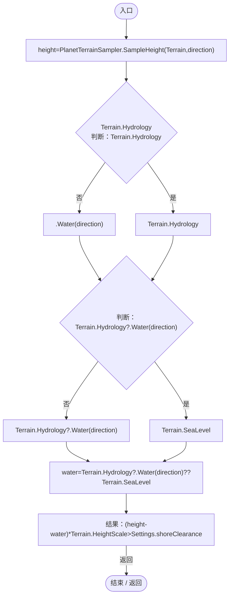
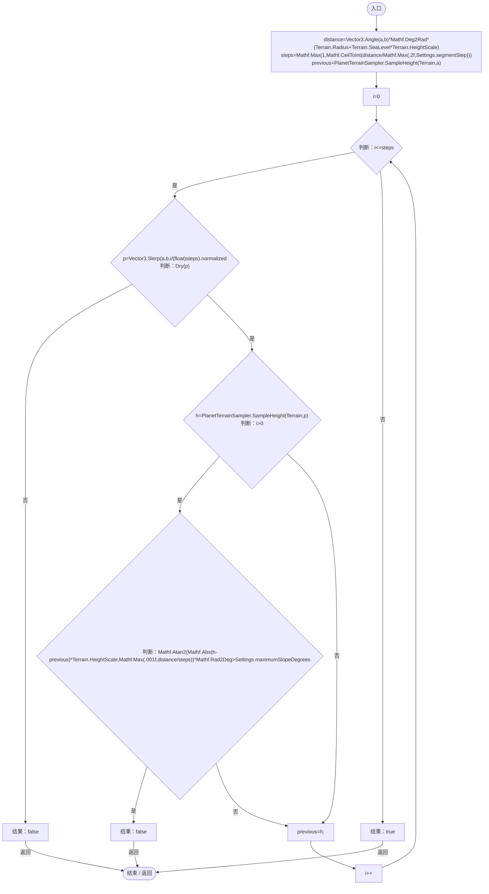
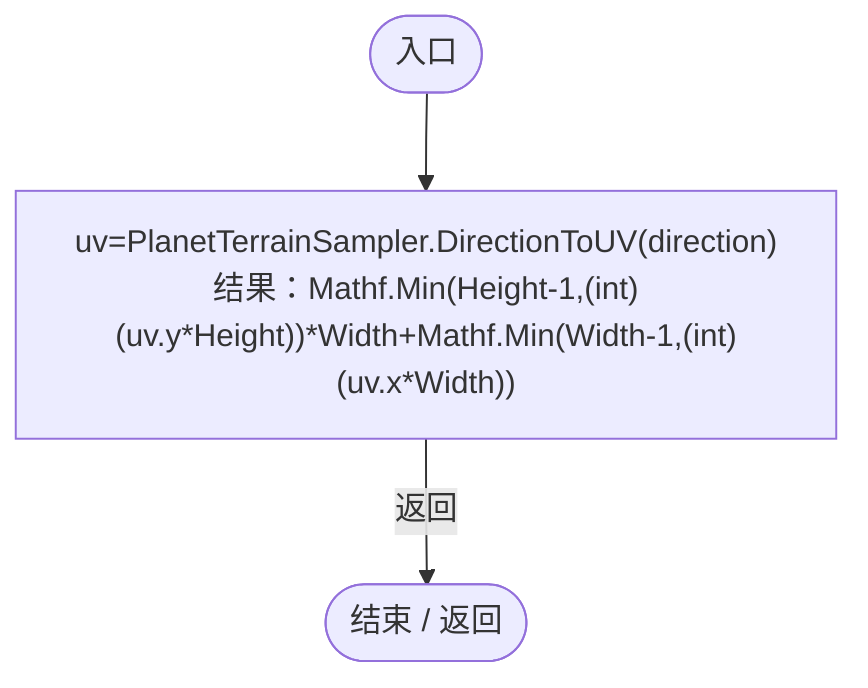
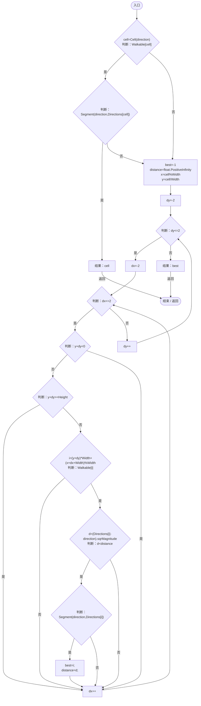
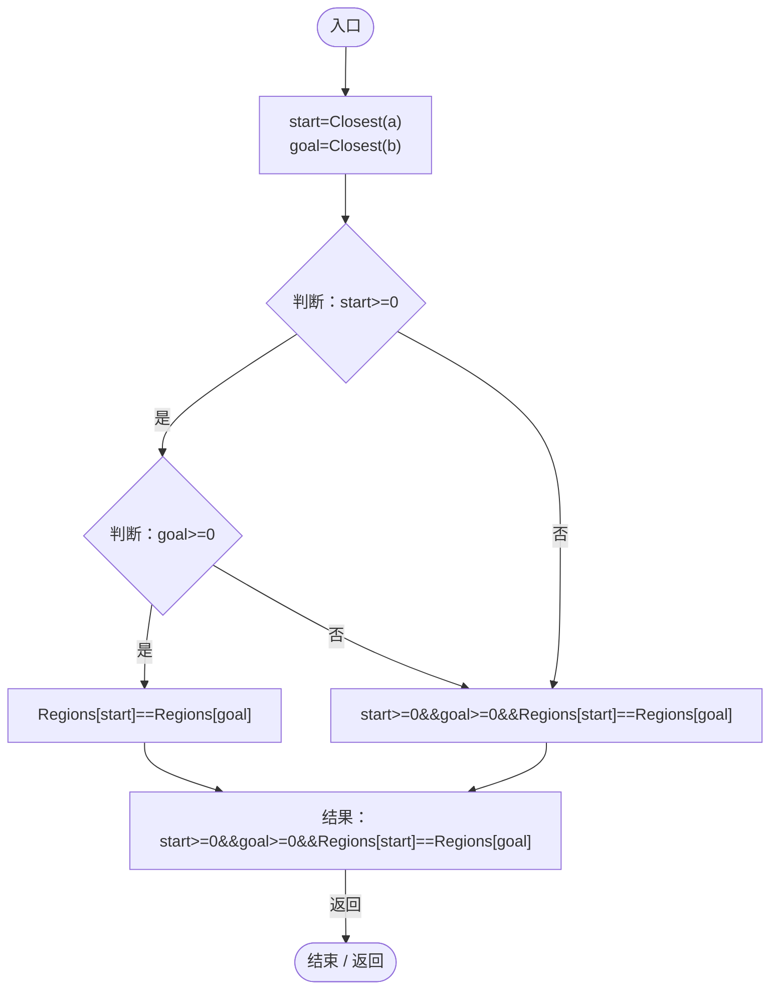
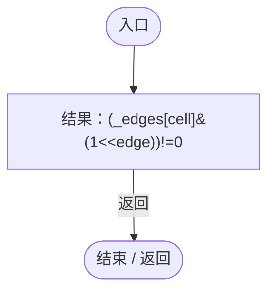

```mermaid
flowchart TD
  b0(["入口"])
  b1["public LandNavigationGraph(PlanetTerrainData data,LandNavigationSettings settings) { Terrain=data;Settings=settings;Width=Mathf.Clamp(settings.longitudeCells,32,512);Height=Mathf.Clamp(settings.latitudeCells,16,256);int n=Width*Height;Po…"]
  b2["Terrain=data;<br/>Settings=settings;<br/>Width=Mathf.Clamp(settings.longitudeCells,32,512);<br/>Height=Mathf.Clamp(settings.latitudeCells,16,256);<br/>n=Width*Height<br/>Points=new Vector3[n];<br/>Directions=new Vector3[n];<br/>Walkable=new bool[n];<br/>Regions=new int…"]
  b3["i=0"]
  b4{"判断：i&lt;n"}
  b5["dir=PlanetTerrainSampler.DirectionFromUV((i%Width+.5f)/Width,(i/Width+.5f)/Height)<br/>Directions[i]=dir;<br/>Points[i]=dir*(data.Radius+PlanetTerrainSampler.SampleHeight(data,dir)*data.HeightScale);<br/>Walkable[i]=Dry(dir);"]
  b6["i++"]
  b7["i=0"]
  b8{"判断：i&lt;n"}
  b9{"判断：Walkable[i]"}
  b10["edge=0"]
  b11{"判断：edge&lt;8"}
  b12{"next=Neighbour(i,edge)<br/>判断：next&lt;0"}
  b13{"判断：Walkable[next]"}
  b14{"判断：Segment(Directions[i],Directions[next])"}
  b15["_edges[i]&#124;=(byte)(1&lt;&lt;edge);"]
  b16["edge++"]
  b17["i++"]
  b18["region=0<br/>queue=new Queue&lt;int&gt;()"]
  b19["i=0"]
  b20{"判断：i&lt;n"}
  b21{"判断：Walkable[i]"}
  b22{"判断：Regions[i]==0"}
  b23["Regions[i]=++region;<br/>queue.Enqueue(i);"]
  b24{"判断：queue.Count&gt;0"}
  b25["node=queue.Dequeue()"]
  b26["e=0"]
  b27{"判断：e&lt;8"}
  b28{"判断：Linked(node,e)"}
  b29{"next=Neighbour(node,e)<br/>判断：Regions[next]==0"}
  b30["Regions[next]=region;<br/>queue.Enqueue(next);"]
  b31["e++"]
  b32["i++"]
  b33(["结束 / 返回"])
  b0 --> b1
  b1 --> b2
  b2 --> b3
  b3 --> b4
  b4 -->|"是"| b5
  b4 -->|"否"| b7
  b5 --> b6
  b6 --> b4
  b7 --> b8
  b8 -->|"是"| b9
  b8 -->|"否"| b18
  b9 -->|"是"| b10
  b9 -->|"否"| b17
  b10 --> b11
  b11 -->|"是"| b12
  b11 -->|"否"| b17
  b12 -->|"否"| b13
  b12 -->|"是"| b16
  b13 -->|"否"| b16
  b13 -->|"是"| b14
  b14 -->|"是"| b15
  b14 -->|"否"| b16
  b15 --> b16
  b16 --> b11
  b17 --> b8
  b18 --> b19
  b19 --> b20
  b20 -->|"是"| b21
  b20 -->|"否"| b33
  b21 -->|"是"| b22
  b21 -->|"否"| b32
  b22 -->|"是"| b23
  b22 -->|"否"| b32
  b23 --> b24
  b24 -->|"是"| b25
  b24 -->|"否"| b32
  b25 --> b26
  b26 --> b27
  b27 -->|"是"| b28
  b27 -->|"否"| b24
  b28 -->|"是"| b29
  b28 -->|"否"| b31
  b29 -->|"是"| b30
  b29 -->|"否"| b31
  b30 --> b31
  b31 --> b27
  b32 --> b20

```

```mermaid
flowchart TD
  b0(["入口"])
  b1["y=cell/Width+DY[edge]"]
  b2{"判断：y&lt;0"}
  b3{"判断：y&gt;=Height"}
  b4["-1"]
  b5["y*Width+(cell%Width+DX[edge]+Width)%Width"]
  b6["结果：y&lt;0&#124;&#124;y&gt;=Height?-1:y*Width+(cell%Width+DX[edge]+Width)%Width"]
  b7(["结束 / 返回"])
  b0 --> b1
  b1 --> b2
  b2 -->|"否"| b3
  b2 -->|"是"| b4
  b3 -->|"是"| b4
  b3 -->|"否"| b5
  b4 --> b6
  b5 --> b6
  b6 -->|"返回"| b7

```

# LandNavigationGraph.cs

[返回总索引](../README.md) · `Runtime` · `Assets/DarwinPark/Planet/Terrain/LandNavigationGraph.cs`

[源文件](../../../Assets/DarwinPark/Planet/Terrain/LandNavigationGraph.cs) · 源码校验：`46fc7e1b7a3a92f2644f433ed7e7cd39b0b2b7d2b5c87890957eca3fd93d50b4`

方法按源文件位置排列。事件/回调引用不表示立即执行；分支与异常说明见总索引。完整源码与可点击关系图请打开离线手册。

## LandNavigationGraph.ctor · L16

`public LandNavigationGraph(PlanetTerrainData data,LandNavigationSettings settings)`

### Editor / Player · Roslyn编译器控制流

项目内调用/回调引用：

- [PlanetTerrainSampler.DirectionFromUV · L13](fd5c1d83b88a7c8b.md#mbb90aecec23f2a42)（方法）
- [PlanetTerrainSampler.SampleHeight · L32](fd5c1d83b88a7c8b.md#m759508f0c5a04b21)（方法）
- [LandNavigationGraph.Dry · L23](6f2590f045ea5d3f.md#m9d85cc02f7d54e38)（方法）
- [LandNavigationGraph.Neighbour · L35](6f2590f045ea5d3f.md#m0e919afc27292a26)（方法）
- [LandNavigationGraph.Segment · L25](6f2590f045ea5d3f.md#m1357eb7f0ace9eab)（方法）
- [LandNavigationGraph.Linked · L34](6f2590f045ea5d3f.md#m38c3c53f23cc60af)（方法）

## Dry · L23

`public bool Dry(Vector3 direction)`

### Editor / Player · Roslyn编译器控制流

项目内调用/回调引用：

- [PlanetTerrainSampler.SampleHeight · L32](fd5c1d83b88a7c8b.md#m759508f0c5a04b21)（方法）
- [PlanetHydrology.Water · L34](282937bf06cb5f2a.md#m179c2afa259d5320)（方法）

## Segment · L25

`public bool Segment(Vector3 a,Vector3 b)`

### Editor / Player · Roslyn编译器控制流

项目内调用/回调引用：

- [PlanetTerrainSampler.SampleHeight · L32](fd5c1d83b88a7c8b.md#m759508f0c5a04b21)（方法）
- [LandNavigationGraph.Dry · L23](6f2590f045ea5d3f.md#m9d85cc02f7d54e38)（方法）

## Cell · L30

`public int Cell(Vector3 direction)`

### Editor / Player · Roslyn编译器控制流

项目内调用/回调引用：

- [PlanetTerrainSampler.DirectionToUV · L24](fd5c1d83b88a7c8b.md#m3ef2b43aabed9098)（方法）

## Closest · L31

`public int Closest(Vector3 direction)`

### Editor / Player · Roslyn编译器控制流

项目内调用/回调引用：

- [LandNavigationGraph.Cell · L30](6f2590f045ea5d3f.md#m2f85f8538664d703)（方法）
- [LandNavigationGraph.Segment · L25](6f2590f045ea5d3f.md#m1357eb7f0ace9eab)（方法）

## Connected · L33

`public bool Connected(Vector3 a,Vector3 b)`

### Editor / Player · Roslyn编译器控制流

项目内调用/回调引用：

- [LandNavigationGraph.Closest · L31](6f2590f045ea5d3f.md#m84242b314c22284e)（方法）

## Linked · L34

`public bool Linked(int cell,int edge)`

### Editor / Player · Roslyn编译器控制流

## Neighbour · L35

`public int Neighbour(int cell,int edge)`

### Editor / Player · Roslyn编译器控制流

