# DarwinEntity.cs

[返回总索引](../README.md) · `Runtime` · `Assets/DarwinPark/Entities/DarwinEntity.cs`

[源文件](../../../Assets/DarwinPark/Entities/DarwinEntity.cs) · 源码校验：`5901ea4e3247cebcdc0e5479660aa0cab8c9bf37c3af735390dc52b80088d112`

方法按源文件位置排列。事件/回调引用不表示立即执行；分支与异常说明见总索引。完整源码与可点击关系图请打开离线手册。

## Genes.get · L14

`get`

### Editor / Player · 语法控制结构 / 声明（非CFG）

## Genes.set · L14

`private set`

### Editor / Player · 语法控制结构 / 声明（非CFG）

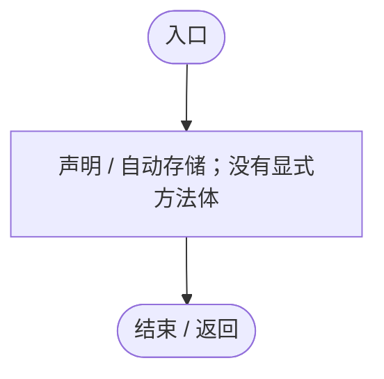

## Traits.get · L16

`public IReadOnlyCollection<string> Traits`

### Editor / Player · 语法控制结构 / 声明（非CFG）

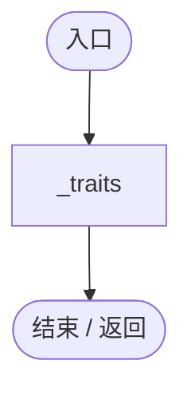

## Awake · L26

`private void Awake()`

### Editor / Player · Roslyn编译器控制流

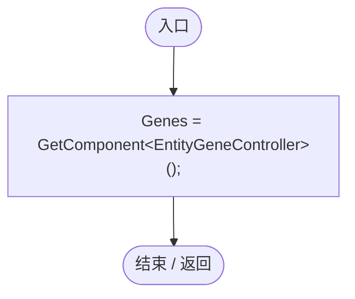

项目内调用/回调引用：

- [DarwinEntity.Genes.set · L14](70798dde169f2e8b.md#me460557fa7161e19)（访问器）

## OnEnable · L31

`private void OnEnable()`

### Editor / Player · Roslyn编译器控制流

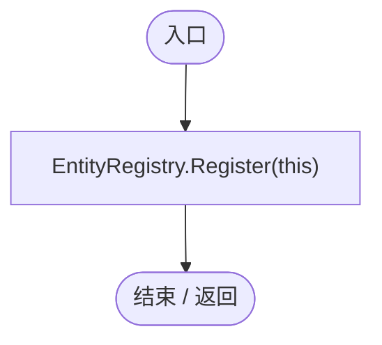

项目内调用/回调引用：

- [EntityRegistry.Register · L18](2093aaf08559c9f2.md#m6e168cdc6bda160c)（方法）

## OnDisable · L32

`private void OnDisable()`

### Editor / Player · Roslyn编译器控制流

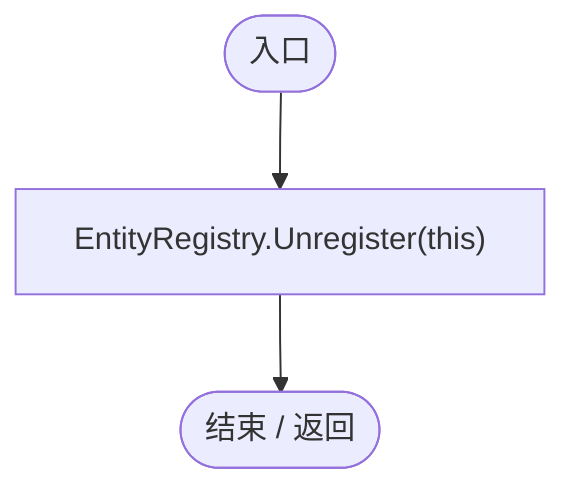

项目内调用/回调引用：

- [EntityRegistry.Unregister · L26](2093aaf08559c9f2.md#m17c2e8d558d71307)（方法）

## EnableTrait · L34

`public void EnableTrait(string id)`

### Editor / Player · Roslyn编译器控制流

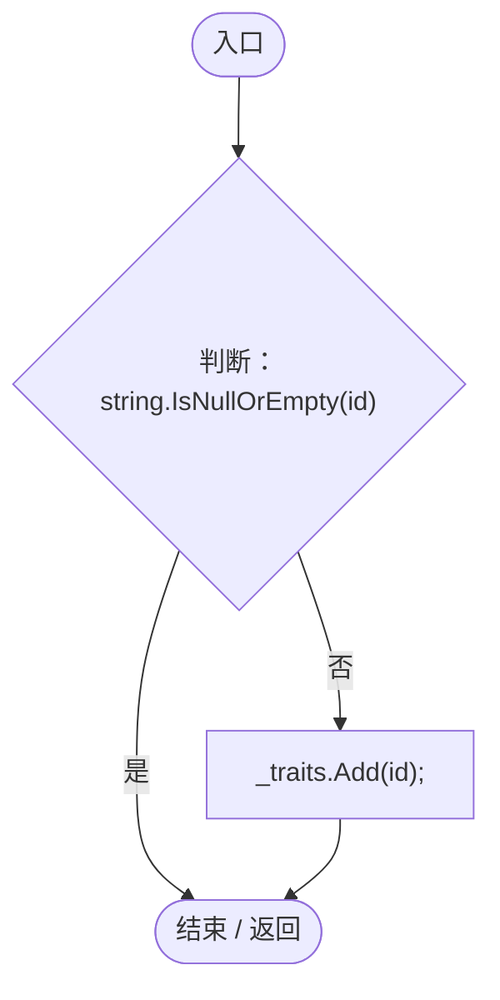

## DisableTrait · L35

`public void DisableTrait(string id)`

### Editor / Player · Roslyn编译器控制流

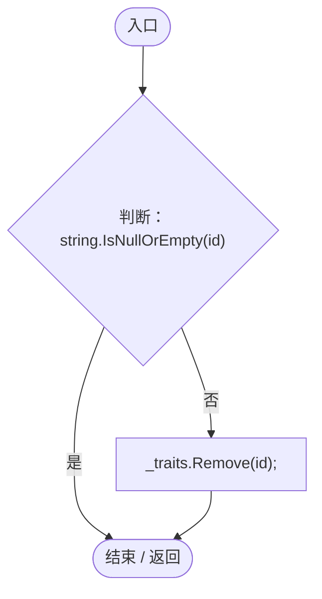

## HasTrait · L36

`public bool HasTrait(string id)`

### Editor / Player · Roslyn编译器控制流

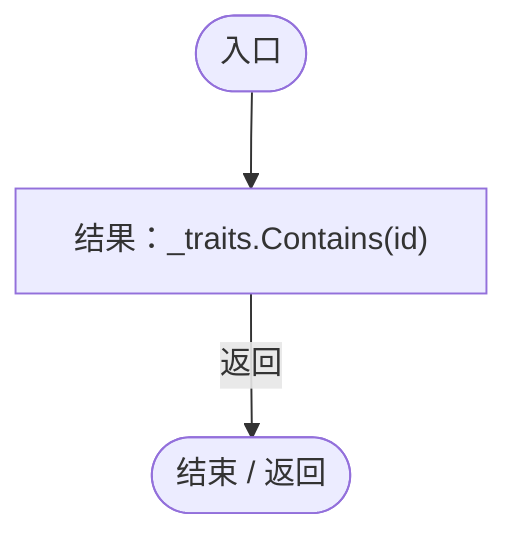

## AddEnergy · L38

`public void AddEnergy(float amount)`

### Editor / Player · Roslyn编译器控制流

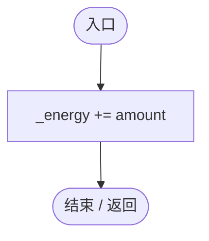

## Energy.get · L39

`public float Energy`

### Editor / Player · 语法控制结构 / 声明（非CFG）

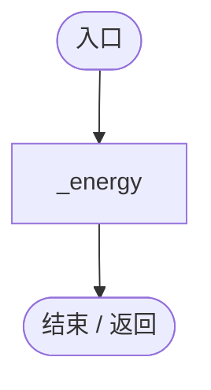

## RequestReproduction · L41

`public void RequestReproduction(DarwinEntity partner, Genome offspringGenome)`

### Editor / Player · Roslyn编译器控制流

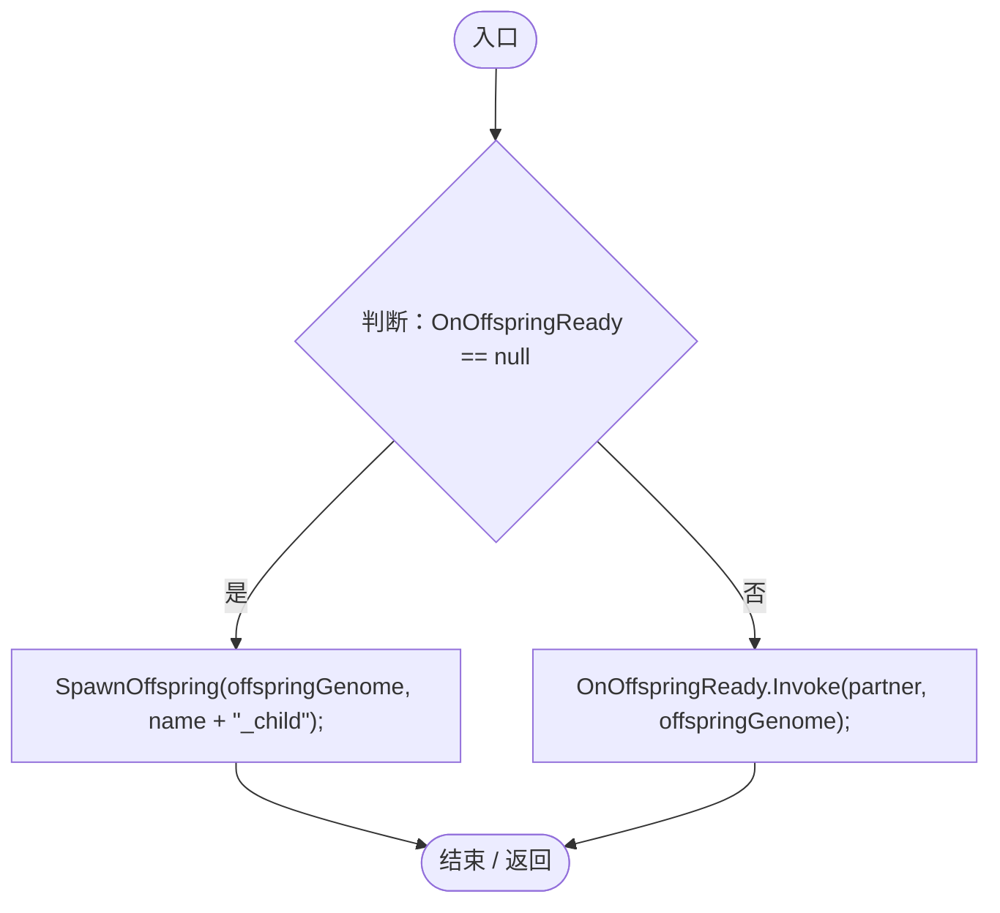

项目内调用/回调引用：

- [DarwinEntity.SpawnOffspring · L51](70798dde169f2e8b.md#m9ce9d7daf46af2e8)（方法）

## SpawnOffspring · L51

`public void SpawnOffspring(Genome genome, string childName)`

### Editor / Player · Roslyn编译器控制流

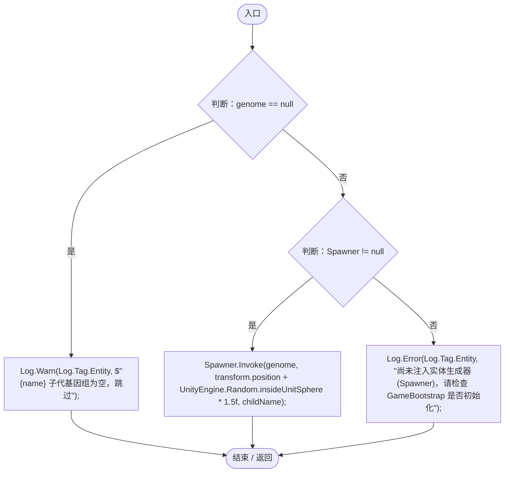

项目内调用/回调引用：

- [Log.Warn · L37](735e5abf0df2bddc.md#m25a5d11252901de1)（方法）
- [Log.Error · L43](735e5abf0df2bddc.md#m2addd5e1d74b000d)（方法）
