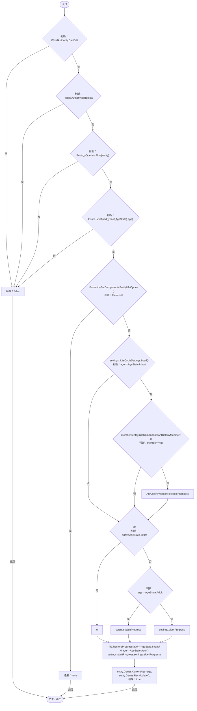

# EntityStateEditor.cs

[返回总索引](../README.md) · `Runtime` · `Assets/DarwinPark/Entities/EntityStateEditor.cs`

[源文件](../../../Assets/DarwinPark/Entities/EntityStateEditor.cs) · 源码校验：`2741119d759c67703503cb743d700efd6df7b5a350d2002d071305fe1ae3a46a`

方法按源文件位置排列。事件/回调引用不表示立即执行；分支与异常说明见总索引。完整源码与可点击关系图请打开离线手册。

## SetStage · L11

`public static bool SetStage(DarwinEntity entity,AgeState age)`

### Editor / Player · Roslyn编译器控制流

项目内调用/回调引用：

- [EcologyQueries.Alive · L38](bdf7ccc2c9c0452f.md#mb2877c487f449970)（方法）
- [LifeCycleSettings.Load · L16](ace76969fe8f61de.md#mbd2925785484f343)（方法）
- [AntColonyWorker.Release · L115](8a0cca2020271b6f.md#m554fde48cbae45dd)（方法）
- [EntityLifeCycle.RestoreProgress · L52](9f4138bfbae654b7.md#m007c73a0c714c238)（方法）
- [EntityGeneController.CurrentAge.set · L37](7494d53178552f0e.md#md8993fc83a0c41da)（访问器）
- [DarwinEntity.Genes.get · L14](70798dde169f2e8b.md#m622eb1adf401d431)（访问器）
- [EntityGeneController.Recalculate · L118](7494d53178552f0e.md#m707d9a56b0c7c609)（方法）

## SetStat · L20

`public static bool SetStat(DarwinEntity entity,string id,float value)`

### Editor / Player · Roslyn编译器控制流

项目内调用/回调引用：

- [EcologyQueries.Alive · L38](bdf7ccc2c9c0452f.md#mb2877c487f449970)（方法）
- [EntityStats.TryGet · L90](75aa86a368efdf24.md#m24ee1433e4a70d94)（方法）
- [EntityStats.CapacityRemaining · L92](75aa86a368efdf24.md#m574f0a6509120d00)（方法）
- [EntityStats.Modify · L111](75aa86a368efdf24.md#m9c837be197158240)（方法）
- [EntityWorkScheduler.Wake · L72](465ccdbb260bcac2.md#md4572d5c3e13b437)（方法）
- [DarwinEntity.Genes.get · L14](70798dde169f2e8b.md#m622eb1adf401d431)（访问器）
- [EntityDeathSettlement.Die · L11](07fa6bdaadf50796.md#m700276963777d0a6)（方法）
