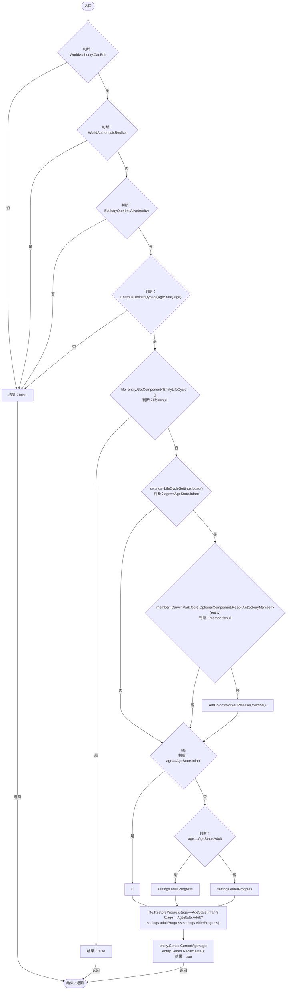
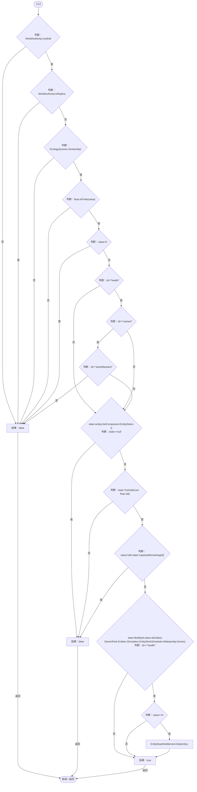

# EntityStateEditor.cs

[返回总索引](../README.md) · `Runtime` · `Assets/DarwinPark/Entities/EntityStateEditor.cs`

[源文件](../../../Assets/DarwinPark/Entities/EntityStateEditor.cs) · 源码校验：`dc4221fc47551dcc7b21937aefd20f4b1225a05078f666aa8d570b7e37a2252e`

方法按源文件位置排列。事件/回调引用不表示立即执行；分支与异常说明见总索引。完整源码与可点击关系图请打开离线手册。

## SetStage · L12

`public static bool SetStage(DarwinEntity entity,AgeState age)`

### Editor / Player · Roslyn编译器控制流

项目内调用/回调引用：

- [EcologyQueries.Alive · L39](bdf7ccc2c9c0452f.md#m8352bfacbe2996a8)（方法）
- [LifeCycleSettings.Load · L16](ace76969fe8f61de.md#m6fe263852e5a8989)（方法）
- [OptionalComponent.Read · L7](806c46b42ced4d36.md#m69622a4dee165c5a)（方法）
- [AntColonyWorker.Release · L115](8a0cca2020271b6f.md#ma690c0beb4883222)（方法）
- [EntityLifeCycle.RestoreProgress · L53](9f4138bfbae654b7.md#m9ac5190ce2d7c425)（方法）
- [EntityGeneController.CurrentAge.set · L39](7494d53178552f0e.md#me4193b89bf90aa38)（访问器）
- [DarwinEntity.Genes.get · L14](70798dde169f2e8b.md#m622eb1adf401d431)（访问器）
- [EntityGeneController.Recalculate · L120](7494d53178552f0e.md#m7bf63f9a1482db3c)（方法）

## SetStat · L21

`public static bool SetStat(DarwinEntity entity,string id,float value)`

### Editor / Player · Roslyn编译器控制流

项目内调用/回调引用：

- [EcologyQueries.Alive · L39](bdf7ccc2c9c0452f.md#m8352bfacbe2996a8)（方法）
- [EntityStats.TryGet · L93](75aa86a368efdf24.md#m03cef847022eee28)（方法）
- [EntityStats.CapacityRemaining · L95](75aa86a368efdf24.md#mf5014bafb4b29341)（方法）
- [EntityStats.Modify · L114](75aa86a368efdf24.md#m375a3812ef990b45)（方法）
- [EntityWorkScheduler.Wake · L73](465ccdbb260bcac2.md#m681ac7b8924497e4)（方法）
- [DarwinEntity.Genes.get · L14](70798dde169f2e8b.md#m622eb1adf401d431)（访问器）
- [EntityDeathSettlement.Die · L12](07fa6bdaadf50796.md#m9a912ca8df50ff6f)（方法）
