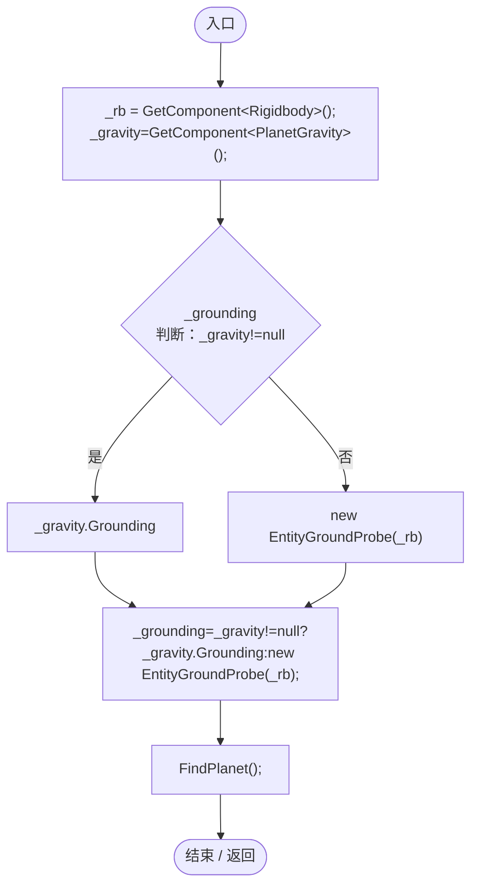
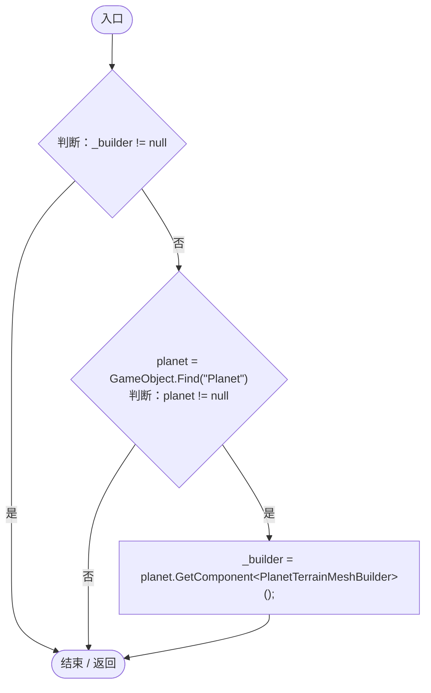
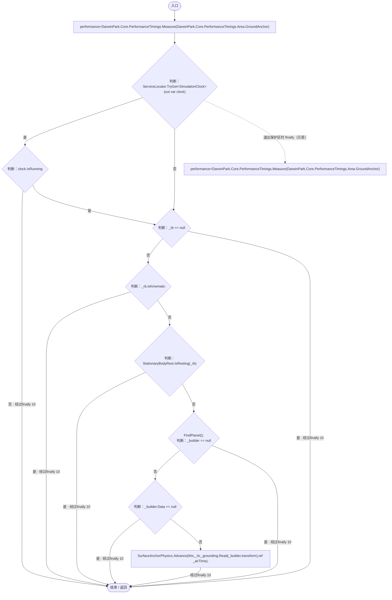

# EntitySurfaceAnchor.cs

[返回总索引](../README.md) · `Runtime` · `Assets/DarwinPark/Entities/EntitySurfaceAnchor.cs`

[源文件](../../../Assets/DarwinPark/Entities/EntitySurfaceAnchor.cs) · 源码校验：`11f08f087e0dfa032f22fd72fca93cba45529fb2f1cc06e9bc42053fcb6cc191`

方法按源文件位置排列。事件/回调引用不表示立即执行；分支与异常说明见总索引。完整源码与可点击关系图请打开离线手册。

## Awake · L34

`private void Awake()`

### Editor / Player · Roslyn编译器控制流

项目内调用/回调引用：

- [EntityGroundProbe.EntityGroundProbe.ctor · L19](6cefee808441951d.md#mb328f2e4d118ac90)（构造函数）
- [EntitySurfaceAnchor.FindPlanet · L41](71fd1058c8ed8660.md#mf256dbcafc12c239)（方法）

## FindPlanet · L41

`private void FindPlanet()`

### Editor / Player · Roslyn编译器控制流

## FixedUpdate · L48

`private void FixedUpdate()`

### Editor / Player · Roslyn编译器控制流

项目内调用/回调引用：

- [PerformanceTimings.Measure · L24](a8403a4c7503726d.md#m592e16f2b6513efd)（方法）
- [ServiceLocator.TryGet · L26](f2fdbe9f9ccd93cb.md#m143b24e6d58471b0)（方法）
- [SimulationClock.IsRunning.get · L22](a8f444aec9614b0a.md#m10f4fe307faca0f0)（访问器）
- [StationaryBodyRest.IsResting · L13](19e6d310d5522440.md#m05a63ddbf1fcc412)（方法）
- [EntitySurfaceAnchor.FindPlanet · L41](71fd1058c8ed8660.md#mf256dbcafc12c239)（方法）
- [PlanetTerrainMeshBuilder.Data.get · L81](415285cf043354a9.md#m1a65abfe0f34c5d8)（访问器）
- [SurfaceAnchorPhysics.Advance · L7](f3e5fa3c77faa61b.md#m130276acc88982fb)（方法）
- [EntityGroundProbe.Read · L20](6cefee808441951d.md#md243671db147a614)（方法）
