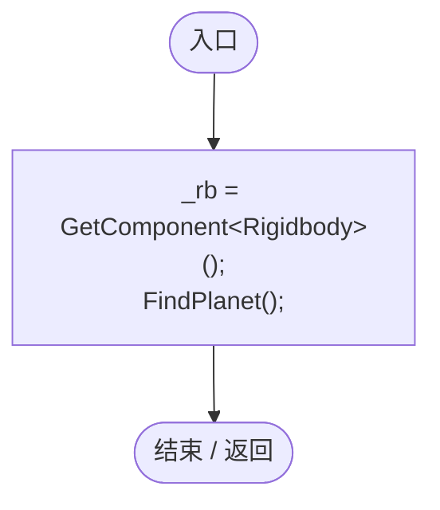
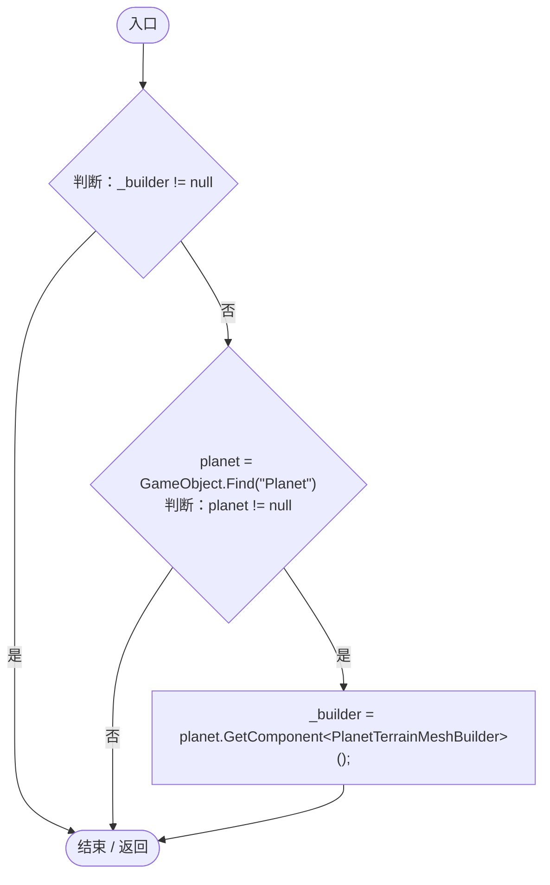
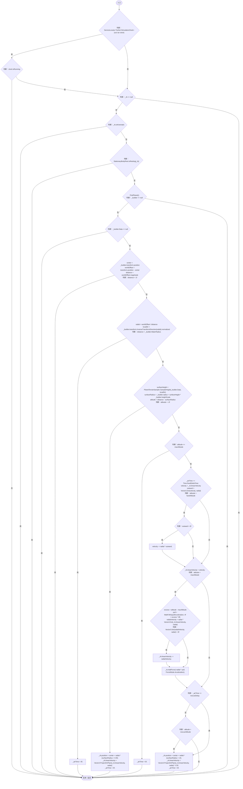

# EntitySurfaceAnchor.cs

[返回总索引](../README.md) · `Runtime` · `Assets/DarwinPark/Entities/EntitySurfaceAnchor.cs`

[源文件](../../../Assets/DarwinPark/Entities/EntitySurfaceAnchor.cs) · 源码校验：`65caa655b39d9a8ee6bff41273a8e46cf89ac39cc0d2779abc7690e4ff6d649e`

方法按源文件位置排列。事件/回调引用不表示立即执行；分支与异常说明见总索引。完整源码与可点击关系图请打开离线手册。

## Awake · L34

`private void Awake()`

### Editor / Player · Roslyn编译器控制流

项目内调用/回调引用：

- [EntitySurfaceAnchor.FindPlanet · L40](71fd1058c8ed8660.md#medcbbeaf0c9d028a)（方法）

## FindPlanet · L40

`private void FindPlanet()`

### Editor / Player · Roslyn编译器控制流

## FixedUpdate · L47

`private void FixedUpdate()`

### Editor / Player · Roslyn编译器控制流

项目内调用/回调引用：

- [ServiceLocator.TryGet · L26](f2fdbe9f9ccd93cb.md#m143b24e6d58471b0)（方法）
- [SimulationClock.IsRunning.get · L22](a8f444aec9614b0a.md#m10f4fe307faca0f0)（访问器）
- [StationaryBodyRest.IsResting · L13](19e6d310d5522440.md#mfc1d49425304ae1a)（方法）
- [EntitySurfaceAnchor.FindPlanet · L40](71fd1058c8ed8660.md#medcbbeaf0c9d028a)（方法）
- [PlanetTerrainMeshBuilder.Data.get · L78](415285cf043354a9.md#m8382f579717fbc6d)（访问器）
- [PlanetTerrainMeshBuilder.WaterRadius.get · L94](415285cf043354a9.md#m28d8809083881ec1)（访问器）
- [PlanetTerrainSampler.SampleHeight · L32](fd5c1d83b88a7c8b.md#m759508f0c5a04b21)（方法）
