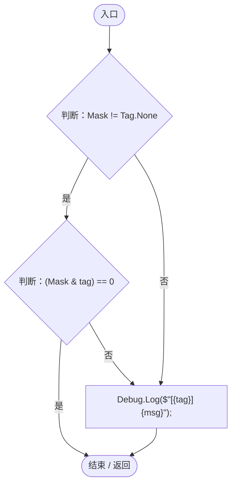
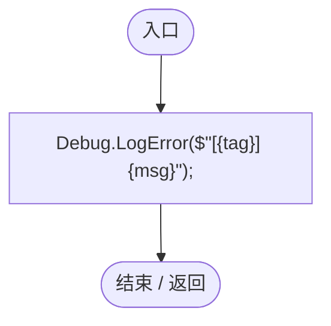
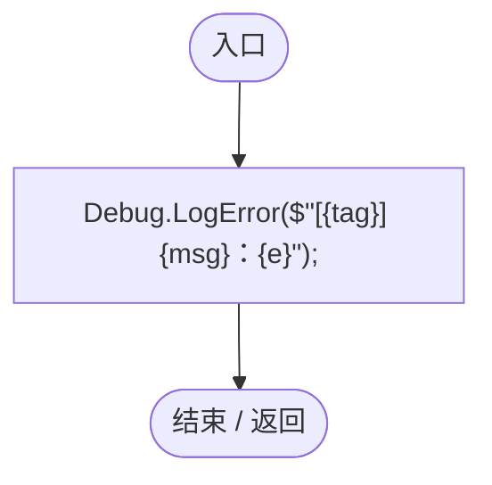

# Log.cs

[返回总索引](../README.md) · `Runtime` · `Assets/DarwinPark/Core/Logging/Log.cs`

[源文件](../../../Assets/DarwinPark/Core/Logging/Log.cs) · 源码校验：`6941a6a2077baeef3e240f787158f21bbb47e040b8bbd67779730f3202afe8d1`

方法按源文件位置排列。事件/回调引用不表示立即执行；分支与异常说明见总索引。完整源码与可点击关系图请打开离线手册。

## Info · L31

`public static void Info(Tag tag, string msg)`

### Editor / Player · Roslyn编译器控制流

## Warn · L37

`public static void Warn(Tag tag, string msg)`

### Editor / Player · Roslyn编译器控制流

## Error · L43

`public static void Error(Tag tag, string msg)`

### Editor / Player · Roslyn编译器控制流

## Exception · L48

`public static void Exception(Tag tag, string msg, System.Exception e)`

### Editor / Player · Roslyn编译器控制流

