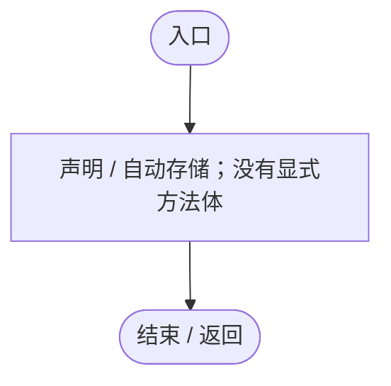
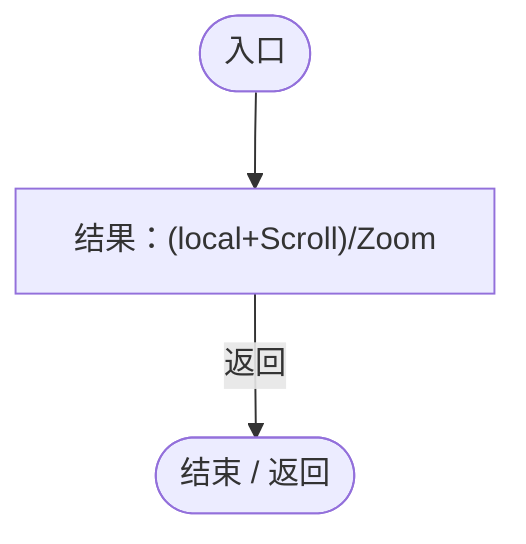
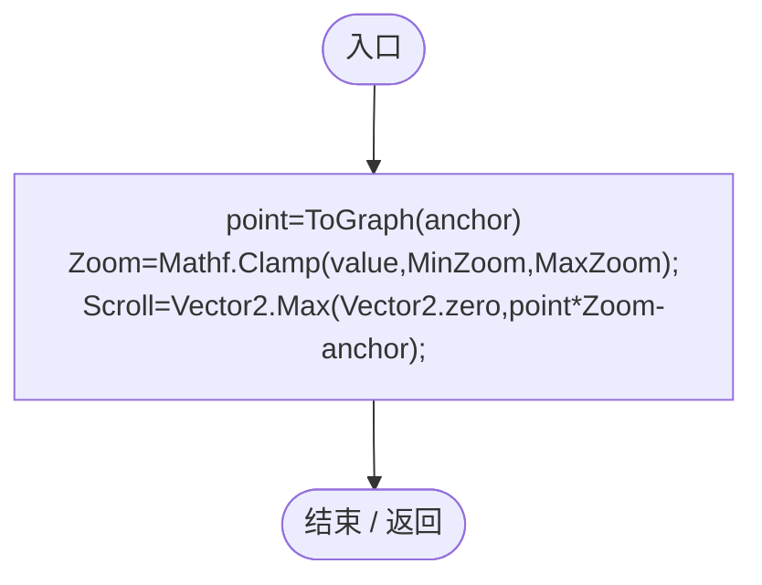
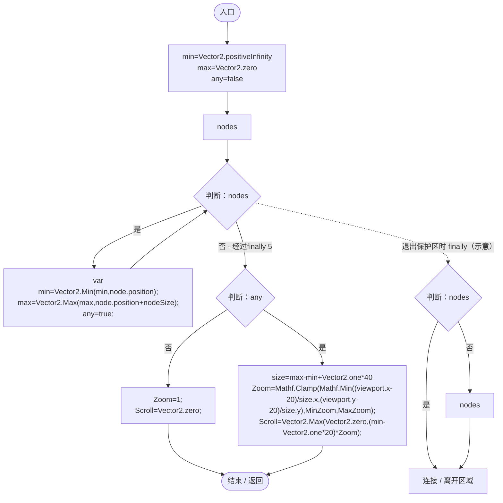

# GeneGraphViewport.cs

[返回总索引](../README.md) · `Runtime` · `Assets/DarwinPark/UI/GeneGraphViewport.cs`

[源文件](../../../Assets/DarwinPark/UI/GeneGraphViewport.cs) · 源码校验：`55239470eb288303d2de51bdcd3dd7faa4bd7d237315cc5b84603b733d7449ec`

方法按源文件位置排列。事件/回调引用不表示立即执行；分支与异常说明见总索引。完整源码与可点击关系图请打开离线手册。

## Zoom.get · L11

`get`

### Editor / Player · 语法控制结构 / 声明（非CFG）

## Zoom.set · L11

`private set`

### Editor / Player · 语法控制结构 / 声明（非CFG）

## ToGraph · L13

`public Vector2 ToGraph(Vector2 local)`

### Editor / Player · Roslyn编译器控制流

项目内调用/回调引用：

- [GeneGraphViewport.Zoom.get · L11](744cdf6c09e0913f.md#mffc365eff8c66b68)（访问器）

## SetZoom · L14

`public void SetZoom(float value,Vector2 anchor)`

### Editor / Player · Roslyn编译器控制流

项目内调用/回调引用：

- [GeneGraphViewport.ToGraph · L13](744cdf6c09e0913f.md#mf035f77e839965a2)（方法）
- [GeneGraphViewport.Zoom.set · L11](744cdf6c09e0913f.md#meb64d9018b512bbf)（访问器）
- [GeneGraphViewport.Zoom.get · L11](744cdf6c09e0913f.md#mffc365eff8c66b68)（访问器）

## Fit · L19

`public void Fit(IEnumerable<GeneTreeNode> nodes,Vector2 nodeSize,Vector2 viewport)`

### Editor / Player · Roslyn编译器控制流

项目内调用/回调引用：

- [GeneGraphViewport.Zoom.set · L11](744cdf6c09e0913f.md#meb64d9018b512bbf)（访问器）
- [GeneGraphViewport.Zoom.get · L11](744cdf6c09e0913f.md#mffc365eff8c66b68)（访问器）
