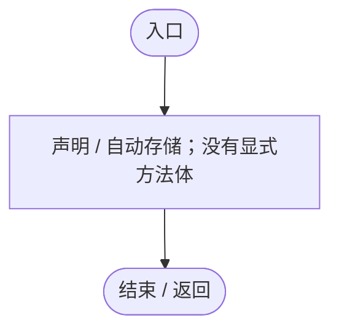
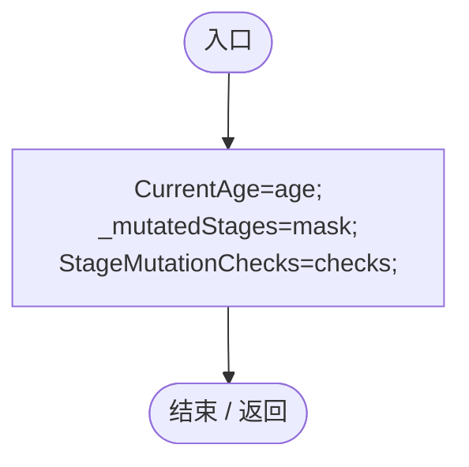
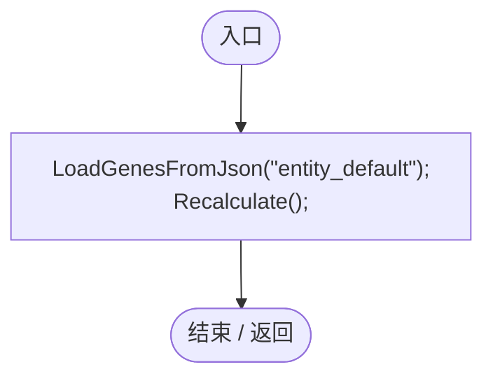
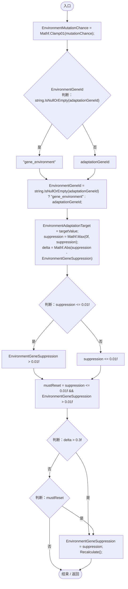
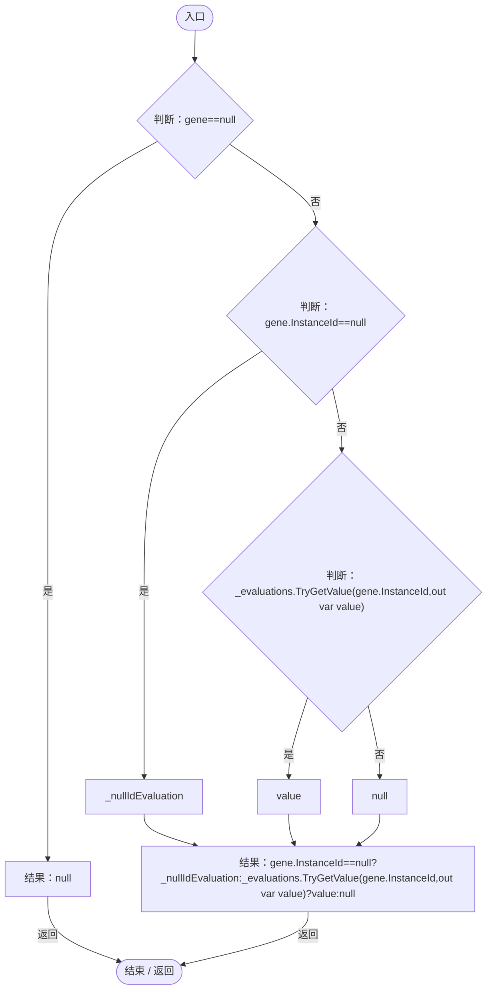
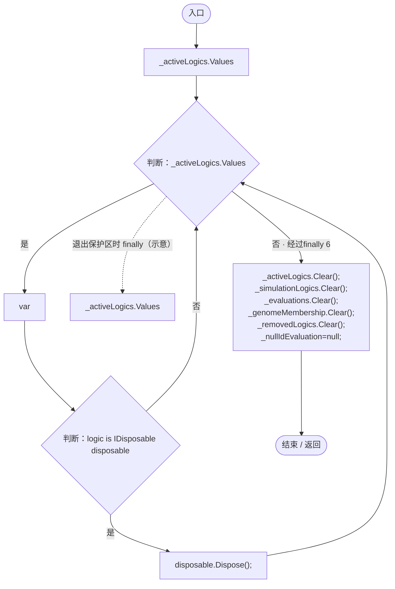

```mermaid
flowchart TD
  b0(["入口"])
  b1{"判断：dt &lt;= 0f"}
  b2{"判断：WorldAuthority.IsReplica"}
  b3{"Ecology.EntityNeighborhood.ObservePosition(this);<br/>egg=GetComponent&lt;Ecology.EggIncubation&gt;()<br/>判断：egg!=null"}
  b4{"判断：egg.Incubating"}
  b5["egg.Advance(dt);"]
  b6{"判断：_isRecalculating"}
  b7{"判断：_life==null"}
  b8{"_life=GetComponent&lt;EntityLifeCycle&gt;();<br/>判断：_life==null"}
  b9{"判断：GetComponent&lt;EntityStats&gt;()!=null"}
  b10["_life=gameObject.AddComponent&lt;EntityLifeCycle&gt;();"]
  b11{"判断：_combat==null"}
  b12["_combat"]
  b13{"GetComponent&lt;Ecology.CombatIntent&gt;()<br/>判断：GetComponent&lt;Ecology.CombatIntent&gt;()"}
  b14["GetComponent&lt;Ecology.CombatIntent&gt;()"]
  b15["gameObject.AddComponent&lt;Ecology.CombatIntent&gt;()"]
  b16["_combat=GetComponent&lt;Ecology.CombatIntent&gt;()??gameObject.AddComponent&lt;Ecology.CombatIntent&gt;();"]
  b17["steps=Mathf.CeilToInt(dt/.1f)"]
  b18["index=0"]
  b19{"判断：index&lt;steps"}
  b20{"判断：index==steps-1"}
  b21["dt-index*.1f"]
  b22[".1f"]
  b23["step=index==steps-1?dt-index*.1f:.1f"]
  b24{"_life<br/>判断：_life"}
  b25["_life?.Advance(step);"]
  b26{"判断：_life!=null"}
  b27{"判断：_life.HasDied"}
  b28["_combat.Advance(step);"]
  b29{"_state<br/>判断：_state"}
  b30["_state?.Advance(step);"]
  b31{"判断：_snapshotRevision!=LogicRevision"}
  b32["_simulationLogics.Clear();<br/>_simulationLogics.AddRange(_activeLogics.Values);<br/>_snapshotRevision=LogicRevision;<br/>LogicSnapshotBuilds++;"]
  b33["_simulationLogics"]
  b34{"判断：_simulationLogics"}
  b35["var<br/>logic.OnUpdate(step);"]
  b36["_simulationLogics"]
  b37["index++"]
  b38(["结束 / 返回"])
  b0 --> b1
  b1 -->|"否"| b2
  b1 -->|"是"| b38
  b2 -->|"是"| b38
  b2 -->|"否"| b3
  b3 -->|"是"| b4
  b3 -->|"否"| b6
  b4 -->|"是"| b5
  b4 -->|"否"| b6
  b5 --> b38
  b6 -->|"是"| b38
  b6 -->|"否"| b7
  b7 -->|"是"| b8
  b7 -->|"否"| b11
  b8 -->|"是"| b9
  b8 -->|"否"| b11
  b9 -->|"是"| b10
  b9 -->|"否"| b11
  b10 --> b11
  b11 -->|"是"| b12
  b11 -->|"否"| b17
  b12 --> b13
  b13 -->|"否"| b14
  b13 -->|"是"| b15
  b14 --> b16
  b15 --> b16
  b16 --> b17
  b17 --> b18
  b18 --> b19
  b19 -->|"是"| b20
  b19 -->|"否"| b38
  b20 -->|"是"| b21
  b20 -->|"否"| b22
  b21 --> b23
  b22 --> b23
  b23 --> b24
  b24 -->|"否"| b25
  b24 -->|"是"| b26
  b25 --> b26
  b26 -->|"是"| b27
  b26 -->|"否"| b28
  b27 -->|"是"| b38
  b27 -->|"否"| b28
  b28 --> b29
  b29 -->|"否"| b30
  b29 -->|"是"| b31
  b30 --> b31
  b31 -->|"是"| b32
  b31 -->|"否"| b33
  b32 --> b33
  b33 --> b34
  b34 -->|"是"| b35
  b34 -->|"否 · 经过finally 36"| b37
  b35 --> b34
  b37 --> b19
  b34 -. "退出保护区时 finally（示意）" .-> b36

```

```mermaid
flowchart TD
  b0(["入口"])
  b1{"判断：_isRecalculating"}
  b2{"GetComponent&lt;Ecology.AntColonyMember&gt;()<br/>判断：GetComponent&lt;Ecology.AntColonyMember&gt;()"}
  b3["GetComponent&lt;Ecology.AntColonyMember&gt;()?.EnforceGenome();"]
  b4["_isRecalculating = true;"]
  b5["_genomeMembership.Clear();<br/>_genomeMembership.UnionWith(Genome.Genes);<br/>Evaluation = GeneValueResolver.Resolve(Genome, IsGestating, EnvironmentGeneSuppression,additionalSuppression:Ecology.AntColonyMember.ExpressionSuppression(this));<br/>_eva…"]
  b6["Evaluation.Genes"]
  b7{"判断：Evaluation.Genes"}
  b8["var"]
  b9{"id=evaluation.Gene.InstanceId<br/>判断：id==null"}
  b10{"判断：_nullIdEvaluation==null"}
  b11["_nullIdEvaluation=evaluation;"]
  b12{"判断：_evaluations.ContainsKey(id)"}
  b13["_evaluations.Add(id,evaluation);"]
  b14["Evaluation.Genes"]
  b15{"stats = GetComponent&lt;EntityStats&gt;()<br/>size = 1f<br/>判断：stats != null"}
  b16{"判断：stats.TryGet(&quot;size&quot;, out float s)"}
  b17["size = s;"]
  b18["Evaluation.Attributes = EntityAttributeProcessor.Process( Evaluation.Attributes, Evaluation.Genes, CurrentAge, size, IsGestating );<br/>_removedLogics.Clear();"]
  b19["_activeLogics"]
  b20{"判断：_activeLogics"}
  b21["var"]
  b22{"eval = GetEvaluation(kvp.Key)<br/>判断：_genomeMembership.Contains(kvp.Key)"}
  b23{"判断：kvp.Key.Enabled"}
  b24{"判断：eval == null"}
  b25{"判断：eval.IsActive"}
  b26{"判断：kvp.Value.GetType().Name != eval.Definition.LogicScriptId"}
  b27["_removedLogics.Add(kvp.Key);"]
  b28["_activeLogics"]
  b29["_removedLogics"]
  b30{"判断：_removedLogics"}
  b31["var"]
  b32{"判断：_activeLogics[g] is IDisposable disposable"}
  b33["disposable.Dispose();"]
  b34["_activeLogics.Remove(g);"]
  b35["_removedLogics"]
  b36["_removedLogics.Clear();"]
  b37{"OnEvaluationChanged<br/>判断：OnEvaluationChanged"}
  b38["OnEvaluationChanged?.Invoke(Evaluation);"]
  b39["Genome.Genes"]
  b40{"判断：Genome.Genes"}
  b41["var"]
  b42{"判断：gene.Enabled"}
  b43{"eval = GetEvaluation(gene)<br/>判断：eval == null"}
  b44{"判断：eval.IsActive"}
  b45{"判断：_activeLogics.ContainsKey(gene)"}
  b46{"def = GeneDatabase.Get(gene.DefinitionId)<br/>判断：def == null"}
  b47{"判断：string.IsNullOrEmpty(def.LogicScriptId)"}
  b48{"logic = GeneLogicRegistry.CreateLogic(def.LogicScriptId)<br/>判断：logic != null"}
  b49["logic.Initialize(this, gene);<br/>_activeLogics[gene] = logic;"]
  b50["Genome.Genes"]
  b51["_isRecalculating=false;<br/>_snapshotRevision=-1;"]
  b52["Ecology.EntityStateController.Rebind(this);<br/>_state=GetComponent&lt;Ecology.EntityStateController&gt;();<br/>LogicRevision++;<br/>Ecology.EntityNeighborhood.Changed(this);"]
  b53(["结束 / 返回"])
  b0 --> b1
  b1 -->|"是"| b53
  b1 -->|"否"| b2
  b2 -->|"否"| b3
  b2 -->|"是"| b4
  b3 --> b4
  b4 --> b5
  b5 --> b6
  b6 --> b7
  b7 -->|"是"| b8
  b7 -->|"否 · 经过finally 14"| b15
  b8 --> b9
  b9 -->|"是"| b10
  b9 -->|"否"| b12
  b10 -->|"是"| b11
  b10 -->|"否"| b7
  b11 --> b7
  b12 -->|"否"| b13
  b12 -->|"是"| b7
  b13 --> b7
  b15 -->|"是"| b16
  b15 -->|"否"| b18
  b16 -->|"是"| b17
  b16 -->|"否"| b18
  b17 --> b18
  b18 --> b19
  b19 --> b20
  b20 -->|"是"| b21
  b20 -->|"否 · 经过finally 28"| b29
  b21 --> b22
  b22 -->|"是"| b23
  b22 -->|"否"| b27
  b23 -->|"是"| b24
  b23 -->|"否"| b27
  b24 -->|"否"| b25
  b24 -->|"是"| b27
  b25 -->|"是"| b26
  b25 -->|"否"| b27
  b26 -->|"是"| b27
  b26 -->|"否"| b20
  b27 --> b20
  b29 --> b30
  b30 -->|"是"| b31
  b30 -->|"否 · 经过finally 35"| b36
  b31 --> b32
  b32 -->|"是"| b33
  b32 -->|"否"| b34
  b33 --> b34
  b34 --> b30
  b36 --> b37
  b37 -->|"否"| b38
  b37 -->|"是"| b39
  b38 --> b39
  b39 --> b40
  b40 -->|"是"| b41
  b40 -->|"否 · 经过finally 50,51"| b52
  b41 --> b42
  b42 -->|"否"| b40
  b42 -->|"是"| b43
  b43 -->|"否"| b44
  b43 -->|"是"| b40
  b44 -->|"否"| b40
  b44 -->|"是"| b45
  b45 -->|"是"| b40
  b45 -->|"否"| b46
  b46 -->|"否"| b47
  b46 -->|"是"| b40
  b47 -->|"是"| b40
  b47 -->|"否"| b48
  b48 -->|"是"| b49
  b48 -->|"否"| b40
  b49 --> b40
  b52 --> b53
  b7 -. "退出保护区时 finally（示意）" .-> b14
  b20 -. "退出保护区时 finally（示意）" .-> b28
  b30 -. "退出保护区时 finally（示意）" .-> b35
  b40 -. "退出保护区时 finally（示意）" .-> b50
  b5 -. "退出保护区时 finally（示意）" .-> b51

```

# EntityGeneController.cs

[返回总索引](../README.md) · `Runtime` · `Assets/DarwinPark/Entities/EntityGeneController.cs`

[源文件](../../../Assets/DarwinPark/Entities/EntityGeneController.cs) · 源码校验：`ebf9082cba9a232c3361bf3ef769481a2da11b4aaf2ce858e8878ae5975cdd9b`

方法按源文件位置排列。事件/回调引用不表示立即执行；分支与异常说明见总索引。完整源码与可点击关系图请打开离线手册。

<a id="mc0039c100a31b455"></a>

## Evaluation.get · L18

`get`


### Editor / Player · 语法控制结构 / 声明（非CFG）


<a id="m63b4ee98968eaacd"></a>

## Evaluation.set · L18

`private set`


### Editor / Player · 语法控制结构 / 声明（非CFG）


<a id="me69facc1c0f1e164"></a>

## LogicRevision.get · L19

`get`


### Editor / Player · 语法控制结构 / 声明（非CFG）



<a id="m36bb66fd6bf521ca"></a>

## LogicRevision.set · L19

`private set`


### Editor / Player · 语法控制结构 / 声明（非CFG）


<a id="m83a42c16950b22a4"></a>

## CurrentAge.get · L34

`get`


### Editor / Player · 语法控制结构 / 声明（非CFG）


<a id="me616ca96310ad01c"></a>

## CurrentAge.set · L34

`set`


### Editor / Player · 语法控制结构 / 声明（非CFG）


<a id="mb3d3672480dfd1a7"></a>

## LogicSnapshotBuilds.get · L43

`get`


### Editor / Player · 语法控制结构 / 声明（非CFG）


<a id="m36ef6596b6651852"></a>

## LogicSnapshotBuilds.set · L43

`private set`


### Editor / Player · 语法控制结构 / 声明（非CFG）


<a id="ma27bd0556514825b"></a>

## StageMutationChecks.get · L48

`get`


### Editor / Player · 语法控制结构 / 声明（非CFG）


<a id="mf7e1e052290e354f"></a>

## StageMutationChecks.set · L48

`private set`


### Editor / Player · 语法控制结构 / 声明（非CFG）


<a id="m47ba58e4bb1cac6a"></a>

## MutatedStageMask.get · L50

`public int MutatedStageMask`

★ 适配：恢复已抽过的阶段，读档不能重抽出生/成年变异。

### Editor / Player · 语法控制结构 / 声明（非CFG）


<a id="m6264213de2a5ca6f"></a>

## RestoreStageState · L51

`public void RestoreStageState(AgeState age,int mask,int checks)`


### Editor / Player · Roslyn编译器控制流



项目内调用/回调引用：

- [EntityGeneController.CurrentAge.set · L34](7494d53178552f0e.md#me616ca96310ad01c)（访问器）
- [EntityGeneController.StageMutationChecks.set · L48](7494d53178552f0e.md#mf7e1e052290e354f)（访问器）

<a id="m0369a6f1284dad7e"></a>

## Awake · L53

`private void Awake()`


### Editor / Player · Roslyn编译器控制流



项目内调用/回调引用：

- [EntityGeneController.LoadGenesFromJson · L224](7494d53178552f0e.md#mc130e1ac732374fb)（方法）
- [EntityGeneController.Recalculate · L97](7494d53178552f0e.md#m65ea735c1e0e37a1)（方法）

<a id="m32cbcad988452772"></a>

## Update · L59

`private void Update()`


### Editor / Player · Roslyn编译器控制流


项目内调用/回调引用：

- [ServiceLocator.TryGet · L26](f2fdbe9f9ccd93cb.md#m143b24e6d58471b0)（方法）
- [SimulationClock.GameDeltaTime.get · L26](a8f444aec9614b0a.md#me7f11abae18a4f2d)（访问器）
- [EntityGeneController.AdvanceSimulation · L66](7494d53178552f0e.md#m477fb905eeed3e79)（方法）

<a id="m477fb905eeed3e79"></a>

## AdvanceSimulation · L66

`public void AdvanceSimulation(float dt)`


### Editor / Player · Roslyn编译器控制流



项目内调用/回调引用：

- [EntityNeighborhood.ObservePosition · L63](e5e24c4aff0395b1.md#m994f4a7ab30bcd1d)（方法）
- [EggIncubation.Advance · L10](f5a647fca719706f.md#m7f35c7c5958784bc)（方法）
- [EntityLifeCycle.Advance · L25](9f4138bfbae654b7.md#m804ba580f54f09f3)（方法）
- [EntityLifeCycle.HasDied.get · L11](9f4138bfbae654b7.md#mf2406e6830e0007e)（访问器）
- [CombatIntent.Advance · L19](34193b994b2c0894.md#m2065729a2988f50f)（方法）
- [EntityStateController.Advance · L41](0f8869eb7018091e.md#mffbdbb199029dbf3)（方法）
- [EntityGeneController.LogicRevision.get · L19](7494d53178552f0e.md#me69facc1c0f1e164)（访问器）
- [EntityGeneController.LogicSnapshotBuilds.set · L43](7494d53178552f0e.md#m36ef6596b6651852)（访问器）
- [EntityGeneController.LogicSnapshotBuilds.get · L43](7494d53178552f0e.md#mb3d3672480dfd1a7)（访问器）
- [IGeneLogic.OnUpdate · L9](5304fdad773967f8.md#m829188d65276f8e5)（方法）

<a id="m65ea735c1e0e37a1"></a>

## Recalculate · L97

`public void Recalculate()`


### Editor / Player · Roslyn编译器控制流



项目内调用/回调引用：

- [AntColonyMember.EnforceGenome · L164](baebd85c05598377.md#ma2daf0035eecd332)（方法）
- [EntityGeneController.Evaluation.set · L18](7494d53178552f0e.md#m63b4ee98968eaacd)（访问器）
- [GeneValueResolver.Resolve · L30](837eb9ce6eba3cc6.md#md4b9129afb709ddb)（方法）
- [AntColonyMember.ExpressionSuppression · L169](baebd85c05598377.md#m0aa8c8b455df83cc)（方法）
- [EntityGeneController.Evaluation.get · L18](7494d53178552f0e.md#mc0039c100a31b455)（访问器）
- [EntityStats.TryGet · L90](75aa86a368efdf24.md#m24ee1433e4a70d94)（方法）
- [EntityAttributeProcessor.Process · L10](5c9856aea4a5298c.md#mb9d5b20716b64153)（方法）
- [EntityGeneController.CurrentAge.get · L34](7494d53178552f0e.md#m83a42c16950b22a4)（访问器）
- [EntityGeneController.GetEvaluation · L208](7494d53178552f0e.md#ma17aa3d8f861a451)（方法）
- [GeneDatabase.Get · L135](ec0a03483435a863.md#m8f3bbfb35f3ca397)（方法）
- [GeneLogicRegistry.CreateLogic · L15](5304fdad773967f8.md#m3a1d09abe1b13c18)（方法）
- [IGeneLogic.Initialize · L8](5304fdad773967f8.md#madf34517fa30c347)（方法）
- [EntityStateController.Rebind · L22](0f8869eb7018091e.md#m40a5ae44229a22cf)（方法）
- [EntityGeneController.LogicRevision.set · L19](7494d53178552f0e.md#m36bb66fd6bf521ca)（访问器）
- [EntityGeneController.LogicRevision.get · L19](7494d53178552f0e.md#me69facc1c0f1e164)（访问器）
- [EntityNeighborhood.Changed · L57](e5e24c4aff0395b1.md#mc8e20797b798aa16)（方法）

<a id="m2e1f88c0ce587fb8"></a>

## ApplyEnvironmentPressure · L187

`public void ApplyEnvironmentPressure(float suppression, float mutationChance, string adaptationGeneId, float targetValue)`

<summary>  ★ 新增：环境压力写入。压力变化较大时才重算，避免每帧重建评估。  </summary>

### Editor / Player · Roslyn编译器控制流



项目内调用/回调引用：

- [EntityGeneController.Recalculate · L97](7494d53178552f0e.md#m65ea735c1e0e37a1)（方法）

<a id="ma17aa3d8f861a451"></a>

## GetEvaluation · L208

`public GeneEvaluation GetEvaluation(GeneInstance gene)`

★ 新增：统一按实例ID查询表达，不能让每个行动/生产子步各建闭包遍历整份基因列表。

### Editor / Player · Roslyn编译器控制流



<a id="maadb710e89e60395"></a>

## GetLogic · L211

`public IGeneLogic GetLogic(GeneInstance gene)`


### Editor / Player · Roslyn编译器控制流


<a id="mb82bad928ee84a00"></a>

## OnDestroy · L217

`private void OnDestroy()`


### Editor / Player · Roslyn编译器控制流



<a id="mc130e1ac732374fb"></a>

## LoadGenesFromJson · L224

`public void LoadGenesFromJson(string jsonId)`


### Editor / Player · Roslyn编译器控制流

```mermaid
flowchart TD
  b0(["入口"])
  b1{"asset = Resources.Load&lt;TextAsset&gt;($&quot;Entities/{jsonId}&quot;)<br/>判断：asset == null"}
  b2["Genome = GeneMutator.CreateBaseGenome();"]
  b3["data = JsonUtility.FromJson&lt;EntityGeneData&gt;(asset.text)<br/>Genome = new Genome();"]
  b4["data.genes"]
  b5{"判断：data.genes"}
  b6["var<br/>Genome.Add(GeneInstance.Create(g.definitionId, g.value, g.tier));"]
  b7["data.genes"]
  b8(["结束 / 返回"])
  b0 --> b1
  b1 -->|"是"| b2
  b1 -->|"否"| b3
  b2 --> b8
  b3 --> b4
  b4 --> b5
  b5 -->|"是"| b6
  b5 -->|"否 · 经过finally 7"| b8
  b6 --> b5
  b5 -. "退出保护区时 finally（示意）" .-> b7

```

项目内调用/回调引用：

- [GeneMutator.CreateBaseGenome · L8](f297edbfb98ef475.md#md3926965177316e9)（方法）
- [Genome.Add · L19](a2ef23f865bc7ee8.md#md9cfdc94b8b8d40f)（方法）
- [GeneInstance.Create · L20](f82e1498d67f5afd.md#m72e94c278de3cf8b)（方法）

<a id="meef08ed0f4b99e2d"></a>

## GetRandomName · L242

`public string GetRandomName()`

★ 适配：优化重复计算，内置词库每个播放会话只解析一次；随机抽样顺序和正常命名结果与原实现一致。

### Editor / Player · Roslyn编译器控制流

```mermaid
flowchart TD
  b0(["入口"])
  b1{"判断：_namePoolLoaded"}
  b2{"_namePoolLoaded=true;<br/>asset=Resources.Load&lt;TextAsset&gt;(&quot;Names/name_pool&quot;)<br/>_nameAssetMissing=asset==null;<br/>判断：asset!=null"}
  b3["_namePool=JsonUtility.FromJson&lt;NamePoolJson&gt;(asset.text);"]
  b4["(Exception ex)<br/>Debug.LogWarning(&quot;[命名] 词库解析失败：&quot;+ex.Message);"]
  b5["Debug.LogWarning(&quot;[命名] 缺少 Names/name_pool，使用回退名称&quot;);"]
  b6{"判断：_nameAssetMissing"}
  b7["结果：$&quot;未知生物-{UnityEngine.Random.Range(100,999)}&quot;"]
  b8{"_namePool<br/>判断：_namePool"}
  b9[".familyNames"]
  b10["_namePool"]
  b11{"判断：_namePool?.familyNames==null"}
  b12{"判断：_namePool.familyNames.Count==0"}
  b13{"判断：_namePool.givenNames==null"}
  b14{"判断：_namePool.givenNames.Count==0"}
  b15["结果：&quot;无名生物&quot;"]
  b16["结果：_namePool.familyNames[UnityEngine.Random.Range(0,_namePool.familyNames.Count)]+&quot;·&quot;+_namePool.givenNames[UnityEngine.Random.Range(0,_namePool.givenNames.Count)]"]
  b17(["结束 / 返回"])
  b0 --> b1
  b1 -->|"否"| b2
  b1 -->|"是"| b6
  b2 -->|"是"| b3
  b2 -->|"否"| b5
  b3 --> b6
  b4 --> b6
  b5 --> b6
  b6 -->|"是"| b7
  b6 -->|"否"| b8
  b7 -->|"返回"| b17
  b8 -->|"否"| b9
  b8 -->|"是"| b10
  b9 --> b11
  b10 --> b11
  b11 -->|"否"| b12
  b11 -->|"是"| b15
  b12 -->|"否"| b13
  b12 -->|"是"| b15
  b13 -->|"否"| b14
  b13 -->|"是"| b15
  b14 -->|"是"| b15
  b14 -->|"否"| b16
  b15 -->|"返回"| b17
  b16 -->|"返回"| b17
  b3 -. "保护区可能异常（示意）" .-> b4

```

<a id="m2ba7954ca313f7aa"></a>

## ResetNamePool · L254

`[RuntimeInitializeOnLoadMethod(RuntimeInitializeLoadType.SubsystemRegistration)] private static void ResetNamePool()`


### Editor / Player · Roslyn编译器控制流

```mermaid
flowchart TD
  b0(["入口"])
  b1["_namePool=null;<br/>_namePoolLoaded=_nameAssetMissing=false;"]
  b2(["结束 / 返回"])
  b0 --> b1
  b1 --> b2

```

<a id="m600509f72d274f0c"></a>

## GetAttribute · L257

`public float GetAttribute(string id)`


### Editor / Player · Roslyn编译器控制流

```mermaid
flowchart TD
  b0(["入口"])
  b1{"判断：Evaluation != null"}
  b2{"判断：Evaluation.Attributes.TryGetValue(id, out var v)"}
  b3["结果：Ecology.EcologyMotion.ResolveAttribute(this,id,v)"]
  b4["结果：0f"]
  b5(["结束 / 返回"])
  b0 --> b1
  b1 -->|"是"| b2
  b1 -->|"否"| b4
  b2 -->|"是"| b3
  b2 -->|"否"| b4
  b3 -->|"返回"| b5
  b4 -->|"返回"| b5

```

项目内调用/回调引用：

- [EntityGeneController.Evaluation.get · L18](7494d53178552f0e.md#mc0039c100a31b455)（访问器）
- [EcologyMotion.ResolveAttribute · L48](6ed9d0eedb456d32.md#m41dec457a7f1948a)（方法）

<a id="m91860b3eca0fc8eb"></a>

## TryStageMutation · L263

`public void TryStageMutation(AgeState stage)`


### Editor / Player · Roslyn编译器控制流

```mermaid
flowchart TD
  b0(["入口"])
  b1{"bit=1&lt;&lt;(int)stage<br/>判断：(_mutatedStages&amp;bit)!=0"}
  b2["_mutatedStages&#124;=bit;<br/>StageMutationChecks++;<br/>effectiveMutationChance = Mathf.Clamp01( mutationChance + EnvironmentMutationChance * 0.25f)"]
  b3{"GetComponent&lt;Ecology.AntColonyMember&gt;()<br/>判断：GetComponent&lt;Ecology.AntColonyMember&gt;()"}
  b4[".Frozen"]
  b5["GetComponent&lt;Ecology.AntColonyMember&gt;()"]
  b6{"判断：GetComponent&lt;Ecology.AntColonyMember&gt;()?.Frozen!=true"}
  b7{"判断：UnityEngine.Random.value &lt; effectiveMutationChance"}
  b8["settings = GeneMutationSettings.CreateDefault()<br/>settings.AdaptationGeneId = EnvironmentGeneId;<br/>settings.AdaptationMutationChance = EnvironmentMutationChance;<br/>settings.AdaptationTargetValue = EnvironmentAdaptationTarget;<br/>GeneMutator.Mutat…"]
  b9["Recalculate();"]
  b10(["结束 / 返回"])
  b0 --> b1
  b1 -->|"是"| b10
  b1 -->|"否"| b2
  b2 --> b3
  b3 -->|"否"| b4
  b3 -->|"是"| b5
  b4 --> b6
  b5 --> b6
  b6 -->|"是"| b7
  b6 -->|"否"| b9
  b7 -->|"是"| b8
  b7 -->|"否"| b9
  b8 --> b9
  b9 --> b10

```

项目内调用/回调引用：

- [EntityGeneController.StageMutationChecks.set · L48](7494d53178552f0e.md#mf7e1e052290e354f)（访问器）
- [EntityGeneController.StageMutationChecks.get · L48](7494d53178552f0e.md#ma27bd0556514825b)（访问器）
- [GeneMutationSettings.CreateDefault · L14](202f10318a181ae1.md#mf2c33daa013981eb)（方法）
- [GeneMutator.Mutate · L18](f297edbfb98ef475.md#m4444eb9ce9b6a55a)（方法）
- [EntityGeneController.Recalculate · L97](7494d53178552f0e.md#m65ea735c1e0e37a1)（方法）
