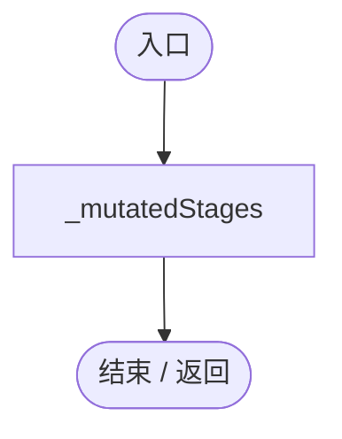
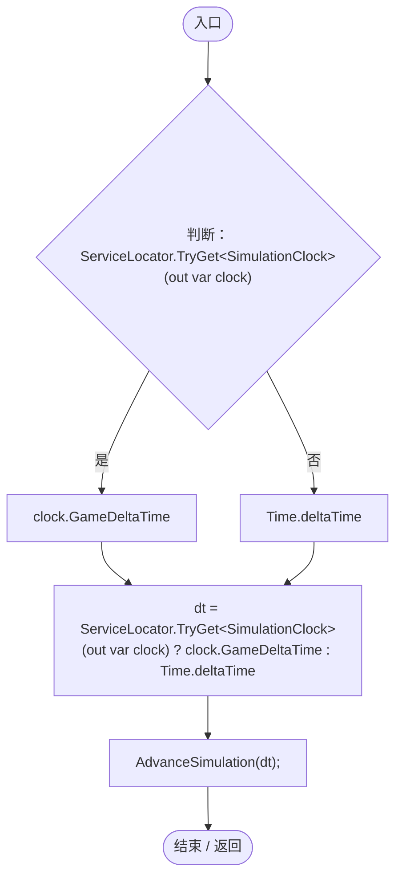
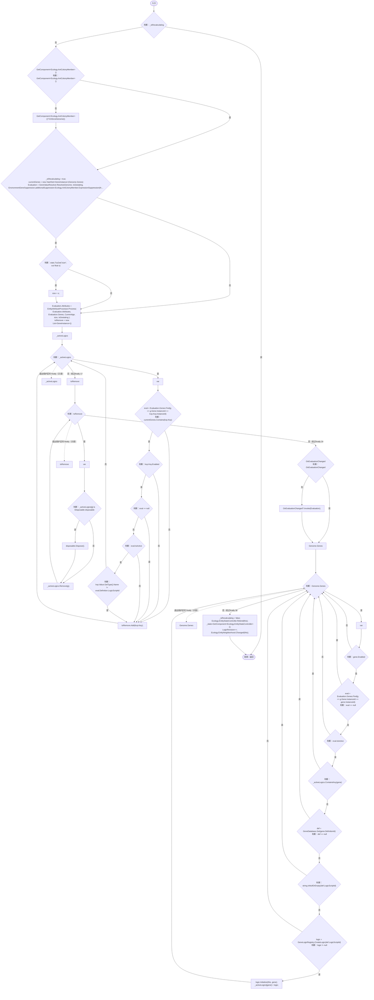
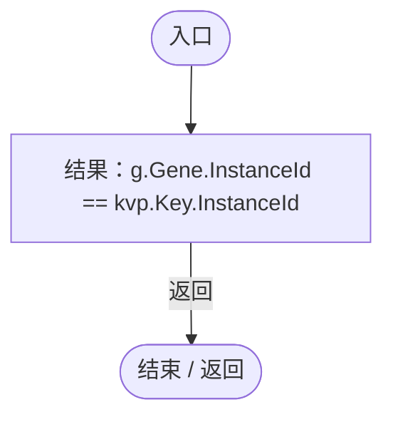
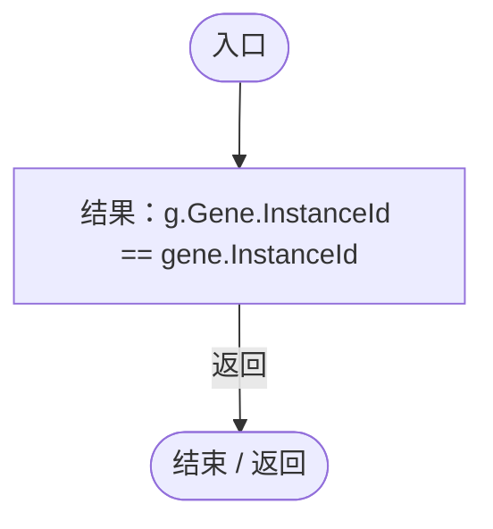
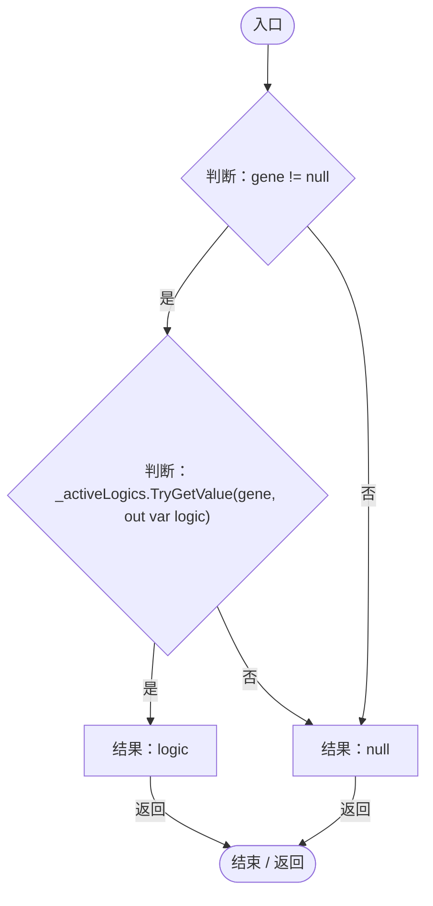
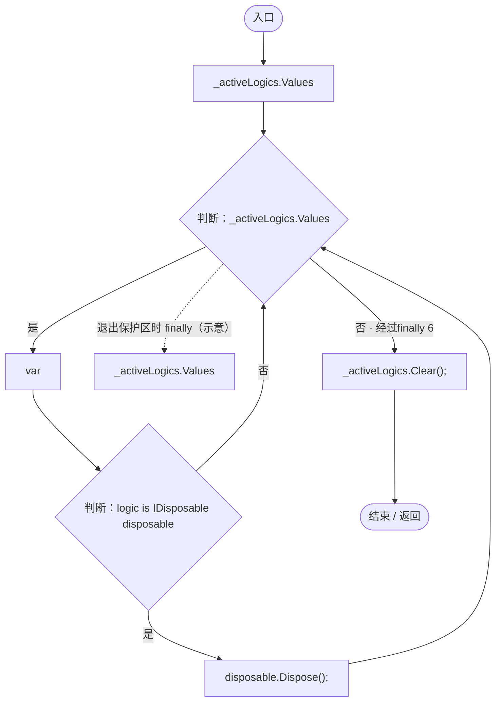
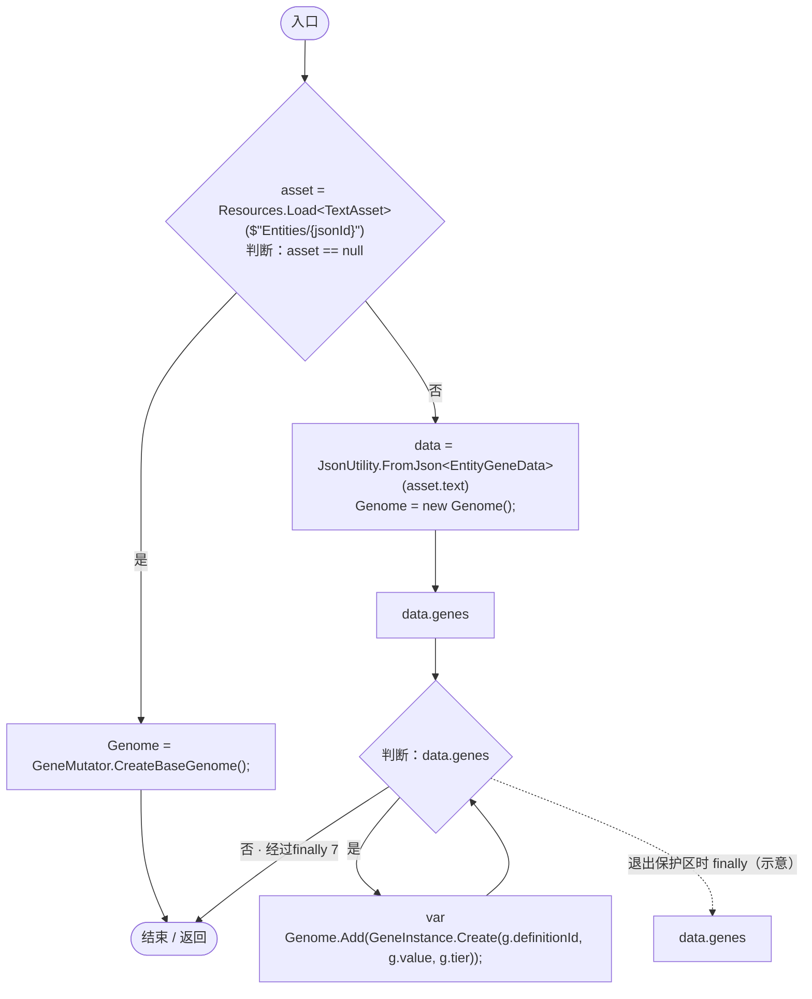

```mermaid
flowchart TD
  b0(["入口"])
  b1["LoadGenesFromJson(&quot;entity_default&quot;);<br/>Recalculate();"]
  b2(["结束 / 返回"])
  b0 --> b1
  b1 --> b2

```

```mermaid
flowchart TD
  b0(["入口"])
  b1{"判断：dt &lt;= 0f"}
  b2{"判断：WorldAuthority.IsReplica"}
  b3{"Ecology.EntityNeighborhood.ObservePosition(this);<br/>egg=GetComponent&lt;Ecology.EggIncubation&gt;()<br/>判断：egg!=null"}
  b4{"判断：egg.Incubating"}
  b5["egg.Advance(dt);"]
  b6{"判断：_isRecalculating"}
  b7{"判断：_life==null"}
  b8{"_life=GetComponent&lt;EntityLifeCycle&gt;();<br/>判断：_life==null"}
  b9{"判断：GetComponent&lt;EntityStats&gt;()!=null"}
  b10["_life=gameObject.AddComponent&lt;EntityLifeCycle&gt;();"]
  b11{"判断：_combat==null"}
  b12["_combat"]
  b13{"GetComponent&lt;Ecology.CombatIntent&gt;()<br/>判断：GetComponent&lt;Ecology.CombatIntent&gt;()"}
  b14["GetComponent&lt;Ecology.CombatIntent&gt;()"]
  b15["gameObject.AddComponent&lt;Ecology.CombatIntent&gt;()"]
  b16["_combat=GetComponent&lt;Ecology.CombatIntent&gt;()??gameObject.AddComponent&lt;Ecology.CombatIntent&gt;();"]
  b17["steps=Mathf.CeilToInt(dt/.1f)"]
  b18["index=0"]
  b19{"判断：index&lt;steps"}
  b20{"判断：index==steps-1"}
  b21["dt-index*.1f"]
  b22[".1f"]
  b23["step=index==steps-1?dt-index*.1f:.1f"]
  b24{"_life<br/>判断：_life"}
  b25["_life?.Advance(step);"]
  b26{"判断：_life!=null"}
  b27{"判断：_life.HasDied"}
  b28["_combat.Advance(step);"]
  b29{"_state<br/>判断：_state"}
  b30["_state?.Advance(step);"]
  b31["_simulationLogics.Clear();<br/>_simulationLogics.AddRange(_activeLogics.Values);"]
  b32["_simulationLogics"]
  b33{"判断：_simulationLogics"}
  b34["var<br/>logic.OnUpdate(step);"]
  b35["_simulationLogics"]
  b36["index++"]
  b37(["结束 / 返回"])
  b0 --> b1
  b1 -->|"否"| b2
  b1 -->|"是"| b37
  b2 -->|"是"| b37
  b2 -->|"否"| b3
  b3 -->|"是"| b4
  b3 -->|"否"| b6
  b4 -->|"是"| b5
  b4 -->|"否"| b6
  b5 --> b37
  b6 -->|"是"| b37
  b6 -->|"否"| b7
  b7 -->|"是"| b8
  b7 -->|"否"| b11
  b8 -->|"是"| b9
  b8 -->|"否"| b11
  b9 -->|"是"| b10
  b9 -->|"否"| b11
  b10 --> b11
  b11 -->|"是"| b12
  b11 -->|"否"| b17
  b12 --> b13
  b13 -->|"否"| b14
  b13 -->|"是"| b15
  b14 --> b16
  b15 --> b16
  b16 --> b17
  b17 --> b18
  b18 --> b19
  b19 -->|"是"| b20
  b19 -->|"否"| b37
  b20 -->|"是"| b21
  b20 -->|"否"| b22
  b21 --> b23
  b22 --> b23
  b23 --> b24
  b24 -->|"否"| b25
  b24 -->|"是"| b26
  b25 --> b26
  b26 -->|"是"| b27
  b26 -->|"否"| b28
  b27 -->|"是"| b37
  b27 -->|"否"| b28
  b28 --> b29
  b29 -->|"否"| b30
  b29 -->|"是"| b31
  b30 --> b31
  b31 --> b32
  b32 --> b33
  b33 -->|"是"| b34
  b33 -->|"否 · 经过finally 35"| b36
  b34 --> b33
  b36 --> b19
  b33 -. "退出保护区时 finally（示意）" .-> b35

```

# EntityGeneController.cs

[返回总索引](../README.md) · `Runtime` · `Assets/DarwinPark/Entities/EntityGeneController.cs`

[源文件](../../../Assets/DarwinPark/Entities/EntityGeneController.cs) · 源码校验：`918bde4c640d86f98039bc7f3d01dbfcb18c8e9cdf29d5cb8779125a6fd1e1b6`

方法按源文件位置排列。事件/回调引用不表示立即执行；分支与异常说明见总索引。完整源码与可点击关系图请打开离线手册。

<a id="m2cb74e57d810ca42"></a>

## Evaluation.get · L19

`get`


### Editor / Player · 语法控制结构 / 声明（非CFG）


<a id="m255d5be15794f403"></a>

## Evaluation.set · L19

`private set`


### Editor / Player · 语法控制结构 / 声明（非CFG）


<a id="md7e44f9922c588a3"></a>

## LogicRevision.get · L20

`get`


### Editor / Player · 语法控制结构 / 声明（非CFG）


<a id="mdaf44f9311f36850"></a>

## LogicRevision.set · L20

`private set`


### Editor / Player · 语法控制结构 / 声明（非CFG）


<a id="mf5bc28691dd4a0f3"></a>

## CurrentAge.get · L35

`get`


### Editor / Player · 语法控制结构 / 声明（非CFG）


<a id="mfb3128e996aea41b"></a>

## CurrentAge.set · L35

`set`


### Editor / Player · 语法控制结构 / 声明（非CFG）


<a id="m7910c7079ddd1c25"></a>

## StageMutationChecks.get · L42

`get`


### Editor / Player · 语法控制结构 / 声明（非CFG）


<a id="mfe9d19c4e951648f"></a>

## StageMutationChecks.set · L42

`private set`


### Editor / Player · 语法控制结构 / 声明（非CFG）


<a id="ma05ff5976dd80950"></a>

## MutatedStageMask.get · L44

`public int MutatedStageMask`

★ 适配：恢复已抽过的阶段，读档不能重抽出生/成年变异。

### Editor / Player · 语法控制结构 / 声明（非CFG）



<a id="m49489af39061f1a1"></a>

## RestoreStageState · L45

`public void RestoreStageState(AgeState age,int mask,int checks)`


### Editor / Player · Roslyn编译器控制流


项目内调用/回调引用：

- [EntityGeneController.CurrentAge.set · L35](7494d53178552f0e.md#mfb3128e996aea41b)（访问器）
- [EntityGeneController.StageMutationChecks.set · L42](7494d53178552f0e.md#mfe9d19c4e951648f)（访问器）

<a id="m226807e77cdb308f"></a>

## Awake · L47

`private void Awake()`


### Editor / Player · Roslyn编译器控制流



项目内调用/回调引用：

- [EntityGeneController.LoadGenesFromJson · L197](7494d53178552f0e.md#ma6af8a6b50c38cd5)（方法）
- [EntityGeneController.Recalculate · L90](7494d53178552f0e.md#m93744c8f3039b93c)（方法）

<a id="m4bc760d603ae5796"></a>

## Update · L53

`private void Update()`


### Editor / Player · Roslyn编译器控制流



项目内调用/回调引用：

- [ServiceLocator.TryGet · L26](f2fdbe9f9ccd93cb.md#m143b24e6d58471b0)（方法）
- [SimulationClock.GameDeltaTime.get · L26](a8f444aec9614b0a.md#me7f11abae18a4f2d)（访问器）
- [EntityGeneController.AdvanceSimulation · L60](7494d53178552f0e.md#m10b24df798096cab)（方法）

<a id="m10b24df798096cab"></a>

## AdvanceSimulation · L60

`public void AdvanceSimulation(float dt)`


### Editor / Player · Roslyn编译器控制流



项目内调用/回调引用：

- [EntityNeighborhood.ObservePosition · L63](e5e24c4aff0395b1.md#m994f4a7ab30bcd1d)（方法）
- [EggIncubation.Advance · L10](f5a647fca719706f.md#m7f35c7c5958784bc)（方法）
- [EntityLifeCycle.Advance · L25](9f4138bfbae654b7.md#m804ba580f54f09f3)（方法）
- [EntityLifeCycle.HasDied.get · L11](9f4138bfbae654b7.md#mf2406e6830e0007e)（访问器）
- [CombatIntent.Advance · L19](34193b994b2c0894.md#m2065729a2988f50f)（方法）
- [EntityStateController.Advance · L41](0f8869eb7018091e.md#mffbdbb199029dbf3)（方法）
- [IGeneLogic.OnUpdate · L9](5304fdad773967f8.md#m829188d65276f8e5)（方法）

<a id="m93744c8f3039b93c"></a>

## Recalculate · L90

`public void Recalculate()`


### Editor / Player · Roslyn编译器控制流



项目内调用/回调引用：

- [AntColonyMember.EnforceGenome · L164](baebd85c05598377.md#ma2daf0035eecd332)（方法）
- [EntityGeneController.Evaluation.set · L19](7494d53178552f0e.md#m255d5be15794f403)（访问器）
- [GeneValueResolver.Resolve · L30](837eb9ce6eba3cc6.md#md4b9129afb709ddb)（方法）
- [AntColonyMember.ExpressionSuppression · L169](baebd85c05598377.md#m0aa8c8b455df83cc)（方法）
- [EntityStats.TryGet · L90](75aa86a368efdf24.md#m24ee1433e4a70d94)（方法）
- [EntityGeneController.Evaluation.get · L19](7494d53178552f0e.md#m2cb74e57d810ca42)（访问器）
- [EntityAttributeProcessor.Process · L10](5c9856aea4a5298c.md#mb9d5b20716b64153)（方法）
- [EntityGeneController.CurrentAge.get · L35](7494d53178552f0e.md#mf5bc28691dd4a0f3)（访问器）
- [GeneDatabase.Get · L135](ec0a03483435a863.md#m8f3bbfb35f3ca397)（方法）
- [GeneLogicRegistry.CreateLogic · L15](5304fdad773967f8.md#m3a1d09abe1b13c18)（方法）
- [IGeneLogic.Initialize · L8](5304fdad773967f8.md#madf34517fa30c347)（方法）
- [EntityStateController.Rebind · L22](0f8869eb7018091e.md#m40a5ae44229a22cf)（方法）
- [EntityGeneController.LogicRevision.set · L20](7494d53178552f0e.md#mdaf44f9311f36850)（访问器）
- [EntityGeneController.LogicRevision.get · L20](7494d53178552f0e.md#md7e44f9922c588a3)（访问器）
- [EntityNeighborhood.Changed · L57](e5e24c4aff0395b1.md#mc8e20797b798aa16)（方法）
- [EntityGeneController.回调@118 · L118](7494d53178552f0e.md#m67fe50cfbabfa322)（回调/委托）
- [EntityGeneController.回调@137 · L137](7494d53178552f0e.md#m96df3a13566f4e4c)（回调/委托）

<a id="m67fe50cfbabfa322"></a>

## 回调@118 · L118

`g … => 回调`


### Editor / Player · Roslyn编译器控制流



<a id="m96df3a13566f4e4c"></a>

## 回调@137 · L137

`g … => 回调`


### Editor / Player · Roslyn编译器控制流



<a id="mce28ca249bd6cc2c"></a>

## ApplyEnvironmentPressure · L164

`public void ApplyEnvironmentPressure(float suppression, float mutationChance, string adaptationGeneId, float targetValue)`

<summary>  ★ 新增：环境压力写入。压力变化较大时才重算，避免每帧重建评估。  </summary>

### Editor / Player · Roslyn编译器控制流


项目内调用/回调引用：

- [EntityGeneController.Recalculate · L90](7494d53178552f0e.md#m93744c8f3039b93c)（方法）

<a id="m4f4e58e1a4abadfc"></a>

## GetLogic · L184

`public IGeneLogic GetLogic(GeneInstance gene)`


### Editor / Player · Roslyn编译器控制流



<a id="m2e1a5e96f8475b2f"></a>

## OnDestroy · L190

`private void OnDestroy()`


### Editor / Player · Roslyn编译器控制流



<a id="ma6af8a6b50c38cd5"></a>

## LoadGenesFromJson · L197

`public void LoadGenesFromJson(string jsonId)`


### Editor / Player · Roslyn编译器控制流



项目内调用/回调引用：

- [GeneMutator.CreateBaseGenome · L8](f297edbfb98ef475.md#md3926965177316e9)（方法）
- [Genome.Add · L19](a2ef23f865bc7ee8.md#md9cfdc94b8b8d40f)（方法）
- [GeneInstance.Create · L20](f82e1498d67f5afd.md#m72e94c278de3cf8b)（方法）

<a id="m4187bf073a713203"></a>

## GetRandomName · L214

`public string GetRandomName()`


### Editor / Player · Roslyn编译器控制流

```mermaid
flowchart TD
  b0(["入口"])
  b1{"nameAsset = Resources.Load&lt;TextAsset&gt;(&quot;Names/name_pool&quot;)<br/>判断：nameAsset == null"}
  b2["结果：$&quot;未知生物-{UnityEngine.Random.Range(100, 999)}&quot;"]
  b3{"pool = JsonUtility.FromJson&lt;NamePoolJson&gt;(nameAsset.text)<br/>判断：pool == null"}
  b4{"判断：pool.familyNames == null"}
  b5{"判断：pool.familyNames.Count == 0"}
  b6["结果：&quot;无名生物&quot;"]
  b7["f = pool.familyNames[UnityEngine.Random.Range(0, pool.familyNames.Count)]<br/>g = pool.givenNames[UnityEngine.Random.Range(0, pool.givenNames.Count)]<br/>结果：$&quot;{f}·{g}&quot;"]
  b8(["结束 / 返回"])
  b0 --> b1
  b1 -->|"是"| b2
  b1 -->|"否"| b3
  b2 -->|"返回"| b8
  b3 -->|"否"| b4
  b3 -->|"是"| b6
  b4 -->|"否"| b5
  b4 -->|"是"| b6
  b5 -->|"是"| b6
  b5 -->|"否"| b7
  b6 -->|"返回"| b8
  b7 -->|"返回"| b8

```

<a id="mc707943b1138a009"></a>

## GetAttribute · L225

`public float GetAttribute(string id)`


### Editor / Player · Roslyn编译器控制流

```mermaid
flowchart TD
  b0(["入口"])
  b1{"判断：Evaluation != null"}
  b2{"判断：Evaluation.Attributes.TryGetValue(id, out var v)"}
  b3["结果：Ecology.EcologyMotion.ResolveAttribute(this,id,v)"]
  b4["结果：0f"]
  b5(["结束 / 返回"])
  b0 --> b1
  b1 -->|"是"| b2
  b1 -->|"否"| b4
  b2 -->|"是"| b3
  b2 -->|"否"| b4
  b3 -->|"返回"| b5
  b4 -->|"返回"| b5

```

项目内调用/回调引用：

- [EntityGeneController.Evaluation.get · L19](7494d53178552f0e.md#m2cb74e57d810ca42)（访问器）
- [EcologyMotion.ResolveAttribute · L48](6ed9d0eedb456d32.md#m41dec457a7f1948a)（方法）

<a id="m3ccf8d0a75040c49"></a>

## TryStageMutation · L231

`public void TryStageMutation(AgeState stage)`


### Editor / Player · Roslyn编译器控制流

```mermaid
flowchart TD
  b0(["入口"])
  b1{"bit=1&lt;&lt;(int)stage<br/>判断：(_mutatedStages&amp;bit)!=0"}
  b2["_mutatedStages&#124;=bit;<br/>StageMutationChecks++;<br/>effectiveMutationChance = Mathf.Clamp01( mutationChance + EnvironmentMutationChance * 0.25f)"]
  b3{"GetComponent&lt;Ecology.AntColonyMember&gt;()<br/>判断：GetComponent&lt;Ecology.AntColonyMember&gt;()"}
  b4[".Frozen"]
  b5["GetComponent&lt;Ecology.AntColonyMember&gt;()"]
  b6{"判断：GetComponent&lt;Ecology.AntColonyMember&gt;()?.Frozen!=true"}
  b7{"判断：UnityEngine.Random.value &lt; effectiveMutationChance"}
  b8["settings = GeneMutationSettings.CreateDefault()<br/>settings.AdaptationGeneId = EnvironmentGeneId;<br/>settings.AdaptationMutationChance = EnvironmentMutationChance;<br/>settings.AdaptationTargetValue = EnvironmentAdaptationTarget;<br/>GeneMutator.Mutat…"]
  b9["Recalculate();"]
  b10(["结束 / 返回"])
  b0 --> b1
  b1 -->|"是"| b10
  b1 -->|"否"| b2
  b2 --> b3
  b3 -->|"否"| b4
  b3 -->|"是"| b5
  b4 --> b6
  b5 --> b6
  b6 -->|"是"| b7
  b6 -->|"否"| b9
  b7 -->|"是"| b8
  b7 -->|"否"| b9
  b8 --> b9
  b9 --> b10

```

项目内调用/回调引用：

- [EntityGeneController.StageMutationChecks.set · L42](7494d53178552f0e.md#mfe9d19c4e951648f)（访问器）
- [EntityGeneController.StageMutationChecks.get · L42](7494d53178552f0e.md#m7910c7079ddd1c25)（访问器）
- [GeneMutationSettings.CreateDefault · L14](202f10318a181ae1.md#mf2c33daa013981eb)（方法）
- [GeneMutator.Mutate · L18](f297edbfb98ef475.md#m4444eb9ce9b6a55a)（方法）
- [EntityGeneController.Recalculate · L90](7494d53178552f0e.md#m93744c8f3039b93c)（方法）
