# EntityGeneController.cs

[返回总索引](../README.md) · `Runtime` · `Assets/DarwinPark/Entities/EntityGeneController.cs`

[源文件](../../../Assets/DarwinPark/Entities/EntityGeneController.cs) · 源码校验：`8bc76b123f02a8a33370442e85000798632e1794ca4069afeb75f9238bc1d506`

方法按源文件位置排列。事件/回调引用不表示立即执行；分支与异常说明见总索引。完整源码与可点击关系图请打开离线手册。

<a id="mc0039c100a31b455"></a>

## Evaluation.get · L18

`get`


### Editor / Player · 语法控制结构 / 声明（非CFG）


<a id="m63b4ee98968eaacd"></a>

## Evaluation.set · L18

`private set`


### Editor / Player · 语法控制结构 / 声明（非CFG）

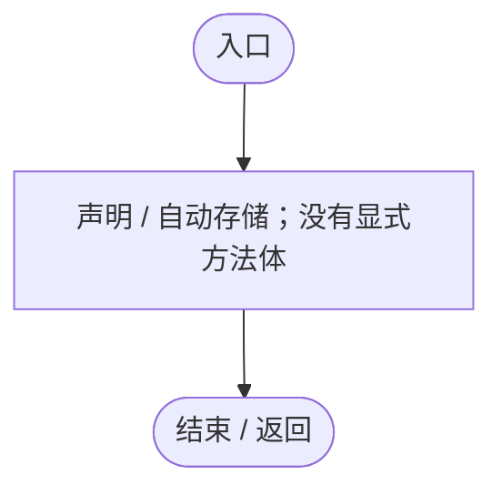

<a id="me69facc1c0f1e164"></a>

## LogicRevision.get · L19

`get`


### Editor / Player · 语法控制结构 / 声明（非CFG）


<a id="m36bb66fd6bf521ca"></a>

## LogicRevision.set · L19

`private set`


### Editor / Player · 语法控制结构 / 声明（非CFG）


<a id="md08823d8f9a2fa16"></a>

## CurrentAge.get · L37

`get`


### Editor / Player · 语法控制结构 / 声明（非CFG）


<a id="md8993fc83a0c41da"></a>

## CurrentAge.set · L37

`set`


### Editor / Player · 语法控制结构 / 声明（非CFG）


<a id="m0dcf791633195321"></a>

## LogicSnapshotBuilds.get · L46

`get`


### Editor / Player · 语法控制结构 / 声明（非CFG）


<a id="mcdd123e24274bd7d"></a>

## LogicSnapshotBuilds.set · L46

`private set`


### Editor / Player · 语法控制结构 / 声明（非CFG）


<a id="mfbc71172f45b87d9"></a>

## StageMutationChecks.get · L51

`get`


### Editor / Player · 语法控制结构 / 声明（非CFG）


<a id="m3ffef05f278565a4"></a>

## StageMutationChecks.set · L51

`private set`


### Editor / Player · 语法控制结构 / 声明（非CFG）


<a id="m3ec50dc8274bc6d2"></a>

## MutatedStageMask.get · L53

`public int MutatedStageMask`

★ 适配：恢复已登记的阶段，读档不重复触发生命阶段事件。

### Editor / Player · 语法控制结构 / 声明（非CFG）

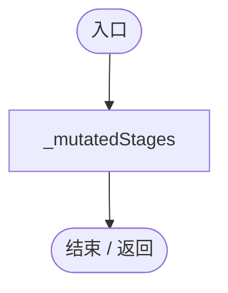

<a id="m41fb3375c42f6c22"></a>

## RestoreStageState · L54

`public void RestoreStageState(AgeState age,int mask,int checks)`


### Editor / Player · Roslyn编译器控制流

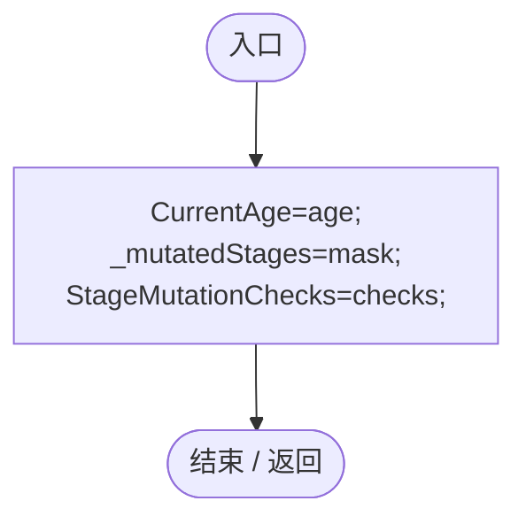

项目内调用/回调引用：

- [EntityGeneController.CurrentAge.set · L37](7494d53178552f0e.md#md8993fc83a0c41da)（访问器）
- [EntityGeneController.StageMutationChecks.set · L51](7494d53178552f0e.md#m3ffef05f278565a4)（访问器）

<a id="m48569997691ad037"></a>

## Awake · L56

`private void Awake()`


### Editor / Player · Roslyn编译器控制流

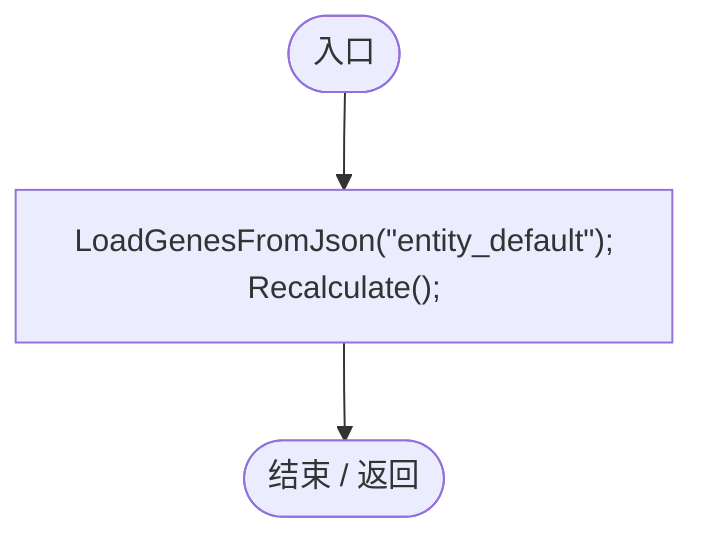

项目内调用/回调引用：

- [EntityGeneController.LoadGenesFromJson · L234](7494d53178552f0e.md#m926bf90e876efef4)（方法）
- [EntityGeneController.Recalculate · L104](7494d53178552f0e.md#m6a5ea0cca4871198)（方法）

<a id="m95c7003cca6fa7fc"></a>

## Update · L62

`private void Update()`


### Editor / Player · Roslyn编译器控制流

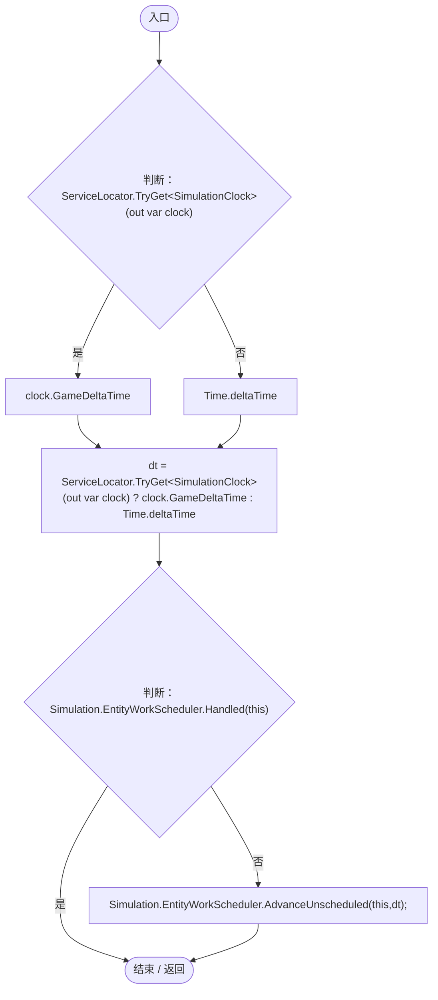

项目内调用/回调引用：

- [ServiceLocator.TryGet · L26](f2fdbe9f9ccd93cb.md#m143b24e6d58471b0)（方法）
- [SimulationClock.GameDeltaTime.get · L26](a8f444aec9614b0a.md#me7f11abae18a4f2d)（访问器）
- [EntityWorkScheduler.Handled · L70](465ccdbb260bcac2.md#mfb3602c3c5d9b2f7)（方法）
- [EntityWorkScheduler.AdvanceUnscheduled · L73](465ccdbb260bcac2.md#md4980b1b489e4fc8)（方法）

<a id="m1fed1096c5150ade"></a>

## AdvanceSimulation · L71

`public void AdvanceSimulation(float dt)`


### Editor / Player · Roslyn编译器控制流

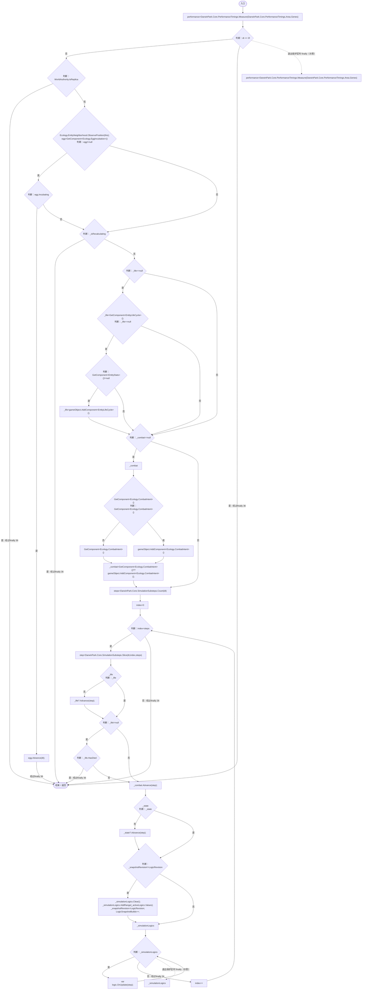

项目内调用/回调引用：

- [PerformanceTimings.Measure · L24](a8403a4c7503726d.md#m8b21456474d7b973)（方法）
- [EntityNeighborhood.ObservePosition · L69](e5e24c4aff0395b1.md#m3cedae5e42d91a3d)（方法）
- [EggIncubation.Advance · L10](f5a647fca719706f.md#m7f35c7c5958784bc)（方法）
- [SimulationSubsteps.Count · L10](44755274b83df7ba.md#m9b3c9def7f9642d1)（方法）
- [SimulationSubsteps.Slice · L11](44755274b83df7ba.md#ma075f8159da64c99)（方法）
- [EntityLifeCycle.Advance · L25](9f4138bfbae654b7.md#m804ba580f54f09f3)（方法）
- [EntityLifeCycle.HasDied.get · L11](9f4138bfbae654b7.md#mf2406e6830e0007e)（访问器）
- [CombatIntent.Advance · L19](34193b994b2c0894.md#mcfb3109714c0797f)（方法）
- [EntityStateController.Advance · L41](0f8869eb7018091e.md#mffbdbb199029dbf3)（方法）
- [EntityGeneController.LogicRevision.get · L19](7494d53178552f0e.md#me69facc1c0f1e164)（访问器）
- [EntityGeneController.LogicSnapshotBuilds.set · L46](7494d53178552f0e.md#mcdd123e24274bd7d)（访问器）
- [EntityGeneController.LogicSnapshotBuilds.get · L46](7494d53178552f0e.md#m0dcf791633195321)（访问器）
- [IGeneLogic.OnUpdate · L9](5304fdad773967f8.md#m829188d65276f8e5)（方法）

<a id="m6a5ea0cca4871198"></a>

## Recalculate · L104

`public void Recalculate()`


### Editor / Player · Roslyn编译器控制流

```mermaid
flowchart TD
  b0(["入口"])
  b1["performance=DarwinPark.Core.PerformanceTimings.Measure(DarwinPark.Core.PerformanceTimings.Area.GeneRecalculation)"]
  b2{"判断：_isRecalculating"}
  b3["Simulation.EntityWorkScheduler.Wake(this);"]
  b4{"GetComponent&lt;Ecology.AntColonyMember&gt;()<br/>判断：GetComponent&lt;Ecology.AntColonyMember&gt;()"}
  b5["GetComponent&lt;Ecology.AntColonyMember&gt;()?.EnforceGenome();"]
  b6["_isRecalculating = true;"]
  b7["_genomeMembership.Clear();<br/>_genomeMembership.UnionWith(Genome.Genes);<br/>Evaluation = GeneValueResolver.Resolve(Genome, IsGestating, EnvironmentGeneSuppression,additionalSuppression:Ecology.AntColonyMember.ExpressionSuppression(this));<br/>_eva…"]
  b8["Evaluation.Genes"]
  b9{"判断：Evaluation.Genes"}
  b10["var"]
  b11{"id=evaluation.Gene.InstanceId<br/>判断：id==null"}
  b12{"判断：_nullIdEvaluation==null"}
  b13["_nullIdEvaluation=evaluation;"]
  b14{"判断：_evaluations.ContainsKey(id)"}
  b15["_evaluations.Add(id,evaluation);"]
  b16["Evaluation.Genes"]
  b17{"stats = GetComponent&lt;EntityStats&gt;()<br/>size = 1f<br/>判断：stats != null"}
  b18{"判断：stats.TryGet(&quot;size&quot;, out float s)"}
  b19["size = s;"]
  b20["Evaluation.Attributes = EntityAttributeProcessor.Process( Evaluation.Attributes, Evaluation.Genes, CurrentAge, size, IsGestating );<br/>_removedLogics.Clear();"]
  b21["_activeLogics"]
  b22{"判断：_activeLogics"}
  b23["var"]
  b24{"eval = GetEvaluation(kvp.Key)<br/>判断：_genomeMembership.Contains(kvp.Key)"}
  b25{"判断：kvp.Key.Enabled"}
  b26{"判断：eval == null"}
  b27{"判断：eval.IsActive"}
  b28{"判断：kvp.Value.GetType().Name != eval.Definition.LogicScriptId"}
  b29["_removedLogics.Add(kvp.Key);"]
  b30["_activeLogics"]
  b31["_removedLogics"]
  b32{"判断：_removedLogics"}
  b33["var"]
  b34{"判断：_activeLogics[g] is IDisposable disposable"}
  b35["disposable.Dispose();"]
  b36["_activeLogics.Remove(g);"]
  b37["_removedLogics"]
  b38["_removedLogics.Clear();"]
  b39{"OnEvaluationChanged<br/>判断：OnEvaluationChanged"}
  b40["OnEvaluationChanged?.Invoke(Evaluation);"]
  b41["Genome.Genes"]
  b42{"判断：Genome.Genes"}
  b43["var"]
  b44{"判断：gene.Enabled"}
  b45{"eval = GetEvaluation(gene)<br/>判断：eval == null"}
  b46{"判断：eval.IsActive"}
  b47{"判断：_activeLogics.ContainsKey(gene)"}
  b48{"def = GeneDatabase.Get(gene.DefinitionId)<br/>判断：def == null"}
  b49{"判断：string.IsNullOrEmpty(def.LogicScriptId)"}
  b50{"logic = GeneLogicRegistry.CreateLogic(def.LogicScriptId)<br/>判断：logic != null"}
  b51["logic.Initialize(this, gene);<br/>_activeLogics[gene] = logic;"]
  b52["Genome.Genes"]
  b53["_isRecalculating=false;<br/>_snapshotRevision=-1;"]
  b54["Ecology.EntityStateController.Rebind(this);<br/>_state=GetComponent&lt;Ecology.EntityStateController&gt;();<br/>LogicRevision++;<br/>Ecology.EntityNeighborhood.Changed(this);"]
  b55["performance=DarwinPark.Core.PerformanceTimings.Measure(DarwinPark.Core.PerformanceTimings.Area.GeneRecalculation)"]
  b56(["结束 / 返回"])
  b0 --> b1
  b1 --> b2
  b2 -->|"是 · 经过finally 55"| b56
  b2 -->|"否"| b3
  b3 --> b4
  b4 -->|"否"| b5
  b4 -->|"是"| b6
  b5 --> b6
  b6 --> b7
  b7 --> b8
  b8 --> b9
  b9 -->|"是"| b10
  b9 -->|"否 · 经过finally 16"| b17
  b10 --> b11
  b11 -->|"是"| b12
  b11 -->|"否"| b14
  b12 -->|"是"| b13
  b12 -->|"否"| b9
  b13 --> b9
  b14 -->|"否"| b15
  b14 -->|"是"| b9
  b15 --> b9
  b17 -->|"是"| b18
  b17 -->|"否"| b20
  b18 -->|"是"| b19
  b18 -->|"否"| b20
  b19 --> b20
  b20 --> b21
  b21 --> b22
  b22 -->|"是"| b23
  b22 -->|"否 · 经过finally 30"| b31
  b23 --> b24
  b24 -->|"是"| b25
  b24 -->|"否"| b29
  b25 -->|"是"| b26
  b25 -->|"否"| b29
  b26 -->|"否"| b27
  b26 -->|"是"| b29
  b27 -->|"是"| b28
  b27 -->|"否"| b29
  b28 -->|"是"| b29
  b28 -->|"否"| b22
  b29 --> b22
  b31 --> b32
  b32 -->|"是"| b33
  b32 -->|"否 · 经过finally 37"| b38
  b33 --> b34
  b34 -->|"是"| b35
  b34 -->|"否"| b36
  b35 --> b36
  b36 --> b32
  b38 --> b39
  b39 -->|"否"| b40
  b39 -->|"是"| b41
  b40 --> b41
  b41 --> b42
  b42 -->|"是"| b43
  b42 -->|"否 · 经过finally 52,53"| b54
  b43 --> b44
  b44 -->|"否"| b42
  b44 -->|"是"| b45
  b45 -->|"否"| b46
  b45 -->|"是"| b42
  b46 -->|"否"| b42
  b46 -->|"是"| b47
  b47 -->|"是"| b42
  b47 -->|"否"| b48
  b48 -->|"否"| b49
  b48 -->|"是"| b42
  b49 -->|"是"| b42
  b49 -->|"否"| b50
  b50 -->|"是"| b51
  b50 -->|"否"| b42
  b51 --> b42
  b54 -->|"经过finally 55"| b56
  b9 -. "退出保护区时 finally（示意）" .-> b16
  b22 -. "退出保护区时 finally（示意）" .-> b30
  b32 -. "退出保护区时 finally（示意）" .-> b37
  b42 -. "退出保护区时 finally（示意）" .-> b52
  b7 -. "退出保护区时 finally（示意）" .-> b53
  b2 -. "退出保护区时 finally（示意）" .-> b55

```

项目内调用/回调引用：

- [PerformanceTimings.Measure · L24](a8403a4c7503726d.md#m8b21456474d7b973)（方法）
- [EntityWorkScheduler.Wake · L72](465ccdbb260bcac2.md#md4572d5c3e13b437)（方法）
- [AntColonyMember.EnforceGenome · L179](baebd85c05598377.md#m5155f080ff2a374a)（方法）
- [EntityGeneController.Evaluation.set · L18](7494d53178552f0e.md#m63b4ee98968eaacd)（访问器）
- [GeneValueResolver.Resolve · L32](837eb9ce6eba3cc6.md#m063abac8252cd4e8)（方法）
- [AntColonyMember.ExpressionSuppression · L184](baebd85c05598377.md#m443d46de5dfd933d)（方法）
- [EntityGeneController.Evaluation.get · L18](7494d53178552f0e.md#mc0039c100a31b455)（访问器）
- [EntityStats.TryGet · L90](75aa86a368efdf24.md#m24ee1433e4a70d94)（方法）
- [EntityAttributeProcessor.Process · L10](5c9856aea4a5298c.md#mb9d5b20716b64153)（方法）
- [EntityGeneController.CurrentAge.get · L37](7494d53178552f0e.md#md08823d8f9a2fa16)（访问器）
- [EntityGeneController.GetEvaluation · L218](7494d53178552f0e.md#ma55c8398ef64561d)（方法）
- [GeneDatabase.Get · L136](ec0a03483435a863.md#me6a5fefe6c3492f9)（方法）
- [GeneLogicRegistry.CreateLogic · L15](5304fdad773967f8.md#m3a1d09abe1b13c18)（方法）
- [IGeneLogic.Initialize · L8](5304fdad773967f8.md#madf34517fa30c347)（方法）
- [EntityStateController.Rebind · L22](0f8869eb7018091e.md#m40a5ae44229a22cf)（方法）
- [EntityGeneController.LogicRevision.set · L19](7494d53178552f0e.md#m36bb66fd6bf521ca)（访问器）
- [EntityGeneController.LogicRevision.get · L19](7494d53178552f0e.md#me69facc1c0f1e164)（访问器）
- [EntityNeighborhood.Changed · L63](e5e24c4aff0395b1.md#mb1d68cb0ccf4819a)（方法）

<a id="maa59ba6d55ba08fa"></a>

## ApplyEnvironmentPressure · L197

`public void ApplyEnvironmentPressure(float suppression, float mutationChance, string adaptationGeneId, float targetValue)`

<summary>  ★ 新增：环境压力写入。压力变化较大时才重算，避免每帧重建评估。  </summary>

### Editor / Player · Roslyn编译器控制流

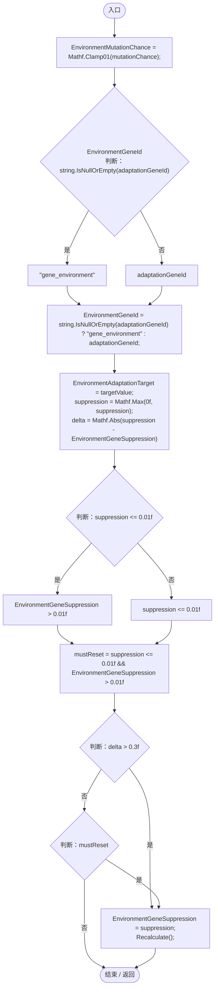

项目内调用/回调引用：

- [EntityGeneController.Recalculate · L104](7494d53178552f0e.md#m6a5ea0cca4871198)（方法）

<a id="ma55c8398ef64561d"></a>

## GetEvaluation · L218

`public GeneEvaluation GetEvaluation(GeneInstance gene)`

★ 新增：统一按实例ID查询表达，不能让每个行动/生产子步各建闭包遍历整份基因列表。

### Editor / Player · Roslyn编译器控制流

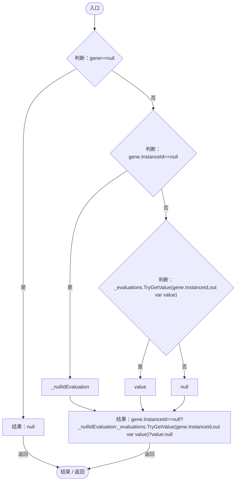

<a id="macce520f213fa6c4"></a>

## GetLogic · L221

`public IGeneLogic GetLogic(GeneInstance gene)`


### Editor / Player · Roslyn编译器控制流

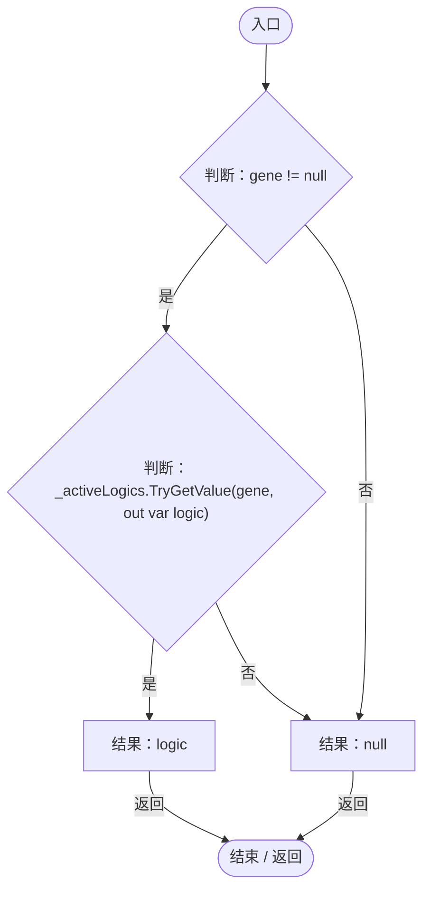

<a id="m3c3576ab3af5f7f9"></a>

## OnDestroy · L227

`private void OnDestroy()`


### Editor / Player · Roslyn编译器控制流

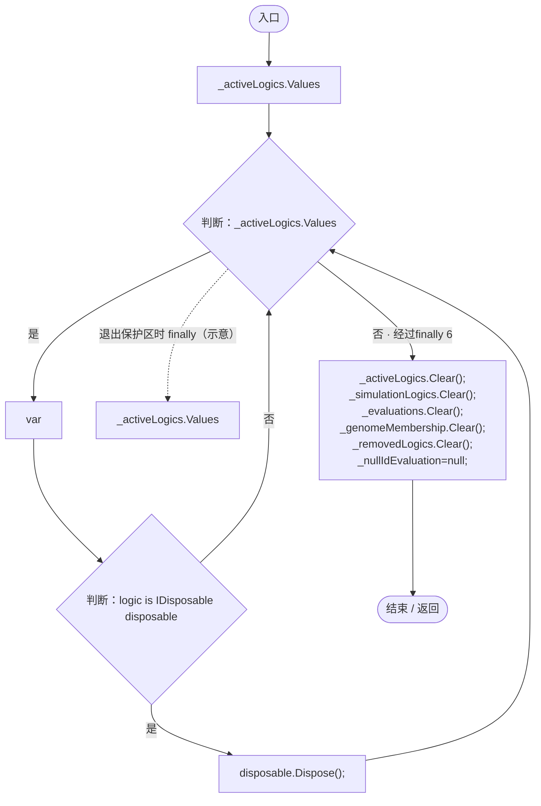

<a id="m926bf90e876efef4"></a>

## LoadGenesFromJson · L234

`public void LoadGenesFromJson(string jsonId)`


### Editor / Player · Roslyn编译器控制流

```mermaid
flowchart TD
  b0(["入口"])
  b1{"asset = Resources.Load&lt;TextAsset&gt;($&quot;Entities/{jsonId}&quot;)<br/>判断：asset == null"}
  b2["Genome = GeneMutator.CreateBaseGenome();"]
  b3["data = JsonUtility.FromJson&lt;EntityGeneData&gt;(asset.text)<br/>Genome = new Genome();"]
  b4["data.genes"]
  b5{"判断：data.genes"}
  b6["var<br/>Genome.Add(GeneInstance.Create(g.definitionId, g.value, g.tier));"]
  b7["data.genes"]
  b8(["结束 / 返回"])
  b0 --> b1
  b1 -->|"是"| b2
  b1 -->|"否"| b3
  b2 --> b8
  b3 --> b4
  b4 --> b5
  b5 -->|"是"| b6
  b5 -->|"否 · 经过finally 7"| b8
  b6 --> b5
  b5 -. "退出保护区时 finally（示意）" .-> b7

```

项目内调用/回调引用：

- [GeneMutator.CreateBaseGenome · L8](f297edbfb98ef475.md#md3926965177316e9)（方法）
- [Genome.Add · L19](a2ef23f865bc7ee8.md#md9cfdc94b8b8d40f)（方法）
- [GeneInstance.Create · L20](f82e1498d67f5afd.md#m72e94c278de3cf8b)（方法）

<a id="m2b3b30aa0f932737"></a>

## GetRandomName · L252

`public string GetRandomName()`

★ 适配：优化重复计算，内置词库每个播放会话只解析一次；随机抽样顺序和正常命名结果与原实现一致。

### Editor / Player · Roslyn编译器控制流

```mermaid
flowchart TD
  b0(["入口"])
  b1{"判断：_namePoolLoaded"}
  b2{"_namePoolLoaded=true;<br/>asset=Resources.Load&lt;TextAsset&gt;(&quot;Names/name_pool&quot;)<br/>_nameAssetMissing=asset==null;<br/>判断：asset!=null"}
  b3["_namePool=JsonUtility.FromJson&lt;NamePoolJson&gt;(asset.text);"]
  b4["(Exception ex)<br/>Debug.LogWarning(&quot;[命名] 词库解析失败：&quot;+ex.Message);"]
  b5["Debug.LogWarning(&quot;[命名] 缺少 Names/name_pool，使用回退名称&quot;);"]
  b6{"判断：_nameAssetMissing"}
  b7["结果：$&quot;未知生物-{UnityEngine.Random.Range(100,999)}&quot;"]
  b8{"_namePool<br/>判断：_namePool"}
  b9[".familyNames"]
  b10["_namePool"]
  b11{"判断：_namePool?.familyNames==null"}
  b12{"判断：_namePool.familyNames.Count==0"}
  b13{"判断：_namePool.givenNames==null"}
  b14{"判断：_namePool.givenNames.Count==0"}
  b15["结果：&quot;无名生物&quot;"]
  b16["结果：_namePool.familyNames[UnityEngine.Random.Range(0,_namePool.familyNames.Count)]+&quot;·&quot;+_namePool.givenNames[UnityEngine.Random.Range(0,_namePool.givenNames.Count)]"]
  b17(["结束 / 返回"])
  b0 --> b1
  b1 -->|"否"| b2
  b1 -->|"是"| b6
  b2 -->|"是"| b3
  b2 -->|"否"| b5
  b3 --> b6
  b4 --> b6
  b5 --> b6
  b6 -->|"是"| b7
  b6 -->|"否"| b8
  b7 -->|"返回"| b17
  b8 -->|"否"| b9
  b8 -->|"是"| b10
  b9 --> b11
  b10 --> b11
  b11 -->|"否"| b12
  b11 -->|"是"| b15
  b12 -->|"否"| b13
  b12 -->|"是"| b15
  b13 -->|"否"| b14
  b13 -->|"是"| b15
  b14 -->|"是"| b15
  b14 -->|"否"| b16
  b15 -->|"返回"| b17
  b16 -->|"返回"| b17
  b3 -. "保护区可能异常（示意）" .-> b4

```

<a id="ma1ebc700c08a6a5d"></a>

## ResetNamePool · L264

`[RuntimeInitializeOnLoadMethod(RuntimeInitializeLoadType.SubsystemRegistration)] private static void ResetNamePool()`


### Editor / Player · Roslyn编译器控制流

```mermaid
flowchart TD
  b0(["入口"])
  b1["_namePool=null;<br/>_namePoolLoaded=_nameAssetMissing=false;"]
  b2(["结束 / 返回"])
  b0 --> b1
  b1 --> b2

```

<a id="mfd8d6d35f485440c"></a>

## GetAttribute · L267

`public float GetAttribute(string id)`


### Editor / Player · Roslyn编译器控制流

```mermaid
flowchart TD
  b0(["入口"])
  b1{"判断：Evaluation != null"}
  b2{"判断：Evaluation.Attributes.TryGetValue(id, out var v)"}
  b3["结果：Ecology.EcologyMotion.ResolveAttribute(this,id,v)"]
  b4["结果：0f"]
  b5(["结束 / 返回"])
  b0 --> b1
  b1 -->|"是"| b2
  b1 -->|"否"| b4
  b2 -->|"是"| b3
  b2 -->|"否"| b4
  b3 -->|"返回"| b5
  b4 -->|"返回"| b5

```

项目内调用/回调引用：

- [EntityGeneController.Evaluation.get · L18](7494d53178552f0e.md#mc0039c100a31b455)（访问器）
- [EcologyMotion.ResolveAttribute · L48](6ed9d0eedb456d32.md#m41dec457a7f1948a)（方法）

<a id="md8a1076ac099e456"></a>

## TryStageMutation · L273

`public void TryStageMutation(AgeState stage)`


### Editor / Player · Roslyn编译器控制流

```mermaid
flowchart TD
  b0(["入口"])
  b1{"bit=1&lt;&lt;(int)stage<br/>判断：(_mutatedStages&amp;bit)!=0"}
  b2["_mutatedStages&#124;=bit;<br/>StageMutationChecks++;"]
  b3(["结束 / 返回"])
  b0 --> b1
  b1 -->|"是"| b3
  b1 -->|"否"| b2
  b2 --> b3

```

项目内调用/回调引用：

- [EntityGeneController.StageMutationChecks.set · L51](7494d53178552f0e.md#m3ffef05f278565a4)（访问器）
- [EntityGeneController.StageMutationChecks.get · L51](7494d53178552f0e.md#mfbc71172f45b87d9)（访问器）
