# LayersSettingsRegression.cs

[返回总索引](../README.md) · `Editor` · `Assets/DarwinPark/Editor/LayersSettingsRegression.cs`

[源文件](../../../Assets/DarwinPark/Editor/LayersSettingsRegression.cs) · 源码校验：`a394a0318105ea6899c4d9da2d7ac4cec1264577d7d4cea9feda4742a95cd525`

方法按源文件位置排列。事件/回调引用不表示立即执行；分支与异常说明见总索引。完整源码与可点击关系图请打开离线手册。

## Folder.get · L29

`private static string Folder`

### Editor · 语法控制结构 / 声明（非CFG）

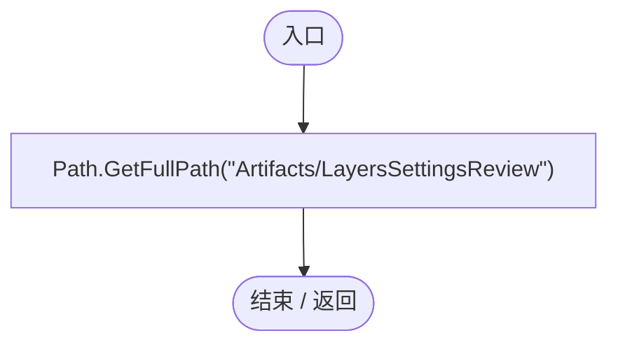

## LayersSettingsRegression.ctor · L30

`static LayersSettingsRegression()`

### Editor · Roslyn编译器控制流

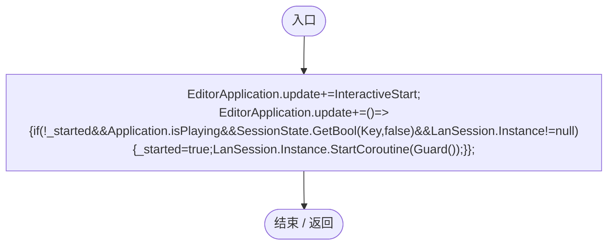

项目内调用/回调引用：

- [LayersSettingsRegression.回调@30 · L30](74c9e2e7a7587584.md#ma54b390c3b508dcc)（回调/委托）
- [LayersSettingsRegression.InteractiveStart · L33](74c9e2e7a7587584.md#mdab79bc7472fe58c)（方法）

## 回调@30 · L30

`( … => 回调`

### Editor · Roslyn编译器控制流

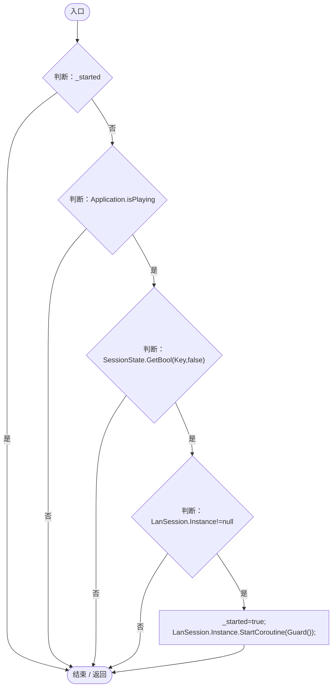

项目内调用/回调引用：

- [LanSession.Instance.get · L23](9fb633eebffe669c.md#mbf83306994878383)（访问器）
- [LayersSettingsRegression.Guard · L47](74c9e2e7a7587584.md#m97391659691a9d7e)（方法）

## RunBatch · L31

`public static void RunBatch()`

### Editor · Roslyn编译器控制流

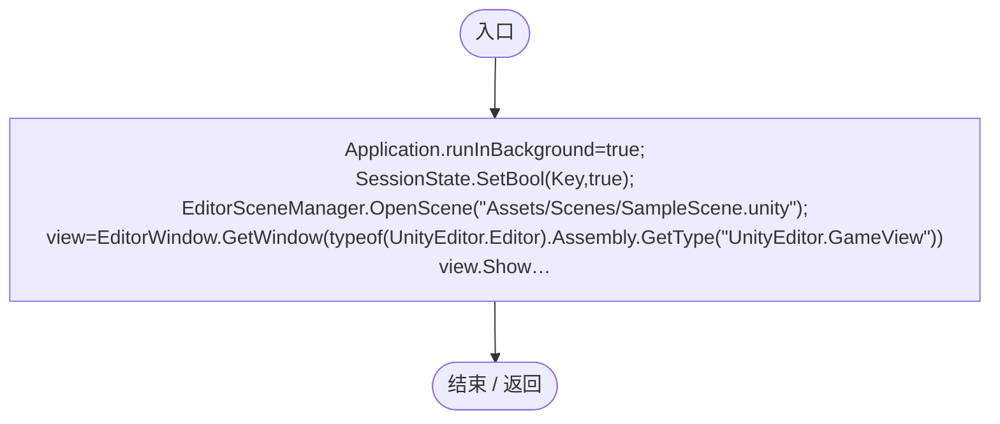

## RunInteractive · L32

`public static void RunInteractive()`

### Editor · Roslyn编译器控制流

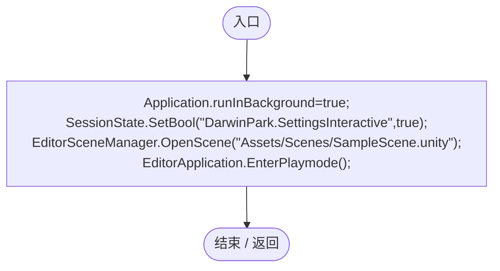

## InteractiveStart · L33

`private static void InteractiveStart()`

### Editor · Roslyn编译器控制流

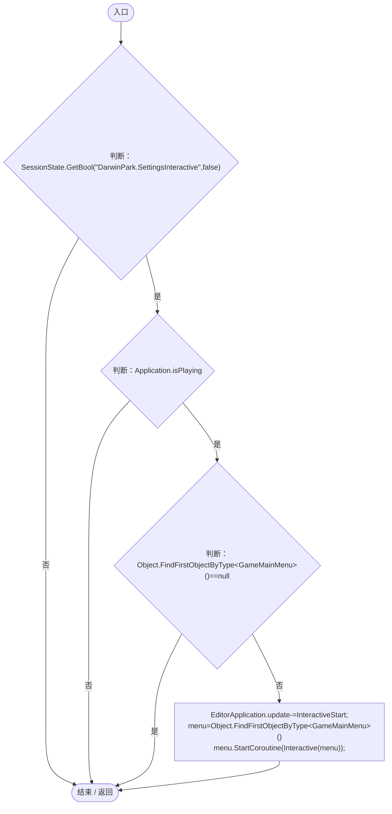

项目内调用/回调引用：

- [LayersSettingsRegression.Interactive · L38](74c9e2e7a7587584.md#m7496b60c59bfa1f7)（方法）
- [LayersSettingsRegression.InteractiveStart · L33](74c9e2e7a7587584.md#mdab79bc7472fe58c)（方法）

## Interactive · L38

`private static IEnumerator Interactive(GameMainMenu menu)`

### Editor · Roslyn编译器控制流

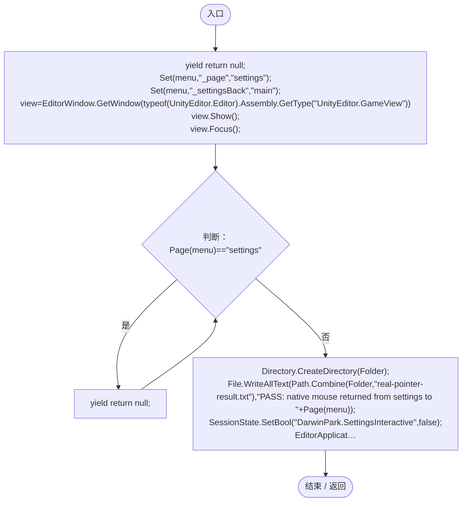

项目内调用/回调引用：

- [LayersSettingsRegression.Set · L45](74c9e2e7a7587584.md#m0c5a345ba64da9ba)（方法）
- [LayersSettingsRegression.Page · L46](74c9e2e7a7587584.md#me9bcdb8cb7cb29a8)（方法）

## Check · L44

`private static void Check(bool ok,string message)`

### Editor · Roslyn编译器控制流

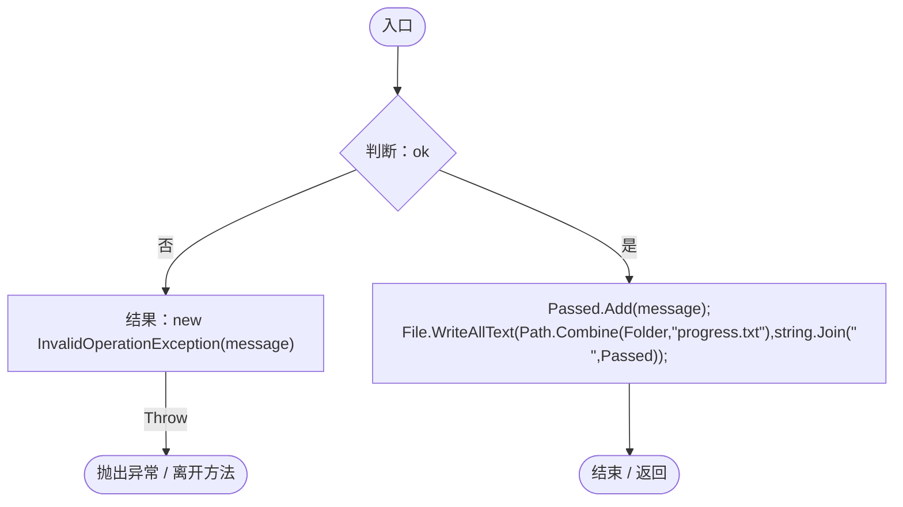

## Set · L45

`private static void Set(object target,string field,object value)`

### Editor · Roslyn编译器控制流

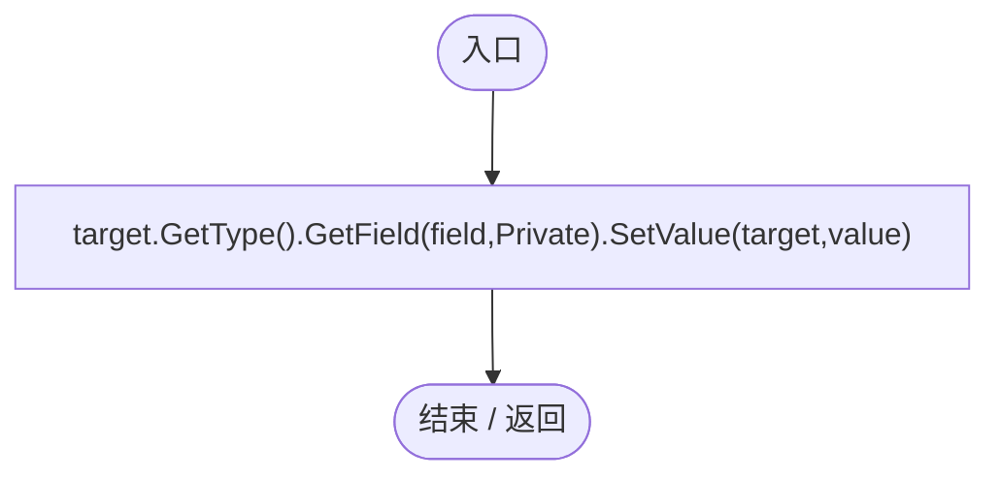

## Page · L46

`private static string Page(GameMainMenu menu)`

### Editor · Roslyn编译器控制流

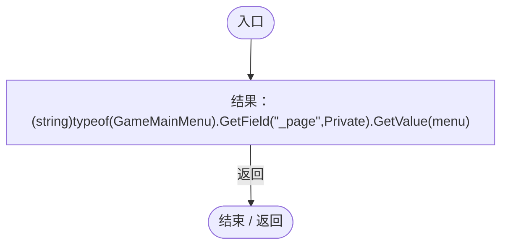

## Guard · L47

`private static IEnumerator Guard()`

### Editor · Roslyn编译器控制流

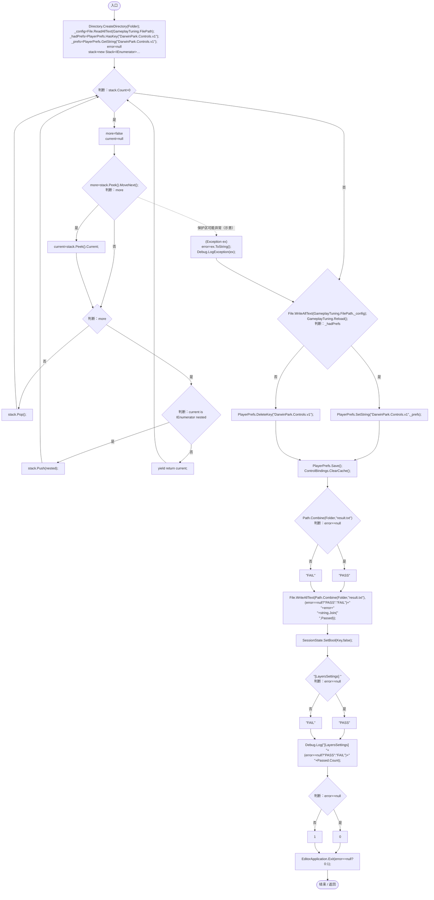

项目内调用/回调引用：

- [LayersSettingsRegression.Run · L63](74c9e2e7a7587584.md#m37692217d960072d)（方法）
- [GameplayTuning.Reload · L31](db546e5713b32d53.md#m10cbcd3bcb0856d1)（方法）
- [ControlBindings.ClearCache · L72](b6735f8f133ee3f4.md#me028e7c0de17a4bd)（方法）

## Capture · L55

`private static IEnumerator Capture(string name)`

### Editor · Roslyn编译器控制流

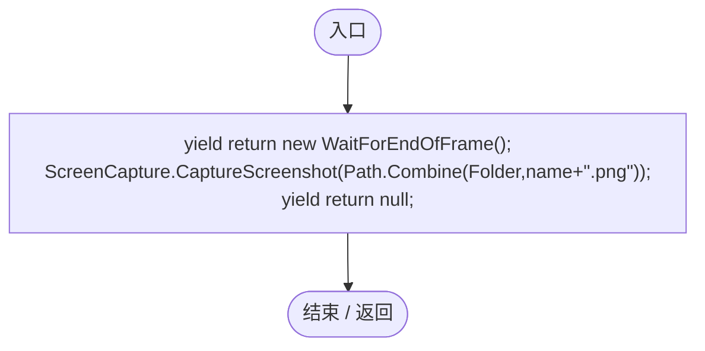

## Spawn · L56

`private static DarwinEntity Spawn(Vector3 point,string group,AntRole role)`

### Editor · Roslyn编译器控制流

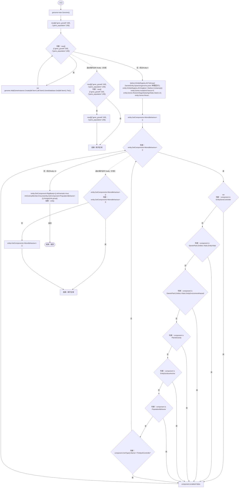

项目内调用/回调引用：

- [Genome.Add · L19](a2ef23f865bc7ee8.md#md9cfdc94b8b8d40f)（方法）
- [GeneInstance.Create · L20](f82e1498d67f5afd.md#m72e94c278de3cf8b)（方法）
- [GeneDatabase.Get · L135](ec0a03483435a863.md#m8f3bbfb35f3ca397)（方法）
- [DarwinEntity.Genes.get · L14](70798dde169f2e8b.md#m622eb1adf401d431)（访问器）
- [EntityGeneController.RestoreStageState · L51](7494d53178552f0e.md#m6264213de2a5ca6f)（方法）
- [EntityGeneController.Recalculate · L97](7494d53178552f0e.md#m65ea735c1e0e37a1)（方法）
- [AntColonyMember.Assign · L54](baebd85c05598377.md#mda0fe308acecb8f2)（方法）
- [AntColonyMember.Ensure · L51](baebd85c05598377.md#m408f716118716988)（方法）
- [LayersSettingsRegression.回调@59 · L59](74c9e2e7a7587584.md#mf0a9c5bb0089831f)（回调/委托）

## 回调@59 · L59

`e … => 回调`

### Editor · Roslyn编译器控制流

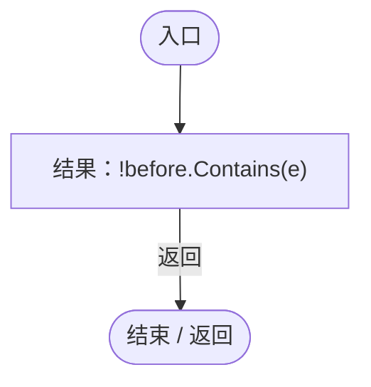

## Run · L63

`private static IEnumerator Run()`

### Editor · Roslyn编译器控制流

```mermaid
flowchart TD
  b0(["入口"])
  b1["yield return null;<br/>ControlBindings.RestoreDefaults();<br/>config=GameplayTuning.Parse(&quot;{/*中文*/\&quot;version\&quot;:1,//行动消耗\n\&quot;movementMetabolismMultiplier\&quot;:0.25}&quot;)<br/>Check(config.movementMetabolismMultiplier==.25f,&quot;中文行注释与块注释可解析&quot;);<br/>Check(CommentedJson…"]
  b2["new[]{0,1,2}"]
  b3{"判断：new[]{0,1,2}"}
  b4["int<br/>Set(menu,&quot;_page&quot;,&quot;settings&quot;);<br/>Set(menu,&quot;_settingsBack&quot;,&quot;main&quot;);<br/>Set(menu,&quot;_settingsTab&quot;,tab);<br/>yield return null;"]
  b5{"判断：menu.SettingsWindowRect.width==Mathf.Min(480,Screen.width-32)"}
  b6["menu.SettingsWindowRect.height==Mathf.Min(560,Screen.height-32)"]
  b7["menu.SettingsWindowRect.width==Mathf.Min(480,Screen.width-32)"]
  b8["Check(menu.SettingsWindowRect.width==Mathf.Min(480,Screen.width-32)&amp;&amp;menu.SettingsWindowRect.height==Mathf.Min(560,Screen.height-32),&quot;设置恢复旧尺寸 分页&quot;+tab);"]
  b9{"判断：tab==0"}
  b10["yield return Capture(&quot;settings-old-size&quot;);"]
  b11["typeof(GameMainMenu).GetMethod(&quot;ReturnFromSettings&quot;,Private).Invoke(menu,null);<br/>Check(Page(menu)==&quot;main&quot;,&quot;设置分页返回原主菜单 分页&quot;+tab);"]
  b12{"new[]{0,1,2}<br/>判断：new[]{0,1,2}"}
  b13["new[]{0,1,2}"]
  b14["连接 / 离开区域"]
  b15["session=Object.FindFirstObjectByType&lt;WorldSessionManager&gt;()<br/>builder=Object.FindFirstObjectByType&lt;PlanetTerrainMeshBuilder&gt;()<br/>builder.subdivisions=32;<br/>Set(session,&quot;_initialTerrain&quot;,JsonUtility.ToJson(builder));<br/>PlanetClimateMap.Instance.m…"]
  b16{"判断：session.Busy"}
  b17{"判断：EditorApplication.timeSinceStartup-start&gt;100"}
  b18["结果：new TimeoutException(&quot;世界加载超时&quot;)"]
  x18(["抛出异常 / 离开方法"])
  b19["yield return null;"]
  b20["clock=ServiceLocator.Get&lt;SimulationClock&gt;()<br/>clock.Pause();"]
  b21["EntityRegistry.All.ToArray()"]
  b22{"判断：EntityRegistry.All.ToArray()"}
  b23["var<br/>Object.DestroyImmediate(e.gameObject);"]
  b24{"EntityRegistry.All.ToArray()<br/>判断：EntityRegistry.All.ToArray()"}
  b25["EntityRegistry.All.ToArray()"]
  b26["连接 / 离开区域"]
  b27["ColonyResource.ClearWorld();<br/>menu.ShowPause();<br/>Set(menu,&quot;_page&quot;,&quot;settings&quot;);<br/>Set(menu,&quot;_settingsBack&quot;,&quot;pause&quot;);<br/>Set(menu,&quot;_settingsTab&quot;,1);<br/>yield return null;<br/>typeof(GameMainMenu).GetMethod(&quot;ReturnFromSettings&quot;,Private).Invoke(menu,null);"]
  b28{"判断：Page(menu)==&quot;pause&quot;"}
  b29["GameInputGate.Blocked"]
  b30["Page(menu)==&quot;pause&quot;"]
  b31["Check(Page(menu)==&quot;pause&quot;&amp;&amp;GameInputGate.Blocked,&quot;设置返回暂停菜单并保留门控&quot;);"]
  b32["typeof(GameMainMenu).GetMethod(&quot;Resume&quot;,Private).Invoke(menu,null);<br/>home=EcologyQueries.Surface(builder.transform.position+Vector3.up*(builder.radius+builder.heightScale))<br/>group=Guid.NewGuid().ToString(&quot;N&quot;)<br/>queen=Spawn(home,group,AntRole…"]
  b33{"判断：queen.State.supplyPoints.Count==0"}
  b34["ColonyActivityRange.Circles(queen.Population).Count()==1"]
  b35["queen.State.supplyPoints.Count==0"]
  b36["Check(queen.State.supplyPoints.Count==0&amp;&amp;ColonyActivityRange.Circles(queen.Population).Count()==1,&quot;没有多余能量时不预建检查点或范围&quot;);"]
  b37["supply=ColonyActivityRange.Boundary(new ActivityCircle(&quot;t&quot;,home,queen.Radius*.8f),0)<br/>queen.State.supplyPoints.Add(EcologyQueries.ToLocal(supply));<br/>Check(ColonyActivityRange.Circles(queen.Population).Count()==1,&quot;旧档空检查点也不产生范围&quot;);<br/>resource=C…"]
  b38{"判断：PopulationRangeLayer.Visible"}
  b39{"判断：PopulationRangeLayer.Outline"}
  b40["PopulationRangeLayer.ActiveCircleCount==2"]
  b41["PopulationRangeLayer.Visible&amp;&amp;!PopulationRangeLayer.Outline&amp;&amp;PopulationRangeLayer.ActiveCircleCount==2"]
  b42["Check(PopulationRangeLayer.Visible&amp;&amp;!PopulationRangeLayer.Outline&amp;&amp;PopulationRangeLayer.ActiveCircleCount==2,&quot;默认以合并半透明区域显示&quot;);"]
  b43["renderer=builder.GetComponent&lt;MeshRenderer&gt;()<br/>block=new MaterialPropertyBlock()<br/>renderer.GetPropertyBlock(block);"]
  b44{"判断：block.GetVector(&quot;_PopulationStyle&quot;).x==1"}
  b45{"判断：block.GetTexture(&quot;_PopulationData&quot;)!=null"}
  b46["renderer.sharedMaterial.shader.isSupported"]
  b47["block.GetVector(&quot;_PopulationStyle&quot;).x==1&amp;&amp;block.GetTexture(&quot;_PopulationData&quot;)!=null&amp;&amp;renderer.sharedMaterial.shader.isSupported"]
  b48["Check(block.GetVector(&quot;_PopulationStyle&quot;).x==1&amp;&amp;block.GetTexture(&quot;_PopulationData&quot;)!=null&amp;&amp;renderer.sharedMaterial.shader.isSupported,&quot;真实地表Shader收到填色及合并圆数据&quot;);"]
  b49["orbit=Camera.main.GetComponent&lt;OrbitCamera&gt;()<br/>cameraPoint=home+EcologyQueries.Up(home)*110<br/>orbit.RestoreView(cameraPoint,Quaternion.LookRotation(home-cameraPoint,Vector3.forward),Vector3.Distance(cameraPoint,builder.transform.position));…"]
  b50["button.GetComponent&lt;RightClickHandler&gt;()<br/>new PointerEventData(EventSystem.current){button=PointerEventData.InputButton.Right}<br/>button=PointerEventData.InputButton.Right<br/>button.GetComponent&lt;RightClickHandler&gt;().OnPointerClick(new PointerEv…"]
  b51["yield return null;<br/>renderer.GetPropertyBlock(block);"]
  b52{"判断：PopulationRangeLayer.Outline"}
  b53["block.GetVector(&quot;_PopulationStyle&quot;).x==2"]
  b54["PopulationRangeLayer.Outline"]
  b55["Check(PopulationRangeLayer.Outline&amp;&amp;block.GetVector(&quot;_PopulationStyle&quot;).x==2,&quot;按钮右键切换合并外轮廓&quot;);"]
  b56["yield return Capture(&quot;population-union-outline&quot;);<br/>EventSystem.current.SetSelectedGameObject(button.gameObject);<br/>button.onClick.Invoke();<br/>yield return null;<br/>renderer.GetPropertyBlock(block);"]
  b57{"判断：PopulationRangeLayer.Visible"}
  b58{"判断：control.CurrentLayer==&quot;default&quot;"}
  b59["block.GetFloat(&quot;_PopulationCount&quot;)==0"]
  b60["!PopulationRangeLayer.Visible&amp;&amp;control.CurrentLayer==&quot;default&quot;&amp;&amp;block.GetFloat(&quot;_PopulationCount&quot;)==0"]
  b61["Check(!PopulationRangeLayer.Visible&amp;&amp;control.CurrentLayer==&quot;default&quot;&amp;&amp;block.GetFloat(&quot;_PopulationCount&quot;)==0,&quot;左键取消实际清除范围及Shader状态&quot;);"]
  b62{"判断：button.transition==Selectable.Transition.None"}
  b63["button.image.sprite==UIVisualTheme.SurfaceSprite(&quot;button&quot;)"]
  b64["button.transition==Selectable.Transition.None"]
  b65["Check(button.transition==Selectable.Transition.None&amp;&amp;button.image.sprite==UIVisualTheme.SurfaceSprite(&quot;button&quot;),&quot;焦点停在按钮上也不残留绿色选中状态&quot;);"]
  b66{"判断：control.HandleLayerKey(ControlBindings.Get(ControlAction.CycleLayer))"}
  b67["control.CurrentLayer!=&quot;default&quot;"]
  b68["control.HandleLayerKey(ControlBindings.Get(ControlAction.CycleLayer))"]
  b69["Check(control.HandleLayerKey(ControlBindings.Get(ControlAction.CycleLayer))&amp;&amp;control.CurrentLayer!=&quot;default&quot;,&quot;默认切换图层快捷键生效&quot;);"]
  b70{"判断：control.HandleLayerKey(ControlBindings.Get(ControlAction.ClearLayer))"}
  b71["control.CurrentLayer==&quot;default&quot;"]
  b72["control.HandleLayerKey(ControlBindings.Get(ControlAction.ClearLayer))"]
  b73["Check(control.HandleLayerKey(ControlBindings.Get(ControlAction.ClearLayer))&amp;&amp;control.CurrentLayer==&quot;default&quot;,&quot;默认取消图层快捷键生效&quot;);"]
  b74["ControlBindings.TryBind(ControlAction.CycleLayer,KeyCode.K,out _);"]
  b75{"判断：control.HandleLayerKey(KeyCode.L)"}
  b76["control.HandleLayerKey(KeyCode.K)"]
  b77["!control.HandleLayerKey(KeyCode.L)"]
  b78["Check(!control.HandleLayerKey(KeyCode.L)&amp;&amp;control.HandleLayerKey(KeyCode.K),&quot;设置改键后图层新键生效旧键失效&quot;);"]
  b79["Check(!control.HandleLayerKey(KeyCode.K,true),&quot;输入框打字不触发图层快捷键&quot;);<br/>GameInputGate.Blocked=true;<br/>Check(!control.HandleLayerKey(KeyCode.K),&quot;菜单门控期间不触发图层切换&quot;);<br/>GameInputGate.Blocked=false;<br/>resource.State.energy=0;<br/>Check(ColonyActivityRange.Circle…"]
  b80{"判断：population.LivingCount==1"}
  b81["population.MemberCount==2"]
  b82["population.LivingCount==1"]
  b83["Check(population.LivingCount==1&amp;&amp;population.MemberCount==2,&quot;第二页种群入口正确统计活群与成员&quot;);"]
  b84{"判断：population.Card.rect.width==stats.preferredWidth"}
  b85["population.Card.rect.height==stats.preferredHeight"]
  b86["population.Card.rect.width==stats.preferredWidth"]
  b87["Check(population.Card.rect.width==stats.preferredWidth&amp;&amp;population.Card.rect.height==stats.preferredHeight,&quot;第二页种群入口沿用紧凑卡片规格&quot;);"]
  b88["Check(population.Locate(0),&quot;列表支持定位王后或领袖&quot;);<br/>population.OpenList();<br/>yield return null;<br/>Check(PopulationWorkbench.Instance.Visible,&quot;完整种群详情可以展开查看&quot;);<br/>yield return Capture(&quot;population-list&quot;);"]
  b89["EntityRegistry.All.ToArray()"]
  b90{"判断：EntityRegistry.All.ToArray()"}
  b91["var<br/>Object.DestroyImmediate(e.gameObject);"]
  b92{"EntityRegistry.All.ToArray()<br/>判断：EntityRegistry.All.ToArray()"}
  b93["EntityRegistry.All.ToArray()"]
  b94["连接 / 离开区域"]
  b95["population.RefreshNow();"]
  b96{"判断：population.LivingCount==0"}
  b97{"判断：population.MemberCount==0"}
  b98["population.GroupCount&gt;0"]
  b99["population.LivingCount==0&amp;&amp;population.MemberCount==0&amp;&amp;population.GroupCount&gt;0"]
  b100["Check(population.LivingCount==0&amp;&amp;population.MemberCount==0&amp;&amp;population.GroupCount&gt;0,&quot;种群灭绝后活体归零且保留历史档案&quot;);"]
  b101["PopulationWorkbench.Instance.Close();"]
  b102(["结束 / 返回"])
  b0 --> b1
  b1 --> b2
  b2 --> b3
  b3 -->|"是"| b4
  b3 -->|"否 · 经过finally 12"| b15
  b4 --> b5
  b5 -->|"是"| b6
  b5 -->|"否"| b7
  b6 --> b8
  b7 --> b8
  b8 --> b9
  b9 -->|"是"| b10
  b9 -->|"否"| b11
  b10 --> b11
  b11 --> b3
  b12 -->|"否"| b13
  b12 -->|"是"| b14
  b13 --> b14
  b15 --> b16
  b16 -->|"是"| b17
  b16 -->|"否"| b20
  b17 -->|"是"| b18
  b17 -->|"否"| b19
  b18 -->|"Throw"| x18
  b19 --> b16
  b20 --> b21
  b21 --> b22
  b22 -->|"是"| b23
  b22 -->|"否 · 经过finally 24"| b27
  b23 --> b22
  b24 -->|"否"| b25
  b24 -->|"是"| b26
  b25 --> b26
  b27 --> b28
  b28 -->|"是"| b29
  b28 -->|"否"| b30
  b29 --> b31
  b30 --> b31
  b31 --> b32
  b32 --> b33
  b33 -->|"是"| b34
  b33 -->|"否"| b35
  b34 --> b36
  b35 --> b36
  b36 --> b37
  b37 --> b38
  b38 -->|"是"| b39
  b38 -->|"否"| b41
  b39 -->|"否"| b40
  b39 -->|"是"| b41
  b40 --> b42
  b41 --> b42
  b42 --> b43
  b43 --> b44
  b44 -->|"是"| b45
  b44 -->|"否"| b47
  b45 -->|"是"| b46
  b45 -->|"否"| b47
  b46 --> b48
  b47 --> b48
  b48 --> b49
  b49 --> b50
  b50 --> b51
  b51 --> b52
  b52 -->|"是"| b53
  b52 -->|"否"| b54
  b53 --> b55
  b54 --> b55
  b55 --> b56
  b56 --> b57
  b57 -->|"否"| b58
  b57 -->|"是"| b60
  b58 -->|"是"| b59
  b58 -->|"否"| b60
  b59 --> b61
  b60 --> b61
  b61 --> b62
  b62 -->|"是"| b63
  b62 -->|"否"| b64
  b63 --> b65
  b64 --> b65
  b65 --> b66
  b66 -->|"是"| b67
  b66 -->|"否"| b68
  b67 --> b69
  b68 --> b69
  b69 --> b70
  b70 -->|"是"| b71
  b70 -->|"否"| b72
  b71 --> b73
  b72 --> b73
  b73 --> b74
  b74 --> b75
  b75 -->|"否"| b76
  b75 -->|"是"| b77
  b76 --> b78
  b77 --> b78
  b78 --> b79
  b79 --> b80
  b80 -->|"是"| b81
  b80 -->|"否"| b82
  b81 --> b83
  b82 --> b83
  b83 --> b84
  b84 -->|"是"| b85
  b84 -->|"否"| b86
  b85 --> b87
  b86 --> b87
  b87 --> b88
  b88 --> b89
  b89 --> b90
  b90 -->|"是"| b91
  b90 -->|"否 · 经过finally 92"| b95
  b91 --> b90
  b92 -->|"否"| b93
  b92 -->|"是"| b94
  b93 --> b94
  b95 --> b96
  b96 -->|"是"| b97
  b96 -->|"否"| b99
  b97 -->|"是"| b98
  b97 -->|"否"| b99
  b98 --> b100
  b99 --> b100
  b100 --> b101
  b101 --> b102
  b3 -. "退出保护区时 finally（示意）" .-> b12
  b22 -. "退出保护区时 finally（示意）" .-> b24
  b90 -. "退出保护区时 finally（示意）" .-> b92

```

项目内调用/回调引用：

- [ControlBindings.RestoreDefaults · L67](b6735f8f133ee3f4.md#m479d8e9c3bd1b890)（方法）
- [GameplayTuning.Parse · L22](db546e5713b32d53.md#madb718db2cbbddee)（方法）
- [LayersSettingsRegression.Check · L44](74c9e2e7a7587584.md#me5a9aaab26a2198f)（方法）
- [CommentedJson.Strip · L9](f72593057d514ce3.md#mc9c02edd5a7f0a4d)（方法）
- [GameplayTuning.Poll · L43](db546e5713b32d53.md#mc1fb9e9bfba9d03c)（方法）
- [GameplayTuning.Current.get · L21](db546e5713b32d53.md#m1caba89e7704d239)（访问器）
- [GameplayTuning.Reload · L31](db546e5713b32d53.md#m10cbcd3bcb0856d1)（方法）
- [LayersSettingsRegression.Set · L45](74c9e2e7a7587584.md#m0c5a345ba64da9ba)（方法）
- [LayersSettingsRegression.Capture · L55](74c9e2e7a7587584.md#mcc1c4d2f24816ebb)（方法）
- [LayersSettingsRegression.Page · L46](74c9e2e7a7587584.md#me9bcdb8cb7cb29a8)（方法）
- [PlanetClimateMap.Instance.get · L16](b4e9726c1bcf4c37.md#m3add54a419aeef9f)（访问器）
- [PlanetOreSystem.Instance.get · L8](86b3fbb4d9436121.md#m53f6a6af4b6dc252)（访问器）
- [WorldSessionManager.Create · L41](08741c7b7b9d9344.md#m6aadfeee8b90aacd)（方法）
- [WorldSessionManager.Busy.get · L24](08741c7b7b9d9344.md#m4483e2e4f28f7c85)（访问器）
- [ServiceLocator.Get · L33](f2fdbe9f9ccd93cb.md#m2ae625299520c56d)（方法）
- [SimulationClock.Pause · L79](a8f444aec9614b0a.md#m30929d45a885d0f1)（方法）
- [ColonyResource.ClearWorld · L100](293dbaecfff4b585.md#m634e84088b7cf78c)（方法）
- [GameMainMenu.ShowPause · L89](a1f1791f9e7a8035.md#m953d85f379a39458)（方法）
- [GameInputGate.Blocked.get · L8](52955daae7e592ab.md#m765763b665829633)（访问器）
- [EcologyQueries.Surface · L47](bdf7ccc2c9c0452f.md#m2f1f6873ee5fc8df)（方法）
- [LayersSettingsRegression.Spawn · L56](74c9e2e7a7587584.md#mb05a2029872d57a9)（方法）
- [AntColonySettings.Current.get · L31](cb0a937e97c8fbb3.md#mcd121159f407ccdf)（访问器）
- [AntColonyMember.State.get · L27](baebd85c05598377.md#mc8282e8cc823ceeb)（访问器）
- [ColonyActivityRange.Circles · L15](e8d854132f563257.md#m455fdb9801c8ae0e)（方法）
- [AntColonyMember.Population.get · L30](baebd85c05598377.md#m688c2c0dfb5a66d6)（访问器）
- [ColonyActivityRange.Boundary · L38](e8d854132f563257.md#m46a418cd54a2ba04)（方法）
- [ActivityCircle.ActivityCircle.ctor · L10](e8d854132f563257.md#m7ad6684817aa9fd4)（构造函数）
- [EcologyQueries.ToLocal · L39](bdf7ccc2c9c0452f.md#m1a07639eacf3aa47)（方法）
- [ColonyResource.Convert · L78](293dbaecfff4b585.md#m91c734732ae2bc49)（方法）
- [SimulationControlPanel.SetLayer · L655](76bc7add9187fd1f.md#mab01f8a7518e426f)（方法）
- [PopulationRangeLayer.Outline.get · L16](7ad316e94c5af908.md#m81b227b0dd72d322)（访问器）
- [PopulationRangeLayer.ActiveCircleCount.get · L17](7ad316e94c5af908.md#mdf5ce69158592d87)（访问器）
- [EcologyQueries.Up · L41](bdf7ccc2c9c0452f.md#maca7070196f125fd)（方法）
- [OrbitCamera.RestoreView · L42](42eb429559b42bcb.md#m8ee0579d9414ca2c)（方法）
- [UIRoot.MainCanvas.get · L14](9c1421378791f0e0.md#maa2cc9baf1248477)（访问器）
- [RightClickHandler.OnPointerClick · L11](889ceb71f450c954.md#m70aaaecf784662aa)（方法）
- [UIVisualTheme.SurfaceSprite · L45](ca525a798a08f966.md#md3ae1d7fd207ae2f)（方法）
- [SimulationControlPanel.HandleLayerKey · L646](76bc7add9187fd1f.md#mecce3d40cecb2374)（方法）
- [ControlBindings.Get · L45](b6735f8f133ee3f4.md#mb5707e6e63a56689)（方法）
- [ControlBindings.TryBind · L55](b6735f8f133ee3f4.md#m2724f096eee115f2)（方法）
- [GameInputGate.Blocked.set · L8](52955daae7e592ab.md#m578697f6379686f4)（访问器）
- [ColonyResource.State.get · L22](293dbaecfff4b585.md#m341a1355f4d657bf)（访问器）
- [ColonyResource.Remove · L99](293dbaecfff4b585.md#m3e346b425034ee3a)（方法）
- [MapPopulationListUI.RefreshNow · L34](628d691916fbb56b.md#mc66cc8403198e94e)（方法）
- [MapPopulationListUI.Locate · L47](628d691916fbb56b.md#mdbc1fbb4bd81af1a)（方法）
- [MapPopulationListUI.OpenList · L46](628d691916fbb56b.md#m0b232c93d49869f2)（方法）
- [PopulationWorkbench.Visible.get · L15](6ca6fcae89e529ec.md#mbe13c2d3e85c0b85)（访问器）
- [PopulationWorkbench.Instance.get · L14](6ca6fcae89e529ec.md#m82395c4f7e743e70)（访问器）
- [PopulationWorkbench.Close · L68](6ca6fcae89e529ec.md#m09bed70d853d69f9)（方法）
