# ActiveSimulationBenchmark.cs

[返回总索引](../README.md) · `Editor` · `Assets/DarwinPark/Editor/ActiveSimulationBenchmark.cs`

[源文件](../../../Assets/DarwinPark/Editor/ActiveSimulationBenchmark.cs) · 源码校验：`a9fed9c95f8f50573190b0ecde8b92ac780b7cb8f1805e1c9a7c4ad96ad8235f`

方法按源文件位置排列。事件/回调引用不表示立即执行；分支与异常说明见总索引。完整源码与可点击关系图请打开离线手册。

## Folder.get · L24

`private static string Folder`

### Editor · 语法控制结构 / 声明（非CFG）

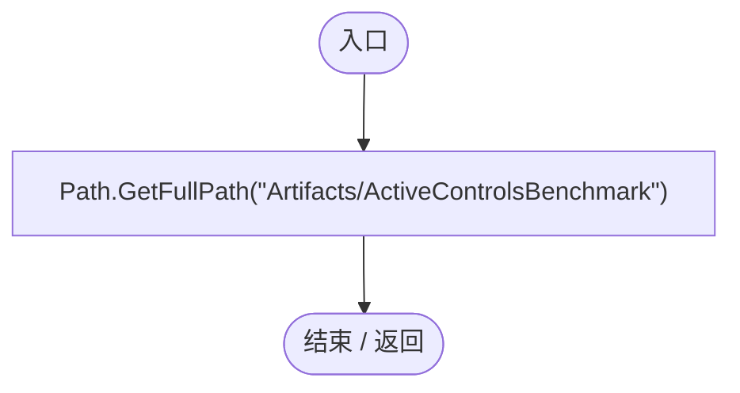

## ActiveSimulationBenchmark.ctor · L25

`static ActiveSimulationBenchmark()`

### Editor · Roslyn编译器控制流

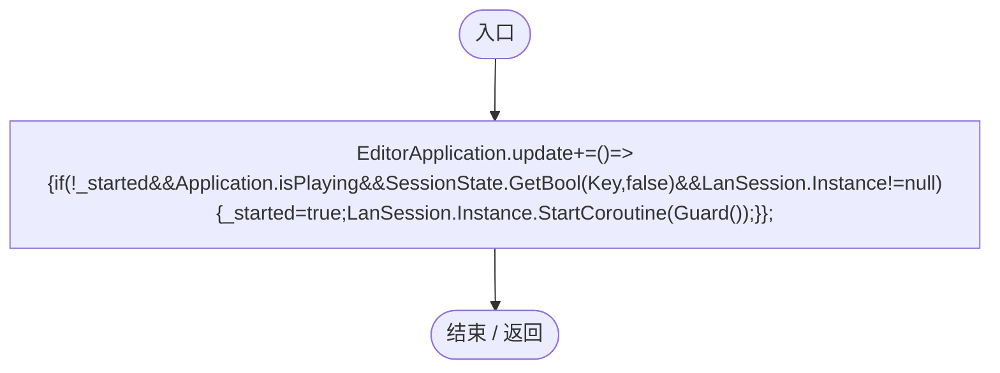

项目内调用/回调引用：

- [ActiveSimulationBenchmark.回调@25 · L25](7532f6e210474791.md#m5a34d101c574d371)（回调/委托）

## 回调@25 · L25

`( … => 回调`

### Editor · Roslyn编译器控制流

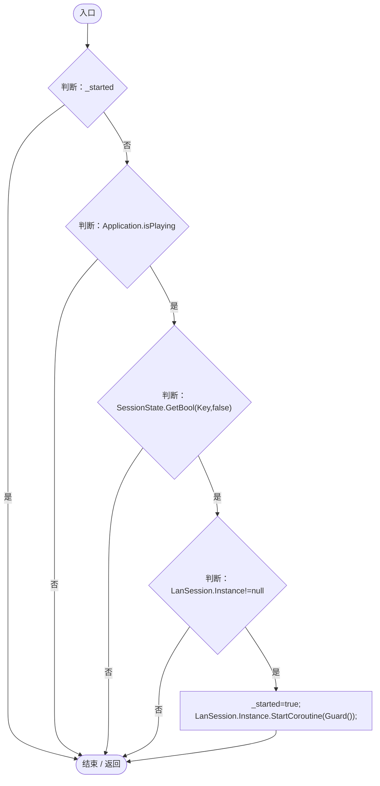

项目内调用/回调引用：

- [LanSession.Instance.get · L23](9fb633eebffe669c.md#mbf83306994878383)（访问器）
- [ActiveSimulationBenchmark.Guard · L27](7532f6e210474791.md#m98f362202b7464e0)（方法）

## RunBatch · L26

`public static void RunBatch()`

### Editor · Roslyn编译器控制流

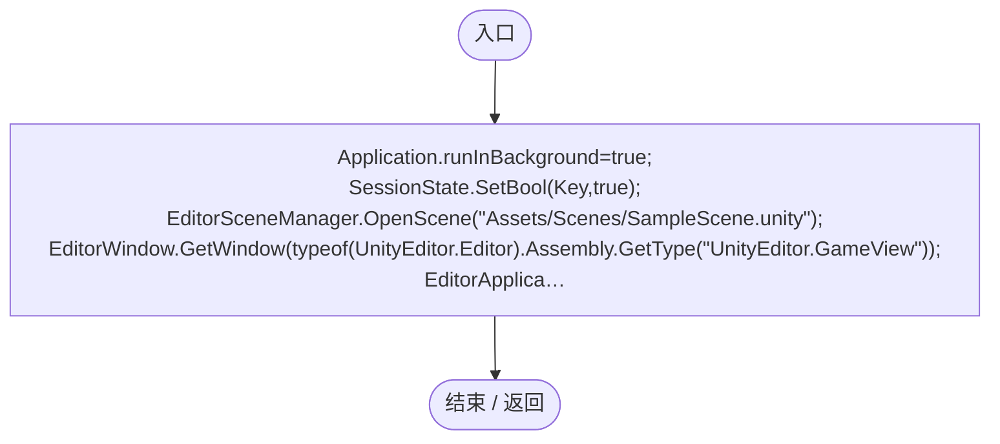

## Guard · L27

`private static IEnumerator Guard()`

### Editor · Roslyn编译器控制流

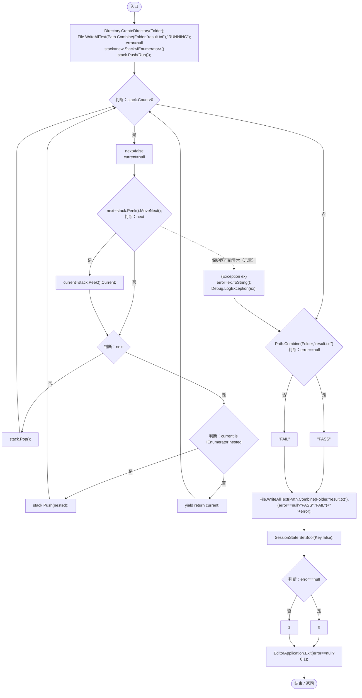

项目内调用/回调引用：

- [ActiveSimulationBenchmark.Run · L42](7532f6e210474791.md#m1f18c32d76611030)（方法）

## Counters · L33

`private static Dictionary<string,long> Counters()`

### Editor · Roslyn编译器控制流

```mermaid
flowchart TD
  b0(["入口"])
  b1{"values=new Dictionary&lt;string,long&gt;()<br/>type=typeof(ActiveSimulationPlan)<br/>判断：type!=null"}
  b2["type.GetFields(BindingFlags.Public&#124;BindingFlags.Static)"]
  b3{"判断：type.GetFields(BindingFlags.Public&#124;BindingFlags.Static)"}
  b4{"var<br/>判断：f.FieldType==typeof(long)"}
  b5["values[f.Name]=(long)f.GetValue(null);"]
  b6{"type.GetFields(BindingFlags.Public&#124;BindingFlags.Static)<br/>判断：type.GetFields(BindingFlags.Public&#124;BindingFlags.Static)"}
  b7["type.GetFields(BindingFlags.Public&#124;BindingFlags.Static)"]
  b8["连接 / 离开区域"]
  b9["结果：values"]
  b10(["结束 / 返回"])
  b0 --> b1
  b1 -->|"是"| b2
  b1 -->|"否"| b9
  b2 --> b3
  b3 -->|"是"| b4
  b3 -->|"否 · 经过finally 6"| b9
  b4 -->|"是"| b5
  b4 -->|"否"| b3
  b5 --> b3
  b6 -->|"否"| b7
  b6 -->|"是"| b8
  b7 --> b8
  b9 -->|"返回"| b10
  b3 -. "退出保护区时 finally（示意）" .-> b6

```

## Sample · L35

`private static IEnumerator Sample(string name)`

### Editor · Roslyn编译器控制流

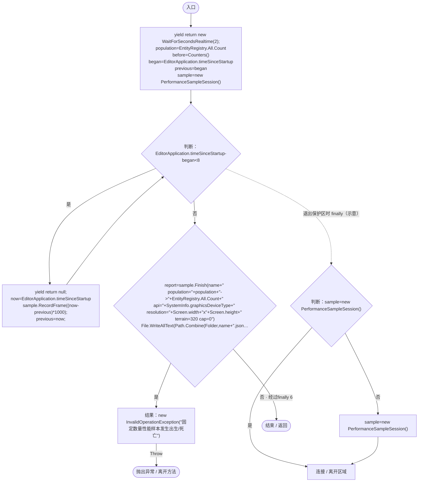

项目内调用/回调引用：

- [ActiveSimulationBenchmark.Counters · L33](7532f6e210474791.md#m801cec8529716927)（方法）
- [PerformanceSampleSession.PerformanceSampleSession.ctor · L42](a8403a4c7503726d.md#mdb6c2d364ec2e182)（构造函数）
- [PerformanceSampleSession.RecordFrame · L50](a8403a4c7503726d.md#mffe46035e5d5ed6a)（方法）
- [PerformanceSampleSession.Finish · L54](a8403a4c7503726d.md#md4418226b9a88150)（方法）
- [ActiveSimulationBenchmark.回调@40 · L40](7532f6e210474791.md#ma546e124aa3a2aa2)（回调/委托）
- [ActiveSimulationBenchmark.回调@40 · L40](7532f6e210474791.md#mad2a12793e32f147)（回调/委托）
- [ActiveSimulationBenchmark.回调@40 · L40](7532f6e210474791.md#m1dc1e3dd4581f729)（回调/委托）
- [ActiveSimulationBenchmark.回调@40 · L40](7532f6e210474791.md#mf6af1de42a13eaf8)（回调/委托）
- [ActiveSimulationBenchmark.回调@40 · L40](7532f6e210474791.md#mea06c6f1bd2b2538)（回调/委托）

## 回调@40 · L40

`p … => 回调`

### Editor · Roslyn编译器控制流

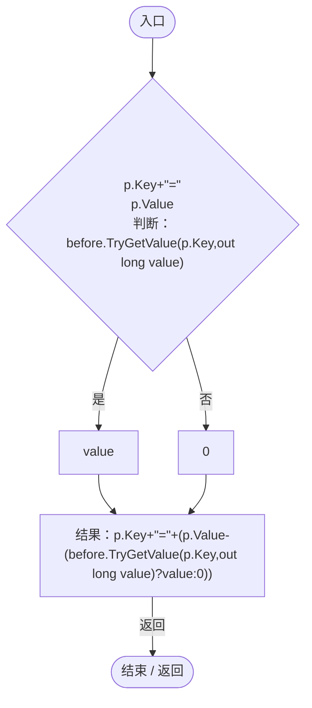

## 回调@40 · L40

`e … => 回调`

### Editor · Roslyn编译器控制流

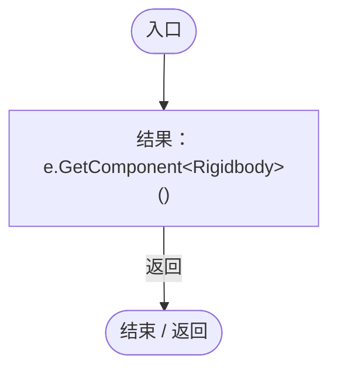

## 回调@40 · L40

`b … => 回调`

### Editor · Roslyn编译器控制流

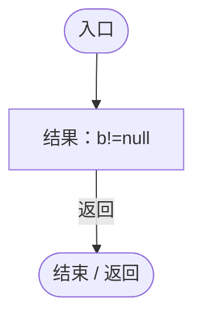

## 回调@40 · L40

`b … => 回调`

### Editor · Roslyn编译器控制流

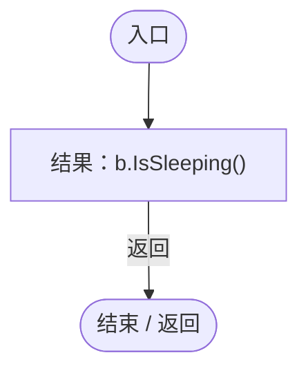

## 回调@40 · L40

`b … => 回调`

### Editor · Roslyn编译器控制流

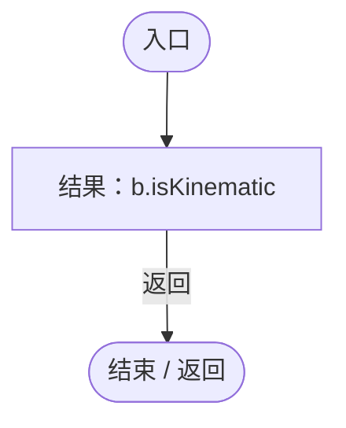

## Run · L42

`private static IEnumerator Run()`

### Editor · Roslyn编译器控制流

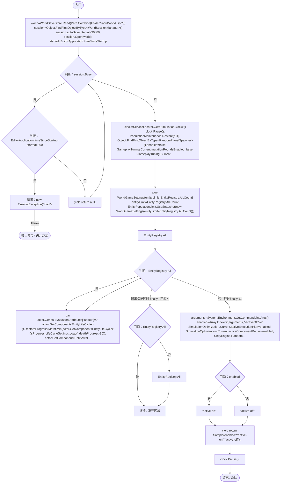

项目内调用/回调引用：

- [WorldSaveStore.Read · L74](d67a35e5e3814c15.md#mde52fadbe0185af1)（方法）
- [WorldSessionManager.Open · L60](08741c7b7b9d9344.md#m7bd56ef45131b4e5)（方法）
- [WorldSessionManager.Busy.get · L24](08741c7b7b9d9344.md#m4483e2e4f28f7c85)（访问器）
- [ServiceLocator.Get · L33](f2fdbe9f9ccd93cb.md#m2ae625299520c56d)（方法）
- [SimulationClock.Pause · L79](a8f444aec9614b0a.md#m30929d45a885d0f1)（方法）
- [PopulationMaintenance.Restore · L162](923ccc4e86c4786c.md#m23ae054ef57d2624)（方法）
- [GameplayTuning.Current.get · L46](db546e5713b32d53.md#m4fa691bd8a3b9618)（访问器）
- [FramePacingSettings.SetLimit · L19](8a946f816b77d4b6.md#mff17d0cc654b6a7f)（方法）
- [EntityPopulationLimit.UseSnapshot · L30](44f717c5df79d270.md#m735185cedc969868)（方法）
- [EntityGeneController.Evaluation.get · L20](7494d53178552f0e.md#mf275f100ea21601a)（访问器）
- [DarwinEntity.Genes.get · L14](70798dde169f2e8b.md#m622eb1adf401d431)（访问器）
- [EntityLifeCycle.RestoreProgress · L53](9f4138bfbae654b7.md#m9ac5190ce2d7c425)（方法）
- [EntityLifeCycle.Progress.get · L12](9f4138bfbae654b7.md#md607c90b6934f95f)（访问器）
- [LifeCycleSettings.Load · L16](ace76969fe8f61de.md#m6fe263852e5a8989)（方法）
- [SimulationOptimization.Current.get · L30](11c9091e70893352.md#mcfa8eb2e650e57b1)（访问器）
- [SimulationClock.Play · L78](a8f444aec9614b0a.md#m7aa9e64b7de60ed0)（方法）
- [ActiveSimulationBenchmark.Sample · L35](7532f6e210474791.md#m81eb294370b74425)（方法）
