# EntityStats.cs

[返回总索引](../README.md) · `Runtime` · `Assets/DarwinPark/Entities/Stats/EntityStats.cs`

[源文件](../../../Assets/DarwinPark/Entities/Stats/EntityStats.cs) · 源码校验：`7d3512f70ccbb88f939a540b6a59d67f9336e147fb70f43cdac2936441b4883c`

方法按源文件位置排列。事件/回调引用不表示立即执行；分支与异常说明见总索引。完整源码与可点击关系图请打开离线手册。

## ValueRevision.get · L11

`get`

### Editor / Player · 语法控制结构 / 声明（非CFG）

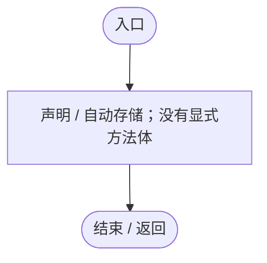

## ValueRevision.set · L11

`private set`

### Editor / Player · 语法控制结构 / 声明（非CFG）

## Awake · L24

`private void Awake()`

### Editor / Player · Roslyn编译器控制流

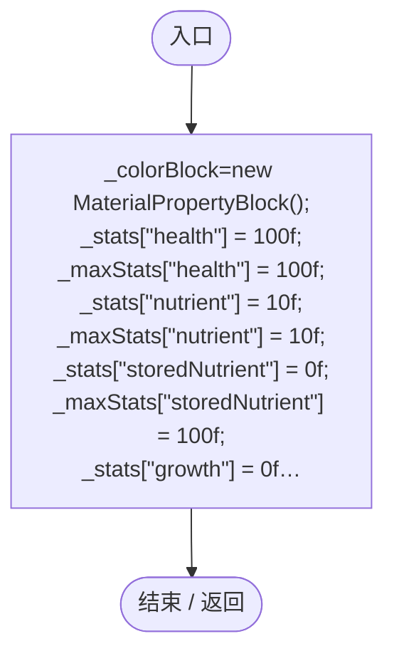

## Start · L36

`private void Start()`

### Editor / Player · Roslyn编译器控制流

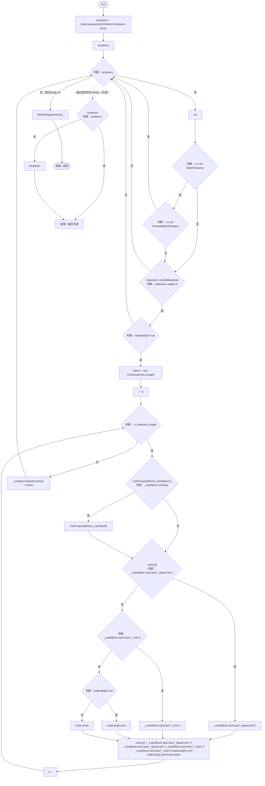

项目内调用/回调引用：

- [EntityStats.RefreshAppearance · L63](75aa86a368efdf24.md#mf66e0322cab3fa95)（方法）

## LateUpdate · L62

`private void LateUpdate()`

★ 新增：在最后渲染前组合受击色和种群配色；出生、读档、换群和暂停时的配置修改都能生效。

### Editor / Player · Roslyn编译器控制流

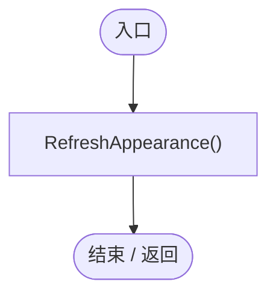

项目内调用/回调引用：

- [EntityStats.RefreshAppearance · L63](75aa86a368efdf24.md#mf66e0322cab3fa95)（方法）

## RefreshAppearance · L63

`private void RefreshAppearance()`

### Editor / Player · Roslyn编译器控制流

```mermaid
flowchart TD
  b0(["入口"])
  b1{"判断：_population==null"}
  b2["_population=DarwinPark.Core.OptionalComponent.Read&lt;Ecology.PopulationBehavior&gt;(this);"]
  b3{"判断：_population!=null"}
  b4{"判断：_population.Active"}
  b5{"Ecology.PopulationArchive.Find(_population.GroupId)<br/>判断：Ecology.PopulationArchive.Find(_population.GroupId)"}
  b6[".syncEntityColor"]
  b7["Ecology.PopulationArchive.Find(_population.GroupId)"]
  b8["Ecology.PopulationArchive.Find(_population.GroupId)?.syncEntityColor==true"]
  b9["_population!=null&amp;&amp;_population.Active&amp;&amp;Ecology.PopulationArchive.Find(_population.GroupId)?.syncEntityColor==true"]
  b10["sync=_population!=null&amp;&amp;_population.Active&amp;&amp;Ecology.PopulationArchive.Find(_population.GroupId)?.syncEntityColor==true"]
  b11{"判断：sync"}
  b12["Ecology.ColonyAppearance.ColorFor(_population.GroupId)"]
  b13["Color.white"]
  b14["color=sync?Ecology.ColonyAppearance.ColorFor(_population.GroupId):Color.white"]
  b15{"判断：sync==_appliedSync"}
  b16{"判断：_isFlashing==_appliedFlash"}
  b17{"判断：sync"}
  b18{"判断：color==_appliedColor"}
  b19["_appliedSync=sync;<br/>_appliedFlash=_isFlashing;<br/>_appliedColor=color;"]
  b20["_rendererOriginalColors"]
  b21{"判断：_rendererOriginalColors"}
  b22{"var<br/>判断：pair.Key==null"}
  b23["i=0"]
  b24{"判断：i&lt;pair.Value.Length"}
  b25{"判断：_isFlashing"}
  b26["Color.red"]
  b27{"判断：sync"}
  b28["color"]
  b29["pair.Value[i]"]
  b30["body=_isFlashing?Color.red:sync?color:pair.Value[i]"]
  b31{"body.a=pair.Value[i].a;<br/>pair.Key.GetPropertyBlock(_colorBlock,i);<br/>判断：_colorBlock.isEmpty"}
  b32["pair.Key.GetPropertyBlock(_colorBlock);"]
  b33["_colorBlock.SetColor(&quot;_BaseColor&quot;,body);<br/>_colorBlock.SetColor(&quot;_Color&quot;,body);<br/>pair.Key.SetPropertyBlock(_colorBlock,i);"]
  b34["i++"]
  b35["_rendererOriginalColors"]
  b36(["结束 / 返回"])
  b0 --> b1
  b1 -->|"是"| b2
  b1 -->|"否"| b3
  b2 --> b3
  b3 -->|"是"| b4
  b3 -->|"否"| b9
  b4 -->|"是"| b5
  b4 -->|"否"| b9
  b5 -->|"否"| b6
  b5 -->|"是"| b7
  b6 --> b8
  b7 --> b8
  b8 --> b10
  b9 --> b10
  b10 --> b11
  b11 -->|"是"| b12
  b11 -->|"否"| b13
  b12 --> b14
  b13 --> b14
  b14 --> b15
  b15 -->|"是"| b16
  b15 -->|"否"| b19
  b16 -->|"是"| b17
  b16 -->|"否"| b19
  b17 -->|"是"| b18
  b17 -->|"否"| b36
  b18 -->|"是"| b36
  b18 -->|"否"| b19
  b19 --> b20
  b20 --> b21
  b21 -->|"是"| b22
  b21 -->|"否 · 经过finally 35"| b36
  b22 -->|"是"| b21
  b22 -->|"否"| b23
  b23 --> b24
  b24 -->|"是"| b25
  b24 -->|"否"| b21
  b25 -->|"是"| b26
  b25 -->|"否"| b27
  b26 --> b30
  b27 -->|"是"| b28
  b27 -->|"否"| b29
  b28 --> b30
  b29 --> b30
  b30 --> b31
  b31 -->|"是"| b32
  b31 -->|"否"| b33
  b32 --> b33
  b33 --> b34
  b34 --> b24
  b21 -. "退出保护区时 finally（示意）" .-> b35

```

项目内调用/回调引用：

- [OptionalComponent.Read · L7](806c46b42ced4d36.md#m69622a4dee165c5a)（方法）
- [PopulationArchive.Find · L50](084e119b69cdd751.md#m842230bd55f69711)（方法）
- [PopulationBehavior.GroupId.get · L22](21e4f62f75a9a80f.md#me471d0106be463ca)（访问器）
- [ColonyAppearance.ColorFor · L9](e51c7c842d87a26d.md#m0ea090c43edf8334)（方法）

## OnDisable · L82

`private void OnDisable()`

### Editor / Player · Roslyn编译器控制流

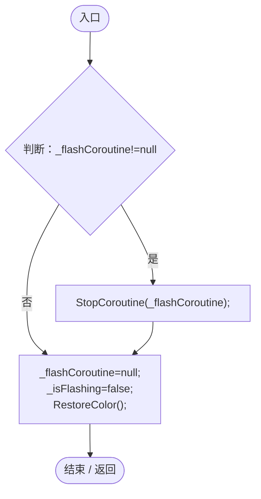

项目内调用/回调引用：

- [EntityStats.RestoreColor · L165](75aa86a368efdf24.md#m2b9fdb8e36574b99)（方法）

## CaptureValues · L89

`public List<DarwinPark.Entities.StatSaveValue> CaptureValues()`

★ 适配：数值与上限成对持久化，恢复时不触发受击闪烁或进食副作用。

### Editor / Player · Roslyn编译器控制流

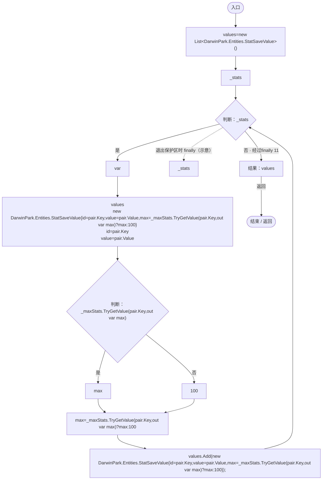

## RestoreValues · L91

`public void RestoreValues(List<DarwinPark.Entities.StatSaveValue> values)`

### Editor / Player · Roslyn编译器控制流

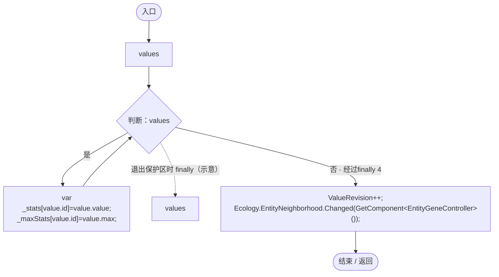

项目内调用/回调引用：

- [EntityStats.ValueRevision.set · L11](75aa86a368efdf24.md#md18ffecc681e201f)（访问器）
- [EntityStats.ValueRevision.get · L11](75aa86a368efdf24.md#m61d2673905656496)（访问器）
- [EntityNeighborhood.Changed · L76](e5e24c4aff0395b1.md#m03f95c0e5929cf81)（方法）

## TryGet · L93

`public bool TryGet(string id, out float value)`

### Editor / Player · Roslyn编译器控制流

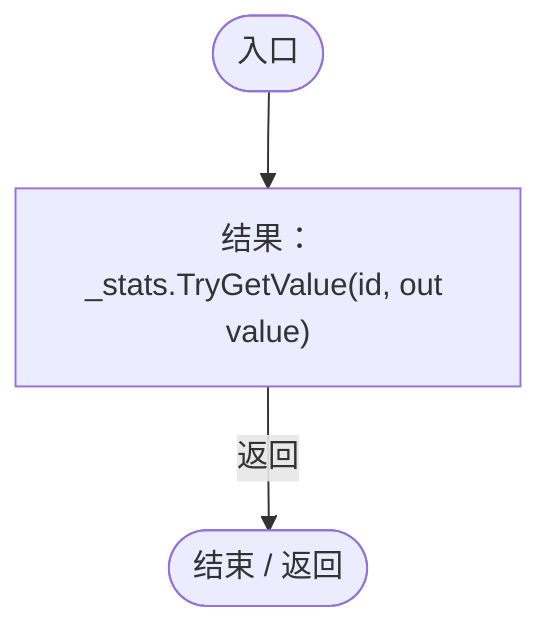

## CapacityRemaining · L95

`public float CapacityRemaining(string id)`

★ 适配：营养转移只需当前空位，不应每帧构造整份存档数值列表。

### Editor / Player · Roslyn编译器控制流

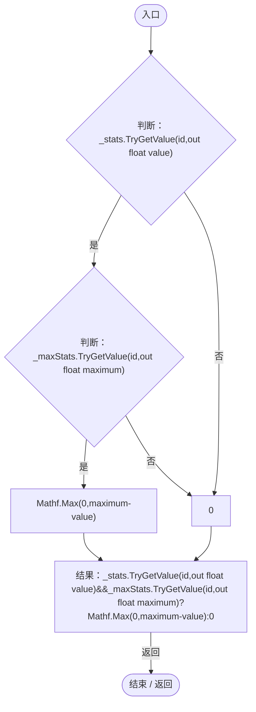

## Feed · L98

`public void Feed(float amount)`

★ 新增：进食先补饱食度，溢出进入储存；猎食收益不因饱食度上限而丢失。

### Editor / Player · Roslyn编译器控制流

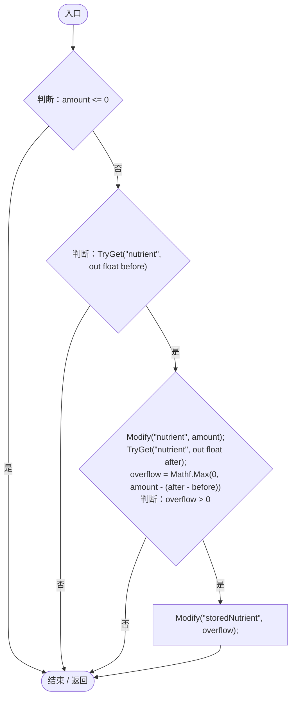

项目内调用/回调引用：

- [EntityStats.TryGet · L93](75aa86a368efdf24.md#m03cef847022eee28)（方法）
- [EntityStats.Modify · L107](75aa86a368efdf24.md#mf17c464aaa04f6f2)（方法）

## Modify · L107

`public void Modify(string id, float delta)`

### Editor / Player · Roslyn编译器控制流

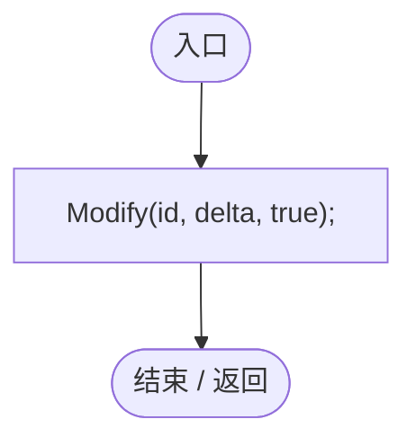

项目内调用/回调引用：

- [EntityStats.Modify · L114](75aa86a368efdf24.md#m375a3812ef990b45)（方法）

## Modify · L114

`public void Modify(string id, float delta, bool playHitFlash)`

★ 适配：环境持续伤害每帧都会调用，关闭闪烁避免实体长期变红；  捕食/饥饿等瞬时伤害仍走原来的闪烁路径。

### Editor / Player · Roslyn编译器控制流

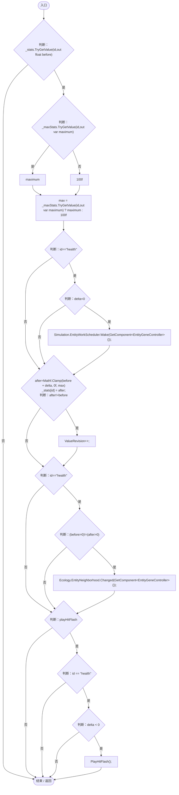

项目内调用/回调引用：

- [EntityWorkScheduler.Wake · L73](465ccdbb260bcac2.md#m681ac7b8924497e4)（方法）
- [EntityStats.ValueRevision.set · L11](75aa86a368efdf24.md#md18ffecc681e201f)（访问器）
- [EntityStats.ValueRevision.get · L11](75aa86a368efdf24.md#m61d2673905656496)（访问器）
- [EntityNeighborhood.Changed · L76](e5e24c4aff0395b1.md#m03f95c0e5929cf81)（方法）
- [EntityStats.PlayHitFlash · L142](75aa86a368efdf24.md#mce4d5becf889dbba)（方法）

## SetMax · L134

`public void SetMax(string id, float max)`

### Editor / Player · Roslyn编译器控制流

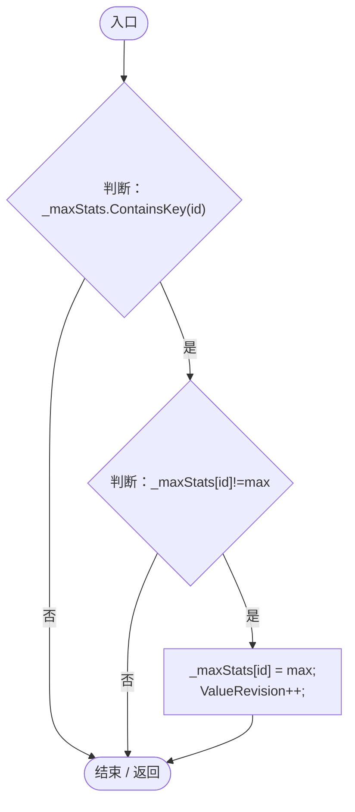

项目内调用/回调引用：

- [EntityStats.ValueRevision.set · L11](75aa86a368efdf24.md#md18ffecc681e201f)（访问器）
- [EntityStats.ValueRevision.get · L11](75aa86a368efdf24.md#m61d2673905656496)（访问器）

## PlayHitFlash · L142

`private void PlayHitFlash()`

  触发受击变红闪烁  

### Editor / Player · Roslyn编译器控制流

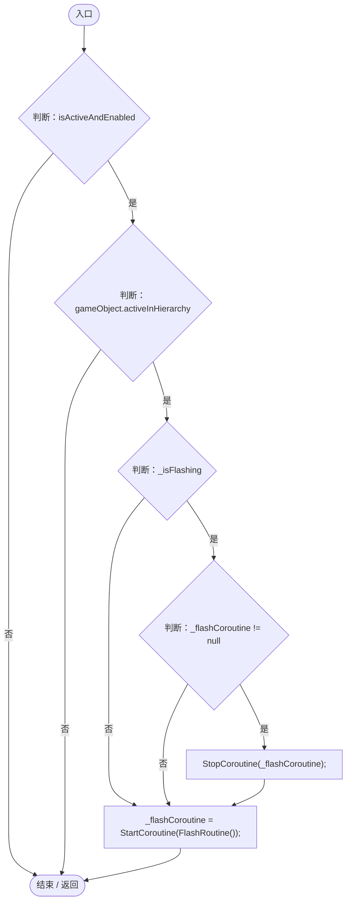

项目内调用/回调引用：

- [EntityStats.FlashRoutine · L155](75aa86a368efdf24.md#m30f20c6b773adacd)（方法）

## FlashRoutine · L155

`private IEnumerator FlashRoutine()`

### Editor / Player · Roslyn编译器控制流

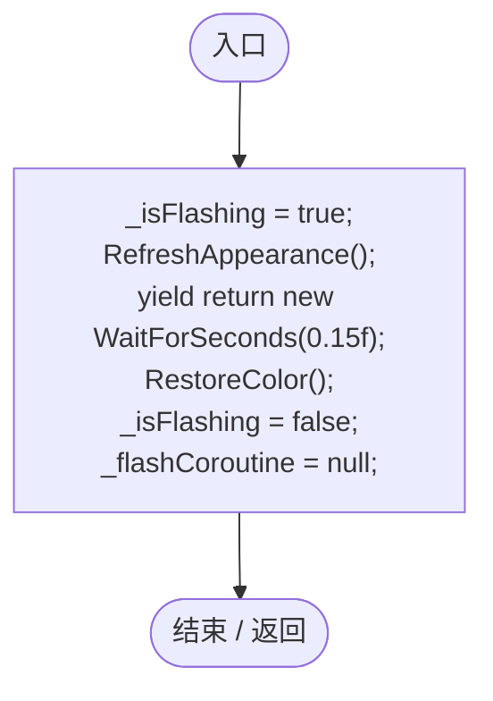

项目内调用/回调引用：

- [EntityStats.RefreshAppearance · L63](75aa86a368efdf24.md#mf66e0322cab3fa95)（方法）
- [EntityStats.RestoreColor · L165](75aa86a368efdf24.md#m2b9fdb8e36574b99)（方法）

## RestoreColor · L165

`private void RestoreColor()`

### Editor / Player · Roslyn编译器控制流

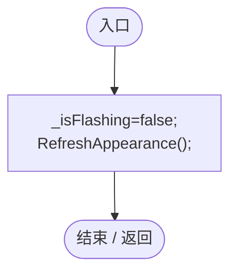

项目内调用/回调引用：

- [EntityStats.RefreshAppearance · L63](75aa86a368efdf24.md#mf66e0322cab3fa95)（方法）
