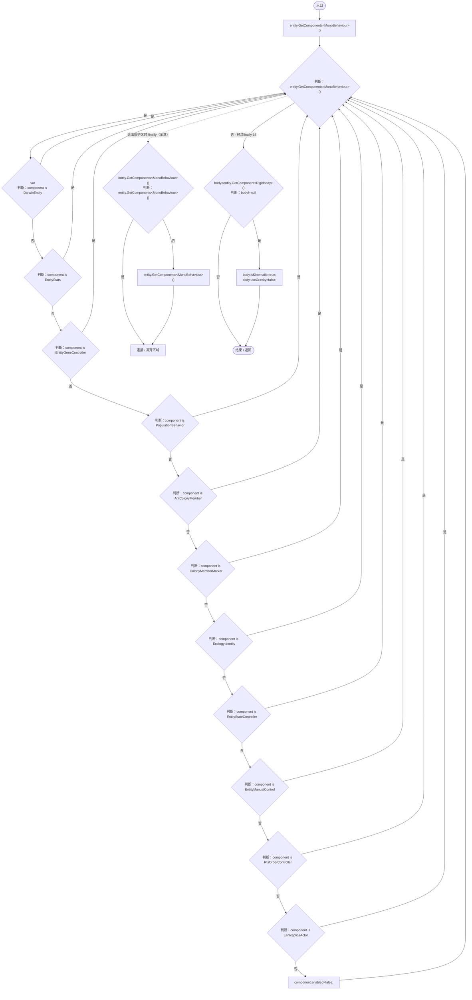
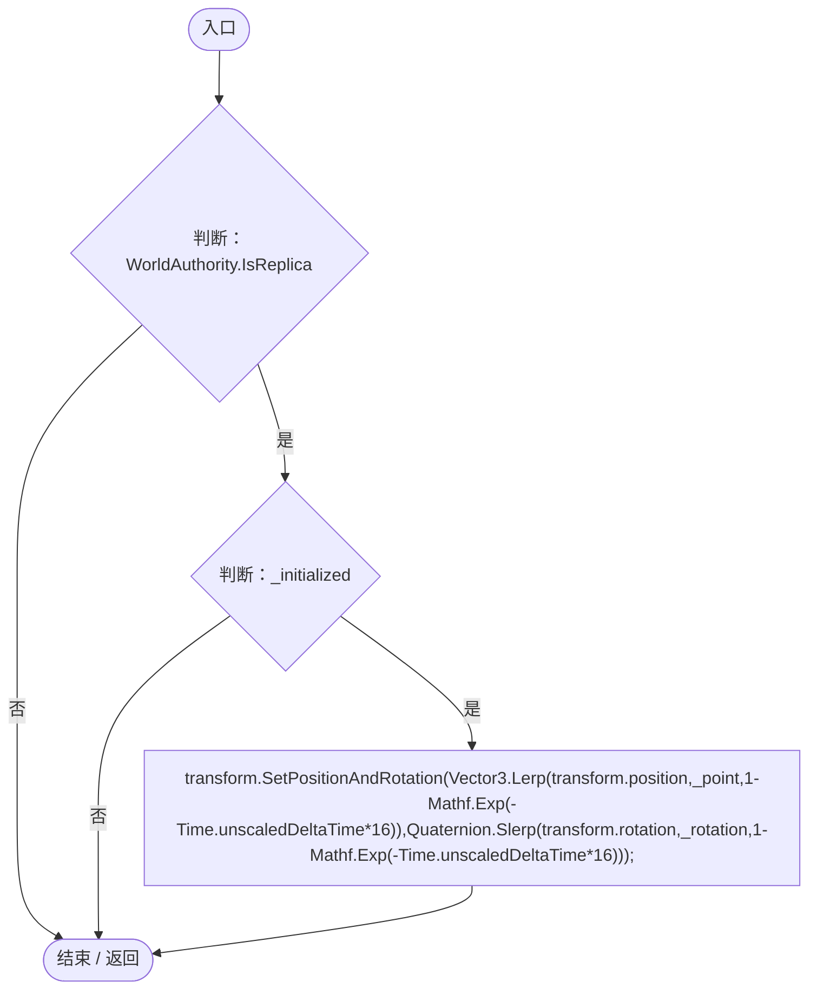

# LanReplicaActor.cs

[返回总索引](../README.md) · `Runtime` · `Assets/DarwinPark/UI/LanReplicaActor.cs`

[源文件](../../../Assets/DarwinPark/UI/LanReplicaActor.cs) · 源码校验：`19e3bd15c2829e1ce6b27179a91ccfa8d29a03c816dc5f9e6dd664d10fad69bd`

方法按源文件位置排列。事件/回调引用不表示立即执行；分支与异常说明见总索引。完整源码与可点击关系图请打开离线手册。

## Freeze · L14

`public static void Freeze(DarwinEntity entity)`

### Editor / Player · Roslyn编译器控制流

## Apply · L20

`public void Apply(LanActor incoming)`

### Editor / Player · Roslyn编译器控制流

```mermaid
flowchart TD
  b0(["入口"])
  b1["entity=GetComponent&lt;DarwinEntity&gt;()<br/>saved=incoming.state<br/>genes=entity.Genes<br/>genome=JsonUtility.ToJson(saved.genome)"]
  b2{"判断：genome!=_genome"}
  b3{"判断：genes.CurrentAge!=saved.age"}
  b4{"判断：genes.IsGestating!=saved.gestating"}
  b5["Mathf.Abs(genes.EnvironmentGeneSuppression-incoming.suppression)&gt;.001f"]
  b6["genome!=_genome&#124;&#124;genes.CurrentAge!=saved.age&#124;&#124;genes.IsGestating!=saved.gestating&#124;&#124;Mathf.Abs(genes.EnvironmentGeneSuppression-incoming.suppression)&gt;.001f"]
  b7["expression=genome!=_genome&#124;&#124;genes.CurrentAge!=saved.age&#124;&#124;genes.IsGestating!=saved.gestating&#124;&#124;Mathf.Abs(genes.EnvironmentGeneSuppression-incoming.suppression)&gt;.001f"]
  b8{"判断：expression"}
  b9["genes.Genome=saved.genome;<br/>genes.EnvironmentGeneSuppression=incoming.suppression;<br/>genes.IsGestating=saved.gestating;<br/>genes.RestoreStageState(saved.age,saved.mutatedStages,saved.stageChecks);<br/>genes.Recalculate();<br/>_genome=genome;"]
  b10["GetComponent&lt;EntityStats&gt;().RestoreValues(saved.stats);<br/>entity.DisplayName=saved.name;<br/>transform.localScale=saved.scale;"]
  b11{"saved.ecology<br/>判断：saved.ecology"}
  b12[".groupId"]
  b13["saved.ecology"]
  b14{"判断：saved.ecology?.groupId"}
  b15["saved.ecology?.groupId"]
  b16["&quot;&quot;"]
  b17["(saved.ecology?.groupId??&quot;&quot;)+&quot;&#124;&quot;"]
  b18{"saved.ecology<br/>判断：saved.ecology"}
  b19[".ant"]
  b20{"判断：.ant"}
  b21[".role"]
  b22["saved.ecology?.ant?.role"]
  b23{"判断：saved.ecology?.ant?.role"}
  b24["saved.ecology?.ant?.role"]
  b25["&quot;&quot;"]
  b26["role=(saved.ecology?.groupId??&quot;&quot;)+&quot;&#124;&quot;+(saved.ecology?.ant?.role??&quot;&quot;)"]
  b27{"判断：_initialized"}
  b28{"判断：role!=_role"}
  b29{"saved.ecology<br/>判断：saved.ecology"}
  b30["saved.ecology?.Restore(entity);"]
  b31["_role=role;"]
  b32{"saved.ecology<br/>判断：saved.ecology"}
  b33[".rts"]
  b34["saved.ecology"]
  b35{"判断：saved.ecology?.rts!=null"}
  b36["RtsOrderController.Ensure(entity).Restore(saved.ecology.rts);"]
  b37{"判断：saved.ecology!=null"}
  b38{"GetComponent&lt;EntityStateController&gt;()<br/>判断：GetComponent&lt;EntityStateController&gt;()"}
  b39["GetComponent&lt;EntityStateController&gt;()?.Restore(saved.ecology.entityStateId);"]
  b40{"_point=saved.position;<br/>_rotation=saved.rotation;<br/>判断：_initialized"}
  b41{"判断：Vector3.Distance(transform.position,_point)&gt;40"}
  b42["transform.SetPositionAndRotation(_point,_rotation);"]
  b43{"_initialized=true;<br/>Freeze(entity);<br/>NutritionReplicaPresentation.Apply(entity,saved.ecology);<br/>判断：expression"}
  b44["inspector=FindFirstObjectByType&lt;GeneInspectorUI&gt;()"]
  b45{"inspector<br/>判断：inspector"}
  b46[".CurrentEntity"]
  b47["inspector"]
  b48{"判断：inspector?.CurrentEntity==entity"}
  b49["inspector.ShowEntityInfo(entity);"]
  b50(["结束 / 返回"])
  b0 --> b1
  b1 --> b2
  b2 -->|"否"| b3
  b2 -->|"是"| b6
  b3 -->|"否"| b4
  b3 -->|"是"| b6
  b4 -->|"否"| b5
  b4 -->|"是"| b6
  b5 --> b7
  b6 --> b7
  b7 --> b8
  b8 -->|"是"| b9
  b8 -->|"否"| b10
  b9 --> b10
  b10 --> b11
  b11 -->|"否"| b12
  b11 -->|"是"| b13
  b12 --> b14
  b13 --> b14
  b14 -->|"否"| b15
  b14 -->|"是"| b16
  b15 --> b17
  b16 --> b17
  b17 --> b18
  b18 -->|"否"| b19
  b18 -->|"是"| b22
  b19 --> b20
  b20 -->|"否"| b21
  b20 -->|"是"| b22
  b21 --> b23
  b22 --> b23
  b23 -->|"否"| b24
  b23 -->|"是"| b25
  b24 --> b26
  b25 --> b26
  b26 --> b27
  b27 -->|"是"| b28
  b27 -->|"否"| b29
  b28 -->|"是"| b29
  b28 -->|"否"| b32
  b29 -->|"否"| b30
  b29 -->|"是"| b31
  b30 --> b31
  b31 --> b32
  b32 -->|"否"| b33
  b32 -->|"是"| b34
  b33 --> b35
  b34 --> b35
  b35 -->|"是"| b36
  b35 -->|"否"| b37
  b36 --> b37
  b37 -->|"是"| b38
  b37 -->|"否"| b40
  b38 -->|"否"| b39
  b38 -->|"是"| b40
  b39 --> b40
  b40 -->|"是"| b41
  b40 -->|"否"| b42
  b41 -->|"是"| b42
  b41 -->|"否"| b43
  b42 --> b43
  b43 -->|"是"| b44
  b43 -->|"否"| b50
  b44 --> b45
  b45 -->|"否"| b46
  b45 -->|"是"| b47
  b46 --> b48
  b47 --> b48
  b48 -->|"是"| b49
  b48 -->|"否"| b50
  b49 --> b50

```

项目内调用/回调引用：

- [DarwinEntity.Genes.get · L14](70798dde169f2e8b.md#m622eb1adf401d431)（访问器）
- [EntityGeneController.CurrentAge.get · L34](7494d53178552f0e.md#m83a42c16950b22a4)（访问器）
- [EntityGeneController.RestoreStageState · L51](7494d53178552f0e.md#m6264213de2a5ca6f)（方法）
- [EntityGeneController.Recalculate · L97](7494d53178552f0e.md#m65ea735c1e0e37a1)（方法）
- [EntityStats.RestoreValues · L88](75aa86a368efdf24.md#m774f994eaa3183ca)（方法）
- [EcologySaveState.Restore · L42](dd1dde4b4c192659.md#m91672bc75a4694f7)（方法）
- [RtsOrderController.Restore · L64](cac3b6501f41ca35.md#mdeebce85c44da972)（方法）
- [RtsOrderController.Ensure · L18](cac3b6501f41ca35.md#mcd94009017493347)（方法）
- [EntityStateController.Restore · L100](0f8869eb7018091e.md#m5c730db919104ae6)（方法）
- [LanReplicaActor.Freeze · L14](75ae66582735754a.md#m1a47b8f5ab017d76)（方法）
- [NutritionReplicaPresentation.Apply · L14](a956a3ed597cf878.md#m6b9a951c280292a7)（方法）
- [GeneInspectorUI.ShowEntityInfo · L385](924e27c34e7b1f0a.md#mea69a0457b885287)（方法）

## LateUpdate · L36

`private void LateUpdate()`

### Editor / Player · Roslyn编译器控制流

