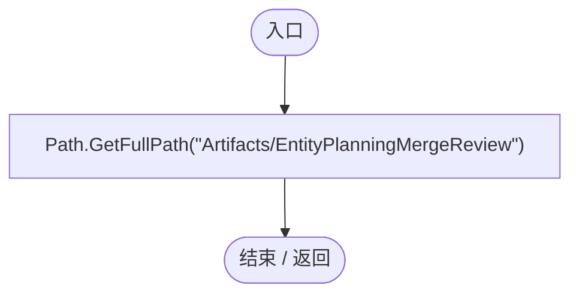
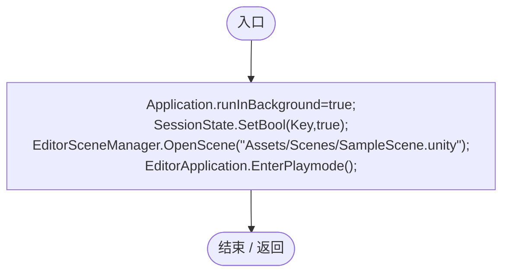
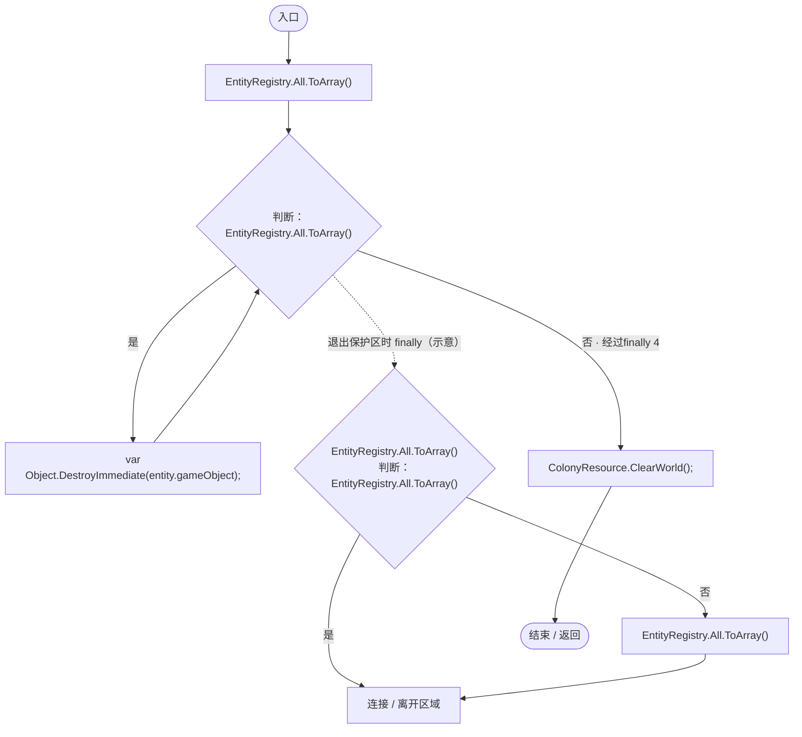
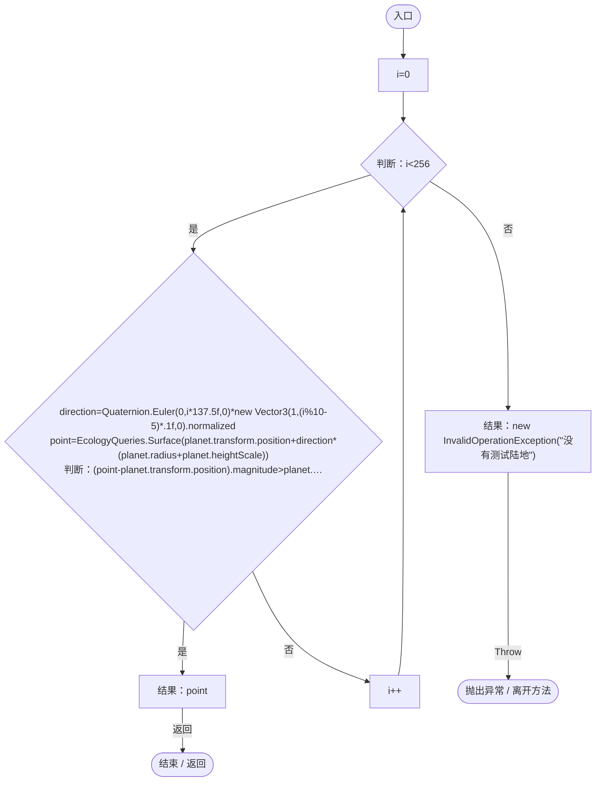
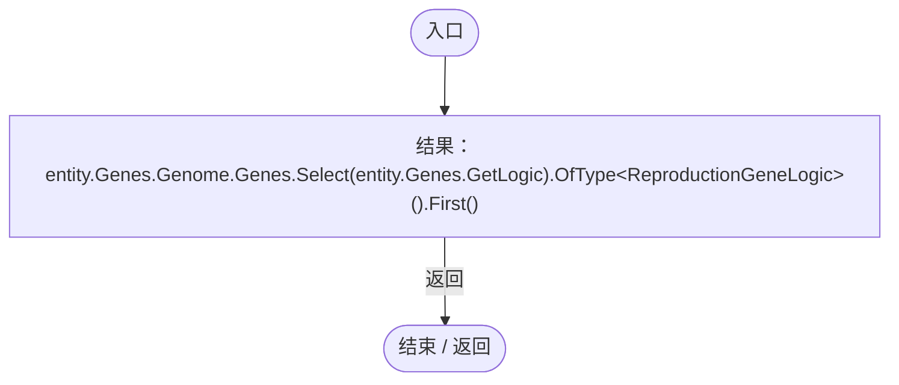
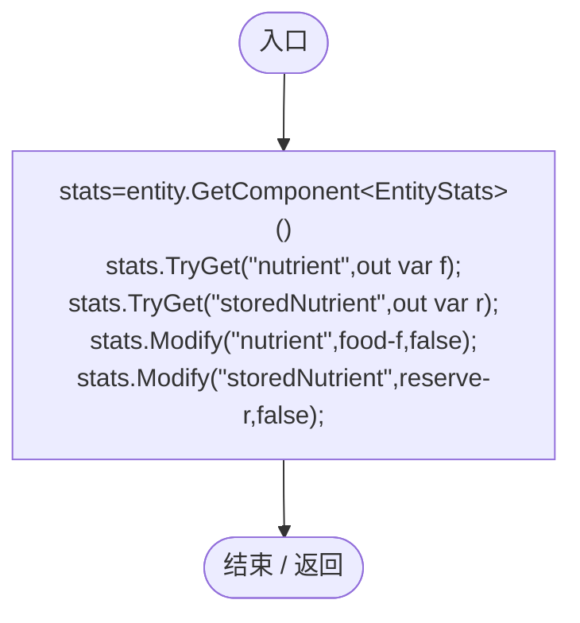
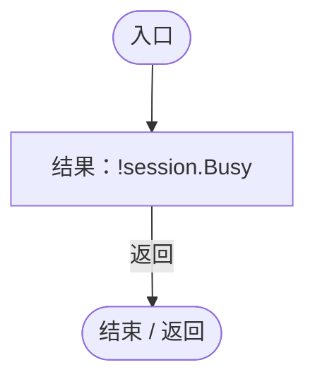
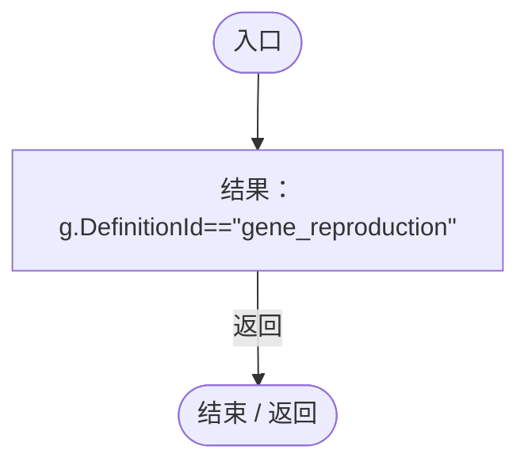
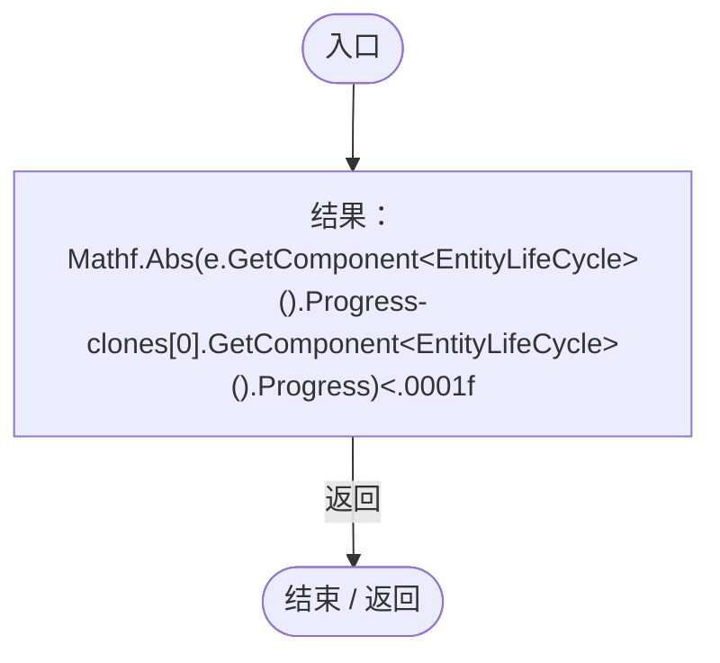
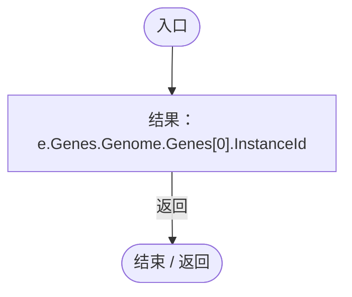

# EntityPlanningMergeRegression.cs

[返回总索引](../README.md) · `Editor` · `Assets/DarwinPark/Editor/EntityPlanningMergeRegression.cs`

[源文件](../../../Assets/DarwinPark/Editor/EntityPlanningMergeRegression.cs) · 源码校验：`a7df613a1a0c9e4acaff80af686bb64a2c7a3315b5c5cc0dc6bd5f40b4f8ab37`

方法按源文件位置排列。事件/回调引用不表示立即执行；分支与异常说明见总索引。完整源码与可点击关系图请打开离线手册。

<a id="m71f0ed2d27646d7e"></a>

## Folder.get · L30

`private static string Folder`


### Editor · 语法控制结构 / 声明（非CFG）



<a id="m4065dad26d9f737c"></a>

## EntityPlanningMergeRegression.ctor · L31

`static EntityPlanningMergeRegression()`


### Editor · Roslyn编译器控制流


项目内调用/回调引用：

- [EntityPlanningMergeRegression.回调@31 · L31](763da58492f54d4c.md#mded1870c9c178f68)（回调/委托）

<a id="mded1870c9c178f68"></a>

## 回调@31 · L31

`( … => 回调`


### Editor · Roslyn编译器控制流


项目内调用/回调引用：

- [LanSession.Instance.get · L23](9fb633eebffe669c.md#mbf83306994878383)（访问器）
- [EntityPlanningMergeRegression.Guard · L34](763da58492f54d4c.md#m18a99218570352ad)（方法）

<a id="m5a6ed3c2b40b4d73"></a>

## RunBatch · L32

`public static void RunBatch()`


### Editor · Roslyn编译器控制流



<a id="m02a9e61a69711542"></a>

## Check · L33

`private static void Check(bool value,string message)`


### Editor · Roslyn编译器控制流


<a id="m18a99218570352ad"></a>

## Guard · L34

`private static IEnumerator Guard()`


### Editor · Roslyn编译器控制流


项目内调用/回调引用：

- [EntityPlanningMergeRegression.Run · L59](763da58492f54d4c.md#m962420c9efd80f95)（方法）

<a id="m58b835ed2f639d18"></a>

## Wait · L40

`private static IEnumerator Wait(Func<bool> done,string name)`


### Editor · Roslyn编译器控制流


<a id="mcb17864e21df5fd9"></a>

## Clear · L42

`private static void Clear()`


### Editor · Roslyn编译器控制流



项目内调用/回调引用：

- [ColonyResource.ClearWorld · L103](293dbaecfff4b585.md#mc8a8963f331b38de)（方法）

<a id="m69a44147f12bec87"></a>

## Spawn · L43

`private static DarwinEntity Spawn(Genome genome,Vector3 point,AgeState age=AgeState.Adult)`


### Editor · Roslyn编译器控制流


项目内调用/回调引用：

- [RandomSpawnRecipe.Clone · L23](923ccc4e86c4786c.md#me0949958df9c70e0)（方法）
- [DarwinEntity.Genes.get · L14](70798dde169f2e8b.md#m622eb1adf401d431)（访问器）
- [EntityLifeCycle.RestoreProgress · L50](9f4138bfbae654b7.md#m1e9381f9a38ed7be)（方法）
- [EntityGeneController.RestoreStageState · L53](7494d53178552f0e.md#m79f314a95ddba9bf)（方法）
- [EntityGeneController.Recalculate · L101](7494d53178552f0e.md#m3b78ff9955767303)（方法）
- [EntityPlanningMergeRegression.Registered · L45](763da58492f54d4c.md#me15f9c5228591e15)（局部函数）

<a id="me15f9c5228591e15"></a>

## Registered · L45

`void Registered(DarwinEntity entity)`


### Editor · Roslyn编译器控制流


<a id="mbbaef74c958110be"></a>

## Land · L52

`private static Vector3 Land(PlanetTerrainMeshBuilder planet)`


### Editor · Roslyn编译器控制流



项目内调用/回调引用：

- [EcologyQueries.Surface · L47](bdf7ccc2c9c0452f.md#m2f1f6873ee5fc8df)（方法）
- [PlanetTerrainMeshBuilder.WaterRadius.get · L94](415285cf043354a9.md#m28d8809083881ec1)（访问器）

<a id="m217d3b7412dc2b99"></a>

## Reproduction · L56

`private static ReproductionGeneLogic Reproduction(DarwinEntity entity)`


### Editor · Roslyn编译器控制流



项目内调用/回调引用：

- [DarwinEntity.Genes.get · L14](70798dde169f2e8b.md#m622eb1adf401d431)（访问器）
- [EntityGeneController.GetLogic · L216](7494d53178552f0e.md#m13c006db1e31b2bc)（方法）

<a id="mbe82a564d68bae3e"></a>

## Food · L57

`private static void Food(DarwinEntity entity,float food,float reserve)`


### Editor · Roslyn编译器控制流



项目内调用/回调引用：

- [EntityStats.TryGet · L90](75aa86a368efdf24.md#m24ee1433e4a70d94)（方法）
- [EntityStats.Modify · L111](75aa86a368efdf24.md#m9c837be197158240)（方法）

<a id="m962420c9efd80f95"></a>

## Run · L59

`private static IEnumerator Run()`


### Editor · Roslyn编译器控制流

```mermaid
flowchart TD
  b0(["入口"])
  b1["session=Object.FindFirstObjectByType&lt;WorldSessionManager&gt;()<br/>session.autoSaveInterval=36000;<br/>planet=Object.FindFirstObjectByType&lt;PlanetTerrainMeshBuilder&gt;()<br/>planet.subdivisions=24;<br/>typeof(WorldSessionManager).GetField(&quot;_initialTerrain&quot;,Pr…"]
  b2{"判断：tuning.baseMetabolismMultiplier==.5f"}
  b3{"判断：tuning.movementMetabolismMultiplier==.5f"}
  b4["tuning.nutritionGainMultiplier==.5f"]
  b5["tuning.baseMetabolismMultiplier==.5f&amp;&amp;tuning.movementMetabolismMultiplier==.5f&amp;&amp;tuning.nutritionGainMultiplier==.5f"]
  b6["Check(tuning.baseMetabolismMultiplier==.5f&amp;&amp;tuning.movementMetabolismMultiplier==.5f&amp;&amp;tuning.nutritionGainMultiplier==.5f,&quot;基础、行动与获取默认同时降至一半&quot;);"]
  b7{"GeneDatabase.Get(MultipleBirthEvolutionUpgrade.GeneId)<br/>判断：GeneDatabase.Get(MultipleBirthEvolutionUpgrade.GeneId)"}
  b8[".LogicScriptId"]
  b9["GeneDatabase.Get(MultipleBirthEvolutionUpgrade.GeneId)"]
  b10{"判断：GeneDatabase.Get(MultipleBirthEvolutionUpgrade.GeneId)?.LogicScriptId==&quot;MultipleBirthGeneLogic&quot;"}
  b11["GeneTreeStorage.Active.edges.Any(e=&gt;e.from==MultipleBirthEvolutionUpgrade.SourceGeneId&amp;&amp;e.to==MultipleBirthEvolutionUpgrade.GeneId&amp;&amp;e.kind==&quot;error&quot;)"]
  b12["GeneDatabase.Get(MultipleBirthEvolutionUpgrade.GeneId)?.LogicScriptId==&quot;MultipleBirthGeneLogic&quot;"]
  b13["Check(GeneDatabase.Get(MultipleBirthEvolutionUpgrade.GeneId)?.LogicScriptId==&quot;MultipleBirthGeneLogic&quot;&amp;&amp;GeneTreeStorage.Active.edges.Any(e=&gt;e.from==MultipleBirthEvolutionUpgrade.SourceGeneId&amp;&amp;e.to==MultipleBirthEvolutionUpgrade.GeneId&amp;&amp;e.…"]
  b14["home=Land(planet)<br/>producer=EcologyDefaults.Template(&quot;producer&quot;).CreateGenome()<br/>producer.Genes.RemoveAll(g=&gt;g.DefinitionId==&quot;gene_reproduction&quot;);<br/>scheduler=Object.FindFirstObjectByType&lt;EntityWorkScheduler&gt;()<br/>Check(scheduler!=null,&quot;游戏根节点实际…"]
  b15["i=0"]
  b16{"判断：i&lt;24"}
  b17["clones.Add(Spawn(producer,home+Vector3.right*((i%6)*.35f)+Vector3.forward*(i/6*.35f)));<br/>i++"]
  b18["far=Spawn(producer,home+Vector3.right*tuning.mergeRadius*4)<br/>changed=RandomSpawnRecipe.Clone(producer)<br/>changed.Genes.First(g=&gt;g.DefinitionId==&quot;gene_repair&quot;).Value=61;<br/>different=Spawn(changed,home+Vector3.forward*2)"]
  b19["EntityRegistry.All"]
  b20{"判断：EntityRegistry.All"}
  b21["var<br/>Food(entity,10,30);"]
  b22{"判断：EntityRegistry.All"}
  b23["EntityRegistry.All"]
  b24["连接 / 离开区域"]
  b25["baseline=clones.Select(EntitySaveState.Capture).ToArray()<br/>beforeLife=clones[0].GetComponent&lt;EntityLifeCycle&gt;().Progress<br/>representatives=scheduler.RepresentativeSteps<br/>shared=scheduler.SharedMemberSteps<br/>scheduler.Advance(.5f);"]
  b26{"判断：scheduler.SharedMemberSteps-shared&gt;=23*5"}
  b27["scheduler.RepresentativeSteps-representatives&lt;=3*5"]
  b28["scheduler.SharedMemberSteps-shared&gt;=23*5"]
  b29["Check(scheduler.SharedMemberSteps-shared&gt;=23*5&amp;&amp;scheduler.RepresentativeSteps-representatives&lt;=3*5,&quot;24个近邻共享代表基础计算，远处或不同基因分组&quot;);"]
  b30{"判断：clones.All(e=&gt;Mathf.Abs(e.GetComponent&lt;EntityLifeCycle&gt;().Progress-clones[0].GetComponent&lt;EntityLifeCycle&gt;().Progress)&lt;.0001f)"}
  b31["clones[0].GetComponent&lt;EntityLifeCycle&gt;().Progress&gt;beforeLife"]
  b32["clones.All(e=&gt;Mathf.Abs(e.GetComponent&lt;EntityLifeCycle&gt;().Progress-clones[0].GetComponent&lt;EntityLifeCycle&gt;().Progress)&lt;.0001f)"]
  b33["Check(clones.All(e=&gt;Mathf.Abs(e.GetComponent&lt;EntityLifeCycle&gt;().Progress-clones[0].GetComponent&lt;EntityLifeCycle&gt;().Progress)&lt;.0001f)&amp;&amp;clones[0].GetComponent&lt;EntityLifeCycle&gt;().Progress&gt;beforeLife,&quot;合并成员各自保留寿命且继续成长&quot;);"]
  b34{"判断：clones.Select(e=&gt;EcologyIdentity.Of(e)).Distinct().Count()==24"}
  b35["clones.Select(e=&gt;e.Genes.Genome.Genes[0].InstanceId).Distinct().Count()==24"]
  b36["clones.Select(e=&gt;EcologyIdentity.Of(e)).Distinct().Count()==24"]
  b37["Check(clones.Select(e=&gt;EcologyIdentity.Of(e)).Distinct().Count()==24&amp;&amp;clones.Select(e=&gt;e.Genes.Genome.Genes[0].InstanceId).Distinct().Count()==24,&quot;合并计算不合并实体或基因实例身份&quot;);"]
  b38["Check(clones.All(e=&gt;(StationaryCohortKernel.Values(e.GetComponent&lt;EntityStats&gt;())-StationaryCohortKernel.Values(clones[0].GetComponent&lt;EntityStats&gt;())).sqrMagnitude&lt;.00001f),&quot;代表营养变化应用给全部兼容近邻&quot;);<br/>merged=StationaryCohortKernel.Values(clones…"]
  b39["index=0"]
  b40{"判断：index&lt;clones.Count"}
  b41["baseline[index].Restore(clones[index]);<br/>index++"]
  b42["step=0"]
  b43{"判断：step&lt;5"}
  b44["clones"]
  b45{"判断：clones"}
  b46["var<br/>entity.Genes.AdvanceSimulation(.1f);<br/>entity.GetComponent&lt;EntityVitals&gt;().AdvanceShared(.1f);"]
  b47["clones"]
  b48["step++"]
  b49{"判断：(merged-StationaryCohortKernel.Values(clones[0].GetComponent&lt;EntityStats&gt;())).sqrMagnitude&lt;.000001f"}
  b50["Mathf.Abs(mergedLife-clones[0].GetComponent&lt;EntityLifeCycle&gt;().Progress)&lt;.00001f"]
  b51["(merged-StationaryCohortKernel.Values(clones[0].GetComponent&lt;EntityStats&gt;())).sqrMagnitude&lt;.000001f"]
  b52["Check((merged-StationaryCohortKernel.Values(clones[0].GetComponent&lt;EntityStats&gt;())).sqrMagnitude&lt;.000001f&amp;&amp;Mathf.Abs(mergedLife-clones[0].GetComponent&lt;EntityLifeCycle&gt;().Progress)&lt;.00001f,&quot;相同状态下共享结算与逐体计算的营养/寿命数值一致&quot;);"]
  b53["clones[1].GetComponent&lt;EntityStats&gt;().Modify(&quot;health&quot;,-5,false);<br/>scheduler.Advance(.1f);"]
  b54{"判断：EntityWorkScheduler.Dormant(clones[1].Genes)"}
  b55["clones.Skip(2).All(e=&gt;e.GetComponent&lt;EntityStats&gt;().CapacityRemaining(&quot;health&quot;)==0)"]
  b56["!EntityWorkScheduler.Dormant(clones[1].Genes)"]
  b57["Check(!EntityWorkScheduler.Dormant(clones[1].Genes)&amp;&amp;clones.Skip(2).All(e=&gt;e.GetComponent&lt;EntityStats&gt;().CapacityRemaining(&quot;health&quot;)==0),&quot;受伤实体立即拆组且伤害不传播给其他成员&quot;);"]
  b58["debt=EntitySaveState.Capture(clones[2])"]
  b59{"判断：debt.pendingSimulationTime&gt;0"}
  b60["JsonUtility.FromJson&lt;EntitySaveState&gt;(JsonUtility.ToJson(debt)).pendingSimulationTime==debt.pendingSimulationTime"]
  b61["debt.pendingSimulationTime&gt;0"]
  b62["Check(debt.pendingSimulationTime&gt;0&amp;&amp;JsonUtility.FromJson&lt;EntitySaveState&gt;(JsonUtility.ToJson(debt)).pendingSimulationTime==debt.pendingSimulationTime,&quot;欠算时间进入序列化快照&quot;);"]
  b63["session.SaveNow(false);<br/>pendingDisk=WorldSaveStore.Read(WorldSaveStore.FileFor(session.Current.id))<br/>Check(pendingDisk.entities.Any(e=&gt;e.pendingSimulationTime&gt;0),&quot;欠算时间实际落盘并通过完整世界校验&quot;);<br/>scheduler.enabled=false;<br/>old=clones[2].GetComponent&lt;En…"]
  b64{"判断：clones[2].Genes.PendingSimulationTime==0"}
  b65["clones[2].GetComponent&lt;EntityLifeCycle&gt;().Progress&gt;old"]
  b66["clones[2].Genes.PendingSimulationTime==0"]
  b67["Check(clones[2].Genes.PendingSimulationTime==0&amp;&amp;clones[2].GetComponent&lt;EntityLifeCycle&gt;().Progress&gt;old,&quot;停用合并后补清欠下时间&quot;);"]
  b68["scheduler.enabled=true;<br/>clones[2].Genes.PendingSimulationTime=12;<br/>EntityWorkScheduler.AdvanceUnscheduled(clones[2].Genes,.1f);<br/>Check(Mathf.Abs(clones[2].Genes.PendingSimulationTime-7)&lt;.0001f,&quot;大额欠算按每次补算上限分段处理，剩余时间继续保留&quot;);<br/>Check(clones[2].G…"]
  b69["clones"]
  b70{"判断：clones"}
  b71["var<br/>entity.GetComponent&lt;EntityLifeCycle&gt;().RestoreProgress(LifeCycleSettings.Load().adultProgress-.001f);<br/>entity.Genes.RestoreStageState(AgeState.Infant,1,1);<br/>entity.Genes.Recalculate();"]
  b72["clones"]
  b73["tuning.mutationAttemptsPerFrame=100;<br/>tuning.mergeQuietSeconds=0;<br/>skipped=GlobalMutationManager.MergedSkipped<br/>yield return null;<br/>scheduler.Advance(.5f);"]
  b74{"判断：GlobalMutationManager.MergedSkipped&gt;skipped"}
  b75["clones.All(e=&gt;e.Genes.CurrentAge==AgeState.Adult)"]
  b76["GlobalMutationManager.MergedSkipped&gt;skipped"]
  b77["Check(GlobalMutationManager.MergedSkipped&gt;skipped&amp;&amp;clones.All(e=&gt;e.Genes.CurrentAge==AgeState.Adult),&quot;近邻阶段变异只抽部分代表，但所有成员照常成年&quot;);"]
  b78["Check(clones.All(e=&gt;e.GetComponent&lt;EntityEnvironmentHazard&gt;().CurrentTemperature==0),&quot;共享、拆组和欠账补算尊重被禁用的环境组件&quot;);<br/>tuning.mergeGroupsPerFrame=1;<br/>scheduler.Advance(.5f);<br/>Check(EntityRegistry.All.Any(e=&gt;e.Genes.PendingSimulationTime&gt;=.49f),&quot;全局共…"]
  b79{"判断：EntityRegistry.All.Count==1"}
  b80["!ghost.gameObject.activeInHierarchy"]
  b81["EntityRegistry.All.Count==1"]
  b82["Check(EntityRegistry.All.Count==1&amp;&amp;!ghost.gameObject.activeInHierarchy,&quot;高优先级先处理后，已死亡的后续快照成员不能继续生产后代&quot;);"]
  b83["replicaBefore=StationaryCohortKernel.Values(killer.GetComponent&lt;EntityStats&gt;())<br/>WorldAuthority.IsReplica=true;<br/>clock.Play();<br/>typeof(EntityVitals).GetMethod(&quot;Update&quot;,Private).Invoke(killer.GetComponent&lt;EntityVitals&gt;(),null);<br/>clock.Pause()…"]
  b84{"判断：corpse!=null"}
  b85["Mathf.Abs(accepted.y+accepted.z+corpse.State.energy-biomass)&lt;.001f"]
  b86["corpse!=null"]
  b87["Check(corpse!=null&amp;&amp;Mathf.Abs(accepted.y+accepted.z+corpse.State.energy-biomass)&lt;.001f,&quot;降低捕猎获取后实际吸收加剩余尸体仍严格守恒&quot;);"]
  b88["Clear();<br/>yield return null;<br/>grades=new List&lt;ColonyResource&gt;()"]
  b89["new[]{10f,30,90,270,810}"]
  b90{"判断：new[]{10f,30,90,270,810}"}
  b91["float"]
  b92["grades<br/>new ColonyResourceSave{id=Guid.NewGuid().ToString(&quot;N&quot;),kind=ColonyResourceKind.Energy,group=Guid.NewGuid().ToString(&quot;N&quot;),energy=energy,local=EcologyQueries.ToLocal(home+Vector3.right*grades.Count*2),scale=Vector3.one}<br/>id=Guid.NewG…"]
  b93{"new[]{10f,30,90,270,810}<br/>判断：new[]{10f,30,90,270,810}"}
  b94["new[]{10f,30,90,270,810}"]
  b95["连接 / 离开区域"]
  b96["i=0"]
  b97{"判断：i&lt;5"}
  b98["block=new MaterialPropertyBlock()<br/>grades[i].GetComponent&lt;Renderer&gt;().GetPropertyBlock(block);<br/>ColorUtility.TryParseHtmlString(EnergyBlockGrades.Table.levels[i].color,out var color);"]
  b99{"判断：EnergyBlockGrades.Level(grades[i].State.energy)==i"}
  b100["block.GetColor(&quot;_BaseColor&quot;)==color"]
  b101["EnergyBlockGrades.Level(grades[i].State.energy)==i"]
  b102["Check(EnergyBlockGrades.Level(grades[i].State.energy)==i&amp;&amp;block.GetColor(&quot;_BaseColor&quot;)==color,&quot;五级能量块实际颜色与能量范围 &quot;+(i+1));"]
  b103["i++"]
  b104["screenshotCamera=Camera.main.GetComponent&lt;OrbitCamera&gt;()<br/>screenshotCamera.ReturnToEntity(grades[2].transform.position);<br/>yield return null;<br/>yield return new WaitForEndOfFrame();<br/>ScreenCapture.CaptureScreenshot(Path.Combine(Folder,&quot;energy-…"]
  b105{"判断：grades[4].name.Contains(&quot;Lv.1&quot;)"}
  b106["grades[4].Capture().energy==10"]
  b107["grades[4].name.Contains(&quot;Lv.1&quot;)"]
  b108["Check(grades[4].name.Contains(&quot;Lv.1&quot;)&amp;&amp;grades[4].Capture().energy==10,&quot;能量耗尽降级且存档不凭等级补能量&quot;);"]
  b109["ColonyResource.ClearWorld();<br/>parentGenome=EcologyDefaults.Template(&quot;producer&quot;).CreateGenome()<br/>parentGenome.Genes.RemoveAll(g=&gt;g.DefinitionId==&quot;gene_reproduction&quot;);<br/>parentGenome.Add(GeneInstance.Create(MultipleBirthEvolutionUpgrade.GeneId…"]
  b110{"判断：parent.Genes.IsGestating"}
  b111{"pregnancy.litter<br/>判断：pregnancy.litter"}
  b112[".planned"]
  b113["pregnancy.litter"]
  b114["pregnancy.litter?.planned==5"]
  b115["parent.Genes.IsGestating"]
  b116["Check(parent.Genes.IsGestating&amp;&amp;pregnancy.litter?.planned==5,&quot;真实多胎孕育固定五胎并支付相应预算&quot;);"]
  b117["pregnancy.gestation=0;<br/>reproduction.RestoreState(pregnancy);"]
  b118["new WorldGameSettings{entityLimit=4}<br/>entityLimit=4<br/>EntityPopulationLimit.UseSnapshot(new WorldGameSettings{entityLimit=4});"]
  b119["reproduction.OnUpdate(.1f);<br/>pregnancy=reproduction.CaptureState();"]
  b120{"判断：EntityRegistry.All.Count==4"}
  b121{"判断：parent.Genes.IsGestating"}
  b122["pregnancy.litter.remaining==3"]
  b123["EntityRegistry.All.Count==4&amp;&amp;parent.Genes.IsGestating&amp;&amp;pregnancy.litter.remaining==3"]
  b124["Check(EntityRegistry.All.Count==4&amp;&amp;parent.Genes.IsGestating&amp;&amp;pregnancy.litter.remaining==3,&quot;数量上限只交付两胎并保留剩余三胎&quot;);"]
  b125["session.SaveNow(false);<br/>saved=WorldSaveStore.Read(WorldSaveStore.FileFor(session.Current.id))<br/>parentId=EcologyIdentity.Of(parent)<br/>Check(saved.entities.Single(e=&gt;e.ecology.id==parentId).reproduction.Any(r=&gt;r.litter?.remaining==3),&quot;待出生胎数实际…"]
  b126["WorldSaveStore.Validate(bad);"]
  b127["rejected=true;"]
  b128{"判断：rejected"}
  b129["EcologyQueries.Alive(parent)"]
  b130["rejected"]
  b131["Check(rejected&amp;&amp;EcologyQueries.Alive(parent),&quot;损坏胎数在清场前拒绝&quot;);"]
  b132["session.Open(saved);<br/>yield return Wait(()=&gt;!session.Busy,&quot;读回多胎&quot;);<br/>clock.Pause();<br/>parent=EcologyIdentity.Find(parentId);<br/>reproduction=Reproduction(parent);<br/>Check(reproduction.CaptureState().litter.remaining==3,&quot;读档恢复三胎且不重置到五胎&quot;);"]
  b133["new WorldGameSettings{entityLimit=20}<br/>entityLimit=20<br/>EntityPopulationLimit.UseSnapshot(new WorldGameSettings{entityLimit=20});"]
  b134["i=0"]
  b135{"判断：i&lt;5"}
  b136{"判断：parent.Genes.IsGestating"}
  b137["reproduction.OnUpdate(.1f);<br/>i++"]
  b138{"判断：EntityRegistry.All.Count==7"}
  b139["!parent.Genes.IsGestating"]
  b140["EntityRegistry.All.Count==7"]
  b141["Check(EntityRegistry.All.Count==7&amp;&amp;!parent.Genes.IsGestating,&quot;释放空位后只出生剩余三胎，总共五个后代&quot;);"]
  b142["Clear();<br/>yield return null;<br/>queenGenome=EcologyDefaults.Template(&quot;ant_founder&quot;).CreateGenome()<br/>queenGenome.Genes.RemoveAll(g=&gt;g.DefinitionId==&quot;gene_reproduction&quot;);<br/>queenGenome.Add(GeneInstance.Create(MultipleBirthEvolutionUpgrade.GeneId,…"]
  b143{"判断：queen.Genes.IsGestating"}
  b144{"queen.State.litter<br/>判断：queen.State.litter"}
  b145[".planned"]
  b146["queen.State.litter"]
  b147["queen.State.litter?.planned==5"]
  b148["queen.Genes.IsGestating"]
  b149["Check(queen.Genes.IsGestating&amp;&amp;queen.State.litter?.planned==5,&quot;蚁群王后接入相同多胎策略&quot;);"]
  b150["queen.State.reproductionTimer=0;<br/>queen.Advance(.1f);"]
  b151{"判断：EntityRegistry.All.Count&gt;1"}
  b152{"queen.Capture().litter<br/>判断：queen.Capture().litter"}
  b153[".remaining"]
  b154["queen.Capture().litter"]
  b155["queen.Capture().litter?.remaining&lt;5"]
  b156["EntityRegistry.All.Count&gt;1"]
  b157["Check(EntityRegistry.All.Count&gt;1&amp;&amp;queen.Capture().litter?.remaining&lt;5,&quot;王后实际交付多胎并保留进度&quot;);"]
  b158["workerEntity=Spawn(queenGenome,home+Vector3.right*15)<br/>worker=AntColonyMember.Ensure(workerEntity.GetComponent&lt;PopulationBehavior&gt;())<br/>worker.Assign(AntRole.Worker,queen.GroupId);<br/>worker.Population.EnsureMembership();<br/>Food(workerEntity,6.9…"]
  b159["new WorldGameSettings{entityLimit=EntityRegistry.All.Count+1}<br/>entityLimit=EntityRegistry.All.Count+1<br/>EntityPopulationLimit.UseSnapshot(new WorldGameSettings{entityLimit=EntityRegistry.All.Count+1});"]
  b160{"判断：EntityPopulationLimit.CanSpawn"}
  b161{"判断：ColonyContinuityPriority.CanSpawn(worker.Genes)"}
  b162["ColonyContinuityPriority.CanSpawn(queen.Genes)"]
  b163["EntityPopulationLimit.CanSpawn&amp;&amp;!ColonyContinuityPriority.CanSpawn(worker.Genes)&amp;&amp;ColonyContinuityPriority.CanSpawn(queen.Genes)"]
  b164["Check(EntityPopulationLimit.CanSpawn&amp;&amp;!ColonyContinuityPriority.CanSpawn(worker.Genes)&amp;&amp;ColonyContinuityPriority.CanSpawn(queen.Genes),&quot;接近全局上限时普通繁殖让出真实空位，王后可以使用且不突破上限&quot;);"]
  b165["new WorldGameSettings{entityLimit=capBefore}<br/>entityLimit=capBefore<br/>EntityPopulationLimit.UseSnapshot(new WorldGameSettings{entityLimit=capBefore});"]
  b166["successorEntity=Spawn(queenGenome,home+Vector3.forward*20)<br/>successorQueen=AntColonyMember.Ensure(successorEntity.GetComponent&lt;PopulationBehavior&gt;())<br/>successorQueen.Assign(AntRole.Queen,Guid.NewGuid().ToString(&quot;N&quot;));"]
  b167["i=0"]
  b168{"判断：i&lt;EcologyDefaults.Current.minimumWorkers"}
  b169["helper=Spawn(queenGenome,home+Vector3.forward*(22+i*3))<br/>AntColonyMember.Ensure(helper.GetComponent&lt;PopulationBehavior&gt;()).Assign(AntRole.Worker,successorQueen.GroupId);"]
  b170["i++"]
  b171["Check(successorQueen.ChooseBirthRole()==AntRole.Reproductive,&quot;首批工匠到位的小群优先培养后继繁殖个体&quot;);<br/>supply=ColonyResource.Convert(queen.GroupId,worker.transform.position,100,false)<br/>worker.State.patrolRemaining=20;<br/>ColonyFeeding.Find(worker,false);<br/>lock…"]
  b172{"判断：ColonyFeeding.WantsFood(worker)"}
  b173{"ColonyFeeding.Find(worker,false)<br/>判断：ColonyFeeding.Find(worker,false)"}
  b174[".State.id"]
  b175["ColonyFeeding.Find(worker,false)"]
  b176["ColonyFeeding.Find(worker,false)?.State.id==locked"]
  b177["ColonyFeeding.WantsFood(worker)"]
  b178["Check(ColonyFeeding.WantsFood(worker)&amp;&amp;ColonyFeeding.Find(worker,false)?.State.id==locked,&quot;越过开始补给线后仍保留本次补给和固定目标&quot;);"]
  b179["i=0"]
  b180{"判断：i&lt;30"}
  b181{"判断：ColonyFeeding.WantsFood(worker)"}
  b182["ColonyResource.Feed(worker,.1f);<br/>i++"]
  b183["worker.GetComponent&lt;EntityStats&gt;().TryGet(&quot;nutrient&quot;,out float fed);"]
  b184{"判断：fed&gt;=tuning.memberFeedResume"}
  b185["!ColonyFeeding.WantsFood(worker)"]
  b186["fed&gt;=tuning.memberFeedResume"]
  b187["Check(fed&gt;=tuning.memberFeedResume&amp;&amp;!ColonyFeeding.WantsFood(worker),&quot;吃到恢复线才释放补给任务&quot;);"]
  b188["Food(workerEntity,6,0);<br/>ColonyFeeding.Find(worker,false);<br/>depleted=ColonyResource.Find(worker.State.plan.supply)<br/>depletedId=depleted.State.id<br/>depleted.Remove();"]
  b189{"判断：ColonyFeeding.Find(worker,false)!=null"}
  b190["worker.State.plan.supply!=depletedId"]
  b191["ColonyFeeding.Find(worker,false)!=null"]
  b192["Check(ColonyFeeding.Find(worker,false)!=null&amp;&amp;worker.State.plan.supply!=depletedId,&quot;补给耗尽失效后才选择新资源&quot;);"]
  b193{"判断：worker.Capture().plan!=null"}
  b194["EntityTaskPlan.Priority(ColonyActivity.Feed)&gt;EntityTaskPlan.Priority(ColonyActivity.Transport)"]
  b195["worker.Capture().plan!=null"]
  b196["Check(worker.Capture().plan!=null&amp;&amp;EntityTaskPlan.Priority(ColonyActivity.Feed)&gt;EntityTaskPlan.Priority(ColonyActivity.Transport),&quot;计划成对保存且补给优先于运输/巡逻&quot;);"]
  b197["yield return null;<br/>yield return new WaitForEndOfFrame();<br/>ScreenCapture.CaptureScreenshot(Path.Combine(Folder,&quot;runtime.png&quot;));"]
  b198(["结束 / 返回"])
  b0 --> b1
  b1 --> b2
  b2 -->|"是"| b3
  b2 -->|"否"| b5
  b3 -->|"是"| b4
  b3 -->|"否"| b5
  b4 --> b6
  b5 --> b6
  b6 --> b7
  b7 -->|"否"| b8
  b7 -->|"是"| b9
  b8 --> b10
  b9 --> b10
  b10 -->|"是"| b11
  b10 -->|"否"| b12
  b11 --> b13
  b12 --> b13
  b13 --> b14
  b14 --> b15
  b15 --> b16
  b16 -->|"是"| b17
  b16 -->|"否"| b18
  b17 --> b16
  b18 --> b19
  b19 --> b20
  b20 -->|"是"| b21
  b20 -->|"否 · 经过finally 22"| b25
  b21 --> b20
  b22 -->|"否"| b23
  b22 -->|"是"| b24
  b23 --> b24
  b25 --> b26
  b26 -->|"是"| b27
  b26 -->|"否"| b28
  b27 --> b29
  b28 --> b29
  b29 --> b30
  b30 -->|"是"| b31
  b30 -->|"否"| b32
  b31 --> b33
  b32 --> b33
  b33 --> b34
  b34 -->|"是"| b35
  b34 -->|"否"| b36
  b35 --> b37
  b36 --> b37
  b37 --> b38
  b38 --> b39
  b39 --> b40
  b40 -->|"是"| b41
  b40 -->|"否"| b42
  b41 --> b40
  b42 --> b43
  b43 -->|"是"| b44
  b43 -->|"否"| b49
  b44 --> b45
  b45 -->|"是"| b46
  b45 -->|"否 · 经过finally 47"| b48
  b46 --> b45
  b48 --> b43
  b49 -->|"是"| b50
  b49 -->|"否"| b51
  b50 --> b52
  b51 --> b52
  b52 --> b53
  b53 --> b54
  b54 -->|"否"| b55
  b54 -->|"是"| b56
  b55 --> b57
  b56 --> b57
  b57 --> b58
  b58 --> b59
  b59 -->|"是"| b60
  b59 -->|"否"| b61
  b60 --> b62
  b61 --> b62
  b62 --> b63
  b63 --> b64
  b64 -->|"是"| b65
  b64 -->|"否"| b66
  b65 --> b67
  b66 --> b67
  b67 --> b68
  b68 --> b69
  b69 --> b70
  b70 -->|"是"| b71
  b70 -->|"否 · 经过finally 72"| b73
  b71 --> b70
  b73 --> b74
  b74 -->|"是"| b75
  b74 -->|"否"| b76
  b75 --> b77
  b76 --> b77
  b77 --> b78
  b78 --> b79
  b79 -->|"是"| b80
  b79 -->|"否"| b81
  b80 --> b82
  b81 --> b82
  b82 --> b83
  b83 --> b84
  b84 -->|"是"| b85
  b84 -->|"否"| b86
  b85 --> b87
  b86 --> b87
  b87 --> b88
  b88 --> b89
  b89 --> b90
  b90 -->|"是"| b91
  b90 -->|"否 · 经过finally 93"| b96
  b91 --> b92
  b92 --> b90
  b93 -->|"否"| b94
  b93 -->|"是"| b95
  b94 --> b95
  b96 --> b97
  b97 -->|"是"| b98
  b97 -->|"否"| b104
  b98 --> b99
  b99 -->|"是"| b100
  b99 -->|"否"| b101
  b100 --> b102
  b101 --> b102
  b102 --> b103
  b103 --> b97
  b104 --> b105
  b105 -->|"是"| b106
  b105 -->|"否"| b107
  b106 --> b108
  b107 --> b108
  b108 --> b109
  b109 --> b110
  b110 -->|"是"| b111
  b110 -->|"否"| b115
  b111 -->|"否"| b112
  b111 -->|"是"| b113
  b112 --> b114
  b113 --> b114
  b114 --> b116
  b115 --> b116
  b116 --> b117
  b117 --> b118
  b118 --> b119
  b119 --> b120
  b120 -->|"是"| b121
  b120 -->|"否"| b123
  b121 -->|"是"| b122
  b121 -->|"否"| b123
  b122 --> b124
  b123 --> b124
  b124 --> b125
  b125 --> b126
  b126 --> b128
  b127 --> b128
  b128 -->|"是"| b129
  b128 -->|"否"| b130
  b129 --> b131
  b130 --> b131
  b131 --> b132
  b132 --> b133
  b133 --> b134
  b134 --> b135
  b135 -->|"是"| b136
  b135 -->|"否"| b138
  b136 -->|"是"| b137
  b136 -->|"否"| b138
  b137 --> b135
  b138 -->|"是"| b139
  b138 -->|"否"| b140
  b139 --> b141
  b140 --> b141
  b141 --> b142
  b142 --> b143
  b143 -->|"是"| b144
  b143 -->|"否"| b148
  b144 -->|"否"| b145
  b144 -->|"是"| b146
  b145 --> b147
  b146 --> b147
  b147 --> b149
  b148 --> b149
  b149 --> b150
  b150 --> b151
  b151 -->|"是"| b152
  b151 -->|"否"| b156
  b152 -->|"否"| b153
  b152 -->|"是"| b154
  b153 --> b155
  b154 --> b155
  b155 --> b157
  b156 --> b157
  b157 --> b158
  b158 --> b159
  b159 --> b160
  b160 -->|"是"| b161
  b160 -->|"否"| b163
  b161 -->|"否"| b162
  b161 -->|"是"| b163
  b162 --> b164
  b163 --> b164
  b164 --> b165
  b165 --> b166
  b166 --> b167
  b167 --> b168
  b168 -->|"是"| b169
  b168 -->|"否"| b171
  b169 --> b170
  b170 --> b168
  b171 --> b172
  b172 -->|"是"| b173
  b172 -->|"否"| b177
  b173 -->|"否"| b174
  b173 -->|"是"| b175
  b174 --> b176
  b175 --> b176
  b176 --> b178
  b177 --> b178
  b178 --> b179
  b179 --> b180
  b180 -->|"是"| b181
  b180 -->|"否"| b183
  b181 -->|"是"| b182
  b181 -->|"否"| b183
  b182 --> b180
  b183 --> b184
  b184 -->|"是"| b185
  b184 -->|"否"| b186
  b185 --> b187
  b186 --> b187
  b187 --> b188
  b188 --> b189
  b189 -->|"是"| b190
  b189 -->|"否"| b191
  b190 --> b192
  b191 --> b192
  b192 --> b193
  b193 -->|"是"| b194
  b193 -->|"否"| b195
  b194 --> b196
  b195 --> b196
  b196 --> b197
  b197 --> b198
  b20 -. "退出保护区时 finally（示意）" .-> b22
  b45 -. "退出保护区时 finally（示意）" .-> b47
  b70 -. "退出保护区时 finally（示意）" .-> b72
  b90 -. "退出保护区时 finally（示意）" .-> b93
  b126 -. "保护区可能异常（示意）" .-> b127

```

项目内调用/回调引用：

- [PlanetClimateMap.Instance.get · L16](b4e9726c1bcf4c37.md#m3add54a419aeef9f)（访问器）
- [PlanetOreSystem.Instance.get · L8](86b3fbb4d9436121.md#m53f6a6af4b6dc252)（访问器）
- [WorldSessionManager.Create · L41](08741c7b7b9d9344.md#m6aadfeee8b90aacd)（方法）
- [EntityPlanningMergeRegression.Wait · L40](763da58492f54d4c.md#m58b835ed2f639d18)（方法）
- [ServiceLocator.Get · L33](f2fdbe9f9ccd93cb.md#m2ae625299520c56d)（方法）
- [SimulationClock.Pause · L79](a8f444aec9614b0a.md#m30929d45a885d0f1)（方法）
- [PopulationMaintenance.Restore · L155](923ccc4e86c4786c.md#m239f01f9bc44dc27)（方法）
- [EntityPlanningMergeRegression.Clear · L42](763da58492f54d4c.md#mcb17864e21df5fd9)（方法）
- [GameInputGate.Blocked.set · L8](52955daae7e592ab.md#m578697f6379686f4)（访问器）
- [GameplayTuning.Current.get · L31](db546e5713b32d53.md#m557c9ecc76cc372d)（访问器）
- [EntityPlanningMergeRegression.Check · L33](763da58492f54d4c.md#m02a9e61a69711542)（方法）
- [GeneDatabase.Get · L136](ec0a03483435a863.md#me6a5fefe6c3492f9)（方法）
- [GeneTreeStorage.Active.get · L28](a885bad0d7dedee8.md#mfe1f8a5bbc21d980)（访问器）
- [EntityPlanningMergeRegression.Land · L52](763da58492f54d4c.md#mbbaef74c958110be)（方法）
- [RandomSpawnRecipe.CreateGenome · L25](923ccc4e86c4786c.md#m2612c79fe3848e08)（方法）
- [EcologyDefaults.Template · L68](5b565b57de741d98.md#m98d16ffadd19320f)（方法）
- [EntityPlanningMergeRegression.Spawn · L43](763da58492f54d4c.md#m69a44147f12bec87)（方法）
- [RandomSpawnRecipe.Clone · L23](923ccc4e86c4786c.md#me0949958df9c70e0)（方法）
- [EntityPlanningMergeRegression.Food · L57](763da58492f54d4c.md#mbe82a564d68bae3e)（方法）
- [EntityLifeCycle.Progress.get · L10](9f4138bfbae654b7.md#m178185fd5f5a0d74)（访问器）
- [EntityWorkScheduler.RepresentativeSteps.get · L31](465ccdbb260bcac2.md#m019615a4e3a66f2a)（访问器）
- [EntityWorkScheduler.SharedMemberSteps.get · L32](465ccdbb260bcac2.md#m643efd7504634838)（访问器）
- [EntityWorkScheduler.Advance · L58](465ccdbb260bcac2.md#m6c5108b70d3edbe2)（方法）
- [StationaryCohortKernel.Values · L44](9d3f50e550ab5beb.md#med4d301c97774ebe)（方法）
- [EntitySaveState.Restore · L32](a1ec8fcd9d7d3ddb.md#md1cca8b8dd3628a4)（方法）
- [EntityGeneController.AdvanceSimulation · L70](7494d53178552f0e.md#m8d432f097da8bbf7)（方法）
- [DarwinEntity.Genes.get · L14](70798dde169f2e8b.md#m622eb1adf401d431)（访问器）
- [EntityVitals.AdvanceShared · L47](7f68ee05c2ac84bc.md#mb49b326eae5d54a1)（方法）
- [EntityStats.Modify · L111](75aa86a368efdf24.md#m9c837be197158240)（方法）
- [EntityWorkScheduler.Dormant · L38](465ccdbb260bcac2.md#m24138406501318d9)（方法）
- [EntitySaveState.Capture · L22](a1ec8fcd9d7d3ddb.md#md994065ded6697b7)（方法）
- [WorldSessionManager.SaveNow · L159](08741c7b7b9d9344.md#m750fe992c0cd477a)（方法）
- [WorldSaveStore.Read · L72](d67a35e5e3814c15.md#mca362c7675a5800c)（方法）
- [WorldSaveStore.FileFor · L48](d67a35e5e3814c15.md#m419a625e2bcc70f8)（方法）
- [WorldSessionManager.Current.get · L21](08741c7b7b9d9344.md#m5d26a5eb846a8504)（访问器）
- [EntityWorkScheduler.AdvanceUnscheduled · L40](465ccdbb260bcac2.md#m7130b8a5cf03e131)（方法）
- [EntityLifeCycle.RestoreProgress · L50](9f4138bfbae654b7.md#m1e9381f9a38ed7be)（方法）
- [LifeCycleSettings.Load · L16](ace76969fe8f61de.md#mbd2925785484f343)（方法）
- [EntityGeneController.RestoreStageState · L53](7494d53178552f0e.md#m79f314a95ddba9bf)（方法）
- [EntityGeneController.Recalculate · L101](7494d53178552f0e.md#m3b78ff9955767303)（方法）
- [GlobalMutationManager.MergedSkipped.get · L11](debf58c0eabf33e3.md#m380d4fa8cff8bd88)（访问器）
- [EntityManualControl.BeginControl · L32](a6969896da35e1f0.md#mf0dadf914f9961c7)（方法）
- [ReproductionGeneLogic.CaptureState · L35](ac319ea70bd8b723.md#m634822c7a94e59a3)（方法）
- [EntityPlanningMergeRegression.Reproduction · L56](763da58492f54d4c.md#m217d3b7412dc2b99)（方法）
- [ReproductionGeneLogic.RestoreState · L37](ac319ea70bd8b723.md#m774f9d1fdc13aa95)（方法）
- [SimulationClock.Play · L78](a8f444aec9614b0a.md#m7aa9e64b7de60ed0)（方法）
- [NutritionTransfer.Digest · L38](081d3b8ff683e442.md#m5cc524e5acfbb3c7)（方法）
- [ColonyResource.Biomass · L31](293dbaecfff4b585.md#m67e60fe6c15965af)（方法）
- [EntityDeathSettlement.Die · L11](07fa6bdaadf50796.md#m700276963777d0a6)（方法）
- [ColonyResource.State.get · L23](293dbaecfff4b585.md#m65ff21bb6da1a2da)（访问器）
- [ColonyResource.Create · L43](293dbaecfff4b585.md#mf280b568255d1f55)（方法）
- [EcologyQueries.ToLocal · L39](bdf7ccc2c9c0452f.md#m1a07639eacf3aa47)（方法）
- [EnergyBlockGrades.Table.get · L16](1251b395f5845255.md#m5883f4b3fcdf870b)（访问器）
- [EnergyBlockGrades.Level · L50](1251b395f5845255.md#m7c2ca1d753bc064a)（方法）
- [OrbitCamera.ReturnToEntity · L157](42eb429559b42bcb.md#m82eada81c1bf4636)（方法）
- [EnergyBlockGradeVisual.Refresh · L12](dd689a3df9b53e75.md#mdc871697ce28f8db)（方法）
- [ColonyResource.Capture · L104](293dbaecfff4b585.md#mdb04f6328d007f73)（方法）
- [ColonyResource.ClearWorld · L103](293dbaecfff4b585.md#mc8a8963f331b38de)（方法）
- [Genome.Add · L19](a2ef23f865bc7ee8.md#md9cfdc94b8b8d40f)（方法）
- [GeneInstance.Create · L20](f82e1498d67f5afd.md#m72e94c278de3cf8b)（方法）
- [EntityGeneController.GetAttribute · L262](7494d53178552f0e.md#mfead0db2249507df)（方法）
- [ReproductionGeneLogic.OnUpdate · L38](ac319ea70bd8b723.md#m51f778c34785d192)（方法）
- [EntityPopulationLimit.UseSnapshot · L30](44f717c5df79d270.md#m735185cedc969868)（方法）
- [EcologyIdentity.Of · L21](bdf7ccc2c9c0452f.md#m1143cf9570a93b72)（方法）
- [WorldSaveStore.Validate · L73](d67a35e5e3814c15.md#mb2f88d55be126f07)（方法）
- [EcologyQueries.Alive · L38](bdf7ccc2c9c0452f.md#mb2877c487f449970)（方法）
- [WorldSessionManager.Open · L60](08741c7b7b9d9344.md#m7bd56ef45131b4e5)（方法）
- [EcologyIdentity.Find · L20](bdf7ccc2c9c0452f.md#m58f756a3ba9ec990)（方法）
- [AntColonyMember.Ensure · L59](baebd85c05598377.md#m331ea914dd42912a)（方法）
- [AntColonyMember.Assign · L62](baebd85c05598377.md#m186a6481debb310b)（方法）
- [PopulationBehavior.EnsureMembership · L107](21e4f62f75a9a80f.md#medb038b51f8cd8e6)（方法）
- [AntColonyMember.Population.get · L35](baebd85c05598377.md#mbb8ec90c4baa2d1c)（访问器）
- [AntColonyMember.Advance · L89](baebd85c05598377.md#m9debe7e325e53fdb)（方法）
- [AntColonyMember.Genes.get · L33](baebd85c05598377.md#m7331eee1fdd98961)（访问器）
- [AntColonyMember.State.get · L32](baebd85c05598377.md#m426db6a7c12dd7aa)（访问器）
- [AntColonyMember.Capture · L203](baebd85c05598377.md#m2214e831635c4fcc)（方法）
- [ColonyContinuityPriority.CanSpawn · L17](dbd1eb8a8137aa05.md#mbb141444fee59435)（方法）
- [EcologyDefaults.Current.get · L35](5b565b57de741d98.md#m75cb60b88e3cc1c7)（访问器）
- [AntColonyMember.ChooseBirthRole · L77](baebd85c05598377.md#m1ff00b9acd3a6da3)（方法）
- [ColonyResource.Convert · L81](293dbaecfff4b585.md#m34df147d72c4efa1)（方法）
- [ColonyFeeding.Find · L11](2cb56c08d08ff8ec.md#mfea041f7d0713775)（方法）
- [EcologyQueries.Up · L41](bdf7ccc2c9c0452f.md#maca7070196f125fd)（方法）
- [ColonyFeeding.WantsFood · L10](2cb56c08d08ff8ec.md#m56d2edeb3860f143)（方法）
- [ColonyResource.Feed · L88](293dbaecfff4b585.md#m3cb929efc923f233)（方法）
- [EntityStats.TryGet · L90](75aa86a368efdf24.md#m24ee1433e4a70d94)（方法）
- [ColonyResource.Find · L27](293dbaecfff4b585.md#m67d4286733d518a2)（方法）
- [ColonyResource.Remove · L102](293dbaecfff4b585.md#mf910f0b3fabcf7be)（方法）
- [EntityTaskPlan.Priority · L16](da041665b1125ffc.md#m5742bcf198609b76)（方法）
- [EntityPlanningMergeRegression.回调@62 · L62](763da58492f54d4c.md#mab32c450a3d35d0a)（回调/委托）
- [EntityPlanningMergeRegression.回调@64 · L64](763da58492f54d4c.md#m02ab44c8c95e366c)（回调/委托）
- [EntityPlanningMergeRegression.回调@65 · L65](763da58492f54d4c.md#m533ef468ca30cd8b)（回调/委托）
- [EntityPlanningMergeRegression.回调@68 · L68](763da58492f54d4c.md#md4cb220dfb640bb7)（回调/委托）
- [EntityPlanningMergeRegression.回调@74 · L74](763da58492f54d4c.md#mb92c281c4f26c6fa)（回调/委托）
- [EntityPlanningMergeRegression.回调@75 · L75](763da58492f54d4c.md#mcc3c6a100a1f9c04)（回调/委托）
- [EntityPlanningMergeRegression.回调@75 · L75](763da58492f54d4c.md#mc40f8c12e1a204b7)（回调/委托）
- [EntityPlanningMergeRegression.回调@76 · L76](763da58492f54d4c.md#m82bc3581c2bf0109)（回调/委托）
- [EntityPlanningMergeRegression.回调@82 · L82](763da58492f54d4c.md#m7dbdc727487dc1f9)（回调/委托）
- [EntityPlanningMergeRegression.回调@84 · L84](763da58492f54d4c.md#m143049c2b598170f)（回调/委托）
- [EntityPlanningMergeRegression.回调@92 · L92](763da58492f54d4c.md#m878d1cfdbef8475c)（回调/委托）
- [EntityPlanningMergeRegression.回调@93 · L93](763da58492f54d4c.md#m5bdfa9bd7fe928d2)（回调/委托）
- [EntityPlanningMergeRegression.回调@95 · L95](763da58492f54d4c.md#ma5b57baa2624ee33)（回调/委托）
- [EntityPlanningMergeRegression.回调@99 · L99](763da58492f54d4c.md#m0d715d3708fff182)（回调/委托）
- [EntityPlanningMergeRegression.回调@104 · L104](763da58492f54d4c.md#mff8c22b8ed2c2e9b)（回调/委托）
- [EntityPlanningMergeRegression.回调@113 · L113](763da58492f54d4c.md#mf95c11dde473d91a)（回调/委托）
- [EntityPlanningMergeRegression.回调@117 · L117](763da58492f54d4c.md#m01a512a8a53b29fe)（回调/委托）
- [EntityPlanningMergeRegression.回调@117 · L117](763da58492f54d4c.md#m28cc33fcd1d12c84)（回调/委托）
- [EntityPlanningMergeRegression.回调@118 · L118](763da58492f54d4c.md#m7f96d0b2a0c3b970)（回调/委托）
- [EntityPlanningMergeRegression.回调@118 · L118](763da58492f54d4c.md#m42578dcd698c9a9d)（回调/委托）
- [EntityPlanningMergeRegression.回调@119 · L119](763da58492f54d4c.md#m2cf503390e3c86ae)（回调/委托）
- [EntityPlanningMergeRegression.回调@122 · L122](763da58492f54d4c.md#mce4c6edc8fecb2df)（回调/委托）

<a id="mab32c450a3d35d0a"></a>

## 回调@62 · L62

`( … => 回调`


### Editor · Roslyn编译器控制流



项目内调用/回调引用：

- [WorldSessionManager.Busy.get · L24](08741c7b7b9d9344.md#m4483e2e4f28f7c85)（访问器）

<a id="m02ab44c8c95e366c"></a>

## 回调@64 · L64

`e … => 回调`


### Editor · Roslyn编译器控制流


<a id="m533ef468ca30cd8b"></a>

## 回调@65 · L65

`g … => 回调`


### Editor · Roslyn编译器控制流



<a id="md4cb220dfb640bb7"></a>

## 回调@68 · L68

`g … => 回调`


### Editor · Roslyn编译器控制流


<a id="mb92c281c4f26c6fa"></a>

## 回调@74 · L74

`e … => 回调`


### Editor · Roslyn编译器控制流



项目内调用/回调引用：

- [EntityLifeCycle.Progress.get · L10](9f4138bfbae654b7.md#m178185fd5f5a0d74)（访问器）

<a id="mcc3c6a100a1f9c04"></a>

## 回调@75 · L75

`e … => 回调`


### Editor · Roslyn编译器控制流


项目内调用/回调引用：

- [EcologyIdentity.Of · L21](bdf7ccc2c9c0452f.md#m1143cf9570a93b72)（方法）

<a id="mc40f8c12e1a204b7"></a>

## 回调@75 · L75

`e … => 回调`


### Editor · Roslyn编译器控制流



项目内调用/回调引用：

- [DarwinEntity.Genes.get · L14](70798dde169f2e8b.md#m622eb1adf401d431)（访问器）

<a id="m82bc3581c2bf0109"></a>

## 回调@76 · L76

`e … => 回调`


### Editor · Roslyn编译器控制流

```mermaid
flowchart TD
  b0(["入口"])
  b1["结果：(StationaryCohortKernel.Values(e.GetComponent&lt;EntityStats&gt;())-StationaryCohortKernel.Values(clones[0].GetComponent&lt;EntityStats&gt;())).sqrMagnitude&lt;.00001f"]
  b2(["结束 / 返回"])
  b0 --> b1
  b1 -->|"返回"| b2

```

项目内调用/回调引用：

- [StationaryCohortKernel.Values · L44](9d3f50e550ab5beb.md#med4d301c97774ebe)（方法）

<a id="m7dbdc727487dc1f9"></a>

## 回调@82 · L82

`e … => 回调`


### Editor · Roslyn编译器控制流

```mermaid
flowchart TD
  b0(["入口"])
  b1["结果：e.GetComponent&lt;EntityStats&gt;().CapacityRemaining(&quot;health&quot;)==0"]
  b2(["结束 / 返回"])
  b0 --> b1
  b1 -->|"返回"| b2

```

项目内调用/回调引用：

- [EntityStats.CapacityRemaining · L92](75aa86a368efdf24.md#m574f0a6509120d00)（方法）

<a id="m143049c2b598170f"></a>

## 回调@84 · L84

`e … => 回调`


### Editor · Roslyn编译器控制流

```mermaid
flowchart TD
  b0(["入口"])
  b1["结果：e.pendingSimulationTime&gt;0"]
  b2(["结束 / 返回"])
  b0 --> b1
  b1 -->|"返回"| b2

```

<a id="m878d1cfdbef8475c"></a>

## 回调@92 · L92

`e … => 回调`


### Editor · Roslyn编译器控制流

```mermaid
flowchart TD
  b0(["入口"])
  b1["结果：e.Genes.CurrentAge==AgeState.Adult"]
  b2(["结束 / 返回"])
  b0 --> b1
  b1 -->|"返回"| b2

```

项目内调用/回调引用：

- [EntityGeneController.CurrentAge.get · L36](7494d53178552f0e.md#me8997b269f94cf38)（访问器）
- [DarwinEntity.Genes.get · L14](70798dde169f2e8b.md#m622eb1adf401d431)（访问器）

<a id="m5bdfa9bd7fe928d2"></a>

## 回调@93 · L93

`e … => 回调`


### Editor · Roslyn编译器控制流

```mermaid
flowchart TD
  b0(["入口"])
  b1["结果：e.GetComponent&lt;EntityEnvironmentHazard&gt;().CurrentTemperature==0"]
  b2(["结束 / 返回"])
  b0 --> b1
  b1 -->|"返回"| b2

```

项目内调用/回调引用：

- [EntityEnvironmentHazard.CurrentTemperature.get · L25](5c434d0ba85333b1.md#mdf1bdf8db79f66a8)（访问器）

<a id="ma5b57baa2624ee33"></a>

## 回调@95 · L95

`e … => 回调`


### Editor · Roslyn编译器控制流

```mermaid
flowchart TD
  b0(["入口"])
  b1["结果：e.Genes.PendingSimulationTime&gt;=.49f"]
  b2(["结束 / 返回"])
  b0 --> b1
  b1 -->|"返回"| b2

```

项目内调用/回调引用：

- [DarwinEntity.Genes.get · L14](70798dde169f2e8b.md#m622eb1adf401d431)（访问器）

<a id="m0d715d3708fff182"></a>

## 回调@99 · L99

`_ … => 回调`


### Editor · Roslyn编译器控制流

```mermaid
flowchart TD
  b0(["入口"])
  b1{"判断：EcologyQueries.Alive(ghost)"}
  b2["EntityDeathSettlement.Die(ghost);"]
  b3(["结束 / 返回"])
  b0 --> b1
  b1 -->|"是"| b2
  b1 -->|"否"| b3
  b2 --> b3

```

项目内调用/回调引用：

- [EcologyQueries.Alive · L38](bdf7ccc2c9c0452f.md#mb2877c487f449970)（方法）
- [EntityDeathSettlement.Die · L11](07fa6bdaadf50796.md#m700276963777d0a6)（方法）

<a id="mff8c22b8ed2c2e9b"></a>

## 回调@104 · L104

`g … => 回调`


### Editor · Roslyn编译器控制流

```mermaid
flowchart TD
  b0(["入口"])
  b1["结果：g.DefinitionId==&quot;gene_heterotrophy&quot;"]
  b2(["结束 / 返回"])
  b0 --> b1
  b1 -->|"返回"| b2

```

<a id="mf95c11dde473d91a"></a>

## 回调@113 · L113

`g … => 回调`


### Editor · Roslyn编译器控制流

```mermaid
flowchart TD
  b0(["入口"])
  b1["结果：g.DefinitionId==&quot;gene_reproduction&quot;"]
  b2(["结束 / 返回"])
  b0 --> b1
  b1 -->|"返回"| b2

```

<a id="m01a512a8a53b29fe"></a>

## 回调@117 · L117

`e … => 回调`


### Editor · Roslyn编译器控制流

```mermaid
flowchart TD
  b0(["入口"])
  b1["结果：e.ecology.id==parentId"]
  b2(["结束 / 返回"])
  b0 --> b1
  b1 -->|"返回"| b2

```

<a id="m28cc33fcd1d12c84"></a>

## 回调@117 · L117

`r … => 回调`


### Editor · Roslyn编译器控制流

```mermaid
flowchart TD
  b0(["入口"])
  b1{"r.litter<br/>判断：r.litter"}
  b2[".remaining"]
  b3["r.litter"]
  b4["结果：r.litter?.remaining==3"]
  b5(["结束 / 返回"])
  b0 --> b1
  b1 -->|"否"| b2
  b1 -->|"是"| b3
  b2 --> b4
  b3 --> b4
  b4 -->|"返回"| b5

```

<a id="m7f96d0b2a0c3b970"></a>

## 回调@118 · L118

`e … => 回调`


### Editor · Roslyn编译器控制流

```mermaid
flowchart TD
  b0(["入口"])
  b1["结果：e.ecology.id==parentId"]
  b2(["结束 / 返回"])
  b0 --> b1
  b1 -->|"返回"| b2

```

<a id="m42578dcd698c9a9d"></a>

## 回调@118 · L118

`r … => 回调`


### Editor · Roslyn编译器控制流

```mermaid
flowchart TD
  b0(["入口"])
  b1["结果：r.litter!=null"]
  b2(["结束 / 返回"])
  b0 --> b1
  b1 -->|"返回"| b2

```

<a id="m2cf503390e3c86ae"></a>

## 回调@119 · L119

`( … => 回调`


### Editor · Roslyn编译器控制流

```mermaid
flowchart TD
  b0(["入口"])
  b1["结果：!session.Busy"]
  b2(["结束 / 返回"])
  b0 --> b1
  b1 -->|"返回"| b2

```

项目内调用/回调引用：

- [WorldSessionManager.Busy.get · L24](08741c7b7b9d9344.md#m4483e2e4f28f7c85)（访问器）

<a id="mce4c6edc8fecb2df"></a>

## 回调@122 · L122

`g … => 回调`


### Editor · Roslyn编译器控制流

```mermaid
flowchart TD
  b0(["入口"])
  b1["结果：g.DefinitionId==&quot;gene_reproduction&quot;"]
  b2(["结束 / 返回"])
  b0 --> b1
  b1 -->|"返回"| b2

```
