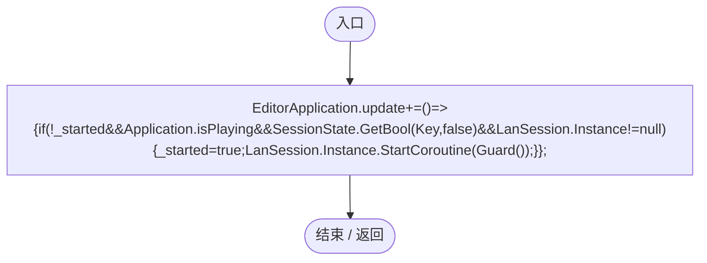
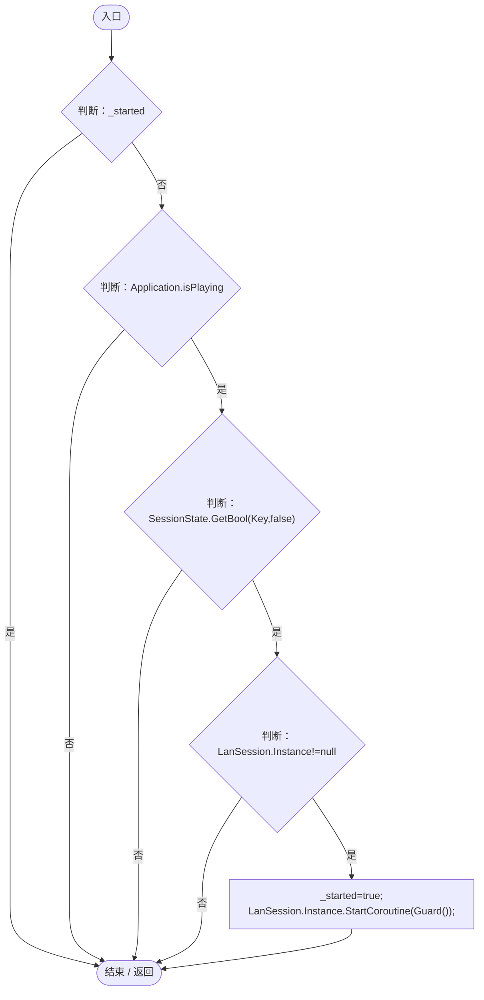
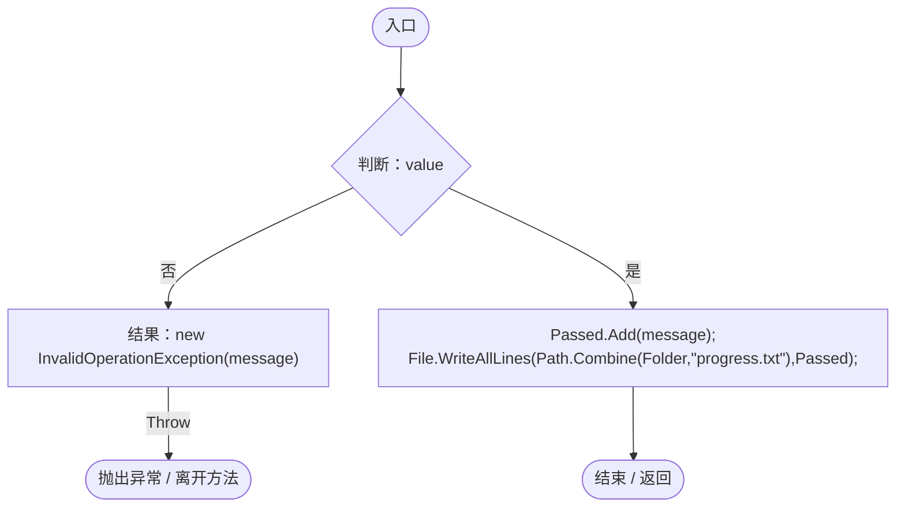
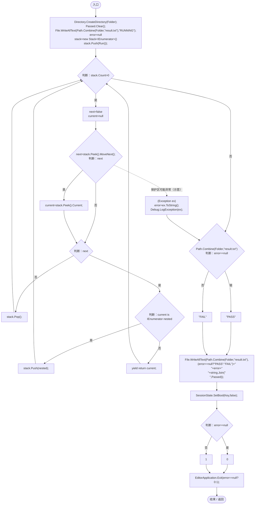
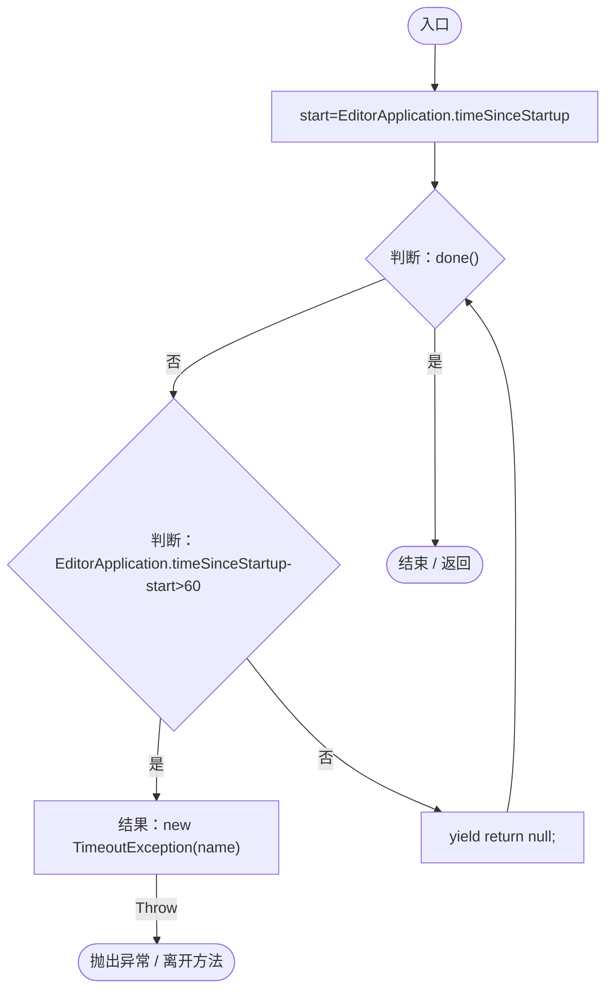
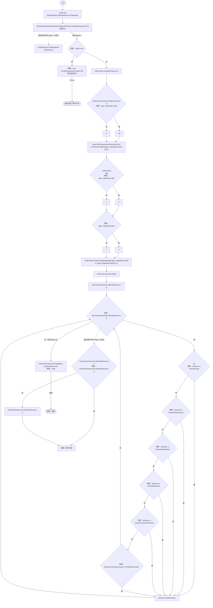
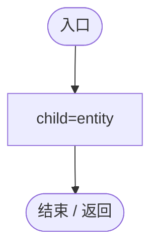
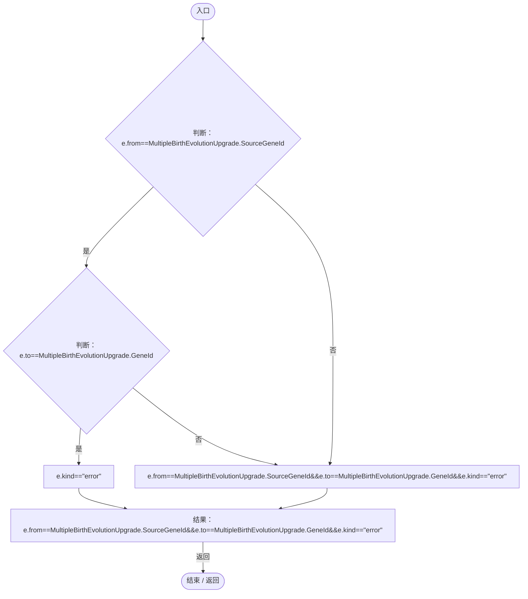
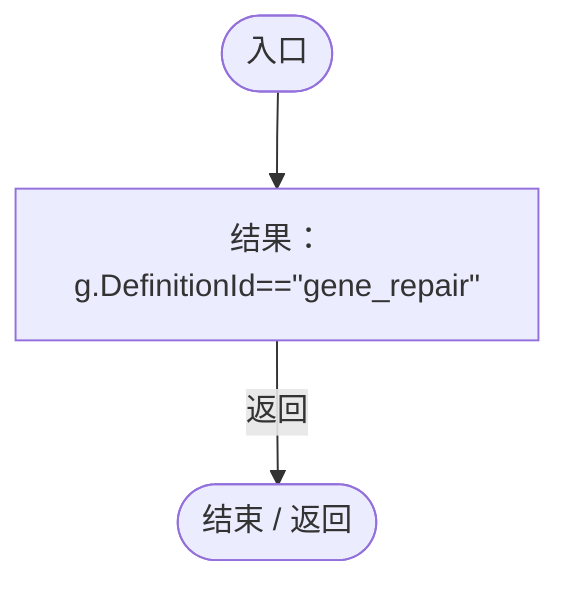
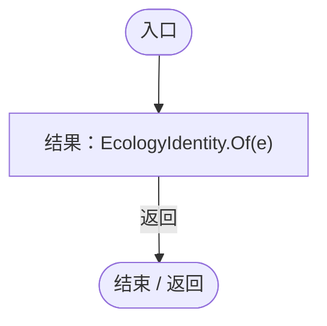

# EntityPlanningMergeRegression.cs

[返回总索引](../README.md) · `Editor` · `Assets/DarwinPark/Editor/EntityPlanningMergeRegression.cs`

[源文件](../../../Assets/DarwinPark/Editor/EntityPlanningMergeRegression.cs) · 源码校验：`8ef39caa5f34e97f22f3a56b132bf3026ce79a24d91824979fba1c8f96b15018`

方法按源文件位置排列。事件/回调引用不表示立即执行；分支与异常说明见总索引。完整源码与可点击关系图请打开离线手册。

<a id="m71f0ed2d27646d7e"></a>

## Folder.get · L30

`private static string Folder`


### Editor · 语法控制结构 / 声明（非CFG）


<a id="m4065dad26d9f737c"></a>

## EntityPlanningMergeRegression.ctor · L31

`static EntityPlanningMergeRegression()`


### Editor · Roslyn编译器控制流



项目内调用/回调引用：

- [EntityPlanningMergeRegression.回调@31 · L31](763da58492f54d4c.md#mded1870c9c178f68)（回调/委托）

<a id="mded1870c9c178f68"></a>

## 回调@31 · L31

`( … => 回调`


### Editor · Roslyn编译器控制流



项目内调用/回调引用：

- [LanSession.Instance.get · L23](9fb633eebffe669c.md#mbf83306994878383)（访问器）
- [EntityPlanningMergeRegression.Guard · L34](763da58492f54d4c.md#m18a99218570352ad)（方法）

<a id="m5a6ed3c2b40b4d73"></a>

## RunBatch · L32

`public static void RunBatch()`


### Editor · Roslyn编译器控制流


<a id="m02a9e61a69711542"></a>

## Check · L33

`private static void Check(bool value,string message)`


### Editor · Roslyn编译器控制流



<a id="m18a99218570352ad"></a>

## Guard · L34

`private static IEnumerator Guard()`


### Editor · Roslyn编译器控制流



项目内调用/回调引用：

- [EntityPlanningMergeRegression.Run · L59](763da58492f54d4c.md#m962420c9efd80f95)（方法）

<a id="m58b835ed2f639d18"></a>

## Wait · L40

`private static IEnumerator Wait(Func<bool> done,string name)`


### Editor · Roslyn编译器控制流



<a id="mcb17864e21df5fd9"></a>

## Clear · L42

`private static void Clear()`


### Editor · Roslyn编译器控制流


项目内调用/回调引用：

- [ColonyResource.ClearWorld · L109](293dbaecfff4b585.md#mc969798f9562c061)（方法）

<a id="m69a44147f12bec87"></a>

## Spawn · L43

`private static DarwinEntity Spawn(Genome genome,Vector3 point,AgeState age=AgeState.Adult)`


### Editor · Roslyn编译器控制流



项目内调用/回调引用：

- [RandomSpawnRecipe.Clone · L23](923ccc4e86c4786c.md#me0949958df9c70e0)（方法）
- [DarwinEntity.Genes.get · L14](70798dde169f2e8b.md#m622eb1adf401d431)（访问器）
- [EntityLifeCycle.RestoreProgress · L51](9f4138bfbae654b7.md#mec34c953ece464ab)（方法）
- [EntityGeneController.RestoreStageState · L56](7494d53178552f0e.md#m37c1dbfa64e7c2ce)（方法）
- [EntityGeneController.Recalculate · L118](7494d53178552f0e.md#m707d9a56b0c7c609)（方法）
- [EntityPlanningMergeRegression.Registered · L45](763da58492f54d4c.md#me15f9c5228591e15)（局部函数）

<a id="me15f9c5228591e15"></a>

## Registered · L45

`void Registered(DarwinEntity entity)`


### Editor · Roslyn编译器控制流



<a id="mbbaef74c958110be"></a>

## Land · L52

`private static Vector3 Land(PlanetTerrainMeshBuilder planet)`


### Editor · Roslyn编译器控制流


项目内调用/回调引用：

- [EcologyQueries.Surface · L48](bdf7ccc2c9c0452f.md#m40ee3e975d7f5137)（方法）
- [PlanetTerrainMeshBuilder.WaterRadius.get · L99](415285cf043354a9.md#m76719c213b06ba56)（访问器）

<a id="m217d3b7412dc2b99"></a>

## Reproduction · L56

`private static ReproductionGeneLogic Reproduction(DarwinEntity entity)`


### Editor · Roslyn编译器控制流


项目内调用/回调引用：

- [DarwinEntity.Genes.get · L14](70798dde169f2e8b.md#m622eb1adf401d431)（访问器）
- [EntityGeneController.GetLogic · L240](7494d53178552f0e.md#m9be6a2566c76c275)（方法）

<a id="mbe82a564d68bae3e"></a>

## Food · L57

`private static void Food(DarwinEntity entity,float food,float reserve)`


### Editor · Roslyn编译器控制流


项目内调用/回调引用：

- [EntityStats.TryGet · L90](75aa86a368efdf24.md#m24ee1433e4a70d94)（方法）
- [EntityStats.Modify · L111](75aa86a368efdf24.md#m9c837be197158240)（方法）

<a id="m962420c9efd80f95"></a>

## Run · L59

`private static IEnumerator Run()`


### Editor · Roslyn编译器控制流

```mermaid
flowchart TD
  b0(["入口"])
  b1["session=Object.FindFirstObjectByType&lt;WorldSessionManager&gt;()<br/>session.autoSaveInterval=36000;<br/>planet=Object.FindFirstObjectByType&lt;PlanetTerrainMeshBuilder&gt;()<br/>planet.subdivisions=24;<br/>typeof(WorldSessionManager).GetField(&quot;_initialTerrain&quot;,Pr…"]
  b2{"判断：tuning.baseMetabolismMultiplier==.5f"}
  b3{"判断：tuning.movementMetabolismMultiplier==.5f"}
  b4["tuning.nutritionGainMultiplier==.5f"]
  b5["tuning.baseMetabolismMultiplier==.5f&amp;&amp;tuning.movementMetabolismMultiplier==.5f&amp;&amp;tuning.nutritionGainMultiplier==.5f"]
  b6["Check(tuning.baseMetabolismMultiplier==.5f&amp;&amp;tuning.movementMetabolismMultiplier==.5f&amp;&amp;tuning.nutritionGainMultiplier==.5f,&quot;基础、行动与获取默认同时降至一半&quot;);"]
  b7{"判断：tuning.mergeStaggerBatches"}
  b8["tuning.mergePhaseBuckets==16"]
  b9["tuning.mergeStaggerBatches"]
  b10["Check(tuning.mergeStaggerBatches&amp;&amp;tuning.mergePhaseBuckets==16,&quot;默认启用16批空间基因错峰&quot;);"]
  b11["tuning.mergeStaggerBatches=false;"]
  b12{"判断：SimulationSubsteps.Count(.5000002f)==5"}
  b13{"判断：SimulationSubsteps.Count(.5001f)==6"}
  b14["SimulationSubsteps.Count(0)==0"]
  b15["SimulationSubsteps.Count(.5000002f)==5&amp;&amp;SimulationSubsteps.Count(.5001f)==6&amp;&amp;SimulationSubsteps.Count(0)==0"]
  b16["Check(SimulationSubsteps.Count(.5000002f)==5&amp;&amp;SimulationSubsteps.Count(.5001f)==6&amp;&amp;SimulationSubsteps.Count(0)==0,&quot;微小浮点尾数不增加整轮行为，真实超额仍增加子步&quot;);"]
  b17["sliceSum=0<br/>slices=SimulationSubsteps.Count(.5000002f)"]
  b18["i=0"]
  b19{"判断：i&lt;slices"}
  b20["sliceSum+=SimulationSubsteps.Slice(.5000002f,i,slices);<br/>i++"]
  b21["Check(Mathf.Abs(sliceSum-.5000002f)&lt;.0000001f,&quot;尾数并入最后子步，交付时间完整保留&quot;);<br/>deadlines=new HashSet&lt;double&gt;()"]
  b22["i=0"]
  b23{"判断：i&lt;64"}
  b24["due=CohortDeadline.Next(10,new Vector3(i*12,0,0),1,6,.5f,16)<br/>CheckDeadline(due,10);<br/>deadlines.Add(due);"]
  b25["i++"]
  b26["Check(deadlines.Count&gt;=8,&quot;相同基因分散空间格产生多批截止时间&quot;);<br/>invalidPhase=false"]
  b27["GameplayTuning.Parse(&quot;{\&quot;version\&quot;:1,\&quot;mergePhaseBuckets\&quot;:0}&quot;);"]
  b28["invalidPhase=true;"]
  b29["Check(invalidPhase,&quot;拒绝无效错峰批次数，避免除零&quot;);"]
  b30{"GeneDatabase.Get(MultipleBirthEvolutionUpgrade.GeneId)<br/>判断：GeneDatabase.Get(MultipleBirthEvolutionUpgrade.GeneId)"}
  b31[".LogicScriptId"]
  b32["GeneDatabase.Get(MultipleBirthEvolutionUpgrade.GeneId)"]
  b33{"判断：GeneDatabase.Get(MultipleBirthEvolutionUpgrade.GeneId)?.LogicScriptId==&quot;MultipleBirthGeneLogic&quot;"}
  b34["GeneTreeStorage.Active.edges.Any(e=&gt;e.from==MultipleBirthEvolutionUpgrade.SourceGeneId&amp;&amp;e.to==MultipleBirthEvolutionUpgrade.GeneId&amp;&amp;e.kind==&quot;error&quot;)"]
  b35["GeneDatabase.Get(MultipleBirthEvolutionUpgrade.GeneId)?.LogicScriptId==&quot;MultipleBirthGeneLogic&quot;"]
  b36["Check(GeneDatabase.Get(MultipleBirthEvolutionUpgrade.GeneId)?.LogicScriptId==&quot;MultipleBirthGeneLogic&quot;&amp;&amp;GeneTreeStorage.Active.edges.Any(e=&gt;e.from==MultipleBirthEvolutionUpgrade.SourceGeneId&amp;&amp;e.to==MultipleBirthEvolutionUpgrade.GeneId&amp;&amp;e.…"]
  b37["home=Land(planet)<br/>producer=EcologyDefaults.Template(&quot;producer&quot;).CreateGenome()<br/>producer.Genes.RemoveAll(g=&gt;g.DefinitionId==&quot;gene_reproduction&quot;);<br/>scheduler=Object.FindFirstObjectByType&lt;EntityWorkScheduler&gt;()<br/>Check(scheduler!=null,&quot;游戏根节点实际…"]
  b38["i=0"]
  b39{"判断：i&lt;24"}
  b40["clones.Add(Spawn(producer,home+Vector3.right*((i%6)*.35f)+Vector3.forward*(i/6*.35f)));<br/>i++"]
  b41["far=Spawn(producer,home+Vector3.right*tuning.mergeRadius*4)<br/>changed=RandomSpawnRecipe.Clone(producer)<br/>changed.Genes.First(g=&gt;g.DefinitionId==&quot;gene_repair&quot;).Value=61;<br/>different=Spawn(changed,home+Vector3.forward*2)"]
  b42["EntityRegistry.All"]
  b43{"判断：EntityRegistry.All"}
  b44["var<br/>Food(entity,10,30);"]
  b45{"判断：EntityRegistry.All"}
  b46["EntityRegistry.All"]
  b47["连接 / 离开区域"]
  b48["baseline=clones.Select(EntitySaveState.Capture).ToArray()<br/>beforeLife=clones[0].GetComponent&lt;EntityLifeCycle&gt;().Progress<br/>representatives=scheduler.RepresentativeSteps<br/>shared=scheduler.SharedMemberSteps<br/>scheduler.Advance(.5f);"]
  b49{"判断：scheduler.SharedMemberSteps-shared&gt;=23*5"}
  b50["scheduler.RepresentativeSteps-representatives&lt;=3*5"]
  b51["scheduler.SharedMemberSteps-shared&gt;=23*5"]
  b52["Check(scheduler.SharedMemberSteps-shared&gt;=23*5&amp;&amp;scheduler.RepresentativeSteps-representatives&lt;=3*5,&quot;24个近邻共享代表基础计算，远处或不同基因分组&quot;);"]
  b53{"判断：clones.All(e=&gt;Mathf.Abs(e.GetComponent&lt;EntityLifeCycle&gt;().Progress-clones[0].GetComponent&lt;EntityLifeCycle&gt;().Progress)&lt;.0001f)"}
  b54["clones[0].GetComponent&lt;EntityLifeCycle&gt;().Progress&gt;beforeLife"]
  b55["clones.All(e=&gt;Mathf.Abs(e.GetComponent&lt;EntityLifeCycle&gt;().Progress-clones[0].GetComponent&lt;EntityLifeCycle&gt;().Progress)&lt;.0001f)"]
  b56["Check(clones.All(e=&gt;Mathf.Abs(e.GetComponent&lt;EntityLifeCycle&gt;().Progress-clones[0].GetComponent&lt;EntityLifeCycle&gt;().Progress)&lt;.0001f)&amp;&amp;clones[0].GetComponent&lt;EntityLifeCycle&gt;().Progress&gt;beforeLife,&quot;合并成员各自保留寿命且继续成长&quot;);"]
  b57{"判断：clones.Select(e=&gt;EcologyIdentity.Of(e)).Distinct().Count()==24"}
  b58["clones.Select(e=&gt;e.Genes.Genome.Genes[0].InstanceId).Distinct().Count()==24"]
  b59["clones.Select(e=&gt;EcologyIdentity.Of(e)).Distinct().Count()==24"]
  b60["Check(clones.Select(e=&gt;EcologyIdentity.Of(e)).Distinct().Count()==24&amp;&amp;clones.Select(e=&gt;e.Genes.Genome.Genes[0].InstanceId).Distinct().Count()==24,&quot;合并计算不合并实体或基因实例身份&quot;);"]
  b61["Check(clones.All(e=&gt;(StationaryCohortKernel.Values(e.GetComponent&lt;EntityStats&gt;())-StationaryCohortKernel.Values(clones[0].GetComponent&lt;EntityStats&gt;())).sqrMagnitude&lt;.00001f),&quot;代表营养变化应用给全部兼容近邻&quot;);<br/>merged=StationaryCohortKernel.Values(clones…"]
  b62["index=0"]
  b63{"判断：index&lt;clones.Count"}
  b64["baseline[index].Restore(clones[index]);<br/>index++"]
  b65["step=0"]
  b66{"判断：step&lt;5"}
  b67["clones"]
  b68{"判断：clones"}
  b69["var<br/>entity.Genes.AdvanceSimulation(.1f);<br/>entity.GetComponent&lt;EntityVitals&gt;().AdvanceShared(.1f);"]
  b70["clones"]
  b71["step++"]
  b72{"判断：(merged-StationaryCohortKernel.Values(clones[0].GetComponent&lt;EntityStats&gt;())).sqrMagnitude&lt;.000001f"}
  b73["Mathf.Abs(mergedLife-clones[0].GetComponent&lt;EntityLifeCycle&gt;().Progress)&lt;.00001f"]
  b74["(merged-StationaryCohortKernel.Values(clones[0].GetComponent&lt;EntityStats&gt;())).sqrMagnitude&lt;.000001f"]
  b75["Check((merged-StationaryCohortKernel.Values(clones[0].GetComponent&lt;EntityStats&gt;())).sqrMagnitude&lt;.000001f&amp;&amp;Mathf.Abs(mergedLife-clones[0].GetComponent&lt;EntityLifeCycle&gt;().Progress)&lt;.00001f,&quot;相同状态下共享结算与逐体计算的营养/寿命数值一致&quot;);"]
  b76["clones[1].GetComponent&lt;EntityStats&gt;().Modify(&quot;health&quot;,-5,false);<br/>scheduler.Advance(.1f);"]
  b77{"判断：EntityWorkScheduler.Dormant(clones[1].Genes)"}
  b78["clones.Skip(2).All(e=&gt;e.GetComponent&lt;EntityStats&gt;().CapacityRemaining(&quot;health&quot;)==0)"]
  b79["!EntityWorkScheduler.Dormant(clones[1].Genes)"]
  b80["Check(!EntityWorkScheduler.Dormant(clones[1].Genes)&amp;&amp;clones.Skip(2).All(e=&gt;e.GetComponent&lt;EntityStats&gt;().CapacityRemaining(&quot;health&quot;)==0),&quot;受伤实体立即拆组且伤害不传播给其他成员&quot;);"]
  b81["debt=EntitySaveState.Capture(clones[2])"]
  b82{"判断：debt.pendingSimulationTime&gt;0"}
  b83["JsonUtility.FromJson&lt;EntitySaveState&gt;(JsonUtility.ToJson(debt)).pendingSimulationTime==debt.pendingSimulationTime"]
  b84["debt.pendingSimulationTime&gt;0"]
  b85["Check(debt.pendingSimulationTime&gt;0&amp;&amp;JsonUtility.FromJson&lt;EntitySaveState&gt;(JsonUtility.ToJson(debt)).pendingSimulationTime==debt.pendingSimulationTime,&quot;欠算时间进入序列化快照&quot;);"]
  b86["session.SaveNow(false);<br/>pendingDisk=WorldSaveStore.Read(WorldSaveStore.FileFor(session.Current.id))<br/>Check(pendingDisk.entities.Any(e=&gt;e.pendingSimulationTime&gt;0),&quot;欠算时间实际落盘并通过完整世界校验&quot;);<br/>scheduler.enabled=false;<br/>old=clones[2].GetComponent&lt;En…"]
  b87{"判断：clones[2].Genes.PendingSimulationTime==0"}
  b88["clones[2].GetComponent&lt;EntityLifeCycle&gt;().Progress&gt;old"]
  b89["clones[2].Genes.PendingSimulationTime==0"]
  b90["Check(clones[2].Genes.PendingSimulationTime==0&amp;&amp;clones[2].GetComponent&lt;EntityLifeCycle&gt;().Progress&gt;old,&quot;停用合并后补清欠下时间&quot;);"]
  b91["scheduler.enabled=true;<br/>clones[2].Genes.PendingSimulationTime=12;<br/>EntityWorkScheduler.AdvanceUnscheduled(clones[2].Genes,.1f);<br/>Check(Mathf.Abs(clones[2].Genes.PendingSimulationTime-7)&lt;.0001f,&quot;大额欠算按每次补算上限分段处理，剩余时间继续保留&quot;);<br/>Check(clones[2].G…"]
  b92["clones"]
  b93{"判断：clones"}
  b94["var<br/>entity.GetComponent&lt;EntityLifeCycle&gt;().RestoreProgress(LifeCycleSettings.Load().adultProgress-.001f);<br/>entity.Genes.RestoreStageState(AgeState.Infant,1,1);<br/>entity.Genes.Recalculate();"]
  b95["clones"]
  b96["tuning.mutationAttemptsPerFrame=100;<br/>tuning.mergeQuietSeconds=0;<br/>attempts=MutationRoundController.Attempts<br/>yield return null;<br/>scheduler.Advance(.5f);"]
  b97{"判断：MutationRoundController.Attempts==attempts"}
  b98["clones.All(e=&gt;e.Genes.CurrentAge==AgeState.Adult)"]
  b99["MutationRoundController.Attempts==attempts"]
  b100["Check(MutationRoundController.Attempts==attempts&amp;&amp;clones.All(e=&gt;e.Genes.CurrentAge==AgeState.Adult),&quot;阶段切换不再单独变异，但所有合并成员照常成年&quot;);"]
  b101["Check(clones.All(e=&gt;e.GetComponent&lt;EntityEnvironmentHazard&gt;().CurrentTemperature==0),&quot;共享、拆组和欠账补算尊重被禁用的环境组件&quot;);<br/>tuning.mergeGroupsPerFrame=1;<br/>scheduler.Advance(.5f);<br/>Check(EntityRegistry.All.Any(e=&gt;e.Genes.PendingSimulationTime&gt;=.49f),&quot;全局共…"]
  b102["i=0"]
  b103{"判断：i&lt;3"}
  b104["singleton.Genes.AdvanceSimulation(.5f);<br/>StationaryCohortKernel.AdvanceCore(singleton.Genes,.5f);<br/>i++"]
  b105{"判断：(singleValues-StationaryCohortKernel.Values(singleton.GetComponent&lt;EntityStats&gt;())).sqrMagnitude&lt;.000001f"}
  b106["Mathf.Abs(singleLife-singleton.GetComponent&lt;EntityLifeCycle&gt;().Progress)&lt;.00001f"]
  b107["(singleValues-StationaryCohortKernel.Values(singleton.GetComponent&lt;EntityStats&gt;())).sqrMagnitude&lt;.000001f"]
  b108["Check((singleValues-StationaryCohortKernel.Values(singleton.GetComponent&lt;EntityStats&gt;())).sqrMagnitude&lt;.000001f&amp;&amp;Mathf.Abs(singleLife-singleton.GetComponent&lt;EntityLifeCycle&gt;().Progress)&lt;.00001f,&quot;孤立实体批量补算与原逐体生命/营养结算一致&quot;);"]
  b109["singleton.Genes.Genome.Genes.First(g=&gt;g.DefinitionId==&quot;gene_repair&quot;).Value+=1;<br/>singleton.Genes.Recalculate();<br/>scheduler.Advance(.5f);<br/>Check(scheduler.SignatureCacheSize==1,&quot;基因变化后签名缓存回收旧版本，只保留当前实体引用&quot;);<br/>Clear();<br/>scheduler.Advance(.1f);<br/>Che…"]
  b110["i=0"]
  b111{"判断：i&lt;64"}
  b112["e=Spawn(producer,home+Vector3.right*i*tuning.mergeRadius*2)<br/>Food(e,10,30);<br/>spread.Add(e);"]
  b113["i++"]
  b114["starts=spread.Select(e=&gt;e.GetComponent&lt;EntityLifeCycle&gt;().Progress).ToArray()<br/>speeds=spread.Select(e=&gt;StationaryCohortKernel.LifeSpeed(e.Genes)).ToArray()<br/>peak=0<br/>workingFrames=0"]
  b115["frame=0"]
  b116{"判断：frame&lt;120"}
  b117{"previous=spread.Select(e=&gt;e.Genes.PendingSimulationTime).ToArray()<br/>scheduler.Advance(1f/60);<br/>settled=spread.Where((e,index)=&gt;e.Genes.PendingSimulationTime&lt;previous[index]+1f/60-.00001f).Count()<br/>peak=Math.Max(peak,settled);<br/>判断：settled&gt;0"}
  b118["workingFrames++;"]
  b119["frame++"]
  b120{"判断：workingFrames&gt;=16"}
  b121["peak&lt;64"]
  b122["workingFrames&gt;=16"]
  b123["Check(workingFrames&gt;=16&amp;&amp;peak&lt;64,&quot;64个分散静止实体分批结算，不再全体同时补算&quot;);"]
  b124["Check(spread.Select((e,index)=&gt;Mathf.Abs(e.GetComponent&lt;EntityLifeCycle&gt;().Progress-starts[index]+e.Genes.PendingSimulationTime*speeds[index]-2*speeds[index])).All(error=&gt;error&lt;.0001f),&quot;两秒连续错峰后每个实体已结算寿命与欠账严格守恒&quot;);<br/>tuning.mergeStaggerBatch…"]
  b125["i=0"]
  b126{"判断：i&lt;24"}
  b127["e=Spawn(producer,home)<br/>Food(e,10,30);<br/>dense.Add(e);"]
  b128["i++"]
  b129["denseShared=scheduler.SharedMemberSteps"]
  b130["i=0"]
  b131{"判断：i&lt;60"}
  b132["scheduler.Advance(1f/60);<br/>i++"]
  b133["Check(scheduler.SharedMemberSteps-denseShared&gt;=23,&quot;开启错峰后真实同格近邻仍共享代表计算&quot;);<br/>Check(dense.All(e=&gt;(StationaryCohortKernel.Values(e.GetComponent&lt;EntityStats&gt;())-StationaryCohortKernel.Values(dense[0].GetComponent&lt;EntityStats&gt;())).sqrMagnitude&lt;.…"]
  b134{"判断：EntityRegistry.All.Count==1"}
  b135["!ghost.gameObject.activeInHierarchy"]
  b136["EntityRegistry.All.Count==1"]
  b137["Check(EntityRegistry.All.Count==1&amp;&amp;!ghost.gameObject.activeInHierarchy,&quot;高优先级先处理后，已死亡的后续快照成员不能继续生产后代&quot;);"]
  b138["replicaBefore=StationaryCohortKernel.Values(killer.GetComponent&lt;EntityStats&gt;())<br/>WorldAuthority.IsReplica=true;<br/>clock.Play();<br/>typeof(EntityVitals).GetMethod(&quot;Update&quot;,Private).Invoke(killer.GetComponent&lt;EntityVitals&gt;(),null);<br/>clock.Pause()…"]
  b139{"判断：corpse!=null"}
  b140["Mathf.Abs(accepted.y+accepted.z+corpse.State.energy-biomass)&lt;.001f"]
  b141["corpse!=null"]
  b142["Check(corpse!=null&amp;&amp;Mathf.Abs(accepted.y+accepted.z+corpse.State.energy-biomass)&lt;.001f,&quot;降低捕猎获取后实际吸收加剩余尸体仍严格守恒&quot;);"]
  b143["Clear();<br/>yield return null;<br/>grades=new List&lt;ColonyResource&gt;()"]
  b144["new[]{10f,30,90,270,810}"]
  b145{"判断：new[]{10f,30,90,270,810}"}
  b146["float"]
  b147["grades<br/>new ColonyResourceSave{id=Guid.NewGuid().ToString(&quot;N&quot;),kind=ColonyResourceKind.Energy,group=Guid.NewGuid().ToString(&quot;N&quot;),energy=energy,local=EcologyQueries.ToLocal(home+Vector3.right*grades.Count*2),scale=Vector3.one}<br/>id=Guid.NewG…"]
  b148{"new[]{10f,30,90,270,810}<br/>判断：new[]{10f,30,90,270,810}"}
  b149["new[]{10f,30,90,270,810}"]
  b150["连接 / 离开区域"]
  b151["i=0"]
  b152{"判断：i&lt;5"}
  b153["block=new MaterialPropertyBlock()<br/>grades[i].GetComponent&lt;Renderer&gt;().GetPropertyBlock(block);<br/>ColorUtility.TryParseHtmlString(EnergyBlockGrades.Table.levels[i].color,out var color);"]
  b154{"判断：EnergyBlockGrades.Level(grades[i].State.energy)==i"}
  b155["block.GetColor(&quot;_BaseColor&quot;)==color"]
  b156["EnergyBlockGrades.Level(grades[i].State.energy)==i"]
  b157["Check(EnergyBlockGrades.Level(grades[i].State.energy)==i&amp;&amp;block.GetColor(&quot;_BaseColor&quot;)==color,&quot;五级能量块实际颜色与能量范围 &quot;+(i+1));"]
  b158["i++"]
  b159["screenshotCamera=Camera.main.GetComponent&lt;OrbitCamera&gt;()<br/>screenshotCamera.ReturnToEntity(grades[2].transform.position);<br/>yield return null;<br/>yield return new WaitForEndOfFrame();<br/>ScreenCapture.CaptureScreenshot(Path.Combine(Folder,&quot;energy-…"]
  b160{"判断：grades[4].name.Contains(&quot;Lv.1&quot;)"}
  b161["grades[4].Capture().energy==10"]
  b162["grades[4].name.Contains(&quot;Lv.1&quot;)"]
  b163["Check(grades[4].name.Contains(&quot;Lv.1&quot;)&amp;&amp;grades[4].Capture().energy==10,&quot;能量耗尽降级且存档不凭等级补能量&quot;);"]
  b164["ColonyResource.ClearWorld();<br/>parentGenome=EcologyDefaults.Template(&quot;producer&quot;).CreateGenome()<br/>parentGenome.Genes.RemoveAll(g=&gt;g.DefinitionId==&quot;gene_reproduction&quot;);<br/>parentGenome.Add(GeneInstance.Create(MultipleBirthEvolutionUpgrade.GeneId…"]
  b165{"判断：parent.Genes.IsGestating"}
  b166{"pregnancy.litter<br/>判断：pregnancy.litter"}
  b167[".planned"]
  b168["pregnancy.litter"]
  b169["pregnancy.litter?.planned==5"]
  b170["parent.Genes.IsGestating"]
  b171["Check(parent.Genes.IsGestating&amp;&amp;pregnancy.litter?.planned==5,&quot;真实多胎孕育固定五胎并支付相应预算&quot;);"]
  b172["pregnancy.gestation=0;<br/>reproduction.RestoreState(pregnancy);"]
  b173["new WorldGameSettings{entityLimit=4}<br/>entityLimit=4<br/>EntityPopulationLimit.UseSnapshot(new WorldGameSettings{entityLimit=4});"]
  b174["reproduction.OnUpdate(.1f);<br/>pregnancy=reproduction.CaptureState();"]
  b175{"判断：EntityRegistry.All.Count==4"}
  b176{"判断：parent.Genes.IsGestating"}
  b177["pregnancy.litter.remaining==3"]
  b178["EntityRegistry.All.Count==4&amp;&amp;parent.Genes.IsGestating&amp;&amp;pregnancy.litter.remaining==3"]
  b179["Check(EntityRegistry.All.Count==4&amp;&amp;parent.Genes.IsGestating&amp;&amp;pregnancy.litter.remaining==3,&quot;数量上限只交付两胎并保留剩余三胎&quot;);"]
  b180["session.SaveNow(false);<br/>saved=WorldSaveStore.Read(WorldSaveStore.FileFor(session.Current.id))<br/>parentId=EcologyIdentity.Of(parent)<br/>Check(saved.entities.Single(e=&gt;e.ecology.id==parentId).reproduction.Any(r=&gt;r.litter?.remaining==3),&quot;待出生胎数实际…"]
  b181["WorldSaveStore.Validate(bad);"]
  b182["rejected=true;"]
  b183{"判断：rejected"}
  b184["EcologyQueries.Alive(parent)"]
  b185["rejected"]
  b186["Check(rejected&amp;&amp;EcologyQueries.Alive(parent),&quot;损坏胎数在清场前拒绝&quot;);"]
  b187["session.Open(saved);<br/>yield return Wait(()=&gt;!session.Busy,&quot;读回多胎&quot;);<br/>clock.Pause();<br/>parent=EcologyIdentity.Find(parentId);<br/>reproduction=Reproduction(parent);<br/>Check(reproduction.CaptureState().litter.remaining==3,&quot;读档恢复三胎且不重置到五胎&quot;);"]
  b188["new WorldGameSettings{entityLimit=20}<br/>entityLimit=20<br/>EntityPopulationLimit.UseSnapshot(new WorldGameSettings{entityLimit=20});"]
  b189["i=0"]
  b190{"判断：i&lt;5"}
  b191{"判断：parent.Genes.IsGestating"}
  b192["reproduction.OnUpdate(.1f);<br/>i++"]
  b193{"判断：EntityRegistry.All.Count==7"}
  b194["!parent.Genes.IsGestating"]
  b195["EntityRegistry.All.Count==7"]
  b196["Check(EntityRegistry.All.Count==7&amp;&amp;!parent.Genes.IsGestating,&quot;释放空位后只出生剩余三胎，总共五个后代&quot;);"]
  b197["Clear();<br/>yield return null;<br/>queenGenome=EcologyDefaults.Template(&quot;ant_founder&quot;).CreateGenome()<br/>queenGenome.Genes.RemoveAll(g=&gt;g.DefinitionId==&quot;gene_reproduction&quot;);<br/>queenGenome.Add(GeneInstance.Create(MultipleBirthEvolutionUpgrade.GeneId,…"]
  b198{"判断：queen.Genes.IsGestating"}
  b199{"queen.State.litter<br/>判断：queen.State.litter"}
  b200[".planned"]
  b201["queen.State.litter"]
  b202["queen.State.litter?.planned==5"]
  b203["queen.Genes.IsGestating"]
  b204["Check(queen.Genes.IsGestating&amp;&amp;queen.State.litter?.planned==5,&quot;蚁群王后接入相同多胎策略&quot;);"]
  b205["queen.State.reproductionTimer=0;<br/>queen.Advance(.1f);"]
  b206{"判断：EntityRegistry.All.Count&gt;1"}
  b207{"queen.Capture().litter<br/>判断：queen.Capture().litter"}
  b208[".remaining"]
  b209["queen.Capture().litter"]
  b210["queen.Capture().litter?.remaining&lt;5"]
  b211["EntityRegistry.All.Count&gt;1"]
  b212["Check(EntityRegistry.All.Count&gt;1&amp;&amp;queen.Capture().litter?.remaining&lt;5,&quot;王后实际交付多胎并保留进度&quot;);"]
  b213["workerEntity=Spawn(queenGenome,home+Vector3.right*15)<br/>worker=AntColonyMember.Ensure(workerEntity.GetComponent&lt;PopulationBehavior&gt;())<br/>worker.Assign(AntRole.Worker,queen.GroupId);<br/>worker.Population.EnsureMembership();<br/>Food(workerEntity,6.9…"]
  b214["new WorldGameSettings{entityLimit=EntityRegistry.All.Count+1}<br/>entityLimit=EntityRegistry.All.Count+1<br/>EntityPopulationLimit.UseSnapshot(new WorldGameSettings{entityLimit=EntityRegistry.All.Count+1});"]
  b215{"判断：EntityPopulationLimit.CanSpawn"}
  b216{"判断：ColonyContinuityPriority.CanSpawn(worker.Genes)"}
  b217["ColonyContinuityPriority.CanSpawn(queen.Genes)"]
  b218["EntityPopulationLimit.CanSpawn&amp;&amp;!ColonyContinuityPriority.CanSpawn(worker.Genes)&amp;&amp;ColonyContinuityPriority.CanSpawn(queen.Genes)"]
  b219["Check(EntityPopulationLimit.CanSpawn&amp;&amp;!ColonyContinuityPriority.CanSpawn(worker.Genes)&amp;&amp;ColonyContinuityPriority.CanSpawn(queen.Genes),&quot;接近全局上限时普通繁殖让出真实空位，王后可以使用且不突破上限&quot;);"]
  b220["new WorldGameSettings{entityLimit=capBefore}<br/>entityLimit=capBefore<br/>EntityPopulationLimit.UseSnapshot(new WorldGameSettings{entityLimit=capBefore});"]
  b221["successorEntity=Spawn(queenGenome,home+Vector3.forward*20)<br/>successorQueen=AntColonyMember.Ensure(successorEntity.GetComponent&lt;PopulationBehavior&gt;())<br/>successorQueen.Assign(AntRole.Queen,Guid.NewGuid().ToString(&quot;N&quot;));"]
  b222["i=0"]
  b223{"判断：i&lt;EcologyDefaults.Current.minimumWorkers"}
  b224["helper=Spawn(queenGenome,home+Vector3.forward*(22+i*3))<br/>AntColonyMember.Ensure(helper.GetComponent&lt;PopulationBehavior&gt;()).Assign(AntRole.Worker,successorQueen.GroupId);"]
  b225["i++"]
  b226["Check(successorQueen.ChooseBirthRole()==AntRole.Reproductive,&quot;首批工匠到位的小群优先培养后继繁殖个体&quot;);<br/>supply=ColonyResource.Convert(queen.GroupId,worker.transform.position,100,false)<br/>worker.State.patrolRemaining=20;<br/>ColonyFeeding.Find(worker,false);<br/>lock…"]
  b227{"判断：ColonyFeeding.WantsFood(worker)"}
  b228{"ColonyFeeding.Find(worker,false)<br/>判断：ColonyFeeding.Find(worker,false)"}
  b229[".State.id"]
  b230["ColonyFeeding.Find(worker,false)"]
  b231["ColonyFeeding.Find(worker,false)?.State.id==locked"]
  b232["ColonyFeeding.WantsFood(worker)"]
  b233["Check(ColonyFeeding.WantsFood(worker)&amp;&amp;ColonyFeeding.Find(worker,false)?.State.id==locked,&quot;越过开始补给线后仍保留本次补给和固定目标&quot;);"]
  b234["i=0"]
  b235{"判断：i&lt;30"}
  b236{"判断：ColonyFeeding.WantsFood(worker)"}
  b237["ColonyResource.Feed(worker,.1f);<br/>i++"]
  b238["worker.GetComponent&lt;EntityStats&gt;().TryGet(&quot;nutrient&quot;,out float fed);"]
  b239{"判断：fed&gt;=tuning.memberFeedResume"}
  b240["!ColonyFeeding.WantsFood(worker)"]
  b241["fed&gt;=tuning.memberFeedResume"]
  b242["Check(fed&gt;=tuning.memberFeedResume&amp;&amp;!ColonyFeeding.WantsFood(worker),&quot;吃到恢复线才释放补给任务&quot;);"]
  b243["Food(workerEntity,6,0);<br/>ColonyFeeding.Find(worker,false);<br/>depleted=ColonyResource.Find(worker.State.plan.supply)<br/>depletedId=depleted.State.id<br/>depleted.Remove();"]
  b244{"判断：ColonyFeeding.Find(worker,false)!=null"}
  b245["worker.State.plan.supply!=depletedId"]
  b246["ColonyFeeding.Find(worker,false)!=null"]
  b247["Check(ColonyFeeding.Find(worker,false)!=null&amp;&amp;worker.State.plan.supply!=depletedId,&quot;补给耗尽失效后才选择新资源&quot;);"]
  b248{"判断：worker.Capture().plan!=null"}
  b249["EntityTaskPlan.Priority(ColonyActivity.Feed)&gt;EntityTaskPlan.Priority(ColonyActivity.Transport)"]
  b250["worker.Capture().plan!=null"]
  b251["Check(worker.Capture().plan!=null&amp;&amp;EntityTaskPlan.Priority(ColonyActivity.Feed)&gt;EntityTaskPlan.Priority(ColonyActivity.Transport),&quot;计划成对保存且补给优先于运输/巡逻&quot;);"]
  b252["yield return null;<br/>yield return new WaitForEndOfFrame();<br/>ScreenCapture.CaptureScreenshot(Path.Combine(Folder,&quot;runtime.png&quot;));"]
  b253(["结束 / 返回"])
  b0 --> b1
  b1 --> b2
  b2 -->|"是"| b3
  b2 -->|"否"| b5
  b3 -->|"是"| b4
  b3 -->|"否"| b5
  b4 --> b6
  b5 --> b6
  b6 --> b7
  b7 -->|"是"| b8
  b7 -->|"否"| b9
  b8 --> b10
  b9 --> b10
  b10 --> b11
  b11 --> b12
  b12 -->|"是"| b13
  b12 -->|"否"| b15
  b13 -->|"是"| b14
  b13 -->|"否"| b15
  b14 --> b16
  b15 --> b16
  b16 --> b17
  b17 --> b18
  b18 --> b19
  b19 -->|"是"| b20
  b19 -->|"否"| b21
  b20 --> b19
  b21 --> b22
  b22 --> b23
  b23 -->|"是"| b24
  b23 -->|"否"| b26
  b24 --> b25
  b25 --> b23
  b26 --> b27
  b27 --> b29
  b28 --> b29
  b29 --> b30
  b30 -->|"否"| b31
  b30 -->|"是"| b32
  b31 --> b33
  b32 --> b33
  b33 -->|"是"| b34
  b33 -->|"否"| b35
  b34 --> b36
  b35 --> b36
  b36 --> b37
  b37 --> b38
  b38 --> b39
  b39 -->|"是"| b40
  b39 -->|"否"| b41
  b40 --> b39
  b41 --> b42
  b42 --> b43
  b43 -->|"是"| b44
  b43 -->|"否 · 经过finally 45"| b48
  b44 --> b43
  b45 -->|"否"| b46
  b45 -->|"是"| b47
  b46 --> b47
  b48 --> b49
  b49 -->|"是"| b50
  b49 -->|"否"| b51
  b50 --> b52
  b51 --> b52
  b52 --> b53
  b53 -->|"是"| b54
  b53 -->|"否"| b55
  b54 --> b56
  b55 --> b56
  b56 --> b57
  b57 -->|"是"| b58
  b57 -->|"否"| b59
  b58 --> b60
  b59 --> b60
  b60 --> b61
  b61 --> b62
  b62 --> b63
  b63 -->|"是"| b64
  b63 -->|"否"| b65
  b64 --> b63
  b65 --> b66
  b66 -->|"是"| b67
  b66 -->|"否"| b72
  b67 --> b68
  b68 -->|"是"| b69
  b68 -->|"否 · 经过finally 70"| b71
  b69 --> b68
  b71 --> b66
  b72 -->|"是"| b73
  b72 -->|"否"| b74
  b73 --> b75
  b74 --> b75
  b75 --> b76
  b76 --> b77
  b77 -->|"否"| b78
  b77 -->|"是"| b79
  b78 --> b80
  b79 --> b80
  b80 --> b81
  b81 --> b82
  b82 -->|"是"| b83
  b82 -->|"否"| b84
  b83 --> b85
  b84 --> b85
  b85 --> b86
  b86 --> b87
  b87 -->|"是"| b88
  b87 -->|"否"| b89
  b88 --> b90
  b89 --> b90
  b90 --> b91
  b91 --> b92
  b92 --> b93
  b93 -->|"是"| b94
  b93 -->|"否 · 经过finally 95"| b96
  b94 --> b93
  b96 --> b97
  b97 -->|"是"| b98
  b97 -->|"否"| b99
  b98 --> b100
  b99 --> b100
  b100 --> b101
  b101 --> b102
  b102 --> b103
  b103 -->|"是"| b104
  b103 -->|"否"| b105
  b104 --> b103
  b105 -->|"是"| b106
  b105 -->|"否"| b107
  b106 --> b108
  b107 --> b108
  b108 --> b109
  b109 --> b110
  b110 --> b111
  b111 -->|"是"| b112
  b111 -->|"否"| b114
  b112 --> b113
  b113 --> b111
  b114 --> b115
  b115 --> b116
  b116 -->|"是"| b117
  b116 -->|"否"| b120
  b117 -->|"是"| b118
  b117 -->|"否"| b119
  b118 --> b119
  b119 --> b116
  b120 -->|"是"| b121
  b120 -->|"否"| b122
  b121 --> b123
  b122 --> b123
  b123 --> b124
  b124 --> b125
  b125 --> b126
  b126 -->|"是"| b127
  b126 -->|"否"| b129
  b127 --> b128
  b128 --> b126
  b129 --> b130
  b130 --> b131
  b131 -->|"是"| b132
  b131 -->|"否"| b133
  b132 --> b131
  b133 --> b134
  b134 -->|"是"| b135
  b134 -->|"否"| b136
  b135 --> b137
  b136 --> b137
  b137 --> b138
  b138 --> b139
  b139 -->|"是"| b140
  b139 -->|"否"| b141
  b140 --> b142
  b141 --> b142
  b142 --> b143
  b143 --> b144
  b144 --> b145
  b145 -->|"是"| b146
  b145 -->|"否 · 经过finally 148"| b151
  b146 --> b147
  b147 --> b145
  b148 -->|"否"| b149
  b148 -->|"是"| b150
  b149 --> b150
  b151 --> b152
  b152 -->|"是"| b153
  b152 -->|"否"| b159
  b153 --> b154
  b154 -->|"是"| b155
  b154 -->|"否"| b156
  b155 --> b157
  b156 --> b157
  b157 --> b158
  b158 --> b152
  b159 --> b160
  b160 -->|"是"| b161
  b160 -->|"否"| b162
  b161 --> b163
  b162 --> b163
  b163 --> b164
  b164 --> b165
  b165 -->|"是"| b166
  b165 -->|"否"| b170
  b166 -->|"否"| b167
  b166 -->|"是"| b168
  b167 --> b169
  b168 --> b169
  b169 --> b171
  b170 --> b171
  b171 --> b172
  b172 --> b173
  b173 --> b174
  b174 --> b175
  b175 -->|"是"| b176
  b175 -->|"否"| b178
  b176 -->|"是"| b177
  b176 -->|"否"| b178
  b177 --> b179
  b178 --> b179
  b179 --> b180
  b180 --> b181
  b181 --> b183
  b182 --> b183
  b183 -->|"是"| b184
  b183 -->|"否"| b185
  b184 --> b186
  b185 --> b186
  b186 --> b187
  b187 --> b188
  b188 --> b189
  b189 --> b190
  b190 -->|"是"| b191
  b190 -->|"否"| b193
  b191 -->|"是"| b192
  b191 -->|"否"| b193
  b192 --> b190
  b193 -->|"是"| b194
  b193 -->|"否"| b195
  b194 --> b196
  b195 --> b196
  b196 --> b197
  b197 --> b198
  b198 -->|"是"| b199
  b198 -->|"否"| b203
  b199 -->|"否"| b200
  b199 -->|"是"| b201
  b200 --> b202
  b201 --> b202
  b202 --> b204
  b203 --> b204
  b204 --> b205
  b205 --> b206
  b206 -->|"是"| b207
  b206 -->|"否"| b211
  b207 -->|"否"| b208
  b207 -->|"是"| b209
  b208 --> b210
  b209 --> b210
  b210 --> b212
  b211 --> b212
  b212 --> b213
  b213 --> b214
  b214 --> b215
  b215 -->|"是"| b216
  b215 -->|"否"| b218
  b216 -->|"否"| b217
  b216 -->|"是"| b218
  b217 --> b219
  b218 --> b219
  b219 --> b220
  b220 --> b221
  b221 --> b222
  b222 --> b223
  b223 -->|"是"| b224
  b223 -->|"否"| b226
  b224 --> b225
  b225 --> b223
  b226 --> b227
  b227 -->|"是"| b228
  b227 -->|"否"| b232
  b228 -->|"否"| b229
  b228 -->|"是"| b230
  b229 --> b231
  b230 --> b231
  b231 --> b233
  b232 --> b233
  b233 --> b234
  b234 --> b235
  b235 -->|"是"| b236
  b235 -->|"否"| b238
  b236 -->|"是"| b237
  b236 -->|"否"| b238
  b237 --> b235
  b238 --> b239
  b239 -->|"是"| b240
  b239 -->|"否"| b241
  b240 --> b242
  b241 --> b242
  b242 --> b243
  b243 --> b244
  b244 -->|"是"| b245
  b244 -->|"否"| b246
  b245 --> b247
  b246 --> b247
  b247 --> b248
  b248 -->|"是"| b249
  b248 -->|"否"| b250
  b249 --> b251
  b250 --> b251
  b251 --> b252
  b252 --> b253
  b27 -. "保护区可能异常（示意）" .-> b28
  b43 -. "退出保护区时 finally（示意）" .-> b45
  b68 -. "退出保护区时 finally（示意）" .-> b70
  b93 -. "退出保护区时 finally（示意）" .-> b95
  b145 -. "退出保护区时 finally（示意）" .-> b148
  b181 -. "保护区可能异常（示意）" .-> b182

```

项目内调用/回调引用：

- [PlanetClimateMap.Instance.get · L16](b4e9726c1bcf4c37.md#m3add54a419aeef9f)（访问器）
- [PlanetOreSystem.Instance.get · L8](86b3fbb4d9436121.md#m53f6a6af4b6dc252)（访问器）
- [WorldSessionManager.Create · L41](08741c7b7b9d9344.md#m6aadfeee8b90aacd)（方法）
- [EntityPlanningMergeRegression.Wait · L40](763da58492f54d4c.md#m58b835ed2f639d18)（方法）
- [ServiceLocator.Get · L33](f2fdbe9f9ccd93cb.md#m2ae625299520c56d)（方法）
- [SimulationClock.Pause · L79](a8f444aec9614b0a.md#m30929d45a885d0f1)（方法）
- [PopulationMaintenance.Restore · L162](923ccc4e86c4786c.md#m23ae054ef57d2624)（方法）
- [EntityPlanningMergeRegression.Clear · L42](763da58492f54d4c.md#mcb17864e21df5fd9)（方法）
- [GameInputGate.Blocked.set · L8](52955daae7e592ab.md#m578697f6379686f4)（访问器）
- [GameplayTuning.Current.get · L46](db546e5713b32d53.md#m4fa691bd8a3b9618)（访问器）
- [EntityPlanningMergeRegression.Check · L33](763da58492f54d4c.md#m02a9e61a69711542)（方法）
- [SimulationSubsteps.Count · L10](44755274b83df7ba.md#m9b3c9def7f9642d1)（方法）
- [SimulationSubsteps.Slice · L11](44755274b83df7ba.md#ma075f8159da64c99)（方法）
- [CohortDeadline.Next · L9](7dc9f0a2697792f4.md#m9e1d17c91ceb218b)（方法）
- [EntityPlanningMergeRegression.CheckDeadline · L176](763da58492f54d4c.md#ma99fe6638da380c7)（方法）
- [GameplayTuning.Parse · L47](db546e5713b32d53.md#ma257d3ec126af87c)（方法）
- [GeneDatabase.Get · L136](ec0a03483435a863.md#me6a5fefe6c3492f9)（方法）
- [GeneTreeStorage.Active.get · L29](a885bad0d7dedee8.md#m864022905c32d666)（访问器）
- [EntityPlanningMergeRegression.Land · L52](763da58492f54d4c.md#mbbaef74c958110be)（方法）
- [RandomSpawnRecipe.CreateGenome · L25](923ccc4e86c4786c.md#m2612c79fe3848e08)（方法）
- [EcologyDefaults.Template · L68](5b565b57de741d98.md#m98d16ffadd19320f)（方法）
- [EntityPlanningMergeRegression.Spawn · L43](763da58492f54d4c.md#m69a44147f12bec87)（方法）
- [RandomSpawnRecipe.Clone · L23](923ccc4e86c4786c.md#me0949958df9c70e0)（方法）
- [EntityPlanningMergeRegression.Food · L57](763da58492f54d4c.md#mbe82a564d68bae3e)（方法）
- [EntityLifeCycle.Progress.get · L10](9f4138bfbae654b7.md#m178185fd5f5a0d74)（访问器）
- [EntityWorkScheduler.RepresentativeSteps.get · L62](465ccdbb260bcac2.md#mc1634e98de0b9148)（访问器）
- [EntityWorkScheduler.SharedMemberSteps.get · L63](465ccdbb260bcac2.md#ma2ea17be21511192)（访问器）
- [EntityWorkScheduler.Advance · L92](465ccdbb260bcac2.md#m6be625a139f75e8f)（方法）
- [StationaryCohortKernel.Values · L47](9d3f50e550ab5beb.md#m1bddf0bf764b3a07)（方法）
- [EntitySaveState.Restore · L32](a1ec8fcd9d7d3ddb.md#md1cca8b8dd3628a4)（方法）
- [EntityGeneController.AdvanceSimulation · L73](7494d53178552f0e.md#m0056817ce3208fda)（方法）
- [DarwinEntity.Genes.get · L14](70798dde169f2e8b.md#m622eb1adf401d431)（访问器）
- [EntityVitals.AdvanceShared · L47](7f68ee05c2ac84bc.md#m891aed9a6cea7c6d)（方法）
- [EntityStats.Modify · L111](75aa86a368efdf24.md#m9c837be197158240)（方法）
- [EntityWorkScheduler.Dormant · L71](465ccdbb260bcac2.md#m4784bd3cb8d8af84)（方法）
- [EntitySaveState.Capture · L22](a1ec8fcd9d7d3ddb.md#md994065ded6697b7)（方法）
- [WorldSessionManager.SaveNow · L169](08741c7b7b9d9344.md#m43f61078d8513f73)（方法）
- [WorldSaveStore.Read · L74](d67a35e5e3814c15.md#mde52fadbe0185af1)（方法）
- [WorldSaveStore.FileFor · L50](d67a35e5e3814c15.md#mce4509883be2e47e)（方法）
- [WorldSessionManager.Current.get · L21](08741c7b7b9d9344.md#m5d26a5eb846a8504)（访问器）
- [EntityWorkScheduler.AdvanceUnscheduled · L73](465ccdbb260bcac2.md#md4980b1b489e4fc8)（方法）
- [EntityLifeCycle.RestoreProgress · L51](9f4138bfbae654b7.md#mec34c953ece464ab)（方法）
- [LifeCycleSettings.Load · L16](ace76969fe8f61de.md#m6fe263852e5a8989)（方法）
- [EntityGeneController.RestoreStageState · L56](7494d53178552f0e.md#m37c1dbfa64e7c2ce)（方法）
- [EntityGeneController.Recalculate · L118](7494d53178552f0e.md#m707d9a56b0c7c609)（方法）
- [StationaryCohortKernel.AdvanceCore · L42](9d3f50e550ab5beb.md#m76f7042c519d444c)（方法）
- [EntityManualControl.BeginControl · L32](a6969896da35e1f0.md#mf0dadf914f9961c7)（方法）
- [ReproductionGeneLogic.CaptureState · L37](ac319ea70bd8b723.md#m56d6ec1f1c8b2072)（方法）
- [EntityPlanningMergeRegression.Reproduction · L56](763da58492f54d4c.md#m217d3b7412dc2b99)（方法）
- [ReproductionGeneLogic.RestoreState · L39](ac319ea70bd8b723.md#m024a77bf70fc78fe)（方法）
- [SimulationClock.Play · L78](a8f444aec9614b0a.md#m7aa9e64b7de60ed0)（方法）
- [NutritionTransfer.Digest · L38](081d3b8ff683e442.md#m5cc524e5acfbb3c7)（方法）
- [ColonyResource.Biomass · L33](293dbaecfff4b585.md#mb051b82e4f8bb35d)（方法）
- [EntityDeathSettlement.Die · L11](07fa6bdaadf50796.md#m700276963777d0a6)（方法）
- [ColonyResource.State.get · L24](293dbaecfff4b585.md#m41824f1a0e160aa5)（访问器）
- [ColonyResource.Create · L45](293dbaecfff4b585.md#m7e8d2b0e06e1cad5)（方法）
- [EcologyQueries.ToLocal · L40](bdf7ccc2c9c0452f.md#mfa1ace432c73012a)（方法）
- [EnergyBlockGrades.Table.get · L16](1251b395f5845255.md#m5883f4b3fcdf870b)（访问器）
- [EnergyBlockGrades.Level · L50](1251b395f5845255.md#m7c2ca1d753bc064a)（方法）
- [OrbitCamera.ReturnToEntity · L159](42eb429559b42bcb.md#mfd0479f20cd9541a)（方法）
- [EnergyBlockGradeVisual.Refresh · L15](dd689a3df9b53e75.md#m8d946724e45820f9)（方法）
- [ColonyResource.Capture · L110](293dbaecfff4b585.md#mc75f45db4e309026)（方法）
- [ColonyResource.ClearWorld · L109](293dbaecfff4b585.md#mc969798f9562c061)（方法）
- [Genome.Add · L19](a2ef23f865bc7ee8.md#md9cfdc94b8b8d40f)（方法）
- [GeneInstance.Create · L20](f82e1498d67f5afd.md#m72e94c278de3cf8b)（方法）
- [EntityGeneController.GetAttribute · L286](7494d53178552f0e.md#m18bff2b38f95b556)（方法）
- [ReproductionGeneLogic.OnUpdate · L40](ac319ea70bd8b723.md#m7cb6727410b8cffa)（方法）
- [EntityPopulationLimit.UseSnapshot · L30](44f717c5df79d270.md#m735185cedc969868)（方法）
- [EcologyIdentity.Of · L22](bdf7ccc2c9c0452f.md#mb23020fe763aafd3)（方法）
- [WorldSaveStore.Validate · L75](d67a35e5e3814c15.md#mcb536c94654d6bb9)（方法）
- [EcologyQueries.Alive · L39](bdf7ccc2c9c0452f.md#m8352bfacbe2996a8)（方法）
- [WorldSessionManager.Open · L60](08741c7b7b9d9344.md#m7bd56ef45131b4e5)（方法）
- [EcologyIdentity.Find · L21](bdf7ccc2c9c0452f.md#mb670b64dc2baff58)（方法）
- [AntColonyMember.Ensure · L60](baebd85c05598377.md#mafc587b9b93d32ac)（方法）
- [AntColonyMember.Assign · L63](baebd85c05598377.md#mabf4d7fac1b1ac98)（方法）
- [PopulationBehavior.EnsureMembership · L109](21e4f62f75a9a80f.md#m6d93f591529fa0a7)（方法）
- [AntColonyMember.Population.get · L36](baebd85c05598377.md#m3fa1d6d15c7c95ba)（访问器）
- [AntColonyMember.Advance · L90](baebd85c05598377.md#m544c00700c48a3a6)（方法）
- [AntColonyMember.Genes.get · L34](baebd85c05598377.md#mdedb1be97f10e388)（访问器）
- [AntColonyMember.State.get · L33](baebd85c05598377.md#ma804eb9f68138343)（访问器）
- [AntColonyMember.Capture · L206](baebd85c05598377.md#m6a32dab32b04b280)（方法）
- [ColonyContinuityPriority.CanSpawn · L17](dbd1eb8a8137aa05.md#mbb141444fee59435)（方法）
- [EcologyDefaults.Current.get · L35](5b565b57de741d98.md#m75cb60b88e3cc1c7)（访问器）
- [AntColonyMember.ChooseBirthRole · L78](baebd85c05598377.md#mb2962a251f6e998c)（方法）
- [ColonyResource.Convert · L86](293dbaecfff4b585.md#m96f8abbbed49b7ed)（方法）
- [ColonyFeeding.Find · L11](2cb56c08d08ff8ec.md#mfea041f7d0713775)（方法）
- [EcologyQueries.Up · L42](bdf7ccc2c9c0452f.md#ma73e6bbbc726282f)（方法）
- [ColonyFeeding.WantsFood · L10](2cb56c08d08ff8ec.md#m56d2edeb3860f143)（方法）
- [ColonyResource.Feed · L94](293dbaecfff4b585.md#md202fabfc503ca1f)（方法）
- [EntityStats.TryGet · L90](75aa86a368efdf24.md#m24ee1433e4a70d94)（方法）
- [ColonyResource.Find · L28](293dbaecfff4b585.md#m1324285ab40ac6f4)（方法）
- [ColonyResource.Remove · L108](293dbaecfff4b585.md#me59455a847912120)（方法）
- [EntityTaskPlan.Priority · L19](da041665b1125ffc.md#mf4050bd85d0733de)（方法）
- [EntityPlanningMergeRegression.回调@62 · L62](763da58492f54d4c.md#mab32c450a3d35d0a)（回调/委托）
- [EntityPlanningMergeRegression.回调@73 · L73](763da58492f54d4c.md#me674dd09a49b211b)（回调/委托）
- [EntityPlanningMergeRegression.回调@74 · L74](763da58492f54d4c.md#me7d25841fbffc026)（回调/委托）
- [EntityPlanningMergeRegression.回调@77 · L77](763da58492f54d4c.md#mb8fa96a97907fdd7)（回调/委托）
- [EntityPlanningMergeRegression.回调@83 · L83](763da58492f54d4c.md#mb11006a4444dd447)（回调/委托）
- [EntityPlanningMergeRegression.回调@84 · L84](763da58492f54d4c.md#ma1fc65fed7b69a8d)（回调/委托）
- [EntityPlanningMergeRegression.回调@84 · L84](763da58492f54d4c.md#ma3d9d4c8d565d1a8)（回调/委托）
- [EntityPlanningMergeRegression.回调@85 · L85](763da58492f54d4c.md#m33b91b79a577cd7e)（回调/委托）
- [EntityPlanningMergeRegression.回调@91 · L91](763da58492f54d4c.md#mfbb48305457debad)（回调/委托）
- [EntityPlanningMergeRegression.回调@93 · L93](763da58492f54d4c.md#m6bfa8a86980a83d7)（回调/委托）
- [EntityPlanningMergeRegression.回调@101 · L101](763da58492f54d4c.md#mf6a1ffa4d48823cc)（回调/委托）
- [EntityPlanningMergeRegression.回调@102 · L102](763da58492f54d4c.md#m5ed81192a327100f)（回调/委托）
- [EntityPlanningMergeRegression.回调@104 · L104](763da58492f54d4c.md#m27c88b2fe791058a)（回调/委托）
- [EntityPlanningMergeRegression.回调@115 · L115](763da58492f54d4c.md#mc0b9f987128e8e59)（回调/委托）
- [EntityPlanningMergeRegression.回调@120 · L120](763da58492f54d4c.md#m79e5ad85cdfde45f)（回调/委托）
- [EntityPlanningMergeRegression.回调@120 · L120](763da58492f54d4c.md#m22f815328ee921f2)（回调/委托）
- [EntityPlanningMergeRegression.回调@123 · L123](763da58492f54d4c.md#mdbe4666fc6088728)（回调/委托）
- [EntityPlanningMergeRegression.回调@123 · L123](763da58492f54d4c.md#mecf2683c2cbc6efb)（回调/委托）
- [EntityPlanningMergeRegression.回调@126 · L126](763da58492f54d4c.md#mcfb646275a3ef01a)（回调/委托）
- [EntityPlanningMergeRegression.回调@126 · L126](763da58492f54d4c.md#m27df5b84312e5cff)（回调/委托）
- [EntityPlanningMergeRegression.回调@128 · L128](763da58492f54d4c.md#me3c0f2e588d126bb)（回调/委托）
- [EntityPlanningMergeRegression.回调@132 · L132](763da58492f54d4c.md#m6078b58bd0fa2faf)（回调/委托）
- [EntityPlanningMergeRegression.回调@136 · L136](763da58492f54d4c.md#mf4b14651ef325651)（回调/委托）
- [EntityPlanningMergeRegression.回调@141 · L141](763da58492f54d4c.md#me93b857cc0a720a8)（回调/委托）
- [EntityPlanningMergeRegression.回调@150 · L150](763da58492f54d4c.md#m9c4a39a51c1e5d61)（回调/委托）
- [EntityPlanningMergeRegression.回调@154 · L154](763da58492f54d4c.md#m70c1334afe76c104)（回调/委托）
- [EntityPlanningMergeRegression.回调@154 · L154](763da58492f54d4c.md#m7b5626d41fc43f48)（回调/委托）
- [EntityPlanningMergeRegression.回调@155 · L155](763da58492f54d4c.md#mcc81eef32ac62474)（回调/委托）
- [EntityPlanningMergeRegression.回调@155 · L155](763da58492f54d4c.md#m517cbafec089157d)（回调/委托）
- [EntityPlanningMergeRegression.回调@156 · L156](763da58492f54d4c.md#m9a6c76fa75ce8e53)（回调/委托）
- [EntityPlanningMergeRegression.回调@159 · L159](763da58492f54d4c.md#m06d463d073919f23)（回调/委托）

<a id="mab32c450a3d35d0a"></a>

## 回调@62 · L62

`( … => 回调`


### Editor · Roslyn编译器控制流


项目内调用/回调引用：

- [WorldSessionManager.Busy.get · L24](08741c7b7b9d9344.md#m4483e2e4f28f7c85)（访问器）

<a id="me674dd09a49b211b"></a>

## 回调@73 · L73

`e … => 回调`


### Editor · Roslyn编译器控制流



<a id="me7d25841fbffc026"></a>

## 回调@74 · L74

`g … => 回调`


### Editor · Roslyn编译器控制流


<a id="mb8fa96a97907fdd7"></a>

## 回调@77 · L77

`g … => 回调`


### Editor · Roslyn编译器控制流



<a id="mb11006a4444dd447"></a>

## 回调@83 · L83

`e … => 回调`


### Editor · Roslyn编译器控制流


项目内调用/回调引用：

- [EntityLifeCycle.Progress.get · L10](9f4138bfbae654b7.md#m178185fd5f5a0d74)（访问器）

<a id="ma1fc65fed7b69a8d"></a>

## 回调@84 · L84

`e … => 回调`


### Editor · Roslyn编译器控制流



项目内调用/回调引用：

- [EcologyIdentity.Of · L22](bdf7ccc2c9c0452f.md#mb23020fe763aafd3)（方法）

<a id="ma3d9d4c8d565d1a8"></a>

## 回调@84 · L84

`e … => 回调`


### Editor · Roslyn编译器控制流


项目内调用/回调引用：

- [DarwinEntity.Genes.get · L14](70798dde169f2e8b.md#m622eb1adf401d431)（访问器）

<a id="m33b91b79a577cd7e"></a>

## 回调@85 · L85

`e … => 回调`


### Editor · Roslyn编译器控制流

```mermaid
flowchart TD
  b0(["入口"])
  b1["结果：(StationaryCohortKernel.Values(e.GetComponent&lt;EntityStats&gt;())-StationaryCohortKernel.Values(clones[0].GetComponent&lt;EntityStats&gt;())).sqrMagnitude&lt;.00001f"]
  b2(["结束 / 返回"])
  b0 --> b1
  b1 -->|"返回"| b2

```

项目内调用/回调引用：

- [StationaryCohortKernel.Values · L47](9d3f50e550ab5beb.md#m1bddf0bf764b3a07)（方法）

<a id="mfbb48305457debad"></a>

## 回调@91 · L91

`e … => 回调`


### Editor · Roslyn编译器控制流

```mermaid
flowchart TD
  b0(["入口"])
  b1["结果：e.GetComponent&lt;EntityStats&gt;().CapacityRemaining(&quot;health&quot;)==0"]
  b2(["结束 / 返回"])
  b0 --> b1
  b1 -->|"返回"| b2

```

项目内调用/回调引用：

- [EntityStats.CapacityRemaining · L92](75aa86a368efdf24.md#m574f0a6509120d00)（方法）

<a id="m6bfa8a86980a83d7"></a>

## 回调@93 · L93

`e … => 回调`


### Editor · Roslyn编译器控制流

```mermaid
flowchart TD
  b0(["入口"])
  b1["结果：e.pendingSimulationTime&gt;0"]
  b2(["结束 / 返回"])
  b0 --> b1
  b1 -->|"返回"| b2

```

<a id="mf6a1ffa4d48823cc"></a>

## 回调@101 · L101

`e … => 回调`


### Editor · Roslyn编译器控制流

```mermaid
flowchart TD
  b0(["入口"])
  b1["结果：e.Genes.CurrentAge==AgeState.Adult"]
  b2(["结束 / 返回"])
  b0 --> b1
  b1 -->|"返回"| b2

```

项目内调用/回调引用：

- [EntityGeneController.CurrentAge.get · L37](7494d53178552f0e.md#md08823d8f9a2fa16)（访问器）
- [DarwinEntity.Genes.get · L14](70798dde169f2e8b.md#m622eb1adf401d431)（访问器）

<a id="m5ed81192a327100f"></a>

## 回调@102 · L102

`e … => 回调`


### Editor · Roslyn编译器控制流

```mermaid
flowchart TD
  b0(["入口"])
  b1["结果：e.GetComponent&lt;EntityEnvironmentHazard&gt;().CurrentTemperature==0"]
  b2(["结束 / 返回"])
  b0 --> b1
  b1 -->|"返回"| b2

```

项目内调用/回调引用：

- [EntityEnvironmentHazard.CurrentTemperature.get · L25](5c434d0ba85333b1.md#mdf1bdf8db79f66a8)（访问器）

<a id="m27c88b2fe791058a"></a>

## 回调@104 · L104

`e … => 回调`


### Editor · Roslyn编译器控制流

```mermaid
flowchart TD
  b0(["入口"])
  b1["结果：e.Genes.PendingSimulationTime&gt;=.49f"]
  b2(["结束 / 返回"])
  b0 --> b1
  b1 -->|"返回"| b2

```

项目内调用/回调引用：

- [DarwinEntity.Genes.get · L14](70798dde169f2e8b.md#m622eb1adf401d431)（访问器）

<a id="mc0b9f987128e8e59"></a>

## 回调@115 · L115

`g … => 回调`


### Editor · Roslyn编译器控制流

```mermaid
flowchart TD
  b0(["入口"])
  b1["结果：g.DefinitionId==&quot;gene_repair&quot;"]
  b2(["结束 / 返回"])
  b0 --> b1
  b1 -->|"返回"| b2

```

<a id="m79e5ad85cdfde45f"></a>

## 回调@120 · L120

`e … => 回调`


### Editor · Roslyn编译器控制流

```mermaid
flowchart TD
  b0(["入口"])
  b1["结果：e.GetComponent&lt;EntityLifeCycle&gt;().Progress"]
  b2(["结束 / 返回"])
  b0 --> b1
  b1 -->|"返回"| b2

```

项目内调用/回调引用：

- [EntityLifeCycle.Progress.get · L10](9f4138bfbae654b7.md#m178185fd5f5a0d74)（访问器）

<a id="m22f815328ee921f2"></a>

## 回调@120 · L120

`e … => 回调`


### Editor · Roslyn编译器控制流

```mermaid
flowchart TD
  b0(["入口"])
  b1["结果：StationaryCohortKernel.LifeSpeed(e.Genes)"]
  b2(["结束 / 返回"])
  b0 --> b1
  b1 -->|"返回"| b2

```

项目内调用/回调引用：

- [StationaryCohortKernel.LifeSpeed · L25](9d3f50e550ab5beb.md#mdb19e021772f12ab)（方法）
- [DarwinEntity.Genes.get · L14](70798dde169f2e8b.md#m622eb1adf401d431)（访问器）

<a id="mdbe4666fc6088728"></a>

## 回调@123 · L123

`e … => 回调`


### Editor · Roslyn编译器控制流

```mermaid
flowchart TD
  b0(["入口"])
  b1["结果：e.Genes.PendingSimulationTime"]
  b2(["结束 / 返回"])
  b0 --> b1
  b1 -->|"返回"| b2

```

项目内调用/回调引用：

- [DarwinEntity.Genes.get · L14](70798dde169f2e8b.md#m622eb1adf401d431)（访问器）

<a id="mecf2683c2cbc6efb"></a>

## 回调@123 · L123

`( … => 回调`


### Editor · Roslyn编译器控制流

```mermaid
flowchart TD
  b0(["入口"])
  b1["结果：e.Genes.PendingSimulationTime&lt;previous[index]+1f/60-.00001f"]
  b2(["结束 / 返回"])
  b0 --> b1
  b1 -->|"返回"| b2

```

项目内调用/回调引用：

- [DarwinEntity.Genes.get · L14](70798dde169f2e8b.md#m622eb1adf401d431)（访问器）

<a id="mcfb646275a3ef01a"></a>

## 回调@126 · L126

`( … => 回调`


### Editor · Roslyn编译器控制流

```mermaid
flowchart TD
  b0(["入口"])
  b1["结果：Mathf.Abs(e.GetComponent&lt;EntityLifeCycle&gt;().Progress-starts[index]+e.Genes.PendingSimulationTime*speeds[index]-2*speeds[index])"]
  b2(["结束 / 返回"])
  b0 --> b1
  b1 -->|"返回"| b2

```

项目内调用/回调引用：

- [EntityLifeCycle.Progress.get · L10](9f4138bfbae654b7.md#m178185fd5f5a0d74)（访问器）
- [DarwinEntity.Genes.get · L14](70798dde169f2e8b.md#m622eb1adf401d431)（访问器）

<a id="m27df5b84312e5cff"></a>

## 回调@126 · L126

`error … => 回调`


### Editor · Roslyn编译器控制流

```mermaid
flowchart TD
  b0(["入口"])
  b1["结果：error&lt;.0001f"]
  b2(["结束 / 返回"])
  b0 --> b1
  b1 -->|"返回"| b2

```

<a id="me3c0f2e588d126bb"></a>

## 回调@128 · L128

`e … => 回调`


### Editor · Roslyn编译器控制流

```mermaid
flowchart TD
  b0(["入口"])
  b1["结果：e.Genes.PendingSimulationTime==0"]
  b2(["结束 / 返回"])
  b0 --> b1
  b1 -->|"返回"| b2

```

项目内调用/回调引用：

- [DarwinEntity.Genes.get · L14](70798dde169f2e8b.md#m622eb1adf401d431)（访问器）

<a id="m6078b58bd0fa2faf"></a>

## 回调@132 · L132

`e … => 回调`


### Editor · Roslyn编译器控制流

```mermaid
flowchart TD
  b0(["入口"])
  b1["结果：(StationaryCohortKernel.Values(e.GetComponent&lt;EntityStats&gt;())-StationaryCohortKernel.Values(dense[0].GetComponent&lt;EntityStats&gt;())).sqrMagnitude&lt;.00001f"]
  b2(["结束 / 返回"])
  b0 --> b1
  b1 -->|"返回"| b2

```

项目内调用/回调引用：

- [StationaryCohortKernel.Values · L47](9d3f50e550ab5beb.md#m1bddf0bf764b3a07)（方法）

<a id="mf4b14651ef325651"></a>

## 回调@136 · L136

`_ … => 回调`


### Editor · Roslyn编译器控制流

```mermaid
flowchart TD
  b0(["入口"])
  b1{"判断：EcologyQueries.Alive(ghost)"}
  b2["EntityDeathSettlement.Die(ghost);"]
  b3(["结束 / 返回"])
  b0 --> b1
  b1 -->|"是"| b2
  b1 -->|"否"| b3
  b2 --> b3

```

项目内调用/回调引用：

- [EcologyQueries.Alive · L39](bdf7ccc2c9c0452f.md#m8352bfacbe2996a8)（方法）
- [EntityDeathSettlement.Die · L11](07fa6bdaadf50796.md#m700276963777d0a6)（方法）

<a id="me93b857cc0a720a8"></a>

## 回调@141 · L141

`g … => 回调`


### Editor · Roslyn编译器控制流

```mermaid
flowchart TD
  b0(["入口"])
  b1["结果：g.DefinitionId==&quot;gene_heterotrophy&quot;"]
  b2(["结束 / 返回"])
  b0 --> b1
  b1 -->|"返回"| b2

```

<a id="m9c4a39a51c1e5d61"></a>

## 回调@150 · L150

`g … => 回调`


### Editor · Roslyn编译器控制流

```mermaid
flowchart TD
  b0(["入口"])
  b1["结果：g.DefinitionId==&quot;gene_reproduction&quot;"]
  b2(["结束 / 返回"])
  b0 --> b1
  b1 -->|"返回"| b2

```

<a id="m70c1334afe76c104"></a>

## 回调@154 · L154

`e … => 回调`


### Editor · Roslyn编译器控制流

```mermaid
flowchart TD
  b0(["入口"])
  b1["结果：e.ecology.id==parentId"]
  b2(["结束 / 返回"])
  b0 --> b1
  b1 -->|"返回"| b2

```

<a id="m7b5626d41fc43f48"></a>

## 回调@154 · L154

`r … => 回调`


### Editor · Roslyn编译器控制流

```mermaid
flowchart TD
  b0(["入口"])
  b1{"r.litter<br/>判断：r.litter"}
  b2[".remaining"]
  b3["r.litter"]
  b4["结果：r.litter?.remaining==3"]
  b5(["结束 / 返回"])
  b0 --> b1
  b1 -->|"否"| b2
  b1 -->|"是"| b3
  b2 --> b4
  b3 --> b4
  b4 -->|"返回"| b5

```

<a id="mcc81eef32ac62474"></a>

## 回调@155 · L155

`e … => 回调`


### Editor · Roslyn编译器控制流

```mermaid
flowchart TD
  b0(["入口"])
  b1["结果：e.ecology.id==parentId"]
  b2(["结束 / 返回"])
  b0 --> b1
  b1 -->|"返回"| b2

```

<a id="m517cbafec089157d"></a>

## 回调@155 · L155

`r … => 回调`


### Editor · Roslyn编译器控制流

```mermaid
flowchart TD
  b0(["入口"])
  b1["结果：r.litter!=null"]
  b2(["结束 / 返回"])
  b0 --> b1
  b1 -->|"返回"| b2

```

<a id="m9a6c76fa75ce8e53"></a>

## 回调@156 · L156

`( … => 回调`


### Editor · Roslyn编译器控制流

```mermaid
flowchart TD
  b0(["入口"])
  b1["结果：!session.Busy"]
  b2(["结束 / 返回"])
  b0 --> b1
  b1 -->|"返回"| b2

```

项目内调用/回调引用：

- [WorldSessionManager.Busy.get · L24](08741c7b7b9d9344.md#m4483e2e4f28f7c85)（访问器）

<a id="m06d463d073919f23"></a>

## 回调@159 · L159

`g … => 回调`


### Editor · Roslyn编译器控制流

```mermaid
flowchart TD
  b0(["入口"])
  b1["结果：g.DefinitionId==&quot;gene_reproduction&quot;"]
  b2(["结束 / 返回"])
  b0 --> b1
  b1 -->|"返回"| b2

```

<a id="ma99fe6638da380c7"></a>

## CheckDeadline · L176

`private static void CheckDeadline(double due,double after)`


### Editor · Roslyn编译器控制流

```mermaid
flowchart TD
  b0(["入口"])
  b1{"判断：due&lt;=after"}
  b2{"判断：due&gt;after+.500001"}
  b3["结果：new InvalidOperationException(&quot;错峰截止时间必须处于下一间隔内&quot;)"]
  x3(["抛出异常 / 离开方法"])
  b4(["结束 / 返回"])
  b0 --> b1
  b1 -->|"否"| b2
  b1 -->|"是"| b3
  b2 -->|"是"| b3
  b2 -->|"否"| b4
  b3 -->|"Throw"| x3

```
