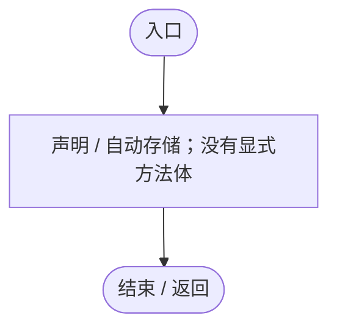
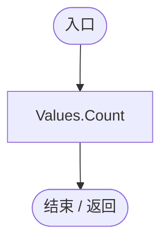
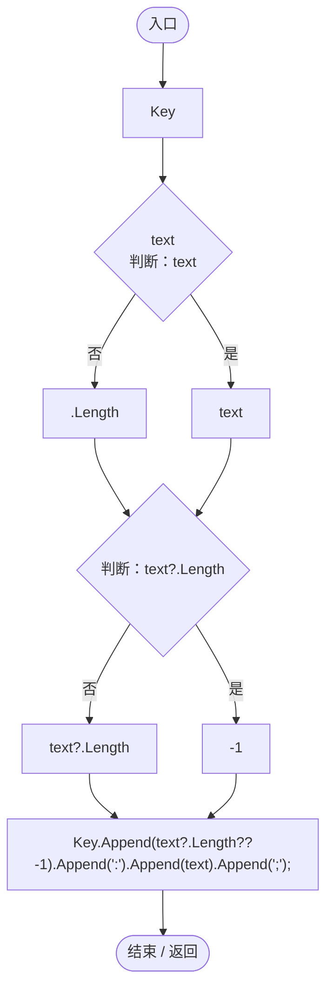
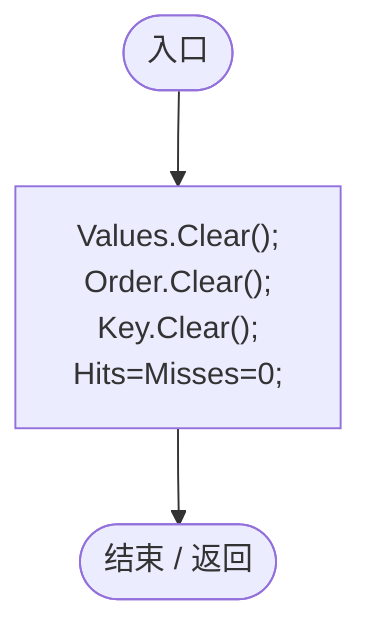
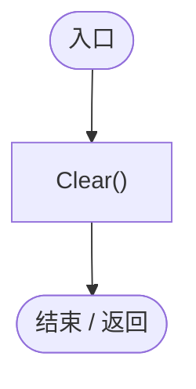

```mermaid
flowchart TD
  b0(["入口"])
  b1{"判断：SimulationOptimization.Current.expressionCache"}
  b2{"判断：genome==null"}
  b3["结果：GeneValueResolver.ResolveUncached(genome,gestating,suppression,exempt,roles)"]
  b4["GeneDatabase.EnsureLoaded();<br/>Key.Clear();<br/>Key.Append(gestating).Append(':').Append(suppression.ToString(&quot;R&quot;,CultureInfo.InvariantCulture));<br/>Text(exempt);"]
  b5["genome.Genes"]
  b6{"判断：genome.Genes"}
  b7["var"]
  b8{"Text(gene.DefinitionId);<br/>Key.Append(gene.Value.ToString(&quot;R&quot;,CultureInfo.InvariantCulture)).Append(':').Append(gene.CopyStrength.ToString(&quot;R&quot;,CultureInfo.InvariantCulture)).Append(':').Append(gene.Tier).Append(':').Append(gene.Enabled).Ap…"}
  b9["gene.MissingStateIds"]
  b10{"判断：gene.MissingStateIds"}
  b11["var<br/>Text(id);"]
  b12["gene.MissingStateIds"]
  b13["Key.Append('&#124;');<br/>role=0"]
  b14{"roles<br/>判断：roles"}
  b15["roles?.TryGetValue(gene.DefinitionId,out role);"]
  b16["Key.Append(role.ToString(&quot;R&quot;,CultureInfo.InvariantCulture)).Append(';');"]
  b17["genome.Genes"]
  b18{"key=Key.ToString()<br/>判断：Values.TryGetValue(key,out var cached)"}
  b19["Hits++;"]
  b20["new GenomeEvaluation{Attributes=new Dictionary&lt;string,float&gt;(cached.attributes)}<br/>Attributes=new Dictionary&lt;string,float&gt;(cached.attributes)<br/>result=new GenomeEvaluation{Attributes=new Dictionary&lt;string,float&gt;(cached.attributes)}"]
  b21["cached.values"]
  b22{"判断：cached.values"}
  b23["var"]
  b24["result.Genes<br/>new GeneEvaluation{Gene=genome.Genes[value.index],Definition=value.definition,State=value.state,SuppressionAmount=value.suppression,EffectiveStrength=value.strength,EnvironmentSuppression=value.environment,RoleSuppression=va…"]
  b25["cached.values"]
  b26["结果：result"]
  b27["Misses++;<br/>evaluated=GeneValueResolver.ResolveUncached(genome,gestating,suppression,exempt,roles)"]
  b28["new Snapshot{attributes=new Dictionary&lt;string,float&gt;(evaluated.Attributes)}<br/>attributes=new Dictionary&lt;string,float&gt;(evaluated.Attributes)<br/>snapshot=new Snapshot{attributes=new Dictionary&lt;string,float&gt;(evaluated.Attributes)}"]
  b29["evaluated.Genes"]
  b30{"判断：evaluated.Genes"}
  b31["var"]
  b32["snapshot.values<br/>new Value{index=genome.Genes.IndexOf(value.Gene),definition=value.Definition,state=value.State,suppression=value.SuppressionAmount,strength=value.EffectiveStrength,environment=value.EnvironmentSuppression,role=value.RoleS…"]
  b33["evaluated.Genes"]
  b34["limit=SimulationOptimization.Current.expressionCacheLimit"]
  b35{"判断：Order.Count&gt;=limit"}
  b36["Values.Remove(Order.Dequeue());"]
  b37["Values[key]=snapshot;<br/>Order.Enqueue(key);<br/>结果：evaluated"]
  b38(["结束 / 返回"])
  b0 --> b1
  b1 -->|"是"| b2
  b1 -->|"否"| b3
  b2 -->|"是"| b3
  b2 -->|"否"| b4
  b3 -->|"返回"| b38
  b4 --> b5
  b5 --> b6
  b6 -->|"是"| b7
  b6 -->|"否 · 经过finally 17"| b18
  b7 --> b8
  b8 -->|"是"| b9
  b8 -->|"否"| b13
  b9 --> b10
  b10 -->|"是"| b11
  b10 -->|"否 · 经过finally 12"| b13
  b11 --> b10
  b13 --> b14
  b14 -->|"否"| b15
  b14 -->|"是"| b16
  b15 --> b16
  b16 --> b6
  b18 -->|"是"| b19
  b18 -->|"否"| b27
  b19 --> b20
  b20 --> b21
  b21 --> b22
  b22 -->|"是"| b23
  b22 -->|"否 · 经过finally 25"| b26
  b23 --> b24
  b24 --> b22
  b26 -->|"返回"| b38
  b27 --> b28
  b28 --> b29
  b29 --> b30
  b30 -->|"是"| b31
  b30 -->|"否 · 经过finally 33"| b34
  b31 --> b32
  b32 --> b30
  b34 --> b35
  b35 -->|"是"| b36
  b35 -->|"否"| b37
  b36 --> b35
  b37 -->|"返回"| b38
  b10 -. "退出保护区时 finally（示意）" .-> b12
  b6 -. "退出保护区时 finally（示意）" .-> b17
  b22 -. "退出保护区时 finally（示意）" .-> b25
  b30 -. "退出保护区时 finally（示意）" .-> b33

```

# GeneExpressionCache.cs

[返回总索引](../README.md) · `Runtime` · `Assets/DarwinPark/Genetics/Evaluation/GeneExpressionCache.cs`

[源文件](../../../Assets/DarwinPark/Genetics/Evaluation/GeneExpressionCache.cs) · 源码校验：`39863fe77957bc8160d0c5586260e8357036f6fa34899488dd34671215be9c67`

方法按源文件位置排列。事件/回调引用不表示立即执行；分支与异常说明见总索引。完整源码与可点击关系图请打开离线手册。

## Hits.get · L15

`get`

### Editor / Player · 语法控制结构 / 声明（非CFG）

## Hits.set · L15

`private set`

### Editor / Player · 语法控制结构 / 声明（非CFG）

## Misses.get · L15

`get`

### Editor / Player · 语法控制结构 / 声明（非CFG）

## Misses.set · L15

`private set`

### Editor / Player · 语法控制结构 / 声明（非CFG）

## Count.get · L15

`public static int Count`

### Editor / Player · 语法控制结构 / 声明（非CFG）

## Text · L16

`private static void Text(string text)`

### Editor / Player · Roslyn编译器控制流

## Resolve · L17

`public static GenomeEvaluation Resolve(Genome genome,bool gestating,float suppression,string exempt,IReadOnlyDictionary<string,float> roles)`

### Editor / Player · Roslyn编译器控制流

项目内调用/回调引用：

- [SimulationOptimization.Current.get · L18](11c9091e70893352.md#m81dac8318af42ca9)（访问器）
- [GeneValueResolver.ResolveUncached · L38](837eb9ce6eba3cc6.md#m37ff0199163a0524)（方法）
- [GeneDatabase.EnsureLoaded · L12](ec0a03483435a863.md#mc3e6357b9ca440f5)（方法）
- [GeneExpressionCache.Text · L16](769f6842770bce00.md#mfef04cc962f917e6)（方法）
- [GeneExpressionCache.Hits.set · L15](769f6842770bce00.md#m6f336cdb36ae803b)（访问器）
- [GeneExpressionCache.Hits.get · L15](769f6842770bce00.md#mdf34091a68c3be4a)（访问器）
- [GeneExpressionCache.Misses.set · L15](769f6842770bce00.md#m159594247d81bad2)（访问器）
- [GeneExpressionCache.Misses.get · L15](769f6842770bce00.md#mc40f6efc5930c5a9)（访问器）

## Clear · L33

`public static void Clear()`

### Editor / Player · Roslyn编译器控制流

项目内调用/回调引用：

- [GeneExpressionCache.Hits.set · L15](769f6842770bce00.md#m6f336cdb36ae803b)（访问器）
- [GeneExpressionCache.Misses.set · L15](769f6842770bce00.md#m159594247d81bad2)（访问器）

## Reset · L34

`[RuntimeInitializeOnLoadMethod(RuntimeInitializeLoadType.SubsystemRegistration)]private static void Reset()`

### Editor / Player · Roslyn编译器控制流

项目内调用/回调引用：

- [GeneExpressionCache.Clear · L33](769f6842770bce00.md#m3e48f1eea2844305)（方法）
