# SimulationControlPanel.cs

[返回总索引](../README.md) · `Runtime` · `Assets/DarwinPark/UI/SimulationControlPanel.cs`

[源文件](../../../Assets/DarwinPark/UI/SimulationControlPanel.cs) · 源码校验：`d2ebea168cdf0755eb213cf97d655667daf924d721f0567225ad52471fc73416`

方法按源文件位置排列。事件/回调引用不表示立即执行；分支与异常说明见总索引。完整源码与可点击关系图请打开离线手册。

<a id="m03c1c859770476c8"></a>

## TryGetScreenRect · L33

`public bool TryGetScreenRect(out Rect rect)`

★ 新增：提供底栏实际屏幕边界，让混用IMGUI的RTS栏跟随Canvas缩放，而不是猜测固定高度。

### Editor / Player · Roslyn编译器控制流

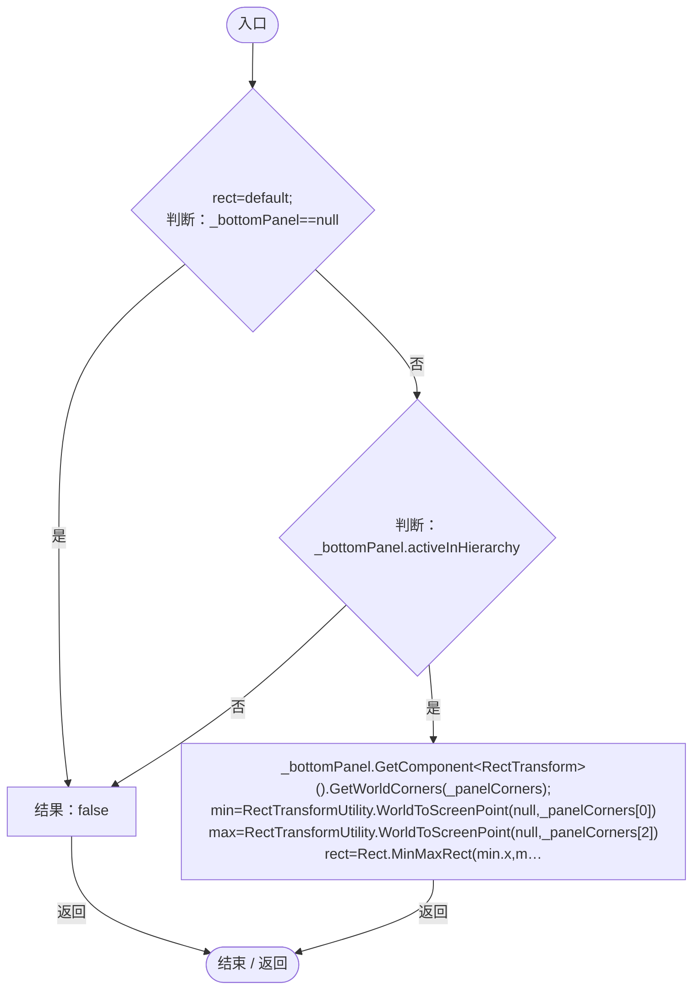

<a id="mdec86cd140ec1865"></a>

## CurrentLayer.get · L42

`public string CurrentLayer`


### Editor / Player · 语法控制结构 / 声明（非CFG）

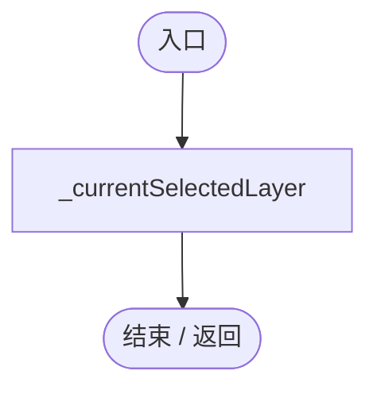

<a id="m8fbdee815f2edaee"></a>

## OnEnable · L49

`private void OnEnable()`


### Editor / Player · Roslyn编译器控制流

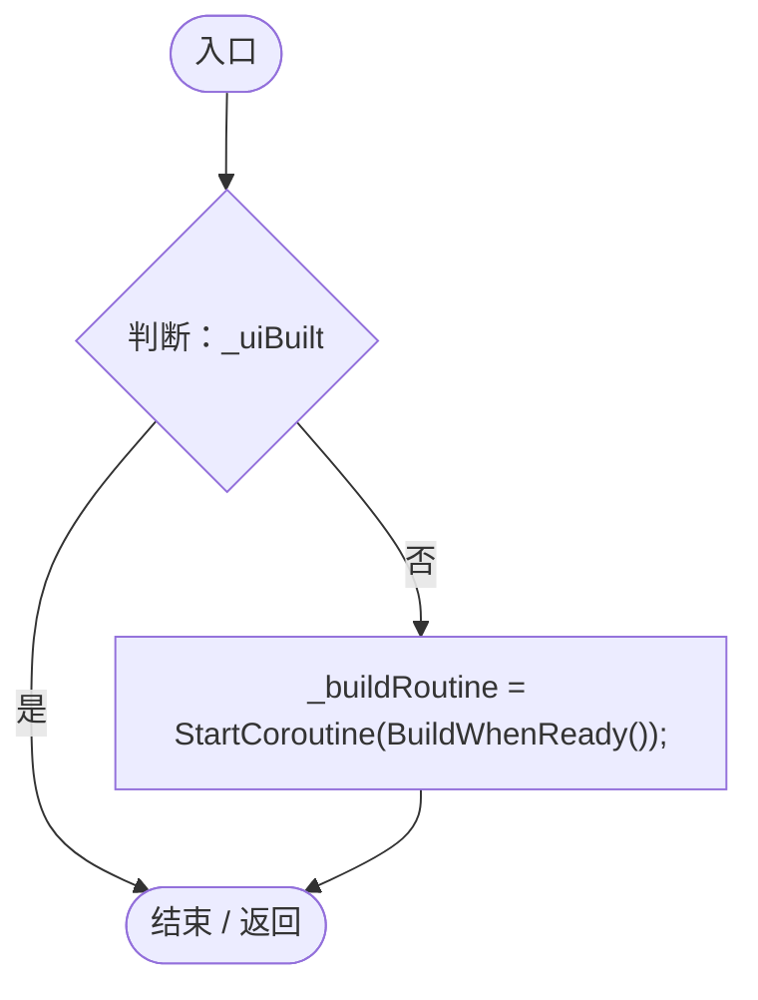

项目内调用/回调引用：

- [SimulationControlPanel.BuildWhenReady · L58](76bc7add9187fd1f.md#m286b5ef98615590e)（方法）

<a id="m286b5ef98615590e"></a>

## BuildWhenReady · L58

`private System.Collections.IEnumerator BuildWhenReady()`


### Editor / Player · Roslyn编译器控制流

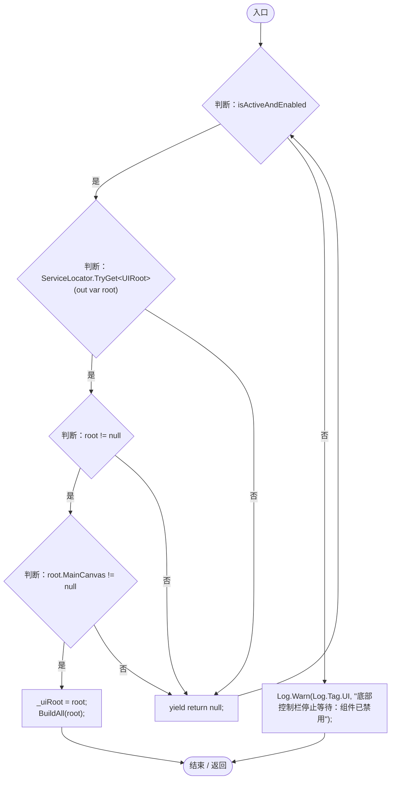

项目内调用/回调引用：

- [ServiceLocator.TryGet · L26](f2fdbe9f9ccd93cb.md#m143b24e6d58471b0)（方法）
- [UIRoot.MainCanvas.get · L14](9c1421378791f0e0.md#maa2cc9baf1248477)（访问器）
- [SimulationControlPanel.BuildAll · L75](76bc7add9187fd1f.md#mfd575435aea71171)（方法）
- [Log.Warn · L37](735e5abf0df2bddc.md#m25a5d11252901de1)（方法）

<a id="mfd575435aea71171"></a>

## BuildAll · L75

`private void BuildAll(UIRoot root)`


### Editor / Player · Roslyn编译器控制流

```mermaid
flowchart TD
  b0(["入口"])
  b1{"判断：_uiBuilt"}
  b2["UIIconRegistry.Init();"]
  b3["_iconPlay"]
  b4{"UIIconRegistry.Get(&quot;time_play&quot;)<br/>判断：UIIconRegistry.Get(&quot;time_play&quot;)"}
  b5["UIIconRegistry.Get(&quot;time_play&quot;)"]
  b6["UIIconRegistry.Get(&quot;play&quot;)"]
  b7["_iconPlay = UIIconRegistry.Get(&quot;time_play&quot;) ?? UIIconRegistry.Get(&quot;play&quot;);"]
  b8["_iconPause"]
  b9{"UIIconRegistry.Get(&quot;time_pause&quot;)<br/>判断：UIIconRegistry.Get(&quot;time_pause&quot;)"}
  b10["UIIconRegistry.Get(&quot;time_pause&quot;)"]
  b11["UIIconRegistry.Get(&quot;pause&quot;)"]
  b12["_iconPause = UIIconRegistry.Get(&quot;time_pause&quot;) ?? UIIconRegistry.Get(&quot;pause&quot;);"]
  b13["_clock = ServiceLocator.Get&lt;SimulationClock&gt;();<br/>root.MainCanvas.sortingOrder = Mathf.Max(root.MainCanvas.sortingOrder, 200);<br/>BuildUI(root.MainCanvas.transform);<br/>_uiBuilt = true;<br/>Canvas.ForceUpdateCanvases();<br/>KeepBottomPanelVisible();"]
  b14{"判断：_bottomPanel != null"}
  b15["_bottomPanel.GetComponent&lt;RectTransform&gt;()"]
  b16["null"]
  b17["br = _bottomPanel != null ? _bottomPanel.GetComponent&lt;RectTransform&gt;() : null"]
  b18["Log.Tag.UI"]
  b19{"Screen.width<br/>Screen.height<br/>判断：_bottomPanel != null"}
  b20["&quot;ok&quot;"]
  b21["&quot;missing&quot;"]
  b22["$&quot;底部控制栏构建完成：screen={Screen.width}x{Screen.height}, panel={(_bottomPanel != null ? &quot;ok&quot; : &quot;missing&quot;)}, &quot;"]
  b23{"判断：br != null"}
  b24["br.rect.ToString()"]
  b25["&quot;null&quot;"]
  b26{"判断：br != null"}
  b27["br.position.ToString()"]
  b28["&quot;null&quot;"]
  b29["Log.Info(Log.Tag.UI, $&quot;底部控制栏构建完成：screen={Screen.width}x{Screen.height}, panel={(_bottomPanel != null ? &quot;ok&quot; : &quot;missing&quot;)}, &quot; + $&quot;rect={(br != null ? br.rect.ToString() : &quot;null&quot;)}, pos={(br != null ? br.position.ToString() : &quot;null&quot;)}, &quot; +…"]
  b30{"判断：_clock != null"}
  b31["_clock.OnRunningChanged -= OnRunningChanged;<br/>_clock.OnRunningChanged += OnRunningChanged;"]
  b32(["结束 / 返回"])
  b0 --> b1
  b1 -->|"是"| b32
  b1 -->|"否"| b2
  b2 --> b3
  b3 --> b4
  b4 -->|"否"| b5
  b4 -->|"是"| b6
  b5 --> b7
  b6 --> b7
  b7 --> b8
  b8 --> b9
  b9 -->|"否"| b10
  b9 -->|"是"| b11
  b10 --> b12
  b11 --> b12
  b12 --> b13
  b13 --> b14
  b14 -->|"是"| b15
  b14 -->|"否"| b16
  b15 --> b17
  b16 --> b17
  b17 --> b18
  b18 --> b19
  b19 -->|"是"| b20
  b19 -->|"否"| b21
  b20 --> b22
  b21 --> b22
  b22 --> b23
  b23 -->|"是"| b24
  b23 -->|"否"| b25
  b24 --> b26
  b25 --> b26
  b26 -->|"是"| b27
  b26 -->|"否"| b28
  b27 --> b29
  b28 --> b29
  b29 --> b30
  b30 -->|"是"| b31
  b30 -->|"否"| b32
  b31 --> b32

```

项目内调用/回调引用：

- [UIIconRegistry.Init · L16](5e97f4545b48cac2.md#m33e915a901d1da63)（方法）
- [UIIconRegistry.Get · L38](5e97f4545b48cac2.md#m95da89c0db2bbab9)（方法）
- [ServiceLocator.Get · L33](f2fdbe9f9ccd93cb.md#m2ae625299520c56d)（方法）
- [UIRoot.MainCanvas.get · L14](9c1421378791f0e0.md#maa2cc9baf1248477)（访问器）
- [SimulationControlPanel.BuildUI · L123](76bc7add9187fd1f.md#m29fe3574e85527e4)（方法）
- [SimulationControlPanel.KeepBottomPanelVisible · L523](76bc7add9187fd1f.md#m14681678a6660c2d)（方法）
- [Log.Info · L31](735e5abf0df2bddc.md#md1fe08215a3ce4d3)（方法）
- [SimulationControlPanel.OnRunningChanged · L564](76bc7add9187fd1f.md#m60bb9a4e34309d4c)（方法）

<a id="mb21b26916ba1ae34"></a>

## OnDisable · L109

`private void OnDisable()`


### Editor / Player · Roslyn编译器控制流

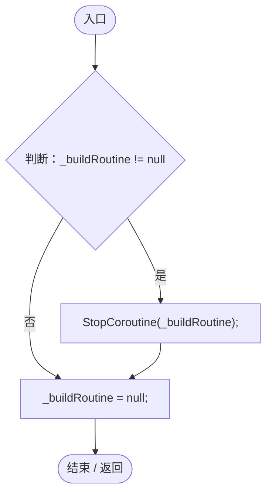

<a id="md3a36bfa6f3888c3"></a>

## OnDestroy · L116

`private void OnDestroy()`


### Editor / Player · Roslyn编译器控制流

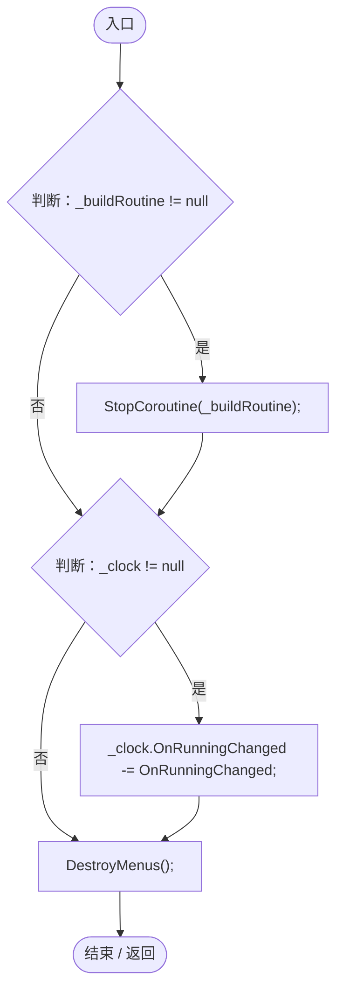

项目内调用/回调引用：

- [SimulationControlPanel.DestroyMenus · L422](76bc7add9187fd1f.md#mf81d8b5d29484eb0)（方法）
- [SimulationControlPanel.OnRunningChanged · L564](76bc7add9187fd1f.md#m60bb9a4e34309d4c)（方法）

<a id="m29fe3574e85527e4"></a>

## BuildUI · L123

`private void BuildUI(Transform canvas)`


### Editor / Player · Roslyn编译器控制流

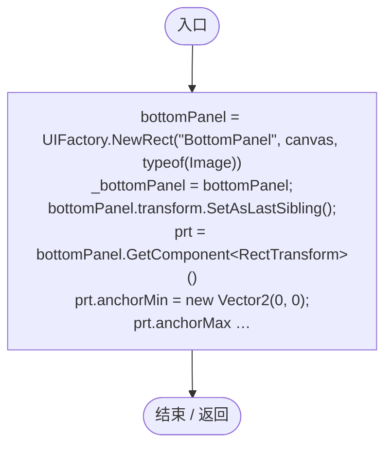

项目内调用/回调引用：

- [UIFactory.NewRect · L33](dd1096a6995423db.md#med612116f3152344)（方法）
- [UIVisualTheme.Paint · L58](ca525a798a08f966.md#m2d61a6b26ab24980)（方法）
- [SimulationControlPanel.CreateIconButton · L196](76bc7add9187fd1f.md#m281d26d4faba4fe0)（方法）
- [UIFactory.Stretch · L150](dd1096a6995423db.md#m11d8f6c6d00cc047)（方法）
- [SimulationControlPanel.BuildPage1 · L242](76bc7add9187fd1f.md#m43c374c5e479f20f)（方法）
- [SimulationControlPanel.BuildPage2 · L437](76bc7add9187fd1f.md#me4b8e012a73680a6)（方法）
- [SimulationControlPanel.SwitchPage · L228](76bc7add9187fd1f.md#m7061731e455c21be)（方法）
- [SimulationControlPanel.回调@155 · L155](76bc7add9187fd1f.md#md25d2c5ea832034a)（回调/委托）
- [SimulationControlPanel.回调@162 · L162](76bc7add9187fd1f.md#m4be57987de28fdbd)（回调/委托）

<a id="md25d2c5ea832034a"></a>

## 回调@155 · L155

`( … => 回调`


### Editor / Player · Roslyn编译器控制流


项目内调用/回调引用：

- [SimulationControlPanel.SwitchPage · L228](76bc7add9187fd1f.md#m7061731e455c21be)（方法）

<a id="m4be57987de28fdbd"></a>

## 回调@162 · L162

`( … => 回调`


### Editor / Player · Roslyn编译器控制流

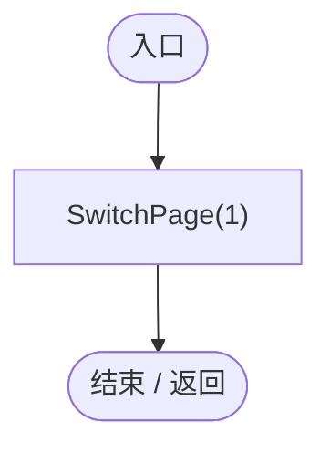

项目内调用/回调引用：

- [SimulationControlPanel.SwitchPage · L228](76bc7add9187fd1f.md#m7061731e455c21be)（方法）

<a id="m281d26d4faba4fe0"></a>

## CreateIconButton · L196

`private Button CreateIconButton(string iconId, Transform parent, System.Action onClick)`


### Editor / Player · Roslyn编译器控制流

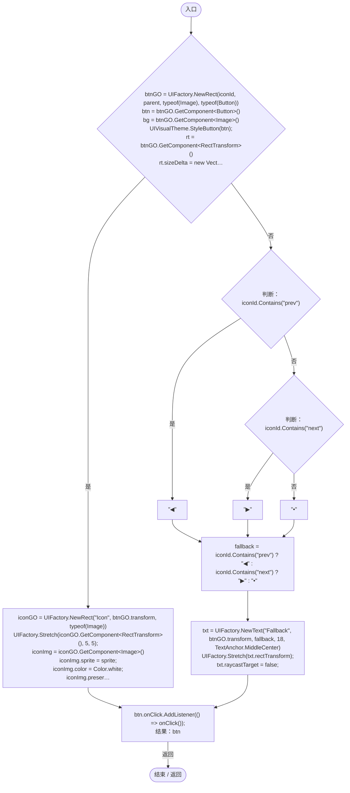

项目内调用/回调引用：

- [UIFactory.NewRect · L33](dd1096a6995423db.md#med612116f3152344)（方法）
- [UIVisualTheme.StyleButton · L67](ca525a798a08f966.md#mf2e64598de5115f3)（方法）
- [UIIconRegistry.Get · L38](5e97f4545b48cac2.md#m95da89c0db2bbab9)（方法）
- [UIFactory.Stretch · L150](dd1096a6995423db.md#m11d8f6c6d00cc047)（方法）
- [UIFactory.NewText · L57](dd1096a6995423db.md#m9dbccb5f0c38189e)（方法）
- [SimulationControlPanel.回调@224 · L224](76bc7add9187fd1f.md#m30d7eba449175e84)（回调/委托）

<a id="m30d7eba449175e84"></a>

## 回调@224 · L224

`( … => 回调`


### Editor / Player · Roslyn编译器控制流

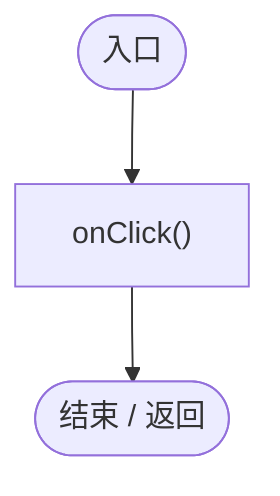

<a id="m7061731e455c21be"></a>

## SwitchPage · L228

`private void SwitchPage(int targetPage)`


### Editor / Player · Roslyn编译器控制流

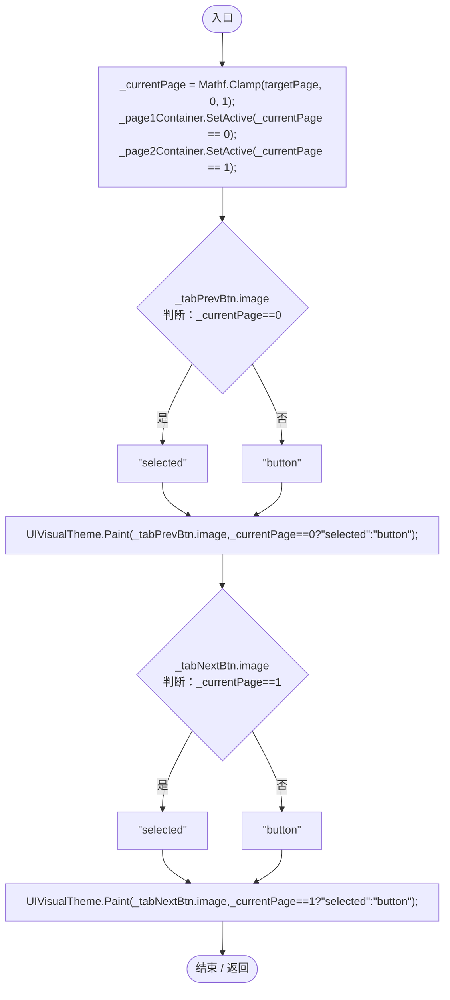

项目内调用/回调引用：

- [UIVisualTheme.Paint · L58](ca525a798a08f966.md#m2d61a6b26ab24980)（方法）

<a id="m43c374c5e479f20f"></a>

## BuildPage1 · L242

`private void BuildPage1(Transform parent)`

==========================================  第一页：时间、图层与环境 (保留原版右键弹窗)  ==========================================

### Editor / Player · Roslyn编译器控制流

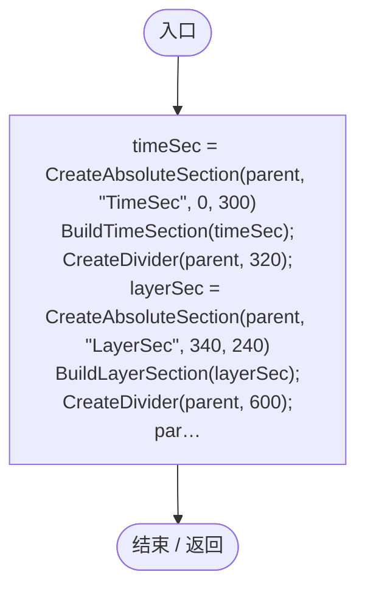

项目内调用/回调引用：

- [SimulationControlPanel.CreateAbsoluteSection · L451](76bc7add9187fd1f.md#m6d29bf4ed2b304e0)（方法）
- [SimulationControlPanel.BuildTimeSection · L258](76bc7add9187fd1f.md#m5eafa59acb1e974d)（方法）
- [SimulationControlPanel.CreateDivider · L463](76bc7add9187fd1f.md#md1d46ba2875babe0)（方法）
- [SimulationControlPanel.BuildLayerSection · L571](76bc7add9187fd1f.md#m0d1c43f4ac4e60be)（方法）
- [SimulationControlPanel.BuildParamSection · L340](76bc7add9187fd1f.md#md4170c6549973988)（方法）

<a id="m5eafa59acb1e974d"></a>

## BuildTimeSection · L258

`private void BuildTimeSection(GameObject parent)`


### Editor / Player · Roslyn编译器控制流

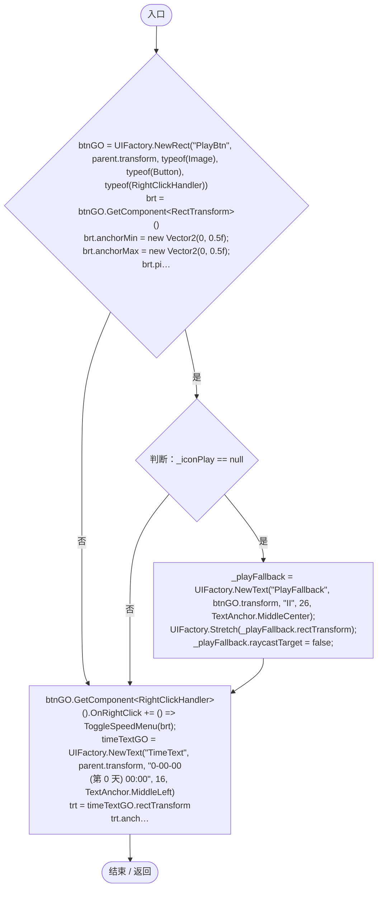

项目内调用/回调引用：

- [UIFactory.NewRect · L33](dd1096a6995423db.md#med612116f3152344)（方法）
- [UIVisualTheme.Paint · L58](ca525a798a08f966.md#m2d61a6b26ab24980)（方法）
- [UIFactory.Stretch · L150](dd1096a6995423db.md#m11d8f6c6d00cc047)（方法）
- [UIFactory.NewText · L57](dd1096a6995423db.md#m9dbccb5f0c38189e)（方法）
- [SimulationControlPanel.回调@271 · L271](76bc7add9187fd1f.md#me357de23a1041fe3)（回调/委托）
- [SimulationControlPanel.回调@288 · L288](76bc7add9187fd1f.md#m0ca2885d0c604933)（回调/委托）

<a id="me357de23a1041fe3"></a>

## 回调@271 · L271

`( … => 回调`


### Editor / Player · Roslyn编译器控制流

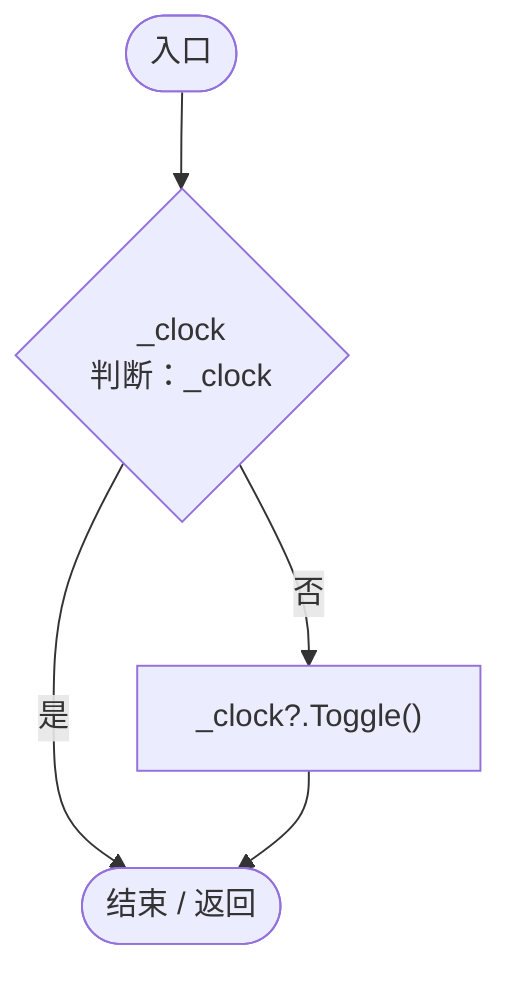

项目内调用/回调引用：

- [SimulationClock.Toggle · L80](a8f444aec9614b0a.md#m2d6d7d27573d58b8)（方法）

<a id="m0ca2885d0c604933"></a>

## 回调@288 · L288

`( … => 回调`


### Editor / Player · Roslyn编译器控制流

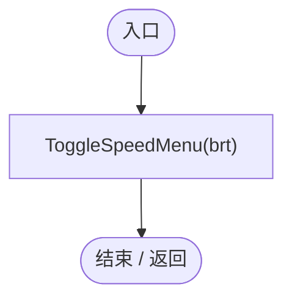

项目内调用/回调引用：

- [SimulationControlPanel.ToggleSpeedMenu · L300](76bc7add9187fd1f.md#mc3af7c594701c6a2)（方法）

<a id="mc3af7c594701c6a2"></a>

## ToggleSpeedMenu · L300

`private void ToggleSpeedMenu(RectTransform targetBtn)`


### Editor / Player · Roslyn编译器控制流

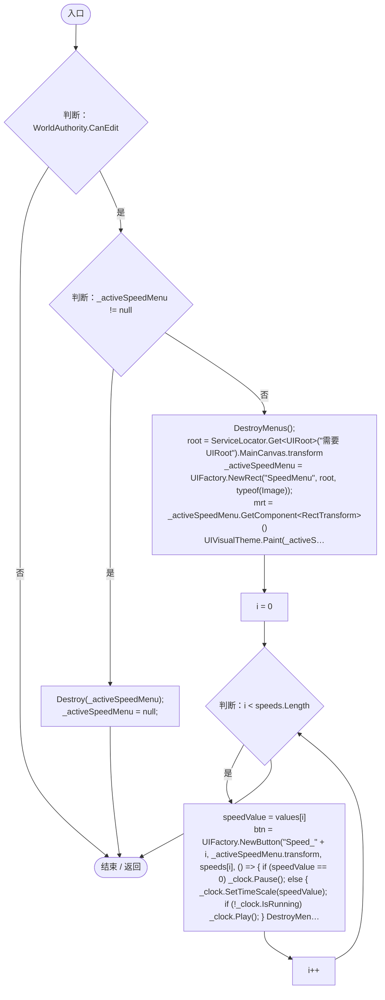

项目内调用/回调引用：

- [SimulationControlPanel.DestroyMenus · L422](76bc7add9187fd1f.md#mf81d8b5d29484eb0)（方法）
- [UIRoot.MainCanvas.get · L14](9c1421378791f0e0.md#maa2cc9baf1248477)（访问器）
- [ServiceLocator.Get · L33](f2fdbe9f9ccd93cb.md#m2ae625299520c56d)（方法）
- [UIFactory.NewRect · L33](dd1096a6995423db.md#med612116f3152344)（方法）
- [UIVisualTheme.Paint · L58](ca525a798a08f966.md#m2d61a6b26ab24980)（方法）
- [UIFactory.NewButton · L73](dd1096a6995423db.md#m5896f1b097c8bdde)（方法）
- [SimulationControlPanel.回调@327 · L327](76bc7add9187fd1f.md#m9b9078bf641179dd)（回调/委托）

<a id="m9b9078bf641179dd"></a>

## 回调@327 · L327

`( … => 回调`


### Editor / Player · Roslyn编译器控制流

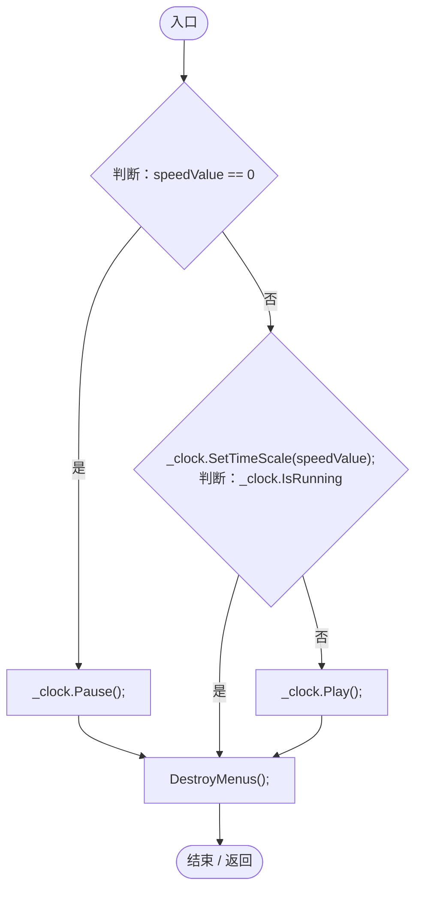

项目内调用/回调引用：

- [SimulationClock.Pause · L79](a8f444aec9614b0a.md#m30929d45a885d0f1)（方法）
- [SimulationClock.SetTimeScale · L81](a8f444aec9614b0a.md#mecaa463a0561aca3)（方法）
- [SimulationClock.IsRunning.get · L22](a8f444aec9614b0a.md#m10f4fe307faca0f0)（访问器）
- [SimulationClock.Play · L78](a8f444aec9614b0a.md#m7aa9e64b7de60ed0)（方法）
- [SimulationControlPanel.DestroyMenus · L422](76bc7add9187fd1f.md#mf81d8b5d29484eb0)（方法）

<a id="md4170c6549973988"></a>

## BuildParamSection · L340

`private void BuildParamSection(GameObject parent)`


### Editor / Player · Roslyn编译器控制流

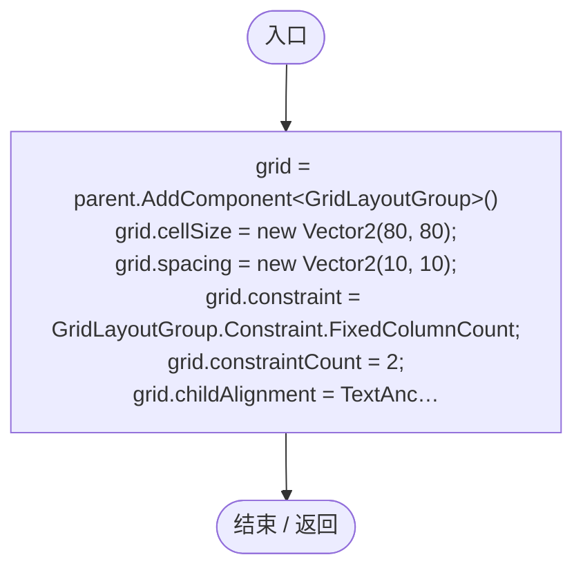

项目内调用/回调引用：

- [SimulationControlPanel.CreateParamButton · L355](76bc7add9187fd1f.md#m23eb5d21ae07b829)（方法）

<a id="m23eb5d21ae07b829"></a>

## CreateParamButton · L355

`private void CreateParamButton(string iconId, string fallbackName, Transform parent)`


### Editor / Player · Roslyn编译器控制流

```mermaid
flowchart TD
  b0(["入口"])
  b1{"btnGO = UIFactory.NewRect(iconId, parent, typeof(Image), typeof(Button), typeof(RightClickHandler))<br/>bg = btnGO.GetComponent&lt;Image&gt;()<br/>UIVisualTheme.Paint(bg,&quot;button&quot;);<br/>sprite = UIIconRegistry.Get(iconId)<br/>判断：sprite != null"}
  b2["iconGO = UIFactory.NewRect(&quot;Icon&quot;, btnGO.transform, typeof(Image))<br/>irt = iconGO.GetComponent&lt;RectTransform&gt;()<br/>UIFactory.Stretch(irt, 20, 20);<br/>iconImg = iconGO.GetComponent&lt;Image&gt;()<br/>iconImg.sprite = sprite;<br/>iconImg.preserveAspect = true;<br/>…"]
  b3["txt = UIFactory.NewText(&quot;Name&quot;, btnGO.transform, fallbackName, 12, TextAnchor.LowerCenter)<br/>UIFactory.Stretch(txt.rectTransform, 2, 5);<br/>txt.raycastTarget = false;<br/>btnGO.GetComponent&lt;Button&gt;().onClick.AddListener(() =&gt; ToggleParamPopup(ico…"]
  b4(["结束 / 返回"])
  b0 --> b1
  b1 -->|"是"| b2
  b1 -->|"否"| b3
  b2 --> b3
  b3 --> b4

```

项目内调用/回调引用：

- [UIFactory.NewRect · L33](dd1096a6995423db.md#med612116f3152344)（方法）
- [UIVisualTheme.Paint · L58](ca525a798a08f966.md#m2d61a6b26ab24980)（方法）
- [UIIconRegistry.Get · L38](5e97f4545b48cac2.md#m95da89c0db2bbab9)（方法）
- [UIFactory.Stretch · L150](dd1096a6995423db.md#m11d8f6c6d00cc047)（方法）
- [UIFactory.NewText · L57](dd1096a6995423db.md#m9dbccb5f0c38189e)（方法）
- [SimulationControlPanel.回调@379 · L379](76bc7add9187fd1f.md#m58ca38ace24eedc1)（回调/委托）
- [SimulationControlPanel.DestroyMenus · L422](76bc7add9187fd1f.md#mf81d8b5d29484eb0)（方法）

<a id="m58ca38ace24eedc1"></a>

## 回调@379 · L379

`( … => 回调`


### Editor / Player · Roslyn编译器控制流

```mermaid
flowchart TD
  b0(["入口"])
  b1["ToggleParamPopup(iconId, fallbackName)"]
  b2(["结束 / 返回"])
  b0 --> b1
  b1 --> b2

```

项目内调用/回调引用：

- [SimulationControlPanel.ToggleParamPopup · L383](76bc7add9187fd1f.md#m1eb3c54ce3967d3a)（方法）

<a id="m1eb3c54ce3967d3a"></a>

## ToggleParamPopup · L383

`private void ToggleParamPopup(string paramId, string paramName)`


### Editor / Player · Roslyn编译器控制流

```mermaid
flowchart TD
  b0(["入口"])
  b1{"判断：WorldAuthority.CanEdit"}
  b2{"判断：_activeParamMenu != null"}
  b3{"判断：_activeParamId==paramId"}
  b4["DestroyMenus();"]
  b5["DestroyMenus();<br/>root = ServiceLocator.Get&lt;UIRoot&gt;(&quot;需要 UIRoot&quot;).MainCanvas.transform<br/>_activeParamId=paramId;<br/>_activeParamMenu = UIFactory.NewRect(&quot;ParamMenuOverlay&quot;, root, typeof(Image), typeof(RightClickHandler));<br/>oRt = _activeParamMenu.…"]
  b6(["结束 / 返回"])
  b0 --> b1
  b1 -->|"否"| b6
  b1 -->|"是"| b2
  b2 -->|"是"| b3
  b2 -->|"否"| b5
  b3 -->|"是"| b4
  b3 -->|"否"| b5
  b4 --> b6
  b5 --> b6

```

项目内调用/回调引用：

- [SimulationControlPanel.DestroyMenus · L422](76bc7add9187fd1f.md#mf81d8b5d29484eb0)（方法）
- [UIRoot.MainCanvas.get · L14](9c1421378791f0e0.md#maa2cc9baf1248477)（访问器）
- [ServiceLocator.Get · L33](f2fdbe9f9ccd93cb.md#m2ae625299520c56d)（方法）
- [UIFactory.NewRect · L33](dd1096a6995423db.md#med612116f3152344)（方法）
- [UIVisualTheme.Paint · L58](ca525a798a08f966.md#m2d61a6b26ab24980)（方法）
- [UIFactory.NewText · L57](dd1096a6995423db.md#m9dbccb5f0c38189e)（方法）
- [PlanetParameterEditor.Initialize · L22](ac36b95043305d58.md#mcb452e7ce502d7e2)（方法）

<a id="mf81d8b5d29484eb0"></a>

## DestroyMenus · L422

`private void DestroyMenus()`


### Editor / Player · Roslyn编译器控制流

```mermaid
flowchart TD
  b0(["入口"])
  b1{"判断：_activeSpeedMenu != null"}
  b2["Destroy(_activeSpeedMenu);"]
  b3{"判断：_activeParamMenu != null"}
  b4["Destroy(_activeParamMenu);"]
  b5["_activeSpeedMenu = null;<br/>_activeParamMenu = null;<br/>_activeParamId=null;"]
  b6(["结束 / 返回"])
  b0 --> b1
  b1 -->|"是"| b2
  b1 -->|"否"| b3
  b2 --> b3
  b3 -->|"是"| b4
  b3 -->|"否"| b5
  b4 --> b5
  b5 --> b6

```

<a id="me4b8e012a73680a6"></a>

## BuildPage2 · L437

`private void BuildPage2(Transform parent)`

==========================================  第二页：直接实例化独立脚本  ==========================================

### Editor / Player · Roslyn编译器控制流

```mermaid
flowchart TD
  b0(["入口"])
  b1["page2GO = UIFactory.NewRect(&quot;EntitySpawnPanel&quot;, parent)<br/>UIFactory.Stretch(page2GO.GetComponent&lt;RectTransform&gt;());<br/>spawnPanel = page2GO.AddComponent&lt;EntitySpawnPanel&gt;()<br/>spawnPanel.DefaultEntityPrefab = this.EntityPrefab;<br/>population=UIFact…"]
  b2(["结束 / 返回"])
  b0 --> b1
  b1 --> b2

```

项目内调用/回调引用：

- [UIFactory.NewRect · L33](dd1096a6995423db.md#med612116f3152344)（方法）
- [UIFactory.Stretch · L150](dd1096a6995423db.md#m11d8f6c6d00cc047)（方法）

<a id="m6d29bf4ed2b304e0"></a>

## CreateAbsoluteSection · L451

`private GameObject CreateAbsoluteSection(Transform parent, string name, float xOffset, float width)`

---------------------------------------------  工具方法  ---------------------------------------------

### Editor / Player · Roslyn编译器控制流

```mermaid
flowchart TD
  b0(["入口"])
  b1["go = UIFactory.NewRect(name, parent)<br/>rt = go.GetComponent&lt;RectTransform&gt;()<br/>rt.anchorMin = new Vector2(0, 0);<br/>rt.anchorMax = new Vector2(0, 1);<br/>rt.pivot = new Vector2(0, 0.5f);<br/>rt.offsetMin = new Vector2(xOffset, 0);<br/>rt.offsetMax = new Ve…"]
  b2(["结束 / 返回"])
  b0 --> b1
  b1 -->|"返回"| b2

```

项目内调用/回调引用：

- [UIFactory.NewRect · L33](dd1096a6995423db.md#med612116f3152344)（方法）

<a id="md1d46ba2875babe0"></a>

## CreateDivider · L463

`private void CreateDivider(Transform parent, float xOffset)`


### Editor / Player · Roslyn编译器控制流

```mermaid
flowchart TD
  b0(["入口"])
  b1["div = UIFactory.NewRect(&quot;Divider&quot;, parent, typeof(Image))<br/>rt = div.GetComponent&lt;RectTransform&gt;()<br/>rt.anchorMin = new Vector2(0, 0.1f);<br/>rt.anchorMax = new Vector2(0, 0.9f);<br/>rt.pivot = new Vector2(0, 0.5f);<br/>rt.offsetMin = new Vector2(xOffse…"]
  b2(["结束 / 返回"])
  b0 --> b1
  b1 --> b2

```

项目内调用/回调引用：

- [UIFactory.NewRect · L33](dd1096a6995423db.md#med612116f3152344)（方法）

<a id="m09c6f4246661c7aa"></a>

## Update · L475

`private void Update()`


### Editor / Player · Roslyn编译器控制流

```mermaid
flowchart TD
  b0(["入口"])
  b1{"判断：WorldRuntimeGate.Ready"}
  b2{"判断：GameInputGate.Blocked"}
  b3{"判断：ControlBindings.Down(ControlAction.ClearLayer)"}
  b4["HandleLayerKey(ControlBindings.Get(ControlAction.ClearLayer));"]
  b5{"判断：ControlBindings.Down(ControlAction.CycleLayer)"}
  b6["HandleLayerKey(ControlBindings.Get(ControlAction.CycleLayer));"]
  b7{"判断：_currentSelectedLayer==&quot;layer_population&quot;"}
  b8{"判断：PopulationRangeLayer.Visible"}
  b9["SetLayer(&quot;default&quot;);"]
  b10{"判断：_uiBuilt"}
  b11{"判断：_tabNextBtn!=null"}
  b12{"_tabNextBtn.interactable=true;<br/>判断：WorldAuthority.CanEdit"}
  b13["DestroyMenus();"]
  b14{"_page2Container<br/>判断：_page2Container"}
  b15[".transform.Find(&quot;EntitySpawnPanel&quot;)"]
  b16["_page2Container"]
  b17["spawning=_page2Container?.transform.Find(&quot;EntitySpawnPanel&quot;)"]
  b18{"判断：spawning!=null"}
  b19["spawning.gameObject.SetActive(WorldAuthority.CanEdit);"]
  b20{"_bottomPanel<br/>判断：_bottomPanel"}
  b21[".transform.Find(&quot;ContentArea/Page1/TimeSec/PlayBtn&quot;)"]
  b22{"判断：.transform.Find(&quot;ContentArea/Page1/TimeSec/PlayBtn&quot;)"}
  b23[".GetComponent&lt;Button&gt;()"]
  b24["_bottomPanel?.transform.Find(&quot;ContentArea/Page1/TimeSec/PlayBtn&quot;)?.GetComponent&lt;Button&gt;()"]
  b25["play=_bottomPanel?.transform.Find(&quot;ContentArea/Page1/TimeSec/PlayBtn&quot;)?.GetComponent&lt;Button&gt;()"]
  b26{"判断：play!=null"}
  b27["play.interactable=WorldAuthority.CanEdit;"]
  b28{"_bottomPanel<br/>判断：_bottomPanel"}
  b29[".transform.Find(&quot;ContentArea/Page1/ParamSec&quot;)"]
  b30["_bottomPanel"]
  b31["parameters=_bottomPanel?.transform.Find(&quot;ContentArea/Page1/ParamSec&quot;)"]
  b32{"判断：parameters!=null"}
  b33["parameters.gameObject.SetActive(WorldAuthority.CanEdit);"]
  b34{"判断：Input.GetKeyDown(KeyCode.Escape)"}
  b35["DestroyMenus();"]
  b36{"判断：_uiBuilt"}
  b37{"判断：_bottomPanel == null"}
  b38{"判断：_uiRoot != null"}
  b39["_uiBuilt = false;<br/>BuildAll(_uiRoot);"]
  b40{"KeepBottomPanelVisible();<br/>判断：_clock != null"}
  b41{"判断：_timeText != null"}
  b42["totalDays = Mathf.FloorToInt(_clock.GameTime / 10f)<br/>year = totalDays / 365<br/>dayOfYear = totalDays % 365<br/>month = (dayOfYear / 30) + 1<br/>day = (dayOfYear % 30) + 1<br/>dayProgress = (_clock.GameTime % 10f) / 10f<br/>hour = Mathf.FloorToInt(dayProgres…"]
  b43(["结束 / 返回"])
  b0 --> b1
  b1 -->|"是"| b2
  b1 -->|"否"| b7
  b2 -->|"否"| b3
  b2 -->|"是"| b7
  b3 -->|"是"| b4
  b3 -->|"否"| b5
  b4 --> b7
  b5 -->|"是"| b6
  b5 -->|"否"| b7
  b6 --> b7
  b7 -->|"是"| b8
  b7 -->|"否"| b10
  b8 -->|"否"| b9
  b8 -->|"是"| b10
  b9 --> b10
  b10 -->|"是"| b11
  b10 -->|"否"| b34
  b11 -->|"是"| b12
  b11 -->|"否"| b34
  b12 -->|"否"| b13
  b12 -->|"是"| b14
  b13 --> b14
  b14 -->|"否"| b15
  b14 -->|"是"| b16
  b15 --> b17
  b16 --> b17
  b17 --> b18
  b18 -->|"是"| b19
  b18 -->|"否"| b20
  b19 --> b20
  b20 -->|"否"| b21
  b20 -->|"是"| b24
  b21 --> b22
  b22 -->|"否"| b23
  b22 -->|"是"| b24
  b23 --> b25
  b24 --> b25
  b25 --> b26
  b26 -->|"是"| b27
  b26 -->|"否"| b28
  b27 --> b28
  b28 -->|"否"| b29
  b28 -->|"是"| b30
  b29 --> b31
  b30 --> b31
  b31 --> b32
  b32 -->|"是"| b33
  b32 -->|"否"| b34
  b33 --> b34
  b34 -->|"是"| b35
  b34 -->|"否"| b36
  b35 --> b36
  b36 -->|"是"| b37
  b36 -->|"否"| b40
  b37 -->|"是"| b38
  b37 -->|"否"| b40
  b38 -->|"是"| b39
  b38 -->|"否"| b40
  b39 --> b40
  b40 -->|"是"| b41
  b40 -->|"否"| b43
  b41 -->|"是"| b42
  b41 -->|"否"| b43
  b42 --> b43

```

项目内调用/回调引用：

- [GameInputGate.Blocked.get · L8](52955daae7e592ab.md#m765763b665829633)（访问器）
- [ControlBindings.Down · L50](b6735f8f133ee3f4.md#mdf834c82033aa362)（方法）
- [SimulationControlPanel.HandleLayerKey · L646](76bc7add9187fd1f.md#mecce3d40cecb2374)（方法）
- [ControlBindings.Get · L45](b6735f8f133ee3f4.md#mb5707e6e63a56689)（方法）
- [SimulationControlPanel.SetLayer · L655](76bc7add9187fd1f.md#mab01f8a7518e426f)（方法）
- [SimulationControlPanel.DestroyMenus · L422](76bc7add9187fd1f.md#mf81d8b5d29484eb0)（方法）
- [SimulationControlPanel.BuildAll · L75](76bc7add9187fd1f.md#mfd575435aea71171)（方法）
- [SimulationControlPanel.KeepBottomPanelVisible · L523](76bc7add9187fd1f.md#m14681678a6660c2d)（方法）
- [SimulationClock.GameTime.get · L23](a8f444aec9614b0a.md#m74adfa39a896652f)（访问器）

<a id="m14681678a6660c2d"></a>

## KeepBottomPanelVisible · L523

`private void KeepBottomPanelVisible()`

<summary>  ★ 修复：底部栏必须始终贴在屏幕底部并位于 Canvas 其他 UI 之上。  只做幂等校正，不覆盖内容布局，避免每帧重建。  </summary>

### Editor / Player · Roslyn编译器控制流

```mermaid
flowchart TD
  b0(["入口"])
  b1{"判断：_bottomPanel == null"}
  b2{"判断：_bottomPanel.activeSelf"}
  b3["_bottomPanel.SetActive(true);"]
  b4{"rt = _bottomPanel.GetComponent&lt;RectTransform&gt;()<br/>判断：rt == null"}
  b5{"判断：Mathf.Approximately(rt.anchorMin.y, 0f)"}
  b6{"判断：Mathf.Approximately(rt.anchorMax.y, 0f)"}
  b7{"判断：Mathf.Approximately(rt.pivot.y, 0f)"}
  b8{"判断：Mathf.Abs(rt.anchoredPosition.x) &gt; 0.5f"}
  b9{"判断：Mathf.Abs(rt.anchoredPosition.y) &gt; 0.5f"}
  b10["Mathf.Abs(rt.sizeDelta.y - 210f) &gt; 0.5f"]
  b11["!Mathf.Approximately(rt.anchorMin.y, 0f) &#124;&#124; !Mathf.Approximately(rt.anchorMax.y, 0f) &#124;&#124; !Mathf.Approximately(rt.pivot.y, 0f) &#124;&#124; Mathf.Abs(rt.anchoredPosition.x) &gt; 0.5f &#124;&#124; Mathf.Abs(rt.anchoredPosition.y) &gt; 0.5f &#124;&#124; Mathf.Abs(rt.sizeDelta.…"]
  b12["layoutBroken = !Mathf.Approximately(rt.anchorMin.y, 0f) &#124;&#124; !Mathf.Approximately(rt.anchorMax.y, 0f) &#124;&#124; !Mathf.Approximately(rt.pivot.y, 0f) &#124;&#124; Mathf.Abs(rt.anchoredPosition.x) &gt; 0.5f &#124;&#124; Mathf.Abs(rt.anchoredPosition.y) &gt; 0.5f &#124;&#124; Mathf.Ab…"]
  b13{"判断：layoutBroken"}
  b14["rt.anchorMin = new Vector2(0f, 0f);<br/>rt.anchorMax = new Vector2(1f, 0f);<br/>rt.pivot = new Vector2(0.5f, 0f);<br/>rt.anchoredPosition = Vector2.zero;<br/>rt.sizeDelta = new Vector2(0f, 210f);"]
  b15["rt.GetWorldCorners(_panelCorners);"]
  b16{"判断：_panelCorners[0].y &lt; -2f"}
  b17["_panelCorners[2].y &lt; 20f"]
  b18["_panelCorners[0].y &lt; -2f"]
  b19["offBottom = _panelCorners[0].y &lt; -2f &#124;&#124; _panelCorners[2].y &lt; 20f"]
  b20{"判断：_panelCorners[0].x &gt; 2f"}
  b21["_panelCorners[2].x &lt; Screen.width - 2f"]
  b22["_panelCorners[0].x &gt; 2f"]
  b23["offSide = _panelCorners[0].x &gt; 2f &#124;&#124; _panelCorners[2].x &lt; Screen.width - 2f"]
  b24{"pushedUp = _panelCorners[0].y &gt; Screen.height * 0.5f<br/>判断：offBottom"}
  b25{"判断：offSide"}
  b26{"判断：pushedUp"}
  b27["rt.anchoredPosition = Vector2.zero;<br/>Canvas.ForceUpdateCanvases();"]
  b28(["结束 / 返回"])
  b0 --> b1
  b1 -->|"是"| b28
  b1 -->|"否"| b2
  b2 -->|"否"| b3
  b2 -->|"是"| b4
  b3 --> b4
  b4 -->|"是"| b28
  b4 -->|"否"| b5
  b5 -->|"是"| b6
  b5 -->|"否"| b11
  b6 -->|"是"| b7
  b6 -->|"否"| b11
  b7 -->|"是"| b8
  b7 -->|"否"| b11
  b8 -->|"否"| b9
  b8 -->|"是"| b11
  b9 -->|"否"| b10
  b9 -->|"是"| b11
  b10 --> b12
  b11 --> b12
  b12 --> b13
  b13 -->|"是"| b14
  b13 -->|"否"| b15
  b14 --> b15
  b15 --> b16
  b16 -->|"否"| b17
  b16 -->|"是"| b18
  b17 --> b19
  b18 --> b19
  b19 --> b20
  b20 -->|"否"| b21
  b20 -->|"是"| b22
  b21 --> b23
  b22 --> b23
  b23 --> b24
  b24 -->|"否"| b25
  b24 -->|"是"| b27
  b25 -->|"否"| b26
  b25 -->|"是"| b27
  b26 -->|"是"| b27
  b26 -->|"否"| b28
  b27 --> b28

```

<a id="m60bb9a4e34309d4c"></a>

## OnRunningChanged · L564

`private void OnRunningChanged(bool running)`


### Editor / Player · Roslyn编译器控制流

```mermaid
flowchart TD
  b0(["入口"])
  b1{"判断：_playIcon != null"}
  b2{"_playIcon.sprite<br/>判断：running"}
  b3["_iconPause"]
  b4["_iconPlay"]
  b5["_playIcon.sprite = running ? _iconPause : _iconPlay;"]
  b6{"判断：_playFallback != null"}
  b7{"_playFallback.text<br/>判断：running"}
  b8["&quot;II&quot;"]
  b9["&quot;▶&quot;"]
  b10["_playFallback.text = running ? &quot;II&quot; : &quot;▶&quot;;"]
  b11(["结束 / 返回"])
  b0 --> b1
  b1 -->|"是"| b2
  b1 -->|"否"| b6
  b2 -->|"是"| b3
  b2 -->|"否"| b4
  b3 --> b5
  b4 --> b5
  b5 --> b6
  b6 -->|"是"| b7
  b6 -->|"否"| b11
  b7 -->|"是"| b8
  b7 -->|"否"| b9
  b8 --> b10
  b9 --> b10
  b10 --> b11

```

<a id="m0d1c43f4ac4e60be"></a>

## BuildLayerSection · L571

`private void BuildLayerSection(GameObject parent)`

★ 补全：生成图层按钮的扫描逻辑（确保它存在）

### Editor / Player · Roslyn编译器控制流

```mermaid
flowchart TD
  b0(["入口"])
  b1["parent.transform"]
  b2{"判断：parent.transform"}
  b3["Transform<br/>Destroy(child.gameObject);"]
  b4{"parent.transform<br/>判断：parent.transform"}
  b5["parent.transform"]
  b6["连接 / 离开区域"]
  b7["grid = parent.AddComponent&lt;GridLayoutGroup&gt;()<br/>grid.cellSize = new Vector2(60, 60);<br/>grid.spacing = new Vector2(10, 10);<br/>grid.constraint = GridLayoutGroup.Constraint.FixedColumnCount;<br/>grid.constraintCount = 3;<br/>grid.childAlignment = TextAnc…"]
  b8["UIIconRegistry.GetAllIds()"]
  b9{"判断：UIIconRegistry.GetAllIds()"}
  b10{"var<br/>判断：id.StartsWith(&quot;layer_&quot;)"}
  b11["uniqueLayerIds.Add(id);"]
  b12{"判断：UIIconRegistry.GetAllIds()"}
  b13["UIIconRegistry.GetAllIds()"]
  b14["连接 / 离开区域"]
  b15{"判断：uniqueLayerIds.Count == 0"}
  b16["uniqueLayerIds.Add(&quot;layer_ore&quot;);<br/>uniqueLayerIds.Add(&quot;layer_terrain&quot;);<br/>uniqueLayerIds.Add(&quot;layer_climate&quot;);"]
  b17["orderedIds=new List&lt;string&gt;()"]
  b18["UIVisualTheme.Data.layerButtons"]
  b19{"判断：UIVisualTheme.Data.layerButtons"}
  b20{"var<br/>判断：uniqueLayerIds.Contains(layer.id)"}
  b21["orderedIds.Add(layer.id);"]
  b22{"UIVisualTheme.Data.layerButtons<br/>判断：UIVisualTheme.Data.layerButtons"}
  b23["UIVisualTheme.Data.layerButtons"]
  b24["连接 / 离开区域"]
  b25["uniqueLayerIds"]
  b26{"判断：uniqueLayerIds"}
  b27{"var<br/>判断：orderedIds.Contains(id)"}
  b28["orderedIds.Add(id);"]
  b29["uniqueLayerIds"]
  b30["orderedIds"]
  b31{"判断：orderedIds"}
  b32["var"]
  b33["displayName=id.Replace(&quot;layer_&quot;, &quot;&quot;)"]
  b34["UIVisualTheme.Data.layerButtons"]
  b35{"判断：UIVisualTheme.Data.layerButtons"}
  b36{"var<br/>判断：layer.id==id"}
  b37["displayName=layer.label;"]
  b38{"UIVisualTheme.Data.layerButtons<br/>判断：UIVisualTheme.Data.layerButtons"}
  b39["UIVisualTheme.Data.layerButtons"]
  b40["连接 / 离开区域"]
  b41["CreateLayerIcon(parent.transform, id, displayName);"]
  b42["orderedIds"]
  b43(["结束 / 返回"])
  b0 --> b1
  b1 --> b2
  b2 -->|"是"| b3
  b2 -->|"否 · 经过finally 4"| b7
  b3 --> b2
  b4 -->|"否"| b5
  b4 -->|"是"| b6
  b5 --> b6
  b7 --> b8
  b8 --> b9
  b9 -->|"是"| b10
  b9 -->|"否 · 经过finally 12"| b15
  b10 -->|"是"| b11
  b10 -->|"否"| b9
  b11 --> b9
  b12 -->|"否"| b13
  b12 -->|"是"| b14
  b13 --> b14
  b15 -->|"是"| b16
  b15 -->|"否"| b17
  b16 --> b17
  b17 --> b18
  b18 --> b19
  b19 -->|"是"| b20
  b19 -->|"否 · 经过finally 22"| b25
  b20 -->|"是"| b21
  b20 -->|"否"| b19
  b21 --> b19
  b22 -->|"否"| b23
  b22 -->|"是"| b24
  b23 --> b24
  b25 --> b26
  b26 -->|"是"| b27
  b26 -->|"否 · 经过finally 29"| b30
  b27 -->|"否"| b28
  b27 -->|"是"| b26
  b28 --> b26
  b30 --> b31
  b31 -->|"是"| b32
  b31 -->|"否 · 经过finally 42"| b43
  b32 --> b33
  b33 --> b34
  b34 --> b35
  b35 -->|"是"| b36
  b35 -->|"否 · 经过finally 38"| b41
  b36 -->|"是"| b37
  b36 -->|"否"| b35
  b37 --> b35
  b38 -->|"否"| b39
  b38 -->|"是"| b40
  b39 --> b40
  b41 --> b31
  b2 -. "退出保护区时 finally（示意）" .-> b4
  b9 -. "退出保护区时 finally（示意）" .-> b12
  b19 -. "退出保护区时 finally（示意）" .-> b22
  b26 -. "退出保护区时 finally（示意）" .-> b29
  b35 -. "退出保护区时 finally（示意）" .-> b38
  b31 -. "退出保护区时 finally（示意）" .-> b42

```

项目内调用/回调引用：

- [UIIconRegistry.GetAllIds · L52](5e97f4545b48cac2.md#m6c2e914006f06f0d)（方法）
- [UIVisualTheme.Data.get · L26](ca525a798a08f966.md#m6c42bdb45a1d9916)（访问器）
- [SimulationControlPanel.CreateLayerIcon · L611](76bc7add9187fd1f.md#md09d7238a8debd6e)（方法）

<a id="md09d7238a8debd6e"></a>

## CreateLayerIcon · L611

`private void CreateLayerIcon(Transform parent, string iconId, string fallbackText)`


### Editor / Player · Roslyn编译器控制流

```mermaid
flowchart TD
  b0(["入口"])
  b1{"判断：_layerOrder.Contains(iconId)"}
  b2["_layerOrder.Add(iconId);"]
  b3{"btnGO = UIFactory.NewRect(iconId, parent, typeof(Image), typeof(Button))<br/>img = btnGO.GetComponent&lt;Image&gt;()<br/>UIVisualTheme.Paint(img,&quot;button&quot;);<br/>btnGO.GetComponent&lt;Button&gt;().transition=Selectable.Transition.None;<br/>sprite = UIIconRegistry.Get…"}
  b4["UIVisualTheme.AddIcon(btnGO.transform,iconId,new Vector2(30,30),new Vector2(0,6),new Vector2(.5f,.5f)).color=UIVisualTheme.Muted;"]
  b5{"txt = UIFactory.NewText(&quot;Txt&quot;, btnGO.transform, fallbackText, 12, TextAnchor.LowerCenter)<br/>UIFactory.Stretch(txt.rectTransform,2,4);<br/>判断：iconId==&quot;layer_population&quot;"}
  b6["element=btnGO.AddComponent&lt;LayoutElement&gt;()<br/>element.ignoreLayout=true;<br/>rt=btnGO.GetComponent&lt;RectTransform&gt;()<br/>rt.anchorMin=rt.anchorMax=new Vector2(.5f,.5f);<br/>rt.sizeDelta=new Vector2(60,44);<br/>rt.anchoredPosition=new Vector2(0,-62);<br/>btnGO.…"]
  b7["btnGO.GetComponent&lt;Button&gt;().onClick.AddListener(() =&gt; OnLayerClicked(iconId));"]
  b8(["结束 / 返回"])
  b0 --> b1
  b1 -->|"否"| b2
  b1 -->|"是"| b3
  b2 --> b3
  b3 -->|"是"| b4
  b3 -->|"否"| b5
  b4 --> b5
  b5 -->|"是"| b6
  b5 -->|"否"| b7
  b6 --> b7
  b7 --> b8

```

项目内调用/回调引用：

- [UIFactory.NewRect · L33](dd1096a6995423db.md#med612116f3152344)（方法）
- [UIVisualTheme.Paint · L58](ca525a798a08f966.md#m2d61a6b26ab24980)（方法）
- [UIIconRegistry.Get · L38](5e97f4545b48cac2.md#m95da89c0db2bbab9)（方法）
- [UIVisualTheme.AddIcon · L79](ca525a798a08f966.md#mcae965e84a38acc6)（方法）
- [UIFactory.NewText · L57](dd1096a6995423db.md#m9dbccb5f0c38189e)（方法）
- [UIFactory.Stretch · L150](dd1096a6995423db.md#m11d8f6c6d00cc047)（方法）
- [SimulationControlPanel.回调@634 · L634](76bc7add9187fd1f.md#m43ee8f248e7107c1)（回调/委托）
- [PopulationRangeLayer.ToggleStyle · L24](7ad316e94c5af908.md#m05a21231094ffea6)（方法）

<a id="m43ee8f248e7107c1"></a>

## 回调@634 · L634

`( … => 回调`


### Editor / Player · Roslyn编译器控制流

```mermaid
flowchart TD
  b0(["入口"])
  b1["OnLayerClicked(iconId)"]
  b2(["结束 / 返回"])
  b0 --> b1
  b1 --> b2

```

项目内调用/回调引用：

- [SimulationControlPanel.OnLayerClicked · L637](76bc7add9187fd1f.md#me27896e06288555d)（方法）

<a id="me27896e06288555d"></a>

## OnLayerClicked · L637

`private void OnLayerClicked(string layerId)`


### Editor / Player · Roslyn编译器控制流

```mermaid
flowchart TD
  b0(["入口"])
  b1{"判断：_currentSelectedLayer == layerId"}
  b2["layerId = &quot;default&quot;;"]
  b3["SetLayer(layerId);"]
  b4(["结束 / 返回"])
  b0 --> b1
  b1 -->|"是"| b2
  b1 -->|"否"| b3
  b2 --> b3
  b3 --> b4

```

项目内调用/回调引用：

- [SimulationControlPanel.SetLayer · L655](76bc7add9187fd1f.md#mab01f8a7518e426f)（方法）

<a id="mecce3d40cecb2374"></a>

## HandleLayerKey · L646

`public bool HandleLayerKey(KeyCode key,bool typing=false)`


### Editor / Player · Roslyn编译器控制流

```mermaid
flowchart TD
  b0(["入口"])
  b1{"UnityEngine.EventSystems.EventSystem.current<br/>判断：UnityEngine.EventSystems.EventSystem.current"}
  b2[".currentSelectedGameObject"]
  b3["UnityEngine.EventSystems.EventSystem.current"]
  b4["selected=UnityEngine.EventSystems.EventSystem.current?.currentSelectedGameObject"]
  b5{"判断：typing"}
  b6{"判断：GameInputGate.Blocked"}
  b7{"判断：WorldRuntimeGate.Ready"}
  b8{"判断：selected!=null"}
  b9{"判断：selected.GetComponentInParent&lt;InputField&gt;() is InputField input"}
  b10{"判断：input.isFocused"}
  b11["结果：false"]
  b12{"判断：key==ControlBindings.Get(ControlAction.ClearLayer)"}
  b13["SetLayer(&quot;default&quot;);<br/>结果：true"]
  b14{"判断：key!=ControlBindings.Get(ControlAction.CycleLayer)"}
  b15{"判断：_layerOrder.Count==0"}
  b16["结果：false"]
  b17["index=_layerOrder.IndexOf(_currentSelectedLayer)"]
  b18{"SetLayer<br/>判断：index+1&gt;=_layerOrder.Count"}
  b19["&quot;default&quot;"]
  b20["_layerOrder[index+1]"]
  b21["SetLayer(index+1&gt;=_layerOrder.Count?&quot;default&quot;:_layerOrder[index+1]);"]
  b22["结果：true"]
  b23(["结束 / 返回"])
  b0 --> b1
  b1 -->|"否"| b2
  b1 -->|"是"| b3
  b2 --> b4
  b3 --> b4
  b4 --> b5
  b5 -->|"否"| b6
  b5 -->|"是"| b11
  b6 -->|"否"| b7
  b6 -->|"是"| b11
  b7 -->|"是"| b8
  b7 -->|"否"| b11
  b8 -->|"是"| b9
  b8 -->|"否"| b12
  b9 -->|"是"| b10
  b9 -->|"否"| b12
  b10 -->|"是"| b11
  b10 -->|"否"| b12
  b11 -->|"返回"| b23
  b12 -->|"是"| b13
  b12 -->|"否"| b14
  b13 -->|"返回"| b23
  b14 -->|"否"| b15
  b14 -->|"是"| b16
  b15 -->|"是"| b16
  b15 -->|"否"| b17
  b16 -->|"返回"| b23
  b17 --> b18
  b18 -->|"是"| b19
  b18 -->|"否"| b20
  b19 --> b21
  b20 --> b21
  b21 --> b22
  b22 -->|"返回"| b23

```

项目内调用/回调引用：

- [GameInputGate.Blocked.get · L8](52955daae7e592ab.md#m765763b665829633)（访问器）
- [ControlBindings.Get · L45](b6735f8f133ee3f4.md#mb5707e6e63a56689)（方法）
- [SimulationControlPanel.SetLayer · L655](76bc7add9187fd1f.md#mab01f8a7518e426f)（方法）

<a id="mab01f8a7518e426f"></a>

## SetLayer · L655

`public void SetLayer(string layerId)`


### Editor / Player · Roslyn编译器控制流

```mermaid
flowchart TD
  b0(["入口"])
  b1{"判断：layerId!=&quot;default&quot;"}
  b2{"判断：_layerOrder.Contains(layerId)"}
  b3["_currentSelectedLayer = layerId;<br/>PopulationRangeLayer.SetVisible(layerId==&quot;layer_population&quot;);<br/>Debug.Log($&quot;[Layer] 切换到图层: {layerId}&quot;);<br/>images = GetComponentsInChildren&lt;UnityEngine.UI.Image&gt;(true)"]
  b4["images"]
  b5{"判断：images"}
  b6{"var<br/>判断：img.gameObject.name.StartsWith(&quot;layer_&quot;)"}
  b7{"判断：img.gameObject.name == layerId"}
  b8{"判断：layerId != &quot;default&quot;"}
  b9["UIVisualTheme.Paint(img,&quot;selected&quot;);"]
  b10["UIVisualTheme.Paint(img,&quot;button&quot;);"]
  b11{"images<br/>判断：images"}
  b12["images"]
  b13["连接 / 离开区域"]
  b14{"planet = GameObject.Find(&quot;Planet&quot;)<br/>判断：planet != null"}
  b15{"mr = planet.GetComponent&lt;MeshRenderer&gt;()<br/>判断：mr != null"}
  b16{"block = new MaterialPropertyBlock()<br/>mr.GetPropertyBlock(block);<br/>判断：layerId == &quot;layer_ore&quot;"}
  b17{"block.SetFloat(&quot;_LayerMode&quot;, 3f);<br/>判断：DarwinPark.Planet.PlanetOreSystem.Instance != null"}
  b18["block.SetTexture(&quot;_OreMap&quot;, DarwinPark.Planet.PlanetOreSystem.Instance.OreMapTexture);"]
  b19{"判断：layerId == &quot;layer_terrain&quot;"}
  b20["block.SetFloat(&quot;_LayerMode&quot;, 1f);"]
  b21{"判断：layerId == &quot;layer_climate&quot;"}
  b22{"climateMap = DarwinPark.Planet.PlanetClimateMap.Instance<br/>判断：climateMap == null"}
  b23["Log.Error(Log.Tag.Planet, &quot;找不到 PlanetClimateMap，无法显示气候图层&quot;);"]
  b24{"判断：climateMap.IsReady"}
  b25["climateMap.GenerateClimateMap();"]
  b26["block.SetFloat(&quot;_LayerMode&quot;, 2f);<br/>climateMap.ApplyToBlock(block);"]
  b27["block.SetFloat(&quot;_LayerMode&quot;, 0f);"]
  b28["mr.SetPropertyBlock(block);"]
  b29(["结束 / 返回"])
  b0 --> b1
  b1 -->|"是"| b2
  b1 -->|"否"| b3
  b2 -->|"否"| b29
  b2 -->|"是"| b3
  b3 --> b4
  b4 --> b5
  b5 -->|"是"| b6
  b5 -->|"否 · 经过finally 11"| b14
  b6 -->|"是"| b7
  b6 -->|"否"| b5
  b7 -->|"是"| b8
  b7 -->|"否"| b10
  b8 -->|"是"| b9
  b8 -->|"否"| b10
  b9 --> b5
  b10 --> b5
  b11 -->|"否"| b12
  b11 -->|"是"| b13
  b12 --> b13
  b14 -->|"是"| b15
  b14 -->|"否"| b29
  b15 -->|"是"| b16
  b15 -->|"否"| b29
  b16 -->|"是"| b17
  b16 -->|"否"| b19
  b17 -->|"是"| b18
  b17 -->|"否"| b28
  b18 --> b28
  b19 -->|"是"| b20
  b19 -->|"否"| b21
  b20 --> b28
  b21 -->|"是"| b22
  b21 -->|"否"| b27
  b22 -->|"是"| b23
  b22 -->|"否"| b24
  b23 --> b28
  b24 -->|"否"| b25
  b24 -->|"是"| b26
  b25 --> b26
  b26 --> b28
  b27 --> b28
  b28 --> b29
  b5 -. "退出保护区时 finally（示意）" .-> b11

```

项目内调用/回调引用：

- [PopulationRangeLayer.SetVisible · L18](7ad316e94c5af908.md#m224360ff57b7a890)（方法）
- [UIVisualTheme.Paint · L58](ca525a798a08f966.md#m2d61a6b26ab24980)（方法）
- [PlanetOreSystem.Instance.get · L8](86b3fbb4d9436121.md#m53f6a6af4b6dc252)（访问器）
- [PlanetOreSystem.OreMapTexture.get · L17](86b3fbb4d9436121.md#ma477eb055a23d504)（访问器）
- [PlanetClimateMap.Instance.get · L16](b4e9726c1bcf4c37.md#m3add54a419aeef9f)（访问器）
- [Log.Error · L43](735e5abf0df2bddc.md#m2addd5e1d74b000d)（方法）
- [PlanetClimateMap.IsReady.get · L24](b4e9726c1bcf4c37.md#m0ab54e1cef9b13e9)（访问器）
- [PlanetClimateMap.GenerateClimateMap · L78](b4e9726c1bcf4c37.md#m32cde1f109325e93)（方法）
- [PlanetClimateMap.ApplyToBlock · L158](b4e9726c1bcf4c37.md#mc610018e57eeda15)（方法）
