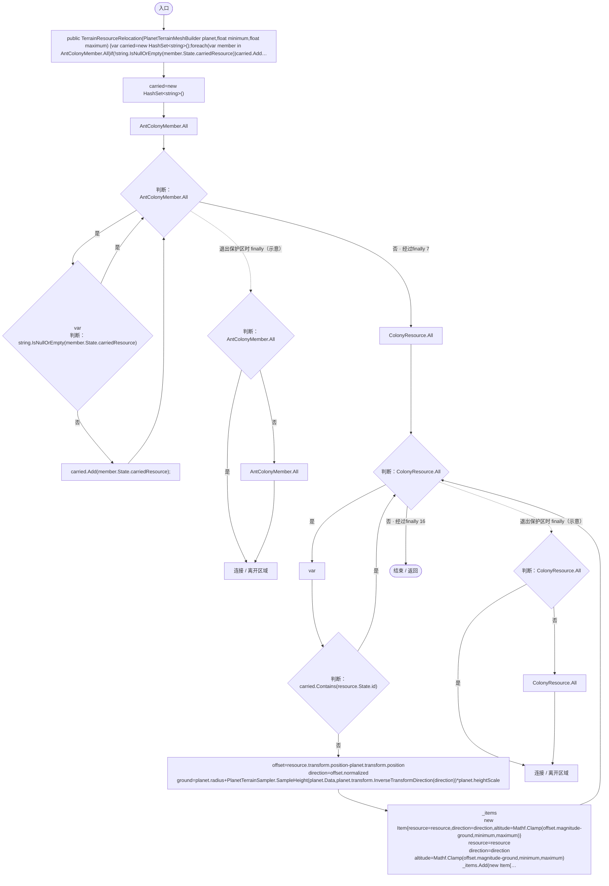
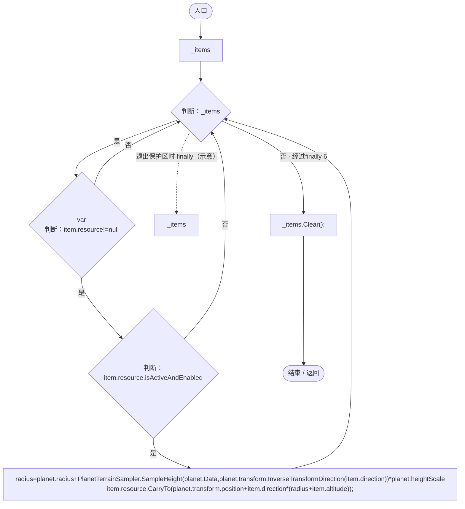

# TerrainResourceRelocation.cs

[返回总索引](../README.md) · `Runtime` · `Assets/DarwinPark/Entities/Ecology/TerrainResourceRelocation.cs`

[源文件](../../../Assets/DarwinPark/Entities/Ecology/TerrainResourceRelocation.cs) · 源码校验：`d30d4e1d83a9cfff2d95ba5501aecabd0c2013084e9dfd7f2e8440e82fb102c1`

方法按源文件位置排列。事件/回调引用不表示立即执行；分支与异常说明见总索引。完整源码与可点击关系图请打开离线手册。

## TerrainResourceRelocation.ctor · L11

`public TerrainResourceRelocation(PlanetTerrainMeshBuilder planet,float minimum,float maximum)`

### Editor / Player · Roslyn编译器控制流

项目内调用/回调引用：

- [AntColonyMember.State.get · L33](baebd85c05598377.md#ma804eb9f68138343)（访问器）
- [ColonyResource.State.get · L24](293dbaecfff4b585.md#m41824f1a0e160aa5)（访问器）
- [PlanetTerrainSampler.SampleHeight · L32](fd5c1d83b88a7c8b.md#m759508f0c5a04b21)（方法）
- [PlanetTerrainMeshBuilder.Data.get · L81](415285cf043354a9.md#m1a65abfe0f34c5d8)（访问器）

## Restore · L13

`public void Restore(PlanetTerrainMeshBuilder planet)`

### Editor / Player · Roslyn编译器控制流

项目内调用/回调引用：

- [PlanetTerrainSampler.SampleHeight · L32](fd5c1d83b88a7c8b.md#m759508f0c5a04b21)（方法）
- [PlanetTerrainMeshBuilder.Data.get · L81](415285cf043354a9.md#m1a65abfe0f34c5d8)（访问器）
- [ColonyResource.CarryTo · L85](293dbaecfff4b585.md#m0524c6be86580a92)（方法）
