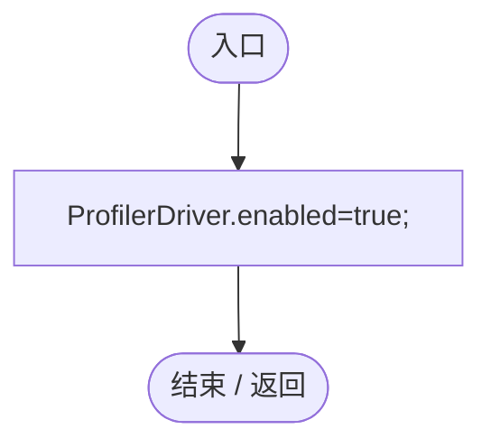
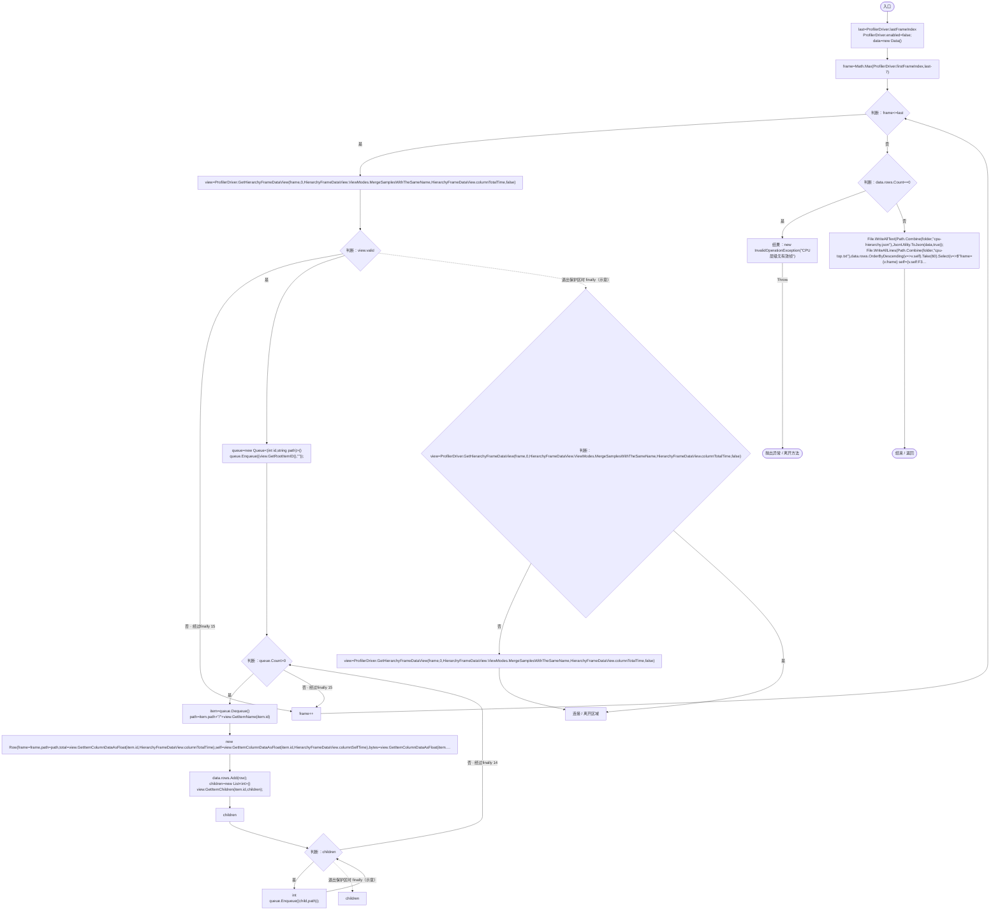
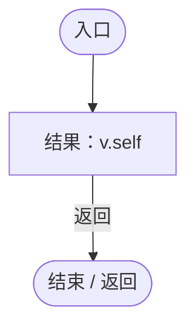
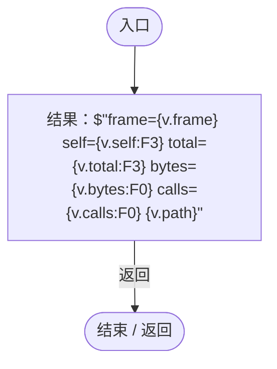

# UserFrameHierarchyAudit.cs

[返回总索引](../README.md) · `Editor` · `Assets/DarwinPark/Editor/UserFrameHierarchyAudit.cs`

[源文件](../../../Assets/DarwinPark/Editor/UserFrameHierarchyAudit.cs) · 源码校验：`171ee45e04acda7e38b714ac1545765bd844896da88dcea348e46fc222dcc6e8`

方法按源文件位置排列。事件/回调引用不表示立即执行；分支与异常说明见总索引。完整源码与可点击关系图请打开离线手册。

## Start · L15

`internal static void Start()`

### Editor · Roslyn编译器控制流

## Finish · L16

`internal static void Finish(string folder)`

### Editor · Roslyn编译器控制流

项目内调用/回调引用：

- [UserFrameHierarchyAudit.回调@30 · L30](778dd6bf439321fc.md#m5190f88a6c4baff9)（回调/委托）
- [UserFrameHierarchyAudit.回调@30 · L30](778dd6bf439321fc.md#m0606c752800598a6)（回调/委托）

## 回调@30 · L30

`v … => 回调`

### Editor · Roslyn编译器控制流

## 回调@30 · L30

`v … => 回调`

### Editor · Roslyn编译器控制流

