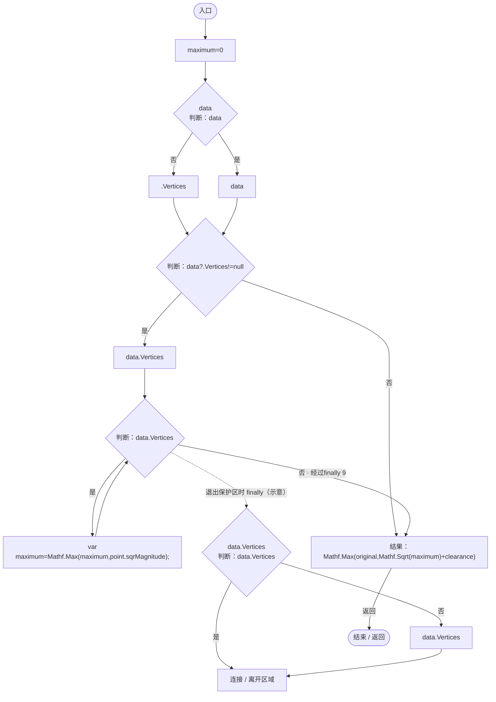
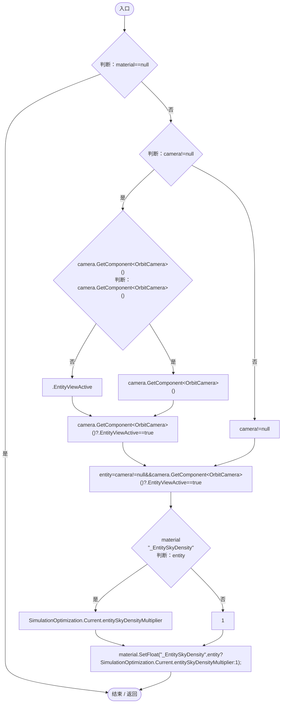

# AtmosphereViewPolicy.cs

[返回总索引](../README.md) · `Runtime` · `Assets/DarwinPark/Planet/AtmosphereViewPolicy.cs`

[源文件](../../../Assets/DarwinPark/Planet/AtmosphereViewPolicy.cs) · 源码校验：`731ab313e934ce279cad3c354f10b478cfa897bdea5629b3d7ae3b642c6a6ad0`

方法按源文件位置排列。事件/回调引用不表示立即执行；分支与异常说明见总索引。完整源码与可点击关系图请打开离线手册。

## OuterRadius · L8

`public static float OuterRadius(PlanetTerrainData data,float original,float clearance)`

### Editor / Player · Roslyn编译器控制流

## Apply · L10

`public static void Apply(Material material,Camera camera)`

### Editor / Player · Roslyn编译器控制流

项目内调用/回调引用：

- [OrbitCamera.EntityViewActive.get · L39](42eb429559b42bcb.md#m4b320edff61e06a5)（访问器）
- [SimulationOptimization.Current.get · L25](11c9091e70893352.md#mde7abfdc18429e4a)（访问器）
