# HudInputRegression.cs

[返回总索引](../README.md) · `Editor` · `Assets/DarwinPark/Editor/HudInputRegression.cs`

[源文件](../../../Assets/DarwinPark/Editor/HudInputRegression.cs) · 源码校验：`72ec426e25f37e4107e212c31d27cf354f8bbd41375285a892bbaaea9d90e5b9`

方法按源文件位置排列。事件/回调引用不表示立即执行；分支与异常说明见总索引。完整源码与可点击关系图请打开离线手册。

<a id="m0aac39e6cf33ad5e"></a>

## Folder.get · L25

`private static string Folder`


### Editor · 语法控制结构 / 声明（非CFG）

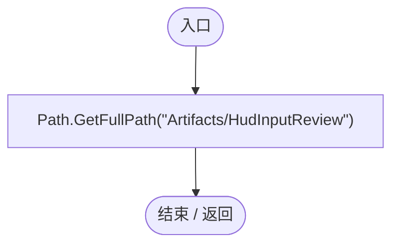

<a id="mc151bb13f99f8668"></a>

## HudInputRegression.ctor · L26

`static HudInputRegression()`


### Editor · Roslyn编译器控制流

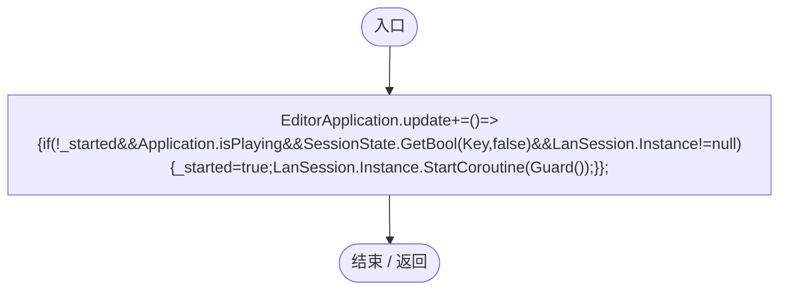

项目内调用/回调引用：

- [HudInputRegression.回调@26 · L26](795f355c3f14dbd5.md#m3af61d5f689cef8c)（回调/委托）

<a id="m3af61d5f689cef8c"></a>

## 回调@26 · L26

`( … => 回调`


### Editor · Roslyn编译器控制流

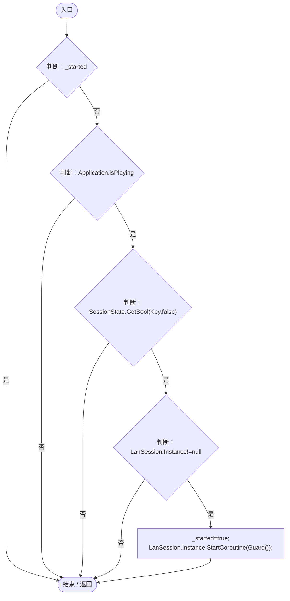

项目内调用/回调引用：

- [LanSession.Instance.get · L23](9fb633eebffe669c.md#mbf83306994878383)（访问器）
- [HudInputRegression.Guard · L29](795f355c3f14dbd5.md#m5b35df7d7c796635)（方法）

<a id="mf3836c0fe00c9e05"></a>

## RunBatch · L27

`public static void RunBatch()`


### Editor · Roslyn编译器控制流

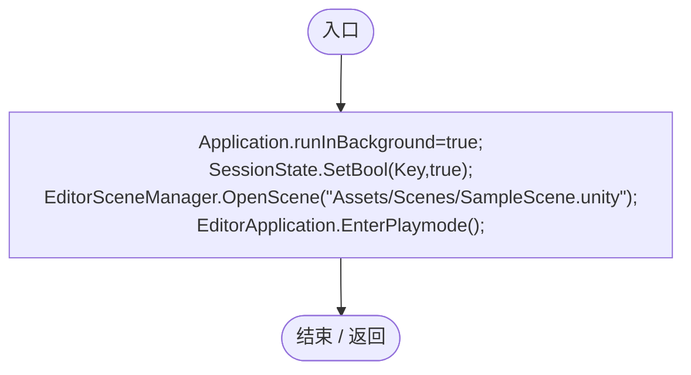

<a id="mec4b514b10a91ef8"></a>

## Check · L28

`private static void Check(bool value,string text)`


### Editor · Roslyn编译器控制流

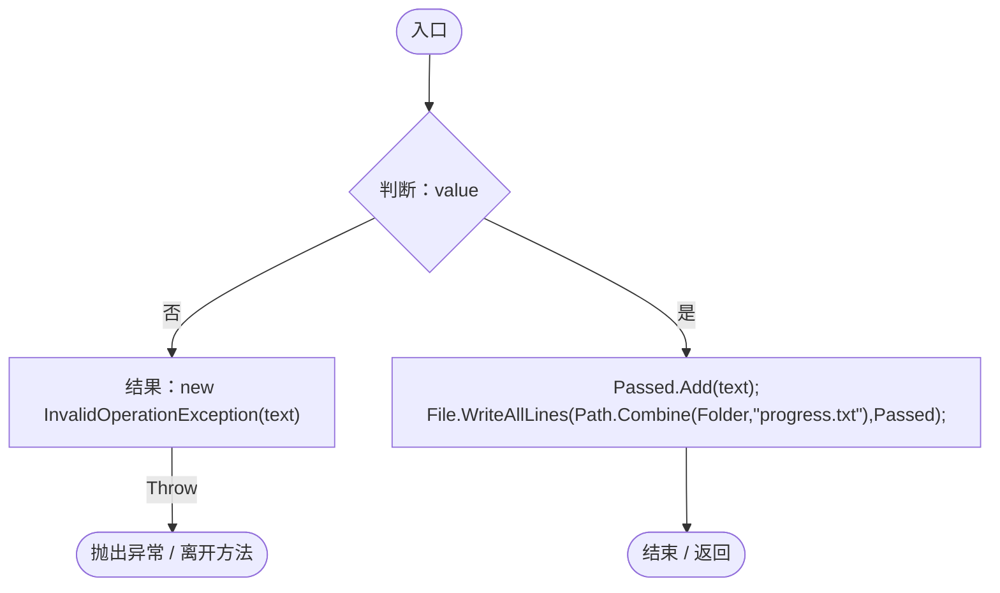

<a id="m5b35df7d7c796635"></a>

## Guard · L29

`private static IEnumerator Guard()`


### Editor · Roslyn编译器控制流

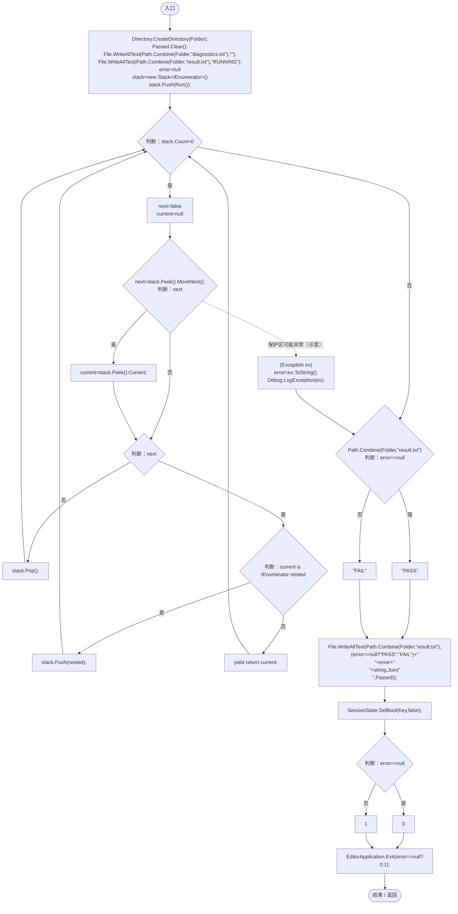

项目内调用/回调引用：

- [HudInputRegression.Run · L61](795f355c3f14dbd5.md#m13eba58356628de0)（方法）

<a id="m8e62b07047feac82"></a>

## Wait · L35

`private static IEnumerator Wait(Func<bool> ready)`


### Editor · Roslyn编译器控制流

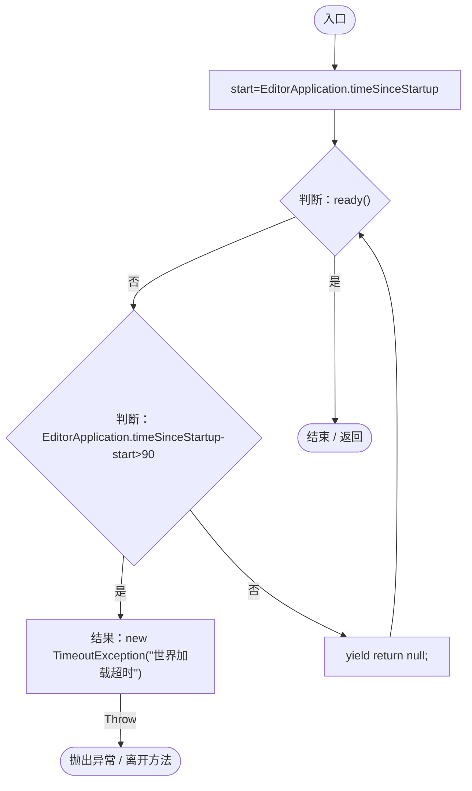

<a id="mf44c23f383eea789"></a>

## Center · L36

`private static Vector2 Center(RectTransform rect)`


### Editor · Roslyn编译器控制流

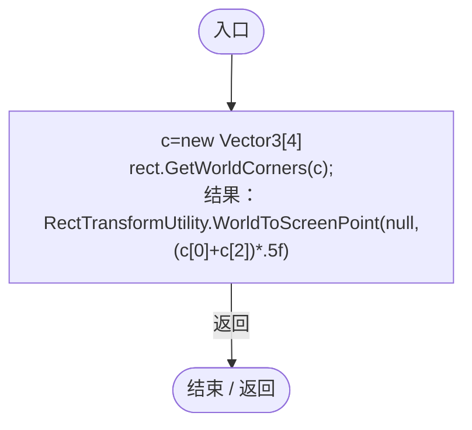

<a id="m1e4d8246ed441882"></a>

## Dump · L37

`private static void Dump(string label)`


### Editor · Roslyn编译器控制流

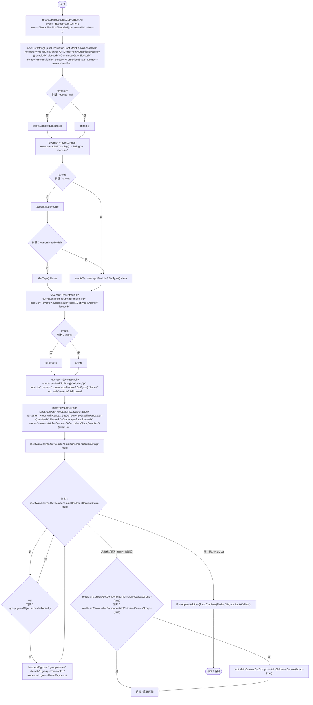

项目内调用/回调引用：

- [ServiceLocator.Get · L33](f2fdbe9f9ccd93cb.md#m2ae625299520c56d)（方法）
- [UIRoot.MainCanvas.get · L14](9c1421378791f0e0.md#maa2cc9baf1248477)（访问器）
- [GameInputGate.Blocked.get · L8](52955daae7e592ab.md#m765763b665829633)（访问器）

<a id="m448f54274e67f61a"></a>

## Click · L44

`private static GameObject Click(Button button)`


### Editor · Roslyn编译器控制流

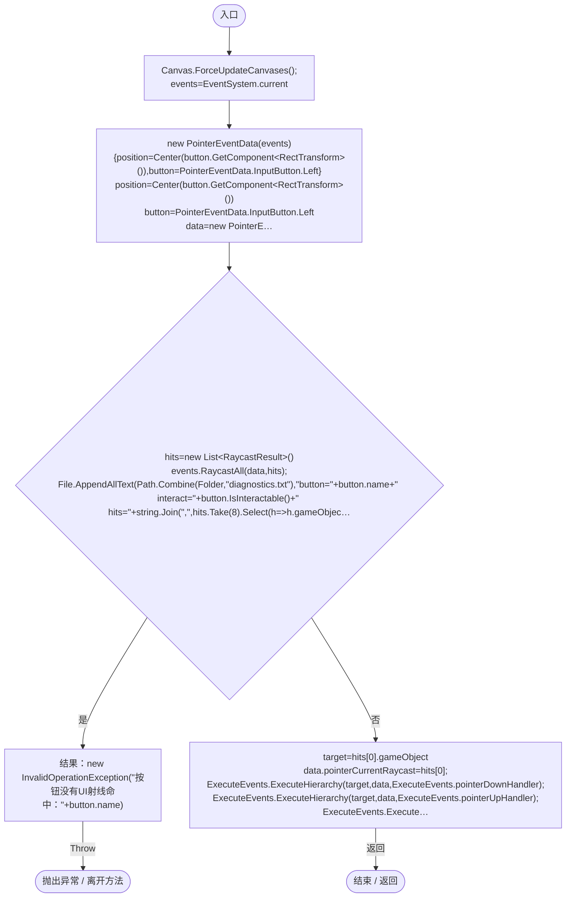

项目内调用/回调引用：

- [HudInputRegression.Center · L36](795f355c3f14dbd5.md#mf44c23f383eea789)（方法）
- [HudInputRegression.回调@47 · L47](795f355c3f14dbd5.md#m93b6882af2c18b28)（回调/委托）

<a id="m93b6882af2c18b28"></a>

## 回调@47 · L47

`h … => 回调`


### Editor · Roslyn编译器控制流

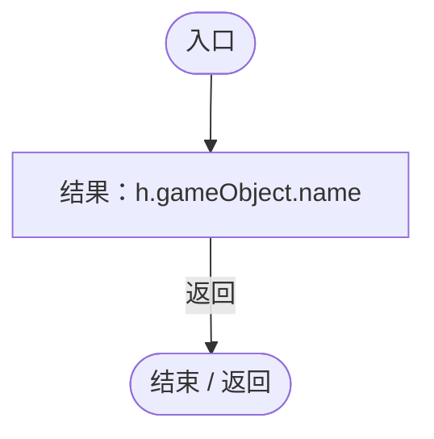

<a id="m8c6c32c4e5e058f9"></a>

## ModuleClick · L51

`private static void ModuleClick(Button button)`


### Editor · Roslyn编译器控制流

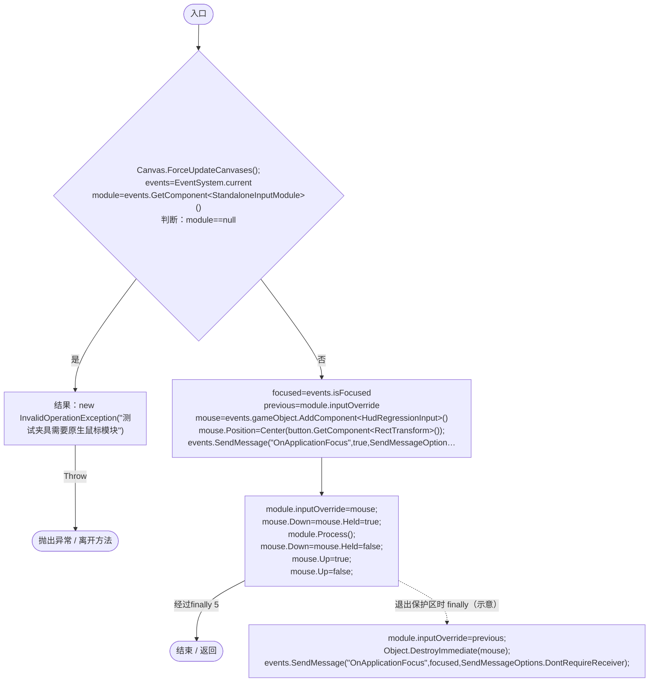

项目内调用/回调引用：

- [HudInputRegression.Center · L36](795f355c3f14dbd5.md#mf44c23f383eea789)（方法）

<a id="m13eba58356628de0"></a>

## Run · L61

`private static IEnumerator Run()`


### Editor · Roslyn编译器控制流

```mermaid
flowchart TD
  b0(["入口"])
  b1["yield return null;<br/>session=Object.FindFirstObjectByType&lt;WorldSessionManager&gt;()<br/>session.autoSaveInterval=36000;<br/>planet=Object.FindFirstObjectByType&lt;PlanetTerrainMeshBuilder&gt;()<br/>PlanetClimateMap.Instance.mapResolution=64;<br/>PlanetOreSystem.In…"]
  b2["ServiceLocator.Get&lt;UIRoot&gt;().MainCanvas.GetComponentsInChildren&lt;Button&gt;(true)"]
  b3{"判断：ServiceLocator.Get&lt;UIRoot&gt;().MainCanvas.GetComponentsInChildren&lt;Button&gt;(true)"}
  b4["var<br/>stale.onClick.RemoveAllListeners();"]
  b5{"ServiceLocator.Get&lt;UIRoot&gt;().MainCanvas.GetComponentsInChildren&lt;Button&gt;(true)<br/>判断：ServiceLocator.Get&lt;UIRoot&gt;().MainCanvas.GetComponentsInChildren&lt;Button&gt;(true)"}
  b6["ServiceLocator.Get&lt;UIRoot&gt;().MainCanvas.GetComponentsInChildren&lt;Button&gt;(true)"]
  b7["连接 / 离开区域"]
  b8{"input=Path.Combine(Folder,&quot;input/world.json&quot;)<br/>判断：File.Exists(input)"}
  b9["world=WorldSaveStore.Read(input)<br/>JsonUtility.FromJsonOverwrite(world.terrainParameters,planet);<br/>planet.subdivisions=24;<br/>world.terrainParameters=JsonUtility.ToJson(planet);<br/>session.Open(world);"]
  b10["planet.subdivisions=24;<br/>typeof(WorldSessionManager).GetField(&quot;_initialTerrain&quot;,Private).SetValue(session,JsonUtility.ToJson(planet));<br/>session.Create(&quot;界面点击回归&quot;,27291,.5f,20,44);"]
  b11{"yield return Wait(()=&gt;!session.Busy);<br/>ServiceLocator.Get&lt;SimulationClock&gt;().Pause();<br/>Object.FindFirstObjectByType&lt;RandomPlanetSpawner&gt;().enabled=false;<br/>yield return null;<br/>Dump(&quot;loaded&quot;);<br/>panel=Object.FindFirstObjectByType&lt;SimulationContr…"}
  b12["root.MainCanvas.GetComponentsInChildren&lt;Button&gt;(true)"]
  b13{"判断：root.MainCanvas.GetComponentsInChildren&lt;Button&gt;(true)"}
  b14["var"]
  b15["copy=button<br/>button.onClick.AddListener(()=&gt;File.AppendAllText(Path.Combine(Folder,&quot;native-clicks.txt&quot;),&quot;CLICK &quot;+copy.name+&quot; frame=&quot;+Time.frameCount+&quot;\n&quot;));"]
  b16{"root.MainCanvas.GetComponentsInChildren&lt;Button&gt;(true)<br/>判断：root.MainCanvas.GetComponentsInChildren&lt;Button&gt;(true)"}
  b17["root.MainCanvas.GetComponentsInChildren&lt;Button&gt;(true)"]
  b18["连接 / 离开区域"]
  b19["File.WriteAllText(Path.Combine(Folder,&quot;interactive-ready.txt&quot;),&quot;READY&quot;);<br/>until=Time.realtimeSinceStartup+120"]
  b20{"判断：Time.realtimeSinceStartup&lt;until"}
  b21{"判断：File.Exists(Path.Combine(Folder,&quot;interactive-done.flag&quot;))"}
  b22["yield return null;"]
  b23{"PopulationWorkbench.Instance<br/>判断：PopulationWorkbench.Instance"}
  b24["PopulationWorkbench.Instance?.Close();"]
  b25["typeof(SimulationControlPanel).GetMethod(&quot;SwitchPage&quot;,Private).Invoke(panel,new object[]{0});<br/>yield return null;<br/>Dump(&quot;after native clicks&quot;);"]
  b26["next=(Button)typeof(SimulationControlPanel).GetField(&quot;_tabNextBtn&quot;,Private).GetValue(panel)<br/>Click(next);<br/>yield return null;<br/>Check((int)typeof(SimulationControlPanel).GetField(&quot;_currentPage&quot;,Private).GetValue(panel)==1,&quot;旧回调丢失后读档仍重建底栏实际点击事…"]
  b27{"PopulationWorkbench.Instance<br/>判断：PopulationWorkbench.Instance"}
  b28[".Visible"]
  b29["PopulationWorkbench.Instance"]
  b30["Check(PopulationWorkbench.Instance?.Visible==true,&quot;存档加载后种群列表实际点击打开&quot;);"]
  b31["PopulationWorkbench.Instance.Close();<br/>yield return null;<br/>Dump(&quot;population closed&quot;);<br/>previous=(Button)typeof(SimulationControlPanel).GetField(&quot;_tabPrevBtn&quot;,Private).GetValue(panel)<br/>Click(previous);<br/>dropdown=root.MainCanvas.GetComponentsIn…"]
  b32["new PointerEventData(EventSystem.current){button=PointerEventData.InputButton.Left,position=Center(dropdown.GetComponent&lt;RectTransform&gt;())}<br/>button=PointerEventData.InputButton.Left<br/>position=Center(dropdown.GetComponent&lt;RectTransform&gt;())<br/>…"]
  b33["ExecuteEvents.Execute(dropdown.gameObject,pointer,ExecuteEvents.pointerClickHandler);<br/>yield return null;<br/>Check(dropdown.transform.Find(&quot;Dropdown List&quot;)!=null,&quot;存档加载后筛选下拉可以展开&quot;);<br/>RuntimeDropdownDismissal.CloseOpenPopups();<br/>yield return new …"]
  b34{"判断：root.MainCanvas.enabled"}
  b35["!raycaster.enabled"]
  b36["!root.MainCanvas.enabled"]
  b37["Check(!root.MainCanvas.enabled&amp;&amp;!raycaster.enabled,&quot;暂停菜单有意隐藏HUD时恢复器不抢开射线&quot;);"]
  b38["typeof(GameMainMenu).GetMethod(&quot;Resume&quot;,Private).Invoke(menu,null);<br/>yield return null;"]
  b39{"判断：root.MainCanvas.enabled"}
  b40["raycaster.enabled"]
  b41["root.MainCanvas.enabled"]
  b42["Check(root.MainCanvas.enabled&amp;&amp;raycaster.enabled,&quot;暂停返回后修复旧快照中的关闭画布和射线&quot;);"]
  b43["ModuleClick(previous);<br/>yield return null;<br/>Check((int)typeof(SimulationControlPanel).GetField(&quot;_currentPage&quot;,Private).GetValue(panel)==0,&quot;恢复后原生输入模块可以点击上一页&quot;);<br/>events=EventSystem.current"]
  b44["events.GetComponents&lt;BaseInputModule&gt;()"]
  b45{"判断：events.GetComponents&lt;BaseInputModule&gt;()"}
  b46["var<br/>inputModule.enabled=false;"]
  b47{"events.GetComponents&lt;BaseInputModule&gt;()<br/>判断：events.GetComponents&lt;BaseInputModule&gt;()"}
  b48["events.GetComponents&lt;BaseInputModule&gt;()"]
  b49["连接 / 离开区域"]
  b50["events.enabled=false;<br/>yield return null;"]
  b51{"判断：events.enabled"}
  b52["events.GetComponents&lt;BaseInputModule&gt;().Count(m=&gt;m.enabled)==1"]
  b53["events.enabled"]
  b54["Check(events.enabled&amp;&amp;events.GetComponents&lt;BaseInputModule&gt;().Count(m=&gt;m.enabled)==1,&quot;停用的事件系统和输入模块恢复且不重复安装&quot;);"]
  b55["ModuleClick(next);<br/>yield return null;<br/>Check((int)typeof(SimulationControlPanel).GetField(&quot;_currentPage&quot;,Private).GetValue(panel)==1,&quot;恢复事件模块后真实指针流程可翻页&quot;);<br/>Object.DestroyImmediate(EventSystem.current.gameObject);"]
  b56{"判断：EventSystem.current!=null"}
  b57["Object.FindObjectsByType&lt;EventSystem&gt;(FindObjectsSortMode.None).Count(e=&gt;e.isActiveAndEnabled)==1"]
  b58["EventSystem.current!=null"]
  b59["Check(EventSystem.current!=null&amp;&amp;Object.FindObjectsByType&lt;EventSystem&gt;(FindObjectsSortMode.None).Count(e=&gt;e.isActiveAndEnabled)==1,&quot;丢失事件节点后补建唯一可用系统&quot;);"]
  b60["Object.DestroyImmediate(root.MainCanvas.GetComponent&lt;GraphicRaycaster&gt;());<br/>yield return null;"]
  b61{"判断：root.MainCanvas.GetComponents&lt;GraphicRaycaster&gt;().Length==1"}
  b62["root.MainCanvas.GetComponent&lt;GraphicRaycaster&gt;().enabled"]
  b63["root.MainCanvas.GetComponents&lt;GraphicRaycaster&gt;().Length==1"]
  b64["Check(root.MainCanvas.GetComponents&lt;GraphicRaycaster&gt;().Length==1&amp;&amp;root.MainCanvas.GetComponent&lt;GraphicRaycaster&gt;().enabled,&quot;丢失射线组件后补建且不重复&quot;);"]
  b65["GameInputGate.Blocked=true;<br/>yield return null;<br/>Check(!GameInputGate.Blocked,&quot;没有实际弹窗的遗留输入门控被释放&quot;);<br/>GameInputGate.ConsumeEscape();<br/>recovery.Recover();<br/>Check(GameInputGate.Blocked,&quot;Esc当帧防穿透标记仍保留&quot;);<br/>list=root.MainCanvas.GetComponentsInChildre…"]
  b66{"判断：PopulationWorkbench.Instance.Visible"}
  b67["GameInputGate.Blocked"]
  b68["PopulationWorkbench.Instance.Visible"]
  b69["Check(PopulationWorkbench.Instance.Visible&amp;&amp;GameInputGate.Blocked,&quot;种群窗口打开时保留合法门控&quot;);"]
  b70["page=(int)typeof(SimulationControlPanel).GetField(&quot;_currentPage&quot;,Private).GetValue(panel)<br/>ModuleClick(previous);<br/>yield return null;<br/>Check((int)typeof(SimulationControlPanel).GetField(&quot;_currentPage&quot;,Private).GetValue(panel)==page,&quot;种群窗口透明遮…"]
  b71{"判断：settings.Visible"}
  b72["GameInputGate.Blocked"]
  b73["settings.Visible"]
  b74["Check(settings.Visible&amp;&amp;GameInputGate.Blocked,&quot;世界设置弹窗合法门控不被释放&quot;);"]
  b75["settings.Close();<br/>yield return null;<br/>work=RandomSpawnWorkbench.Ensure()<br/>work.Open(Object.FindFirstObjectByType&lt;RandomSpawnPanel&gt;(),false);"]
  b76{"判断：work.Visible"}
  b77["GameInputGate.Blocked"]
  b78["work.Visible"]
  b79["Check(work.Visible&amp;&amp;GameInputGate.Blocked,&quot;原生生成窗口保持可交互及合法门控&quot;);"]
  b80["work.Close();<br/>yield return null;<br/>WorldRuntimeGate.Loading=true;<br/>root.MainCanvas.enabled=false;<br/>root.MainCanvas.GetComponent&lt;GraphicRaycaster&gt;().enabled=false;"]
  b81{"判断：root.MainCanvas.enabled"}
  b82["!root.MainCanvas.GetComponent&lt;GraphicRaycaster&gt;().enabled"]
  b83["!root.MainCanvas.enabled"]
  b84["Check(!root.MainCanvas.enabled&amp;&amp;!root.MainCanvas.GetComponent&lt;GraphicRaycaster&gt;().enabled,&quot;加载阶段不强开HUD和点击射线&quot;);"]
  b85["WorldRuntimeGate.Loading=false;<br/>yield return null;"]
  b86{"判断：root.MainCanvas.enabled"}
  b87["root.MainCanvas.GetComponent&lt;GraphicRaycaster&gt;().enabled"]
  b88["root.MainCanvas.enabled"]
  b89["Check(root.MainCanvas.enabled&amp;&amp;root.MainCanvas.GetComponent&lt;GraphicRaycaster&gt;().enabled,&quot;加载标记解除后自动恢复点击链路&quot;);"]
  b90["authority=WorldAuthority.CanEdit<br/>WorldAuthority.CanEdit=false;<br/>yield return null;<br/>typeof(SimulationControlPanel).GetMethod(&quot;SwitchPage&quot;,Private).Invoke(panel,new object[]{0});<br/>play=root.MainCanvas.GetComponentsInChildren&lt;Button&gt;().Single…"]
  b91["cycle=0"]
  b92{"判断：cycle&lt;3"}
  b93["menu.enabled=false;<br/>menu.enabled=true;<br/>cycle++"]
  b94{"loaded=(Action)typeof(WorldSessionManager).GetField(&quot;Loaded&quot;,Private).GetValue(session)<br/>Check(loaded.GetInvocationList().Count(d=&gt;d.Target is GameMainMenu bound&amp;&amp;bound==menu)==1,&quot;菜单反复启停后读档通知只有一个有效绑定&quot;);<br/>判断：File.Exists(input)"}
  b95["session.Open(WorldSaveStore.Read(input));<br/>yield return Wait(()=&gt;!session.Busy);<br/>ServiceLocator.Get&lt;SimulationClock&gt;().Pause();<br/>yield return null;"]
  b96{"判断：menu.Visible"}
  b97{"判断：root.MainCanvas.enabled"}
  b98["root.MainCanvas.GetComponent&lt;GraphicRaycaster&gt;().enabled"]
  b99["!menu.Visible&amp;&amp;root.MainCanvas.enabled&amp;&amp;root.MainCanvas.GetComponent&lt;GraphicRaycaster&gt;().enabled"]
  b100["Check(!menu.Visible&amp;&amp;root.MainCanvas.enabled&amp;&amp;root.MainCanvas.GetComponent&lt;GraphicRaycaster&gt;().enabled,&quot;菜单重新启用后再次进入存档可正常返回可交互HUD&quot;);"]
  b101["Dump(&quot;recovery scenarios complete&quot;);<br/>yield return new WaitForEndOfFrame();<br/>ScreenCapture.CaptureScreenshot(Path.Combine(Folder,&quot;loaded-hud.png&quot;));<br/>yield return null;"]
  b102(["结束 / 返回"])
  b0 --> b1
  b1 --> b2
  b2 --> b3
  b3 -->|"是"| b4
  b3 -->|"否 · 经过finally 5"| b8
  b4 --> b3
  b5 -->|"否"| b6
  b5 -->|"是"| b7
  b6 --> b7
  b8 -->|"是"| b9
  b8 -->|"否"| b10
  b9 --> b11
  b10 --> b11
  b11 -->|"是"| b12
  b11 -->|"否"| b26
  b12 --> b13
  b13 -->|"是"| b14
  b13 -->|"否 · 经过finally 16"| b19
  b14 --> b15
  b15 --> b13
  b16 -->|"否"| b17
  b16 -->|"是"| b18
  b17 --> b18
  b19 --> b20
  b20 -->|"是"| b21
  b20 -->|"否"| b23
  b21 -->|"否"| b22
  b21 -->|"是"| b23
  b22 --> b20
  b23 -->|"否"| b24
  b23 -->|"是"| b25
  b24 --> b25
  b25 --> b26
  b26 --> b27
  b27 -->|"否"| b28
  b27 -->|"是"| b29
  b28 --> b30
  b29 --> b30
  b30 --> b31
  b31 --> b32
  b32 --> b33
  b33 --> b34
  b34 -->|"否"| b35
  b34 -->|"是"| b36
  b35 --> b37
  b36 --> b37
  b37 --> b38
  b38 --> b39
  b39 -->|"是"| b40
  b39 -->|"否"| b41
  b40 --> b42
  b41 --> b42
  b42 --> b43
  b43 --> b44
  b44 --> b45
  b45 -->|"是"| b46
  b45 -->|"否 · 经过finally 47"| b50
  b46 --> b45
  b47 -->|"否"| b48
  b47 -->|"是"| b49
  b48 --> b49
  b50 --> b51
  b51 -->|"是"| b52
  b51 -->|"否"| b53
  b52 --> b54
  b53 --> b54
  b54 --> b55
  b55 --> b56
  b56 -->|"是"| b57
  b56 -->|"否"| b58
  b57 --> b59
  b58 --> b59
  b59 --> b60
  b60 --> b61
  b61 -->|"是"| b62
  b61 -->|"否"| b63
  b62 --> b64
  b63 --> b64
  b64 --> b65
  b65 --> b66
  b66 -->|"是"| b67
  b66 -->|"否"| b68
  b67 --> b69
  b68 --> b69
  b69 --> b70
  b70 --> b71
  b71 -->|"是"| b72
  b71 -->|"否"| b73
  b72 --> b74
  b73 --> b74
  b74 --> b75
  b75 --> b76
  b76 -->|"是"| b77
  b76 -->|"否"| b78
  b77 --> b79
  b78 --> b79
  b79 --> b80
  b80 --> b81
  b81 -->|"否"| b82
  b81 -->|"是"| b83
  b82 --> b84
  b83 --> b84
  b84 --> b85
  b85 --> b86
  b86 -->|"是"| b87
  b86 -->|"否"| b88
  b87 --> b89
  b88 --> b89
  b89 --> b90
  b90 --> b91
  b91 --> b92
  b92 -->|"是"| b93
  b92 -->|"否"| b94
  b93 --> b92
  b94 -->|"是"| b95
  b94 -->|"否"| b101
  b95 --> b96
  b96 -->|"否"| b97
  b96 -->|"是"| b99
  b97 -->|"是"| b98
  b97 -->|"否"| b99
  b98 --> b100
  b99 --> b100
  b100 --> b101
  b101 --> b102
  b3 -. "退出保护区时 finally（示意）" .-> b5
  b13 -. "退出保护区时 finally（示意）" .-> b16
  b45 -. "退出保护区时 finally（示意）" .-> b47

```

项目内调用/回调引用：

- [PlanetClimateMap.Instance.get · L16](b4e9726c1bcf4c37.md#m3add54a419aeef9f)（访问器）
- [PlanetOreSystem.Instance.get · L8](86b3fbb4d9436121.md#m53f6a6af4b6dc252)（访问器）
- [UIRoot.MainCanvas.get · L14](9c1421378791f0e0.md#maa2cc9baf1248477)（访问器）
- [ServiceLocator.Get · L33](f2fdbe9f9ccd93cb.md#m2ae625299520c56d)（方法）
- [WorldSaveStore.Read · L74](d67a35e5e3814c15.md#mde52fadbe0185af1)（方法）
- [WorldSessionManager.Open · L60](08741c7b7b9d9344.md#m7bd56ef45131b4e5)（方法）
- [WorldSessionManager.Create · L41](08741c7b7b9d9344.md#m6aadfeee8b90aacd)（方法）
- [HudInputRegression.Wait · L35](795f355c3f14dbd5.md#m8e62b07047feac82)（方法）
- [SimulationClock.Pause · L79](a8f444aec9614b0a.md#m30929d45a885d0f1)（方法）
- [HudInputRegression.Dump · L37](795f355c3f14dbd5.md#m1e4d8246ed441882)（方法）
- [PopulationWorkbench.Instance.get · L14](6ca6fcae89e529ec.md#m82395c4f7e743e70)（访问器）
- [PopulationWorkbench.Close · L68](6ca6fcae89e529ec.md#m09bed70d853d69f9)（方法）
- [HudInputRegression.Click · L44](795f355c3f14dbd5.md#m448f54274e67f61a)（方法）
- [HudInputRegression.Check · L28](795f355c3f14dbd5.md#mec4b514b10a91ef8)（方法）
- [PopulationWorkbench.Visible.get · L15](6ca6fcae89e529ec.md#mbe13c2d3e85c0b85)（访问器）
- [HudInputRegression.Center · L36](795f355c3f14dbd5.md#mf44c23f383eea789)（方法）
- [RuntimeDropdownDismissal.CloseOpenPopups · L39](bab72c915cc299c5.md#m4e050bc4c4e0bef0)（方法）
- [HudInputRegression.ModuleClick · L51](795f355c3f14dbd5.md#m8c6c32c4e5e058f9)（方法）
- [GameMainMenu.ShowPause · L103](a1f1791f9e7a8035.md#m057a6734b45decd8)（方法）
- [GameInputGate.Blocked.set · L8](52955daae7e592ab.md#m578697f6379686f4)（访问器）
- [GameInputGate.Blocked.get · L8](52955daae7e592ab.md#m765763b665829633)（访问器）
- [GameInputGate.ConsumeEscape · L9](52955daae7e592ab.md#m5b050ac6f014de67)（方法）
- [WorldHudInputLifecycle.Recover · L38](f3fd2d972c3899f1.md#m40e06b669b6b6e31)（方法）
- [WorldGameSettingsPanel.Ensure · L16](6df051f7f7177d08.md#m0a32c6bb826c2a96)（方法）
- [WorldGameSettingsPanel.Open · L17](6df051f7f7177d08.md#m0ff6ac01bffac6d1)（方法）
- [WorldGameSettingsPanel.Close · L39](6df051f7f7177d08.md#m019774ab8575ddd2)（方法）
- [RandomSpawnWorkbench.Ensure · L27](0763b7475b3c75db.md#m52d26640eca61349)（方法）
- [RandomSpawnWorkbench.Open · L29](0763b7475b3c75db.md#m0c118b57d249ff5d)（方法）
- [RandomSpawnWorkbench.Visible.get · L19](0763b7475b3c75db.md#mfc1adb76149ae015)（访问器）
- [RandomSpawnWorkbench.Close · L42](0763b7475b3c75db.md#mb3132a8d58c9ba62)（方法）
- [HudInputRegression.回调@70 · L70](795f355c3f14dbd5.md#m0ca6d7fb3c676659)（回调/委托）
- [HudInputRegression.回调@74 · L74](795f355c3f14dbd5.md#m9c854ad0b1e283f2)（回调/委托）
- [HudInputRegression.回调@82 · L82](795f355c3f14dbd5.md#me65c070899dd7797)（回调/委托）
- [HudInputRegression.回调@83 · L83](795f355c3f14dbd5.md#m6a93c14bbe4b8fb7)（回调/委托）
- [HudInputRegression.回调@86 · L86](795f355c3f14dbd5.md#mdb399bbff04f3b9d)（回调/委托）
- [HudInputRegression.回调@99 · L99](795f355c3f14dbd5.md#mc55ba290dc2687d0)（回调/委托）
- [HudInputRegression.回调@102 · L102](795f355c3f14dbd5.md#m146cfb8a3cb8c4bb)（回调/委托）
- [HudInputRegression.回调@107 · L107](795f355c3f14dbd5.md#m18af0212cc1b8eb8)（回调/委托）
- [HudInputRegression.回调@119 · L119](795f355c3f14dbd5.md#m1b6696740dada8f9)（回调/委托）
- [HudInputRegression.回调@122 · L122](795f355c3f14dbd5.md#ma2e39b2764f92700)（回调/委托）
- [HudInputRegression.回调@123 · L123](795f355c3f14dbd5.md#mbed1ded94b1a64da)（回调/委托）

<a id="m0ca6d7fb3c676659"></a>

## 回调@70 · L70

`( … => 回调`


### Editor · Roslyn编译器控制流

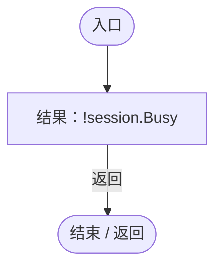

项目内调用/回调引用：

- [WorldSessionManager.Busy.get · L24](08741c7b7b9d9344.md#m4483e2e4f28f7c85)（访问器）

<a id="m9c854ad0b1e283f2"></a>

## 回调@74 · L74

`( … => 回调`


### Editor · Roslyn编译器控制流

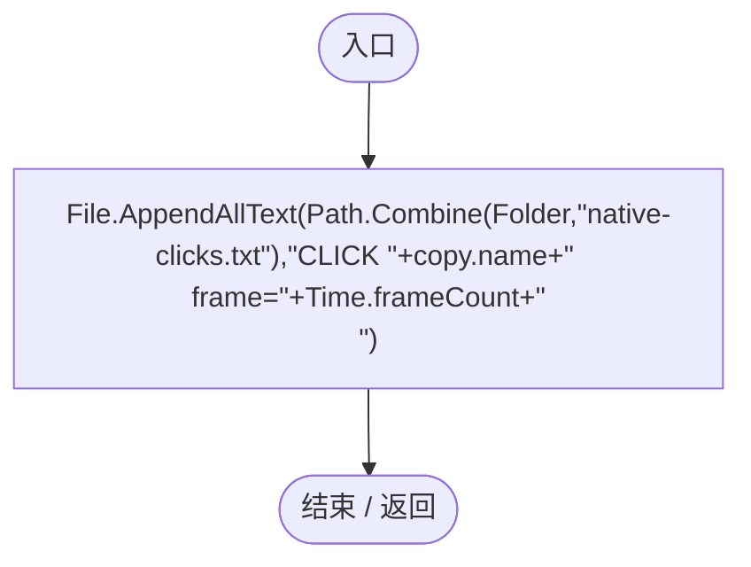

<a id="me65c070899dd7797"></a>

## 回调@82 · L82

`r … => 回调`


### Editor · Roslyn编译器控制流

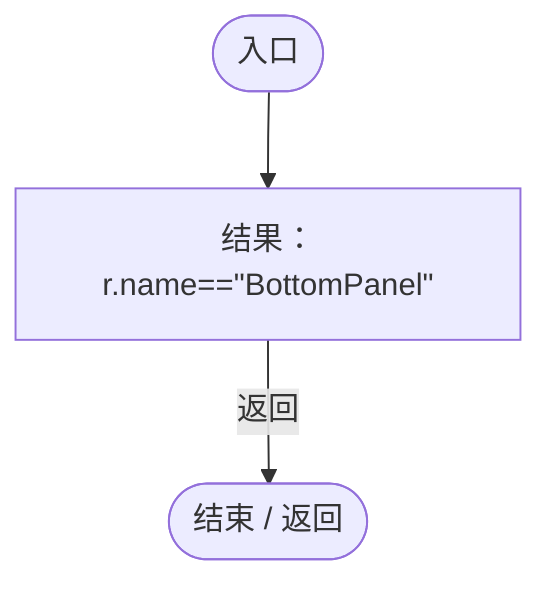

<a id="m6a93c14bbe4b8fb7"></a>

## 回调@83 · L83

`b … => 回调`


### Editor · Roslyn编译器控制流


<a id="mdb399bbff04f3b9d"></a>

## 回调@86 · L86

`d … => 回调`


### Editor · Roslyn编译器控制流

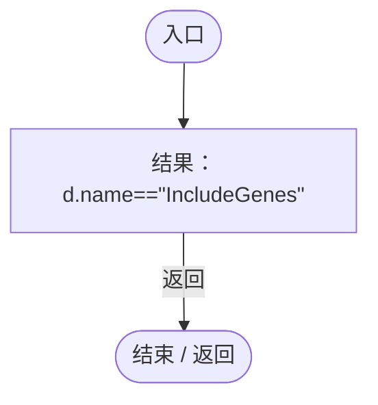

<a id="mc55ba290dc2687d0"></a>

## 回调@99 · L99

`m … => 回调`


### Editor · Roslyn编译器控制流

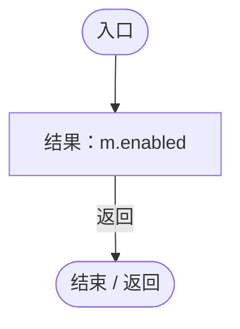

<a id="m146cfb8a3cb8c4bb"></a>

## 回调@102 · L102

`e … => 回调`


### Editor · Roslyn编译器控制流

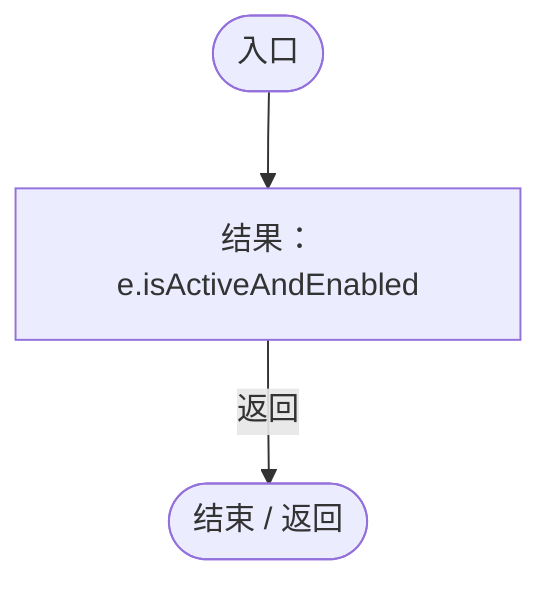

<a id="m18af0212cc1b8eb8"></a>

## 回调@107 · L107

`b … => 回调`


### Editor · Roslyn编译器控制流

```mermaid
flowchart TD
  b0(["入口"])
  b1["结果：b.name==&quot;AllPopulations&quot;"]
  b2(["结束 / 返回"])
  b0 --> b1
  b1 -->|"返回"| b2

```

<a id="m1b6696740dada8f9"></a>

## 回调@119 · L119

`b … => 回调`


### Editor · Roslyn编译器控制流

```mermaid
flowchart TD
  b0(["入口"])
  b1["结果：b.name==&quot;PlayBtn&quot;"]
  b2(["结束 / 返回"])
  b0 --> b1
  b1 -->|"返回"| b2

```

<a id="ma2e39b2764f92700"></a>

## 回调@122 · L122

`d … => 回调`


### Editor · Roslyn编译器控制流

```mermaid
flowchart TD
  b0(["入口"])
  b1{"判断：d.Target is GameMainMenu bound"}
  b2["bound==menu"]
  b3["d.Target is GameMainMenu bound"]
  b4["结果：d.Target is GameMainMenu bound&amp;&amp;bound==menu"]
  b5(["结束 / 返回"])
  b0 --> b1
  b1 -->|"是"| b2
  b1 -->|"否"| b3
  b2 --> b4
  b3 --> b4
  b4 -->|"返回"| b5

```

<a id="mbed1ded94b1a64da"></a>

## 回调@123 · L123

`( … => 回调`


### Editor · Roslyn编译器控制流

```mermaid
flowchart TD
  b0(["入口"])
  b1["结果：!session.Busy"]
  b2(["结束 / 返回"])
  b0 --> b1
  b1 -->|"返回"| b2

```

项目内调用/回调引用：

- [WorldSessionManager.Busy.get · L24](08741c7b7b9d9344.md#m4483e2e4f28f7c85)（访问器）
