# EntityEditPopup.cs

[返回总索引](../README.md) · `Runtime` · `Assets/DarwinPark/UI/EntityEditPopup.cs`

[源文件](../../../Assets/DarwinPark/UI/EntityEditPopup.cs) · 源码校验：`b4be07e7a232138fec0f4886433c0681499fe7c81df1441d4aa932a564de9b97`

方法按源文件位置排列。事件/回调引用不表示立即执行；分支与异常说明见总索引。完整源码与可点击关系图请打开离线手册。

## Instance.get · L16

`get`

### Editor / Player · 语法控制结构 / 声明（非CFG）

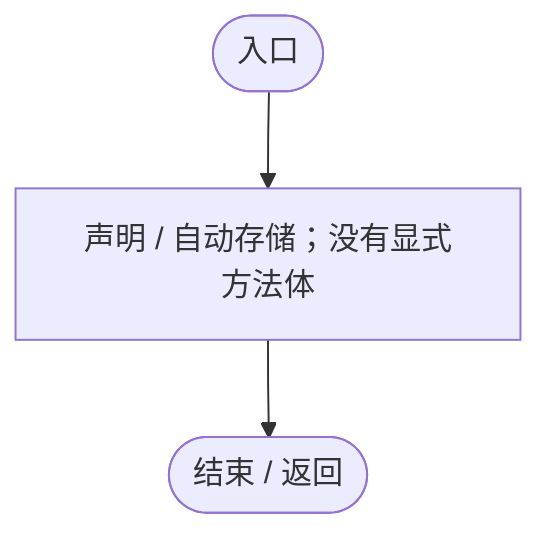

## Instance.set · L16

`private set`

### Editor / Player · 语法控制结构 / 声明（非CFG）

## Visible.get · L16

`public bool Visible`

### Editor / Player · 语法控制结构 / 声明（非CFG）

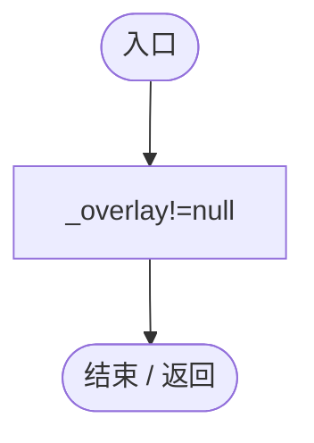

## Awake · L20

`private void Awake()`

### Editor / Player · Roslyn编译器控制流

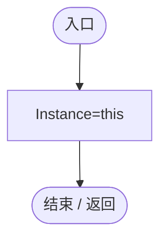

项目内调用/回调引用：

- [EntityEditPopup.Instance.set · L16](79ed73ecd9855f79.md#m39b295ff2176f94b)（访问器）

## Ensure · L21

`public static EntityEditPopup Ensure()`

### Editor / Player · Roslyn编译器控制流

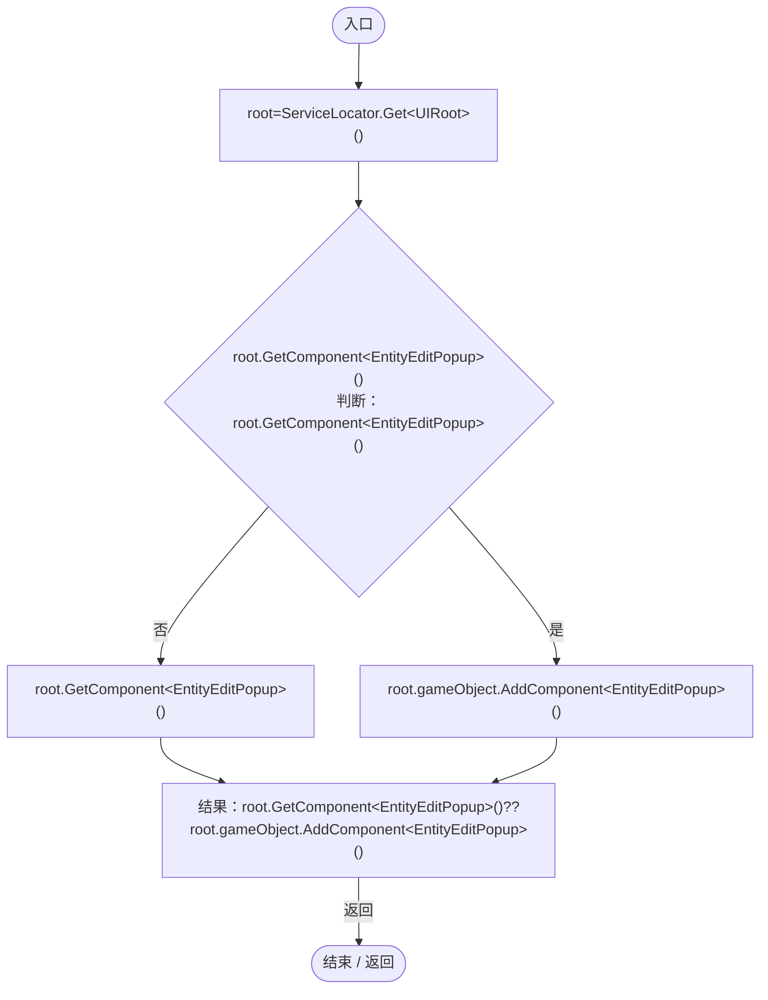

项目内调用/回调引用：

- [ServiceLocator.Get · L33](f2fdbe9f9ccd93cb.md#m2ae625299520c56d)（方法）

## AddEntry · L22

`public static void AddEntry(Transform parent,DarwinEntity entity,ColonyResource corpse=null)`

### Editor / Player · Roslyn编译器控制流

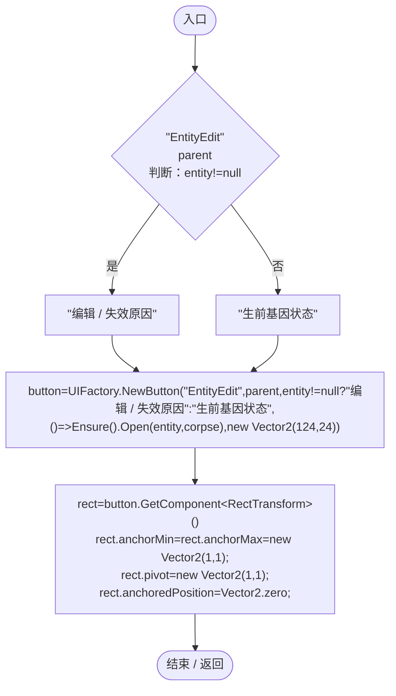

项目内调用/回调引用：

- [UIFactory.NewButton · L73](dd1096a6995423db.md#m5896f1b097c8bdde)（方法）
- [EntityEditPopup.回调@24 · L24](79ed73ecd9855f79.md#m9cf7b33a89549c44)（回调/委托）

## 回调@24 · L24

`( … => 回调`

### Editor / Player · Roslyn编译器控制流

项目内调用/回调引用：

- [EntityEditPopup.Open · L26](79ed73ecd9855f79.md#m5b0fd9776cd369e6)（方法）
- [EntityEditPopup.Ensure · L21](79ed73ecd9855f79.md#m85c1cf71039f3b60)（方法）

## Open · L26

`public void Open(DarwinEntity entity,ColonyResource corpse=null)`

### Editor / Player · Roslyn编译器控制流

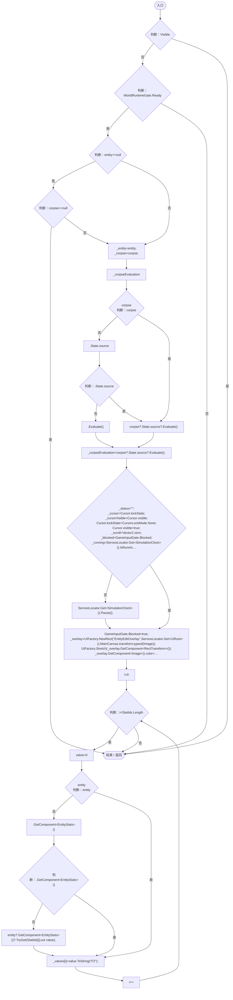

项目内调用/回调引用：

- [ColonyResource.State.get · L24](293dbaecfff4b585.md#m41824f1a0e160aa5)（访问器）
- [CorpseEntityRecord.Evaluate · L20](8a2345f1e54b1c75.md#m9ce3ef56fdd9f205)（方法）
- [GameInputGate.Blocked.get · L8](52955daae7e592ab.md#m765763b665829633)（访问器）
- [SimulationClock.IsRunning.get · L22](a8f444aec9614b0a.md#m10f4fe307faca0f0)（访问器）
- [ServiceLocator.Get · L33](f2fdbe9f9ccd93cb.md#m2ae625299520c56d)（方法）
- [SimulationClock.Pause · L79](a8f444aec9614b0a.md#m30929d45a885d0f1)（方法）
- [GameInputGate.Blocked.set · L8](52955daae7e592ab.md#m578697f6379686f4)（访问器）
- [UIFactory.NewRect · L33](dd1096a6995423db.md#med612116f3152344)（方法）
- [UIRoot.MainCanvas.get · L14](9c1421378791f0e0.md#maa2cc9baf1248477)（访问器）
- [UIFactory.Stretch · L150](dd1096a6995423db.md#m11d8f6c6d00cc047)（方法）
- [EntityStats.TryGet · L90](75aa86a368efdf24.md#m24ee1433e4a70d94)（方法）

## ApplyStage · L33

`public bool ApplyStage(AgeState age)`

### Editor / Player · Roslyn编译器控制流

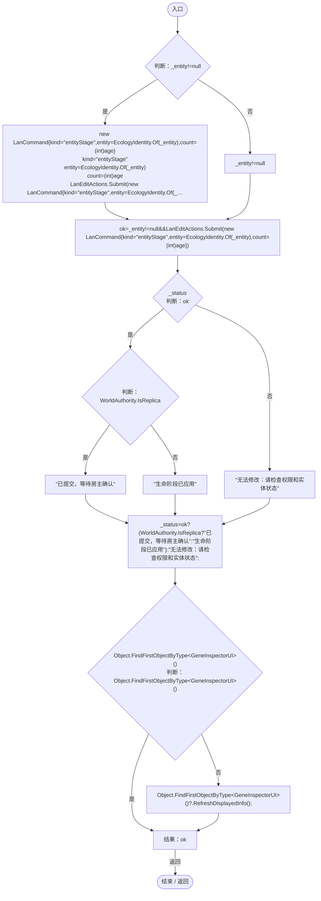

项目内调用/回调引用：

- [LanEditActions.Submit · L16](2816321496f6360e.md#m5411c4b97ac4c898)（方法）
- [EcologyIdentity.Of · L21](bdf7ccc2c9c0452f.md#m1143cf9570a93b72)（方法）
- [GeneInspectorUI.RefreshDisplayedInfo · L326](924e27c34e7b1f0a.md#m1feb95a375dc3dcc)（方法）

## ApplyStat · L35

`public bool ApplyStat(string id,float value)`

### Editor / Player · Roslyn编译器控制流

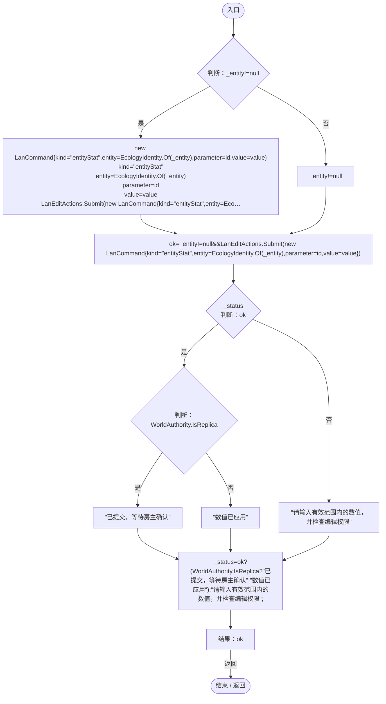

项目内调用/回调引用：

- [LanEditActions.Submit · L16](2816321496f6360e.md#m5411c4b97ac4c898)（方法）
- [EcologyIdentity.Of · L21](bdf7ccc2c9c0452f.md#m1143cf9570a93b72)（方法）

## Close · L37

`public void Close()`

### Editor / Player · Roslyn编译器控制流

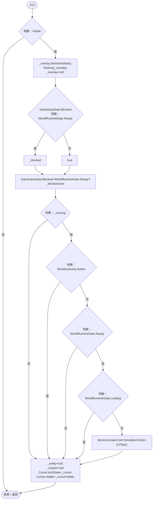

项目内调用/回调引用：

- [GameInputGate.Blocked.set · L8](52955daae7e592ab.md#m578697f6379686f4)（访问器）
- [SimulationClock.Play · L78](a8f444aec9614b0a.md#m7aa9e64b7de60ed0)（方法）
- [ServiceLocator.Get · L33](f2fdbe9f9ccd93cb.md#m2ae625299520c56d)（方法）

## Update · L39

`private void Update()`

### Editor / Player · Roslyn编译器控制流

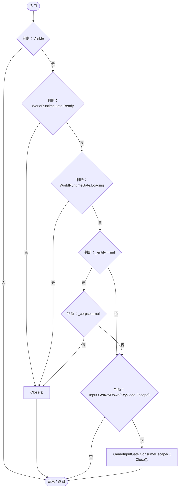

项目内调用/回调引用：

- [EntityEditPopup.Close · L37](79ed73ecd9855f79.md#me0dfe83176e18f21)（方法）
- [GameInputGate.ConsumeEscape · L9](52955daae7e592ab.md#m5b050ac6f014de67)（方法）

## OnDisable · L40

`private void OnDisable()`

### Editor / Player · Roslyn编译器控制流

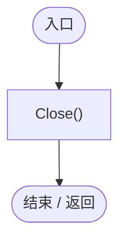

项目内调用/回调引用：

- [EntityEditPopup.Close · L37](79ed73ecd9855f79.md#me0dfe83176e18f21)（方法）

## OnDestroy · L40

`private void OnDestroy()`

### Editor / Player · Roslyn编译器控制流

项目内调用/回调引用：

- [EntityEditPopup.Instance.get · L16](79ed73ecd9855f79.md#m1636d1f5295f3a28)（访问器）
- [EntityEditPopup.Instance.set · L16](79ed73ecd9855f79.md#m39b295ff2176f94b)（访问器）

## OnGUI · L41

`private void OnGUI()`

### Editor / Player · Roslyn编译器控制流

```mermaid
flowchart TD
  b0(["入口"])
  b1{"判断：Visible"}
  b2["GUI.depth=-960;<br/>RuntimeMenuTheme.Apply();<br/>rect=new Rect((Screen.width-Mathf.Min(600,Screen.width-24))/2,(Screen.height-Mathf.Min(620,Screen.height-24))/2,Mathf.Min(600,Screen.width-24),Mathf.Min(620,Screen.height-24))<br/>GUI.Box(rect,GUICon…"]
  b3{"判断：_entity!=null"}
  b4["&quot;编辑实体 · &quot;+_entity.DisplayName"]
  b5["&quot;尸体 · 生前基因状态&quot;"]
  b6["GUILayout.Label(_entity!=null?&quot;编辑实体 · &quot;+_entity.DisplayName:&quot;尸体 · 生前基因状态&quot;,RuntimeMenuTheme.Title);"]
  b7{"判断：GUILayout.Button(&quot;关闭&quot;,GUILayout.Width(64))"}
  b8["Close();"]
  b9{"GUILayout.EndHorizontal();<br/>_scroll=GUILayout.BeginScrollView(_scroll);<br/>判断：_entity!=null"}
  b10["GUILayout.Label(&quot;生命阶段&quot;);<br/>previous=GUI.enabled"]
  b11{"GUI.enabled<br/>判断：previous"}
  b12["WorldAuthority.CanEdit"]
  b13["previous"]
  b14["GUI.enabled=previous&amp;&amp;WorldAuthority.CanEdit;"]
  b15{"GUILayout.BeginHorizontal();<br/>判断：GUILayout.Button(&quot;幼年&quot;)"}
  b16["ApplyStage(AgeState.Infant);"]
  b17{"判断：GUILayout.Button(&quot;成年&quot;)"}
  b18["ApplyStage(AgeState.Adult);"]
  b19{"判断：GUILayout.Button(&quot;老年&quot;)"}
  b20["ApplyStage(AgeState.Elder);"]
  b21["GUILayout.EndHorizontal();"]
  b22["i=0"]
  b23{"判断：i&lt;StatIds.Length"}
  b24{"GUILayout.BeginHorizontal();<br/>GUILayout.Label(StatNames[i],GUILayout.Width(80));<br/>_values[i]=GUILayout.TextField(_values[i],32);<br/>判断：GUILayout.Button(&quot;应用&quot;,GUILayout.Width(64))"}
  b25{"判断：float.TryParse(_values[i],out var value)"}
  b26["ApplyStat(StatIds[i],value);"]
  b27["_status=&quot;请输入有效数值&quot;;"]
  b28["GUILayout.EndHorizontal();<br/>i++"]
  b29["GUI.enabled=previous;"]
  b30["GUILayout.Label(&quot;已死亡；此处查看生前表达，不创建可行动的伪实体。&quot;,RuntimeMenuTheme.Muted);"]
  b31{"判断：string.IsNullOrEmpty(_status)"}
  b32["GUILayout.Label(_status);"]
  b33["GUILayout.Space(12);<br/>GUILayout.Label(&quot;基因失效原因&quot;,RuntimeMenuTheme.Primary);"]
  b34{"判断：_entity!=null"}
  b35["_entity.Genes.Genome"]
  b36{"_corpse<br/>判断：_corpse"}
  b37[".State.source"]
  b38{"判断：.State.source"}
  b39[".genome"]
  b40["_corpse?.State.source?.genome"]
  b41["genome=_entity!=null?_entity.Genes.Genome:_corpse?.State.source?.genome"]
  b42{"判断：_entity!=null"}
  b43["_entity.Genes.Evaluation"]
  b44["_corpseEvaluation"]
  b45["evaluation=_entity!=null?_entity.Genes.Evaluation:_corpseEvaluation"]
  b46{"判断：genome==null"}
  b47["GUILayout.Label(&quot;旧存档未记录生前基因，无法还原失效原因。&quot;);"]
  b48["any=false"]
  b49["genome.Genes"]
  b50{"判断：genome.Genes"}
  b51["var"]
  b52{"definition=GeneDatabase.Get(gene.DefinitionId)<br/>判断：definition==null"}
  b53["GUILayout.Label(gene.DefinitionId+&quot;：定义缺失&quot;);<br/>any=true;"]
  b54{"evaluation<br/>判断：evaluation"}
  b55[".Genes.Find(e=&gt;e.Gene==gene)"]
  b56["evaluation"]
  b57{"判断：evaluation?.Genes.Find(e=&gt;e.Gene==gene)"}
  b58["evaluation?.Genes.Find(e=&gt;e.Gene==gene)"]
  b59["new GeneEvaluation{Gene=gene,Definition=definition}<br/>Gene=gene<br/>Definition=definition"]
  b60["result=evaluation?.Genes.Find(e=&gt;e.Gene==gene)??new GeneEvaluation{Gene=gene,Definition=definition}"]
  b61{"reasons=GeneFailureReasons.Explain(genome,result)<br/>判断：reasons.Count==0"}
  b62["any=true;<br/>GUILayout.Label(definition.DisplayName+&quot; · &quot;+GeneFailureReasons.Summary(result));"]
  b63["reasons"]
  b64{"判断：reasons"}
  b65["var<br/>GUILayout.Label(&quot;• &quot;+reason,RuntimeMenuTheme.Muted);"]
  b66["reasons"]
  b67["genome.Genes"]
  b68{"判断：any"}
  b69["GUILayout.Label(&quot;当前没有失效或缺少状态的基因。&quot;);"]
  b70["GUILayout.EndScrollView();<br/>GUILayout.EndArea();"]
  b71(["结束 / 返回"])
  b0 --> b1
  b1 -->|"否"| b71
  b1 -->|"是"| b2
  b2 --> b3
  b3 -->|"是"| b4
  b3 -->|"否"| b5
  b4 --> b6
  b5 --> b6
  b6 --> b7
  b7 -->|"是"| b8
  b7 -->|"否"| b9
  b8 --> b9
  b9 -->|"是"| b10
  b9 -->|"否"| b30
  b10 --> b11
  b11 -->|"是"| b12
  b11 -->|"否"| b13
  b12 --> b14
  b13 --> b14
  b14 --> b15
  b15 -->|"是"| b16
  b15 -->|"否"| b17
  b16 --> b17
  b17 -->|"是"| b18
  b17 -->|"否"| b19
  b18 --> b19
  b19 -->|"是"| b20
  b19 -->|"否"| b21
  b20 --> b21
  b21 --> b22
  b22 --> b23
  b23 -->|"是"| b24
  b23 -->|"否"| b29
  b24 -->|"是"| b25
  b24 -->|"否"| b28
  b25 -->|"是"| b26
  b25 -->|"否"| b27
  b26 --> b28
  b27 --> b28
  b28 --> b23
  b29 --> b31
  b30 --> b31
  b31 -->|"否"| b32
  b31 -->|"是"| b33
  b32 --> b33
  b33 --> b34
  b34 -->|"是"| b35
  b34 -->|"否"| b36
  b35 --> b41
  b36 -->|"否"| b37
  b36 -->|"是"| b40
  b37 --> b38
  b38 -->|"否"| b39
  b38 -->|"是"| b40
  b39 --> b41
  b40 --> b41
  b41 --> b42
  b42 -->|"是"| b43
  b42 -->|"否"| b44
  b43 --> b45
  b44 --> b45
  b45 --> b46
  b46 -->|"是"| b47
  b46 -->|"否"| b48
  b47 --> b70
  b48 --> b49
  b49 --> b50
  b50 -->|"是"| b51
  b50 -->|"否 · 经过finally 67"| b68
  b51 --> b52
  b52 -->|"是"| b53
  b52 -->|"否"| b54
  b53 --> b50
  b54 -->|"否"| b55
  b54 -->|"是"| b56
  b55 --> b57
  b56 --> b57
  b57 -->|"否"| b58
  b57 -->|"是"| b59
  b58 --> b60
  b59 --> b60
  b60 --> b61
  b61 -->|"是"| b50
  b61 -->|"否"| b62
  b62 --> b63
  b63 --> b64
  b64 -->|"是"| b65
  b64 -->|"否 · 经过finally 66"| b50
  b65 --> b64
  b68 -->|"否"| b69
  b68 -->|"是"| b70
  b69 --> b70
  b70 --> b71
  b64 -. "退出保护区时 finally（示意）" .-> b66
  b50 -. "退出保护区时 finally（示意）" .-> b67

```

项目内调用/回调引用：

- [RuntimeMenuTheme.Apply · L39](b9d8455882f2a532.md#m587a63eff5a85605)（方法）
- [RuntimeMenuTheme.Title.get · L14](b9d8455882f2a532.md#m0b3a4a9f7e8e69ae)（访问器）
- [EntityEditPopup.Close · L37](79ed73ecd9855f79.md#me0dfe83176e18f21)（方法）
- [EntityEditPopup.ApplyStage · L33](79ed73ecd9855f79.md#m4b5383d0e7bd106d)（方法）
- [EntityEditPopup.ApplyStat · L35](79ed73ecd9855f79.md#m4421460b5b8ecfc6)（方法）
- [RuntimeMenuTheme.Muted.get · L13](b9d8455882f2a532.md#meeaba271eb4ad2ed)（访问器）
- [RuntimeMenuTheme.Primary.get · L10](b9d8455882f2a532.md#med9b3baaef6ef78a)（访问器）
- [DarwinEntity.Genes.get · L14](70798dde169f2e8b.md#m622eb1adf401d431)（访问器）
- [ColonyResource.State.get · L24](293dbaecfff4b585.md#m41824f1a0e160aa5)（访问器）
- [EntityGeneController.Evaluation.get · L18](7494d53178552f0e.md#mc0039c100a31b455)（访问器）
- [GeneDatabase.Get · L136](ec0a03483435a863.md#me6a5fefe6c3492f9)（方法）
- [GeneFailureReasons.Explain · L19](e611915e807d8990.md#mb026e84414afe795)（方法）
- [GeneFailureReasons.Summary · L41](e611915e807d8990.md#m3866bc2406793338)（方法）
- [EntityEditPopup.回调@61 · L61](79ed73ecd9855f79.md#m4ec1f0e779ceca2a)（回调/委托）

## 回调@61 · L61

`e … => 回调`

### Editor / Player · Roslyn编译器控制流

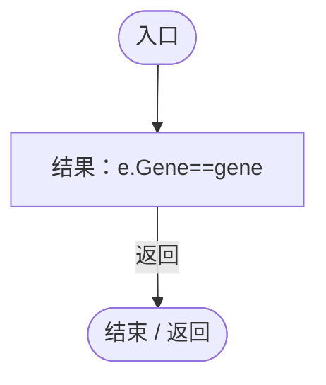
