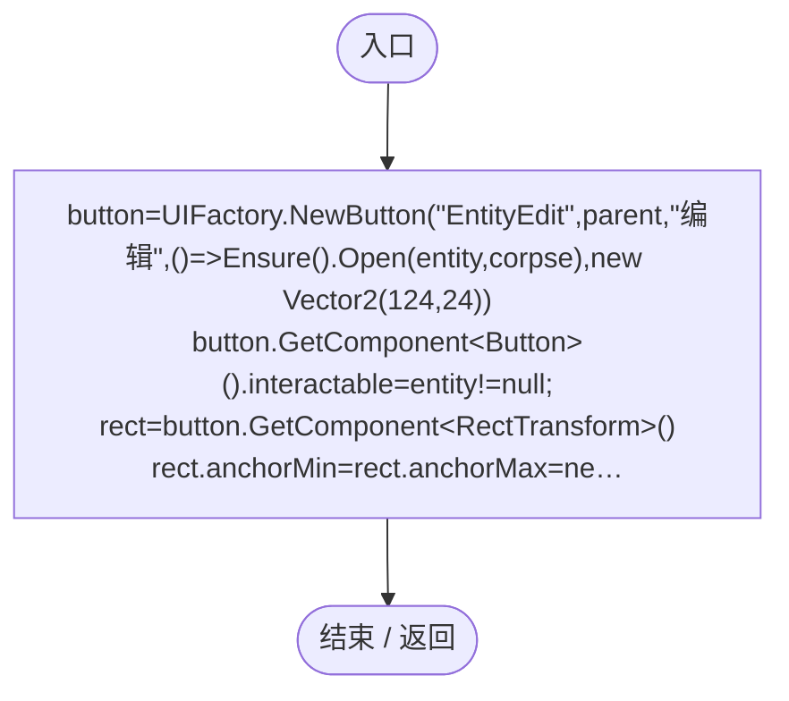
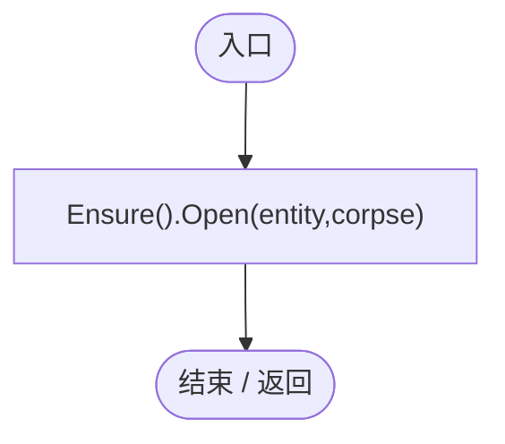
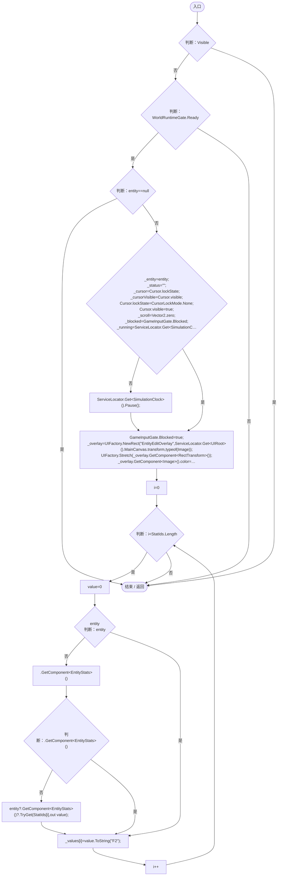
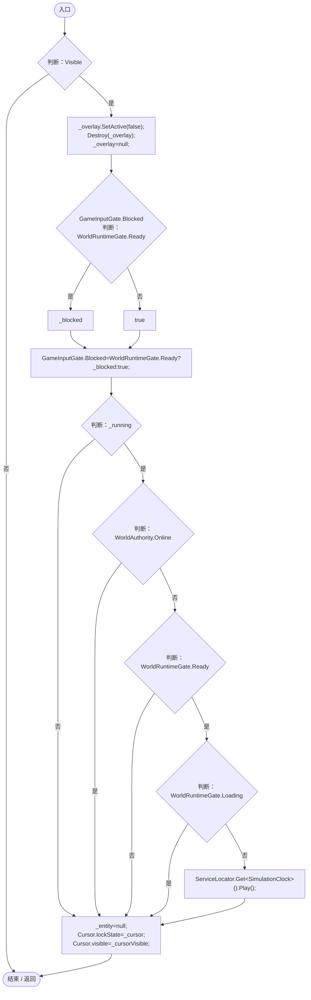
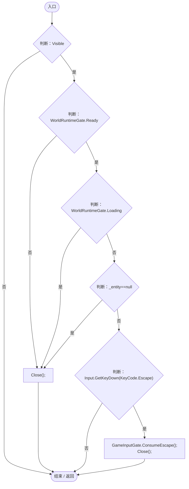
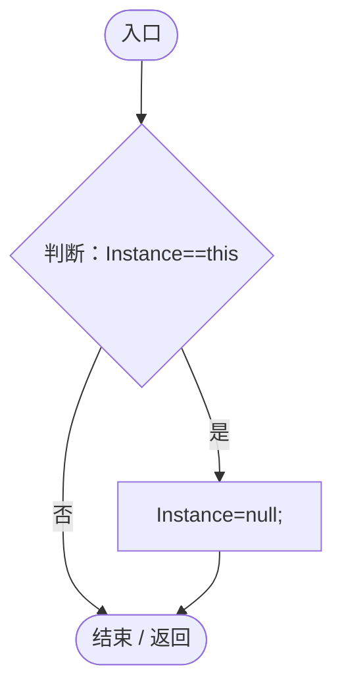

```mermaid
flowchart TD
  b0(["入口"])
  b1{"判断：Visible"}
  b2["GUI.depth=-960;<br/>RuntimeMenuTheme.Apply();<br/>rect=new Rect((Screen.width-Mathf.Min(600,Screen.width-24))/2,(Screen.height-Mathf.Min(620,Screen.height-24))/2,Mathf.Min(600,Screen.width-24),Mathf.Min(620,Screen.height-24))<br/>GUI.Box(rect,GUICon…"]
  b3{"判断：_entity!=null"}
  b4["&quot;编辑实体 · &quot;+_entity.DisplayName"]
  b5["&quot;实体已失效&quot;"]
  b6["GUILayout.Label(_entity!=null?&quot;编辑实体 · &quot;+_entity.DisplayName:&quot;实体已失效&quot;,RuntimeMenuTheme.Title);"]
  b7{"判断：GUILayout.Button(&quot;关闭&quot;,GUILayout.Width(64))"}
  b8["Close();"]
  b9{"GUILayout.EndHorizontal();<br/>_scroll=GUILayout.BeginScrollView(_scroll);<br/>判断：_entity!=null"}
  b10["GUILayout.Label(&quot;生命阶段&quot;);<br/>previous=GUI.enabled"]
  b11{"GUI.enabled<br/>判断：previous"}
  b12["WorldAuthority.CanEdit"]
  b13["previous"]
  b14["GUI.enabled=previous&amp;&amp;WorldAuthority.CanEdit;"]
  b15{"GUILayout.BeginHorizontal();<br/>判断：GUILayout.Button(&quot;幼年&quot;)"}
  b16["ApplyStage(AgeState.Infant);"]
  b17{"判断：GUILayout.Button(&quot;成年&quot;)"}
  b18["ApplyStage(AgeState.Adult);"]
  b19{"判断：GUILayout.Button(&quot;老年&quot;)"}
  b20["ApplyStage(AgeState.Elder);"]
  b21["GUILayout.EndHorizontal();"]
  b22["i=0"]
  b23{"判断：i&lt;StatIds.Length"}
  b24{"GUILayout.BeginHorizontal();<br/>GUILayout.Label(StatNames[i],GUILayout.Width(80));<br/>_values[i]=GUILayout.TextField(_values[i],32);<br/>判断：GUILayout.Button(&quot;应用&quot;,GUILayout.Width(64))"}
  b25{"判断：float.TryParse(_values[i],out var value)"}
  b26["ApplyStat(StatIds[i],value);"]
  b27["_status=&quot;请输入有效数值&quot;;"]
  b28["GUILayout.EndHorizontal();<br/>i++"]
  b29["GUI.enabled=previous;"]
  b30{"判断：string.IsNullOrEmpty(_status)"}
  b31["GUILayout.Label(_status);"]
  b32["GUILayout.EndScrollView();<br/>GUILayout.EndArea();"]
  b33(["结束 / 返回"])
  b0 --> b1
  b1 -->|"否"| b33
  b1 -->|"是"| b2
  b2 --> b3
  b3 -->|"是"| b4
  b3 -->|"否"| b5
  b4 --> b6
  b5 --> b6
  b6 --> b7
  b7 -->|"是"| b8
  b7 -->|"否"| b9
  b8 --> b9
  b9 -->|"是"| b10
  b9 -->|"否"| b30
  b10 --> b11
  b11 -->|"是"| b12
  b11 -->|"否"| b13
  b12 --> b14
  b13 --> b14
  b14 --> b15
  b15 -->|"是"| b16
  b15 -->|"否"| b17
  b16 --> b17
  b17 -->|"是"| b18
  b17 -->|"否"| b19
  b18 --> b19
  b19 -->|"是"| b20
  b19 -->|"否"| b21
  b20 --> b21
  b21 --> b22
  b22 --> b23
  b23 -->|"是"| b24
  b23 -->|"否"| b29
  b24 -->|"是"| b25
  b24 -->|"否"| b28
  b25 -->|"是"| b26
  b25 -->|"否"| b27
  b26 --> b28
  b27 --> b28
  b28 --> b23
  b29 --> b30
  b30 -->|"否"| b31
  b30 -->|"是"| b32
  b31 --> b32
  b32 --> b33

```

# EntityEditPopup.cs

[返回总索引](../README.md) · `Runtime` · `Assets/DarwinPark/UI/EntityEditPopup.cs`

[源文件](../../../Assets/DarwinPark/UI/EntityEditPopup.cs) · 源码校验：`b8dc7ea74e44ba160009914079787201b593ed40f21e2da53f448acb35664de1`

方法按源文件位置排列。事件/回调引用不表示立即执行；分支与异常说明见总索引。完整源码与可点击关系图请打开离线手册。

## Instance.get · L13

`get`

### Editor / Player · 语法控制结构 / 声明（非CFG）

## Instance.set · L13

`private set`

### Editor / Player · 语法控制结构 / 声明（非CFG）

## Visible.get · L13

`public bool Visible`

### Editor / Player · 语法控制结构 / 声明（非CFG）

## Awake · L17

`private void Awake()`

### Editor / Player · Roslyn编译器控制流

项目内调用/回调引用：

- [EntityEditPopup.Instance.set · L13](79ed73ecd9855f79.md#mb4657e4535412d2c)（访问器）

## Ensure · L18

`public static EntityEditPopup Ensure()`

### Editor / Player · Roslyn编译器控制流

项目内调用/回调引用：

- [ServiceLocator.Get · L33](f2fdbe9f9ccd93cb.md#m2ae625299520c56d)（方法）

## AddEntry · L19

`public static void AddEntry(Transform parent,DarwinEntity entity,ColonyResource corpse=null)`

### Editor / Player · Roslyn编译器控制流

项目内调用/回调引用：

- [UIFactory.NewButton · L73](dd1096a6995423db.md#m5896f1b097c8bdde)（方法）
- [EntityEditPopup.回调@21 · L21](79ed73ecd9855f79.md#mec17c868bb5e3ee3)（回调/委托）

## 回调@21 · L21

`( … => 回调`

### Editor / Player · Roslyn编译器控制流

项目内调用/回调引用：

- [EntityEditPopup.Open · L23](79ed73ecd9855f79.md#mb672ffe712524cb3)（方法）
- [EntityEditPopup.Ensure · L18](79ed73ecd9855f79.md#mf701ffe637513b48)（方法）

## Open · L23

`public void Open(DarwinEntity entity,ColonyResource corpse=null)`

### Editor / Player · Roslyn编译器控制流

项目内调用/回调引用：

- [GameInputGate.Blocked.get · L8](52955daae7e592ab.md#m765763b665829633)（访问器）
- [SimulationClock.IsRunning.get · L22](a8f444aec9614b0a.md#m10f4fe307faca0f0)（访问器）
- [ServiceLocator.Get · L33](f2fdbe9f9ccd93cb.md#m2ae625299520c56d)（方法）
- [SimulationClock.Pause · L79](a8f444aec9614b0a.md#m30929d45a885d0f1)（方法）
- [GameInputGate.Blocked.set · L8](52955daae7e592ab.md#m578697f6379686f4)（访问器）
- [UIFactory.NewRect · L33](dd1096a6995423db.md#med612116f3152344)（方法）
- [UIRoot.MainCanvas.get · L14](9c1421378791f0e0.md#maa2cc9baf1248477)（访问器）
- [UIFactory.Stretch · L150](dd1096a6995423db.md#m11d8f6c6d00cc047)（方法）
- [EntityStats.TryGet · L90](75aa86a368efdf24.md#m24ee1433e4a70d94)（方法）

## ApplyStage · L30

`public bool ApplyStage(AgeState age)`

### Editor / Player · Roslyn编译器控制流

项目内调用/回调引用：

- [LanEditActions.Submit · L16](2816321496f6360e.md#m5411c4b97ac4c898)（方法）
- [EcologyIdentity.Of · L22](bdf7ccc2c9c0452f.md#mb23020fe763aafd3)（方法）
- [GeneInspectorUI.RefreshDisplayedInfo · L326](924e27c34e7b1f0a.md#m1feb95a375dc3dcc)（方法）

## ApplyStat · L32

`public bool ApplyStat(string id,float value)`

### Editor / Player · Roslyn编译器控制流

项目内调用/回调引用：

- [LanEditActions.Submit · L16](2816321496f6360e.md#m5411c4b97ac4c898)（方法）
- [EcologyIdentity.Of · L22](bdf7ccc2c9c0452f.md#mb23020fe763aafd3)（方法）

## Close · L34

`public void Close()`

### Editor / Player · Roslyn编译器控制流

项目内调用/回调引用：

- [GameInputGate.Blocked.set · L8](52955daae7e592ab.md#m578697f6379686f4)（访问器）
- [SimulationClock.Play · L78](a8f444aec9614b0a.md#m7aa9e64b7de60ed0)（方法）
- [ServiceLocator.Get · L33](f2fdbe9f9ccd93cb.md#m2ae625299520c56d)（方法）

## Update · L36

`private void Update()`

### Editor / Player · Roslyn编译器控制流

项目内调用/回调引用：

- [EntityEditPopup.Close · L34](79ed73ecd9855f79.md#m07792a3835d81df8)（方法）
- [GameInputGate.ConsumeEscape · L9](52955daae7e592ab.md#m5b050ac6f014de67)（方法）

## OnDisable · L37

`private void OnDisable()`

### Editor / Player · Roslyn编译器控制流

项目内调用/回调引用：

- [EntityEditPopup.Close · L34](79ed73ecd9855f79.md#m07792a3835d81df8)（方法）

## OnDestroy · L37

`private void OnDestroy()`

### Editor / Player · Roslyn编译器控制流

项目内调用/回调引用：

- [EntityEditPopup.Instance.get · L13](79ed73ecd9855f79.md#md1e4e9556a61fb18)（访问器）
- [EntityEditPopup.Instance.set · L13](79ed73ecd9855f79.md#mb4657e4535412d2c)（访问器）

## OnGUI · L38

`private void OnGUI()`

### Editor / Player · Roslyn编译器控制流

项目内调用/回调引用：

- [RuntimeMenuTheme.Apply · L39](b9d8455882f2a532.md#m587a63eff5a85605)（方法）
- [RuntimeMenuTheme.Title.get · L14](b9d8455882f2a532.md#m0b3a4a9f7e8e69ae)（访问器）
- [EntityEditPopup.Close · L34](79ed73ecd9855f79.md#m07792a3835d81df8)（方法）
- [EntityEditPopup.ApplyStage · L30](79ed73ecd9855f79.md#md71dfb31617a2465)（方法）
- [EntityEditPopup.ApplyStat · L32](79ed73ecd9855f79.md#m4b9c2e8423efaac6)（方法）
