# PopulationRangeLayer.cs

[返回总索引](../README.md) · `Runtime` · `Assets/DarwinPark/UI/PopulationRangeLayer.cs`

[源文件](../../../Assets/DarwinPark/UI/PopulationRangeLayer.cs) · 源码校验：`e417d196769a8a5e37f5fb23749927f4126fb37f6988339fa48f03c2622bfbf4`

方法按源文件位置排列。事件/回调引用不表示立即执行；分支与异常说明见总索引。完整源码与可点击关系图请打开离线手册。

## Visible.get · L15

`public static bool Visible`

### Editor / Player · 语法控制结构 / 声明（非CFG）

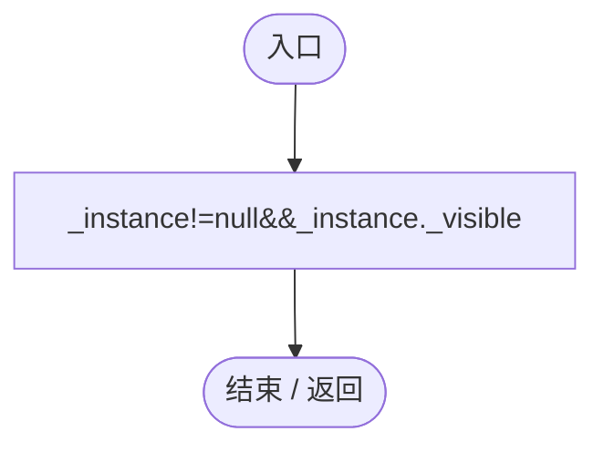

## Outline.get · L16

`get`

### Editor / Player · 语法控制结构 / 声明（非CFG）

## Outline.set · L16

`private set`

### Editor / Player · 语法控制结构 / 声明（非CFG）

## ActiveCircleCount.get · L17

`get`

### Editor / Player · 语法控制结构 / 声明（非CFG）

## ActiveCircleCount.set · L17

`private set`

### Editor / Player · 语法控制结构 / 声明（非CFG）

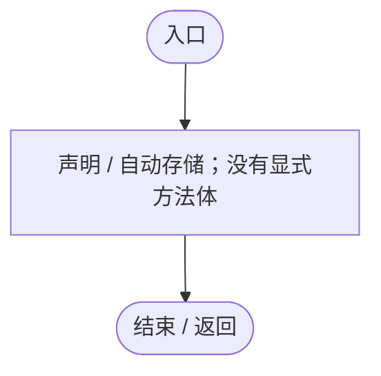

## SetVisible · L18

`public static void SetVisible(bool value)`

### Editor / Player · Roslyn编译器控制流

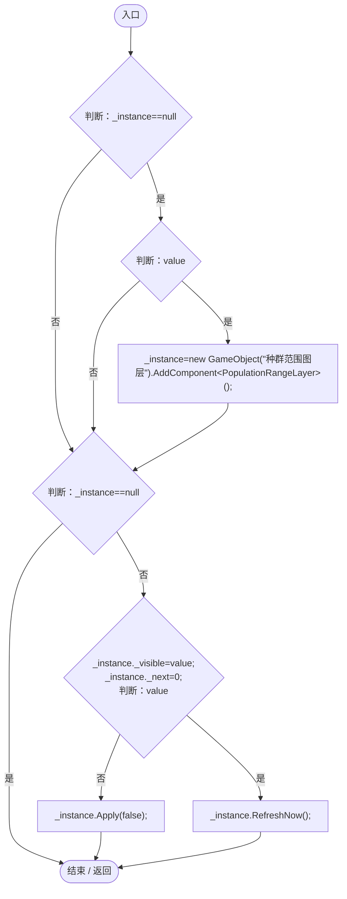

项目内调用/回调引用：

- [PopulationRangeLayer.Apply · L55](7ad316e94c5af908.md#m170ae9e157765d2d)（方法）
- [PopulationRangeLayer.RefreshNow · L32](7ad316e94c5af908.md#m01ffb03f226d42e2)（方法）

## ToggleStyle · L24

`public static void ToggleStyle()`

### Editor / Player · Roslyn编译器控制流

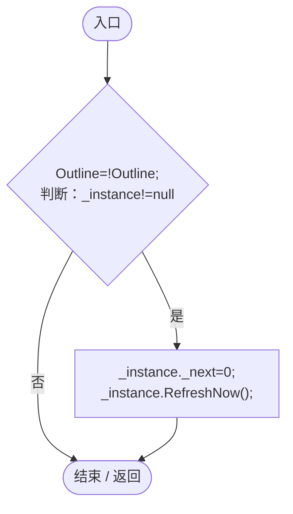

项目内调用/回调引用：

- [PopulationRangeLayer.Outline.set · L16](7ad316e94c5af908.md#m6c181e71c3b5f30d)（访问器）
- [PopulationRangeLayer.Outline.get · L16](7ad316e94c5af908.md#m81b227b0dd72d322)（访问器）
- [PopulationRangeLayer.RefreshNow · L32](7ad316e94c5af908.md#m01ffb03f226d42e2)（方法）

## ClearWorld · L25

`public static void ClearWorld()`

### Editor / Player · Roslyn编译器控制流

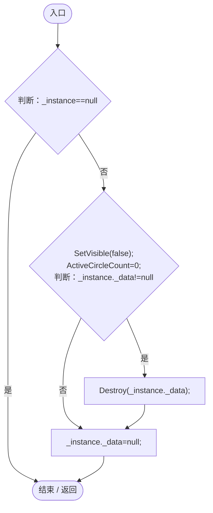

项目内调用/回调引用：

- [PopulationRangeLayer.SetVisible · L18](7ad316e94c5af908.md#m224360ff57b7a890)（方法）
- [PopulationRangeLayer.ActiveCircleCount.set · L17](7ad316e94c5af908.md#me18bcfb2447c743e)（访问器）

## OnDestroy · L26

`private void OnDestroy()`

### Editor / Player · Roslyn编译器控制流

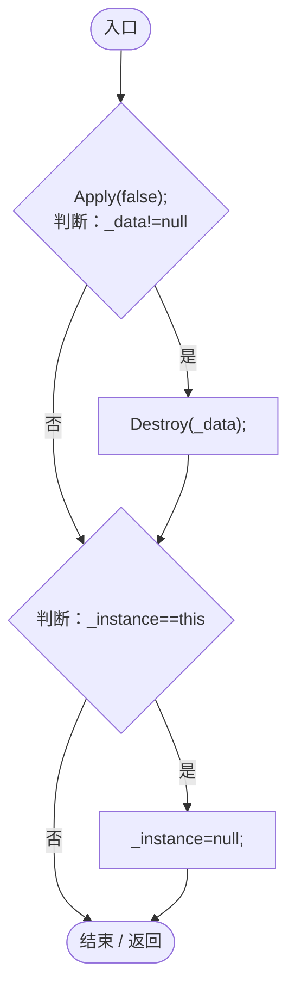

项目内调用/回调引用：

- [PopulationRangeLayer.Apply · L55](7ad316e94c5af908.md#m170ae9e157765d2d)（方法）

## Update · L27

`private void Update()`

### Editor / Player · Roslyn编译器控制流

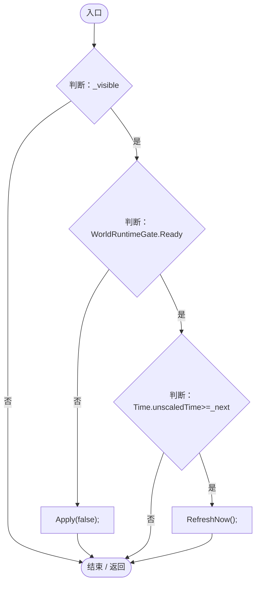

项目内调用/回调引用：

- [PopulationRangeLayer.Apply · L55](7ad316e94c5af908.md#m170ae9e157765d2d)（方法）
- [PopulationRangeLayer.RefreshNow · L32](7ad316e94c5af908.md#m01ffb03f226d42e2)（方法）

## RefreshNow · L32

`public void RefreshNow()`

### Editor / Player · Roslyn编译器控制流

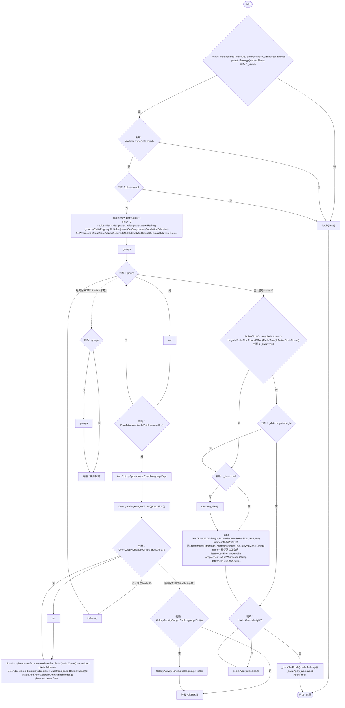

项目内调用/回调引用：

- [AntColonySettings.Current.get · L31](cb0a937e97c8fbb3.md#mcd121159f407ccdf)（访问器）
- [PopulationRangeLayer.Apply · L55](7ad316e94c5af908.md#m170ae9e157765d2d)（方法）
- [PlanetTerrainMeshBuilder.WaterRadius.get · L94](415285cf043354a9.md#m28d8809083881ec1)（访问器）
- [PopulationArchive.IsVisible · L109](084e119b69cdd751.md#m452bdf5931b09c11)（方法）
- [ColonyAppearance.ColorFor · L9](e51c7c842d87a26d.md#m0ea090c43edf8334)（方法）
- [ColonyActivityRange.Circles · L15](e8d854132f563257.md#m455fdb9801c8ae0e)（方法）
- [PopulationArchive.OpacityFor · L107](084e119b69cdd751.md#m97824b788cf7f2ff)（方法）
- [PopulationRangeLayer.ActiveCircleCount.set · L17](7ad316e94c5af908.md#me18bcfb2447c743e)（访问器）
- [PopulationRangeLayer.ActiveCircleCount.get · L17](7ad316e94c5af908.md#mdf5ce69158592d87)（访问器）
- [PopulationRangeLayer.回调@37 · L37](7ad316e94c5af908.md#meb12ab672326c368)（回调/委托）
- [PopulationRangeLayer.回调@37 · L37](7ad316e94c5af908.md#mf32e330373642efd)（回调/委托）
- [PopulationRangeLayer.回调@37 · L37](7ad316e94c5af908.md#m63200795a1c6979c)（回调/委托）
- [PopulationRangeLayer.回调@37 · L37](7ad316e94c5af908.md#mfb6bbf99dca5f551)（回调/委托）

## 回调@37 · L37

`e … => 回调`

### Editor / Player · Roslyn编译器控制流

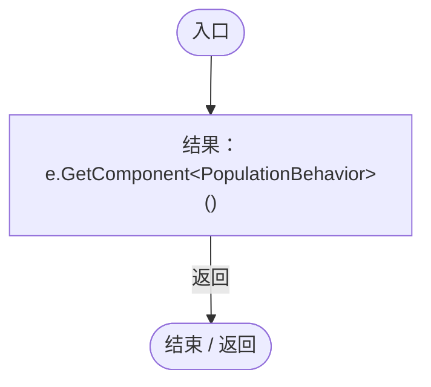

## 回调@37 · L37

`p … => 回调`

### Editor / Player · Roslyn编译器控制流

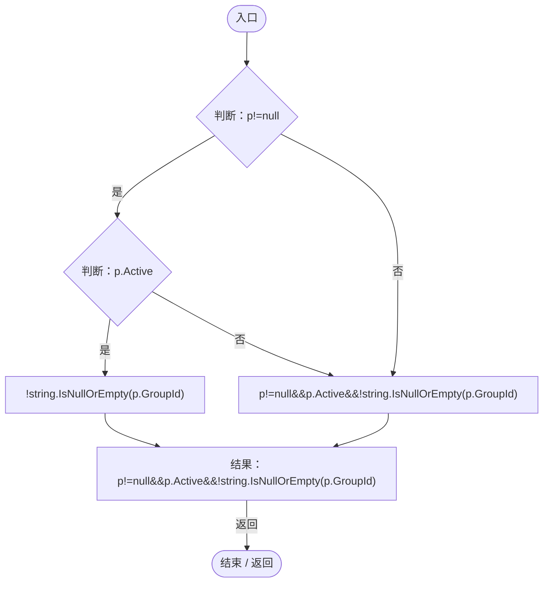

项目内调用/回调引用：

- [PopulationBehavior.GroupId.get · L20](21e4f62f75a9a80f.md#m5145936fa914ba8c)（访问器）

## 回调@37 · L37

`p … => 回调`

### Editor / Player · Roslyn编译器控制流

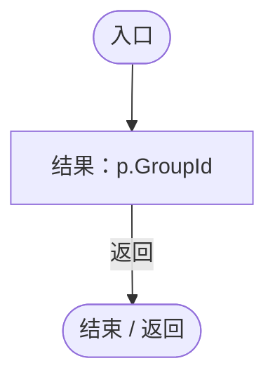

项目内调用/回调引用：

- [PopulationBehavior.GroupId.get · L20](21e4f62f75a9a80f.md#m5145936fa914ba8c)（访问器）

## 回调@37 · L37

`g … => 回调`

### Editor / Player · Roslyn编译器控制流

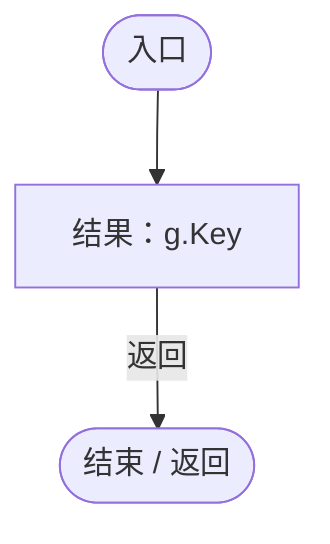

## Apply · L55

`private void Apply(bool show)`

### Editor / Player · Roslyn编译器控制流

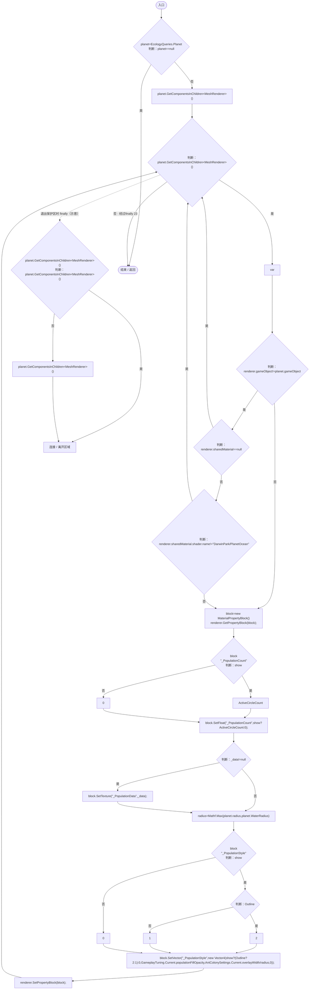

项目内调用/回调引用：

- [PopulationRangeLayer.ActiveCircleCount.get · L17](7ad316e94c5af908.md#mdf5ce69158592d87)（访问器）
- [PlanetTerrainMeshBuilder.WaterRadius.get · L94](415285cf043354a9.md#m28d8809083881ec1)（访问器）
- [PopulationRangeLayer.Outline.get · L16](7ad316e94c5af908.md#m81b227b0dd72d322)（访问器）
- [GameplayTuning.Current.get · L21](db546e5713b32d53.md#m1caba89e7704d239)（访问器）
- [AntColonySettings.Current.get · L31](cb0a937e97c8fbb3.md#mcd121159f407ccdf)（访问器）
