# GeneTreeWorkbench.cs

[返回总索引](../README.md) · `Runtime` · `Assets/DarwinPark/UI/GeneTreeWorkbench.cs`

[源文件](../../../Assets/DarwinPark/UI/GeneTreeWorkbench.cs) · 源码校验：`735a00414d4b5a0acc39d17369445dec4cee774b57b1abd94ffab595fa557940`

方法按源文件位置排列。事件/回调引用不表示立即执行；分支与异常说明见总索引。完整源码与可点击关系图请打开离线手册。

<a id="m37844757c7380137"></a>

## Visible.get · L13

`get`


### Editor / Player · 语法控制结构 / 声明（非CFG）

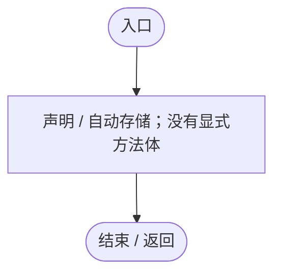

<a id="mbfd65b8ce571fae9"></a>

## Visible.set · L13

`private set`


### Editor / Player · 语法控制结构 / 声明（非CFG）


<a id="mb657c3a152837c63"></a>

## GeneName · L28

`private string GeneName(string id)`


### Editor / Player · Roslyn编译器控制流

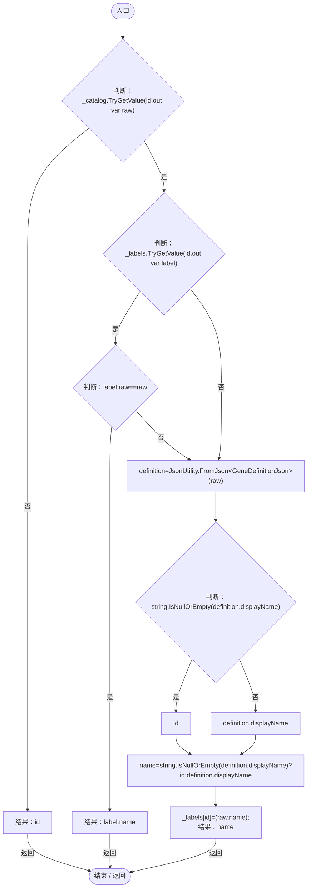

<a id="mb56f2027c48eafaa"></a>

## Open · L36

`public void Open()`


### Editor / Player · Roslyn编译器控制流

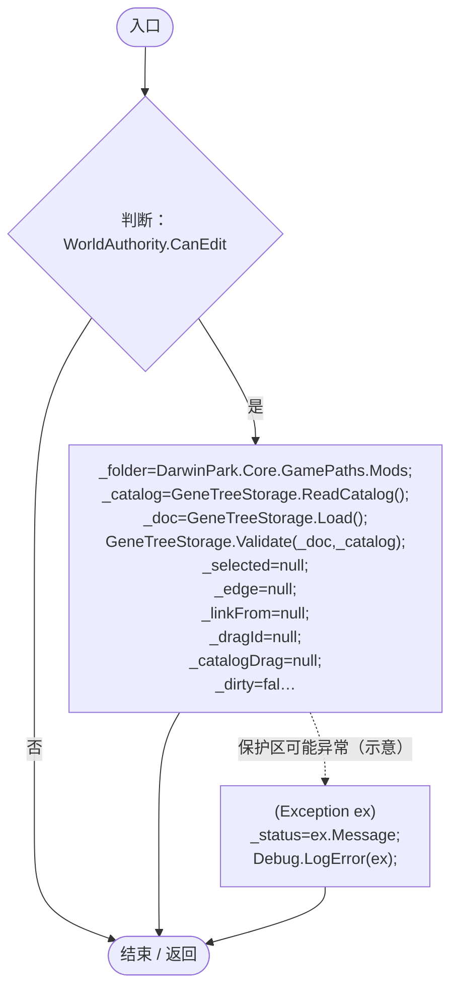

项目内调用/回调引用：

- [GeneTreeStorage.ReadCatalog · L27](a885bad0d7dedee8.md#m89083f320ec287c0)（方法）
- [GeneTreeStorage.Load · L53](a885bad0d7dedee8.md#m60e52e1c6f841f94)（方法）
- [GeneTreeStorage.Validate · L67](a885bad0d7dedee8.md#m3371bf1e3c5ae267)（方法）
- [GeneTreeWorkbench.Visible.set · L13](7b98ef3da23a85cb.md#mbfd65b8ce571fae9)（访问器）

<a id="m371900e9a4a2fe4c"></a>

## Close · L42

`public void Close()`


### Editor / Player · Roslyn编译器控制流

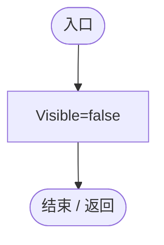

项目内调用/回调引用：

- [GeneTreeWorkbench.Visible.set · L13](7b98ef3da23a85cb.md#mbfd65b8ce571fae9)（访问器）

<a id="m244ae9703065112d"></a>

## HasUnsavedChanges.get · L43

`public bool HasUnsavedChanges`


### Editor / Player · 语法控制结构 / 声明（非CFG）

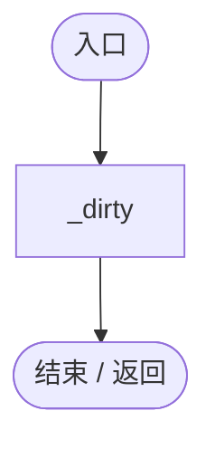

<a id="m770bed666a8ac2fd"></a>

## Draw · L44

`public void Draw(Rect screen,Action close)`


### Editor / Player · Roslyn编译器控制流

```mermaid
flowchart TD
  b0(["入口"])
  b1["RuntimeMenuTheme.Apply();<br/>GUI.Box(screen,GUIContent.none);<br/>GUILayout.BeginArea(new Rect(screen.x+16,screen.y+12,screen.width-32,screen.height-24));<br/>GUILayout.BeginHorizontal();<br/>GUILayout.Label(&quot;基因树工具&quot;,GUILayout.Width(140));"]
  b2{"判断：_hierarchy"}
  b3["&quot;切换流程图&quot;"]
  b4["&quot;切换层级列表&quot;"]
  b5{"判断：GUILayout.Button(_hierarchy?&quot;切换流程图&quot;:&quot;切换层级列表&quot;,GUILayout.Width(150))"}
  b6["_hierarchy=!_hierarchy;"]
  b7{"判断：GUILayout.Button(&quot;保存并应用&quot;,RuntimeMenuTheme.Primary,GUILayout.Width(110))"}
  b8["Save();"]
  b9{"判断：GUILayout.Button(&quot;重新读取&quot;,GUILayout.Width(100))"}
  b10{"判断：_dirty"}
  b11["Open();"]
  b12["_status=&quot;有未保存修改，请先保存，或点放弃修改。&quot;;"]
  b13{"判断：GUILayout.Button(&quot;放弃修改&quot;,GUILayout.Width(100))"}
  b14["_dirty=false;<br/>Open();"]
  b15{"判断：GUILayout.Button(&quot;返回主界面&quot;,GUILayout.Width(120))"}
  b16{"判断：_dirty"}
  b17["_status=&quot;请先保存，或放弃修改后返回。&quot;;"]
  b18["close();"]
  b19{"GUILayout.EndHorizontal();<br/>GUILayout.Label(&quot;左侧拖入 · 拖动节点 · Shift左键源→目标建立下级 · 右键节点/连线编辑 · 红=抑制 / 绿=促进&quot;);<br/>GUILayout.BeginHorizontal();<br/>GUILayout.Label(&quot;导入文件夹&quot;,GUILayout.Width(90));<br/>_folder=GUILayout.TextField(_folder);<br/>判断：GUILayout.Button(&quot;…"}
  b20["Try(()=&gt;{var imported=GeneTreeStorage.ReadCatalog(_folder);foreach(var item in imported)_catalog[item.Key]=item.Value;_dirty=true;_status=&quot;已读取 &quot;+imported.Count+&quot; 个基因&quot;;});"]
  b21["GUILayout.EndHorizontal();"]
  b22{"判断：_dirty"}
  b23["&quot;● 未保存 &quot;"]
  b24["&quot;&quot;"]
  b25["GUILayout.Label((_dirty?&quot;● 未保存 &quot;:&quot;&quot;)+_status);"]
  b26{"GUILayout.BeginHorizontal();<br/>GUI.enabled=!_hierarchy;<br/>判断：GUILayout.Button(&quot;− 缩小&quot;,GUILayout.Width(85))"}
  b27["_view.SetZoom(_view.Zoom/1.2f,_canvas.size*.5f);"]
  b28{"GUILayout.Label(Mathf.RoundToInt(_view.Zoom*100)+&quot;%&quot;,GUILayout.Width(55));<br/>判断：GUILayout.Button(&quot;＋ 放大&quot;,GUILayout.Width(85))"}
  b29["_view.SetZoom(_view.Zoom*1.2f,_canvas.size*.5f);"]
  b30{"判断：GUILayout.Button(&quot;适应全图&quot;,GUILayout.Width(100))"}
  b31["_fitPending=true;"]
  b32{"判断：GUILayout.Button(&quot;100%&quot;,GUILayout.Width(70))"}
  b33["_view.SetZoom(1,_canvas.size*.5f);"]
  b34["GUI.enabled=true;<br/>GUILayout.Label(&quot;画布内滚轮缩放 · 中键拖动画布&quot;);<br/>GUILayout.EndHorizontal();<br/>GUILayout.EndArea();<br/>top=screen.y+200<br/>bottom=screen.height-220<br/>left=new Rect(screen.x+16,top,225,bottom)<br/>GUI.Box(left,&quot;基因文件&quot;);<br/>GUILayout.BeginArea(new Rect…"]
  b35["_catalog.Keys.OrderBy(x=&gt;x)"]
  b36{"判断：_catalog.Keys.OrderBy(x=&gt;x)"}
  b37["var"]
  b38{"判断：id==_selected"}
  b39["RuntimeMenuTheme.Selected"]
  b40["GUI.skin.button"]
  b41["new GUIStyle(id==_selected?RuntimeMenuTheme.Selected:GUI.skin.button){alignment=TextAnchor.MiddleLeft,padding=new RectOffset(38,8,3,3)}"]
  b42["alignment=TextAnchor.MiddleLeft<br/>padding=new RectOffset(38,8,3,3)<br/>rowStyle=new GUIStyle(id==_selected?RuntimeMenuTheme.Selected:GUI.skin.button){alignment=TextAnchor.MiddleLeft,padding=new RectOffset(38,8,3,3)}"]
  b43["GUILayout.Label(GeneName(id),rowStyle,GUILayout.Height(32));<br/>row=GUILayoutUtility.GetLastRect()"]
  b44{"new Rect(row.x+6,row.y+4,24,24)<br/>UIVisualTheme.GeneIcon(id)<br/>判断：id==_selected"}
  b45["UIVisualTheme.Accent"]
  b46["UIVisualTheme.Muted"]
  b47["RuntimeMenuTheme.Icon(new Rect(row.x+6,row.y+4,24,24),UIVisualTheme.GeneIcon(id),id==_selected?UIVisualTheme.Accent:UIVisualTheme.Muted);"]
  b48{"判断：Event.current.type==EventType.MouseDown"}
  b49{"判断：Event.current.button==0"}
  b50{"判断：row.Contains(Event.current.mousePosition)"}
  b51["_catalogDrag=id;<br/>Event.current.Use();"]
  b52{"判断：_catalog.Keys.OrderBy(x=&gt;x)"}
  b53["_catalog.Keys.OrderBy(x=&gt;x)"]
  b54["连接 / 离开区域"]
  b55{"GUILayout.EndScrollView();<br/>GUILayout.EndArea();<br/>_canvas=new Rect(left.xMax+10,top,Mathf.Max(250,screen.width-580),bottom);<br/>GUI.Box(_canvas,GUIContent.none);<br/>判断：_hierarchy"}
  b56["DrawHierarchy();"]
  b57["DrawGraph();"]
  b58{"DrawInspector(new Rect(_canvas.xMax+10,top,screen.xMax-_canvas.xMax-26,bottom));<br/>ev=Event.current<br/>判断：_catalogDrag!=null"}
  b59{"GUI.Label(new Rect(ev.mousePosition+new Vector2(12,8),new Vector2(210,30)),_catalogDrag,GUI.skin.box);<br/>判断：ev.type==EventType.MouseUp"}
  b60{"判断：_canvas.Contains(ev.mousePosition)"}
  b61{"判断：_hierarchy"}
  b62["AddNode(_catalogDrag,_view.ToGraph(ev.mousePosition-_canvas.position));"]
  b63["_catalogDrag=null;<br/>ev.Use();"]
  b64{"判断：ev.type==EventType.KeyDown"}
  b65{"判断：ev.keyCode==KeyCode.Escape"}
  b66["_linkFrom=null;<br/>_dragId=null;<br/>_catalogDrag=null;<br/>ev.Use();"]
  b67(["结束 / 返回"])
  b0 --> b1
  b1 --> b2
  b2 -->|"是"| b3
  b2 -->|"否"| b4
  b3 --> b5
  b4 --> b5
  b5 -->|"是"| b6
  b5 -->|"否"| b7
  b6 --> b7
  b7 -->|"是"| b8
  b7 -->|"否"| b9
  b8 --> b9
  b9 -->|"是"| b10
  b9 -->|"否"| b13
  b10 -->|"否"| b11
  b10 -->|"是"| b12
  b11 --> b13
  b12 --> b13
  b13 -->|"是"| b14
  b13 -->|"否"| b15
  b14 --> b15
  b15 -->|"是"| b16
  b15 -->|"否"| b19
  b16 -->|"是"| b17
  b16 -->|"否"| b18
  b17 --> b19
  b18 --> b19
  b19 -->|"是"| b20
  b19 -->|"否"| b21
  b20 --> b21
  b21 --> b22
  b22 -->|"是"| b23
  b22 -->|"否"| b24
  b23 --> b25
  b24 --> b25
  b25 --> b26
  b26 -->|"是"| b27
  b26 -->|"否"| b28
  b27 --> b28
  b28 -->|"是"| b29
  b28 -->|"否"| b30
  b29 --> b30
  b30 -->|"是"| b31
  b30 -->|"否"| b32
  b31 --> b32
  b32 -->|"是"| b33
  b32 -->|"否"| b34
  b33 --> b34
  b34 --> b35
  b35 --> b36
  b36 -->|"是"| b37
  b36 -->|"否 · 经过finally 52"| b55
  b37 --> b38
  b38 -->|"是"| b39
  b38 -->|"否"| b40
  b39 --> b41
  b40 --> b41
  b41 --> b42
  b42 --> b43
  b43 --> b44
  b44 -->|"是"| b45
  b44 -->|"否"| b46
  b45 --> b47
  b46 --> b47
  b47 --> b48
  b48 -->|"是"| b49
  b48 -->|"否"| b36
  b49 -->|"是"| b50
  b49 -->|"否"| b36
  b50 -->|"是"| b51
  b50 -->|"否"| b36
  b51 --> b36
  b52 -->|"否"| b53
  b52 -->|"是"| b54
  b53 --> b54
  b55 -->|"是"| b56
  b55 -->|"否"| b57
  b56 --> b58
  b57 --> b58
  b58 -->|"是"| b59
  b58 -->|"否"| b64
  b59 -->|"是"| b60
  b59 -->|"否"| b64
  b60 -->|"是"| b61
  b60 -->|"否"| b63
  b61 -->|"否"| b62
  b61 -->|"是"| b63
  b62 --> b63
  b63 --> b64
  b64 -->|"是"| b65
  b64 -->|"否"| b67
  b65 -->|"是"| b66
  b65 -->|"否"| b67
  b66 --> b67
  b36 -. "退出保护区时 finally（示意）" .-> b52

```

项目内调用/回调引用：

- [RuntimeMenuTheme.Apply · L39](b9d8455882f2a532.md#m587a63eff5a85605)（方法）
- [RuntimeMenuTheme.Primary.get · L10](b9d8455882f2a532.md#med9b3baaef6ef78a)（访问器）
- [GeneTreeWorkbench.Save · L231](7b98ef3da23a85cb.md#m57e82d58ee531e61)（方法）
- [GeneTreeWorkbench.Open · L36](7b98ef3da23a85cb.md#mb56f2027c48eafaa)（方法）
- [GeneTreeWorkbench.Try · L239](7b98ef3da23a85cb.md#m197d9f3db81e18f9)（方法）
- [GeneGraphViewport.SetZoom · L14](744cdf6c09e0913f.md#m7c73dc5d30283c69)（方法）
- [GeneGraphViewport.Zoom.get · L11](744cdf6c09e0913f.md#mffc365eff8c66b68)（访问器）
- [RuntimeMenuTheme.Selected.get · L12](b9d8455882f2a532.md#m0db940502f53ec10)（访问器）
- [GeneTreeWorkbench.GeneName · L28](7b98ef3da23a85cb.md#mb657c3a152837c63)（方法）
- [RuntimeMenuTheme.Icon · L80](b9d8455882f2a532.md#m6ea7a21a603b9da6)（方法）
- [UIVisualTheme.GeneIcon · L53](ca525a798a08f966.md#m3219debd95233e85)（方法）
- [GeneTreeWorkbench.DrawHierarchy · L183](7b98ef3da23a85cb.md#m35633d4b21d6a878)（方法）
- [GeneTreeWorkbench.DrawGraph · L106](7b98ef3da23a85cb.md#m1c65a9ca84671db5)（方法）
- [GeneTreeWorkbench.DrawInspector · L197](7b98ef3da23a85cb.md#mc6bfa5102cd10d99)（方法）
- [GeneTreeWorkbench.AddNode · L97](7b98ef3da23a85cb.md#m37d009fd33b1b840)（方法）
- [GeneGraphViewport.ToGraph · L13](744cdf6c09e0913f.md#mf035f77e839965a2)（方法）
- [GeneTreeWorkbench.回调@59 · L59](7b98ef3da23a85cb.md#m3b932e0096933ca9)（回调/委托）
- [GeneTreeWorkbench.回调@74 · L74](7b98ef3da23a85cb.md#m4d60ca123d53b27e)（回调/委托）

<a id="m3b932e0096933ca9"></a>

## 回调@59 · L59

`( … => 回调`


### Editor / Player · Roslyn编译器控制流

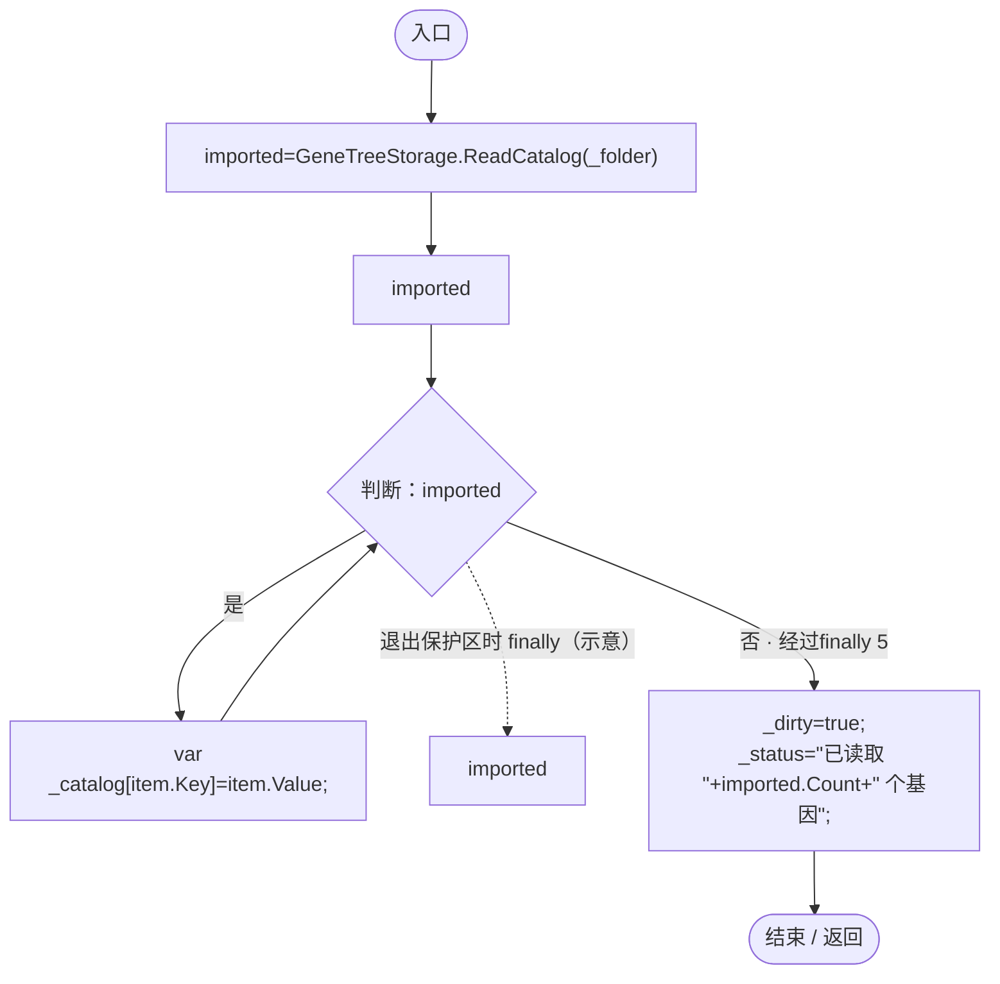

项目内调用/回调引用：

- [GeneTreeStorage.ReadCatalog · L27](a885bad0d7dedee8.md#m89083f320ec287c0)（方法）

<a id="m4d60ca123d53b27e"></a>

## 回调@74 · L74

`x … => 回调`


### Editor / Player · Roslyn编译器控制流

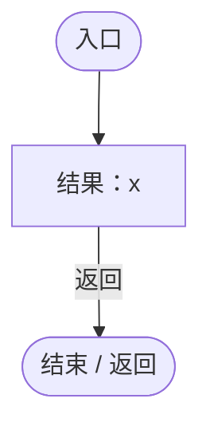

<a id="m37d009fd33b1b840"></a>

## AddNode · L97

`private void AddNode(string id,Vector2 at)`


### Editor / Player · Roslyn编译器控制流

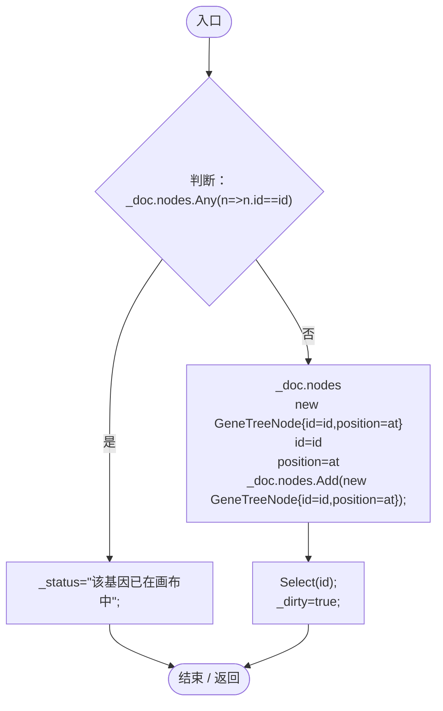

项目内调用/回调引用：

- [GeneTreeWorkbench.Select · L102](7b98ef3da23a85cb.md#m40ae152075d1bab7)（方法）
- [GeneTreeWorkbench.回调@99 · L99](7b98ef3da23a85cb.md#m294afbb252406e8d)（回调/委托）

<a id="m294afbb252406e8d"></a>

## 回调@99 · L99

`n … => 回调`


### Editor / Player · Roslyn编译器控制流

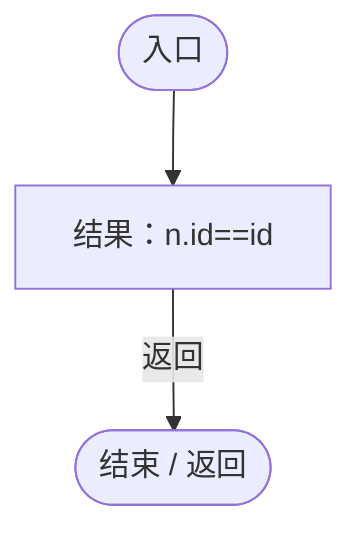

<a id="m40ae152075d1bab7"></a>

## Select · L102

`private void Select(string id)`


### Editor / Player · Roslyn编译器控制流

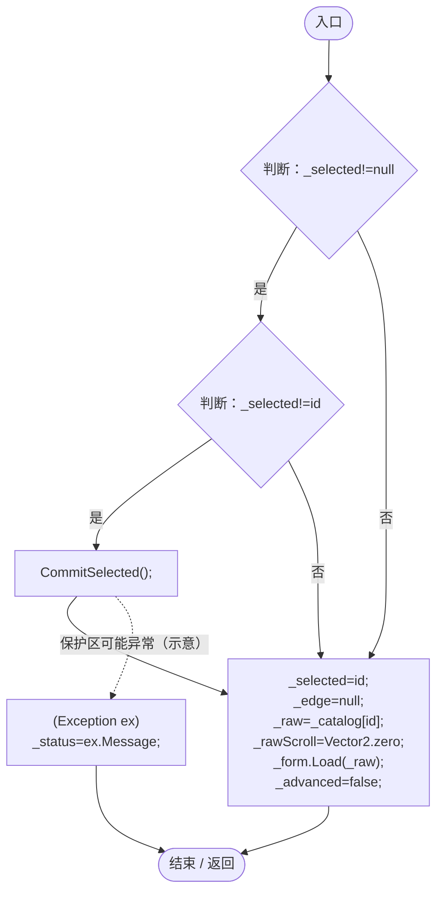

项目内调用/回调引用：

- [GeneTreeWorkbench.CommitSelected · L223](7b98ef3da23a85cb.md#mfa01a741474511d6)（方法）
- [GeneValueForm.Load · L16](1a57b2a63a2f76d5.md#m3e1d8f0799dda5fd)（方法）

<a id="m1c65a9ca84671db5"></a>

## DrawGraph · L106

`private void DrawGraph()`


### Editor / Player · Roslyn编译器控制流

```mermaid
flowchart TD
  b0(["入口"])
  b1{"判断：_fitPending"}
  b2["_view.Fit(_doc.nodes,_nodeSize,_canvas.size);<br/>_fitPending=false;"]
  b3{"input=Event.current<br/>判断：_canvas.Contains(input.mousePosition)"}
  b4{"判断：input.type==EventType.ScrollWheel"}
  b5["_view.SetZoom(_view.Zoom*Mathf.Pow(1.12f,-input.delta.y),input.mousePosition-_canvas.position);<br/>input.Use();"]
  b6{"判断：_canvas.Contains(input.mousePosition)"}
  b7{"判断：input.type==EventType.MouseDrag"}
  b8{"判断：input.button==2"}
  b9["_view.Scroll=Vector2.Max(Vector2.zero,_view.Scroll-input.delta);<br/>input.Use();"]
  b10["extent=new Vector2(3000,2400)"]
  b11["_doc.nodes"]
  b12{"判断：_doc.nodes"}
  b13["var<br/>extent=Vector2.Max(extent,node.position+_nodeSize+Vector2.one*80);"]
  b14["_doc.nodes"]
  b15{"zoom=_view.Zoom<br/>_view.Scroll=GUI.BeginScrollView(_canvas,_view.Scroll,new Rect(Vector2.zero,Vector2.Max(extent*zoom,_canvas.size-Vector2.one*18)));<br/>mouse=Event.current.mousePosition/zoom<br/>判断：_grid==null"}
  b16["_grid=Resources.Load&lt;Texture2D&gt;(&quot;UI/Surfaces/grid&quot;);"]
  b17{"判断：_grid!=null"}
  b18["GUI.DrawTextureWithTexCoords(new Rect(Vector2.zero,extent*zoom),_grid,new Rect(0,0,extent.x/40,extent.y/40));"]
  b19["_doc.edges"]
  b20{"判断：_doc.edges"}
  b21["var"]
  b22{"from=_doc.nodes.Find(n=&gt;n.id==edge.from)<br/>to=_doc.nodes.Find(n=&gt;n.id==edge.to)<br/>判断：from==null"}
  b23{"判断：to==null"}
  b24{"判断：edge.kind==&quot;evolution&quot;"}
  b25["a=from.position+new Vector2(85,65);<br/>b=to.position+new Vector2(85,0);"]
  b26["right=to.position.x&gt;=from.position.x"]
  b27{"a<br/>from.position<br/>判断：right"}
  b28["170"]
  b29["0"]
  b30["a=from.position+new Vector2(right?170:0,32);"]
  b31{"b<br/>to.position<br/>判断：right"}
  b32["0"]
  b33["170"]
  b34["b=to.position+new Vector2(right?0:170,32);"]
  b35{"判断：edge.kind==&quot;suppress&quot;"}
  b36["UIVisualTheme.Danger"]
  b37{"判断：edge.kind==&quot;promote&quot;"}
  b38["UIVisualTheme.Accent"]
  b39{"判断：edge.kind==&quot;error&quot;"}
  b40["new Color(1,.72f,.25f)"]
  b41["new Color(.52f,.69f,.91f)"]
  b42["color=edge.kind==&quot;suppress&quot;?UIVisualTheme.Danger:edge.kind==&quot;promote&quot;?UIVisualTheme.Accent:edge.kind==&quot;error&quot;?new Color(1,.72f,.25f):new Color(.52f,.69f,.91f)"]
  b43{"判断：edge.kind==&quot;error&quot;"}
  b44{"判断：edge.kind==&quot;suppress&quot;"}
  b45{"判断：edge.kind==&quot;promote&quot;"}
  b46["DashedLine(a*zoom,b*zoom,color,2);"]
  b47["Line(a*zoom,b*zoom,color,2);"]
  b48["d=(b-a).normalized<br/>Line(b*zoom,(b-d*14+new Vector2(-d.y,d.x)*7)*zoom,color,2);<br/>Line(b*zoom,(b-d*14-new Vector2(-d.y,d.x)*7)*zoom,color,2);"]
  b49{"判断：edge.kind==&quot;evolution&quot;"}
  b50["&quot;进化&quot;"]
  b51{"判断：edge.kind==&quot;error&quot;"}
  b52["&quot;出错&quot;"]
  b53{"判断：edge.kind==&quot;suppress&quot;"}
  b54["&quot;抑制&quot;"]
  b55["&quot;促进&quot;"]
  b56["relation=edge.kind==&quot;evolution&quot;?&quot;进化&quot;:edge.kind==&quot;error&quot;?&quot;出错&quot;:edge.kind==&quot;suppress&quot;?&quot;抑制&quot;:&quot;促进&quot;"]
  b57["new GUIStyle(GUI.skin.label){fontSize=Mathf.Max(6,Mathf.RoundToInt(14*zoom))}<br/>fontSize=Mathf.Max(6,Mathf.RoundToInt(14*zoom))<br/>relationStyle=new GUIStyle(GUI.skin.label){fontSize=Mathf.Max(6,Mathf.RoundToInt(14*zoom))}"]
  b58{"relationStyle.normal.textColor=color;<br/>GUI.Label(new Rect((a+b)*.5f*zoom,new Vector2(110,23)*zoom),relation+&quot; &quot;+edge.value,relationStyle);<br/>判断：Event.current.type==EventType.MouseDown"}
  b59{"判断：Event.current.button==1"}
  b60{"判断：Distance(mouse,a,b)&lt;12/zoom"}
  b61["CommitSelected();<br/>_edge=edge;<br/>_selected=null;<br/>_kind=edge.kind;<br/>_value=edge.value.ToString(System.Globalization.CultureInfo.InvariantCulture);"]
  b62["(Exception ex)<br/>_status=ex.Message;"]
  b63["Event.current.Use();"]
  b64["_doc.edges"]
  b65["_doc.nodes"]
  b66{"判断：_doc.nodes"}
  b67["var"]
  b68{"rect=new Rect(node.position*zoom,_nodeSize*zoom)<br/>old=GUI.color<br/>判断：node.error"}
  b69{"&quot;UI/Surfaces/&quot;<br/>判断：node.id==_selected"}
  b70["&quot;diamond_selected&quot;"]
  b71["&quot;diamond&quot;"]
  b72["diamond=Resources.Load&lt;Texture2D&gt;(&quot;UI/Surfaces/&quot;+(node.id==_selected?&quot;diamond_selected&quot;:&quot;diamond&quot;))"]
  b73["GUI.DrawTexture(new Rect(rect.center-new Vector2(90,40)*zoom,new Vector2(180,80)*zoom),diamond);"]
  b74["new GUIStyle(GUI.skin.label){alignment=TextAnchor.MiddleCenter,fontSize=Mathf.Max(6,Mathf.RoundToInt(14*zoom)),padding=new RectOffset(Mathf.RoundToInt(24*zoom),0,0,0)}<br/>alignment=TextAnchor.MiddleCenter<br/>fontSize=Mathf.Max(6,Mathf.RoundToI…"]
  b75["GUI.Label(rect,GeneName(node.id),textStyle);"]
  b76{"new Rect(rect.x+14*zoom,rect.center.y-12*zoom,24*zoom,24*zoom)<br/>UIVisualTheme.GeneIcon(node.id)<br/>判断：node.id==_selected"}
  b77["UIVisualTheme.Accent"]
  b78["UIVisualTheme.Muted"]
  b79["RuntimeMenuTheme.Icon(new Rect(rect.x+14*zoom,rect.center.y-12*zoom,24*zoom,24*zoom),UIVisualTheme.GeneIcon(node.id),node.id==_selected?UIVisualTheme.Accent:UIVisualTheme.Muted);"]
  b80["style=Centered(zoom)"]
  b81{"style.normal.background<br/>判断：node.id==_selected"}
  b82["&quot;selected&quot;"]
  b83["&quot;button&quot;"]
  b84["style.normal.background=UIVisualTheme.SurfaceSprite(node.id==_selected?&quot;selected&quot;:&quot;button&quot;).texture;"]
  b85["style.padding.left=Mathf.RoundToInt(32*zoom);<br/>GUI.Box(rect,GeneName(node.id),style);"]
  b86{"new Rect(rect.x+10*zoom,rect.center.y-13*zoom,26*zoom,26*zoom)<br/>UIVisualTheme.GeneIcon(node.id)<br/>判断：node.id==_selected"}
  b87["UIVisualTheme.Accent"]
  b88["UIVisualTheme.Muted"]
  b89["RuntimeMenuTheme.Icon(new Rect(rect.x+10*zoom,rect.center.y-13*zoom,26*zoom,26*zoom),UIVisualTheme.GeneIcon(node.id),node.id==_selected?UIVisualTheme.Accent:UIVisualTheme.Muted);"]
  b90{"GUI.color=old;<br/>ev=Event.current<br/>判断：ev.type==EventType.MouseDown"}
  b91{"判断：rect.Contains(ev.mousePosition)"}
  b92{"判断：ev.button==1"}
  b93["Select(node.id);<br/>_linkFrom=node.id;<br/>_status=&quot;右侧设置节点，或选择关系类型后点目标节点建立连线&quot;;"]
  b94{"判断：ev.button==0"}
  b95{"判断：_linkFrom!=null"}
  b96{"判断：_linkFrom!=node.id"}
  b97{"Connect<br/>_linkFrom<br/>node.id<br/>判断：ev.shift"}
  b98["&quot;evolution&quot;"]
  b99["_kind"]
  b100["Connect(_linkFrom,node.id,ev.shift?&quot;evolution&quot;:_kind);"]
  b101["_linkFrom=null;"]
  b102{"判断：ev.shift"}
  b103["_linkFrom=node.id;<br/>_kind=&quot;evolution&quot;;<br/>_status=&quot;再点目标节点建立下级关系&quot;;"]
  b104["Select(node.id);<br/>_dragId=node.id;<br/>_dragOffset=mouse-node.position;"]
  b105["ev.Use();"]
  b106["_doc.nodes"]
  b107{"判断：Event.current.type==EventType.MouseDrag"}
  b108{"判断：_dragId!=null"}
  b109["n=_doc.nodes.Find(n=&gt;n.id==_dragId)<br/>n.position=Vector2.Max(Vector2.zero,mouse-_dragOffset);<br/>_dirty=true;<br/>Event.current.Use();"]
  b110{"判断：Event.current.type==EventType.MouseUp"}
  b111["_dragId=null;"]
  b112["GUI.EndScrollView();"]
  b113(["结束 / 返回"])
  b0 --> b1
  b1 -->|"是"| b2
  b1 -->|"否"| b3
  b2 --> b3
  b3 -->|"是"| b4
  b3 -->|"否"| b6
  b4 -->|"是"| b5
  b4 -->|"否"| b6
  b5 --> b6
  b6 -->|"是"| b7
  b6 -->|"否"| b10
  b7 -->|"是"| b8
  b7 -->|"否"| b10
  b8 -->|"是"| b9
  b8 -->|"否"| b10
  b9 --> b10
  b10 --> b11
  b11 --> b12
  b12 -->|"是"| b13
  b12 -->|"否 · 经过finally 14"| b15
  b13 --> b12
  b15 -->|"是"| b16
  b15 -->|"否"| b17
  b16 --> b17
  b17 -->|"是"| b18
  b17 -->|"否"| b19
  b18 --> b19
  b19 --> b20
  b20 -->|"是"| b21
  b20 -->|"否 · 经过finally 64"| b65
  b21 --> b22
  b22 -->|"否"| b23
  b22 -->|"是"| b20
  b23 -->|"是"| b20
  b23 -->|"否"| b24
  b24 -->|"是"| b25
  b24 -->|"否"| b26
  b25 --> b35
  b26 --> b27
  b27 -->|"是"| b28
  b27 -->|"否"| b29
  b28 --> b30
  b29 --> b30
  b30 --> b31
  b31 -->|"是"| b32
  b31 -->|"否"| b33
  b32 --> b34
  b33 --> b34
  b34 --> b35
  b35 -->|"是"| b36
  b35 -->|"否"| b37
  b36 --> b42
  b37 -->|"是"| b38
  b37 -->|"否"| b39
  b38 --> b42
  b39 -->|"是"| b40
  b39 -->|"否"| b41
  b40 --> b42
  b41 --> b42
  b42 --> b43
  b43 -->|"否"| b44
  b43 -->|"是"| b46
  b44 -->|"否"| b45
  b44 -->|"是"| b46
  b45 -->|"是"| b46
  b45 -->|"否"| b47
  b46 --> b48
  b47 --> b48
  b48 --> b49
  b49 -->|"是"| b50
  b49 -->|"否"| b51
  b50 --> b56
  b51 -->|"是"| b52
  b51 -->|"否"| b53
  b52 --> b56
  b53 -->|"是"| b54
  b53 -->|"否"| b55
  b54 --> b56
  b55 --> b56
  b56 --> b57
  b57 --> b58
  b58 -->|"是"| b59
  b58 -->|"否"| b20
  b59 -->|"是"| b60
  b59 -->|"否"| b20
  b60 -->|"是"| b61
  b60 -->|"否"| b20
  b61 --> b63
  b62 --> b63
  b63 --> b20
  b65 --> b66
  b66 -->|"是"| b67
  b66 -->|"否 · 经过finally 106"| b107
  b67 --> b68
  b68 -->|"是"| b69
  b68 -->|"否"| b80
  b69 -->|"是"| b70
  b69 -->|"否"| b71
  b70 --> b72
  b71 --> b72
  b72 --> b73
  b73 --> b74
  b74 --> b75
  b75 --> b76
  b76 -->|"是"| b77
  b76 -->|"否"| b78
  b77 --> b79
  b78 --> b79
  b79 --> b90
  b80 --> b81
  b81 -->|"是"| b82
  b81 -->|"否"| b83
  b82 --> b84
  b83 --> b84
  b84 --> b85
  b85 --> b86
  b86 -->|"是"| b87
  b86 -->|"否"| b88
  b87 --> b89
  b88 --> b89
  b89 --> b90
  b90 -->|"是"| b91
  b90 -->|"否"| b66
  b91 -->|"是"| b92
  b91 -->|"否"| b66
  b92 -->|"是"| b93
  b92 -->|"否"| b94
  b93 --> b105
  b94 -->|"是"| b95
  b94 -->|"否"| b105
  b95 -->|"是"| b96
  b95 -->|"否"| b102
  b96 -->|"是"| b97
  b96 -->|"否"| b102
  b97 -->|"是"| b98
  b97 -->|"否"| b99
  b98 --> b100
  b99 --> b100
  b100 --> b101
  b101 --> b105
  b102 -->|"是"| b103
  b102 -->|"否"| b104
  b103 --> b105
  b104 --> b105
  b105 --> b66
  b107 -->|"是"| b108
  b107 -->|"否"| b110
  b108 -->|"是"| b109
  b108 -->|"否"| b110
  b109 --> b110
  b110 -->|"是"| b111
  b110 -->|"否"| b112
  b111 --> b112
  b112 --> b113
  b12 -. "退出保护区时 finally（示意）" .-> b14
  b61 -. "保护区可能异常（示意）" .-> b62
  b20 -. "退出保护区时 finally（示意）" .-> b64
  b66 -. "退出保护区时 finally（示意）" .-> b106

```

项目内调用/回调引用：

- [GeneGraphViewport.Fit · L19](744cdf6c09e0913f.md#m8fd9f841573cb608)（方法）
- [GeneGraphViewport.SetZoom · L14](744cdf6c09e0913f.md#m7c73dc5d30283c69)（方法）
- [GeneGraphViewport.Zoom.get · L11](744cdf6c09e0913f.md#mffc365eff8c66b68)（访问器）
- [GeneTreeWorkbench.DashedLine · L244](7b98ef3da23a85cb.md#mbdbf831b9a3ac590)（方法）
- [GeneTreeWorkbench.Line · L242](7b98ef3da23a85cb.md#m2a4fdb2cd02c6110)（方法）
- [GeneTreeWorkbench.Distance · L241](7b98ef3da23a85cb.md#m52caac89543d27a3)（方法）
- [GeneTreeWorkbench.CommitSelected · L223](7b98ef3da23a85cb.md#mfa01a741474511d6)（方法）
- [GeneTreeWorkbench.GeneName · L28](7b98ef3da23a85cb.md#mb657c3a152837c63)（方法）
- [RuntimeMenuTheme.Icon · L80](b9d8455882f2a532.md#m6ea7a21a603b9da6)（方法）
- [UIVisualTheme.GeneIcon · L53](ca525a798a08f966.md#m3219debd95233e85)（方法）
- [GeneTreeWorkbench.Centered · L240](7b98ef3da23a85cb.md#m5ba5bb7ce3d222a3)（方法）
- [UIVisualTheme.SurfaceSprite · L45](ca525a798a08f966.md#md3ae1d7fd207ae2f)（方法）
- [GeneTreeWorkbench.Select · L102](7b98ef3da23a85cb.md#m40ae152075d1bab7)（方法）
- [GeneTreeWorkbench.Connect · L174](7b98ef3da23a85cb.md#me9b18c9079eda168)（方法）
- [GeneTreeWorkbench.回调@125 · L125](7b98ef3da23a85cb.md#mc8373160b589d311)（回调/委托）
- [GeneTreeWorkbench.回调@125 · L125](7b98ef3da23a85cb.md#m3b8978a3333e94fb)（回调/委托）
- [GeneTreeWorkbench.回调@170 · L170](7b98ef3da23a85cb.md#m06a8c5f19e61244c)（回调/委托）

<a id="mc8373160b589d311"></a>

## 回调@125 · L125

`n … => 回调`


### Editor / Player · Roslyn编译器控制流

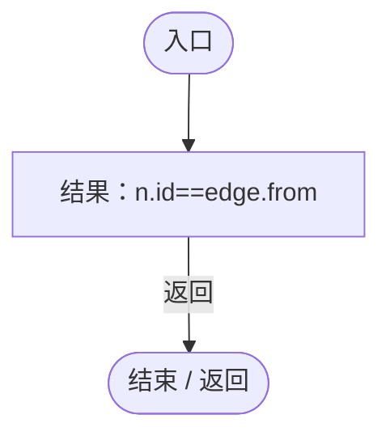

<a id="m3b8978a3333e94fb"></a>

## 回调@125 · L125

`n … => 回调`


### Editor / Player · Roslyn编译器控制流

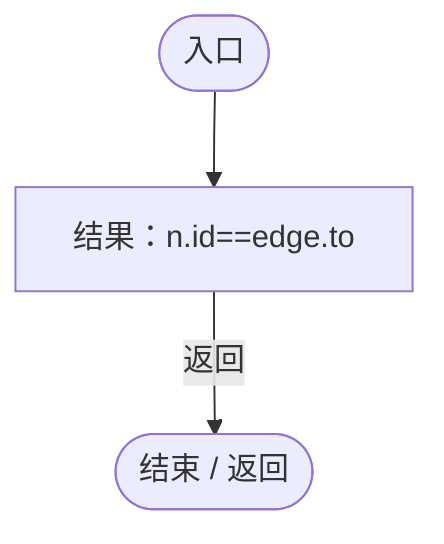

<a id="m06a8c5f19e61244c"></a>

## 回调@170 · L170

`n … => 回调`


### Editor / Player · Roslyn编译器控制流

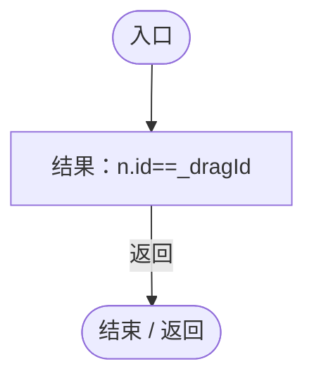

<a id="me9b18c9079eda168"></a>

## Connect · L174

`private void Connect(string from,string to,string kind)`


### Editor / Player · Roslyn编译器控制流

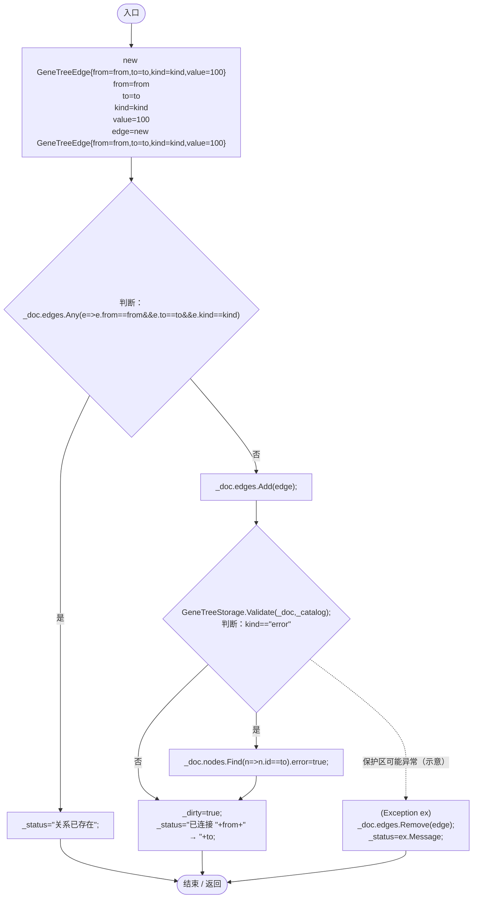

项目内调用/回调引用：

- [GeneTreeStorage.Validate · L67](a885bad0d7dedee8.md#m3371bf1e3c5ae267)（方法）
- [GeneTreeWorkbench.回调@177 · L177](7b98ef3da23a85cb.md#m8f20d73d9fbd615c)（回调/委托）
- [GeneTreeWorkbench.回调@179 · L179](7b98ef3da23a85cb.md#m87c5de673e2a27da)（回调/委托）

<a id="m8f20d73d9fbd615c"></a>

## 回调@177 · L177

`e … => 回调`


### Editor / Player · Roslyn编译器控制流

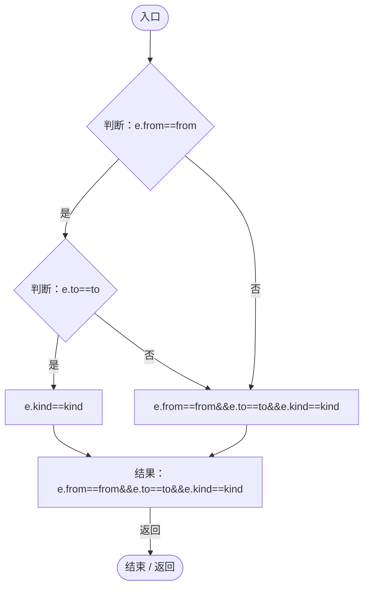

<a id="m87c5de673e2a27da"></a>

## 回调@179 · L179

`n … => 回调`


### Editor / Player · Roslyn编译器控制流


<a id="m35633d4b21d6a878"></a>

## DrawHierarchy · L183

`private void DrawHierarchy()`


### Editor / Player · Roslyn编译器控制流

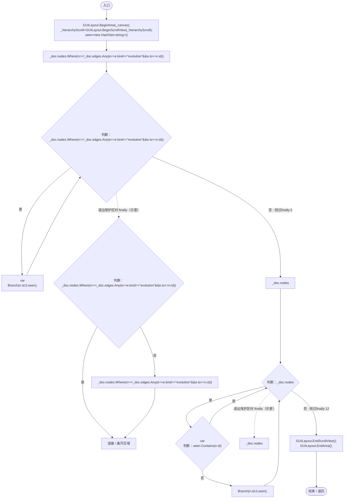

项目内调用/回调引用：

- [GeneTreeWorkbench.Branch · L190](7b98ef3da23a85cb.md#m21e4397458b3df6c)（方法）
- [GeneTreeWorkbench.回调@186 · L186](7b98ef3da23a85cb.md#m0fd2952d03baff09)（回调/委托）

<a id="m0fd2952d03baff09"></a>

## 回调@186 · L186

`n … => 回调`


### Editor / Player · Roslyn编译器控制流

```mermaid
flowchart TD
  b0(["入口"])
  b1["结果：!_doc.edges.Any(e=&gt;e.kind==&quot;evolution&quot;&amp;&amp;e.to==n.id)"]
  b2(["结束 / 返回"])
  b0 --> b1
  b1 -->|"返回"| b2

```

项目内调用/回调引用：

- [GeneTreeWorkbench.回调@186 · L186](7b98ef3da23a85cb.md#m73c23d0e923e34f1)（回调/委托）

<a id="m73c23d0e923e34f1"></a>

## 回调@186 · L186

`e … => 回调`


### Editor / Player · Roslyn编译器控制流

```mermaid
flowchart TD
  b0(["入口"])
  b1{"判断：e.kind==&quot;evolution&quot;"}
  b2["e.to==n.id"]
  b3["e.kind==&quot;evolution&quot;"]
  b4["结果：e.kind==&quot;evolution&quot;&amp;&amp;e.to==n.id"]
  b5(["结束 / 返回"])
  b0 --> b1
  b1 -->|"是"| b2
  b1 -->|"否"| b3
  b2 --> b4
  b3 --> b4
  b4 -->|"返回"| b5

```

<a id="m21e4397458b3df6c"></a>

## Branch · L190

`private void Branch(string id,int depth,HashSet<string> seen)`


### Editor / Player · Roslyn编译器控制流

```mermaid
flowchart TD
  b0(["入口"])
  b1{"判断：seen.Add(id)"}
  b2["GUILayout.BeginHorizontal();<br/>GUILayout.Space(depth*22);"]
  b3{"判断：_doc.nodes.Find(n=&gt;n.id==id).error"}
  b4["&quot;◇ &quot;"]
  b5["&quot;□ &quot;"]
  b6["(_doc.nodes.Find(n=&gt;n.id==id).error?&quot;◇ &quot;:&quot;□ &quot;)+GeneName(id)"]
  b7{"判断：id==_selected"}
  b8["RuntimeMenuTheme.Selected"]
  b9["GUI.skin.button"]
  b10{"判断：GUILayout.Button((_doc.nodes.Find(n=&gt;n.id==id).error?&quot;◇ &quot;:&quot;□ &quot;)+GeneName(id),id==_selected?RuntimeMenuTheme.Selected:GUI.skin.button,GUILayout.Height(30))"}
  b11["Select(id);"]
  b12["GUILayout.EndHorizontal();"]
  b13["_doc.edges.Where(e=&gt;e.from==id)"]
  b14{"判断：_doc.edges.Where(e=&gt;e.from==id)"}
  b15{"var<br/>判断：e.kind==&quot;evolution&quot;"}
  b16["Branch(e.to,depth+1,seen);"]
  b17["GUILayout.Label(new string(' ',(depth+1)*3)+e.kind+&quot; → &quot;+e.to+&quot; (&quot;+e.value+&quot;)&quot;);"]
  b18{"判断：_doc.edges.Where(e=&gt;e.from==id)"}
  b19["_doc.edges.Where(e=&gt;e.from==id)"]
  b20["连接 / 离开区域"]
  b21(["结束 / 返回"])
  b0 --> b1
  b1 -->|"否"| b21
  b1 -->|"是"| b2
  b2 --> b3
  b3 -->|"是"| b4
  b3 -->|"否"| b5
  b4 --> b6
  b5 --> b6
  b6 --> b7
  b7 -->|"是"| b8
  b7 -->|"否"| b9
  b8 --> b10
  b9 --> b10
  b10 -->|"是"| b11
  b10 -->|"否"| b12
  b11 --> b12
  b12 --> b13
  b13 --> b14
  b14 -->|"是"| b15
  b14 -->|"否 · 经过finally 18"| b21
  b15 -->|"是"| b16
  b15 -->|"否"| b17
  b16 --> b14
  b17 --> b14
  b18 -->|"否"| b19
  b18 -->|"是"| b20
  b19 --> b20
  b14 -. "退出保护区时 finally（示意）" .-> b18

```

项目内调用/回调引用：

- [GeneTreeWorkbench.GeneName · L28](7b98ef3da23a85cb.md#mb657c3a152837c63)（方法）
- [RuntimeMenuTheme.Selected.get · L12](b9d8455882f2a532.md#m0db940502f53ec10)（访问器）
- [GeneTreeWorkbench.Select · L102](7b98ef3da23a85cb.md#m40ae152075d1bab7)（方法）
- [GeneTreeWorkbench.Branch · L190](7b98ef3da23a85cb.md#m21e4397458b3df6c)（方法）
- [GeneTreeWorkbench.回调@193 · L193](7b98ef3da23a85cb.md#m5abca92aa1d4e3d0)（回调/委托）
- [GeneTreeWorkbench.回调@194 · L194](7b98ef3da23a85cb.md#m9c016fa138da1e23)（回调/委托）

<a id="m5abca92aa1d4e3d0"></a>

## 回调@193 · L193

`n … => 回调`


### Editor / Player · Roslyn编译器控制流

```mermaid
flowchart TD
  b0(["入口"])
  b1["结果：n.id==id"]
  b2(["结束 / 返回"])
  b0 --> b1
  b1 -->|"返回"| b2

```

<a id="m9c016fa138da1e23"></a>

## 回调@194 · L194

`e … => 回调`


### Editor / Player · Roslyn编译器控制流

```mermaid
flowchart TD
  b0(["入口"])
  b1["结果：e.from==id"]
  b2(["结束 / 返回"])
  b0 --> b1
  b1 -->|"返回"| b2

```

<a id="mc6bfa5102cd10d99"></a>

## DrawInspector · L197

`private void DrawInspector(Rect rect)`


### Editor / Player · Roslyn编译器控制流

```mermaid
flowchart TD
  b0(["入口"])
  b1{"GUI.Box(rect,&quot;属性 / 右键设置&quot;);<br/>GUILayout.BeginArea(new Rect(rect.x+8,rect.y+28,rect.width-16,rect.height-40));<br/>GUILayout.Label(&quot;关系类型&quot;);<br/>index=Array.IndexOf(new[]{&quot;evolution&quot;,&quot;error&quot;,&quot;suppress&quot;,&quot;promote&quot;},_kind)<br/>next=GUILayout.SelectionGrid(M…"}
  b2{"GUILayout.Label(_edge.from+&quot; → &quot;+_edge.to);<br/>_value=GUILayout.TextField(_value);<br/>判断：GUILayout.Button(&quot;应用关系数值&quot;)"}
  b3["Try(()=&gt;{if(!float.TryParse(_value,System.Globalization.NumberStyles.Float,System.Globalization.CultureInfo.InvariantCulture,out var v)&#124;&#124;v&lt;0&#124;&#124;float.IsNaN(v)&#124;&#124;float.IsInfinity(v))throw new Exception(&quot;请输入非负有限数值&quot;);string oldKind=_edge.kind;…"]
  b4{"判断：GUILayout.Button(&quot;删除关系&quot;)"}
  b5["_doc.edges.Remove(_edge);<br/>_edge=null;<br/>_dirty=true;"]
  b6{"判断：_selected!=null"}
  b7{"GUILayout.Label(_selected);<br/>node=_doc.nodes.Find(n=&gt;n.id==_selected)<br/>error=GUILayout.Toggle(node.error,&quot;菱形：出错基因&quot;)<br/>判断：error!=node.error"}
  b8["node.error=error;<br/>_dirty=true;"]
  b9{"判断：GUILayout.Button(&quot;以此为源建立所选关系&quot;)"}
  b10["_linkFrom=_selected;<br/>_status=&quot;点击目标节点&quot;;"]
  b11{"advanced=GUILayout.Toggle(_advanced,&quot;高级 JSON 编辑&quot;)<br/>判断：advanced!=_advanced"}
  b12{"判断：advanced"}
  b13["_raw=_form.Export();"]
  b14["_form.Load(_raw);"]
  b15["_advanced=advanced;"]
  b16["(Exception ex)<br/>_status=ex.Message;"]
  b17{"_rawScroll=GUILayout.BeginScrollView(_rawScroll,GUILayout.Height(Mathf.Max(80,rect.height-400)));<br/>判断：_advanced"}
  b18{"edited=GUILayout.TextArea(_raw,GUILayout.ExpandHeight(true))<br/>判断：edited!=_raw"}
  b19["_raw=edited;<br/>_dirty=true;"]
  b20{"GUI.changed=false;<br/>_form.Draw();<br/>判断：GUI.changed"}
  b21["_dirty=true;"]
  b22{"GUILayout.EndScrollView();<br/>判断：GUILayout.Button(&quot;应用基因数值&quot;,RuntimeMenuTheme.Primary)"}
  b23["Try(()=&gt;{if(!_advanced)_raw=_form.Export();var d=JsonUtility.FromJson&lt;GeneDefinitionJson&gt;(_raw);if(d==null&#124;&#124;d.id!=_selected)throw new Exception(&quot;id 不能更改&quot;);if(!Enum.TryParse&lt;GeneCategory&gt;(d.category,true,out _))throw new Exception(&quot;catego…"]
  b24{"判断：GUILayout.Button(&quot;移出画布&quot;)"}
  b25["_doc.nodes.Remove(node);<br/>_doc.edges.RemoveAll(e=&gt;e.from==node.id&#124;&#124;e.to==node.id);<br/>_selected=null;<br/>_dirty=true;"]
  b26["GUILayout.FlexibleSpace();<br/>GUILayout.Label(&quot;影响值单位与原配置 coefficient 相同。进化/出错数值为相对选择权重。未保存的 JSON 文本需先应用。&quot;);<br/>GUILayout.EndArea();"]
  b27(["结束 / 返回"])
  b0 --> b1
  b1 -->|"是"| b2
  b1 -->|"否"| b6
  b2 -->|"是"| b3
  b2 -->|"否"| b4
  b3 --> b4
  b4 -->|"是"| b5
  b4 -->|"否"| b26
  b5 --> b26
  b6 -->|"是"| b7
  b6 -->|"否"| b26
  b7 -->|"是"| b8
  b7 -->|"否"| b9
  b8 --> b9
  b9 -->|"是"| b10
  b9 -->|"否"| b11
  b10 --> b11
  b11 -->|"是"| b12
  b11 -->|"否"| b17
  b12 -->|"是"| b13
  b12 -->|"否"| b14
  b13 --> b15
  b14 --> b15
  b15 --> b17
  b16 --> b17
  b17 -->|"是"| b18
  b17 -->|"否"| b20
  b18 -->|"是"| b19
  b18 -->|"否"| b22
  b19 --> b22
  b20 -->|"是"| b21
  b20 -->|"否"| b22
  b21 --> b22
  b22 -->|"是"| b23
  b22 -->|"否"| b24
  b23 --> b24
  b24 -->|"是"| b25
  b24 -->|"否"| b26
  b25 --> b26
  b26 --> b27
  b12 -. "保护区可能异常（示意）" .-> b16

```

项目内调用/回调引用：

- [GeneTreeWorkbench.Try · L239](7b98ef3da23a85cb.md#m197d9f3db81e18f9)（方法）
- [GeneValueForm.Export · L38](1a57b2a63a2f76d5.md#m733739ea591391d9)（方法）
- [GeneValueForm.Load · L16](1a57b2a63a2f76d5.md#m3e1d8f0799dda5fd)（方法）
- [GeneValueForm.Draw · L24](1a57b2a63a2f76d5.md#mdc679b8208682da1)（方法）
- [RuntimeMenuTheme.Primary.get · L10](b9d8455882f2a532.md#med9b3baaef6ef78a)（访问器）
- [GeneTreeWorkbench.回调@205 · L205](7b98ef3da23a85cb.md#m8c3a7f8d3bac8896)（回调/委托）
- [GeneTreeWorkbench.回调@210 · L210](7b98ef3da23a85cb.md#m0f4cdc9a68bdeb7f)（回调/委托）
- [GeneTreeWorkbench.回调@218 · L218](7b98ef3da23a85cb.md#m1f160a049649317c)（回调/委托）
- [GeneTreeWorkbench.回调@219 · L219](7b98ef3da23a85cb.md#m990a04e0a84b2ef3)（回调/委托）

<a id="m8c3a7f8d3bac8896"></a>

## 回调@205 · L205

`( … => 回调`


### Editor / Player · Roslyn编译器控制流

```mermaid
flowchart TD
  b0(["入口"])
  b1{"判断：float.TryParse(_value,System.Globalization.NumberStyles.Float,System.Globalization.CultureInfo.InvariantCulture,out var v)"}
  b2{"判断：v&lt;0"}
  b3{"判断：float.IsNaN(v)"}
  b4{"判断：float.IsInfinity(v)"}
  b5["结果：new Exception(&quot;请输入非负有限数值&quot;)"]
  x5(["抛出异常 / 离开方法"])
  b6["oldKind=_edge.kind<br/>_edge.kind=_kind;"]
  b7["GeneTreeStorage.Validate(_doc,_catalog);"]
  b8["_edge.kind=oldKind;"]
  x8(["重新抛出异常"])
  b9{"_edge.value=v;<br/>判断：_kind==&quot;error&quot;"}
  b10["_doc.nodes.Find(n=&gt;n.id==_edge.to).error=true;"]
  b11["_dirty=true;"]
  b12(["结束 / 返回"])
  b0 --> b1
  b1 -->|"是"| b2
  b1 -->|"否"| b5
  b2 -->|"否"| b3
  b2 -->|"是"| b5
  b3 -->|"否"| b4
  b3 -->|"是"| b5
  b4 -->|"是"| b5
  b4 -->|"否"| b6
  b5 -->|"Throw"| x5
  b6 --> b7
  b7 --> b9
  b8 -->|"Rethrow"| x8
  b9 -->|"是"| b10
  b9 -->|"否"| b11
  b10 --> b11
  b11 --> b12
  b7 -. "保护区可能异常（示意）" .-> b8

```

项目内调用/回调引用：

- [GeneTreeStorage.Validate · L67](a885bad0d7dedee8.md#m3371bf1e3c5ae267)（方法）
- [GeneTreeWorkbench.回调@205 · L205](7b98ef3da23a85cb.md#m23f0daf04b9e8637)（回调/委托）

<a id="m23f0daf04b9e8637"></a>

## 回调@205 · L205

`n … => 回调`


### Editor / Player · Roslyn编译器控制流

```mermaid
flowchart TD
  b0(["入口"])
  b1["结果：n.id==_edge.to"]
  b2(["结束 / 返回"])
  b0 --> b1
  b1 -->|"返回"| b2

```

<a id="m0f4cdc9a68bdeb7f"></a>

## 回调@210 · L210

`n … => 回调`


### Editor / Player · Roslyn编译器控制流

```mermaid
flowchart TD
  b0(["入口"])
  b1["结果：n.id==_selected"]
  b2(["结束 / 返回"])
  b0 --> b1
  b1 -->|"返回"| b2

```

<a id="m1f160a049649317c"></a>

## 回调@218 · L218

`( … => 回调`


### Editor / Player · Roslyn编译器控制流

```mermaid
flowchart TD
  b0(["入口"])
  b1{"判断：_advanced"}
  b2["_raw=_form.Export();"]
  b3{"d=JsonUtility.FromJson&lt;GeneDefinitionJson&gt;(_raw)<br/>判断：d==null"}
  b4{"判断：d.id!=_selected"}
  b5["结果：new Exception(&quot;id 不能更改&quot;)"]
  x5(["抛出异常 / 离开方法"])
  b6{"判断：Enum.TryParse&lt;GeneCategory&gt;(d.category,true,out _)"}
  b7["结果：new Exception(&quot;category 无效&quot;)"]
  x7(["抛出异常 / 离开方法"])
  b8["_form.Load(_raw);<br/>_catalog[_selected]=_raw;<br/>_dirty=true;<br/>_status=&quot;已应用节点配置，请保存&quot;;"]
  b9(["结束 / 返回"])
  b0 --> b1
  b1 -->|"否"| b2
  b1 -->|"是"| b3
  b2 --> b3
  b3 -->|"否"| b4
  b3 -->|"是"| b5
  b4 -->|"是"| b5
  b4 -->|"否"| b6
  b5 -->|"Throw"| x5
  b6 -->|"否"| b7
  b6 -->|"是"| b8
  b7 -->|"Throw"| x7
  b8 --> b9

```

项目内调用/回调引用：

- [GeneValueForm.Export · L38](1a57b2a63a2f76d5.md#m733739ea591391d9)（方法）
- [GeneValueForm.Load · L16](1a57b2a63a2f76d5.md#m3e1d8f0799dda5fd)（方法）

<a id="m990a04e0a84b2ef3"></a>

## 回调@219 · L219

`e … => 回调`


### Editor / Player · Roslyn编译器控制流

```mermaid
flowchart TD
  b0(["入口"])
  b1{"判断：e.from==node.id"}
  b2["e.to==node.id"]
  b3["e.from==node.id"]
  b4["结果：e.from==node.id&#124;&#124;e.to==node.id"]
  b5(["结束 / 返回"])
  b0 --> b1
  b1 -->|"否"| b2
  b1 -->|"是"| b3
  b2 --> b4
  b3 --> b4
  b4 -->|"返回"| b5

```

<a id="mfa01a741474511d6"></a>

## CommitSelected · L223

`private void CommitSelected()`


### Editor / Player · Roslyn编译器控制流

```mermaid
flowchart TD
  b0(["入口"])
  b1{"判断：_selected==null"}
  b2{"判断：_advanced"}
  b3["_raw=_form.Export();"]
  b4{"definition=JsonUtility.FromJson&lt;GeneDefinitionJson&gt;(_raw)<br/>判断：definition==null"}
  b5{"判断：definition.id!=_selected"}
  b6["结果：new Exception(&quot;当前 JSON id 无效，未保存&quot;)"]
  x6(["抛出异常 / 离开方法"])
  b7["_catalog[_selected]=_raw;"]
  b8(["结束 / 返回"])
  b0 --> b1
  b1 -->|"是"| b8
  b1 -->|"否"| b2
  b2 -->|"否"| b3
  b2 -->|"是"| b4
  b3 --> b4
  b4 -->|"否"| b5
  b4 -->|"是"| b6
  b5 -->|"是"| b6
  b5 -->|"否"| b7
  b6 -->|"Throw"| x6
  b7 --> b8

```

项目内调用/回调引用：

- [GeneValueForm.Export · L38](1a57b2a63a2f76d5.md#m733739ea591391d9)（方法）

<a id="m57e82d58ee531e61"></a>

## Save · L231

`private void Save()`


### Editor / Player · Roslyn编译器控制流

```mermaid
flowchart TD
  b0(["入口"])
  b1["Try(()=&gt;{ if(!WorldAuthority.CanEdit)return; CommitSelected(); if(LanSession.Instance?.IsClient==true){LanEditActions.Profile(_catalog,_doc);_dirty=false;_status=&quot;已提交管理员应用&quot;;return;} GeneTreeStorage.Save(_doc,_catalog); // ★ 修复（防Bug回归）：世界…"]
  b2(["结束 / 返回"])
  b0 --> b1
  b1 --> b2

```

项目内调用/回调引用：

- [GeneTreeWorkbench.Try · L239](7b98ef3da23a85cb.md#m197d9f3db81e18f9)（方法）
- [GeneTreeWorkbench.回调@231 · L231](7b98ef3da23a85cb.md#mc56203345edaf3a1)（回调/委托）

<a id="mc56203345edaf3a1"></a>

## 回调@231 · L231

`( … => 回调`


### Editor / Player · Roslyn编译器控制流

```mermaid
flowchart TD
  b0(["入口"])
  b1{"判断：WorldAuthority.CanEdit"}
  b2["CommitSelected();"]
  b3{"LanSession.Instance<br/>判断：LanSession.Instance"}
  b4[".IsClient"]
  b5["LanSession.Instance"]
  b6{"判断：LanSession.Instance?.IsClient==true"}
  b7["LanEditActions.Profile(_catalog,_doc);<br/>_dirty=false;<br/>_status=&quot;已提交管理员应用&quot;;"]
  b8{"GeneTreeStorage.Save(_doc,_catalog);<br/>判断：GeneRuntimeProfile.Catalog!=null"}
  b9["GeneRuntimeProfile.Catalog=_catalog;<br/>GeneRuntimeProfile.Tree=_doc;"]
  b10["GeneDatabase.Reload();<br/>GeneDatabase.EnsureLoaded();"]
  b11["DarwinPark.Entities.EntityRegistry.All"]
  b12{"判断：DarwinPark.Entities.EntityRegistry.All"}
  b13["var<br/>entity.Genes.Recalculate();"]
  b14{"判断：DarwinPark.Entities.EntityRegistry.All"}
  b15["DarwinPark.Entities.EntityRegistry.All"]
  b16["连接 / 离开区域"]
  b17["_dirty=false;<br/>_status=&quot;已保存并应用：&quot;+GeneTreeStorage.Folder;"]
  b18(["结束 / 返回"])
  b0 --> b1
  b1 -->|"否"| b18
  b1 -->|"是"| b2
  b2 --> b3
  b3 -->|"否"| b4
  b3 -->|"是"| b5
  b4 --> b6
  b5 --> b6
  b6 -->|"是"| b7
  b6 -->|"否"| b8
  b7 --> b18
  b8 -->|"是"| b9
  b8 -->|"否"| b10
  b9 --> b10
  b10 --> b11
  b11 --> b12
  b12 -->|"是"| b13
  b12 -->|"否 · 经过finally 14"| b17
  b13 --> b12
  b14 -->|"否"| b15
  b14 -->|"是"| b16
  b15 --> b16
  b17 --> b18
  b12 -. "退出保护区时 finally（示意）" .-> b14

```

项目内调用/回调引用：

- [GeneTreeWorkbench.CommitSelected · L223](7b98ef3da23a85cb.md#mfa01a741474511d6)（方法）
- [LanSession.Instance.get · L23](9fb633eebffe669c.md#mbf83306994878383)（访问器）
- [LanEditActions.Profile · L23](2816321496f6360e.md#m6014fbd4e981a6ed)（方法）
- [GeneTreeStorage.Save · L92](a885bad0d7dedee8.md#m92ca7c9be670a39c)（方法）
- [GeneDatabase.Reload · L145](ec0a03483435a863.md#mbf775d68c402c10e)（方法）
- [GeneDatabase.EnsureLoaded · L12](ec0a03483435a863.md#mc3e6357b9ca440f5)（方法）
- [EntityGeneController.Recalculate · L90](7494d53178552f0e.md#m93744c8f3039b93c)（方法）
- [DarwinEntity.Genes.get · L14](70798dde169f2e8b.md#m622eb1adf401d431)（访问器）

<a id="m197d9f3db81e18f9"></a>

## Try · L239

`private void Try(Action action)`


### Editor / Player · Roslyn编译器控制流

```mermaid
flowchart TD
  b0(["入口"])
  b1["action();"]
  b2["(Exception ex)<br/>_status=ex.Message;<br/>Debug.LogWarning(&quot;[基因树] &quot;+ex.Message);"]
  b3(["结束 / 返回"])
  b0 --> b1
  b1 --> b3
  b2 --> b3
  b1 -. "保护区可能异常（示意）" .-> b2

```

<a id="m5ba5bb7ce3d222a3"></a>

## Centered · L240

`private static GUIStyle Centered(float zoom)`


### Editor / Player · Roslyn编译器控制流

```mermaid
flowchart TD
  b0(["入口"])
  b1["new GUIStyle(GUI.skin.box){alignment=TextAnchor.MiddleCenter,wordWrap=true,fontSize=Mathf.Max(6,Mathf.RoundToInt(14*zoom)),padding=new RectOffset(2,2,2,2)}<br/>alignment=TextAnchor.MiddleCenter<br/>wordWrap=true<br/>fontSize=Mathf.Max(6,Mathf.RoundT…"]
  b2(["结束 / 返回"])
  b0 --> b1
  b1 -->|"返回"| b2

```

<a id="m52caac89543d27a3"></a>

## Distance · L241

`private static float Distance(Vector2 p,Vector2 a,Vector2 b)`


### Editor / Player · Roslyn编译器控制流

```mermaid
flowchart TD
  b0(["入口"])
  b1["v=b-a"]
  b2{"判断：v.sqrMagnitude&gt;0"}
  b3["Mathf.Clamp01(Vector2.Dot(p-a,v)/v.sqrMagnitude)"]
  b4["0"]
  b5["t=v.sqrMagnitude&gt;0?Mathf.Clamp01(Vector2.Dot(p-a,v)/v.sqrMagnitude):0"]
  b6["结果：Vector2.Distance(p,a+v*t)"]
  b7(["结束 / 返回"])
  b0 --> b1
  b1 --> b2
  b2 -->|"是"| b3
  b2 -->|"否"| b4
  b3 --> b5
  b4 --> b5
  b5 --> b6
  b6 -->|"返回"| b7

```

<a id="m2a4fdb2cd02c6110"></a>

## Line · L242

`private static void Line(Vector2 a,Vector2 b,Color color,float width)`


### Editor / Player · Roslyn编译器控制流

```mermaid
flowchart TD
  b0(["入口"])
  b1["matrix=GUI.matrix<br/>old=GUI.color<br/>GUI.color=color;<br/>GUIUtility.RotateAroundPivot(Vector2.SignedAngle(Vector2.right,b-a),a);<br/>GUI.DrawTexture(new Rect(a.x,a.y-width*.5f,(b-a).magnitude,width),Texture2D.whiteTexture);<br/>GUI.matrix=matrix;<br/>GUI.co…"]
  b2(["结束 / 返回"])
  b0 --> b1
  b1 --> b2

```

<a id="mbdbf831b9a3ac590"></a>

## DashedLine · L244

`private static void DashedLine(Vector2 a,Vector2 b,Color color,float width)`


### Editor / Player · Roslyn编译器控制流

```mermaid
flowchart TD
  b0(["入口"])
  b1["length=Vector2.Distance(a,b)<br/>direction=(b-a).normalized"]
  b2["at=0"]
  b3{"判断：at&lt;length"}
  b4["Line(a+direction*at,a+direction*Mathf.Min(at+9,length),color,width);<br/>at+=16"]
  b5(["结束 / 返回"])
  b0 --> b1
  b1 --> b2
  b2 --> b3
  b3 -->|"是"| b4
  b3 -->|"否"| b5
  b4 --> b3

```

项目内调用/回调引用：

- [GeneTreeWorkbench.Line · L242](7b98ef3da23a85cb.md#m2a4fdb2cd02c6110)（方法）
