# InteractionUXRegression.cs

[返回总索引](../README.md) · `Editor` · `Assets/DarwinPark/Editor/InteractionUXRegression.cs`

[源文件](../../../Assets/DarwinPark/Editor/InteractionUXRegression.cs) · 源码校验：`2bb4eea9ac612fbc0e1fac5cfb3af1ac2c63a67b31775ce8c245ab89f4cd5731`

方法按源文件位置排列。事件/回调引用不表示立即执行；分支与异常说明见总索引。完整源码与可点击关系图请打开离线手册。

## Check · L24

`private static void Check(bool ok,string message)`

### Editor · Roslyn编译器控制流

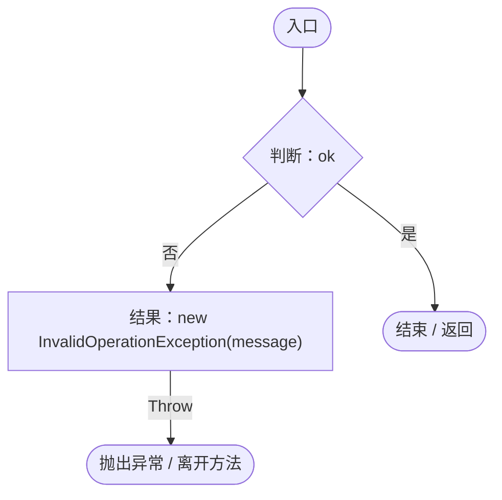

## Call · L25

`private static void Call(object o,string name)`

### Editor · Roslyn编译器控制流

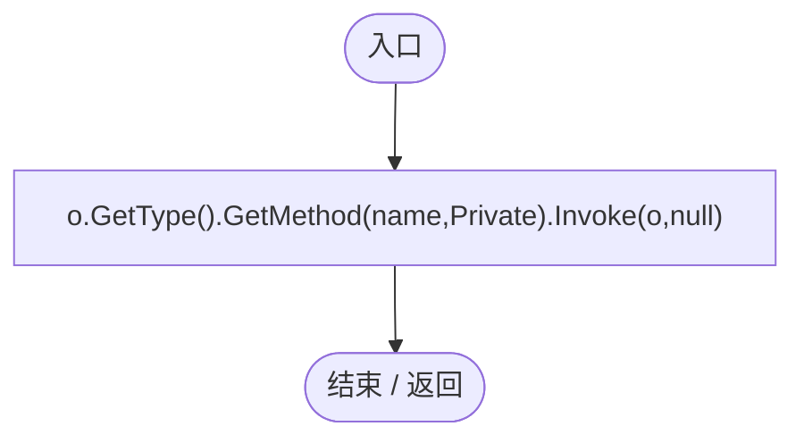

## Field · L26

`private static T Field<T>(object o,string name)`

### Editor · Roslyn编译器控制流

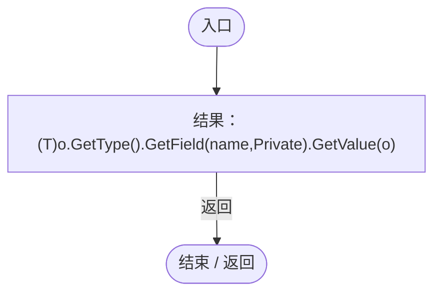

## Validate · L27

`[MenuItem("Tools/Darwin Park/Validate Interaction UX")] public static void Validate()`

### Editor · Roslyn编译器控制流

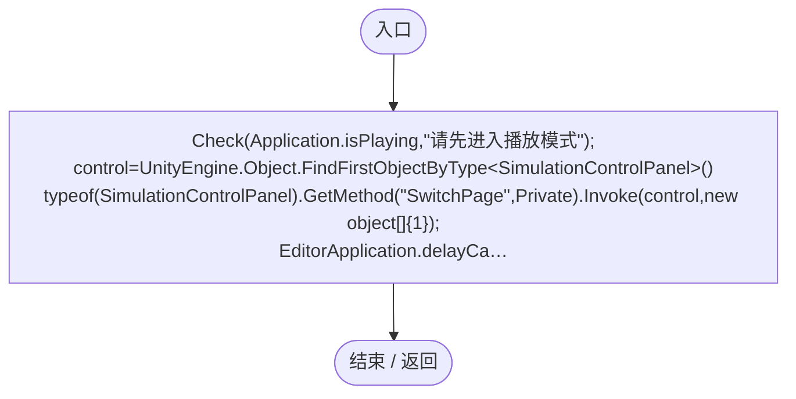

项目内调用/回调引用：

- [InteractionUXRegression.Check · L24](7bb23131e3b3865d.md#md7c372f8009dc11a)（方法）
- [InteractionUXRegression.回调@33 · L33](7bb23131e3b3865d.md#mfaba8e41c4d85955)（回调/委托）

## 回调@33 · L33

`( … => 回调`

### Editor · Roslyn编译器控制流

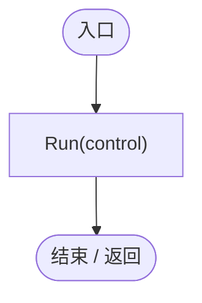

项目内调用/回调引用：

- [InteractionUXRegression.Run · L43](7bb23131e3b3865d.md#md21ce0e02c85a2b6)（方法）

## Spawn · L35

`private static DarwinEntity Spawn(Vector3 position,bool moving)`

### Editor · Roslyn编译器控制流

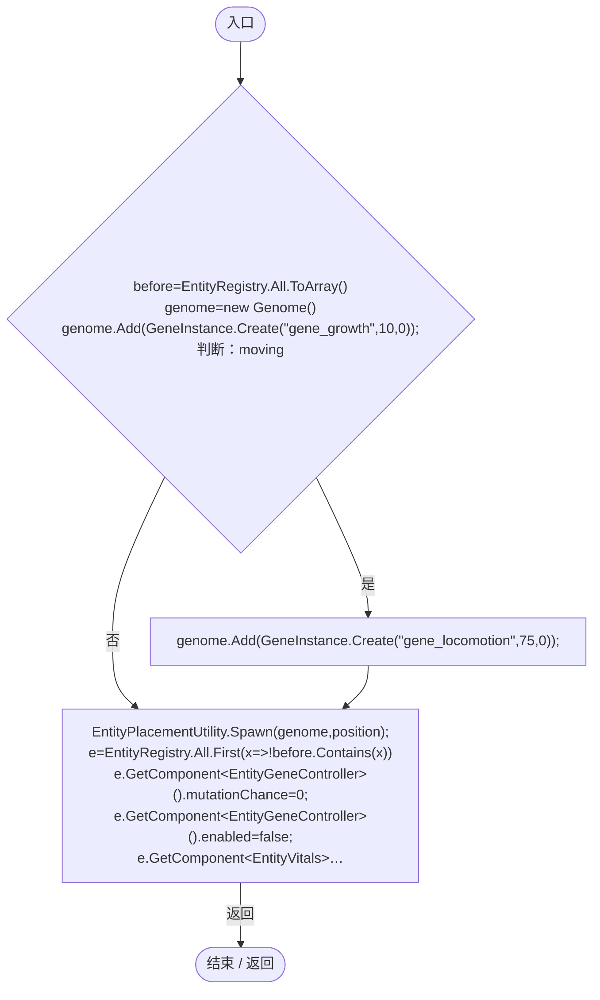

项目内调用/回调引用：

- [Genome.Add · L19](a2ef23f865bc7ee8.md#md9cfdc94b8b8d40f)（方法）
- [GeneInstance.Create · L20](f82e1498d67f5afd.md#m72e94c278de3cf8b)（方法）
- [EntityPlacementUtility.Spawn · L77](6d2c32e632b9c147.md#m79ec74c5c23421cd)（方法）
- [InteractionUXRegression.回调@39 · L39](7bb23131e3b3865d.md#meb4d7070a5857ca1)（回调/委托）

## 回调@39 · L39

`x … => 回调`

### Editor · Roslyn编译器控制流

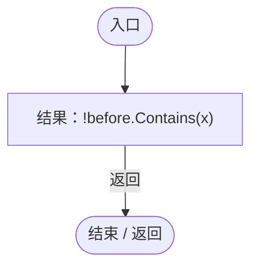

## Run · L43

`private static void Run(SimulationControlPanel control)`

### Editor · Roslyn编译器控制流

```mermaid
flowchart TD
  b0(["入口"])
  b1["report=new StringBuilder()<br/>clock=ServiceLocator.Get&lt;SimulationClock&gt;()<br/>running=clock.IsRunning<br/>scale=clock.TimeScale<br/>initial=EntityRegistry.All.ToArray()<br/>camera=Camera.main<br/>orbit=camera.GetComponent&lt;OrbitCamera&gt;()<br/>oldPos=camera.transform…"]
  b2["new[]{&quot;x&quot;,&quot;y&quot;,&quot;targetDistance&quot;,&quot;_isFocusing&quot;,&quot;targetPosition&quot;,&quot;targetRotation&quot;}"]
  b3{"判断：new[]{&quot;x&quot;,&quot;y&quot;,&quot;targetDistance&quot;,&quot;_isFocusing&quot;,&quot;targetPosition&quot;,&quot;targetRotation&quot;}"}
  b4["string<br/>orbitState[field]=typeof(OrbitCamera).GetField(field,Private).GetValue(orbit);"]
  b5{"new[]{&quot;x&quot;,&quot;y&quot;,&quot;targetDistance&quot;,&quot;_isFocusing&quot;,&quot;targetPosition&quot;,&quot;targetRotation&quot;}<br/>判断：new[]{&quot;x&quot;,&quot;y&quot;,&quot;targetDistance&quot;,&quot;_isFocusing&quot;,&quot;targetPosition&quot;,&quot;targetRotation&quot;}"}
  b6["new[]{&quot;x&quot;,&quot;y&quot;,&quot;targetDistance&quot;,&quot;_isFocusing&quot;,&quot;targetPosition&quot;,&quot;targetRotation&quot;}"]
  b7["连接 / 离开区域"]
  b8["inspector=UnityEngine.Object.FindFirstObjectByType&lt;GeneInspectorUI&gt;()<br/>tool=EntityPlacementTool.Instance<br/>root=ServiceLocator.Get&lt;UIRoot&gt;()<br/>b=UnityEngine.Object.FindFirstObjectByType&lt;PlanetTerrainMeshBuilder&gt;()<br/>slot=null<br/>obstacle=null<br/>oldC…"]
  b9["clock.Play();<br/>clock.SetTimeScale(1);<br/>temp=root.MainCanvas.transform.GetComponentsInChildren&lt;Button&gt;(true).First(x=&gt;x.name==&quot;btn_param_temp&quot;)<br/>temp.onClick.Invoke();<br/>editor=UnityEngine.Object.FindFirstObjectByType&lt;PlanetParameterEditor&gt;()<br/>…"]
  b10["slider.gameObject<br/>new PointerEventData(EventSystem.current){button=PointerEventData.InputButton.Left}<br/>button=PointerEventData.InputButton.Left<br/>ExecuteEvents.ExecuteHierarchy(slider.gameObject,new PointerEventData(EventSystem.current){but…"]
  b11{"判断：editor.gameObject.activeInHierarchy"}
  b12["Field&lt;GameObject&gt;(control,&quot;_activeParamMenu&quot;)!=null"]
  b13["editor.gameObject.activeInHierarchy"]
  b14["Check(editor.gameObject.activeInHierarchy &amp;&amp; Field&lt;GameObject&gt;(control,&quot;_activeParamMenu&quot;)!=null,&quot;滑条松手导致参数面板关闭&quot;);"]
  b15["Check(Mathf.Abs(ClimateDataHub.BaseTemperature-oldTemp)&lt;.01f,&quot;草稿未确认就改变环境&quot;);<br/>editor.Apply();<br/>Check(Mathf.Abs(ClimateDataHub.BaseTemperature-23)&lt;.01f,&quot;草稿无法确认&quot;);<br/>editor.CancelRequested();<br/>report.AppendLine(&quot;PASS: parameter button left click…"]
  b16["slot<br/>new PointerEventData(EventSystem.current){button=PointerEventData.InputButton.Right}<br/>button=PointerEventData.InputButton.Right<br/>slot.OnPointerClick(new PointerEventData(EventSystem.current){button=PointerEventData.InputButton.Right});"]
  b17["quantity=UnityEngine.Object.FindFirstObjectByType&lt;PlacementQuantityPopup&gt;()<br/>Check(quantity!=null,&quot;右键未打开数量设置&quot;);<br/>quantity.GetComponentInChildren&lt;InputField&gt;().text=&quot;3&quot;;<br/>quantity.Apply();<br/>Check(slot.placementCount==3,&quot;数量未应用到槽位&quot;);"]
  b18["slot<br/>new PointerEventData(EventSystem.current){button=PointerEventData.InputButton.Left}<br/>button=PointerEventData.InputButton.Left<br/>slot.OnPointerClick(new PointerEventData(EventSystem.current){button=PointerEventData.InputButton.Left});"]
  b19["count=EntityRegistry.All.Count<br/>centre=new Vector2(camera.pixelWidth*.5f,camera.pixelHeight*.5f)"]
  b20{"判断：tool.TryPlaceAt(centre)"}
  b21{"判断：tool.IsPlacing"}
  b22["EntityRegistry.All.Count==count+3"]
  b23["tool.TryPlaceAt(centre) &amp;&amp; tool.IsPlacing &amp;&amp; EntityRegistry.All.Count==count+3"]
  b24["Check(tool.TryPlaceAt(centre) &amp;&amp; tool.IsPlacing &amp;&amp; EntityRegistry.All.Count==count+3,&quot;首次批量投放后丢失模式/数量错误&quot;);"]
  b25{"判断：tool.TryPlaceAt(centre)"}
  b26{"判断：tool.IsPlacing"}
  b27["EntityRegistry.All.Count==count+6"]
  b28["tool.TryPlaceAt(centre) &amp;&amp; tool.IsPlacing &amp;&amp; EntityRegistry.All.Count==count+6"]
  b29["Check(tool.TryPlaceAt(centre) &amp;&amp; tool.IsPlacing &amp;&amp; EntityRegistry.All.Count==count+6,&quot;第二次连续批量投放失败&quot;);"]
  b30["tool.CancelPlacement();"]
  b31{"判断：tool.IsPlacing"}
  b32["!OrbitCamera.IsDraggingUI"]
  b33["!tool.IsPlacing"]
  b34["Check(!tool.IsPlacing &amp;&amp; !OrbitCamera.IsDraggingUI,&quot;取消没有释放输入&quot;);"]
  b35["report.AppendLine(&quot;PASS: slot right click sets count=3; two world clicks spawn 3+3 independent entities and keep placing; cancel releases input&quot;);<br/>up=Vector3.up<br/>groundRadius=b.WaterRadius+10"]
  b36["i=0"]
  b37{"判断：i&lt;512"}
  b38{"y=1-2f*(i+.5f)/512<br/>angle=i*2.39996323f<br/>d=new Vector3(Mathf.Sqrt(1-y*y)*Mathf.Cos(angle),y,Mathf.Sqrt(1-y*y)*Mathf.Sin(angle))<br/>r=b.radius+PlanetTerrainSampler.SampleHeight(b.Data,d)*b.heightScale<br/>判断：r&gt;b.WaterRadius+3"}
  b39["up=b.transform.TransformDirection(d);<br/>groundRadius=r;"]
  b40["i++"]
  b41["pos=b.transform.position+up*(groundRadius+4)<br/>tangent=Vector3.Cross(up,Vector3.right).normalized<br/>side=Vector3.Cross(up,tangent)<br/>hunter=Spawn(pos,true)<br/>a=Spawn(pos+tangent*1.3f,false)<br/>other=Spawn(pos+side*1.3f,false)<br/>Physics.SyncTransforms…"]
  b42["GeneDatabase.All"]
  b43{"判断：GeneDatabase.All"}
  b44{"var<br/>判断：def.Id!=&quot;gene_growth&quot;"}
  b45["genes.Genome.Add(GeneInstance.Create(def.Id,50,def.Tier));"]
  b46{"判断：GeneDatabase.All"}
  b47["GeneDatabase.All"]
  b48["连接 / 离开区域"]
  b49["genes.Recalculate();<br/>inspector.RefreshDisplayedInfo();<br/>Canvas.ForceUpdateCanvases();<br/>panel=root.MainCanvas.transform.Find(&quot;GenePanel&quot;)<br/>viewport=panel.GetComponentInChildren&lt;ScrollRect&gt;()<br/>Check(panel.GetComponent&lt;RectTransform&gt;().anchorMi…"]
  b50{"判断：viewport.vertical"}
  b51{"判断：viewport.horizontal"}
  b52["panel.Find(&quot;ScrollView/Viewport/Content/PageCtrl&quot;)==null"]
  b53["viewport.vertical &amp;&amp; !viewport.horizontal &amp;&amp; panel.Find(&quot;ScrollView/Viewport/Content/PageCtrl&quot;)==null"]
  b54["Check(viewport.vertical &amp;&amp; !viewport.horizontal &amp;&amp; panel.Find(&quot;ScrollView/Viewport/Content/PageCtrl&quot;)==null,&quot;基因仍使用分页按钮&quot;);"]
  b55["Check(panel.GetComponentsInChildren&lt;InputField&gt;().Length&gt;=genes.Genome.Genes.Count,&quot;滚动列表没有列出全部基因&quot;);<br/>baseText=panel.GetComponentsInChildren&lt;Text&gt;().First(x=&gt;x.name==&quot;BaseInfo&quot;)<br/>hunter.GetComponent&lt;EntityStats&gt;().Modify(&quot;health&quot;,-12,false)…"]
  b56{"判断：baseText==unchanged"}
  b57["baseText.text.Contains(&quot;88.0&quot;)"]
  b58["baseText==unchanged"]
  b59["Check(baseText==unchanged &amp;&amp; baseText.text.Contains(&quot;88.0&quot;),&quot;健康值未就地刷新&quot;);"]
  b60{"判断：panel.GetComponentsInChildren&lt;InputField&gt;().Any(x=&gt;x.text==&quot;84.0&quot;)"}
  b61["Mathf.Abs(viewport.verticalNormalizedPosition-scrollPosition)&lt;.01f"]
  b62["panel.GetComponentsInChildren&lt;InputField&gt;().Any(x=&gt;x.text==&quot;84.0&quot;)"]
  b63["Check(panel.GetComponentsInChildren&lt;InputField&gt;().Any(x=&gt;x.text==&quot;84.0&quot;) &amp;&amp; Mathf.Abs(viewport.verticalNormalizedPosition-scrollPosition)&lt;.01f,&quot;基因数值未刷新或滚动位置重置&quot;);"]
  b64["typeof(GeneInspectorUI).GetMethod(&quot;ShowAddGeneMenu&quot;,Private).Invoke(inspector,null);<br/>Call(inspector,&quot;Update&quot;);<br/>add=root.MainCanvas.transform.Find(&quot;AddGenePanel&quot;)<br/>Check(add.GetComponent&lt;RectTransform&gt;().anchorMin==Vector2.zero,&quot;添加面板未放左下&quot;)…"]
  b65{"判断：panel.gameObject.activeSelf"}
  b66["!add.gameObject.activeSelf"]
  b67["!panel.gameObject.activeSelf"]
  b68["Check(!panel.gameObject.activeSelf &amp;&amp; !add.gameObject.activeSelf,&quot;关闭信息未同步关闭添加面板&quot;);"]
  b69["report.AppendLine(&quot;PASS: top-left info / bottom-left add panel; all genes in vertical scroll; live health/gene values without recreating text or resetting scroll; close hides child panels&quot;);<br/>genes.Genome.Genes.RemoveAll(x=&gt;x.DefinitionId…"]
  b70{"判断：aHp&lt;100"}
  b71["bHp==100"]
  b72["aHp&lt;100"]
  b73["Check(aHp&lt;100 &amp;&amp; bHp==100,&quot;首次攻击伤及附近其他实体&quot;);"]
  b74["manual.SetAim(new Ray(pos-side*5,side));<br/>genes.GetLogic(action).OnUpdate(1.1f);<br/>aStats.TryGet(&quot;health&quot;,out float aAfter);<br/>bStats.TryGet(&quot;health&quot;,out float bAfter);"]
  b75{"判断：aAfter==aHp"}
  b76["bAfter&lt;bHp"]
  b77["aAfter==aHp"]
  b78["Check(aAfter==aHp &amp;&amp; bAfter&lt;bHp,&quot;攻击目标锁定旧实体，无法按准星切换&quot;);"]
  b79["manual.SetAim(new Ray(pos,up));<br/>genes.GetLogic(action).OnUpdate(1.1f);<br/>bStats.TryGet(&quot;health&quot;,out float missed);<br/>Check(missed==bAfter,&quot;空准星仍自动伤害附近目标&quot;);<br/>obstacle=GameObject.CreatePrimitive(PrimitiveType.Cube);<br/>obstacle.transform.position=p…"]
  b80{"tool.CancelPlacement();<br/>判断：slot!=null"}
  b81["slot.placementCount=oldCount;"]
  b82{"inspector.HideEntityInfo();<br/>Call(control,&quot;DestroyMenus&quot;);<br/>判断：obstacle!=null"}
  b83["UnityEngine.Object.Destroy(obstacle);"]
  b84["EntityRegistry.All.ToArray()"]
  b85{"判断：EntityRegistry.All.ToArray()"}
  b86{"var<br/>判断：initial.Contains(e)"}
  b87["e.gameObject.SetActive(false);<br/>UnityEngine.Object.Destroy(e.gameObject);"]
  b88{"EntityRegistry.All.ToArray()<br/>判断：EntityRegistry.All.ToArray()"}
  b89["EntityRegistry.All.ToArray()"]
  b90["连接 / 离开区域"]
  b91{"ClimateDataHub.BaseTemperature=oldTemp;<br/>判断：ServiceLocator.TryGet&lt;DarwinPark.Environment.EnvironmentSystem&gt;(out var env)"}
  b92["env.BaseTemperature=oldTemp;"]
  b93["camera.transform.SetPositionAndRotation(oldPos,oldRot);<br/>orbit.distance=oldDistance;"]
  b94["orbitState"]
  b95{"判断：orbitState"}
  b96["var<br/>typeof(OrbitCamera).GetField(pair.Key,Private).SetValue(orbit,pair.Value);"]
  b97["orbitState"]
  b98{"clock<br/>判断：scale&gt;0"}
  b99["scale"]
  b100["1"]
  b101["clock.SetTimeScale(scale&gt;0?scale:1);"]
  b102{"判断：running"}
  b103["clock.Play();"]
  b104["clock.Pause();"]
  b105["连接 / 离开区域"]
  b106(["结束 / 返回"])
  b0 --> b1
  b1 --> b2
  b2 --> b3
  b3 -->|"是"| b4
  b3 -->|"否 · 经过finally 5"| b8
  b4 --> b3
  b5 -->|"否"| b6
  b5 -->|"是"| b7
  b6 --> b7
  b8 --> b9
  b9 --> b10
  b10 --> b11
  b11 -->|"是"| b12
  b11 -->|"否"| b13
  b12 --> b14
  b13 --> b14
  b14 --> b15
  b15 --> b16
  b16 --> b17
  b17 --> b18
  b18 --> b19
  b19 --> b20
  b20 -->|"是"| b21
  b20 -->|"否"| b23
  b21 -->|"是"| b22
  b21 -->|"否"| b23
  b22 --> b24
  b23 --> b24
  b24 --> b25
  b25 -->|"是"| b26
  b25 -->|"否"| b28
  b26 -->|"是"| b27
  b26 -->|"否"| b28
  b27 --> b29
  b28 --> b29
  b29 --> b30
  b30 --> b31
  b31 -->|"否"| b32
  b31 -->|"是"| b33
  b32 --> b34
  b33 --> b34
  b34 --> b35
  b35 --> b36
  b36 --> b37
  b37 -->|"是"| b38
  b37 -->|"否"| b41
  b38 -->|"是"| b39
  b38 -->|"否"| b40
  b39 --> b41
  b40 --> b37
  b41 --> b42
  b42 --> b43
  b43 -->|"是"| b44
  b43 -->|"否 · 经过finally 46"| b49
  b44 -->|"是"| b45
  b44 -->|"否"| b43
  b45 --> b43
  b46 -->|"否"| b47
  b46 -->|"是"| b48
  b47 --> b48
  b49 --> b50
  b50 -->|"是"| b51
  b50 -->|"否"| b53
  b51 -->|"否"| b52
  b51 -->|"是"| b53
  b52 --> b54
  b53 --> b54
  b54 --> b55
  b55 --> b56
  b56 -->|"是"| b57
  b56 -->|"否"| b58
  b57 --> b59
  b58 --> b59
  b59 --> b60
  b60 -->|"是"| b61
  b60 -->|"否"| b62
  b61 --> b63
  b62 --> b63
  b63 --> b64
  b64 --> b65
  b65 -->|"否"| b66
  b65 -->|"是"| b67
  b66 --> b68
  b67 --> b68
  b68 --> b69
  b69 --> b70
  b70 -->|"是"| b71
  b70 -->|"否"| b72
  b71 --> b73
  b72 --> b73
  b73 --> b74
  b74 --> b75
  b75 -->|"是"| b76
  b75 -->|"否"| b77
  b76 --> b78
  b77 --> b78
  b78 --> b79
  b79 -->|"经过finally 80"| b106
  b80 -->|"是"| b81
  b80 -->|"否"| b82
  b81 --> b82
  b82 -->|"是"| b83
  b82 -->|"否"| b84
  b83 --> b84
  b84 --> b85
  b85 -->|"是"| b86
  b85 -->|"否 · 经过finally 88"| b91
  b86 -->|"否"| b87
  b86 -->|"是"| b85
  b87 --> b85
  b88 -->|"否"| b89
  b88 -->|"是"| b90
  b89 --> b90
  b91 -->|"是"| b92
  b91 -->|"否"| b93
  b92 --> b93
  b93 --> b94
  b94 --> b95
  b95 -->|"是"| b96
  b95 -->|"否 · 经过finally 97"| b98
  b96 --> b95
  b98 -->|"是"| b99
  b98 -->|"否"| b100
  b99 --> b101
  b100 --> b101
  b101 --> b102
  b102 -->|"是"| b103
  b102 -->|"否"| b104
  b103 --> b105
  b104 --> b105
  b3 -. "退出保护区时 finally（示意）" .-> b5
  b43 -. "退出保护区时 finally（示意）" .-> b46
  b9 -. "退出保护区时 finally（示意）" .-> b80
  b85 -. "退出保护区时 finally（示意）" .-> b88
  b95 -. "退出保护区时 finally（示意）" .-> b97

```

项目内调用/回调引用：

- [ServiceLocator.Get · L33](f2fdbe9f9ccd93cb.md#m2ae625299520c56d)（方法）
- [SimulationClock.IsRunning.get · L22](a8f444aec9614b0a.md#m10f4fe307faca0f0)（访问器）
- [EntityPlacementTool.Instance.get · L13](2ca993947b0a7e7a.md#mafb26991c0dfcb86)（访问器）
- [SimulationClock.Play · L78](a8f444aec9614b0a.md#m7aa9e64b7de60ed0)（方法）
- [SimulationClock.SetTimeScale · L81](a8f444aec9614b0a.md#mecaa463a0561aca3)（方法）
- [UIRoot.MainCanvas.get · L14](9c1421378791f0e0.md#maa2cc9baf1248477)（访问器）
- [InteractionUXRegression.Check · L24](7bb23131e3b3865d.md#md7c372f8009dc11a)（方法）
- [InteractionUXRegression.Field · L26](7bb23131e3b3865d.md#m6990c076125ddc2f)（方法）
- [PlanetParameterEditor.Apply · L88](ac36b95043305d58.md#m5c1e8487916976ec)（方法）
- [EntitySpawnerUI.OnPointerClick · L20](35e73bec7584e677.md#m5f4fec17861ede2a)（方法）
- [PlacementQuantityPopup.Apply · L38](8e55f714deb963c4.md#m779d8397f2a21920)（方法）
- [EntityPlacementTool.TryPlaceAt · L73](2ca993947b0a7e7a.md#m3ad1295309fe99b0)（方法）
- [EntityPlacementTool.IsPlacing.get · L14](2ca993947b0a7e7a.md#ma73d17b3db4aa719)（访问器）
- [EntityPlacementTool.CancelPlacement · L81](2ca993947b0a7e7a.md#m5a9374d2c71f0a2d)（方法）
- [PlanetTerrainMeshBuilder.WaterRadius.get · L94](415285cf043354a9.md#m28d8809083881ec1)（访问器）
- [PlanetTerrainSampler.SampleHeight · L32](fd5c1d83b88a7c8b.md#m759508f0c5a04b21)（方法）
- [PlanetTerrainMeshBuilder.Data.get · L78](415285cf043354a9.md#m8382f579717fbc6d)（访问器）
- [InteractionUXRegression.Spawn · L35](7bb23131e3b3865d.md#mb3e0c964087f76fa)（方法）
- [GeneInspectorUI.ShowEntityInfo · L385](924e27c34e7b1f0a.md#mea69a0457b885287)（方法）
- [DarwinEntity.Genes.get · L14](70798dde169f2e8b.md#m622eb1adf401d431)（访问器）
- [GeneDatabase.All.get · L128](ec0a03483435a863.md#m0a367ed24734f426)（访问器）
- [Genome.Add · L19](a2ef23f865bc7ee8.md#md9cfdc94b8b8d40f)（方法）
- [GeneInstance.Create · L20](f82e1498d67f5afd.md#m72e94c278de3cf8b)（方法）
- [EntityGeneController.Recalculate · L90](7494d53178552f0e.md#m93744c8f3039b93c)（方法）
- [GeneInspectorUI.RefreshDisplayedInfo · L325](924e27c34e7b1f0a.md#mdd0690def5cc19d3)（方法）
- [EntityStats.Modify · L111](75aa86a368efdf24.md#m9c837be197158240)（方法）
- [InteractionUXRegression.Call · L25](7bb23131e3b3865d.md#mcaa9314ab01d353e)（方法）
- [GeneInspectorUI.HideEntityInfo · L316](924e27c34e7b1f0a.md#m11944eddcac871c2)（方法）
- [EntityManualControl.BeginControl · L32](a6969896da35e1f0.md#mf0dadf914f9961c7)（方法）
- [EntityManualControl.SetInput · L33](a6969896da35e1f0.md#m7c7f5613b3bebc74)（方法）
- [EntityManualControl.SetAim · L27](a6969896da35e1f0.md#m70f09d0090a1fa41)（方法）
- [EntityAttackAim.Pick · L10](2e9dde897281c303.md#m6a55b6280b6e3053)（方法）
- [IGeneLogic.OnUpdate · L9](5304fdad773967f8.md#m829188d65276f8e5)（方法）
- [EntityGeneController.GetLogic · L184](7494d53178552f0e.md#m4f4e58e1a4abadfc)（方法）
- [EntityStats.TryGet · L90](75aa86a368efdf24.md#m24ee1433e4a70d94)（方法）
- [ServiceLocator.TryGet · L26](f2fdbe9f9ccd93cb.md#m143b24e6d58471b0)（方法）
- [SimulationClock.Pause · L79](a8f444aec9614b0a.md#m30929d45a885d0f1)（方法）
- [InteractionUXRegression.回调@57 · L57](7bb23131e3b3865d.md#mc589226b7a249c52)（回调/委托）
- [InteractionUXRegression.回调@65 · L65](7bb23131e3b3865d.md#mac1da66ece3b0180)（回调/委托）
- [InteractionUXRegression.回调@94 · L94](7bb23131e3b3865d.md#m778efee73b9c0532)（回调/委托）
- [InteractionUXRegression.回调@95 · L95](7bb23131e3b3865d.md#m6c98d7060f446de4)（回调/委托）
- [InteractionUXRegression.回调@98 · L98](7bb23131e3b3865d.md#m0a5920a51ceba2da)（回调/委托）
- [InteractionUXRegression.回调@104 · L104](7bb23131e3b3865d.md#md0ba0ba02c469c36)（回调/委托）

## 回调@57 · L57

`x … => 回调`

### Editor · Roslyn编译器控制流

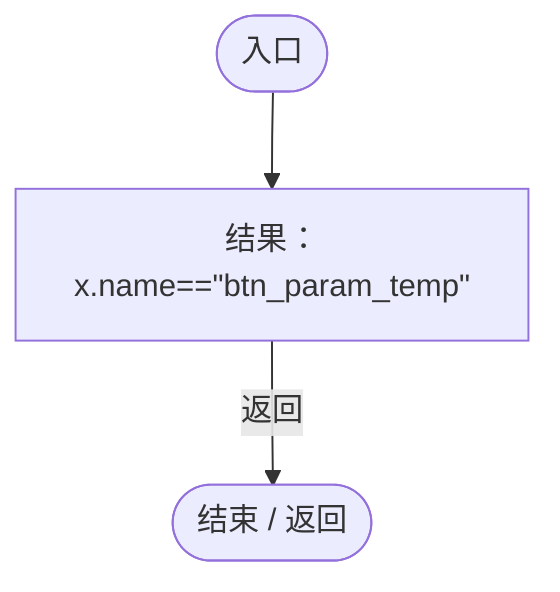

## 回调@65 · L65

`x … => 回调`

### Editor · Roslyn编译器控制流

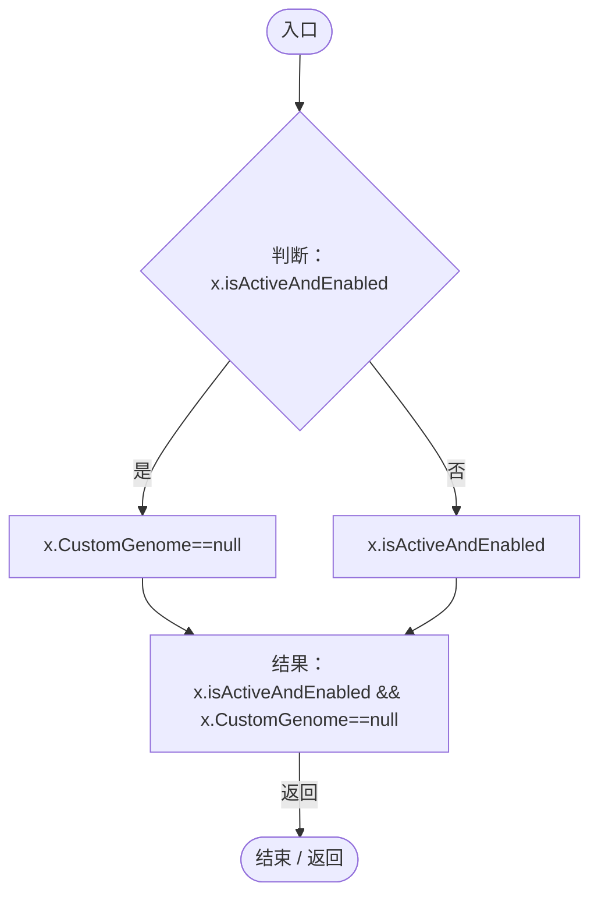

## 回调@94 · L94

`x … => 回调`

### Editor · Roslyn编译器控制流

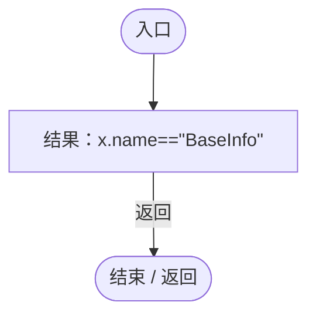

## 回调@95 · L95

`x … => 回调`

### Editor · Roslyn编译器控制流

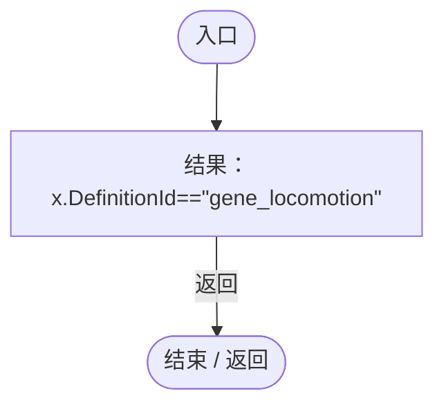

## 回调@98 · L98

`x … => 回调`

### Editor · Roslyn编译器控制流

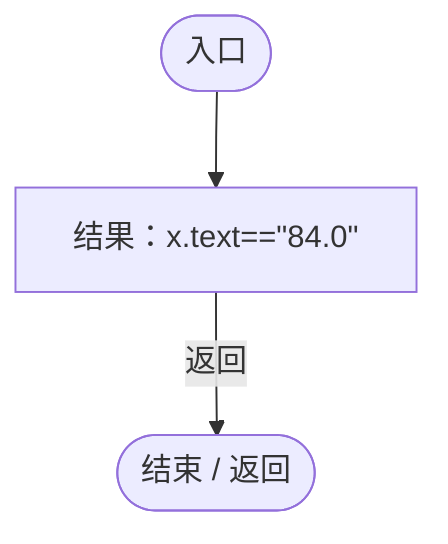

## 回调@104 · L104

`x … => 回调`

### Editor · Roslyn编译器控制流

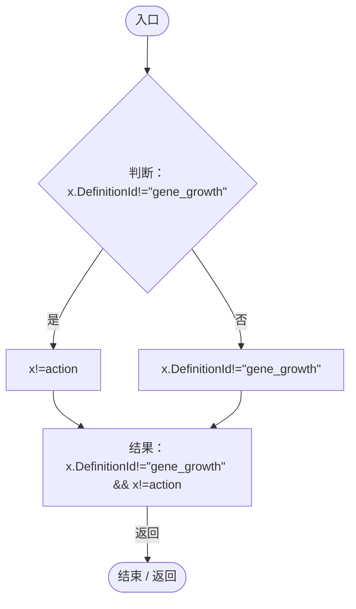
