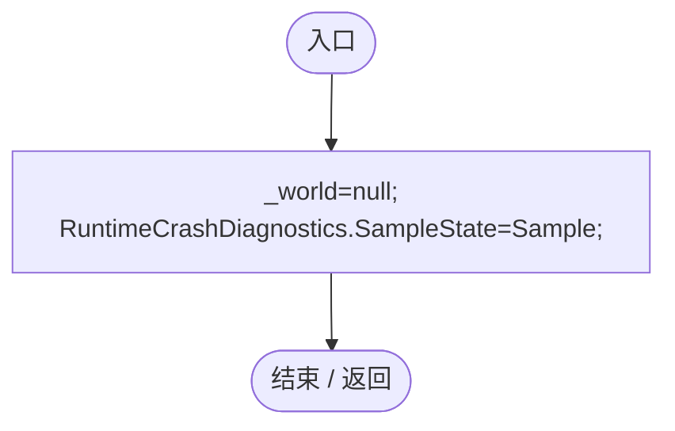

```mermaid
flowchart TD
  b0(["入口"])
  b1{"判断：_world==null"}
  b2["_world=Object.FindFirstObjectByType&lt;WorldSessionManager&gt;();"]
  b3["lan=LanSession.Instance"]
  b4["new RuntimeCrashDiagnostics.Snapshot{worldId=_world?.Current?.id,worldName=_world?.Current?.name, loadingStatus=_world?.Status,saveStatus=_world?.SaveStatus,loading=_world!=null&amp;&amp;_world.Busy,entities=EntityRegistry.All.Count, networkRole…"]
  b5{"_world<br/>判断：_world"}
  b6[".Current"]
  b7{"判断：.Current"}
  b8[".id"]
  b9["_world?.Current?.id"]
  b10["worldId=_world?.Current?.id"]
  b11{"_world<br/>判断：_world"}
  b12[".Current"]
  b13{"判断：.Current"}
  b14[".name"]
  b15["_world?.Current?.name"]
  b16["worldName=_world?.Current?.name"]
  b17{"_world<br/>判断：_world"}
  b18[".Status"]
  b19["_world"]
  b20["loadingStatus=_world?.Status"]
  b21{"_world<br/>判断：_world"}
  b22[".SaveStatus"]
  b23["_world"]
  b24["saveStatus=_world?.SaveStatus"]
  b25{"判断：_world!=null"}
  b26["_world.Busy"]
  b27["_world!=null"]
  b28["loading=_world!=null&amp;&amp;_world.Busy"]
  b29["entities=EntityRegistry.All.Count"]
  b30{"判断：lan==null"}
  b31{"判断：lan.Online"}
  b32["&quot;单人&quot;"]
  b33{"判断：lan.IsHost"}
  b34["&quot;房主&quot;"]
  b35["&quot;成员&quot;"]
  b36["networkRole=lan==null&#124;&#124;!lan.Online?&quot;单人&quot;:lan.IsHost?&quot;房主&quot;:&quot;成员&quot;"]
  b37{"lan<br/>判断：lan"}
  b38[".MemberCount"]
  b39["lan"]
  b40{"判断：lan?.MemberCount"}
  b41["lan?.MemberCount"]
  b42["0"]
  b43["members=lan?.MemberCount??0"]
  b44["结果：new RuntimeCrashDiagnostics.Snapshot{worldId=_world?.Current?.id,worldName=_world?.Current?.name, loadingStatus=_world?.Status,saveStatus=_world?.SaveStatus,loading=_world!=null&amp;&amp;_world.Busy,entities=EntityRegistry.All.Count, networkR…"]
  b45(["结束 / 返回"])
  b0 --> b1
  b1 -->|"是"| b2
  b1 -->|"否"| b3
  b2 --> b3
  b3 --> b4
  b4 --> b5
  b5 -->|"否"| b6
  b5 -->|"是"| b9
  b6 --> b7
  b7 -->|"否"| b8
  b7 -->|"是"| b9
  b8 --> b10
  b9 --> b10
  b10 --> b11
  b11 -->|"否"| b12
  b11 -->|"是"| b15
  b12 --> b13
  b13 -->|"否"| b14
  b13 -->|"是"| b15
  b14 --> b16
  b15 --> b16
  b16 --> b17
  b17 -->|"否"| b18
  b17 -->|"是"| b19
  b18 --> b20
  b19 --> b20
  b20 --> b21
  b21 -->|"否"| b22
  b21 -->|"是"| b23
  b22 --> b24
  b23 --> b24
  b24 --> b25
  b25 -->|"是"| b26
  b25 -->|"否"| b27
  b26 --> b28
  b27 --> b28
  b28 --> b29
  b29 --> b30
  b30 -->|"否"| b31
  b30 -->|"是"| b32
  b31 -->|"否"| b32
  b31 -->|"是"| b33
  b32 --> b36
  b33 -->|"是"| b34
  b33 -->|"否"| b35
  b34 --> b36
  b35 --> b36
  b36 --> b37
  b37 -->|"否"| b38
  b37 -->|"是"| b39
  b38 --> b40
  b39 --> b40
  b40 -->|"否"| b41
  b40 -->|"是"| b42
  b41 --> b43
  b42 --> b43
  b43 --> b44
  b44 -->|"返回"| b45

```

# RuntimeDiagnosticWorldState.cs

[返回总索引](../README.md) · `Runtime` · `Assets/DarwinPark/UI/RuntimeDiagnosticWorldState.cs`

[源文件](../../../Assets/DarwinPark/UI/RuntimeDiagnosticWorldState.cs) · 源码校验：`fb9f145aeaf17f35bd75e5b80cb5a6667c35c3cb01cf986e8374edac3d25514e`

方法按源文件位置排列。事件/回调引用不表示立即执行；分支与异常说明见总索引。完整源码与可点击关系图请打开离线手册。

## Register · L11

`[RuntimeInitializeOnLoadMethod(RuntimeInitializeLoadType.BeforeSceneLoad)] private static void Register()`

### Editor / Player · Roslyn编译器控制流

项目内调用/回调引用：

- [RuntimeDiagnosticWorldState.Sample · L13](7bd14a39565df6a0.md#ma23f0499040a58d5)（方法）

## Sample · L13

`private static RuntimeCrashDiagnostics.Snapshot Sample()`

### Editor / Player · Roslyn编译器控制流

项目内调用/回调引用：

- [LanSession.Instance.get · L23](9fb633eebffe669c.md#mbf83306994878383)（访问器）
- [WorldSessionManager.Current.get · L21](08741c7b7b9d9344.md#m5d26a5eb846a8504)（访问器）
- [WorldSessionManager.Status.get · L23](08741c7b7b9d9344.md#mc9040fb24bb00a63)（访问器）
- [WorldSessionManager.SaveStatus.get · L25](08741c7b7b9d9344.md#m8f6ef5f347766596)（访问器）
- [WorldSessionManager.Busy.get · L24](08741c7b7b9d9344.md#m4483e2e4f28f7c85)（访问器）
