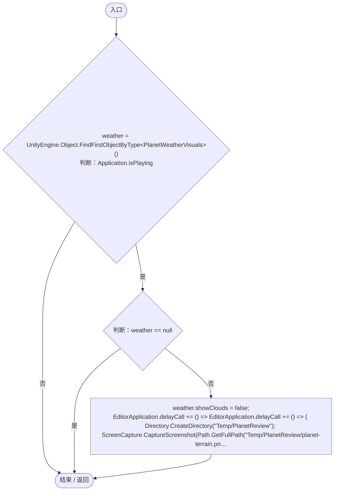
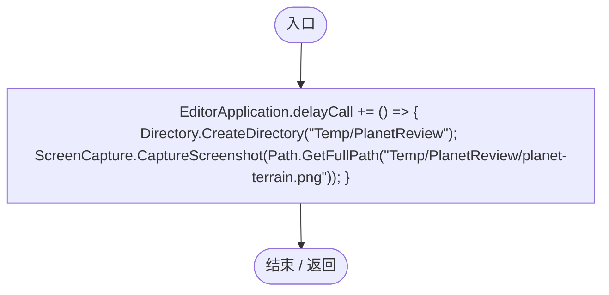
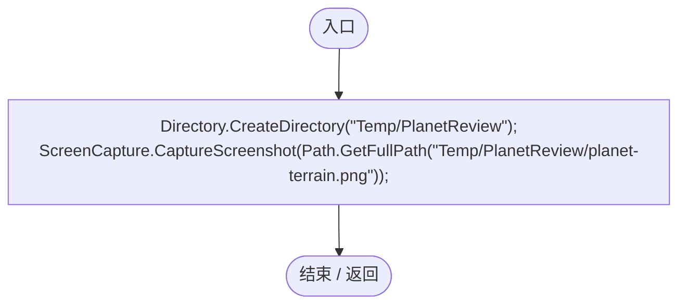

```mermaid
flowchart TD
  b0(["入口"])
  b1{"判断：Application.isPlaying"}
  b2["Debug.LogError(&quot;请先进入播放模式再验收。&quot;);"]
  b3{"builder = UnityEngine.Object.FindFirstObjectByType&lt;PlanetTerrainMeshBuilder&gt;()<br/>判断：builder == null"}
  b4{"判断：builder.Data == null"}
  b5["结果：new InvalidOperationException(&quot;地形未就绪&quot;)"]
  x5(["抛出异常 / 离开方法"])
  b6["report = new StringBuilder()"]
  b7["UnityEngine.Object.FindObjectsByType&lt;GameObject&gt;(FindObjectsInactive.Include, FindObjectsSortMode.None)"]
  b8{"判断：UnityEngine.Object.FindObjectsByType&lt;GameObject&gt;(FindObjectsInactive.Include, FindObjectsSortMode.None)"}
  b9{"var<br/>判断：go.scene.IsValid()"}
  b10{"判断：GameObjectUtility.GetMonoBehavioursWithMissingScriptCount(go) &gt; 0"}
  b11["结果：new InvalidOperationException($&quot;场景含缺失脚本: {go.name}&quot;)"]
  x11(["抛出异常 / 离开方法"])
  b12{"UnityEngine.Object.FindObjectsByType&lt;GameObject&gt;(FindObjectsInactive.Include, FindObjectsSortMode.None)<br/>判断：UnityEngine.Object.FindObjectsByType&lt;GameObject&gt;(FindObjectsInactive.Include, FindObjectsSortMode.None)"}
  b13["UnityEngine.Object.FindObjectsByType&lt;GameObject&gt;(FindObjectsInactive.Include, FindObjectsSortMode.None)"]
  b14["连接 / 离开区域"]
  b15["report.AppendLine(&quot;PASS: no missing MonoBehaviour scripts in loaded scene&quot;);<br/>data = builder.Data<br/>edges = new Dictionary&lt;(int, int), int&gt;()"]
  b16["i = 0"]
  b17{"判断：i &lt; data.Triangles.Length"}
  b18["side = 0"]
  b19{"判断：side &lt; 3"}
  b20["a = data.Triangles[i + side]<br/>b = data.Triangles[i + (side + 1) % 3]<br/>key = (Math.Min(a, b), Math.Max(a, b))<br/>edges.TryGetValue(key, out int count);<br/>edges[key] = count + 1;"]
  b21["side++"]
  b22["i += 3"]
  b23["edges"]
  b24{"判断：edges"}
  b25{"var<br/>判断：pair.Value != 2"}
  b26["结果：new InvalidOperationException(&quot;网格存在开放边或非流形边&quot;)"]
  x26(["抛出异常 / 离开方法"])
  b27["edges"]
  b28{"euler = data.Vertices.Length - edges.Count + data.Triangles.Length / 3<br/>判断：euler != 2"}
  b29["结果：new InvalidOperationException(&quot;球面拓扑不闭合&quot;)"]
  x29(["抛出异常 / 离开方法"])
  b30{"report.AppendLine($&quot;PASS: closed welded sphere V={data.Vertices.Length}, E={edges.Count}, Euler={euler}&quot;);<br/>判断：ServiceLocator.TryGet&lt;UIRoot&gt;(out var root)"}
  b31{"判断：root.MainCanvas == null"}
  b32["结果：new InvalidOperationException(&quot;MainCanvas 缺失&quot;)"]
  x32(["抛出异常 / 离开方法"])
  b33{"panel = root.MainCanvas.transform.Find(&quot;BottomPanel&quot;) as RectTransform<br/>判断：panel == null"}
  b34{"判断：panel.gameObject.activeInHierarchy"}
  b35{"判断：panel.rect.height &lt;= 0"}
  b36["结果：new InvalidOperationException(&quot;底部栏不可见&quot;)"]
  x36(["抛出异常 / 离开方法"])
  b37{"report.AppendLine($&quot;PASS: BottomPanel active, rect={panel.rect}, canvas enabled={root.MainCanvas.enabled}&quot;);<br/>weather = builder.GetComponent&lt;PlanetWeatherVisuals&gt;()<br/>判断：weather == null"}
  b38["结果：new InvalidOperationException(&quot;天气组件未挂载&quot;)"]
  x38(["抛出异常 / 离开方法"])
  b39["new[] { weather.oceanShader, weather.cloudShader, weather.atmosphereShader, builder.GetComponent&lt;MeshRenderer&gt;().sharedMaterial.shader }"]
  b40{"判断：new[] { weather.oceanShader, weather.cloudShader, weather.atmosphereShader, builder.GetComponent&lt;MeshRenderer&gt;().sharedMaterial.shader }"}
  b41{"var<br/>判断：shader == null"}
  b42{"判断：shader.isSupported"}
  b43{"判断：ShaderUtil.ShaderHasError(shader)"}
  b44["结果：new InvalidOperationException($&quot;Shader 无效: {shader}&quot;)"]
  x44(["抛出异常 / 离开方法"])
  b45["report.AppendLine($&quot;PASS: shader {shader.name}&quot;);"]
  b46{"new[] { weather.oceanShader, weather.cloudShader, weather.atmosphereShader, builder.GetComponent&lt;MeshRenderer&gt;().sharedMaterial.shader }<br/>判断：new[] { weather.oceanShader, weather.cloudShader, weather.atmosphereShader, builder.GetComponent&lt;…"}
  b47["new[] { weather.oceanShader, weather.cloudShader, weather.atmosphereShader, builder.GetComponent&lt;MeshRenderer&gt;().sharedMaterial.shader }"]
  b48["连接 / 离开区域"]
  b49["new[] { &quot;OceanSurface&quot;, &quot;CloudVolume&quot;, &quot;AtmosphericScattering&quot; }"]
  b50{"判断：new[] { &quot;OceanSurface&quot;, &quot;CloudVolume&quot;, &quot;AtmosphericScattering&quot; }"}
  b51{"string<br/>判断：builder.transform.Find(name) == null"}
  b52["结果：new InvalidOperationException($&quot;视觉层缺失: {name}&quot;)"]
  x52(["抛出异常 / 离开方法"])
  b53{"new[] { &quot;OceanSurface&quot;, &quot;CloudVolume&quot;, &quot;AtmosphericScattering&quot; }<br/>判断：new[] { &quot;OceanSurface&quot;, &quot;CloudVolume&quot;, &quot;AtmosphericScattering&quot; }"}
  b54["new[] { &quot;OceanSurface&quot;, &quot;CloudVolume&quot;, &quot;AtmosphericScattering&quot; }"]
  b55["连接 / 离开区域"]
  b56["folder = Path.GetFullPath(&quot;Temp/PlanetReview&quot;)<br/>Directory.CreateDirectory(folder);<br/>File.WriteAllText(Path.Combine(folder, &quot;runtime-checks.txt&quot;), report.ToString());<br/>ScreenCapture.CaptureScreenshot(Path.Combine(folder, &quot;planet-with-clouds.…"]
  b57(["结束 / 返回"])
  b0 --> b1
  b1 -->|"否"| b2
  b1 -->|"是"| b3
  b2 --> b57
  b3 -->|"否"| b4
  b3 -->|"是"| b5
  b4 -->|"是"| b5
  b4 -->|"否"| b6
  b5 -->|"Throw"| x5
  b6 --> b7
  b7 --> b8
  b8 -->|"是"| b9
  b8 -->|"否 · 经过finally 12"| b15
  b9 -->|"是"| b10
  b9 -->|"否"| b8
  b10 -->|"是"| b11
  b10 -->|"否"| b8
  b11 -->|"Throw"| x11
  b12 -->|"否"| b13
  b12 -->|"是"| b14
  b13 --> b14
  b15 --> b16
  b16 --> b17
  b17 -->|"是"| b18
  b17 -->|"否"| b23
  b18 --> b19
  b19 -->|"是"| b20
  b19 -->|"否"| b22
  b20 --> b21
  b21 --> b19
  b22 --> b17
  b23 --> b24
  b24 -->|"是"| b25
  b24 -->|"否 · 经过finally 27"| b28
  b25 -->|"是"| b26
  b25 -->|"否"| b24
  b26 -->|"Throw"| x26
  b28 -->|"是"| b29
  b28 -->|"否"| b30
  b29 -->|"Throw"| x29
  b30 -->|"是"| b31
  b30 -->|"否"| b32
  b31 -->|"是"| b32
  b31 -->|"否"| b33
  b32 -->|"Throw"| x32
  b33 -->|"否"| b34
  b33 -->|"是"| b36
  b34 -->|"是"| b35
  b34 -->|"否"| b36
  b35 -->|"是"| b36
  b35 -->|"否"| b37
  b36 -->|"Throw"| x36
  b37 -->|"是"| b38
  b37 -->|"否"| b39
  b38 -->|"Throw"| x38
  b39 --> b40
  b40 -->|"是"| b41
  b40 -->|"否 · 经过finally 46"| b49
  b41 -->|"否"| b42
  b41 -->|"是"| b44
  b42 -->|"是"| b43
  b42 -->|"否"| b44
  b43 -->|"是"| b44
  b43 -->|"否"| b45
  b44 -->|"Throw"| x44
  b45 --> b40
  b46 -->|"否"| b47
  b46 -->|"是"| b48
  b47 --> b48
  b49 --> b50
  b50 -->|"是"| b51
  b50 -->|"否 · 经过finally 53"| b56
  b51 -->|"是"| b52
  b51 -->|"否"| b50
  b52 -->|"Throw"| x52
  b53 -->|"否"| b54
  b53 -->|"是"| b55
  b54 --> b55
  b56 --> b57
  b8 -. "退出保护区时 finally（示意）" .-> b12
  b24 -. "退出保护区时 finally（示意）" .-> b27
  b40 -. "退出保护区时 finally（示意）" .-> b46
  b50 -. "退出保护区时 finally（示意）" .-> b53

```

# PlanetVisualRegression.cs

[返回总索引](../README.md) · `Editor` · `Assets/DarwinPark/Editor/PlanetVisualRegression.cs`

[源文件](../../../Assets/DarwinPark/Editor/PlanetVisualRegression.cs) · 源码校验：`f95ebe8cc57e720b5be2e23d287ca5f04be35b8c3a360705ddaf6b6cd4d609c4`

方法按源文件位置排列。事件/回调引用不表示立即执行；分支与异常说明见总索引。完整源码与可点击关系图请打开离线手册。

## Validate · L15

`[MenuItem("Tools/Darwin Park/Validate Current Planet")] public static void Validate()`

### Editor · Roslyn编译器控制流

项目内调用/回调引用：

- [PlanetTerrainMeshBuilder.Data.get · L78](415285cf043354a9.md#m8382f579717fbc6d)（访问器）
- [ServiceLocator.TryGet · L26](f2fdbe9f9ccd93cb.md#m143b24e6d58471b0)（方法）
- [UIRoot.MainCanvas.get · L14](9c1421378791f0e0.md#maa2cc9baf1248477)（访问器）

## CaptureTerrain · L64

`[MenuItem("Tools/Darwin Park/Capture Terrain Without Clouds")] public static void CaptureTerrain()`

### Editor · Roslyn编译器控制流

项目内调用/回调引用：

- [PlanetVisualRegression.回调@71 · L71](7d9aaa69423885f8.md#m811673b4734ae5df)（回调/委托）

## 回调@71 · L71

`( … => 回调`

### Editor · Roslyn编译器控制流

项目内调用/回调引用：

- [PlanetVisualRegression.回调@71 · L71](7d9aaa69423885f8.md#m5fd5211270849caf)（回调/委托）

## 回调@71 · L71

`( … => 回调`

### Editor · Roslyn编译器控制流

