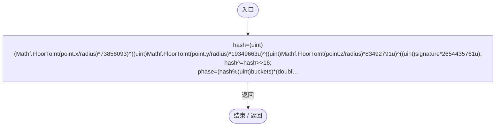

# CohortDeadline.cs

[返回总索引](../README.md) · `Runtime` · `Assets/DarwinPark/Entities/Simulation/CohortDeadline.cs`

[源文件](../../../Assets/DarwinPark/Entities/Simulation/CohortDeadline.cs) · 源码校验：`5a61431a39777856bca75a8b21fa55c3c3d027f0ee676b94040d0dbb4de79c0b`

方法按源文件位置排列。事件/回调引用不表示立即执行；分支与异常说明见总索引。完整源码与可点击关系图请打开离线手册。

## Next · L9

`public static double Next(double after,Vector3 point,int signature,float radius,float interval,int buckets)`

### Editor / Player · Roslyn编译器控制流

