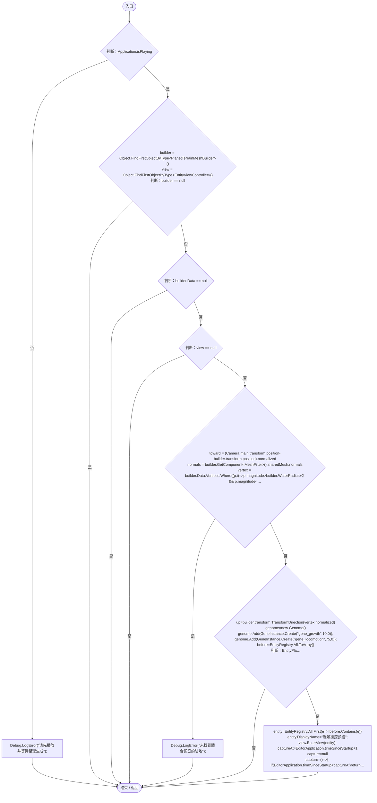
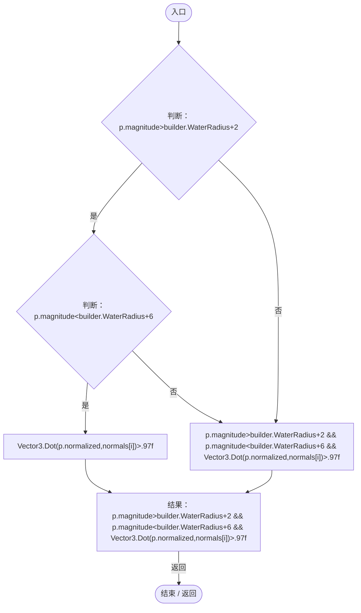
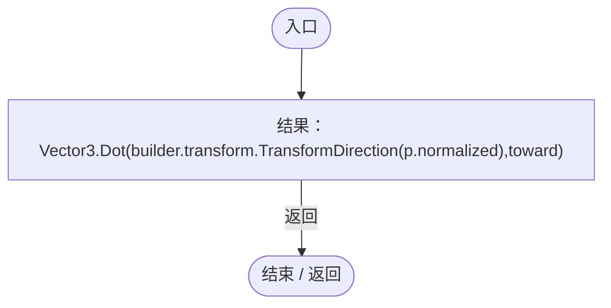
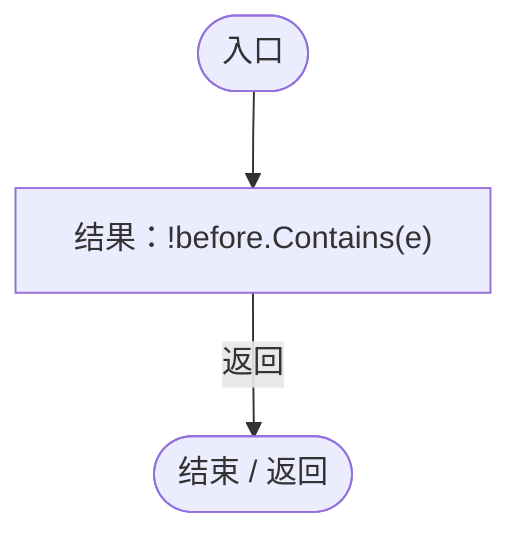
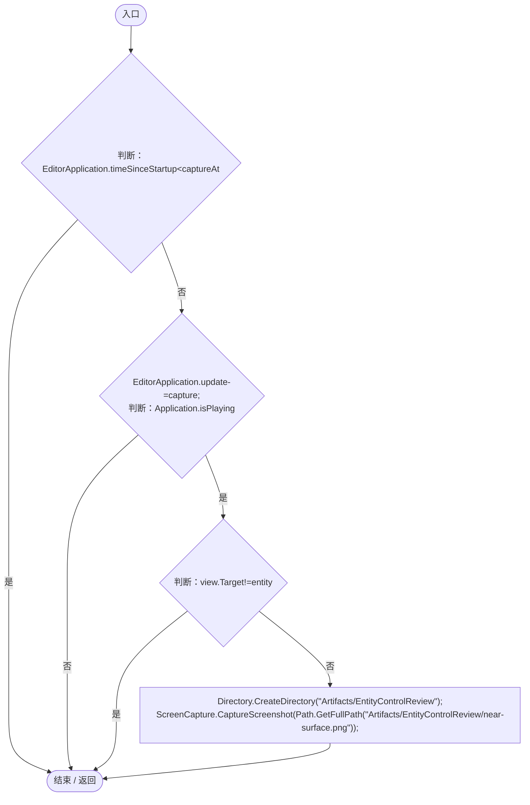

# EntityViewPreview.cs

[返回总索引](../README.md) · `Editor` · `Assets/DarwinPark/Editor/EntityViewPreview.cs`

[源文件](../../../Assets/DarwinPark/Editor/EntityViewPreview.cs) · 源码校验：`d6ffe5814bdaf32e83b396806b17ab8399a994298cb02af0616023e169cbcc14`

方法按源文件位置排列。事件/回调引用不表示立即执行；分支与异常说明见总索引。完整源码与可点击关系图请打开离线手册。

## Preview · L15

`[MenuItem("Tools/Darwin Park/Preview Entity View")] public static void Preview()`

### Editor · Roslyn编译器控制流

项目内调用/回调引用：

- [PlanetTerrainMeshBuilder.Data.get · L78](415285cf043354a9.md#m8382f579717fbc6d)（访问器）
- [Genome.Add · L19](a2ef23f865bc7ee8.md#md9cfdc94b8b8d40f)（方法）
- [GeneInstance.Create · L20](f82e1498d67f5afd.md#m72e94c278de3cf8b)（方法）
- [EntityPlacementUtility.Spawn · L77](6d2c32e632b9c147.md#m79ec74c5c23421cd)（方法）
- [EntityViewController.EnterView · L73](0ad0345f83229ef0.md#mbd7be6d2bbd0ec83)（方法）
- [EntityViewPreview.回调@24 · L24](7ed4c5d34534a614.md#mf17e9540c87bd66d)（回调/委托）
- [EntityViewPreview.回调@25 · L25](7ed4c5d34534a614.md#m6eb75dc0e765d95c)（回调/委托）
- [EntityViewPreview.回调@31 · L31](7ed4c5d34534a614.md#mf8cd5a9266bd4bd2)（回调/委托）
- [EntityViewPreview.回调@35 · L35](7ed4c5d34534a614.md#m491965ada7630fcb)（回调/委托）

## 回调@24 · L24

`( … => 回调`

### Editor · Roslyn编译器控制流

项目内调用/回调引用：

- [PlanetTerrainMeshBuilder.WaterRadius.get · L94](415285cf043354a9.md#m28d8809083881ec1)（访问器）

## 回调@25 · L25

`p … => 回调`

### Editor · Roslyn编译器控制流

## 回调@31 · L31

`e … => 回调`

### Editor · Roslyn编译器控制流

## 回调@35 · L35

`( … => 回调`

### Editor · Roslyn编译器控制流

项目内调用/回调引用：

- [EntityViewController.Target.get · L16](0ad0345f83229ef0.md#m87ca090092a884ab)（访问器）
