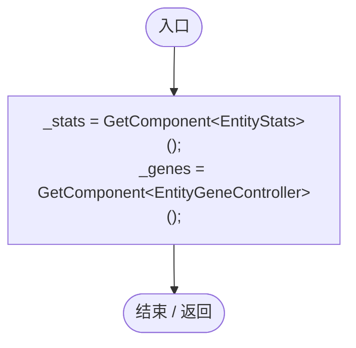

```mermaid
flowchart TD
  b0(["入口"])
  b1{"判断：ServiceLocator.TryGet&lt;SimulationClock&gt;(out var clock)"}
  b2["clock.IsRunning"]
  b3["!ServiceLocator.TryGet&lt;SimulationClock&gt;(out var clock)"]
  b4["running = !ServiceLocator.TryGet&lt;SimulationClock&gt;(out var clock) &#124;&#124; clock.IsRunning"]
  b5{"判断：running"}
  b6{"判断：clock != null"}
  b7["clock.GameDeltaTime"]
  b8["Time.deltaTime"]
  b9["dt = clock != null ? clock.GameDeltaTime : Time.deltaTime"]
  b10{"判断：dt &lt;= 0f"}
  b11["steps=Mathf.CeilToInt(dt/.1f)"]
  b12["index=0"]
  b13{"判断：index&lt;steps"}
  b14{"判断：index==steps-1"}
  b15["dt-index*.1f"]
  b16[".1f"]
  b17["step=index==steps-1?dt-index*.1f:.1f"]
  b18["AdvanceVitals(step);"]
  b19["index++"]
  b20(["结束 / 返回"])
  b0 --> b1
  b1 -->|"是"| b2
  b1 -->|"否"| b3
  b2 --> b4
  b3 --> b4
  b4 --> b5
  b5 -->|"否"| b20
  b5 -->|"是"| b6
  b6 -->|"是"| b7
  b6 -->|"否"| b8
  b7 --> b9
  b8 --> b9
  b9 --> b10
  b10 -->|"是"| b20
  b10 -->|"否"| b11
  b11 --> b12
  b12 --> b13
  b13 -->|"是"| b14
  b13 -->|"否"| b20
  b14 -->|"是"| b15
  b14 -->|"否"| b16
  b15 --> b17
  b16 --> b17
  b17 --> b18
  b18 --> b19
  b19 --> b13

```

```mermaid
flowchart TD
  b0(["入口"])
  b1{"GetComponent&lt;DarwinPark.Entities.Ecology.EggIncubation&gt;()<br/>判断：GetComponent&lt;DarwinPark.Entities.Ecology.EggIncubation&gt;()"}
  b2[".Incubating"]
  b3["GetComponent&lt;DarwinPark.Entities.Ecology.EggIncubation&gt;()"]
  b4{"判断：GetComponent&lt;DarwinPark.Entities.Ecology.EggIncubation&gt;()?.Incubating==true"}
  b5{"判断：_stats.TryGet(&quot;health&quot;,out var eggHealth)"}
  b6{"判断：eggHealth&lt;=0"}
  b7["Ecology.EntityDeathSettlement.Die(GetComponent&lt;DarwinEntity&gt;());"]
  b8{"consumed = Ecology.EcologyEnergyBudget.Consumption(_genes,baseMetabolism,moveMetabolism)*dt<br/>_stats.Modify(&quot;nutrient&quot;, -consumed);<br/>判断：_stats.TryGet(&quot;nutrient&quot;, out var hunger)"}
  b9{"判断：_stats.TryGet(&quot;storedNutrient&quot;, out var stored)"}
  b10{"判断：hunger &lt; 4f"}
  b11{"判断：stored &gt; 0f"}
  b12["transfer = Mathf.Min(10f * dt, stored)<br/>_stats.Modify(&quot;storedNutrient&quot;, -transfer);<br/>_stats.Modify(&quot;nutrient&quot;, transfer);"]
  b13{"repairEfficiency = _genes.GetAttribute(&quot;repairEfficiency&quot;)<br/>repairCapability = _genes.GetAttribute(&quot;repairCapability&quot;)<br/>判断：_stats.TryGet(&quot;health&quot;, out var hp)"}
  b14{"判断：_stats.TryGet(&quot;nutrient&quot;, out var nut2)"}
  b15{"判断：hp &lt; 100f"}
  b16{"判断：hp &gt; repairCapability"}
  b17{"判断：nut2 &gt; 5f"}
  b18{"判断：repairEfficiency &gt; 0f"}
  b19{"GetComponent&lt;EntityEnvironmentHazard&gt;()<br/>判断：GetComponent&lt;EntityEnvironmentHazard&gt;()"}
  b20[".IsDrowning"]
  b21["GetComponent&lt;EntityEnvironmentHazard&gt;()"]
  b22{"判断：GetComponent&lt;EntityEnvironmentHazard&gt;()?.IsDrowning != true"}
  b23["hpToRepair = repairEfficiency * dt<br/>_stats.Modify(&quot;health&quot;, hpToRepair);<br/>_stats.Modify(&quot;nutrient&quot;, -hpToRepair * GameplayTuning.Current.repairFoodPerHealth);"]
  b24{"判断：_stats.TryGet(&quot;nutrient&quot;, out var finalNutrient)"}
  b25{"判断：finalNutrient &lt;= 0f"}
  b26["_stats.Modify(&quot;health&quot;, -GameplayTuning.Current.starvationDamagePerSecond * dt);"]
  b27{"判断：_stats.TryGet(&quot;health&quot;, out var finalHp)"}
  b28{"判断：finalHp &lt;= 0f"}
  b29["Ecology.EntityDeathSettlement.Die(GetComponent&lt;DarwinEntity&gt;());"]
  b30(["结束 / 返回"])
  b0 --> b1
  b1 -->|"否"| b2
  b1 -->|"是"| b3
  b2 --> b4
  b3 --> b4
  b4 -->|"是"| b5
  b4 -->|"否"| b8
  b5 -->|"是"| b6
  b5 -->|"否"| b30
  b6 -->|"是"| b7
  b6 -->|"否"| b30
  b7 --> b30
  b8 -->|"是"| b9
  b8 -->|"否"| b13
  b9 -->|"是"| b10
  b9 -->|"否"| b13
  b10 -->|"是"| b11
  b10 -->|"否"| b13
  b11 -->|"是"| b12
  b11 -->|"否"| b13
  b12 --> b13
  b13 -->|"是"| b14
  b13 -->|"否"| b24
  b14 -->|"是"| b15
  b14 -->|"否"| b24
  b15 -->|"是"| b16
  b15 -->|"否"| b24
  b16 -->|"是"| b17
  b16 -->|"否"| b24
  b17 -->|"是"| b18
  b17 -->|"否"| b24
  b18 -->|"是"| b19
  b18 -->|"否"| b24
  b19 -->|"否"| b20
  b19 -->|"是"| b21
  b20 --> b22
  b21 --> b22
  b22 -->|"是"| b23
  b22 -->|"否"| b24
  b23 --> b24
  b24 -->|"是"| b25
  b24 -->|"否"| b27
  b25 -->|"是"| b26
  b25 -->|"否"| b27
  b26 --> b27
  b27 -->|"是"| b28
  b27 -->|"否"| b30
  b28 -->|"是"| b29
  b28 -->|"否"| b30
  b29 --> b30

```

# EntityVitals.cs

[返回总索引](../README.md) · `Runtime` · `Assets/DarwinPark/Entities/Vitals/EntityVitals.cs`

[源文件](../../../Assets/DarwinPark/Entities/Vitals/EntityVitals.cs) · 源码校验：`e0e9f6ee4a94d84b495fc718f3bd4232cb03a036aba4a52198c0c712ad082512`

方法按源文件位置排列。事件/回调引用不表示立即执行；分支与异常说明见总索引。完整源码与可点击关系图请打开离线手册。

## Awake · L18

`private void Awake()`

### Editor / Player · Roslyn编译器控制流

## Update · L24

`private void Update()`

### Editor / Player · Roslyn编译器控制流

项目内调用/回调引用：

- [ServiceLocator.TryGet · L26](f2fdbe9f9ccd93cb.md#m143b24e6d58471b0)（方法）
- [SimulationClock.IsRunning.get · L22](a8f444aec9614b0a.md#m10f4fe307faca0f0)（访问器）
- [SimulationClock.GameDeltaTime.get · L26](a8f444aec9614b0a.md#me7f11abae18a4f2d)（访问器）
- [EntityVitals.AdvanceVitals · L42](7f68ee05c2ac84bc.md#mf5035ac75b5525f0)（方法）

## AdvanceVitals · L42

`private void AdvanceVitals(float dt)`

### Editor / Player · Roslyn编译器控制流

项目内调用/回调引用：

- [EntityStats.TryGet · L90](75aa86a368efdf24.md#m24ee1433e4a70d94)（方法）
- [EntityDeathSettlement.Die · L11](07fa6bdaadf50796.md#m700276963777d0a6)（方法）
- [EcologyEnergyBudget.Consumption · L54](06a91c8201f26593.md#m9b329937b5f8ae2d)（方法）
- [EntityStats.Modify · L104](75aa86a368efdf24.md#m858c2a75d852ecc1)（方法）
- [EntityGeneController.GetAttribute · L225](7494d53178552f0e.md#mc707943b1138a009)（方法）
- [EntityEnvironmentHazard.IsDrowning.get · L27](5c434d0ba85333b1.md#md1684c4e763e2899)（访问器）
- [GameplayTuning.Current.get · L21](db546e5713b32d53.md#m1caba89e7704d239)（访问器）
