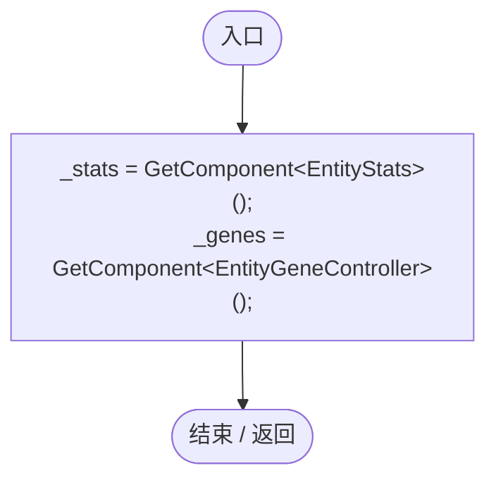
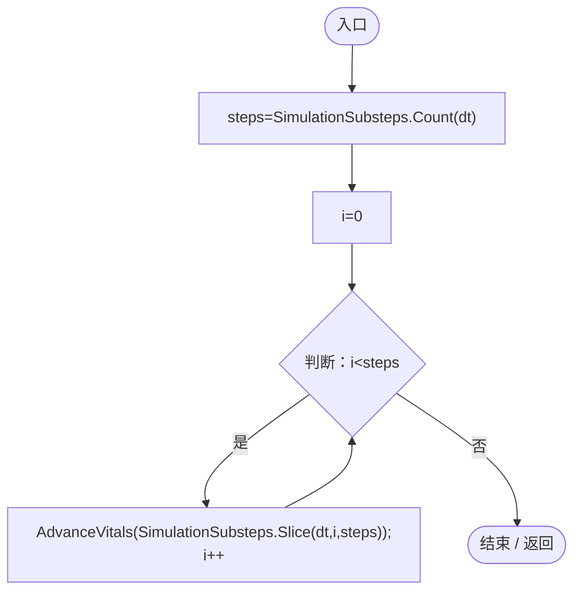

```mermaid
flowchart TD
  b0(["入口"])
  b1{"判断：WorldAuthority.IsReplica"}
  b2{"判断：Simulation.EntityWorkScheduler.Dormant(_genes)"}
  b3{"判断：ServiceLocator.TryGet&lt;SimulationClock&gt;(out var clock)"}
  b4["clock.IsRunning"]
  b5["!ServiceLocator.TryGet&lt;SimulationClock&gt;(out var clock)"]
  b6["running = !ServiceLocator.TryGet&lt;SimulationClock&gt;(out var clock) &#124;&#124; clock.IsRunning"]
  b7{"判断：running"}
  b8{"判断：clock != null"}
  b9["clock.GameDeltaTime"]
  b10["Time.deltaTime"]
  b11["dt = clock != null ? clock.GameDeltaTime : Time.deltaTime"]
  b12{"判断：dt &lt;= 0f"}
  b13["steps=SimulationSubsteps.Count(dt)"]
  b14["index=0"]
  b15{"判断：index&lt;steps"}
  b16["step=SimulationSubsteps.Slice(dt,index,steps)<br/>AdvanceVitals(step);"]
  b17["index++"]
  b18(["结束 / 返回"])
  b0 --> b1
  b1 -->|"是"| b18
  b1 -->|"否"| b2
  b2 -->|"是"| b18
  b2 -->|"否"| b3
  b3 -->|"是"| b4
  b3 -->|"否"| b5
  b4 --> b6
  b5 --> b6
  b6 --> b7
  b7 -->|"否"| b18
  b7 -->|"是"| b8
  b8 -->|"是"| b9
  b8 -->|"否"| b10
  b9 --> b11
  b10 --> b11
  b11 --> b12
  b12 -->|"是"| b18
  b12 -->|"否"| b13
  b13 --> b14
  b14 --> b15
  b15 -->|"是"| b16
  b15 -->|"否"| b18
  b16 --> b17
  b17 --> b15

```

```mermaid
flowchart TD
  b0(["入口"])
  b1["performance=PerformanceTimings.Measure(PerformanceTimings.Area.Vitals)"]
  b2{"OptionalComponent.Read&lt;DarwinPark.Entities.Ecology.EggIncubation&gt;(this)<br/>判断：OptionalComponent.Read&lt;DarwinPark.Entities.Ecology.EggIncubation&gt;(this)"}
  b3[".Incubating"]
  b4["OptionalComponent.Read&lt;DarwinPark.Entities.Ecology.EggIncubation&gt;(this)"]
  b5{"判断：OptionalComponent.Read&lt;DarwinPark.Entities.Ecology.EggIncubation&gt;(this)?.Incubating==true"}
  b6{"判断：_stats.TryGet(&quot;health&quot;,out var eggHealth)"}
  b7{"判断：eggHealth&lt;=0"}
  b8["Ecology.EntityDeathSettlement.Die(GetComponent&lt;DarwinEntity&gt;());"]
  b9{"consumed = Ecology.EcologyEnergyBudget.Consumption(_genes,baseMetabolism,moveMetabolism)*dt<br/>_stats.Modify(&quot;nutrient&quot;, -consumed);<br/>判断：_stats.TryGet(&quot;nutrient&quot;, out var hunger)"}
  b10{"判断：_stats.TryGet(&quot;storedNutrient&quot;, out var stored)"}
  b11{"判断：hunger &lt; 4f"}
  b12{"判断：stored &gt; 0f"}
  b13["transfer = Mathf.Min(10f * dt, stored)<br/>_stats.Modify(&quot;storedNutrient&quot;, -transfer);<br/>_stats.Modify(&quot;nutrient&quot;, transfer);"]
  b14{"判断：_stats.TryGet(&quot;health&quot;, out var hp)"}
  b15{"判断：hp&lt;100f"}
  b16{"判断：_stats.TryGet(&quot;nutrient&quot;, out var nut2)"}
  b17{"判断：nut2&gt;5f"}
  b18{"repairEfficiency = _genes.GetAttribute(&quot;repairEfficiency&quot;)<br/>repairCapability = _genes.GetAttribute(&quot;repairCapability&quot;)<br/>判断：hp &lt; 100f"}
  b19{"判断：hp &gt; repairCapability"}
  b20{"判断：nut2 &gt; 5f"}
  b21{"判断：repairEfficiency &gt; 0f"}
  b22{"GetComponent&lt;EntityEnvironmentHazard&gt;()<br/>判断：GetComponent&lt;EntityEnvironmentHazard&gt;()"}
  b23[".IsDrowning"]
  b24["GetComponent&lt;EntityEnvironmentHazard&gt;()"]
  b25{"判断：GetComponent&lt;EntityEnvironmentHazard&gt;()?.IsDrowning != true"}
  b26["hpToRepair = repairEfficiency * dt<br/>_stats.Modify(&quot;health&quot;, hpToRepair);<br/>_stats.Modify(&quot;nutrient&quot;, -hpToRepair * GameplayTuning.Current.repairFoodPerHealth);"]
  b27{"判断：_stats.TryGet(&quot;nutrient&quot;, out var finalNutrient)"}
  b28{"判断：finalNutrient &lt;= 0f"}
  b29["_stats.Modify(&quot;health&quot;, -GameplayTuning.Current.starvationDamagePerSecond * dt);"]
  b30{"判断：_stats.TryGet(&quot;health&quot;, out var finalHp)"}
  b31{"判断：finalHp &lt;= 0f"}
  b32["Ecology.EntityDeathSettlement.Die(GetComponent&lt;DarwinEntity&gt;());"]
  b33["performance=PerformanceTimings.Measure(PerformanceTimings.Area.Vitals)"]
  b34(["结束 / 返回"])
  b0 --> b1
  b1 --> b2
  b2 -->|"否"| b3
  b2 -->|"是"| b4
  b3 --> b5
  b4 --> b5
  b5 -->|"是"| b6
  b5 -->|"否"| b9
  b6 -->|"是"| b7
  b6 -->|"否 · 经过finally 33"| b34
  b7 -->|"是"| b8
  b7 -->|"否 · 经过finally 33"| b34
  b8 -->|"经过finally 33"| b34
  b9 -->|"是"| b10
  b9 -->|"否"| b14
  b10 -->|"是"| b11
  b10 -->|"否"| b14
  b11 -->|"是"| b12
  b11 -->|"否"| b14
  b12 -->|"是"| b13
  b12 -->|"否"| b14
  b13 --> b14
  b14 -->|"是"| b15
  b14 -->|"否"| b27
  b15 -->|"是"| b16
  b15 -->|"否"| b27
  b16 -->|"是"| b17
  b16 -->|"否"| b27
  b17 -->|"是"| b18
  b17 -->|"否"| b27
  b18 -->|"是"| b19
  b18 -->|"否"| b27
  b19 -->|"是"| b20
  b19 -->|"否"| b27
  b20 -->|"是"| b21
  b20 -->|"否"| b27
  b21 -->|"是"| b22
  b21 -->|"否"| b27
  b22 -->|"否"| b23
  b22 -->|"是"| b24
  b23 --> b25
  b24 --> b25
  b25 -->|"是"| b26
  b25 -->|"否"| b27
  b26 --> b27
  b27 -->|"是"| b28
  b27 -->|"否"| b30
  b28 -->|"是"| b29
  b28 -->|"否"| b30
  b29 --> b30
  b30 -->|"是"| b31
  b30 -->|"否 · 经过finally 33"| b34
  b31 -->|"是"| b32
  b31 -->|"否 · 经过finally 33"| b34
  b32 -->|"经过finally 33"| b34
  b2 -. "退出保护区时 finally（示意）" .-> b33

```

# EntityVitals.cs

[返回总索引](../README.md) · `Runtime` · `Assets/DarwinPark/Entities/Vitals/EntityVitals.cs`

[源文件](../../../Assets/DarwinPark/Entities/Vitals/EntityVitals.cs) · 源码校验：`f689eccec76f43dabde5d56ba78edde4fde01c49ba2bfe2d74b3be6b0daf8c3d`

方法按源文件位置排列。事件/回调引用不表示立即执行；分支与异常说明见总索引。完整源码与可点击关系图请打开离线手册。

## Awake · L19

`private void Awake()`

### Editor / Player · Roslyn编译器控制流

## Update · L25

`private void Update()`

### Editor / Player · Roslyn编译器控制流

项目内调用/回调引用：

- [EntityWorkScheduler.Dormant · L72](465ccdbb260bcac2.md#m4a31d87a27ce69fd)（方法）
- [ServiceLocator.TryGet · L26](f2fdbe9f9ccd93cb.md#m143b24e6d58471b0)（方法）
- [SimulationClock.IsRunning.get · L22](a8f444aec9614b0a.md#m10f4fe307faca0f0)（访问器）
- [SimulationClock.GameDeltaTime.get · L26](a8f444aec9614b0a.md#me7f11abae18a4f2d)（访问器）
- [SimulationSubsteps.Count · L10](44755274b83df7ba.md#m9b3c9def7f9642d1)（方法）
- [SimulationSubsteps.Slice · L11](44755274b83df7ba.md#ma075f8159da64c99)（方法）
- [EntityVitals.AdvanceVitals · L50](7f68ee05c2ac84bc.md#m3765bb5c38be87c4)（方法）

## AdvanceShared · L48

`public void AdvanceShared(float dt)`

★ 适配：供代表和醒来补算使用，与普通Update共用小步逻辑。

### Editor / Player · Roslyn编译器控制流

项目内调用/回调引用：

- [SimulationSubsteps.Count · L10](44755274b83df7ba.md#m9b3c9def7f9642d1)（方法）
- [EntityVitals.AdvanceVitals · L50](7f68ee05c2ac84bc.md#m3765bb5c38be87c4)（方法）
- [SimulationSubsteps.Slice · L11](44755274b83df7ba.md#ma075f8159da64c99)（方法）

## AdvanceVitals · L50

`private void AdvanceVitals(float dt)`

### Editor / Player · Roslyn编译器控制流

项目内调用/回调引用：

- [PerformanceTimings.Measure · L24](a8403a4c7503726d.md#m592e16f2b6513efd)（方法）
- [OptionalComponent.Read · L7](806c46b42ced4d36.md#m69622a4dee165c5a)（方法）
- [EntityStats.TryGet · L93](75aa86a368efdf24.md#m03cef847022eee28)（方法）
- [EntityDeathSettlement.Die · L12](07fa6bdaadf50796.md#m9a912ca8df50ff6f)（方法）
- [EcologyEnergyBudget.Consumption · L48](06a91c8201f26593.md#mda50abeff34fd455)（方法）
- [EntityStats.Modify · L107](75aa86a368efdf24.md#mf17c464aaa04f6f2)（方法）
- [EntityGeneController.GetAttribute · L288](7494d53178552f0e.md#m45127bcdd833aaf5)（方法）
- [EntityEnvironmentHazard.IsDrowning.get · L27](5c434d0ba85333b1.md#md1684c4e763e2899)（访问器）
- [GameplayTuning.Current.get · L46](db546e5713b32d53.md#m4fa691bd8a3b9618)（访问器）
