# RuntimeDiagnosticsRegression.cs

[返回总索引](../README.md) · `Editor` · `Assets/DarwinPark/Editor/RuntimeDiagnosticsRegression.cs`

[源文件](../../../Assets/DarwinPark/Editor/RuntimeDiagnosticsRegression.cs) · 源码校验：`79a056ed27a9941ce6a6aca541a101b5a883861886b998cbf21ba20a7356c4e9`

方法按源文件位置排列。事件/回调引用不表示立即执行；分支与异常说明见总索引。完整源码与可点击关系图请打开离线手册。

<a id="m3be687862bbab49e"></a>

## Folder.get · L20

`private static string Folder`


### Editor · 语法控制结构 / 声明（非CFG）

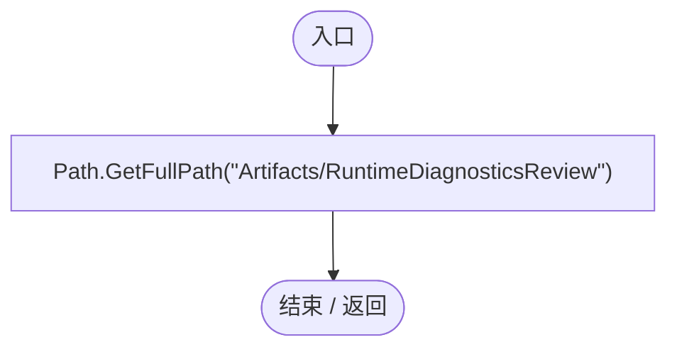

<a id="maaeb581fbb236bb4"></a>

## Check · L21

`private static void Check(bool ok,string text)`


### Editor · Roslyn编译器控制流

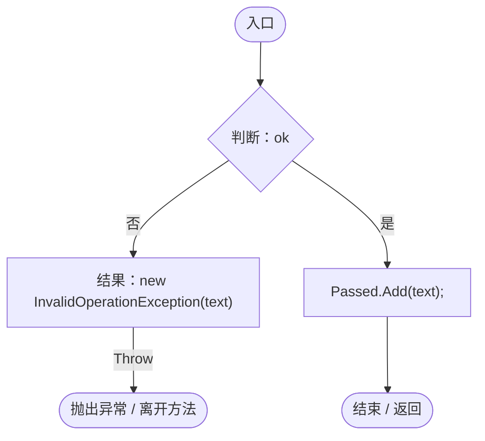

<a id="mde759d0912d67e97"></a>

## Read · L22

`private static string Read(string path)`


### Editor · Roslyn编译器控制流

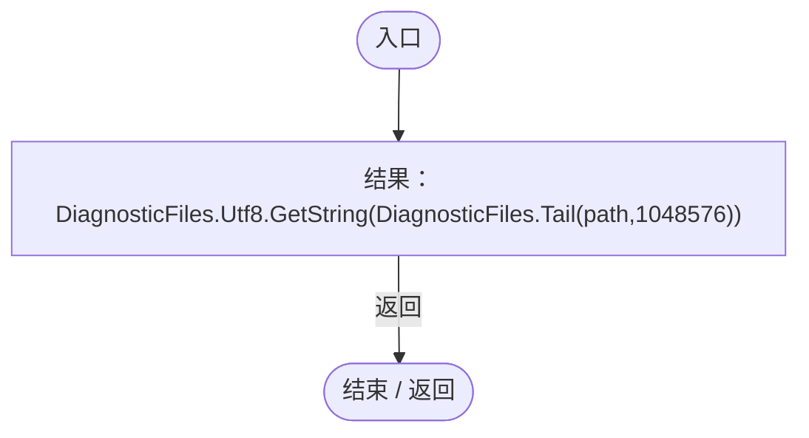

项目内调用/回调引用：

- [DiagnosticFiles.Tail · L20](d8a018f478416f7b.md#m5474ad6077e3293c)（方法）

<a id="mf88e50816b560f03"></a>

## RunBatch · L23

`public static void RunBatch()`


### Editor · Roslyn编译器控制流

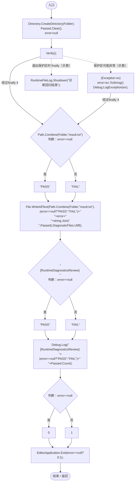

项目内调用/回调引用：

- [RuntimeDiagnosticsRegression.Verify · L32](8065f8a70f2edae9.md#m2edc56e1e8fbcb58)（方法）
- [RuntimeFileLog.Shutdown · L49](8080b38a7e1c5585.md#m817cce367fb66edc)（方法）

<a id="m3703a9e814e1ae9c"></a>

## Fast · L31

`private static RuntimeDiagnosticSettings Fast()`


### Editor · Roslyn编译器控制流

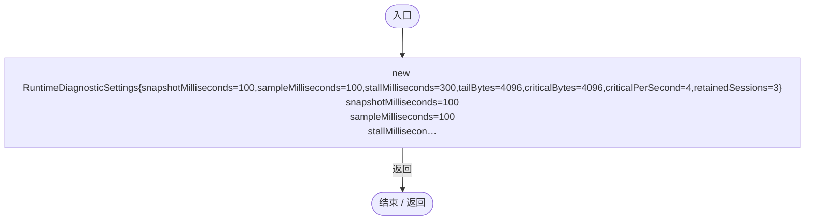

<a id="m2edc56e1e8fbcb58"></a>

## Verify · L32

`private static void Verify()`


### Editor · Roslyn编译器控制流

```mermaid
flowchart TD
  b0(["入口"])
  b1["RuntimeDiagnosticSettings.Load().Validate();<br/>Check(true,&quot;诊断JSON可加载，所有磁盘和频率预算有效&quot;);<br/>root=Path.Combine(Folder,Guid.NewGuid().ToString(&quot;N&quot;))<br/>Directory.CreateDirectory(root);<br/>logs=Path.Combine(root,&quot;capture&quot;)<br/>config=RuntimeLogSettings.Load()<br/>…"]
  b2["结果：new InvalidOperationException(&quot;诊断回归-预期异常&quot;)"]
  x2(["抛出异常 / 离开方法"])
  b3["(Exception ex)<br/>Debug.LogException(ex);"]
  b4["Task.Run(()=&gt;Debug.LogError(&quot;诊断回归-后台线程错误&quot;)).GetAwaiter().GetResult();<br/>critical=Read(Path.Combine(run,&quot;critical.log&quot;))"]
  b5{"判断：critical.Contains(&quot;预期错误&quot;)"}
  b6{"判断：critical.Contains(&quot;预期异常&quot;)"}
  b7{"判断：critical.Contains(nameof(Verify))"}
  b8["critical.Contains(&quot;后台线程错误&quot;)"]
  b9["critical.Contains(&quot;预期错误&quot;)&amp;&amp;critical.Contains(&quot;预期异常&quot;)&amp;&amp;critical.Contains(nameof(Verify))&amp;&amp;critical.Contains(&quot;后台线程错误&quot;)"]
  b10["Check(critical.Contains(&quot;预期错误&quot;)&amp;&amp;critical.Contains(&quot;预期异常&quot;)&amp;&amp;critical.Contains(nameof(Verify))&amp;&amp;critical.Contains(&quot;后台线程错误&quot;),&quot;主线程与后台异常在回调返回前独立落盘，含真实调用栈&quot;);"]
  b11["typeof(RuntimeCrashDiagnostics).GetMethod(&quot;Unobserved&quot;,BindingFlags.NonPublic&#124;BindingFlags.Static).Invoke(null,new object[]{null,new UnobservedTaskExceptionEventArgs(new AggregateException(&quot;预期Task异常&quot;))});<br/>Check(Read(Path.Combine(run,&quot;cri…"]
  b12["archive=ZipFile.OpenRead(zip)"]
  b13{"判断：archive.Entries.Any(e=&gt;e.Name==&quot;critical.log&quot;)"}
  b14{"判断：archive.Entries.Any(e=&gt;e.Name==&quot;state.json&quot;)"}
  b15["archive.Entries.Any(e=&gt;e.Name==&quot;session.txt&quot;)"]
  b16["archive.Entries.Any(e=&gt;e.Name==&quot;critical.log&quot;)&amp;&amp;archive.Entries.Any(e=&gt;e.Name==&quot;state.json&quot;)&amp;&amp;archive.Entries.Any(e=&gt;e.Name==&quot;session.txt&quot;)"]
  b17["Check(archive.Entries.Any(e=&gt;e.Name==&quot;critical.log&quot;)&amp;&amp;archive.Entries.Any(e=&gt;e.Name==&quot;state.json&quot;)&amp;&amp;archive.Entries.Any(e=&gt;e.Name==&quot;session.txt&quot;),&quot;一键异步导出包含错误、状态、版本环境&quot;);"]
  b18["Check(!archive.Entries.Any(e=&gt;e.Name==&quot;active.lock&quot;&#124;&#124;e.Name==&quot;Editor.log&quot;),&quot;导出排除文件锁及可能含Unity授权信息的Editor.log&quot;);<br/>state=archive.Entries.First(e=&gt;e.Name==&quot;state.json&quot;)"]
  b19["reader=new StreamReader(state.Open())"]
  b20["Check(reader.ReadToEnd().Contains(&quot;pendingSimulationSeconds&quot;),&quot;状态包含帧时间、模拟积压等排查卡顿字段&quot;);"]
  b21{"判断：reader=new StreamReader(state.Open())"}
  b22["reader=new StreamReader(state.Open())"]
  b23["连接 / 离开区域"]
  b24{"判断：archive=ZipFile.OpenRead(zip)"}
  b25["archive=ZipFile.OpenRead(zip)"]
  b26["连接 / 离开区域"]
  b27["RuntimeFileLog.Shutdown(&quot;预期正常退出&quot;);<br/>Check(File.Exists(Path.Combine(run,&quot;completed.txt&quot;)),&quot;正常关闭排空后保存完成标记&quot;);<br/>fatalCapture=Path.Combine(root,&quot;fatal-capture&quot;)<br/>RuntimeFileLog.StartSession(config,fatalCapture,fatalCapture);<br/>RuntimeCrashDiagnost…"]
  b28{"判断：Read(Path.Combine(fatalRun,&quot;critical.log&quot;)).Contains(&quot;终止性异常夹具&quot;)"}
  b29["!File.Exists(Path.Combine(fatalRun,&quot;completed.txt&quot;))"]
  b30["Read(Path.Combine(fatalRun,&quot;critical.log&quot;)).Contains(&quot;终止性异常夹具&quot;)"]
  b31["Check(Read(Path.Combine(fatalRun,&quot;critical.log&quot;)).Contains(&quot;终止性异常夹具&quot;)&amp;&amp;!File.Exists(Path.Combine(fatalRun,&quot;completed.txt&quot;)),&quot;终止性异常处理器保留错误，后续关闭也不能覆盖为正常退出&quot;);"]
  b32{"判断：ulong.TryParse(DiagnosticMemory.WorkingSetBytes(),out var resident)"}
  b33["resident&gt;0"]
  b34["ulong.TryParse(DiagnosticMemory.WorkingSetBytes(),out var resident)"]
  b35["Check(ulong.TryParse(DiagnosticMemory.WorkingSetBytes(),out var resident)&amp;&amp;resident&gt;0,&quot;Windows Mono可读取真实进程工作集内存&quot;);"]
  b36["sessions=Path.Combine(root,&quot;sessions&quot;)<br/>native=Path.Combine(root,&quot;Player.log&quot;)<br/>File.WriteAllText(native,&quot;Unity原始输出-中文\n&quot;,DiagnosticFiles.Utf8);<br/>settings=Fast()<br/>a=new RuntimeDiagnosticSession(sessions,settings,&quot;版本=回归&quot;,()=&gt;native,native)<br/>a.…"]
  b37{"判断：b.RecoveredSessions==0"}
  b38["!File.Exists(Path.Combine(a.DirectoryPath,&quot;abnormal-exit.txt&quot;))"]
  b39["b.RecoveredSessions==0"]
  b40["Check(b.RecoveredSessions==0&amp;&amp;!File.Exists(Path.Combine(a.DirectoryPath,&quot;abnormal-exit.txt&quot;)),&quot;其他仍在运行的实例不被误报为崩溃&quot;);"]
  b41["Thread.Sleep(450);<br/>a.Checkpoint();<br/>health=Read(Path.Combine(a.DirectoryPath,&quot;health.txt&quot;))"]
  b42{"判断：health.Contains(&quot;疑似主线程停顿=True&quot;)"}
  b43["Read(Path.Combine(a.DirectoryPath,&quot;state.json&quot;)).Contains(&quot;800&quot;)"]
  b44["health.Contains(&quot;疑似主线程停顿=True&quot;)"]
  b45["Check(health.Contains(&quot;疑似主线程停顿=True&quot;)&amp;&amp;Read(Path.Combine(a.DirectoryPath,&quot;state.json&quot;)).Contains(&quot;800&quot;),&quot;主线程不再心跳时后台记录疑似卡死及最后实体数&quot;);"]
  b46["a.Pulse();<br/>a.Checkpoint();<br/>Check(Read(Path.Combine(a.DirectoryPath,&quot;health.txt&quot;)).Contains(&quot;疑似主线程停顿=False&quot;),&quot;恢复心跳后停顿提示清除&quot;);"]
  b47["i=0"]
  b48{"判断：i&lt;100"}
  b49["a.RecordCritical(&quot;同秒错误风暴-&quot;+i,&quot;&quot;);<br/>i++"]
  b50["a.RecordCritical(&quot;致命异常越过限流&quot;,&quot;&quot;,true);<br/>a.Checkpoint();"]
  b51{"判断：Read(Path.Combine(a.DirectoryPath,&quot;critical.log&quot;)).Contains(&quot;致命异常越过限流&quot;)"}
  b52["!Read(Path.Combine(a.DirectoryPath,&quot;health.txt&quot;)).Contains(&quot;紧急日志限流数=0\n&quot;)"]
  b53["Read(Path.Combine(a.DirectoryPath,&quot;critical.log&quot;)).Contains(&quot;致命异常越过限流&quot;)"]
  b54["Check(Read(Path.Combine(a.DirectoryPath,&quot;critical.log&quot;)).Contains(&quot;致命异常越过限流&quot;)&amp;&amp;!Read(Path.Combine(a.DirectoryPath,&quot;health.txt&quot;)).Contains(&quot;紧急日志限流数=0\n&quot;),&quot;错误风暴有界并记录省略数量，致命异常仍保留&quot;);"]
  b55["i=0"]
  b56{"判断：i&lt;20"}
  b57["a.RecordCritical(&quot;轮转-&quot;+i+new string('中',800),&quot;&quot;,true);<br/>i++"]
  b58{"判断：File.Exists(Path.Combine(a.DirectoryPath,&quot;critical-previous.log&quot;))"}
  b59{"判断：new FileInfo(Path.Combine(a.DirectoryPath,&quot;critical.log&quot;)).Length&lt;=settings.criticalBytes"}
  b60["new FileInfo(Path.Combine(a.DirectoryPath,&quot;critical-previous.log&quot;)).Length&lt;=settings.criticalBytes"]
  b61["File.Exists(Path.Combine(a.DirectoryPath,&quot;critical-previous.log&quot;))&amp;&amp;new FileInfo(Path.Combine(a.DirectoryPath,&quot;critical.log&quot;)).Length&lt;=settings.criticalBytes&amp;&amp;new FileInfo(Path.Combine(a.DirectoryPath,&quot;critical-previous.log&quot;)).Length&lt;=se…"]
  b62["Check(File.Exists(Path.Combine(a.DirectoryPath,&quot;critical-previous.log&quot;))&amp;&amp;new FileInfo(Path.Combine(a.DirectoryPath,&quot;critical.log&quot;)).Length&lt;=settings.criticalBytes&amp;&amp;new FileInfo(Path.Combine(a.DirectoryPath,&quot;critical-previous.log&quot;)).Leng…"]
  b63["a.Close(false,&quot;模拟未正常退出&quot;);<br/>old=a.DirectoryPath"]
  b64["c=new RuntimeDiagnosticSession(sessions,settings,&quot;重启&quot;,()=&gt;native,native)"]
  b65{"判断：c.RecoveredSessions==1"}
  b66["File.Exists(Path.Combine(old,&quot;abnormal-exit.txt&quot;))"]
  b67["c.RecoveredSessions==1"]
  b68["Check(c.RecoveredSessions==1&amp;&amp;File.Exists(Path.Combine(old,&quot;abnormal-exit.txt&quot;)),&quot;重启识别未正常结束的上次会话并保留证据&quot;);"]
  b69{"判断：c=new RuntimeDiagnosticSession(sessions,settings,&quot;重启&quot;,()=&gt;native,native)"}
  b70["c=new RuntimeDiagnosticSession(sessions,settings,&quot;重启&quot;,()=&gt;native,native)"]
  b71["连接 / 离开区域"]
  b72["b.Dispose();<br/>Check(File.Exists(Path.Combine(b.DirectoryPath,&quot;completed.txt&quot;)),&quot;并发实例正常退出各自保存标记&quot;);<br/>unrelated=Path.Combine(sessions,&quot;unrelated&quot;)<br/>Directory.CreateDirectory(unrelated);<br/>File.WriteAllText(Path.Combine(unrelated,&quot;keep.txt&quot;),&quot;保留&quot;);"]
  b73["i=0"]
  b74{"判断：i&lt;5"}
  b75["c=new RuntimeDiagnosticSession(sessions,settings,&quot;保留策略&quot;,()=&gt;native,native)"]
  b76["连接 / 离开区域"]
  b77{"判断：c=new RuntimeDiagnosticSession(sessions,settings,&quot;保留策略&quot;,()=&gt;native,native)"}
  b78["c=new RuntimeDiagnosticSession(sessions,settings,&quot;保留策略&quot;,()=&gt;native,native)"]
  b79["连接 / 离开区域"]
  b80["i++"]
  b81{"判断：DiagnosticFiles.Runs(sessions).Length==settings.retainedSessions"}
  b82["File.Exists(Path.Combine(unrelated,&quot;keep.txt&quot;))"]
  b83["DiagnosticFiles.Runs(sessions).Length==settings.retainedSessions"]
  b84["Check(DiagnosticFiles.Runs(sessions).Length==settings.retainedSessions&amp;&amp;File.Exists(Path.Combine(unrelated,&quot;keep.txt&quot;)),&quot;只清理本功能拥有的会话且总数量受限&quot;);"]
  b85["failedRoot=Path.Combine(root,&quot;failed&quot;)<br/>failed=new RuntimeDiagnosticSession(failedRoot,settings,&quot;故障测试&quot;,()=&gt;native,native)<br/>File.WriteAllText(Path.Combine(failed.DirectoryPath,&quot;critical.log&quot;),&quot;&quot;);<br/>File.Delete(Path.Combine(failed.DirectoryPa…"]
  b86["archive=ZipFile.OpenRead(exported)"]
  b87{"判断：archive.Entries.Any(e=&gt;e.Name==&quot;crash.dmp&quot;)"}
  b88{"判断：archive.Entries.Any(e=&gt;e.Name==&quot;error.log&quot;)"}
  b89["!archive.Entries.Any(e=&gt;e.Name==&quot;private.bin&quot;&#124;&#124;e.Name==&quot;world-save.json&quot;)"]
  b90["archive.Entries.Any(e=&gt;e.Name==&quot;crash.dmp&quot;)&amp;&amp;archive.Entries.Any(e=&gt;e.Name==&quot;error.log&quot;)&amp;&amp;!archive.Entries.Any(e=&gt;e.Name==&quot;private.bin&quot;&#124;&#124;e.Name==&quot;world-save.json&quot;)"]
  b91["Check(archive.Entries.Any(e=&gt;e.Name==&quot;crash.dmp&quot;)&amp;&amp;archive.Entries.Any(e=&gt;e.Name==&quot;error.log&quot;)&amp;&amp;!archive.Entries.Any(e=&gt;e.Name==&quot;private.bin&quot;&#124;&#124;e.Name==&quot;world-save.json&quot;),&quot;候选原生转储可收集，非白名单文件不导出&quot;);"]
  b92{"判断：archive=ZipFile.OpenRead(exported)"}
  b93["archive=ZipFile.OpenRead(exported)"]
  b94["连接 / 离开区域"]
  b95["large=Path.Combine(nativeRoot,&quot;large.dmp&quot;)"]
  b96["file=File.Create(large)"]
  b97["file.SetLength(settings.exportMaximumBytes+1L);"]
  b98{"判断：file=File.Create(large)"}
  b99["file=File.Create(large)"]
  b100["连接 / 离开区域"]
  b101["bounded=DiagnosticFiles.Export(sessions,nativeRoot,settings)"]
  b102["archive=ZipFile.OpenRead(bounded)"]
  b103["reader=new StreamReader(archive.GetEntry(&quot;README.txt&quot;).Open())"]
  b104{"判断：archive.Entries.Any(e=&gt;e.Name==&quot;large.dmp&quot;)"}
  b105["reader.ReadToEnd().Contains(&quot;预算不足&quot;)"]
  b106["!archive.Entries.Any(e=&gt;e.Name==&quot;large.dmp&quot;)"]
  b107["Check(!archive.Entries.Any(e=&gt;e.Name==&quot;large.dmp&quot;)&amp;&amp;reader.ReadToEnd().Contains(&quot;预算不足&quot;),&quot;超出预算的转储不打包且明确注明遗漏原因&quot;);"]
  b108{"判断：reader=new StreamReader(archive.GetEntry(&quot;README.txt&quot;).Open())"}
  b109["reader=new StreamReader(archive.GetEntry(&quot;README.txt&quot;).Open())"]
  b110["连接 / 离开区域"]
  b111{"判断：archive=ZipFile.OpenRead(bounded)"}
  b112["archive=ZipFile.OpenRead(bounded)"]
  b113["连接 / 离开区域"]
  b114["i=0"]
  b115{"判断：i&lt;4"}
  b116["DiagnosticFiles.Export(sessions,nativeRoot,settings);<br/>i++"]
  b117["Check(Directory.GetFiles(Path.Combine(sessions,&quot;exports&quot;),&quot;*.zip&quot;).Length==settings.retainedExports,&quot;导出包保留数量受限&quot;);"]
  b118(["结束 / 返回"])
  b0 --> b1
  b1 --> b2
  b2 -->|"Throw"| x2
  b3 --> b4
  b4 --> b5
  b5 -->|"是"| b6
  b5 -->|"否"| b9
  b6 -->|"是"| b7
  b6 -->|"否"| b9
  b7 -->|"是"| b8
  b7 -->|"否"| b9
  b8 --> b10
  b9 --> b10
  b10 --> b11
  b11 --> b12
  b12 --> b13
  b13 -->|"是"| b14
  b13 -->|"否"| b16
  b14 -->|"是"| b15
  b14 -->|"否"| b16
  b15 --> b17
  b16 --> b17
  b17 --> b18
  b18 --> b19
  b19 --> b20
  b20 -->|"经过finally 21,24"| b27
  b21 -->|"否"| b22
  b21 -->|"是"| b23
  b22 --> b23
  b24 -->|"否"| b25
  b24 -->|"是"| b26
  b25 --> b26
  b27 --> b28
  b28 -->|"是"| b29
  b28 -->|"否"| b30
  b29 --> b31
  b30 --> b31
  b31 --> b32
  b32 -->|"是"| b33
  b32 -->|"否"| b34
  b33 --> b35
  b34 --> b35
  b35 --> b36
  b36 --> b37
  b37 -->|"是"| b38
  b37 -->|"否"| b39
  b38 --> b40
  b39 --> b40
  b40 --> b41
  b41 --> b42
  b42 -->|"是"| b43
  b42 -->|"否"| b44
  b43 --> b45
  b44 --> b45
  b45 --> b46
  b46 --> b47
  b47 --> b48
  b48 -->|"是"| b49
  b48 -->|"否"| b50
  b49 --> b48
  b50 --> b51
  b51 -->|"是"| b52
  b51 -->|"否"| b53
  b52 --> b54
  b53 --> b54
  b54 --> b55
  b55 --> b56
  b56 -->|"是"| b57
  b56 -->|"否"| b58
  b57 --> b56
  b58 -->|"是"| b59
  b58 -->|"否"| b61
  b59 -->|"是"| b60
  b59 -->|"否"| b61
  b60 --> b62
  b61 --> b62
  b62 --> b63
  b63 --> b64
  b64 --> b65
  b65 -->|"是"| b66
  b65 -->|"否"| b67
  b66 --> b68
  b67 --> b68
  b68 -->|"经过finally 69"| b72
  b69 -->|"否"| b70
  b69 -->|"是"| b71
  b70 --> b71
  b72 --> b73
  b73 --> b74
  b74 -->|"是"| b75
  b74 -->|"否"| b81
  b75 --> b76
  b76 -->|"经过finally 77"| b80
  b77 -->|"否"| b78
  b77 -->|"是"| b79
  b78 --> b79
  b80 --> b74
  b81 -->|"是"| b82
  b81 -->|"否"| b83
  b82 --> b84
  b83 --> b84
  b84 --> b85
  b85 --> b86
  b86 --> b87
  b87 -->|"是"| b88
  b87 -->|"否"| b90
  b88 -->|"是"| b89
  b88 -->|"否"| b90
  b89 --> b91
  b90 --> b91
  b91 -->|"经过finally 92"| b95
  b92 -->|"否"| b93
  b92 -->|"是"| b94
  b93 --> b94
  b95 --> b96
  b96 --> b97
  b97 -->|"经过finally 98"| b101
  b98 -->|"否"| b99
  b98 -->|"是"| b100
  b99 --> b100
  b101 --> b102
  b102 --> b103
  b103 --> b104
  b104 -->|"否"| b105
  b104 -->|"是"| b106
  b105 --> b107
  b106 --> b107
  b107 -->|"经过finally 108,111"| b114
  b108 -->|"否"| b109
  b108 -->|"是"| b110
  b109 --> b110
  b111 -->|"否"| b112
  b111 -->|"是"| b113
  b112 --> b113
  b114 --> b115
  b115 -->|"是"| b116
  b115 -->|"否"| b117
  b116 --> b115
  b117 --> b118
  b2 -. "保护区可能异常（示意）" .-> b3
  b20 -. "退出保护区时 finally（示意）" .-> b21
  b13 -. "退出保护区时 finally（示意）" .-> b24
  b65 -. "退出保护区时 finally（示意）" .-> b69
  b76 -. "退出保护区时 finally（示意）" .-> b77
  b87 -. "退出保护区时 finally（示意）" .-> b92
  b97 -. "退出保护区时 finally（示意）" .-> b98
  b104 -. "退出保护区时 finally（示意）" .-> b108
  b103 -. "退出保护区时 finally（示意）" .-> b111

```

项目内调用/回调引用：

- [RuntimeDiagnosticSettings.Validate · L17](e1f8672949291bee.md#mc96db0457c0367e1)（方法）
- [RuntimeDiagnosticSettings.Load · L23](e1f8672949291bee.md#md976fd935d55dddb)（方法）
- [RuntimeDiagnosticsRegression.Check · L21](8065f8a70f2edae9.md#maaeb581fbb236bb4)（方法）
- [RuntimeLogSettings.Load · L20](ade1290a5194a825.md#m0f3085aaf1b46923)（方法）
- [RuntimeFileLog.StartSession · L35](8080b38a7e1c5585.md#mf0de887184e18c16)（方法）
- [RuntimeCrashDiagnostics.Start · L31](b7eea720e09afd0b.md#m1ad77d29c65c9dff)（方法）
- [RuntimeDiagnosticsRegression.Read · L22](8065f8a70f2edae9.md#mde759d0912d67e97)（方法）
- [RuntimeFileLog.Flush · L48](8080b38a7e1c5585.md#mf8cac7c8613ec3d6)（方法）
- [RuntimeCrashDiagnostics.ExportAsync · L86](b7eea720e09afd0b.md#m136ba9b12f0b873f)（方法）
- [RuntimeFileLog.Shutdown · L49](8080b38a7e1c5585.md#m817cce367fb66edc)（方法）
- [DiagnosticMemory.WorkingSetBytes · L20](da5a4e8a86332124.md#m87f3b765ab85a4c9)（方法）
- [RuntimeDiagnosticsRegression.Fast · L31](8065f8a70f2edae9.md#m3703a9e814e1ae9c)（方法）
- [RuntimeDiagnosticSession.RuntimeDiagnosticSession.ctor · L26](cdf29a3aa679d2b9.md#m43040cbe148dc332)（构造函数）
- [RuntimeDiagnosticSession.Pulse · L46](cdf29a3aa679d2b9.md#mdfcc32a6347856c8)（方法）
- [RuntimeDiagnosticSession.RecordCritical · L51](cdf29a3aa679d2b9.md#m1afdc9615cb1482b)（方法）
- [RuntimeDiagnosticSession.Checkpoint · L75](cdf29a3aa679d2b9.md#m5da3345844dd040e)（方法）
- [RuntimeDiagnosticSession.DirectoryPath.get · L23](cdf29a3aa679d2b9.md#m508bb212a239179f)（访问器）
- [RuntimeDiagnosticSession.RecoveredSessions.get · L25](cdf29a3aa679d2b9.md#mbe77d8a7bf1f913f)（访问器）
- [RuntimeDiagnosticSession.Close · L108](cdf29a3aa679d2b9.md#m7bdcb9aef7062799)（方法）
- [RuntimeDiagnosticSession.Dispose · L114](cdf29a3aa679d2b9.md#mda60e59dea4b2dc7)（方法）
- [DiagnosticFiles.Runs · L38](d8a018f478416f7b.md#m60809bf5627f2c91)（方法）
- [DiagnosticFiles.Tail · L20](d8a018f478416f7b.md#m5474ad6077e3293c)（方法）
- [DiagnosticFiles.Export · L45](d8a018f478416f7b.md#m18f8fc11749c1aab)（方法）
- [RuntimeDiagnosticsRegression.回调@40 · L40](8065f8a70f2edae9.md#mcbd25c25cc856fdb)（回调/委托）
- [RuntimeDiagnosticsRegression.回调@49 · L49](8065f8a70f2edae9.md#m8b9c9c28ad5c0f0b)（回调/委托）
- [RuntimeDiagnosticsRegression.回调@49 · L49](8065f8a70f2edae9.md#mf0ccc53d8e65f302)（回调/委托）
- [RuntimeDiagnosticsRegression.回调@49 · L49](8065f8a70f2edae9.md#mf1ac079db20be8ab)（回调/委托）
- [RuntimeDiagnosticsRegression.回调@50 · L50](8065f8a70f2edae9.md#mc4aae2b8793d8c47)（回调/委托）
- [RuntimeDiagnosticsRegression.回调@51 · L51](8065f8a70f2edae9.md#mee7a8d6ffca61074)（回调/委托）
- [RuntimeDiagnosticsRegression.回调@61 · L61](8065f8a70f2edae9.md#mef66d0eff7a61ea5)（回调/委托）
- [RuntimeDiagnosticsRegression.回调@63 · L63](8065f8a70f2edae9.md#ma7fe768f871f3f54)（回调/委托）
- [RuntimeDiagnosticsRegression.回调@73 · L73](8065f8a70f2edae9.md#maceba1c6c7b95118)（回调/委托）
- [RuntimeDiagnosticsRegression.回调@76 · L76](8065f8a70f2edae9.md#mf2cfcb349ec45fce)（回调/委托）
- [RuntimeDiagnosticsRegression.回调@78 · L78](8065f8a70f2edae9.md#m779151997cd88719)（回调/委托）
- [RuntimeDiagnosticsRegression.回调@85 · L85](8065f8a70f2edae9.md#m3194370ef04a2c13)（回调/委托）
- [RuntimeDiagnosticsRegression.回调@85 · L85](8065f8a70f2edae9.md#maba830fd61b8dce7)（回调/委托）
- [RuntimeDiagnosticsRegression.回调@85 · L85](8065f8a70f2edae9.md#mac6b58a2ab641d23)（回调/委托）
- [RuntimeDiagnosticsRegression.回调@88 · L88](8065f8a70f2edae9.md#md5d9e01877985aee)（回调/委托）

<a id="mcbd25c25cc856fdb"></a>

## 回调@40 · L40

`( … => 回调`


### Editor · Roslyn编译器控制流

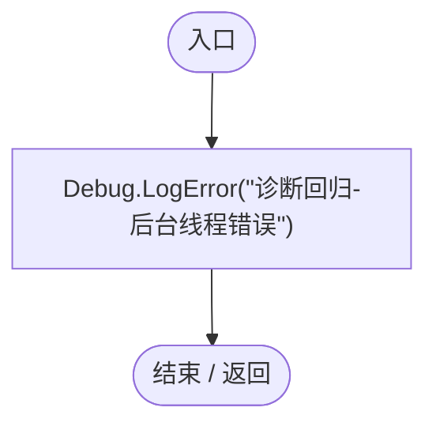

<a id="m8b9c9c28ad5c0f0b"></a>

## 回调@49 · L49

`e … => 回调`


### Editor · Roslyn编译器控制流

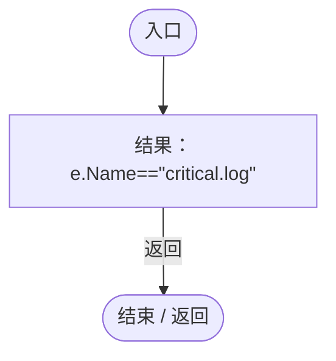

<a id="mf0ccc53d8e65f302"></a>

## 回调@49 · L49

`e … => 回调`


### Editor · Roslyn编译器控制流


<a id="mf1ac079db20be8ab"></a>

## 回调@49 · L49

`e … => 回调`


### Editor · Roslyn编译器控制流

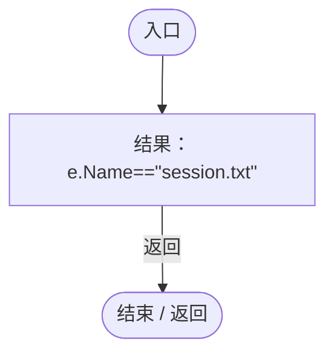

<a id="mc4aae2b8793d8c47"></a>

## 回调@50 · L50

`e … => 回调`


### Editor · Roslyn编译器控制流

```mermaid
flowchart TD
  b0(["入口"])
  b1{"判断：e.Name==&quot;active.lock&quot;"}
  b2["e.Name==&quot;Editor.log&quot;"]
  b3["e.Name==&quot;active.lock&quot;"]
  b4["结果：e.Name==&quot;active.lock&quot;&#124;&#124;e.Name==&quot;Editor.log&quot;"]
  b5(["结束 / 返回"])
  b0 --> b1
  b1 -->|"否"| b2
  b1 -->|"是"| b3
  b2 --> b4
  b3 --> b4
  b4 -->|"返回"| b5

```

<a id="mee7a8d6ffca61074"></a>

## 回调@51 · L51

`e … => 回调`


### Editor · Roslyn编译器控制流


<a id="mef66d0eff7a61ea5"></a>

## 回调@61 · L61

`( … => 回调`


### Editor · Roslyn编译器控制流

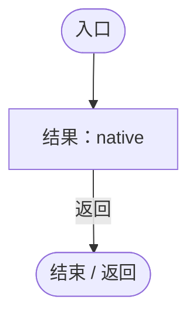

<a id="ma7fe768f871f3f54"></a>

## 回调@63 · L63

`( … => 回调`


### Editor · Roslyn编译器控制流


<a id="maceba1c6c7b95118"></a>

## 回调@73 · L73

`( … => 回调`


### Editor · Roslyn编译器控制流


<a id="mf2cfcb349ec45fce"></a>

## 回调@76 · L76

`( … => 回调`


### Editor · Roslyn编译器控制流


<a id="m779151997cd88719"></a>

## 回调@78 · L78

`( … => 回调`


### Editor · Roslyn编译器控制流


<a id="m3194370ef04a2c13"></a>

## 回调@85 · L85

`e … => 回调`


### Editor · Roslyn编译器控制流


<a id="maba830fd61b8dce7"></a>

## 回调@85 · L85

`e … => 回调`


### Editor · Roslyn编译器控制流

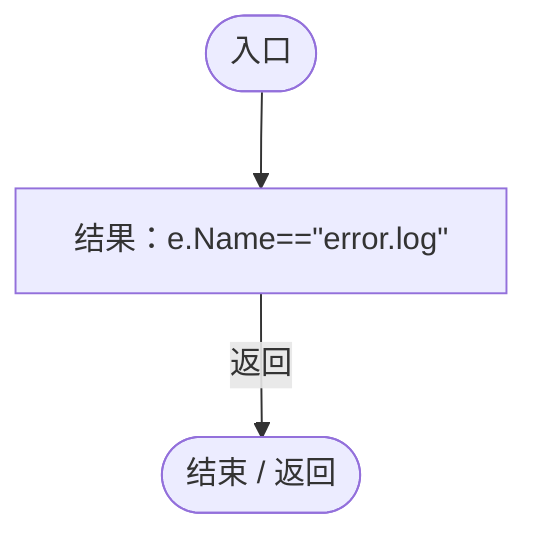

<a id="mac6b58a2ab641d23"></a>

## 回调@85 · L85

`e … => 回调`


### Editor · Roslyn编译器控制流

```mermaid
flowchart TD
  b0(["入口"])
  b1{"判断：e.Name==&quot;private.bin&quot;"}
  b2["e.Name==&quot;world-save.json&quot;"]
  b3["e.Name==&quot;private.bin&quot;"]
  b4["结果：e.Name==&quot;private.bin&quot;&#124;&#124;e.Name==&quot;world-save.json&quot;"]
  b5(["结束 / 返回"])
  b0 --> b1
  b1 -->|"否"| b2
  b1 -->|"是"| b3
  b2 --> b4
  b3 --> b4
  b4 -->|"返回"| b5

```

<a id="md5d9e01877985aee"></a>

## 回调@88 · L88

`e … => 回调`


### Editor · Roslyn编译器控制流

```mermaid
flowchart TD
  b0(["入口"])
  b1["结果：e.Name==&quot;large.dmp&quot;"]
  b2(["结束 / 返回"])
  b0 --> b1
  b1 -->|"返回"| b2

```
