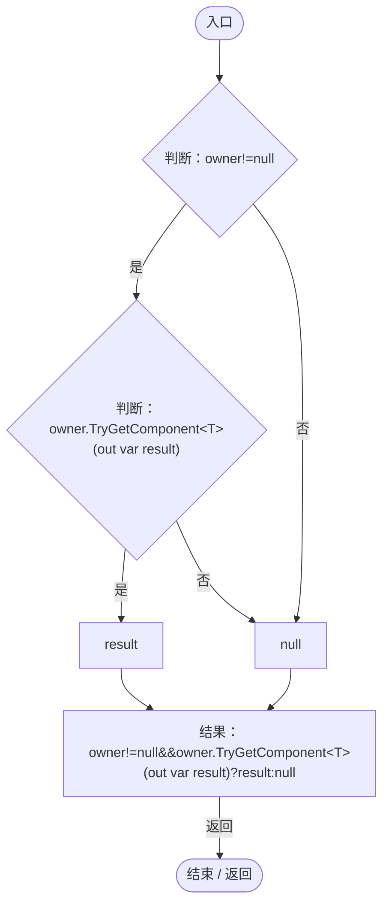

# OptionalComponent.cs

[返回总索引](../README.md) · `Runtime` · `Assets/DarwinPark/Core/OptionalComponent.cs`

[源文件](../../../Assets/DarwinPark/Core/OptionalComponent.cs) · 源码校验：`c69f28db26147fd8a96f0115d0dce7ad3c75058f72cd7499bf5256a4c7d5f1d9`

方法按源文件位置排列。事件/回调引用不表示立即执行；分支与异常说明见总索引。完整源码与可点击关系图请打开离线手册。

## Read · L7

`public static T Read<T>(Component owner)where T:Component`

### Editor / Player · Roslyn编译器控制流

