# RuntimeFileLog.cs

[返回总索引](../README.md) · `Runtime` · `Assets/DarwinPark/Core/Logging/RuntimeFileLog.cs`

[源文件](../../../Assets/DarwinPark/Core/Logging/RuntimeFileLog.cs) · 源码校验：`6ee5bf0788ecd540430794a20bd09ecf337c6ce7d4cb0f25b9df682276014e92`

方法按源文件位置排列。事件/回调引用不表示立即执行；分支与异常说明见总索引。完整源码与可点击关系图请打开离线手册。

## DirectoryPath.get · L12

`public static string DirectoryPath`

### Editor / Player · 语法控制结构 / 声明（非CFG）

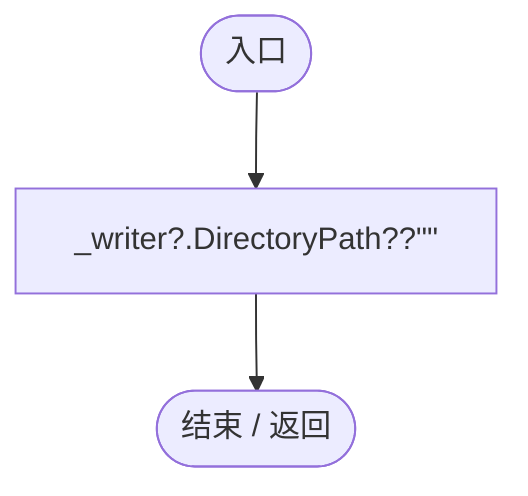

项目内调用/回调引用：

- [SessionLogWriter.DirectoryPath.get · L22](40cf249053355538.md#m87f743b3f976472b)（访问器）

## CurrentFilePath.get · L13

`public static string CurrentFilePath`

### Editor / Player · 语法控制结构 / 声明（非CFG）

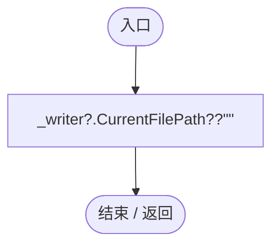

## Failure.get · L14

`public static string Failure`

### Editor / Player · 语法控制结构 / 声明（非CFG）

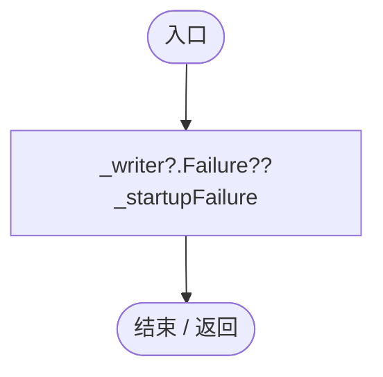

## Reset · L15

`[RuntimeInitializeOnLoadMethod(RuntimeInitializeLoadType.SubsystemRegistration)] private static void Reset()`

### Editor / Player · Roslyn编译器控制流

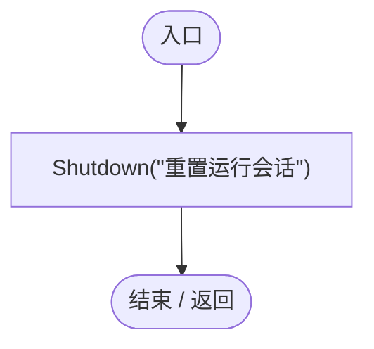

项目内调用/回调引用：

- [RuntimeFileLog.Shutdown · L49](8080b38a7e1c5585.md#m817cce367fb66edc)（方法）

## Initialize · L17

`[RuntimeInitializeOnLoadMethod(RuntimeInitializeLoadType.BeforeSceneLoad)] public static void Initialize()`

### Editor / Player · Roslyn编译器控制流

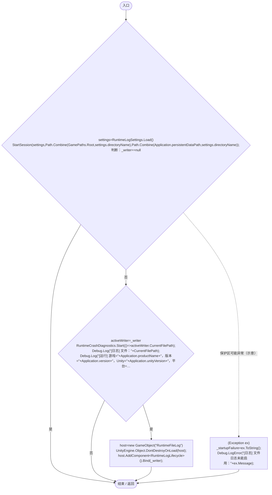

项目内调用/回调引用：

- [RuntimeLogSettings.Load · L20](ade1290a5194a825.md#m0f3085aaf1b46923)（方法）
- [RuntimeFileLog.StartSession · L35](8080b38a7e1c5585.md#mf0de887184e18c16)（方法）
- [RuntimeCrashDiagnostics.Start · L31](b7eea720e09afd0b.md#m1ad77d29c65c9dff)（方法）
- [RuntimeLogLifecycle.Bind · L9](108cc41be732ad0e.md#m0e3159b579903567)（方法）
- [RuntimeFileLog.回调@26 · L26](8080b38a7e1c5585.md#m6cd5b7310ad92954)（回调/委托）

## 回调@26 · L26

`( … => 回调`

### Editor / Player · Roslyn编译器控制流

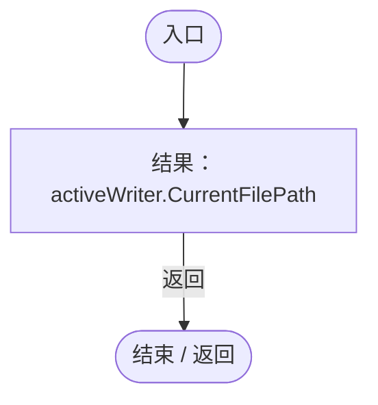

## StartSession · L35

`public static void StartSession(RuntimeLogSettings settings,string preferredDirectory,string fallbackDirectory)`

### Editor / Player · Roslyn编译器控制流

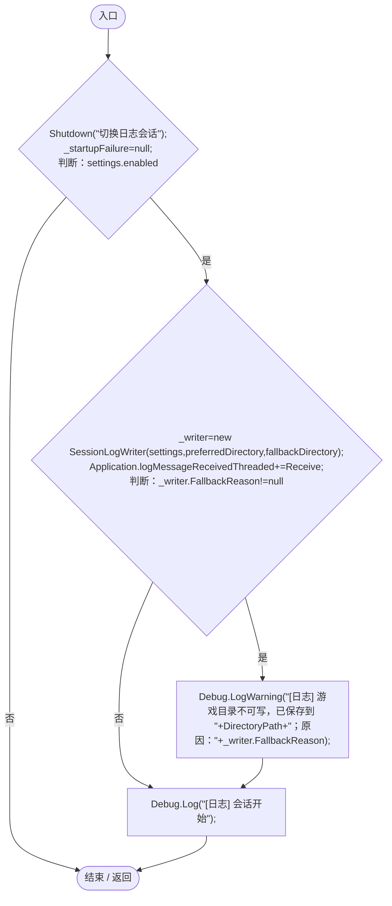

项目内调用/回调引用：

- [RuntimeFileLog.Shutdown · L49](8080b38a7e1c5585.md#m817cce367fb66edc)（方法）
- [SessionLogWriter.SessionLogWriter.ctor · L26](40cf249053355538.md#m31807e1034b4251e)（构造函数）
- [SessionLogWriter.FallbackReason.get · L25](40cf249053355538.md#mf8ceee2abfb5c3f5)（访问器）
- [RuntimeFileLog.Receive · L43](8080b38a7e1c5585.md#mde9756dd697906ee)（方法）

## Receive · L43

`private static void Receive(string message,string stack,LogType type)`

### Editor / Player · Roslyn编译器控制流

```mermaid
flowchart TD
  b0(["入口"])
  b1{"_writer<br/>判断：_writer"}
  b2["_writer?.Write(message,stack,type);"]
  b3["RuntimeCrashDiagnostics.Receive(message,stack,type);"]
  b4(["结束 / 返回"])
  b0 --> b1
  b1 -->|"否"| b2
  b1 -->|"是"| b3
  b2 --> b3
  b3 --> b4

```

项目内调用/回调引用：

- [SessionLogWriter.Write · L40](40cf249053355538.md#m158b7ff150120b71)（方法）
- [RuntimeCrashDiagnostics.Receive · L57](b7eea720e09afd0b.md#mb8486cb668865dcf)（方法）

## Flush · L48

`public static bool Flush()`

### Editor / Player · Roslyn编译器控制流

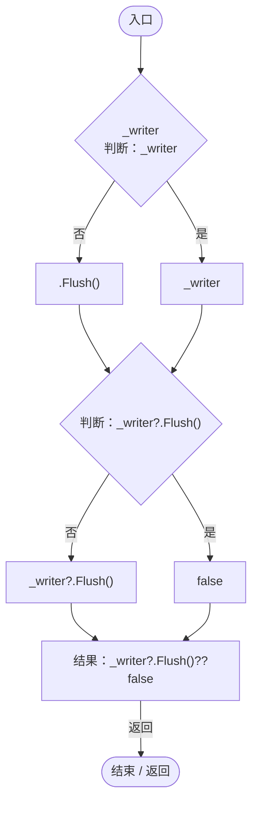

项目内调用/回调引用：

- [SessionLogWriter.Flush · L49](40cf249053355538.md#m4c75140dcf6a8af2)（方法）

## Shutdown · L49

`public static void Shutdown(string reason="正常关闭")`

### Editor / Player · Roslyn编译器控制流

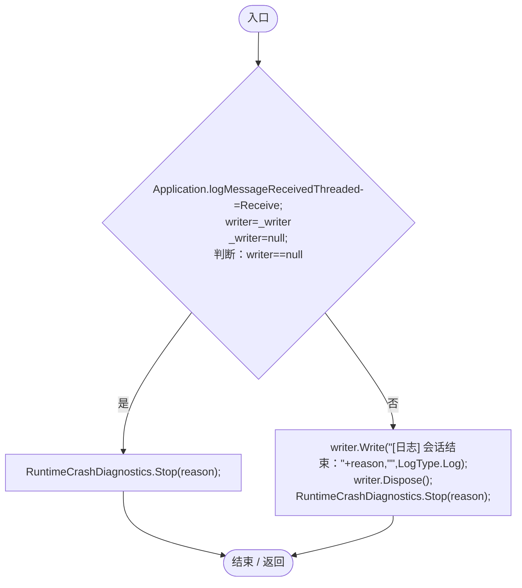

项目内调用/回调引用：

- [RuntimeCrashDiagnostics.Stop · L92](b7eea720e09afd0b.md#m48cf06f118b9c8f2)（方法）
- [SessionLogWriter.Write · L40](40cf249053355538.md#m158b7ff150120b71)（方法）
- [SessionLogWriter.Dispose · L105](40cf249053355538.md#m484710d086f46a75)（方法）
- [RuntimeFileLog.Receive · L43](8080b38a7e1c5585.md#mde9756dd697906ee)（方法）

## ShutdownIfCurrent · L57

`internal static void ShutdownIfCurrent(SessionLogWriter writer)`

### Editor / Player · Roslyn编译器控制流

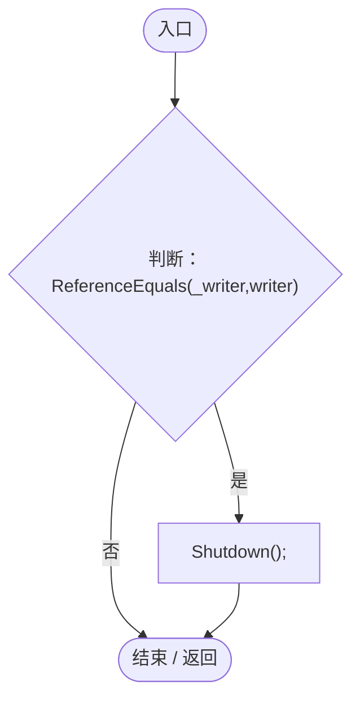

项目内调用/回调引用：

- [RuntimeFileLog.Shutdown · L49](8080b38a7e1c5585.md#m817cce367fb66edc)（方法）

## OpenDirectory · L58

`public static void OpenDirectory()`

### Editor / Player · Roslyn编译器控制流

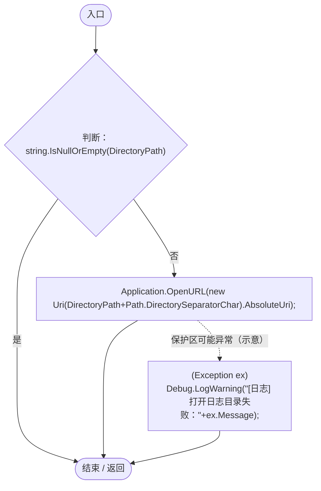
