# EntityGeneFilterRegression.cs

[返回总索引](../README.md) · `Editor` · `Assets/DarwinPark/Editor/EntityGeneFilterRegression.cs`

[源文件](../../../Assets/DarwinPark/Editor/EntityGeneFilterRegression.cs) · 源码校验：`4d007ab6e82326c062a9f1844654999b6589269863bfc932bdf3c9455526a15c`

方法按源文件位置排列。事件/回调引用不表示立即执行；分支与异常说明见总索引。完整源码与可点击关系图请打开离线手册。

<a id="mb1604cc311a5a76b"></a>

## Folder.get · L27

`private static string Folder`


### Editor · 语法控制结构 / 声明（非CFG）

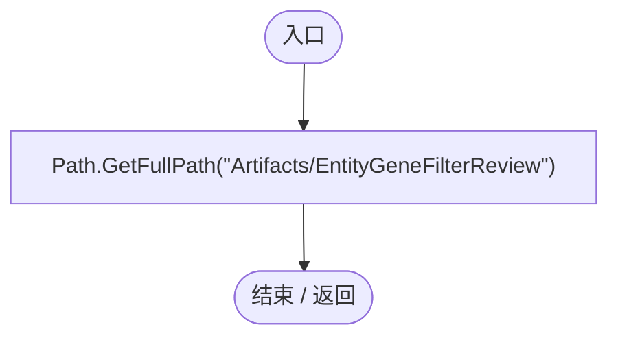

<a id="me237129001624877"></a>

## EntityGeneFilterRegression.ctor · L28

`static EntityGeneFilterRegression()`


### Editor · Roslyn编译器控制流

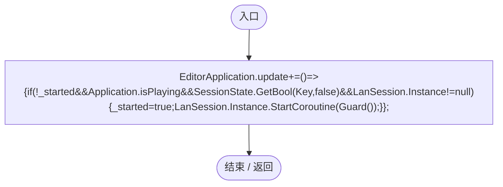

项目内调用/回调引用：

- [EntityGeneFilterRegression.回调@28 · L28](809edd2bc8d1c735.md#m2ad864e5ec99d728)（回调/委托）

<a id="m2ad864e5ec99d728"></a>

## 回调@28 · L28

`( … => 回调`


### Editor · Roslyn编译器控制流

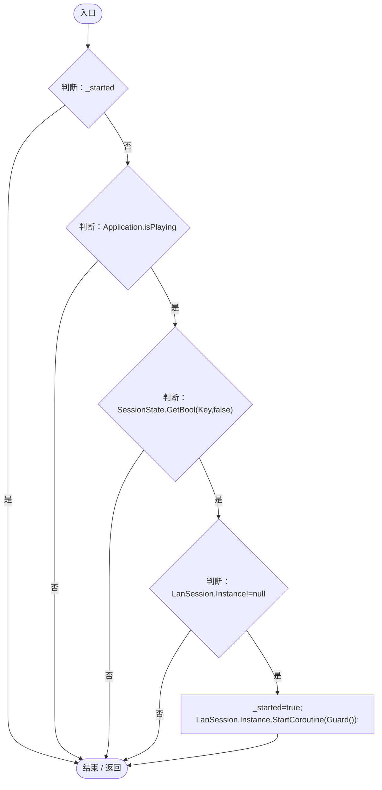

项目内调用/回调引用：

- [LanSession.Instance.get · L23](9fb633eebffe669c.md#mbf83306994878383)（访问器）
- [EntityGeneFilterRegression.Guard · L31](809edd2bc8d1c735.md#md3a2b07703fd20c7)（方法）

<a id="ma45768fa856a57b3"></a>

## RunBatch · L29

`public static void RunBatch()`


### Editor · Roslyn编译器控制流

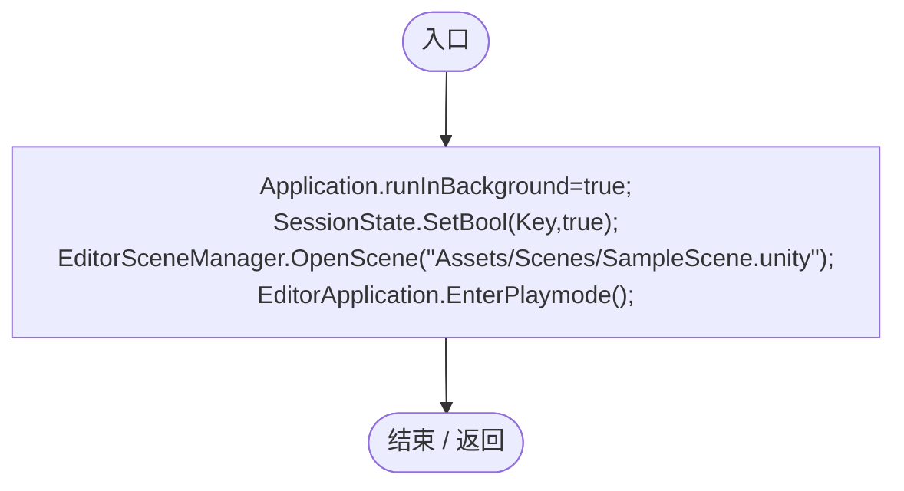

<a id="m5b4428aa1ef2464b"></a>

## Check · L30

`private static void Check(bool condition,string text)`


### Editor · Roslyn编译器控制流

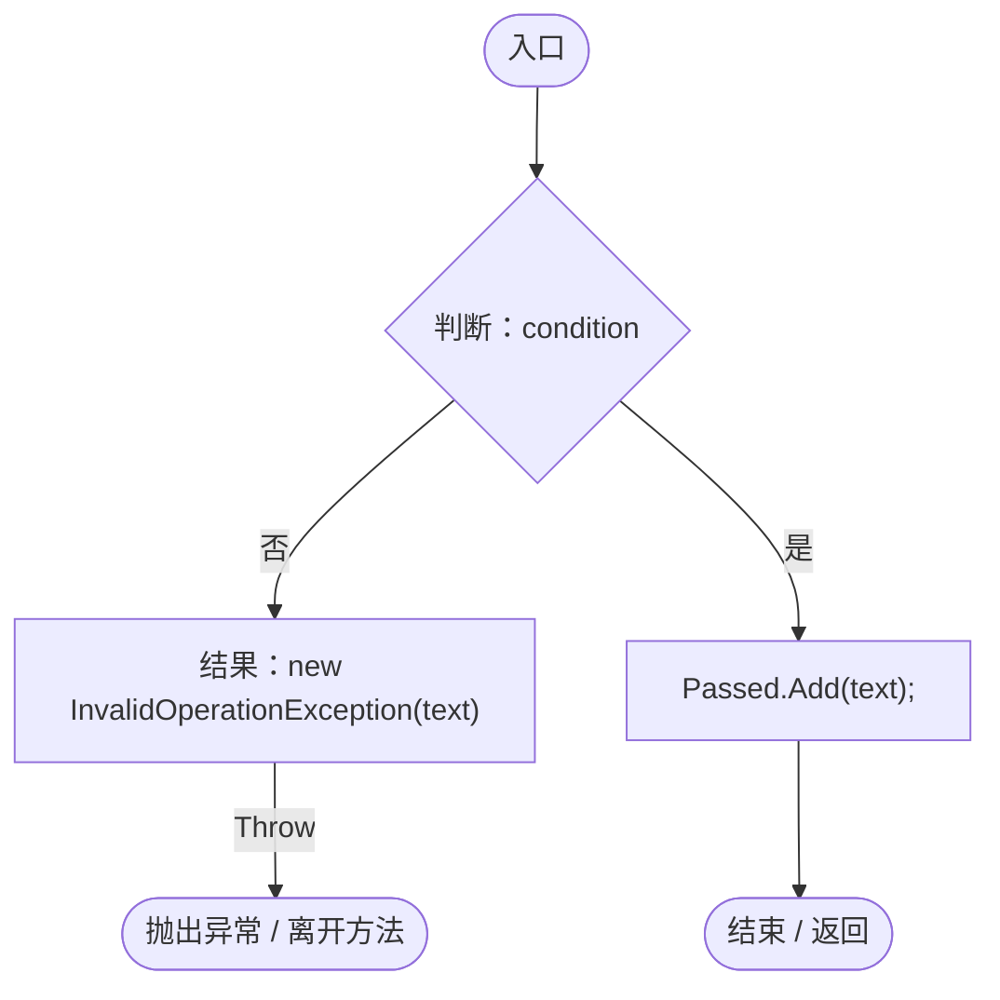

<a id="md3a2b07703fd20c7"></a>

## Guard · L31

`private static IEnumerator Guard()`


### Editor · Roslyn编译器控制流

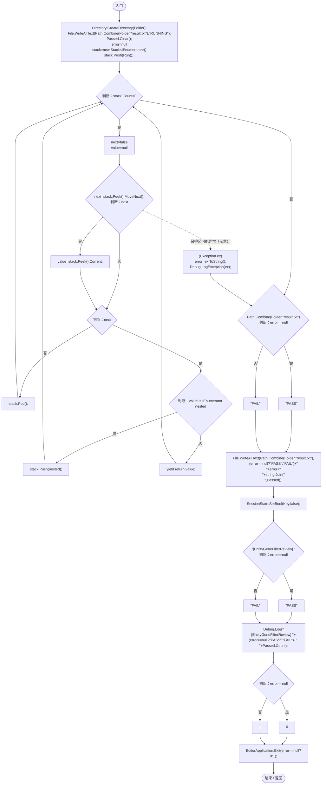

项目内调用/回调引用：

- [EntityGeneFilterRegression.Run · L54](809edd2bc8d1c735.md#m5f2c2e66663b4e6e)（方法）

<a id="m04c1cfe3ba7b5538"></a>

## Spawn · L37

`private static DarwinEntity Spawn(string name,bool movement,bool nutrition,bool disabled=false)`


### Editor · Roslyn编译器控制流

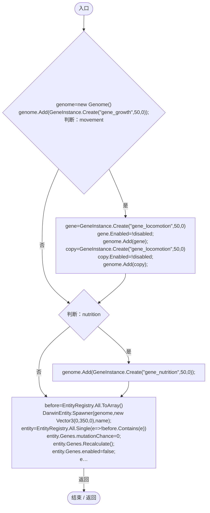

项目内调用/回调引用：

- [Genome.Add · L19](a2ef23f865bc7ee8.md#md9cfdc94b8b8d40f)（方法）
- [GeneInstance.Create · L20](f82e1498d67f5afd.md#m72e94c278de3cf8b)（方法）
- [DarwinEntity.Genes.get · L14](70798dde169f2e8b.md#m622eb1adf401d431)（访问器）
- [EntityGeneController.Recalculate · L90](7494d53178552f0e.md#m93744c8f3039b93c)（方法）
- [EntityGeneFilterRegression.回调@42 · L42](809edd2bc8d1c735.md#me070d305aee7ae5f)（回调/委托）

<a id="me070d305aee7ae5f"></a>

## 回调@42 · L42

`e … => 回调`


### Editor · Roslyn编译器控制流

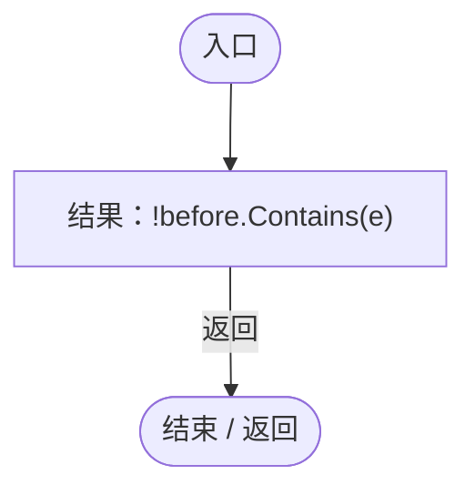

<a id="m7c19b02a40b52363"></a>

## Capture · L46

`private static IEnumerator Capture(string name)`


### Editor · Roslyn编译器控制流

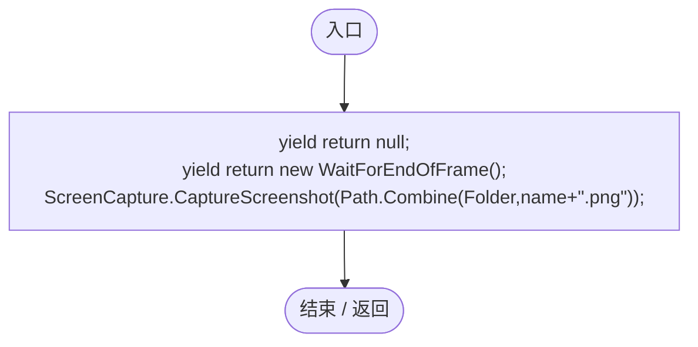

<a id="m49dd3b881d6101ae"></a>

## Center · L48

`private static Vector2 Center(RectTransform rect)`

★ 新增：通过真实GraphicRaycaster和EventSystem派发鼠标事件，验证点击遮罩和列表项目而非只手调Hide。

### Editor · Roslyn编译器控制流

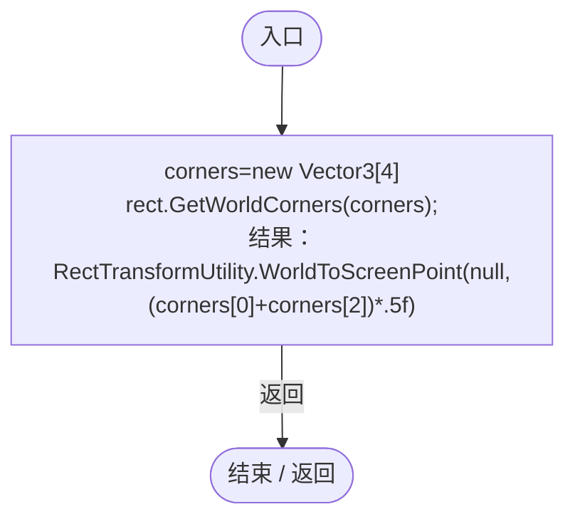

<a id="mf53768632d8da08d"></a>

## Click · L49

`private static GameObject Click(Vector2 point)`


### Editor · Roslyn编译器控制流

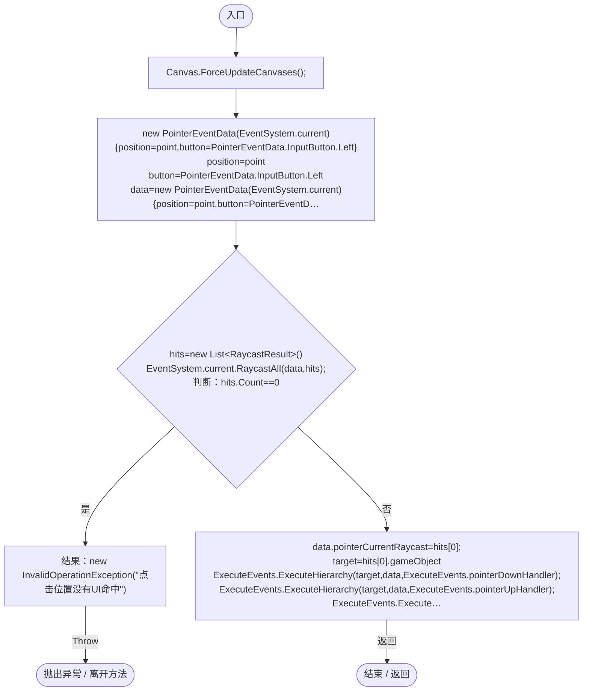

<a id="m5f2c2e66663b4e6e"></a>

## Run · L54

`private static IEnumerator Run()`


### Editor · Roslyn编译器控制流

```mermaid
flowchart TD
  b0(["入口"])
  b1["yield return null;<br/>root=ServiceLocator.Get&lt;UIRoot&gt;()<br/>stats=Object.FindFirstObjectByType&lt;MapEntityStatisticsUI&gt;(FindObjectsInactive.Include)<br/>probe=DefaultControls.CreateDropdown(new DefaultControls.Resources())<br/>probe.transform.SetParent(r…"]
  b2["probe.GetComponent&lt;Dropdown&gt;().Show();"]
  b3["(Exception ex)<br/>probeError=ex.ToString();"]
  b4["File.WriteAllText(Path.Combine(Folder,&quot;early-dropdown.txt&quot;),probeError+&quot;\ntemplate=&quot;+probe.GetComponent&lt;Dropdown&gt;().template.gameObject.activeSelf+&quot;\nlist=&quot;+(probe.transform.Find(&quot;Dropdown List&quot;)!=null));"]
  b5{"判断：probeError==&quot;none&quot;"}
  b6{"判断：probe.GetComponent&lt;Dropdown&gt;().template.gameObject.activeSelf"}
  b7{"判断：probe.transform.Find(&quot;Dropdown List&quot;)==null"}
  b8["probe.GetComponent&lt;CanvasGroup&gt;().blocksRaycasts"]
  b9["probeError==&quot;none&quot;&amp;&amp;!probe.GetComponent&lt;Dropdown&gt;().template.gameObject.activeSelf&amp;&amp;probe.transform.Find(&quot;Dropdown List&quot;)==null&amp;&amp;probe.GetComponent&lt;CanvasGroup&gt;().blocksRaycasts"]
  b10["Check(probeError==&quot;none&quot;&amp;&amp;!probe.GetComponent&lt;Dropdown&gt;().template.gameObject.activeSelf&amp;&amp;probe.transform.Find(&quot;Dropdown List&quot;)==null&amp;&amp;probe.GetComponent&lt;CanvasGroup&gt;().blocksRaycasts,&quot;创建当帧展开不会抛淡入异常或留下Option A模板，保持阻止点击穿透&quot;);"]
  b11["probe.GetComponent&lt;Dropdown&gt;().interactable=false;<br/>yield return null;"]
  b12{"判断：probe.GetComponent&lt;Dropdown&gt;().interactable"}
  b13["!probe.GetComponent&lt;Dropdown&gt;().IsInteractable()"]
  b14["!probe.GetComponent&lt;Dropdown&gt;().interactable"]
  b15["Check(!probe.GetComponent&lt;Dropdown&gt;().interactable&amp;&amp;!probe.GetComponent&lt;Dropdown&gt;().IsInteractable(),&quot;初始化保护不覆盖业务禁用与只读权限&quot;);"]
  b16["Object.DestroyImmediate(probe);<br/>filter=stats.GetComponent&lt;MapEntityGeneFilterUI&gt;()"]
  b17{"判断：filter!=null"}
  b18["filter.Card!=null"]
  b19["filter!=null"]
  b20["Check(filter!=null&amp;&amp;filter.Card!=null,&quot;组合筛选组件在真实统计卡启动时挂载&quot;);"]
  b21["clock=ServiceLocator.Get&lt;SimulationClock&gt;()<br/>WorldRuntimeGate.Ready=true;<br/>typeof(GameMainMenu).GetMethod(&quot;Resume&quot;,Private).Invoke(Object.FindFirstObjectByType&lt;GameMainMenu&gt;(),null);<br/>clock.Pause();<br/>control=Object.FindFirstObjectByType&lt;Simu…"]
  b22["EntityRegistry.All.ToArray()"]
  b23{"判断：EntityRegistry.All.ToArray()"}
  b24["var<br/>Object.DestroyImmediate(entity.gameObject);"]
  b25{"EntityRegistry.All.ToArray()<br/>判断：EntityRegistry.All.ToArray()"}
  b26["EntityRegistry.All.ToArray()"]
  b27["连接 / 离开区域"]
  b28["a=Spawn(&quot;包含行动&quot;,true,false)<br/>b=Spawn(&quot;只有营养&quot;,false,true)<br/>c=Spawn(&quot;行动被禁用&quot;,true,false,true)<br/>d=Spawn(&quot;行动与营养&quot;,true,true)<br/>e=Spawn(&quot;仅生长&quot;,false,false)<br/>inactive=Spawn(&quot;停用实体&quot;,true,false)<br/>inactive.gameObject.SetActive(false);<br/>yield return null;<br/>filte…"]
  b29{"判断：filter.Total==5"}
  b30["filter.Matches.Count==5"]
  b31["filter.Total==5"]
  b32["Check(filter.Total==5&amp;&amp;filter.Matches.Count==5,&quot;无条件时显示所有存活实体，排除停用个体&quot;);"]
  b33{"判断：filter.SetGene(&quot;gene_locomotion&quot;,true)"}
  b34["filter.Matches.Count==3"]
  b35["filter.SetGene(&quot;gene_locomotion&quot;,true)"]
  b36["Check(filter.SetGene(&quot;gene_locomotion&quot;,true)&amp;&amp;filter.Matches.Count==3,&quot;包含行动基因，复制基因按实体去重&quot;);"]
  b37["Check(filter.Matches.Contains(c),&quot;禁用或不生效仍算携带基因&quot;);<br/>filter.SetGene(&quot;gene_growth&quot;,true);<br/>Check(filter.Matches.Count==3,&quot;多个必须包含条件按全部满足组合&quot;);<br/>filter.SetGene(&quot;gene_nutrition&quot;,false);"]
  b38{"判断：filter.Matches.Count==2"}
  b39{"判断：filter.Matches.Contains(a)"}
  b40["filter.Matches.Contains(c)"]
  b41["filter.Matches.Count==2&amp;&amp;filter.Matches.Contains(a)&amp;&amp;filter.Matches.Contains(c)"]
  b42["Check(filter.Matches.Count==2&amp;&amp;filter.Matches.Contains(a)&amp;&amp;filter.Matches.Contains(c),&quot;包含与不包含条件同时生效&quot;);"]
  b43["filter.SetGene(&quot;gene_locomotion&quot;,false);"]
  b44{"判断：filter.Criteria.Included.Contains(&quot;gene_locomotion&quot;)"}
  b45{"判断：filter.Matches.Count==1"}
  b46["filter.Matches[0]==e"]
  b47["!filter.Criteria.Included.Contains(&quot;gene_locomotion&quot;)&amp;&amp;filter.Matches.Count==1&amp;&amp;filter.Matches[0]==e"]
  b48["Check(!filter.Criteria.Included.Contains(&quot;gene_locomotion&quot;)&amp;&amp;filter.Matches.Count==1&amp;&amp;filter.Matches[0]==e,&quot;同一基因切换规则互斥，多个排除任一命中即排除&quot;);"]
  b49["filter.ResetFilter();<br/>include=filter.Card.Find(&quot;IncludeGenes&quot;).GetComponent&lt;Dropdown&gt;()<br/>index=include.options.FindIndex(o=&gt;o.text.Contains(&quot;行动基因&quot;))<br/>Check(index&gt;=2,&quot;实际下拉菜单包含可选行动基因&quot;);<br/>include.Show();<br/>yield return new WaitForSecondsRealtime…"]
  b50{"判断：include.transform.Find(&quot;Dropdown List&quot;)!=null"}
  b51["!include.template.gameObject.activeSelf"]
  b52["include.transform.Find(&quot;Dropdown List&quot;)!=null"]
  b53["Check(include.transform.Find(&quot;Dropdown List&quot;)!=null&amp;&amp;!include.template.gameObject.activeSelf,&quot;初始化后正常展开且隐藏原始模板&quot;);"]
  b54["yield return Capture(&quot;dropdown-open&quot;);<br/>outside=Click(new Vector2(Screen.width*.2f,Screen.height*.7f))<br/>Check(outside.name==&quot;Blocker&quot;,&quot;点击列表外部实际命中关闭遮罩而非底层世界&quot;);<br/>yield return new WaitForSecondsRealtime(.25f);"]
  b55{"判断：include.transform.Find(&quot;Dropdown List&quot;)==null"}
  b56["!include.template.gameObject.activeSelf"]
  b57["include.transform.Find(&quot;Dropdown List&quot;)==null"]
  b58["Check(include.transform.Find(&quot;Dropdown List&quot;)==null&amp;&amp;!include.template.gameObject.activeSelf,&quot;点击外部彻底收起列表和模板&quot;);"]
  b59["include.Show();<br/>yield return new WaitForSecondsRealtime(.25f);<br/>Click(Center(include.GetComponent&lt;RectTransform&gt;()));<br/>Check(include.transform.Find(&quot;Dropdown List&quot;)==null,&quot;再次点击展开按钮可收起菜单&quot;);<br/>picked=include.transform.Find(&quot;Dropdown List&quot;).Get…"]
  b60{"判断：filter.Criteria.Included.Contains(&quot;gene_locomotion&quot;)"}
  b61["include.transform.Find(&quot;Dropdown List&quot;)==null"]
  b62["filter.Criteria.Included.Contains(&quot;gene_locomotion&quot;)"]
  b63["Check(filter.Criteria.Included.Contains(&quot;gene_locomotion&quot;)&amp;&amp;include.transform.Find(&quot;Dropdown List&quot;)==null,&quot;点击真实列表项目应用条件并关闭菜单&quot;);"]
  b64["filter.ResetFilter();<br/>include.Show();<br/>yield return new WaitForSecondsRealtime(.25f);<br/>menu=Object.FindFirstObjectByType&lt;GameMainMenu&gt;()<br/>menuVisible=menu.Visible"]
  b65{"判断：RuntimeDropdownDismissal.CloseOpenPopups()"}
  b66{"判断：menu.Visible==menuVisible"}
  b67["!include.GetComponent&lt;RuntimeDropdownDismissal&gt;().IsOpen"]
  b68["RuntimeDropdownDismissal.CloseOpenPopups()&amp;&amp;menu.Visible==menuVisible&amp;&amp;!include.GetComponent&lt;RuntimeDropdownDismissal&gt;().IsOpen"]
  b69["Check(RuntimeDropdownDismissal.CloseOpenPopups()&amp;&amp;menu.Visible==menuVisible&amp;&amp;!include.GetComponent&lt;RuntimeDropdownDismissal&gt;().IsOpen,&quot;Esc菜单路由优先收起下拉且不打开暂停菜单&quot;);"]
  b70["yield return new WaitForSecondsRealtime(.25f);<br/>include.Show();<br/>ExecuteEvents.Execute(include.gameObject,new BaseEventData(EventSystem.current),ExecuteEvents.cancelHandler);"]
  b71{"判断：include.GetComponent&lt;RuntimeDropdownDismissal&gt;().IsOpen"}
  b72["GameInputGate.Blocked"]
  b73["!include.GetComponent&lt;RuntimeDropdownDismissal&gt;().IsOpen"]
  b74["Check(!include.GetComponent&lt;RuntimeDropdownDismissal&gt;().IsOpen&amp;&amp;GameInputGate.Blocked,&quot;取消事件关闭菜单并消费本帧Esc输入&quot;);"]
  b75["yield return new WaitForSecondsRealtime(.25f);<br/>include.template.gameObject.SetActive(true);<br/>include.GetComponent&lt;RuntimeDropdownDismissal&gt;().ClosePopup();<br/>Check(!include.template.gameObject.activeSelf,&quot;异常残留的原始Option A模板也能关闭&quot;);<br/>include.Sh…"]
  b76{"判断：include.transform.Find(&quot;Dropdown List&quot;)==null"}
  b77{"判断：include.template.gameObject.activeSelf"}
  b78["root.MainCanvas.transform.Find(&quot;Blocker&quot;)==null"]
  b79["include.transform.Find(&quot;Dropdown List&quot;)==null&amp;&amp;!include.template.gameObject.activeSelf&amp;&amp;root.MainCanvas.transform.Find(&quot;Blocker&quot;)==null"]
  b80["Check(include.transform.Find(&quot;Dropdown List&quot;)==null&amp;&amp;!include.template.gameObject.activeSelf&amp;&amp;root.MainCanvas.transform.Find(&quot;Blocker&quot;)==null,&quot;切换页面清理列表模板与遮罩&quot;);"]
  b81["switchPage.Invoke(control,new object[]{0});<br/>yield return null;<br/>include.Show();<br/>yield return new WaitForSecondsRealtime(.25f);<br/>root.MainCanvas.enabled=false;<br/>Check(!include.GetComponent&lt;RuntimeDropdownDismissal&gt;().IsOpen,&quot;隐藏HUD时不残留独立排序的弹出…"]
  b82{"判断：filter.Criteria.Included.Count==0"}
  b83["filter.Matches.Count==5"]
  b84["filter.Criteria.Included.Count==0"]
  b85["Check(filter.Criteria.Included.Count==0&amp;&amp;filter.Matches.Count==5,&quot;清空本组独立于占位项，不会因value为0而失效&quot;);"]
  b86["filter.SetGene(&quot;gene_locomotion&quot;,true);<br/>filter.SetGene(&quot;gene_nutrition&quot;,false);<br/>filter.OpenResults();<br/>yield return null;"]
  b87{"判断：filter.Results.Visible"}
  b88["filter.Results.VisibleRowCount==2"]
  b89["filter.Results.Visible"]
  b90["Check(filter.Results.Visible&amp;&amp;filter.Results.VisibleRowCount==2,&quot;生成筛选后的真实实体列表与数量&quot;);"]
  b91["filter.Results.transform.Find(&quot;EntityRow0&quot;).GetComponent&lt;Button&gt;().onClick.Invoke();"]
  b92{"判断：filter.LocatedEntity!=null"}
  b93["(bool)typeof(OrbitCamera).GetField(&quot;_isFocusing&quot;,Private).GetValue(Camera.main.GetComponent&lt;OrbitCamera&gt;())"]
  b94["filter.LocatedEntity!=null"]
  b95["Check(filter.LocatedEntity!=null&amp;&amp;(bool)typeof(OrbitCamera).GetField(&quot;_isFocusing&quot;,Private).GetValue(Camera.main.GetComponent&lt;OrbitCamera&gt;()),&quot;点击列表条目实际启动相机定位&quot;);"]
  b96["filter.Results.transform.Find(&quot;EntityRow0&quot;).GetComponent&lt;RightClickHandler&gt;()<br/>new PointerEventData(EventSystem.current){button=PointerEventData.InputButton.Right}<br/>button=PointerEventData.InputButton.Right<br/>filter.Results.transform.Find(&quot;E…"]
  b97["Check(Object.FindFirstObjectByType&lt;GeneInspectorUI&gt;().CurrentEntity==filter.LocatedEntity,&quot;右键列表实体可查看原属性面板&quot;);<br/>Object.FindFirstObjectByType&lt;GeneInspectorUI&gt;().HideEntityInfo();<br/>canvasScaler=root.MainCanvas.GetComponent&lt;CanvasScaler&gt;()<br/>orig…"]
  b98{"判断：filter.WideLayout"}
  b99["!filter.Card.gameObject.activeSelf"]
  b100["!filter.WideLayout"]
  b101["Check(!filter.WideLayout&amp;&amp;!filter.Card.gameObject.activeSelf,&quot;宽度不足时收起独立卡，不挤压原统计&quot;);"]
  b102["stats.transform.Find(&quot;OpenEntityFilter&quot;).GetComponent&lt;Button&gt;().onClick.Invoke();<br/>yield return null;<br/>Check(filter.Card.gameObject.activeSelf,&quot;窄屏通过筛选按钮展开条件&quot;);<br/>yield return Capture(&quot;narrow-filter&quot;);<br/>filter.OpenResults();"]
  b103{"判断：filter.Results.Visible"}
  b104["!filter.Card.gameObject.activeSelf"]
  b105["filter.Results.Visible"]
  b106["Check(filter.Results.Visible&amp;&amp;!filter.Card.gameObject.activeSelf,&quot;窄屏切换为列表时收起条件卡&quot;);"]
  b107["filter.minimumWidth=oldMinimum;<br/>canvasScaler.uiScaleMode=originalMode;<br/>canvasScaler.scaleFactor=originalScale;<br/>yield return null;<br/>WorldAuthority.CanEdit=false;<br/>filter.ResetFilter();<br/>filter.SetGene(&quot;gene_locomotion&quot;,true);<br/>filter.OpenResu…"]
  b108{"判断：filter.Matches.Count==3"}
  b109["filter.Results.LocateRow(0)"]
  b110["filter.Matches.Count==3"]
  b111["Check(filter.Matches.Count==3&amp;&amp;filter.Results.LocateRow(0),&quot;普通成员也能只读筛选并定位&quot;);"]
  b112["WorldAuthority.CanEdit=true;<br/>filter.SetGene(&quot;gene_nutrition&quot;,false);<br/>c.Genes.Genome.Genes.RemoveAll(g=&gt;g.DefinitionId==&quot;gene_locomotion&quot;);<br/>c.Genes.Recalculate();<br/>yield return new WaitForSecondsRealtime(.65f);"]
  b113{"判断：filter.Matches.Count==1"}
  b114["filter.Matches[0]==a"]
  b115["filter.Matches.Count==1"]
  b116["Check(filter.Matches.Count==1&amp;&amp;filter.Matches[0]==a,&quot;实际基因移除后匹配数量与列表自动刷新&quot;);"]
  b117["a.GetComponent&lt;EntityStats&gt;().Modify(&quot;health&quot;,-100000);<br/>Check(!filter.Locate(a),&quot;列表中刚死亡的实体不能被继续定位&quot;);<br/>filter.RefreshNow();"]
  b118{"判断：filter.Matches.Count==0"}
  b119["filter.Results.VisibleRowCount==0"]
  b120["filter.Matches.Count==0"]
  b121["Check(filter.Matches.Count==0&amp;&amp;filter.Results.VisibleRowCount==0,&quot;死亡后列表安全变为空结果&quot;);"]
  b122["filter.ResetFilter();"]
  b123["i=0"]
  b124{"判断：i&lt;27"}
  b125["Spawn(&quot;分页实体&quot;+i,false,false);<br/>i++"]
  b126["filter.RefreshNow();<br/>filter.OpenResults();"]
  b127{"判断：filter.Results.PageCount&gt;1"}
  b128["filter.Results.GetComponentsInChildren&lt;Button&gt;(true).Count(button=&gt;button.name.StartsWith(&quot;EntityRow&quot;))==filter.resultsPerPage"]
  b129["filter.Results.PageCount&gt;1"]
  b130["Check(filter.Results.PageCount&gt;1&amp;&amp;filter.Results.GetComponentsInChildren&lt;Button&gt;(true).Count(button=&gt;button.name.StartsWith(&quot;EntityRow&quot;))==filter.resultsPerPage,&quot;大量匹配复用固定行，不按实体总数创建UI&quot;);"]
  b131["filter.Results.ChangePage(1);"]
  b132{"判断：filter.Results.Page==1"}
  b133["filter.Results.LocateRow(0)"]
  b134["filter.Results.Page==1"]
  b135["Check(filter.Results.Page==1&amp;&amp;filter.Results.LocateRow(0),&quot;下一页条目仍正确定位相应实体&quot;);"]
  b136["EntityRegistry.All.ToArray()"]
  b137{"判断：EntityRegistry.All.ToArray()"}
  b138{"var<br/>判断：entity!=b"}
  b139{"判断：entity!=e"}
  b140["Object.DestroyImmediate(entity.gameObject);"]
  b141{"EntityRegistry.All.ToArray()<br/>判断：EntityRegistry.All.ToArray()"}
  b142["EntityRegistry.All.ToArray()"]
  b143["连接 / 离开区域"]
  b144["filter.RefreshNow();"]
  b145{"判断：filter.Results.Page==0"}
  b146["filter.Matches.Count==2"]
  b147["filter.Results.Page==0"]
  b148["Check(filter.Results.Page==0&amp;&amp;filter.Matches.Count==2,&quot;实体减少时页码回退，不越界访问旧列表&quot;);"]
  b149["switchPage.Invoke(control,new object[]{1});<br/>yield return null;"]
  b150{"判断：filter.Results.Visible"}
  b151["!filter.Card.gameObject.activeInHierarchy"]
  b152["!filter.Results.Visible"]
  b153["Check(!filter.Results.Visible&amp;&amp;!filter.Card.gameObject.activeInHierarchy,&quot;切到第二页隐藏筛选和列表&quot;);"]
  b154["switchPage.Invoke(control,new object[]{0});<br/>yield return null;<br/>WorldRuntimeGate.Ready=false;<br/>filter.RefreshNow();"]
  b155{"判断：filter.Matches.Count==0"}
  b156["!filter.Results.Visible"]
  b157["filter.Matches.Count==0"]
  b158["Check(filter.Matches.Count==0&amp;&amp;!filter.Results.Visible,&quot;离开世界清空匹配结果并关闭列表&quot;);"]
  b159(["结束 / 返回"])
  b0 --> b1
  b1 --> b2
  b2 --> b4
  b3 --> b4
  b4 --> b5
  b5 -->|"是"| b6
  b5 -->|"否"| b9
  b6 -->|"否"| b7
  b6 -->|"是"| b9
  b7 -->|"是"| b8
  b7 -->|"否"| b9
  b8 --> b10
  b9 --> b10
  b10 --> b11
  b11 --> b12
  b12 -->|"否"| b13
  b12 -->|"是"| b14
  b13 --> b15
  b14 --> b15
  b15 --> b16
  b16 --> b17
  b17 -->|"是"| b18
  b17 -->|"否"| b19
  b18 --> b20
  b19 --> b20
  b20 --> b21
  b21 --> b22
  b22 --> b23
  b23 -->|"是"| b24
  b23 -->|"否 · 经过finally 25"| b28
  b24 --> b23
  b25 -->|"否"| b26
  b25 -->|"是"| b27
  b26 --> b27
  b28 --> b29
  b29 -->|"是"| b30
  b29 -->|"否"| b31
  b30 --> b32
  b31 --> b32
  b32 --> b33
  b33 -->|"是"| b34
  b33 -->|"否"| b35
  b34 --> b36
  b35 --> b36
  b36 --> b37
  b37 --> b38
  b38 -->|"是"| b39
  b38 -->|"否"| b41
  b39 -->|"是"| b40
  b39 -->|"否"| b41
  b40 --> b42
  b41 --> b42
  b42 --> b43
  b43 --> b44
  b44 -->|"否"| b45
  b44 -->|"是"| b47
  b45 -->|"是"| b46
  b45 -->|"否"| b47
  b46 --> b48
  b47 --> b48
  b48 --> b49
  b49 --> b50
  b50 -->|"是"| b51
  b50 -->|"否"| b52
  b51 --> b53
  b52 --> b53
  b53 --> b54
  b54 --> b55
  b55 -->|"是"| b56
  b55 -->|"否"| b57
  b56 --> b58
  b57 --> b58
  b58 --> b59
  b59 --> b60
  b60 -->|"是"| b61
  b60 -->|"否"| b62
  b61 --> b63
  b62 --> b63
  b63 --> b64
  b64 --> b65
  b65 -->|"是"| b66
  b65 -->|"否"| b68
  b66 -->|"是"| b67
  b66 -->|"否"| b68
  b67 --> b69
  b68 --> b69
  b69 --> b70
  b70 --> b71
  b71 -->|"否"| b72
  b71 -->|"是"| b73
  b72 --> b74
  b73 --> b74
  b74 --> b75
  b75 --> b76
  b76 -->|"是"| b77
  b76 -->|"否"| b79
  b77 -->|"否"| b78
  b77 -->|"是"| b79
  b78 --> b80
  b79 --> b80
  b80 --> b81
  b81 --> b82
  b82 -->|"是"| b83
  b82 -->|"否"| b84
  b83 --> b85
  b84 --> b85
  b85 --> b86
  b86 --> b87
  b87 -->|"是"| b88
  b87 -->|"否"| b89
  b88 --> b90
  b89 --> b90
  b90 --> b91
  b91 --> b92
  b92 -->|"是"| b93
  b92 -->|"否"| b94
  b93 --> b95
  b94 --> b95
  b95 --> b96
  b96 --> b97
  b97 --> b98
  b98 -->|"否"| b99
  b98 -->|"是"| b100
  b99 --> b101
  b100 --> b101
  b101 --> b102
  b102 --> b103
  b103 -->|"是"| b104
  b103 -->|"否"| b105
  b104 --> b106
  b105 --> b106
  b106 --> b107
  b107 --> b108
  b108 -->|"是"| b109
  b108 -->|"否"| b110
  b109 --> b111
  b110 --> b111
  b111 --> b112
  b112 --> b113
  b113 -->|"是"| b114
  b113 -->|"否"| b115
  b114 --> b116
  b115 --> b116
  b116 --> b117
  b117 --> b118
  b118 -->|"是"| b119
  b118 -->|"否"| b120
  b119 --> b121
  b120 --> b121
  b121 --> b122
  b122 --> b123
  b123 --> b124
  b124 -->|"是"| b125
  b124 -->|"否"| b126
  b125 --> b124
  b126 --> b127
  b127 -->|"是"| b128
  b127 -->|"否"| b129
  b128 --> b130
  b129 --> b130
  b130 --> b131
  b131 --> b132
  b132 -->|"是"| b133
  b132 -->|"否"| b134
  b133 --> b135
  b134 --> b135
  b135 --> b136
  b136 --> b137
  b137 -->|"是"| b138
  b137 -->|"否 · 经过finally 141"| b144
  b138 -->|"是"| b139
  b138 -->|"否"| b137
  b139 -->|"是"| b140
  b139 -->|"否"| b137
  b140 --> b137
  b141 -->|"否"| b142
  b141 -->|"是"| b143
  b142 --> b143
  b144 --> b145
  b145 -->|"是"| b146
  b145 -->|"否"| b147
  b146 --> b148
  b147 --> b148
  b148 --> b149
  b149 --> b150
  b150 -->|"否"| b151
  b150 -->|"是"| b152
  b151 --> b153
  b152 --> b153
  b153 --> b154
  b154 --> b155
  b155 -->|"是"| b156
  b155 -->|"否"| b157
  b156 --> b158
  b157 --> b158
  b158 --> b159
  b2 -. "保护区可能异常（示意）" .-> b3
  b23 -. "退出保护区时 finally（示意）" .-> b25
  b137 -. "退出保护区时 finally（示意）" .-> b141

```

项目内调用/回调引用：

- [ServiceLocator.Get · L33](f2fdbe9f9ccd93cb.md#m2ae625299520c56d)（方法）
- [UIRoot.MainCanvas.get · L14](9c1421378791f0e0.md#maa2cc9baf1248477)（访问器）
- [RuntimeDropdownSkin.Apply · L10](4e9d66f8395f54ec.md#m2b589d708f286228)（方法）
- [EntityGeneFilterRegression.Check · L30](809edd2bc8d1c735.md#m5b4428aa1ef2464b)（方法）
- [SimulationClock.Pause · L79](a8f444aec9614b0a.md#m30929d45a885d0f1)（方法）
- [EntityGeneFilterRegression.Spawn · L37](809edd2bc8d1c735.md#m04c1cfe3ba7b5538)（方法）
- [MapEntityGeneFilterUI.ResetFilter · L70](c2cd33111de06171.md#m7283c4fc481ca510)（方法）
- [MapEntityGeneFilterUI.Total.get · L22](c2cd33111de06171.md#ma8e13db0a5068ad9)（访问器）
- [MapEntityGeneFilterUI.SetGene · L66](c2cd33111de06171.md#m90c7c3a4c1019644)（方法）
- [MapEntityGeneFilterUI.Criteria.get · L20](c2cd33111de06171.md#md463670cdf572dd3)（访问器）
- [EntityGeneFilterRegression.Capture · L46](809edd2bc8d1c735.md#m7c19b02a40b52363)（方法）
- [EntityGeneFilterRegression.Click · L49](809edd2bc8d1c735.md#mf53768632d8da08d)（方法）
- [EntityGeneFilterRegression.Center · L48](809edd2bc8d1c735.md#m49dd3b881d6101ae)（方法）
- [RuntimeDropdownDismissal.CloseOpenPopups · L39](bab72c915cc299c5.md#m4e050bc4c4e0bef0)（方法）
- [GameInputGate.Blocked.get · L8](52955daae7e592ab.md#m765763b665829633)（访问器）
- [RuntimeDropdownDismissal.ClosePopup · L31](bab72c915cc299c5.md#m5d5c73530b0131b7)（方法）
- [MapEntityGeneFilterUI.OpenResults · L116](c2cd33111de06171.md#m9c7582411525ee46)（方法）
- [EntityFilterResultsUI.VisibleRowCount.get · L17](1376ad45671e7435.md#mba03fbccdafe971d)（访问器）
- [MapEntityGeneFilterUI.LocatedEntity.get · L23](c2cd33111de06171.md#me3f26f9663c4ac0e)（访问器）
- [RightClickHandler.OnPointerClick · L11](889ceb71f450c954.md#m70aaaecf784662aa)（方法）
- [GeneInspectorUI.HideEntityInfo · L316](924e27c34e7b1f0a.md#m11944eddcac871c2)（方法）
- [MapEntityStatisticsUI.RefreshNow · L74](da03211264cb6014.md#ma30ab70fe8c10f4f)（方法）
- [EntityPlacementUtility.IsPointerOverUI · L16](6d2c32e632b9c147.md#m126e7f8ff0d0a893)（方法）
- [MapEntityGeneFilterUI.WideLayout.get · L24](c2cd33111de06171.md#m02705633cd4835e0)（访问器）
- [EntityFilterResultsUI.LocateRow · L52](1376ad45671e7435.md#m8fb9e38900bf1247)（方法）
- [DarwinEntity.Genes.get · L14](70798dde169f2e8b.md#m622eb1adf401d431)（访问器）
- [EntityGeneController.Recalculate · L90](7494d53178552f0e.md#m93744c8f3039b93c)（方法）
- [EntityStats.Modify · L104](75aa86a368efdf24.md#m858c2a75d852ecc1)（方法）
- [MapEntityGeneFilterUI.Locate · L121](c2cd33111de06171.md#me05bb48415da55d6)（方法）
- [MapEntityGeneFilterUI.RefreshNow · L85](c2cd33111de06171.md#mb01da891ea5513fa)（方法）
- [EntityFilterResultsUI.ChangePage · L51](1376ad45671e7435.md#m460425c12a49288e)（方法）
- [EntityFilterResultsUI.Page.get · L15](1376ad45671e7435.md#m32e9a65166812869)（访问器）
- [EntityGeneFilterRegression.回调@72 · L72](809edd2bc8d1c735.md#mcf86744e339316db)（回调/委托）
- [EntityGeneFilterRegression.回调@76 · L76](809edd2bc8d1c735.md#m9621ecf10f3de7ea)（回调/委托）
- [EntityGeneFilterRegression.回调@96 · L96](809edd2bc8d1c735.md#m36507a1225b45cfb)（回调/委托）
- [EntityGeneFilterRegression.回调@98 · L98](809edd2bc8d1c735.md#m528ebf3027702a4b)（回调/委托）

<a id="mcf86744e339316db"></a>

## 回调@72 · L72

`o … => 回调`


### Editor · Roslyn编译器控制流

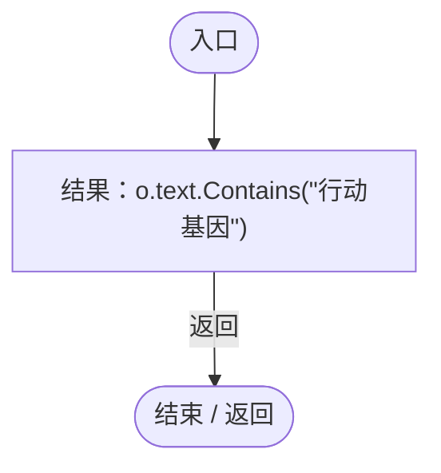

<a id="m9621ecf10f3de7ea"></a>

## 回调@76 · L76

`t … => 回调`


### Editor · Roslyn编译器控制流

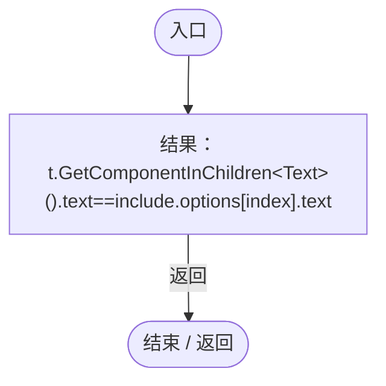

<a id="m36507a1225b45cfb"></a>

## 回调@96 · L96

`g … => 回调`


### Editor · Roslyn编译器控制流

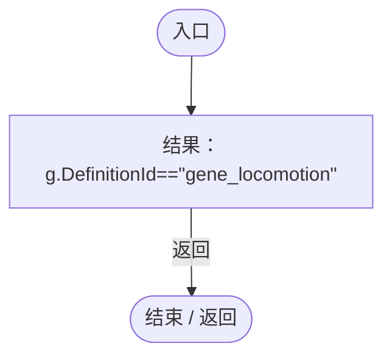

<a id="m528ebf3027702a4b"></a>

## 回调@98 · L98

`button … => 回调`


### Editor · Roslyn编译器控制流

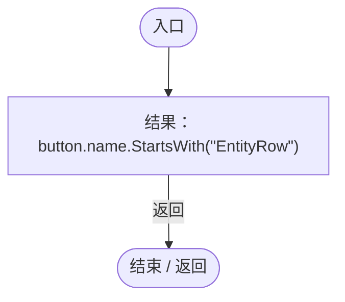
