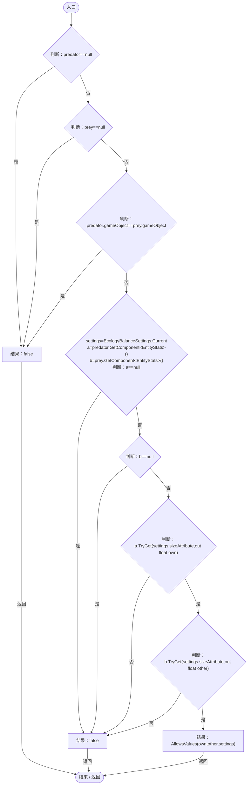
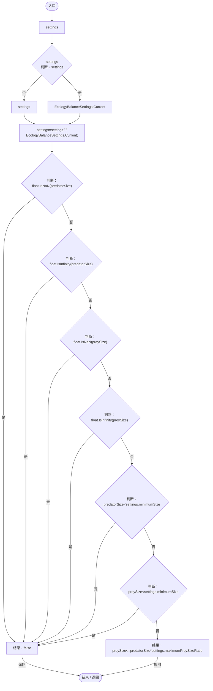

# PredationSizePolicy.cs

[返回总索引](../README.md) · `Runtime` · `Assets/DarwinPark/Entities/Ecology/PredationSizePolicy.cs`

[源文件](../../../Assets/DarwinPark/Entities/Ecology/PredationSizePolicy.cs) · 源码校验：`e8e2706fe68594052e78a4fd3557a5d6f1a99afa75e764a63d09f7cb873722b8`

方法按源文件位置排列。事件/回调引用不表示立即执行；分支与异常说明见总索引。完整源码与可点击关系图请打开离线手册。

## Allows · L9

`public static bool Allows(EntityGeneController predator,DarwinEntity prey)`

### Editor / Player · Roslyn编译器控制流

项目内调用/回调引用：

- [EcologyBalanceSettings.Current.get · L29](5a37bc79f15f6238.md#md33d4c4b8f82540b)（访问器）
- [EntityStats.TryGet · L90](75aa86a368efdf24.md#m24ee1433e4a70d94)（方法）
- [PredationSizePolicy.AllowsValues · L17](80ea865fb0f12053.md#mc56a07700ddd4a98)（方法）

## AllowsValues · L17

`public static bool AllowsValues(float predatorSize,float preySize,EcologyBalanceSettings settings=null)`

### Editor / Player · Roslyn编译器控制流

项目内调用/回调引用：

- [EcologyBalanceSettings.Current.get · L29](5a37bc79f15f6238.md#md33d4c4b8f82540b)（访问器）
