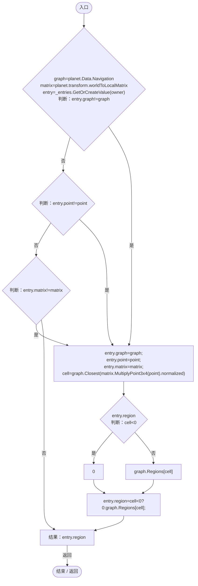
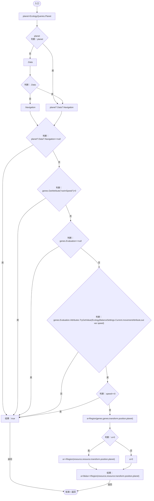
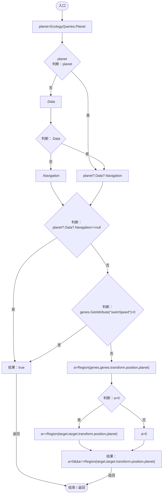
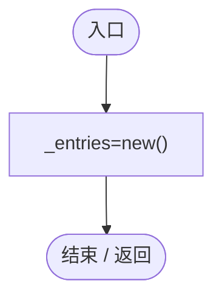

# LandReachability.cs

[返回总索引](../README.md) · `Runtime` · `Assets/DarwinPark/Entities/Ecology/LandReachability.cs`

[源文件](../../../Assets/DarwinPark/Entities/Ecology/LandReachability.cs) · 源码校验：`1436683ddd8ba5b61cdc4baa408e0866ebf5d08d5208380c76c6f506f8f85597`

方法按源文件位置排列。事件/回调引用不表示立即执行；分支与异常说明见总索引。完整源码与可点击关系图请打开离线手册。

## Region · L11

`private static int Region(Object owner,Vector3 point,PlanetTerrainMeshBuilder planet)`

### Editor / Player · Roslyn编译器控制流

项目内调用/回调引用：

- [PlanetTerrainMeshBuilder.Data.get · L81](415285cf043354a9.md#m1a65abfe0f34c5d8)（访问器）
- [LandNavigationGraph.Closest · L31](6f2590f045ea5d3f.md#m84242b314c22284e)（方法）

## CanReach · L13

`public static bool CanReach(EntityGeneController genes,ColonyResource resource)`

### Editor / Player · Roslyn编译器控制流

项目内调用/回调引用：

- [PlanetTerrainMeshBuilder.Data.get · L81](415285cf043354a9.md#m1a65abfe0f34c5d8)（访问器）
- [EntityGeneController.GetAttribute · L286](7494d53178552f0e.md#m18bff2b38f95b556)（方法）
- [EntityGeneController.Evaluation.get · L18](7494d53178552f0e.md#mc0039c100a31b455)（访问器）
- [EcologyBalanceSettings.Current.get · L29](5a37bc79f15f6238.md#md33d4c4b8f82540b)（访问器）
- [LandReachability.Region · L11](816416ac988cda79.md#m48727eb621982fd9)（方法）

## CanReach · L15

`public static bool CanReach(EntityGeneController genes,DarwinEntity target)`

### Editor / Player · Roslyn编译器控制流

项目内调用/回调引用：

- [PlanetTerrainMeshBuilder.Data.get · L81](415285cf043354a9.md#m1a65abfe0f34c5d8)（访问器）
- [EntityGeneController.GetAttribute · L286](7494d53178552f0e.md#m18bff2b38f95b556)（方法）
- [LandReachability.Region · L11](816416ac988cda79.md#m48727eb621982fd9)（方法）

## Reset · L17

`[RuntimeInitializeOnLoadMethod(RuntimeInitializeLoadType.SubsystemRegistration)]private static void Reset()`

### Editor / Player · Roslyn编译器控制流

