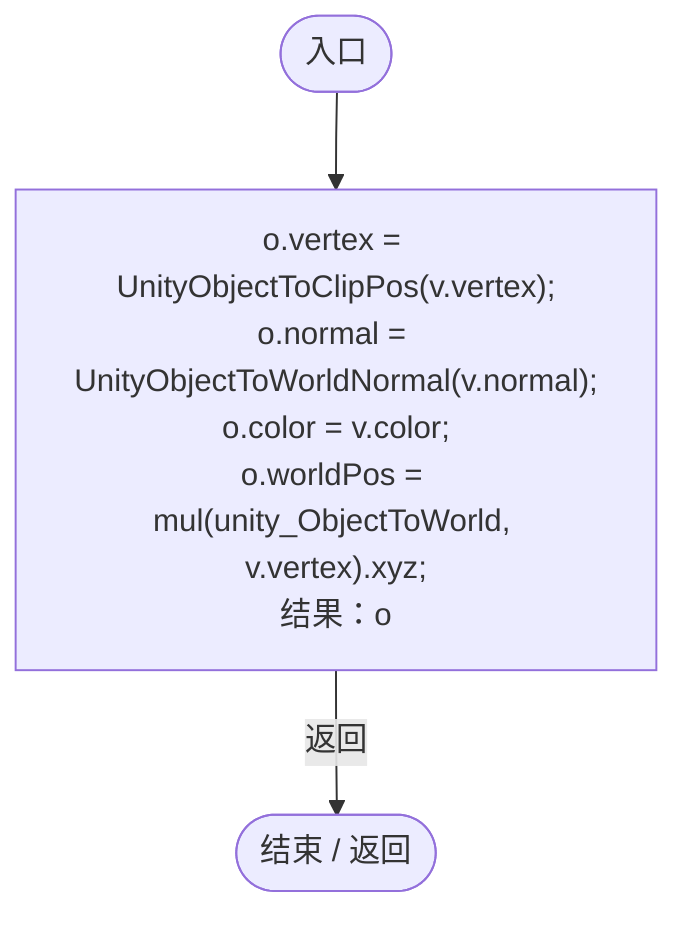
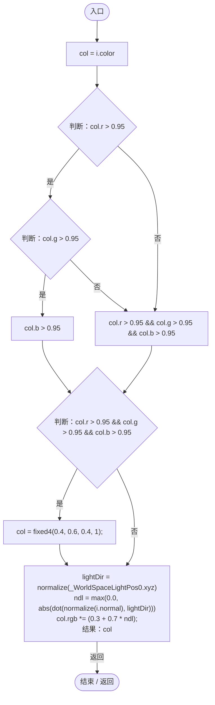

# PlanetSurface.shader

[返回总索引](../README.md) · `GPU` · `Assets/DarwinPark/Planet/PlanetSurface.shader`

[源文件](../../../Assets/DarwinPark/Planet/PlanetSurface.shader) · 源码校验：`31ff04f861087299bd7d66dcea424b0cf5a81abebf6f9003b4c5f378155be0cd`

方法按源文件位置排列。事件/回调引用不表示立即执行；分支与异常说明见总索引。完整源码与可点击关系图请打开离线手册。

## vert · L32

`v2f vert (appdata v)`

### GPU · GPU控制结构（名称链接，不作C#类型推断）

## frag · L42

`fixed4 frag (v2f i) : SV_Target`

### GPU · GPU控制结构（名称链接，不作C#类型推断）

