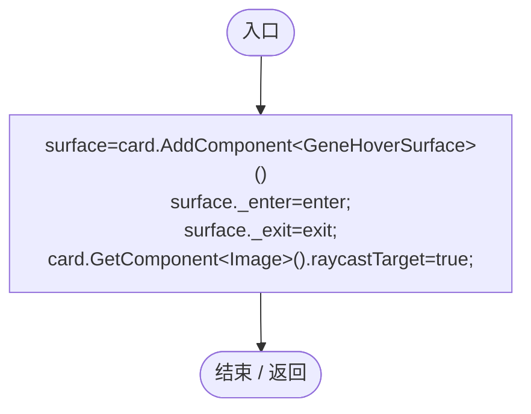
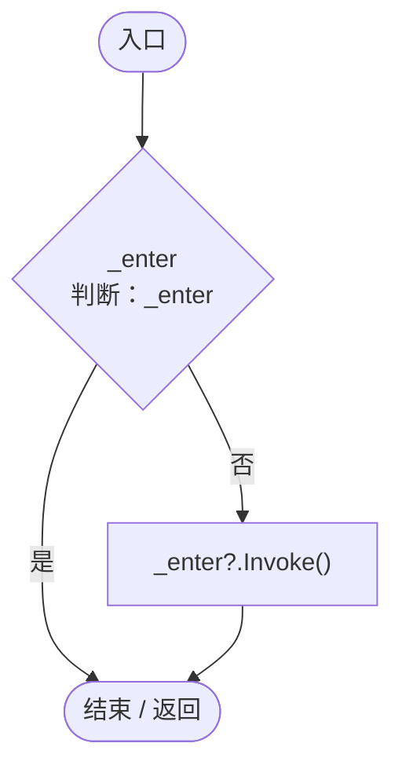
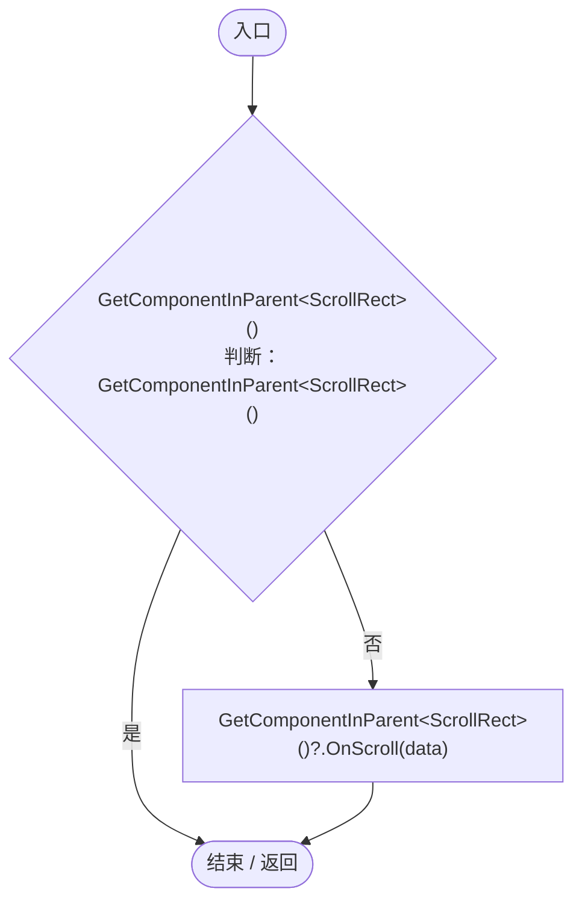
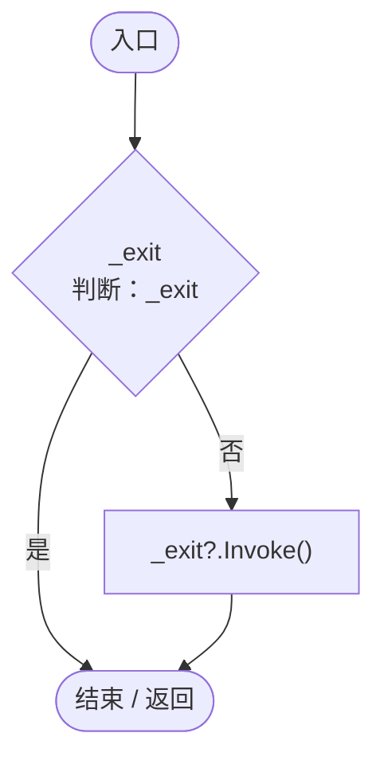

# GeneHoverSurface.cs

[返回总索引](../README.md) · `Runtime` · `Assets/DarwinPark/UI/GeneHoverSurface.cs`

[源文件](../../../Assets/DarwinPark/UI/GeneHoverSurface.cs) · 源码校验：`87c319ada2066bfba46547f43dcf5da9828edc608abd27ce2a5949f17078860c`

方法按源文件位置排列。事件/回调引用不表示立即执行；分支与异常说明见总索引。完整源码与可点击关系图请打开离线手册。

## Bind · L11

`public static void Bind(GameObject card,Action enter,Action exit)`

### Editor / Player · Roslyn编译器控制流

## OnPointerEnter · L13

`public void OnPointerEnter(PointerEventData data)`

### Editor / Player · Roslyn编译器控制流

## OnPointerExit · L14

`public void OnPointerExit(PointerEventData data)`

### Editor / Player · Roslyn编译器控制流

## OnScroll · L15

`public void OnScroll(PointerEventData data)`

### Editor / Player · Roslyn编译器控制流

## OnDisable · L16

`private void OnDisable()`

### Editor / Player · Roslyn编译器控制流

