# EcologyBalanceRegression.cs

[返回总索引](../README.md) · `Editor` · `Assets/DarwinPark/Editor/EcologyBalanceRegression.cs`

[源文件](../../../Assets/DarwinPark/Editor/EcologyBalanceRegression.cs) · 源码校验：`5db5c51ac6e8c8f9361b2f87f82199c62a30f89aff111ea6ef34c6af052e6421`

方法按源文件位置排列。事件/回调引用不表示立即执行；分支与异常说明见总索引。完整源码与可点击关系图请打开离线手册。

<a id="m294a4f58221f802d"></a>

## Folder.get · L33

`private static string Folder`


### Editor · 语法控制结构 / 声明（非CFG）

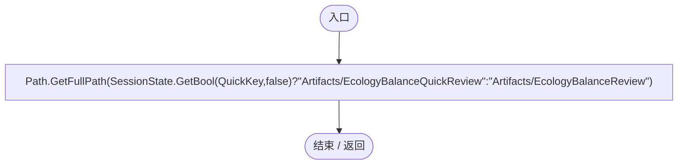

<a id="mf8f087e2079d221a"></a>

## EcologyBalanceRegression.ctor · L37

`static EcologyBalanceRegression()`

★ 修复（防Bug回归）：Unity搜索索引异常可能中断启动delayCall，回归入口改用幂等update等待，不能把未执行当通过。

### Editor · Roslyn编译器控制流

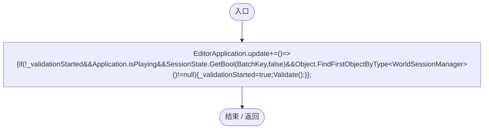

项目内调用/回调引用：

- [EcologyBalanceRegression.回调@37 · L37](81fff3fefa111617.md#m1b0ec236adb07a26)（回调/委托）

<a id="m1b0ec236adb07a26"></a>

## 回调@37 · L37

`( … => 回调`


### Editor · Roslyn编译器控制流

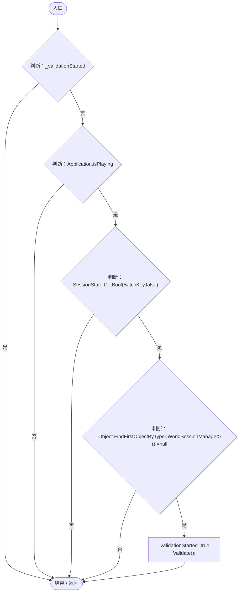

项目内调用/回调引用：

- [EcologyBalanceRegression.Validate · L41](81fff3fefa111617.md#m5e9203cb499d49bc)（方法）

<a id="m0d76fdc49a5f8c85"></a>

## RunBatch · L38

`public static void RunBatch()`


### Editor · Roslyn编译器控制流

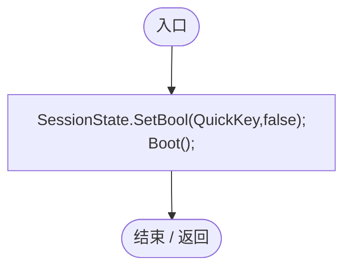

项目内调用/回调引用：

- [EcologyBalanceRegression.Boot · L40](81fff3fefa111617.md#m4ae0804b908febca)（方法）

<a id="md0675769a0f2548f"></a>

## RunQuickBatch · L39

`public static void RunQuickBatch()`


### Editor · Roslyn编译器控制流

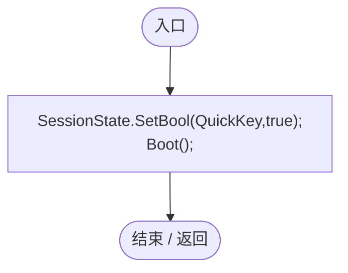

项目内调用/回调引用：

- [EcologyBalanceRegression.Boot · L40](81fff3fefa111617.md#m4ae0804b908febca)（方法）

<a id="m4ae0804b908febca"></a>

## Boot · L40

`private static void Boot()`


### Editor · Roslyn编译器控制流

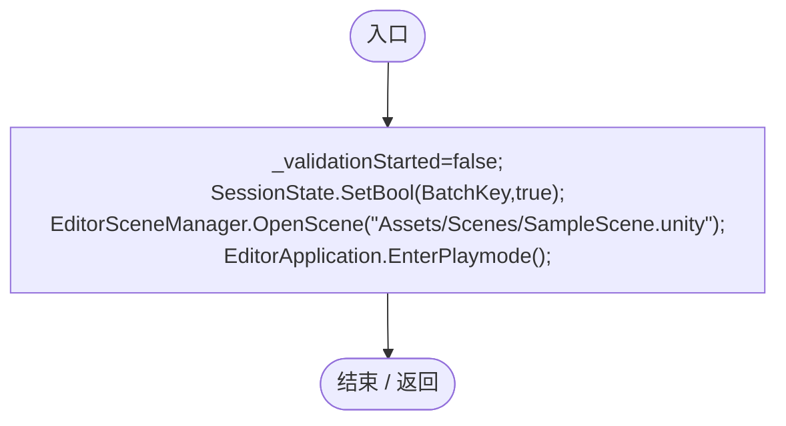

<a id="m5e9203cb499d49bc"></a>

## Validate · L41

`[MenuItem("Tools/Darwin Park/Validate Ecology Balance")] public static void Validate()`


### Editor · Roslyn编译器控制流

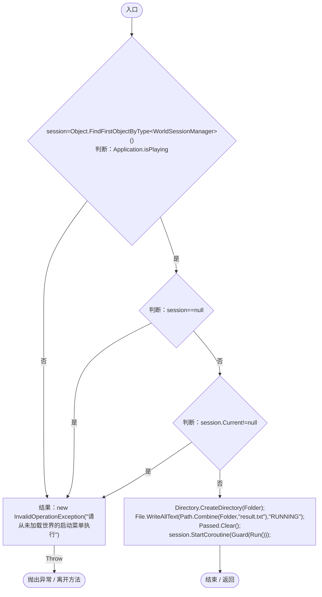

项目内调用/回调引用：

- [WorldSessionManager.Current.get · L21](08741c7b7b9d9344.md#m5d26a5eb846a8504)（访问器）
- [EcologyBalanceRegression.Guard · L51](81fff3fefa111617.md#m688391d64f86fa1c)（方法）
- [EcologyBalanceRegression.Run · L91](81fff3fefa111617.md#m007c38a59c6ab7cc)（方法）

<a id="mffc45a7ddd4a6d5c"></a>

## Check · L48

`private static void Check(bool condition,string message)`


### Editor · Roslyn编译器控制流

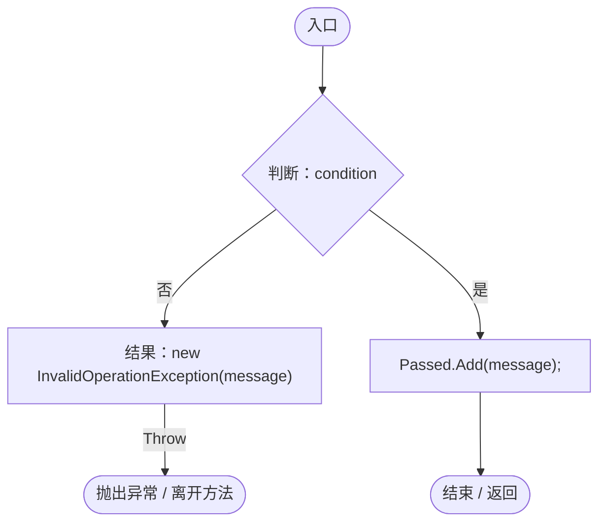

<a id="mb02f037d8b1b9c3d"></a>

## Cleanup · L49

`private static void Cleanup()`


### Editor · Roslyn编译器控制流

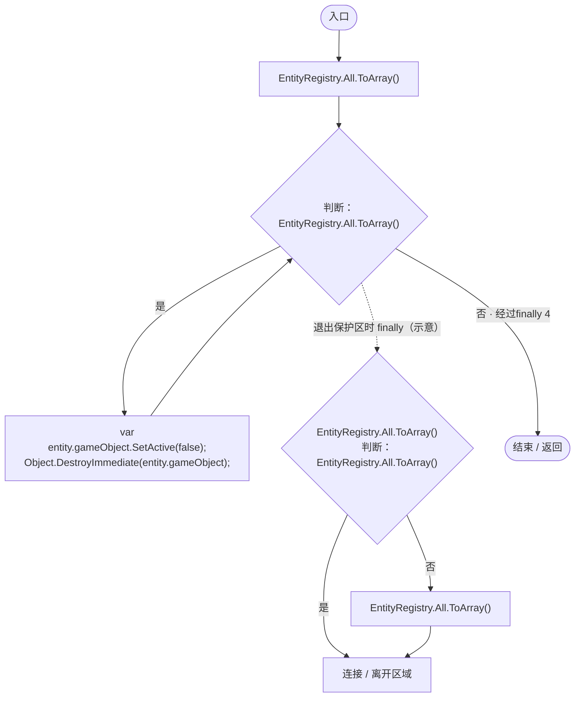

<a id="m688391d64f86fa1c"></a>

## Guard · L51

`private static IEnumerator Guard(IEnumerator run)`


### Editor · Roslyn编译器控制流

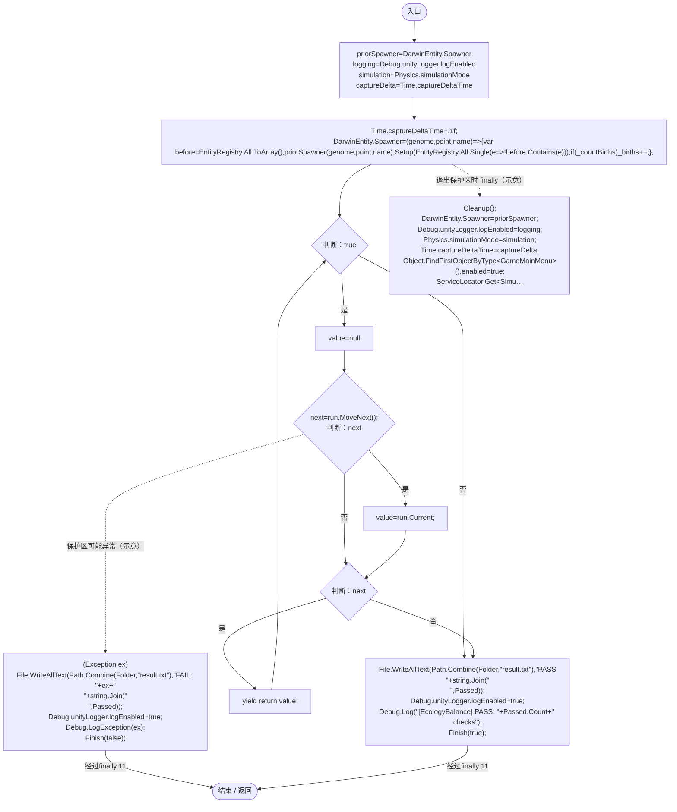

项目内调用/回调引用：

- [EcologyBalanceRegression.Finish · L74](81fff3fefa111617.md#m7b9960bd7ec908ce)（方法）
- [EcologyBalanceRegression.Cleanup · L49](81fff3fefa111617.md#mb02f037d8b1b9c3d)（方法）
- [SimulationClock.Pause · L79](a8f444aec9614b0a.md#m30929d45a885d0f1)（方法）
- [ServiceLocator.Get · L33](f2fdbe9f9ccd93cb.md#m2ae625299520c56d)（方法）
- [GameInputGate.Blocked.set · L8](52955daae7e592ab.md#m578697f6379686f4)（访问器）
- [EcologyBalanceRegression.回调@58 · L58](81fff3fefa111617.md#m078dcfc53a06879f)（回调/委托）

<a id="m078dcfc53a06879f"></a>

## 回调@58 · L58

`( … => 回调`


### Editor · Roslyn编译器控制流

```mermaid
flowchart TD
  b0(["入口"])
  b1{"before=EntityRegistry.All.ToArray()<br/>priorSpawner(genome,point,name);<br/>Setup(EntityRegistry.All.Single(e=&gt;!before.Contains(e)));<br/>判断：_countBirths"}
  b2["_births++;"]
  b3(["结束 / 返回"])
  b0 --> b1
  b1 -->|"是"| b2
  b1 -->|"否"| b3
  b2 --> b3

```

项目内调用/回调引用：

- [EcologyBalanceRegression.Setup · L76](81fff3fefa111617.md#m780d8943664f0472)（方法）
- [EcologyBalanceRegression.回调@58 · L58](81fff3fefa111617.md#mcf3695a579bad155)（回调/委托）

<a id="mcf3695a579bad155"></a>

## 回调@58 · L58

`e … => 回调`


### Editor · Roslyn编译器控制流

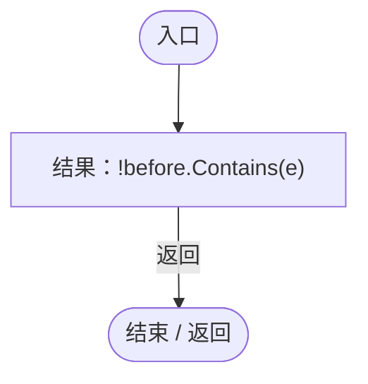

<a id="m7b9960bd7ec908ce"></a>

## Finish · L74

`private static void Finish(bool success)`


### Editor · Roslyn编译器控制流

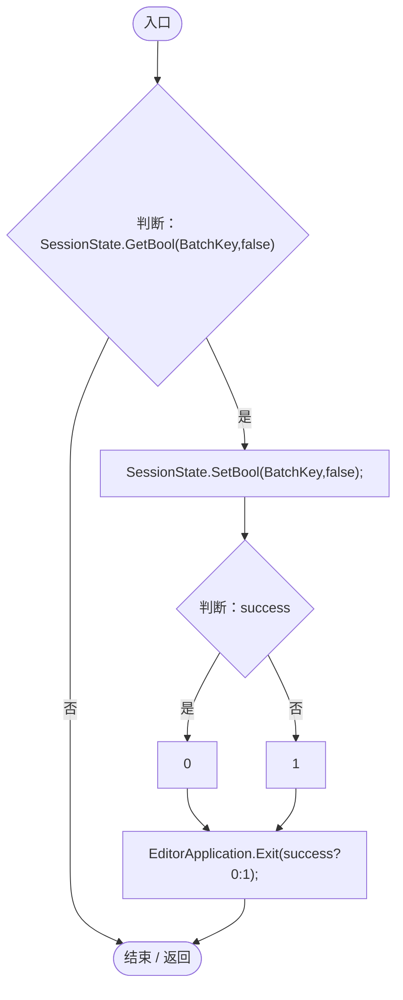

<a id="m780d8943664f0472"></a>

## Setup · L76

`private static void Setup(DarwinEntity entity)`


### Editor · Roslyn编译器控制流

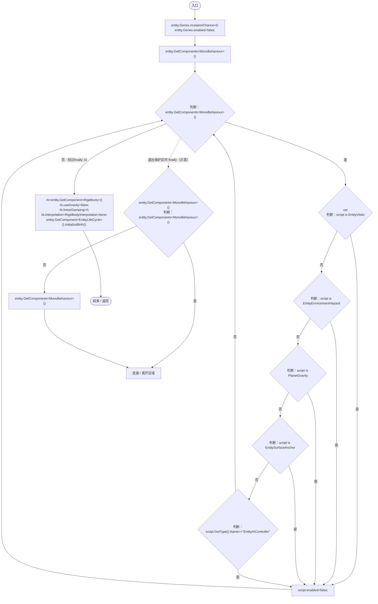

项目内调用/回调引用：

- [DarwinEntity.Genes.get · L14](70798dde169f2e8b.md#m622eb1adf401d431)（访问器）
- [EntityLifeCycle.InitializeBirth · L17](9f4138bfbae654b7.md#m76374fa073e2a603)（方法）

<a id="md36568de2375783b"></a>

## Spawn · L83

`private static DarwinEntity Spawn(Vector3 position,bool moving=false,bool hunter=false)`


### Editor · Roslyn编译器控制流

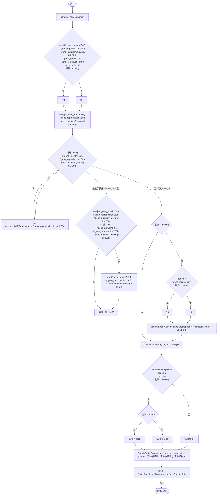

项目内调用/回调引用：

- [Genome.Add · L19](a2ef23f865bc7ee8.md#md9cfdc94b8b8d40f)（方法）
- [GeneInstance.Create · L20](f82e1498d67f5afd.md#m72e94c278de3cf8b)（方法）
- [EcologyBalanceRegression.回调@87 · L87](81fff3fefa111617.md#m2504594efe9c0785)（回调/委托）

<a id="m2504594efe9c0785"></a>

## 回调@87 · L87

`e … => 回调`


### Editor · Roslyn编译器控制流


<a id="m1d2256a7af2b6274"></a>

## Adult · L89

`private static void Adult(DarwinEntity entity)`


### Editor · Roslyn编译器控制流

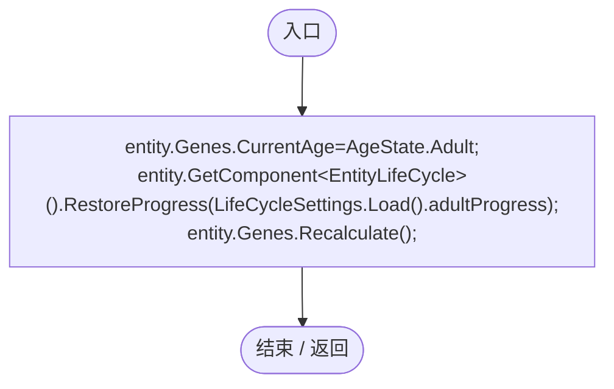

项目内调用/回调引用：

- [EntityGeneController.CurrentAge.set · L35](7494d53178552f0e.md#mfb3128e996aea41b)（访问器）
- [DarwinEntity.Genes.get · L14](70798dde169f2e8b.md#m622eb1adf401d431)（访问器）
- [EntityLifeCycle.RestoreProgress · L48](9f4138bfbae654b7.md#mfc75121476d49679)（方法）
- [LifeCycleSettings.Load · L16](ace76969fe8f61de.md#mbd2925785484f343)（方法）
- [EntityGeneController.Recalculate · L90](7494d53178552f0e.md#m93744c8f3039b93c)（方法）

<a id="m007c38a59c6ab7cc"></a>

## Run · L91

`private static IEnumerator Run()`


### Editor · Roslyn编译器控制流

```mermaid
flowchart TD
  b0(["入口"])
  b1["yield return null;<br/>ServiceLocator.Get&lt;SimulationClock&gt;().Pause();<br/>GeneRuntimeProfile.Clear();<br/>GeneDatabase.Reload();<br/>GeneDatabase.EnsureLoaded();<br/>settings=EcologyBalanceSettings.Current"]
  b2{"判断：PredationSizePolicy.AllowsValues(.9f,1)"}
  b3{"判断：PredationSizePolicy.AllowsValues(1,1)"}
  b4{"判断：PredationSizePolicy.AllowsValues(1,1.0001f)"}
  b5["PredationSizePolicy.AllowsValues(1.2f,1)"]
  b6["!PredationSizePolicy.AllowsValues(.9f,1)&amp;&amp;PredationSizePolicy.AllowsValues(1,1)&amp;&amp;!PredationSizePolicy.AllowsValues(1,1.0001f)&amp;&amp;PredationSizePolicy.AllowsValues(1.2f,1)"]
  b7["Check(!PredationSizePolicy.AllowsValues(.9f,1)&amp;&amp;PredationSizePolicy.AllowsValues(1,1)&amp;&amp;!PredationSizePolicy.AllowsValues(1,1.0001f)&amp;&amp;PredationSizePolicy.AllowsValues(1.2f,1),&quot;实际数值体型边界：小不能吃大、同型允许、无模糊容差&quot;);"]
  b8{"判断：PredationSizePolicy.AllowsValues(0,1)"}
  b9["!PredationSizePolicy.AllowsValues(float.NaN,1)"]
  b10["!PredationSizePolicy.AllowsValues(0,1)"]
  b11["Check(!PredationSizePolicy.AllowsValues(0,1)&amp;&amp;!PredationSizePolicy.AllowsValues(float.NaN,1),&quot;无效或零体型拒绝捕食&quot;);"]
  b12["plant=Spawn(new Vector3(0,400,0))<br/>Adult(plant);<br/>rep=plant.Genes.Genome.Genes.Single(g=&gt;g.DefinitionId==&quot;gene_reproduction&quot;)<br/>reproduction=(ReproductionGeneLogic)plant.Genes.GetLogic(rep)<br/>original=reproduction.CalculateGestationTime(1)<br/>nut…"]
  b13{"判断：reproduction.CalculateGestationTime(.01f)==70"}
  b14["reproduction.CalculateGestationTime(100)==300"]
  b15["reproduction.CalculateGestationTime(.01f)==70"]
  b16["Check(reproduction.CalculateGestationTime(.01f)==70&amp;&amp;reproduction.CalculateGestationTime(100)==300,&quot;孕育仍遵守 7～30 游戏日边界&quot;);"]
  b17["stats=plant.GetComponent&lt;EntityStats&gt;()<br/>stats.TryGet(&quot;storedNutrient&quot;,out float beforeReserve);<br/>nutritionLogic=plant.Genes.GetLogic(nutrition)<br/>nutritionLogic.OnUpdate(1);<br/>stats.TryGet(&quot;storedNutrient&quot;,out float afterReserve);<br/>Check(after…"]
  b18{"判断：migrated.suppressionRules.Any(r=&gt;r.targetGeneId==&quot;gene_reproduction&quot;)"}
  b19["migrated.attributeCurves[0].maxValue==123"]
  b20["migrated.suppressionRules.Any(r=&gt;r.targetGeneId==&quot;gene_reproduction&quot;)"]
  b21["Check(migrated.suppressionRules.Any(r=&gt;r.targetGeneId==&quot;gene_reproduction&quot;)&amp;&amp;migrated.attributeCurves[0].maxValue==123,&quot;旧默认抑制矩阵迁移且保留自定义曲线&quot;);"]
  b22["legacy.suppressionRules<br/>new GeneSuppressionJson{targetGeneId=&quot;gene_reproduction&quot;,coefficient=321}<br/>targetGeneId=&quot;gene_reproduction&quot;<br/>coefficient=321<br/>legacy.suppressionRules.Add(new GeneSuppressionJson{targetGeneId=&quot;gene_reproduction&quot;,coeff…"]
  b23["Check(JsonUtility.FromJson&lt;GeneDefinitionJson&gt;(EcologyGeneDefaults.Upgrade(JsonUtility.ToJson(legacy))).suppressionRules.Single().coefficient==321,&quot;自定义抑制矩阵不被平衡补丁覆盖&quot;);<br/>priorBalance=EcologyBalanceSettings.CurrentJson<br/>customBalance=EcologyB…"]
  b24["new WorldSaveData{id=Guid.NewGuid().ToString(&quot;N&quot;),name=&quot;生态规则往返实验&quot;,oreResolution=1,ore=new float[1],terrainParameters=JsonUtility.ToJson(Object.FindFirstObjectByType&lt;PlanetTerrainMeshBuilder&gt;()),environmentParameters=JsonUtility.ToJson(Se…"]
  b25["roundtrip=Path.Combine(Folder,&quot;roundtrip.json&quot;)<br/>WorldSaveStore.Write(save,roundtrip);<br/>read=WorldSaveStore.Read(roundtrip)"]
  b26["EcologyBalanceSettings.UseSnapshot(read.ecologyBalanceSettings);<br/>Check(EcologyBalanceSettings.Current.baseMetabolismScale==.123f,&quot;生态规则独立世界写盘、读取并恢复快照&quot;);<br/>customBalance.maximumPreySizeRatio=2;<br/>rejected=false"]
  b27["EcologyBalanceSettings.UseSnapshot(JsonUtility.ToJson(customBalance));"]
  b28["rejected=true;"]
  b29{"判断：rejected"}
  b30["EcologyBalanceSettings.CurrentJson==read.ecologyBalanceSettings"]
  b31["rejected"]
  b32["Check(rejected&amp;&amp;EcologyBalanceSettings.CurrentJson==read.ecologyBalanceSettings,&quot;损坏生态快照被拒绝且现有规则不变&quot;);"]
  b33["EcologyBalanceSettings.UseSnapshot(priorBalance);"]
  b34{"builder=Object.FindFirstObjectByType&lt;PlanetTerrainMeshBuilder&gt;()<br/>weather=Object.FindFirstObjectByType&lt;PlanetWeatherVisuals&gt;()<br/>判断：weather!=null"}
  b35["Object.DestroyImmediate(weather);"]
  b36["builder.subdivisions=32;<br/>builder.Build();<br/>PlanetClimateMap.Instance.CancelInvoke();<br/>PlanetClimateMap.Instance.enabled=false;<br/>direction=Vector3.up<br/>best=float.MinValue"]
  b37["i=0"]
  b38{"判断：i&lt;512"}
  b39{"y=1-2f*(i+.5f)/512<br/>angle=i*2.39996323f<br/>d=new Vector3(Mathf.Sqrt(1-y*y)*Mathf.Cos(angle),y,Mathf.Sqrt(1-y*y)*Mathf.Sin(angle))<br/>height=PlanetTerrainSampler.SampleHeight(builder.Data,d)<br/>判断：height&gt;best"}
  b40["best=height;<br/>direction=d;"]
  b41["i++"]
  b42["center=EcologyQueries.Surface(builder.transform.position+direction*(builder.radius+builder.heightScale))<br/>menu=Object.FindFirstObjectByType&lt;GameMainMenu&gt;()<br/>menu.enabled=false;<br/>WorldRuntimeGate.Ready=true;<br/>GameInputGate.Blocked=false;<br/>cloc…"]
  b43["legacyLogic<br/>new ReproductionSaveState{gene=legacyGene.InstanceId,gestation=272}<br/>gene=legacyGene.InstanceId<br/>gestation=272<br/>legacyLogic.RestoreState(new ReproductionSaveState{gene=legacyGene.InstanceId,gestation=272});"]
  b44["restingParent=Spawn(center+Vector3.right*3)<br/>Adult(restingParent);<br/>restingGene=restingParent.Genes.Genome.Genes.Single(g=&gt;g.DefinitionId==&quot;gene_reproduction&quot;)<br/>restingLogic=(ReproductionGeneLogic)restingParent.Genes.GetLogic(restingGene)"]
  b45["restingLogic<br/>new ReproductionSaveState{gene=restingGene.InstanceId,cooldown=150}<br/>gene=restingGene.InstanceId<br/>cooldown=150<br/>restingLogic.RestoreState(new ReproductionSaveState{gene=restingGene.InstanceId,cooldown=150});"]
  b46["oldWorld=JsonUtility.FromJson&lt;WorldSaveData&gt;(JsonUtility.ToJson(read))<br/>oldWorld.ecologyBalanceSettings=null;"]
  b47["oldWorld.entities<br/>new List&lt;EntitySaveState&gt;{EntitySaveState.Capture(legacyParent),EntitySaveState.Capture(restingParent)}<br/>EntitySaveState.Capture(legacyParent)<br/>EntitySaveState.Capture(restingParent)<br/>oldWorld.entities=new List&lt;EntitySaveS…"]
  b48{"判断：EcologyLegacySaveUpgrade.Apply(oldWorld,EntityRegistry.All)==2"}
  b49{"判断：legacyLogic.CaptureState().gestation&lt;100"}
  b50["restingLogic.CaptureState().cooldown==5"]
  b51["EcologyLegacySaveUpgrade.Apply(oldWorld,EntityRegistry.All)==2&amp;&amp;legacyLogic.CaptureState().gestation&lt;100&amp;&amp;restingLogic.CaptureState().cooldown==5"]
  b52["Check(EcologyLegacySaveUpgrade.Apply(oldWorld,EntityRegistry.All)==2&amp;&amp;legacyLogic.CaptureState().gestation&lt;100&amp;&amp;restingLogic.CaptureState().cooldown==5,&quot;旧孕育/休养收纳到新周期，不重置生命周期或重复扣储备&quot;);"]
  b53["remaining=legacyLogic.CaptureState().gestation<br/>legacyLogic.OnUpdate(1);"]
  b54{"判断：EcologyLegacySaveUpgrade.Apply(oldWorld,EntityRegistry.All)==0"}
  b55["Mathf.Abs(legacyLogic.CaptureState().gestation-(remaining-1))&lt;.001f"]
  b56["EcologyLegacySaveUpgrade.Apply(oldWorld,EntityRegistry.All)==0"]
  b57["Check(EcologyLegacySaveUpgrade.Apply(oldWorld,EntityRegistry.All)==0&amp;&amp;Mathf.Abs(legacyLogic.CaptureState().gestation-(remaining-1))&lt;.001f,&quot;已迁移世界再次检查不重置剩余孕育&quot;);"]
  b58["upgradedFile=Path.Combine(Folder,&quot;legacy-upgraded.json&quot;)<br/>WorldSaveStore.Write(oldWorld,upgradedFile);<br/>upgradedWorld=WorldSaveStore.Read(upgradedFile)"]
  b59{"判断：upgradedWorld.ecologyBalanceSettings==EcologyBalanceSettings.CurrentJson"}
  b60["upgradedWorld.entities[0].reproduction.Single().gestation&lt;100"]
  b61["upgradedWorld.ecologyBalanceSettings==EcologyBalanceSettings.CurrentJson"]
  b62["Check(upgradedWorld.ecologyBalanceSettings==EcologyBalanceSettings.CurrentJson&amp;&amp;upgradedWorld.entities[0].reproduction.Single().gestation&lt;100,&quot;旧计时迁移和规则标记同步写盘读取&quot;);"]
  b63["step=0"]
  b64{"判断：step&lt;1000"}
  b65{"判断：EntityRegistry.All.Count==2"}
  b66["legacyParent.Genes.AdvanceSimulation(.1f);<br/>Vitals.Invoke(legacyParent.GetComponent&lt;EntityVitals&gt;(),new object[]{.1f});<br/>step++"]
  b67{"判断：EcologyQueries.Alive(legacyParent)"}
  b68["EntityRegistry.All.Count&gt;2"]
  b69["EcologyQueries.Alive(legacyParent)"]
  b70["Check(EcologyQueries.Alive(legacyParent)&amp;&amp;EntityRegistry.All.Count&gt;2,&quot;旧长孕育实体在新规则下实际存活并产下后代&quot;);"]
  b71{"Cleanup();<br/>判断：SessionState.GetBool(QuickKey,false)"}
  b72["new[]{17,41,83}"]
  b73{"判断：new[]{17,41,83}"}
  b74["int"]
  b75["Cleanup();<br/>UnityEngine.Random.InitState(seed);<br/>_births=0;<br/>_countBirths=false;<br/>up=EcologyQueries.Up(center)<br/>a=Vector3.Cross(up,Vector3.right).normalized<br/>b=Vector3.Cross(up,a)"]
  b76["i=0"]
  b77{"判断：i&lt;24"}
  b78["point=UnityEngine.Random.insideUnitCircle*22<br/>e=Spawn(EcologyQueries.Surface(center+a*point.x+b*point.y))<br/>Adult(e);"]
  b79["i++"]
  b80["i=0"]
  b81{"判断：i&lt;2"}
  b82["e=Spawn(EcologyQueries.Surface(center+a*(i*3)),true)<br/>Adult(e);"]
  b83["i++"]
  b84["_countBirths=true;<br/>csv=new StringBuilder(&quot;seconds,plants,consumers,births,consumer_details\n&quot;)<br/>minPlants=int.MaxValue<br/>minConsumers=int.MaxValue<br/>maxTotal=0<br/>completedSteps=0"]
  b85["step=0"]
  b86{"判断：step&lt;30000"}
  b87["EntityRegistry.All.ToArray()"]
  b88{"判断：EntityRegistry.All.ToArray()"}
  b89{"var<br/>判断：EcologyQueries.Alive(entity)"}
  b90{"entity.Genes.AdvanceSimulation(.1f);<br/>判断：entity!=null"}
  b91{"判断：entity.isActiveAndEnabled"}
  b92["Vitals.Invoke(entity.GetComponent&lt;EntityVitals&gt;(),new object[]{.1f});"]
  b93{"EntityRegistry.All.ToArray()<br/>判断：EntityRegistry.All.ToArray()"}
  b94["EntityRegistry.All.ToArray()"]
  b95["连接 / 离开区域"]
  b96["EntityRegistry.All.ToArray()"]
  b97{"判断：EntityRegistry.All.ToArray()"}
  b98{"var<br/>判断：EcologyQueries.Alive(entity)"}
  b99["entity.gameObject.SetActive(false);<br/>Object.DestroyImmediate(entity.gameObject);"]
  b100{"判断：entity.Genes.GetAttribute(settings.movementAttribute)&gt;0"}
  b101["body=entity.GetComponent&lt;Rigidbody&gt;()<br/>entity.transform.position=EcologyQueries.Surface(entity.transform.position+body.linearVelocity*.1f);"]
  b102{"EntityRegistry.All.ToArray()<br/>判断：EntityRegistry.All.ToArray()"}
  b103["EntityRegistry.All.ToArray()"]
  b104["连接 / 离开区域"]
  b105{"Physics.SyncTransforms();<br/>completedSteps=step+1;<br/>判断：step%500==0"}
  b106{"判断：step==29999"}
  b107{"plants=EntityRegistry.All.Count(e=&gt;EcologyEnergyBudget.IsProducer(e.Genes))<br/>consumers=EntityRegistry.All.Count-plants<br/>maxTotal=Mathf.Max(maxTotal,EntityRegistry.All.Count);<br/>判断：step&gt;=5000"}
  b108["minPlants=Mathf.Min(minPlants,plants);<br/>minConsumers=Mathf.Min(minConsumers,consumers);"]
  b109{"details=string.Join(&quot;;&quot;,EntityRegistry.All.Where(e=&gt;!EcologyEnergyBudget.IsProducer(e.Genes)).Select(e=&gt;{var values=e.GetComponent&lt;EntityStats&gt;();values.TryGet(&quot;nutrient&quot;,out float food);values.TryGet(&quot;storedNutrient&quot;,out float reserve);…"}
  b110{"判断：plants==0"}
  b111{"判断：consumers==0"}
  b112["yield return null;"]
  b113["step++"]
  b114{"判断：completedSteps==30000"}
  b115{"判断：minPlants&gt;0"}
  b116{"判断：minConsumers&gt;0"}
  b117{"判断：maxTotal&lt;=400"}
  b118["_births&gt;24"]
  b119["completedSteps==30000&amp;&amp;minPlants&gt;0&amp;&amp;minConsumers&gt;0&amp;&amp;maxTotal&lt;=400&amp;&amp;_births&gt;24"]
  b120["Check(completedSteps==30000&amp;&amp;minPlants&gt;0&amp;&amp;minConsumers&gt;0&amp;&amp;maxTotal&lt;=400&amp;&amp;_births&gt;24,&quot;种子 &quot;+seed+&quot;：3000 模拟秒多代生产/捕食/繁殖循环，数量有界；出生=&quot;+_births+&quot;，最高数量=&quot;+maxTotal+&quot;，后期植物/消费者最低=&quot;+minPlants+&quot;/&quot;+minConsumers);"]
  b121["_countBirths=false;"]
  b122{"new[]{17,41,83}<br/>判断：new[]{17,41,83}"}
  b123["new[]{17,41,83}"]
  b124["连接 / 离开区域"]
  b125(["结束 / 返回"])
  b0 --> b1
  b1 --> b2
  b2 -->|"否"| b3
  b2 -->|"是"| b6
  b3 -->|"是"| b4
  b3 -->|"否"| b6
  b4 -->|"否"| b5
  b4 -->|"是"| b6
  b5 --> b7
  b6 --> b7
  b7 --> b8
  b8 -->|"否"| b9
  b8 -->|"是"| b10
  b9 --> b11
  b10 --> b11
  b11 --> b12
  b12 --> b13
  b13 -->|"是"| b14
  b13 -->|"否"| b15
  b14 --> b16
  b15 --> b16
  b16 --> b17
  b17 --> b18
  b18 -->|"是"| b19
  b18 -->|"否"| b20
  b19 --> b21
  b20 --> b21
  b21 --> b22
  b22 --> b23
  b23 --> b24
  b24 --> b25
  b25 --> b26
  b26 --> b27
  b27 --> b29
  b28 --> b29
  b29 -->|"是"| b30
  b29 -->|"否"| b31
  b30 --> b32
  b31 --> b32
  b32 -->|"经过finally 33"| b34
  b34 -->|"是"| b35
  b34 -->|"否"| b36
  b35 --> b36
  b36 --> b37
  b37 --> b38
  b38 -->|"是"| b39
  b38 -->|"否"| b42
  b39 -->|"是"| b40
  b39 -->|"否"| b41
  b40 --> b41
  b41 --> b38
  b42 --> b43
  b43 --> b44
  b44 --> b45
  b45 --> b46
  b46 --> b47
  b47 --> b48
  b48 -->|"是"| b49
  b48 -->|"否"| b51
  b49 -->|"是"| b50
  b49 -->|"否"| b51
  b50 --> b52
  b51 --> b52
  b52 --> b53
  b53 --> b54
  b54 -->|"是"| b55
  b54 -->|"否"| b56
  b55 --> b57
  b56 --> b57
  b57 --> b58
  b58 --> b59
  b59 -->|"是"| b60
  b59 -->|"否"| b61
  b60 --> b62
  b61 --> b62
  b62 --> b63
  b63 --> b64
  b64 -->|"是"| b65
  b64 -->|"否"| b67
  b65 -->|"是"| b66
  b65 -->|"否"| b67
  b66 --> b64
  b67 -->|"是"| b68
  b67 -->|"否"| b69
  b68 --> b70
  b69 --> b70
  b70 --> b71
  b71 -->|"是"| b125
  b71 -->|"否"| b72
  b72 --> b73
  b73 -->|"是"| b74
  b73 -->|"否 · 经过finally 122"| b125
  b74 --> b75
  b75 --> b76
  b76 --> b77
  b77 -->|"是"| b78
  b77 -->|"否"| b80
  b78 --> b79
  b79 --> b77
  b80 --> b81
  b81 -->|"是"| b82
  b81 -->|"否"| b84
  b82 --> b83
  b83 --> b81
  b84 --> b85
  b85 --> b86
  b86 -->|"是"| b87
  b86 -->|"否"| b114
  b87 --> b88
  b88 -->|"是"| b89
  b88 -->|"否 · 经过finally 93"| b96
  b89 -->|"是"| b90
  b89 -->|"否"| b88
  b90 -->|"是"| b91
  b90 -->|"否"| b88
  b91 -->|"是"| b92
  b91 -->|"否"| b88
  b92 --> b88
  b93 -->|"否"| b94
  b93 -->|"是"| b95
  b94 --> b95
  b96 --> b97
  b97 -->|"是"| b98
  b97 -->|"否 · 经过finally 102"| b105
  b98 -->|"否"| b99
  b98 -->|"是"| b100
  b99 --> b97
  b100 -->|"是"| b101
  b100 -->|"否"| b97
  b101 --> b97
  b102 -->|"否"| b103
  b102 -->|"是"| b104
  b103 --> b104
  b105 -->|"否"| b106
  b105 -->|"是"| b107
  b106 -->|"是"| b107
  b106 -->|"否"| b113
  b107 -->|"是"| b108
  b107 -->|"否"| b109
  b108 --> b109
  b109 -->|"否"| b110
  b109 -->|"是"| b114
  b110 -->|"否"| b111
  b110 -->|"是"| b114
  b111 -->|"是"| b114
  b111 -->|"否"| b112
  b112 --> b113
  b113 --> b86
  b114 -->|"是"| b115
  b114 -->|"否"| b119
  b115 -->|"是"| b116
  b115 -->|"否"| b119
  b116 -->|"是"| b117
  b116 -->|"否"| b119
  b117 -->|"是"| b118
  b117 -->|"否"| b119
  b118 --> b120
  b119 --> b120
  b120 --> b121
  b121 --> b73
  b122 -->|"否"| b123
  b122 -->|"是"| b124
  b123 --> b124
  b27 -. "保护区可能异常（示意）" .-> b28
  b26 -. "退出保护区时 finally（示意）" .-> b33
  b88 -. "退出保护区时 finally（示意）" .-> b93
  b97 -. "退出保护区时 finally（示意）" .-> b102
  b73 -. "退出保护区时 finally（示意）" .-> b122

```

项目内调用/回调引用：

- [SimulationClock.Pause · L79](a8f444aec9614b0a.md#m30929d45a885d0f1)（方法）
- [ServiceLocator.Get · L33](f2fdbe9f9ccd93cb.md#m2ae625299520c56d)（方法）
- [GeneRuntimeProfile.Clear · L9](f1a7d6e7b41d5a91.md#m3e3a434df6550039)（方法）
- [GeneDatabase.Reload · L145](ec0a03483435a863.md#mbf775d68c402c10e)（方法）
- [GeneDatabase.EnsureLoaded · L12](ec0a03483435a863.md#mc3e6357b9ca440f5)（方法）
- [EcologyBalanceSettings.Current.get · L29](5a37bc79f15f6238.md#md33d4c4b8f82540b)（访问器）
- [EcologyBalanceRegression.Check · L48](81fff3fefa111617.md#mffc45a7ddd4a6d5c)（方法）
- [PredationSizePolicy.AllowsValues · L17](80ea865fb0f12053.md#mc56a07700ddd4a98)（方法）
- [EcologyBalanceRegression.Spawn · L83](81fff3fefa111617.md#md36568de2375783b)（方法）
- [EcologyBalanceRegression.Adult · L89](81fff3fefa111617.md#m1d2256a7af2b6274)（方法）
- [DarwinEntity.Genes.get · L14](70798dde169f2e8b.md#m622eb1adf401d431)（访问器）
- [EntityGeneController.GetLogic · L184](7494d53178552f0e.md#m4f4e58e1a4abadfc)（方法）
- [ReproductionGeneLogic.CalculateGestationTime · L150](ac319ea70bd8b723.md#m1d2dd13f863c0d75)（方法）
- [EntityGeneController.Recalculate · L90](7494d53178552f0e.md#m93744c8f3039b93c)（方法）
- [EntityStats.TryGet · L90](75aa86a368efdf24.md#m24ee1433e4a70d94)（方法）
- [IGeneLogic.OnUpdate · L9](5304fdad773967f8.md#m829188d65276f8e5)（方法）
- [GeneInstance.Create · L20](f82e1498d67f5afd.md#m72e94c278de3cf8b)（方法）
- [Genome.Add · L19](a2ef23f865bc7ee8.md#md9cfdc94b8b8d40f)（方法）
- [EntityStats.Modify · L111](75aa86a368efdf24.md#m9c837be197158240)（方法）
- [EntityGeneController.GetAttribute · L225](7494d53178552f0e.md#mc707943b1138a009)（方法）
- [EcologyBalanceRegression.Cleanup · L49](81fff3fefa111617.md#mb02f037d8b1b9c3d)（方法）
- [EcologyMotion.CanHunt · L38](6ed9d0eedb456d32.md#m4271864b37a65a94)（方法）
- [EcologyReproductionTiming.FoodPressure · L24](f834876424538fa9.md#md8dab99dea20ca62)（方法）
- [SimulationClock.Play · L78](a8f444aec9614b0a.md#m7aa9e64b7de60ed0)（方法）
- [EntityManualControl.BeginControl · L32](a6969896da35e1f0.md#mf0dadf914f9961c7)（方法）
- [EntityManualControl.SetAim · L27](a6969896da35e1f0.md#m70f09d0090a1fa41)（方法）
- [EntityManualControl.QueueAttack · L24](a6969896da35e1f0.md#md160ef2315358c16)（方法）
- [EntityManualControl.Release · L37](a6969896da35e1f0.md#m87aa0efacece2c5b)（方法）
- [SimulationClock.SetTimeScale · L81](a8f444aec9614b0a.md#mecaa463a0561aca3)（方法）
- [EcologyEnergyBudget.Consumption · L54](06a91c8201f26593.md#m9b329937b5f8ae2d)（方法）
- [EcologyEnergyBudget.WantsFood · L14](06a91c8201f26593.md#mc0262b05e0fd6456)（方法）
- [LocomotionSettings.Load · L17](8cce83c7d4563cf0.md#m06b74c04dd63fb4a)（方法）
- [EntityStats.Feed · L95](75aa86a368efdf24.md#mc025822ff1eb86a0)（方法）
- [GeneTreeStorage.ReadCatalog · L27](a885bad0d7dedee8.md#m89083f320ec287c0)（方法）
- [EcologyGeneDefaults.Upgrade · L14](ce4f4683a31b001c.md#m0cb614734c6a2d00)（方法）
- [EcologyBalanceSettings.CurrentJson.get · L30](5a37bc79f15f6238.md#m4835e7fa2ac9560d)（访问器）
- [EcologyBalanceSettings.Parse · L31](5a37bc79f15f6238.md#m044d17a39c22d55a)（方法）
- [GeneTreeStorage.Active.get · L26](a885bad0d7dedee8.md#mcd6b1d82c9cf8f5c)（访问器）
- [WorldSaveStore.Write · L117](d67a35e5e3814c15.md#m793b97a7ba7d2029)（方法）
- [WorldSaveStore.Read · L72](d67a35e5e3814c15.md#mca362c7675a5800c)（方法）
- [EcologyBalanceSettings.UseSnapshot · L43](5a37bc79f15f6238.md#mfb6d2d0cbc1cf33d)（方法）
- [PlanetTerrainMeshBuilder.Build · L158](415285cf043354a9.md#m3cb263b66d834f1f)（方法）
- [PlanetClimateMap.Instance.get · L16](b4e9726c1bcf4c37.md#m3add54a419aeef9f)（访问器）
- [PlanetTerrainSampler.SampleHeight · L32](fd5c1d83b88a7c8b.md#m759508f0c5a04b21)（方法）
- [PlanetTerrainMeshBuilder.Data.get · L78](415285cf043354a9.md#m8382f579717fbc6d)（访问器）
- [EcologyQueries.Surface · L47](bdf7ccc2c9c0452f.md#m2f1f6873ee5fc8df)（方法）
- [GameInputGate.Blocked.set · L8](52955daae7e592ab.md#m578697f6379686f4)（访问器）
- [ReproductionGeneLogic.RestoreState · L35](ac319ea70bd8b723.md#m2e3c6341cef3b9c0)（方法）
- [EntitySaveState.Capture · L21](a1ec8fcd9d7d3ddb.md#mc67502b381bc2751)（方法）
- [EcologyLegacySaveUpgrade.Apply · L14](3ea317ee2852be05.md#m62b6c72e15708d48)（方法）
- [ReproductionGeneLogic.CaptureState · L33](ac319ea70bd8b723.md#mb3b414bac984dd2e)（方法）
- [ReproductionGeneLogic.OnUpdate · L36](ac319ea70bd8b723.md#mf050ec0ba2694604)（方法）
- [EntityGeneController.AdvanceSimulation · L60](7494d53178552f0e.md#m10b24df798096cab)（方法）
- [EcologyQueries.Alive · L38](bdf7ccc2c9c0452f.md#mb2877c487f449970)（方法）
- [EcologyQueries.Up · L41](bdf7ccc2c9c0452f.md#maca7070196f125fd)（方法）
- [EcologyBalanceRegression.回调@97 · L97](81fff3fefa111617.md#mebfe410eb5125c16)（回调/委托）
- [EcologyBalanceRegression.回调@99 · L99](81fff3fefa111617.md#m386bb639a3e295bb)（回调/委托）
- [EcologyBalanceRegression.回调@114 · L114](81fff3fefa111617.md#m8a1ebe1b68104d0d)（回调/委托）
- [EcologyBalanceRegression.回调@127 · L127](81fff3fefa111617.md#mf22a31f6359fc539)（回调/委托）
- [EcologyBalanceRegression.回调@132 · L132](81fff3fefa111617.md#md051b5e137f4183f)（回调/委托）
- [EcologyBalanceRegression.回调@150 · L150](81fff3fefa111617.md#me4a8007eb3122e6d)（回调/委托）
- [EcologyBalanceRegression.回调@153 · L153](81fff3fefa111617.md#maa78adef1139a155)（回调/委托）
- [EcologyBalanceRegression.回调@184 · L184](81fff3fefa111617.md#m8d48e6c0a36b5f69)（回调/委托）
- [EcologyBalanceRegression.回调@186 · L186](81fff3fefa111617.md#m6d44212eba074c7d)（回调/委托）
- [EcologyBalanceRegression.回调@186 · L186](81fff3fefa111617.md#m10b13211318999c4)（回调/委托）

<a id="mebfe410eb5125c16"></a>

## 回调@97 · L97

`g … => 回调`


### Editor · Roslyn编译器控制流

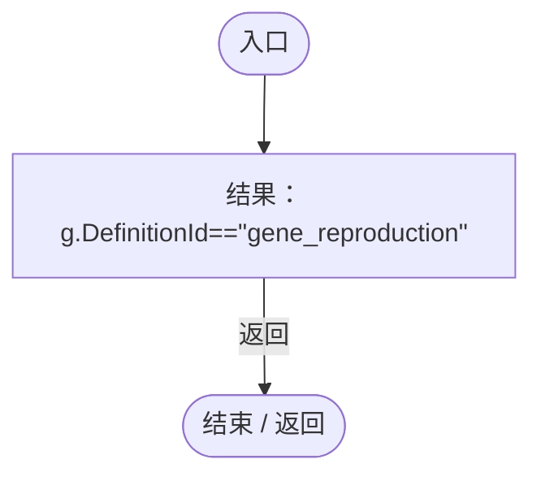

<a id="m386bb639a3e295bb"></a>

## 回调@99 · L99

`g … => 回调`


### Editor · Roslyn编译器控制流

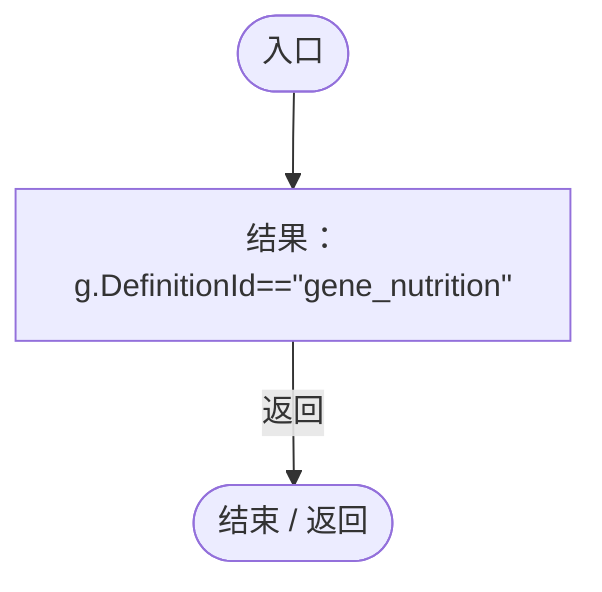

<a id="m8a1ebe1b68104d0d"></a>

## 回调@114 · L114

`g … => 回调`


### Editor · Roslyn编译器控制流

```mermaid
flowchart TD
  b0(["入口"])
  b1["结果：g.DefinitionId==&quot;gene_locomotion&quot;"]
  b2(["结束 / 返回"])
  b0 --> b1
  b1 -->|"返回"| b2

```

<a id="mf22a31f6359fc539"></a>

## 回调@127 · L127

`r … => 回调`


### Editor · Roslyn编译器控制流

```mermaid
flowchart TD
  b0(["入口"])
  b1["结果：r.targetGeneId==&quot;gene_reproduction&quot;"]
  b2(["结束 / 返回"])
  b0 --> b1
  b1 -->|"返回"| b2

```

<a id="md051b5e137f4183f"></a>

## 回调@132 · L132

`p … => 回调`


### Editor · Roslyn编译器控制流

```mermaid
flowchart TD
  b0(["入口"])
  b1["new SavedGeneDefinition{id=p.Key,json=p.Value}<br/>id=p.Key<br/>json=p.Value<br/>结果：new SavedGeneDefinition{id=p.Key,json=p.Value}"]
  b2(["结束 / 返回"])
  b0 --> b1
  b1 -->|"返回"| b2

```

<a id="me4a8007eb3122e6d"></a>

## 回调@150 · L150

`g … => 回调`


### Editor · Roslyn编译器控制流

```mermaid
flowchart TD
  b0(["入口"])
  b1["结果：g.DefinitionId==&quot;gene_reproduction&quot;"]
  b2(["结束 / 返回"])
  b0 --> b1
  b1 -->|"返回"| b2

```

<a id="maa78adef1139a155"></a>

## 回调@153 · L153

`g … => 回调`


### Editor · Roslyn编译器控制流

```mermaid
flowchart TD
  b0(["入口"])
  b1["结果：g.DefinitionId==&quot;gene_reproduction&quot;"]
  b2(["结束 / 返回"])
  b0 --> b1
  b1 -->|"返回"| b2

```

<a id="m8d48e6c0a36b5f69"></a>

## 回调@184 · L184

`e … => 回调`


### Editor · Roslyn编译器控制流

```mermaid
flowchart TD
  b0(["入口"])
  b1["结果：EcologyEnergyBudget.IsProducer(e.Genes)"]
  b2(["结束 / 返回"])
  b0 --> b1
  b1 -->|"返回"| b2

```

项目内调用/回调引用：

- [EcologyEnergyBudget.IsProducer · L24](06a91c8201f26593.md#mcb3499a2649d9648)（方法）
- [DarwinEntity.Genes.get · L14](70798dde169f2e8b.md#m622eb1adf401d431)（访问器）

<a id="m6d44212eba074c7d"></a>

## 回调@186 · L186

`e … => 回调`


### Editor · Roslyn编译器控制流

```mermaid
flowchart TD
  b0(["入口"])
  b1["结果：!EcologyEnergyBudget.IsProducer(e.Genes)"]
  b2(["结束 / 返回"])
  b0 --> b1
  b1 -->|"返回"| b2

```

项目内调用/回调引用：

- [EcologyEnergyBudget.IsProducer · L24](06a91c8201f26593.md#mcb3499a2649d9648)（方法）
- [DarwinEntity.Genes.get · L14](70798dde169f2e8b.md#m622eb1adf401d431)（访问器）

<a id="m10b13211318999c4"></a>

## 回调@186 · L186

`e … => 回调`


### Editor · Roslyn编译器控制流

```mermaid
flowchart TD
  b0(["入口"])
  b1["values=e.GetComponent&lt;EntityStats&gt;()<br/>values.TryGet(&quot;nutrient&quot;,out float food);<br/>values.TryGet(&quot;storedNutrient&quot;,out float reserve);<br/>结果：e.GetComponent&lt;EntityLifeCycle&gt;().Progress.ToString(&quot;F1&quot;)+&quot;/&quot;+food.ToString(&quot;F1&quot;)+&quot;/&quot;+reserve.ToString(&quot;…"]
  b2(["结束 / 返回"])
  b0 --> b1
  b1 -->|"返回"| b2

```

项目内调用/回调引用：

- [EntityStats.TryGet · L90](75aa86a368efdf24.md#m24ee1433e4a70d94)（方法）
- [EntityLifeCycle.Progress.get · L10](9f4138bfbae654b7.md#m178185fd5f5a0d74)（访问器）
- [DarwinEntity.Genes.get · L14](70798dde169f2e8b.md#m622eb1adf401d431)（访问器）
- [EcologyBalanceRegression.回调@186 · L186](81fff3fefa111617.md#m1f91366a915d78a9)（回调/委托）
- [EcologyBalanceRegression.回调@186 · L186](81fff3fefa111617.md#m4655dc2a96d04fe0)（回调/委托）

<a id="m1f91366a915d78a9"></a>

## 回调@186 · L186

`p … => 回调`


### Editor · Roslyn编译器控制流

```mermaid
flowchart TD
  b0(["入口"])
  b1["结果：EcologyEnergyBudget.IsProducer(p.Genes)"]
  b2(["结束 / 返回"])
  b0 --> b1
  b1 -->|"返回"| b2

```

项目内调用/回调引用：

- [EcologyEnergyBudget.IsProducer · L24](06a91c8201f26593.md#mcb3499a2649d9648)（方法）
- [DarwinEntity.Genes.get · L14](70798dde169f2e8b.md#m622eb1adf401d431)（访问器）

<a id="m4655dc2a96d04fe0"></a>

## 回调@186 · L186

`p … => 回调`


### Editor · Roslyn编译器控制流

```mermaid
flowchart TD
  b0(["入口"])
  b1["结果：Vector3.Distance(p.transform.position,e.transform.position)"]
  b2(["结束 / 返回"])
  b0 --> b1
  b1 -->|"返回"| b2

```
