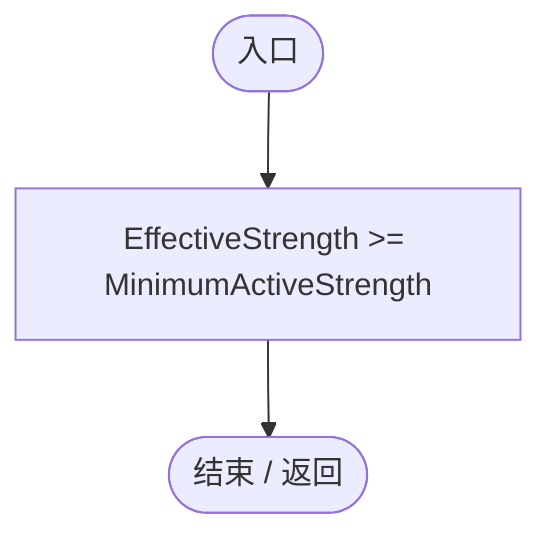
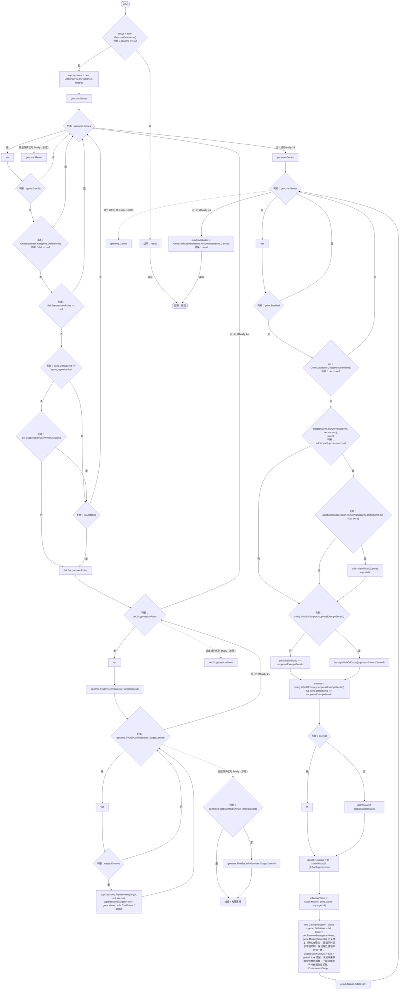

# GeneValueResolver.cs

[返回总索引](../README.md) · `Runtime` · `Assets/DarwinPark/Genetics/Evaluation/GeneValueResolver.cs`

[源文件](../../../Assets/DarwinPark/Genetics/Evaluation/GeneValueResolver.cs) · 源码校验：`b79f319d6f79699ade8463e1421139b6c7d6fb7256ba3f763aa08ad92bfcf443`

方法按源文件位置排列。事件/回调引用不表示立即执行；分支与异常说明见总索引。完整源码与可点击关系图请打开离线手册。

## IsActive.get · L17

`public bool IsActive`

### Editor / Player · 语法控制结构 / 声明（非CFG）

## Resolve · L32

`public static GenomeEvaluation Resolve(Genome genome, bool isGestating = false, float globalSuppression = 0f, string suppressExemptGeneId = null,IReadOnlyDictionary<string,float> additionalSuppression=null)`

  ★ 修复（防Bug回归）：默认把环境压力施加给所有基因；遗传值不受影响，  环境适应突变仍可发生。可选豁免参数仅供显式需要豁免的调用使用。  

### Editor / Player · Roslyn编译器控制流

项目内调用/回调引用：

- [GeneDatabase.Get · L136](ec0a03483435a863.md#me6a5fefe6c3492f9)（方法）
- [Genome.FindByDefinition · L14](a2ef23f865bc7ee8.md#m2a51173f07ba445c)（方法）
- [GeneDefinition.ResolveState · L85](07f99d5784e3dadb.md#mf00205d71765b81f)（方法）
- [GeneAttributeInheritance.Accumulate · L39](cbba0870e05d6571.md#m94b9ccbc18db141d)（方法）
