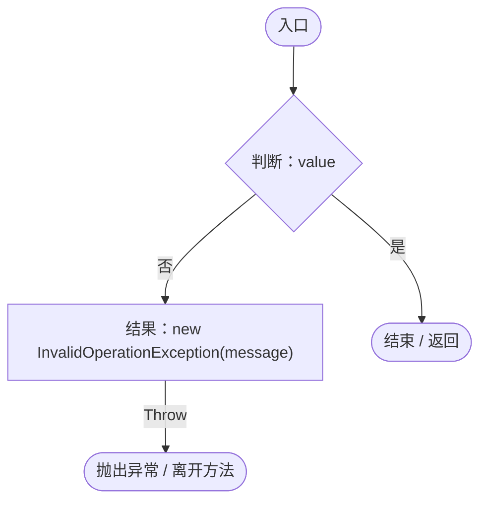
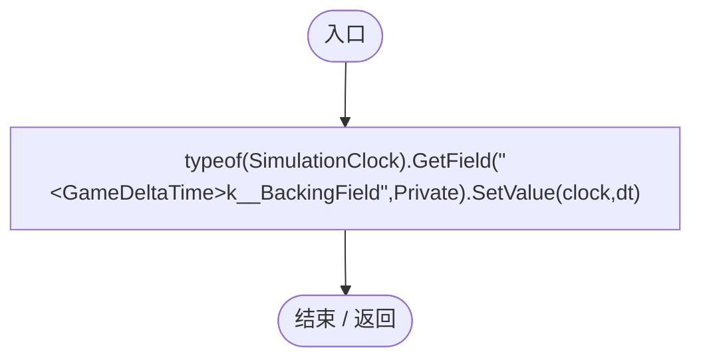
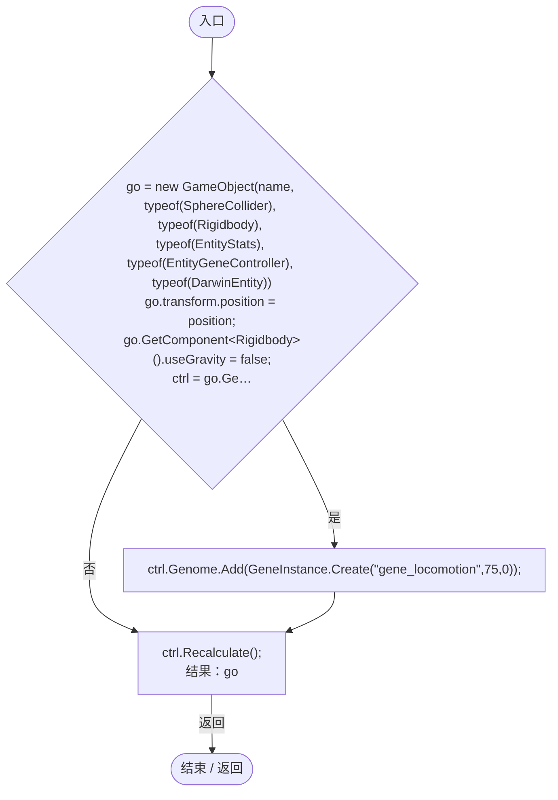

```mermaid
flowchart TD
  b0(["入口"])
  b1["Check(Application.isPlaying,&quot;请先进入播放模式&quot;);<br/>report = new StringBuilder()<br/>builder = UnityEngine.Object.FindFirstObjectByType&lt;PlanetTerrainMeshBuilder&gt;()<br/>weather = builder.GetComponent&lt;PlanetWeatherVisuals&gt;()"]
  b2["new[]{&quot;OceanSurface&quot;,&quot;CloudVolume&quot;,&quot;AtmosphericScattering&quot;}"]
  b3{"判断：new[]{&quot;OceanSurface&quot;,&quot;CloudVolume&quot;,&quot;AtmosphericScattering&quot;}"}
  b4["string"]
  b5["mesh = builder.transform.Find(name).GetComponent&lt;MeshFilter&gt;().sharedMesh<br/>vertices=mesh.vertices<br/>triangles=mesh.triangles"]
  b6["i=0"]
  b7{"判断：i&lt;triangles.Length"}
  b8["a=vertices[triangles[i]]<br/>b=vertices[triangles[i+1]]<br/>c=vertices[triangles[i+2]]<br/>Check(Vector3.Dot(Vector3.Cross(b-a,c-a),a+b+c)&gt;0,name+&quot; 含朝内三角形&quot;);"]
  b9["i+=3"]
  b10{"new[]{&quot;OceanSurface&quot;,&quot;CloudVolume&quot;,&quot;AtmosphericScattering&quot;}<br/>判断：new[]{&quot;OceanSurface&quot;,&quot;CloudVolume&quot;,&quot;AtmosphericScattering&quot;}"}
  b11["new[]{&quot;OceanSurface&quot;,&quot;CloudVolume&quot;,&quot;AtmosphericScattering&quot;}"]
  b12["连接 / 离开区域"]
  b13["new[]{weather.oceanShader,weather.cloudShader,weather.atmosphereShader,builder.TerrainMaterial.shader}"]
  b14{"判断：new[]{weather.oceanShader,weather.cloudShader,weather.atmosphereShader,builder.TerrainMaterial.shader}"}
  b15["var"]
  b16{"判断：shader.isSupported"}
  b17["!ShaderUtil.ShaderHasError(shader)"]
  b18["shader.isSupported"]
  b19["Check(shader.isSupported &amp;&amp; !ShaderUtil.ShaderHasError(shader),&quot;Shader 编译错误: &quot;+shader.name);"]
  b20{"new[]{weather.oceanShader,weather.cloudShader,weather.atmosphereShader,builder.TerrainMaterial.shader}<br/>判断：new[]{weather.oceanShader,weather.cloudShader,weather.atmosphereShader,builder.TerrainMaterial.shader}"}
  b21["new[]{weather.oceanShader,weather.cloudShader,weather.atmosphereShader,builder.TerrainMaterial.shader}"]
  b22["连接 / 离开区域"]
  b23["report.AppendLine(&quot;PASS: all ocean/cloud/atmosphere triangles face outward; four shaders supported/error-free&quot;);<br/>camera=Camera.main<br/>orbit=camera.GetComponent&lt;OrbitCamera&gt;()<br/>Check(orbit.minDistance &lt; builder.WaterRadius+10,&quot;镜头最近距离未开放&quot;);<br/>o…"]
  b24["dir=(oldPosition-builder.transform.position).normalized<br/>camera.transform.position=builder.transform.position+dir*(builder.WaterRadius+weather.hideCloudsBelowAltitude-5);<br/>typeof(PlanetWeatherVisuals).GetMethod(&quot;LateUpdate&quot;,Private).Invoke…"]
  b25["camera.transform.position=oldPosition;"]
  b26["report.AppendLine(&quot;PASS: closer orbit enabled; clouds hide near ground and restore at orbital distance&quot;);<br/>control=UnityEngine.Object.FindFirstObjectByType&lt;SimulationControlPanel&gt;()<br/>typeof(SimulationControlPanel).GetMethod(&quot;ToggleParamPop…"]
  b27{"判断：builder.seed==original"}
  b28["input.text==slider.value.ToString(&quot;F0&quot;)"]
  b29["builder.seed==original"]
  b30["Check(builder.seed==original &amp;&amp; input.text==slider.value.ToString(&quot;F0&quot;),&quot;种子草稿没有联动/提前应用&quot;);"]
  b31["input.text=original.ToString();<br/>editor.Apply();<br/>Check(builder.seed==original,&quot;输入框应用失败&quot;);<br/>input.text=&quot;2147483648&quot;;<br/>Check(builder.seed==original,&quot;非法种子未拒绝&quot;);<br/>typeof(SimulationControlPanel).GetMethod(&quot;DestroyMenus&quot;,Private).Invoke(control,nu…"]
  b32["clock.Play();<br/>clock.SetTimeScale(1);<br/>typeof(SimulationClock).GetMethod(&quot;Update&quot;,Private).Invoke(clock,null);<br/>one=clock.GameDeltaTime<br/>clock.SetTimeScale(16);<br/>Check(Mathf.Abs(clock.GameDeltaTime-one*16)&lt;.001f,&quot;统一时钟倍率错误&quot;);<br/>a=first.GetCompon…"]
  b33["i=0"]
  b34{"判断：i&lt;16"}
  b35["a.AdvanceSimulation(.1f);<br/>i++"]
  b36["b.AdvanceSimulation(1.6f);<br/>progressA=a.GetComponent&lt;EntityLifeCycle&gt;().Progress<br/>progressB=b.GetComponent&lt;EntityLifeCycle&gt;().Progress"]
  b37{"判断：progressA&gt;0"}
  b38["Mathf.Abs(progressA-progressB)&lt;.0001"]
  b39["progressA&gt;0"]
  b40["Check(progressA&gt;0 &amp;&amp; Mathf.Abs(progressA-progressB)&lt;.0001,&quot;成长在相同模拟时长下不一致&quot;);"]
  b41["va=first.AddComponent&lt;EntityVitals&gt;()<br/>vb=second.AddComponent&lt;EntityVitals&gt;()<br/>va.enabled=vb.enabled=false;<br/>SetDelta(clock,.1f);"]
  b42["i=0"]
  b43{"判断：i&lt;16"}
  b44["typeof(EntityVitals).GetMethod(&quot;Update&quot;,Private).Invoke(va,null);<br/>i++"]
  b45["SetDelta(clock,1.6f);<br/>typeof(EntityVitals).GetMethod(&quot;Update&quot;,Private).Invoke(vb,null);<br/>first.GetComponent&lt;EntityStats&gt;().TryGet(&quot;nutrient&quot;,out float foodA);<br/>second.GetComponent&lt;EntityStats&gt;().TryGet(&quot;nutrient&quot;,out float foodB);"]
  b46{"判断：Mathf.Abs(foodA-foodB)&lt;.0001f"}
  b47["foodA&lt;10"]
  b48["Mathf.Abs(foodA-foodB)&lt;.0001f"]
  b49["Check(Mathf.Abs(foodA-foodB)&lt;.0001f &amp;&amp; foodA&lt;10,&quot;代谢没有按模拟时间推进&quot;);"]
  b50["clock.Pause();<br/>Check(clock.GameDeltaTime==0,&quot;暂停残留旧步长&quot;);<br/>report.AppendLine(&quot;PASS: 16x clock delta; equal simulated duration yields equal growth/metabolism; Pause clears delta&quot;);<br/>clock.Play();<br/>clock.SetTimeScale(1);<br/>hunter=first.GetCompone…"]
  b51["first.SetActive(false);<br/>second.SetActive(false);<br/>UnityEngine.Object.Destroy(first);<br/>UnityEngine.Object.Destroy(second);"]
  b52{"clock<br/>判断：scale&gt;0"}
  b53["scale"]
  b54["1"]
  b55["clock.SetTimeScale(scale&gt;0?scale:1);"]
  b56{"判断：running"}
  b57["clock.Play();"]
  b58["clock.Pause();"]
  b59["连接 / 离开区域"]
  b60["Directory.CreateDirectory(&quot;Artifacts/SimulationReview&quot;);<br/>File.WriteAllText(&quot;Artifacts/SimulationReview/runtime-checks.txt&quot;,report.ToString());<br/>ScreenCapture.CaptureScreenshot(Path.GetFullPath(&quot;Artifacts/SimulationReview/orbit.png&quot;));<br/>Deb…"]
  b61(["结束 / 返回"])
  b0 --> b1
  b1 --> b2
  b2 --> b3
  b3 -->|"是"| b4
  b3 -->|"否 · 经过finally 10"| b13
  b4 --> b5
  b5 --> b6
  b6 --> b7
  b7 -->|"是"| b8
  b7 -->|"否"| b3
  b8 --> b9
  b9 --> b7
  b10 -->|"否"| b11
  b10 -->|"是"| b12
  b11 --> b12
  b13 --> b14
  b14 -->|"是"| b15
  b14 -->|"否 · 经过finally 20"| b23
  b15 --> b16
  b16 -->|"是"| b17
  b16 -->|"否"| b18
  b17 --> b19
  b18 --> b19
  b19 --> b14
  b20 -->|"否"| b21
  b20 -->|"是"| b22
  b21 --> b22
  b23 --> b24
  b24 -->|"经过finally 25"| b26
  b26 --> b27
  b27 -->|"是"| b28
  b27 -->|"否"| b29
  b28 --> b30
  b29 --> b30
  b30 --> b31
  b31 --> b32
  b32 --> b33
  b33 --> b34
  b34 -->|"是"| b35
  b34 -->|"否"| b36
  b35 --> b34
  b36 --> b37
  b37 -->|"是"| b38
  b37 -->|"否"| b39
  b38 --> b40
  b39 --> b40
  b40 --> b41
  b41 --> b42
  b42 --> b43
  b43 -->|"是"| b44
  b43 -->|"否"| b45
  b44 --> b43
  b45 --> b46
  b46 -->|"是"| b47
  b46 -->|"否"| b48
  b47 --> b49
  b48 --> b49
  b49 --> b50
  b50 -->|"经过finally 51"| b60
  b51 --> b52
  b52 -->|"是"| b53
  b52 -->|"否"| b54
  b53 --> b55
  b54 --> b55
  b55 --> b56
  b56 -->|"是"| b57
  b56 -->|"否"| b58
  b57 --> b59
  b58 --> b59
  b60 --> b61
  b3 -. "退出保护区时 finally（示意）" .-> b10
  b14 -. "退出保护区时 finally（示意）" .-> b20
  b24 -. "退出保护区时 finally（示意）" .-> b25
  b32 -. "退出保护区时 finally（示意）" .-> b51

```

# SimulationBehaviorRegression.cs

[返回总索引](../README.md) · `Editor` · `Assets/DarwinPark/Editor/SimulationBehaviorRegression.cs`

[源文件](../../../Assets/DarwinPark/Editor/SimulationBehaviorRegression.cs) · 源码校验：`6bae5592bb2cebdad68c3fc30514c62f03ae0ca8a8402f9e4dd0da1bc3ccfe64`

方法按源文件位置排列。事件/回调引用不表示立即执行；分支与异常说明见总索引。完整源码与可点击关系图请打开离线手册。

## Check · L24

`private static void Check(bool value, string message)`

### Editor · Roslyn编译器控制流

## SetDelta · L25

`private static void SetDelta(SimulationClock clock, float dt)`

### Editor · Roslyn编译器控制流

## TestEntity · L26

`private static GameObject TestEntity(string name, Vector3 position, bool hunter)`

### Editor · Roslyn编译器控制流

项目内调用/回调引用：

- [Genome.Add · L19](a2ef23f865bc7ee8.md#md9cfdc94b8b8d40f)（方法）
- [GeneInstance.Create · L20](f82e1498d67f5afd.md#m72e94c278de3cf8b)（方法）
- [EntityGeneController.Recalculate · L97](7494d53178552f0e.md#m65ea735c1e0e37a1)（方法）

## Validate · L35

`[MenuItem("Tools/Darwin Park/Validate Simulation Behaviors")] public static void Validate()`

### Editor · Roslyn编译器控制流

项目内调用/回调引用：

- [SimulationBehaviorRegression.Check · L24](845c11bed26d879e.md#m9796b6f8718e2468)（方法）
- [PlanetTerrainMeshBuilder.WaterRadius.get · L94](415285cf043354a9.md#m28d8809083881ec1)（访问器）
- [PlanetParameterEditor.Apply · L88](ac36b95043305d58.md#m5c1e8487916976ec)（方法）
- [ServiceLocator.Get · L33](f2fdbe9f9ccd93cb.md#m2ae625299520c56d)（方法）
- [SimulationClock.IsRunning.get · L22](a8f444aec9614b0a.md#m10f4fe307faca0f0)（访问器）
- [SimulationBehaviorRegression.TestEntity · L26](845c11bed26d879e.md#mcd95b2fc370f47b1)（方法）
- [SimulationClock.Play · L78](a8f444aec9614b0a.md#m7aa9e64b7de60ed0)（方法）
- [SimulationClock.SetTimeScale · L81](a8f444aec9614b0a.md#mecaa463a0561aca3)（方法）
- [SimulationClock.GameDeltaTime.get · L26](a8f444aec9614b0a.md#me7f11abae18a4f2d)（访问器）
- [EntityGeneController.AdvanceSimulation · L66](7494d53178552f0e.md#m477fb905eeed3e79)（方法）
- [EntityLifeCycle.Progress.get · L10](9f4138bfbae654b7.md#m178185fd5f5a0d74)（访问器）
- [SimulationBehaviorRegression.SetDelta · L25](845c11bed26d879e.md#m7a52d561fff4c56a)（方法）
- [EntityStats.TryGet · L90](75aa86a368efdf24.md#m24ee1433e4a70d94)（方法）
- [SimulationClock.Pause · L79](a8f444aec9614b0a.md#m30929d45a885d0f1)（方法）
- [Genome.Add · L19](a2ef23f865bc7ee8.md#md9cfdc94b8b8d40f)（方法）
- [GeneInstance.Create · L20](f82e1498d67f5afd.md#m72e94c278de3cf8b)（方法）
- [EntityGeneController.Recalculate · L97](7494d53178552f0e.md#m65ea735c1e0e37a1)（方法）
- [EntityStats.Modify · L104](75aa86a368efdf24.md#m858c2a75d852ecc1)（方法）
- [EntityGeneController.GetLogic · L211](7494d53178552f0e.md#maadb710e89e60395)（方法）
- [IGeneLogic.OnUpdate · L9](5304fdad773967f8.md#m829188d65276f8e5)（方法）
