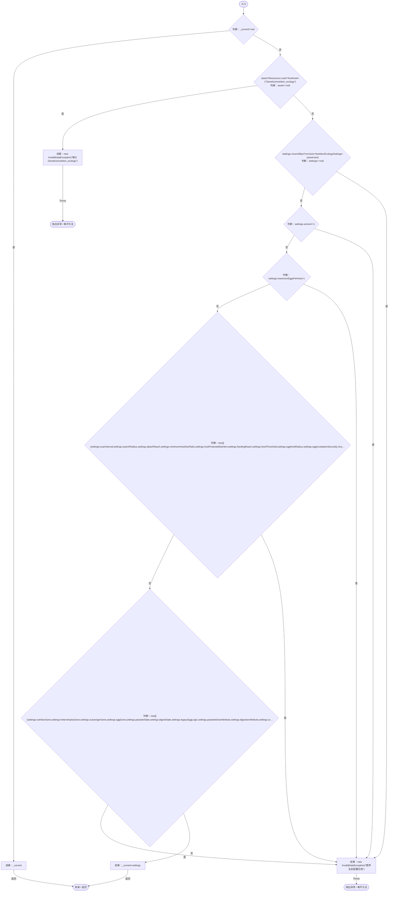

```mermaid
flowchart TD
  b0(["入口"])
  b1{"判断：float.IsFinite(v)"}
  b2["v&lt;=0"]
  b3["!float.IsFinite(v)"]
  b4["结果：!float.IsFinite(v)&#124;&#124;v&lt;=0"]
  b5(["结束 / 返回"])
  b0 --> b1
  b1 -->|"是"| b2
  b1 -->|"否"| b3
  b2 --> b4
  b3 --> b4
  b4 -->|"返回"| b5

```

# NutritionEcologySettings.cs

[返回总索引](../README.md) · `Runtime` · `Assets/DarwinPark/Genetics/NutritionEcologySettings.cs`

[源文件](../../../Assets/DarwinPark/Genetics/NutritionEcologySettings.cs) · 源码校验：`cd4ec56b5e1901c37a2cbb94a40ac80379923b9621d1e102c1a14506fda9f85b`

方法按源文件位置排列。事件/回调引用不表示立即执行；分支与异常说明见总索引。完整源码与可点击关系图请打开离线手册。

## Current.get · L19

`get`

### Editor / Player · Roslyn编译器控制流

项目内调用/回调引用：

- [NutritionEcologySettings.回调@26 · L26](846a17351dbd6aa4.md#m39061aecef460623)（回调/委托）

## 回调@26 · L26

`v … => 回调`

### Editor / Player · Roslyn编译器控制流

