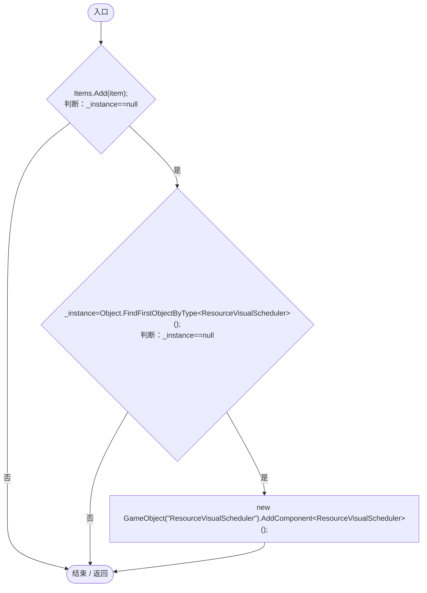
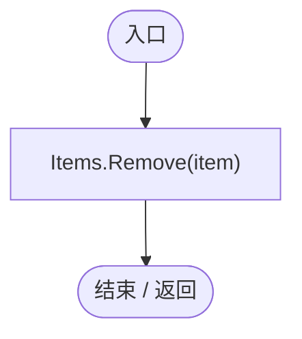
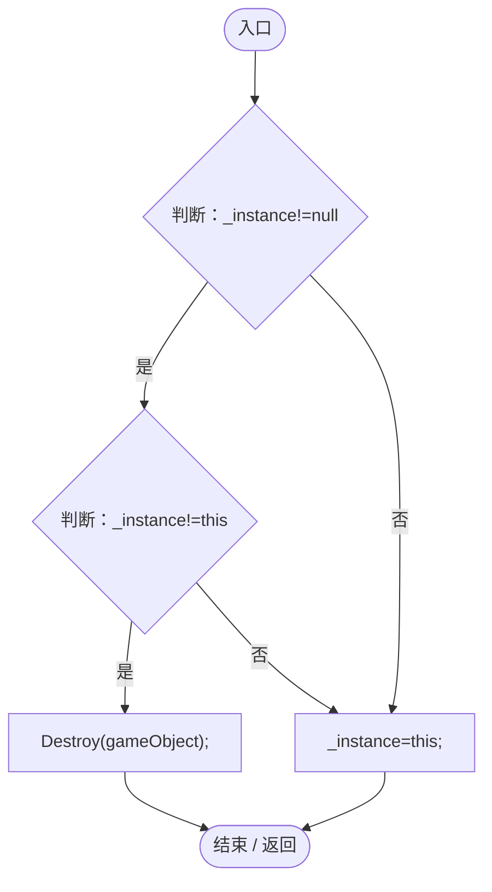
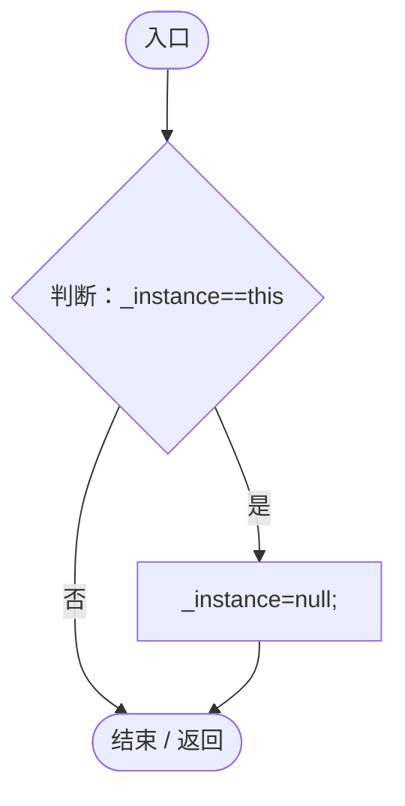
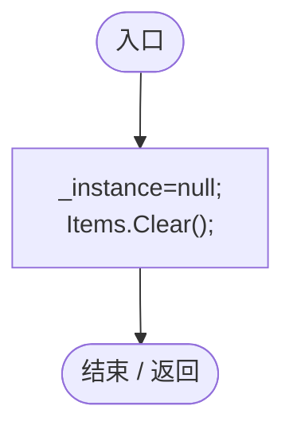

# ResourceVisualScheduler.cs

[返回总索引](../README.md) · `Runtime` · `Assets/DarwinPark/Entities/Ecology/ResourceVisualScheduler.cs`

[源文件](../../../Assets/DarwinPark/Entities/Ecology/ResourceVisualScheduler.cs) · 源码校验：`71770bb8c692afb69ca169717b1095e4b4f259a0fea59d4e8974d4a4f8fc215c`

方法按源文件位置排列。事件/回调引用不表示立即执行；分支与异常说明见总索引。完整源码与可点击关系图请打开离线手册。

## Register · L10

`public static void Register(EnergyBlockGradeVisual item)`

### Editor / Player · Roslyn编译器控制流

## Remove · L12

`public static void Remove(EnergyBlockGradeVisual item)`

### Editor / Player · Roslyn编译器控制流

## Awake · L13

`private void Awake()`

### Editor / Player · Roslyn编译器控制流

## OnDestroy · L14

`private void OnDestroy()`

### Editor / Player · Roslyn编译器控制流

## LateUpdate · L15

`private void LateUpdate()`

### Editor / Player · Roslyn编译器控制流

```mermaid
flowchart TD
  b0(["入口"])
  b1{"判断：Time.unscaledTime&lt;_next"}
  b2["_next=Time.unscaledTime+SimulationOptimization.Current.visualRefreshSeconds;<br/>camera=Camera.main"]
  b3{"判断：camera!=null"}
  b4["camera.transform.position"]
  b5["Vector3.zero"]
  b6["point=camera!=null?camera.transform.position:Vector3.zero"]
  b7["distance=SimulationOptimization.Current.lightDistance"]
  b8["Items"]
  b9{"判断：Items"}
  b10{"var<br/>判断：item!=null"}
  b11{"判断：item.isActiveAndEnabled"}
  b12["item.Refresh();"]
  b13{"item<br/>判断：camera==null"}
  b14["(item.transform.position-point).sqrMagnitude&lt;=distance*distance"]
  b15["camera==null"]
  b16["item.SetLightVisible(camera==null&#124;&#124;(item.transform.position-point).sqrMagnitude&lt;=distance*distance);"]
  b17["Items"]
  b18(["结束 / 返回"])
  b0 --> b1
  b1 -->|"是"| b18
  b1 -->|"否"| b2
  b2 --> b3
  b3 -->|"是"| b4
  b3 -->|"否"| b5
  b4 --> b6
  b5 --> b6
  b6 --> b7
  b7 --> b8
  b8 --> b9
  b9 -->|"是"| b10
  b9 -->|"否 · 经过finally 17"| b18
  b10 -->|"是"| b11
  b10 -->|"否"| b9
  b11 -->|"是"| b12
  b11 -->|"否"| b9
  b12 --> b13
  b13 -->|"否"| b14
  b13 -->|"是"| b15
  b14 --> b16
  b15 --> b16
  b16 --> b9
  b9 -. "退出保护区时 finally（示意）" .-> b17

```

项目内调用/回调引用：

- [SimulationOptimization.Current.get · L18](11c9091e70893352.md#m81dac8318af42ca9)（访问器）
- [EnergyBlockGradeVisual.Refresh · L15](dd689a3df9b53e75.md#m8d946724e45820f9)（方法）
- [EnergyBlockGradeVisual.SetLightVisible · L14](dd689a3df9b53e75.md#m31231118f6a8d332)（方法）

## Reset · L20

`[RuntimeInitializeOnLoadMethod(RuntimeInitializeLoadType.SubsystemRegistration)]private static void Reset()`

### Editor / Player · Roslyn编译器控制流

