# PlanetOreSystem.cs

[返回总索引](../README.md) · `Runtime` · `Assets/DarwinPark/Planet/PlanetOreSystem.cs`

[源文件](../../../Assets/DarwinPark/Planet/PlanetOreSystem.cs) · 源码校验：`ffca415590965748874f508da8f06b50a60453e3d06ba3c40d6dfec8626bd116`

方法按源文件位置排列。事件/回调引用不表示立即执行；分支与异常说明见总索引。完整源码与可点击关系图请打开离线手册。

## Instance.get · L8

`get`

### Editor / Player · 语法控制结构 / 声明（非CFG）

## Instance.set · L8

`private set`

### Editor / Player · 语法控制结构 / 声明（非CFG）

## OreMapTexture.get · L17

`get`

### Editor / Player · 语法控制结构 / 声明（非CFG）

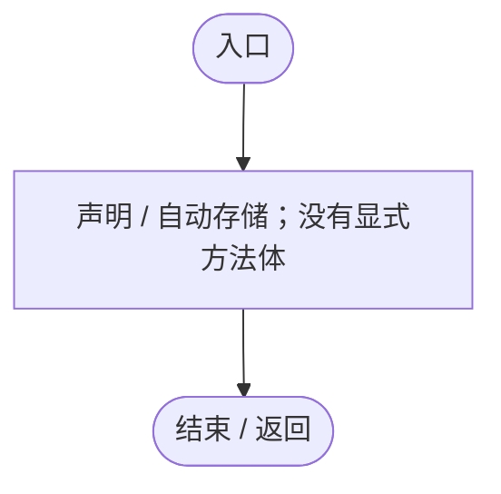

## OreMapTexture.set · L17

`private set`

### Editor / Player · 语法控制结构 / 声明（非CFG）

## Awake · L22

`private void Awake()`

### Editor / Player · Roslyn编译器控制流

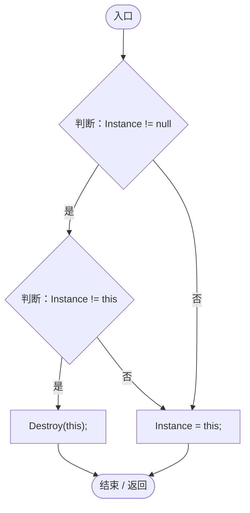

项目内调用/回调引用：

- [PlanetOreSystem.Instance.get · L8](86b3fbb4d9436121.md#m53f6a6af4b6dc252)（访问器）
- [PlanetOreSystem.Instance.set · L8](86b3fbb4d9436121.md#m1b5f0ec7c88e20d4)（访问器）

## OnDestroy · L29

`private void OnDestroy()`

★ 修复（防Bug回归）：重进场景后不能沿用已经销毁的静态实例与纹理。

### Editor / Player · Roslyn编译器控制流

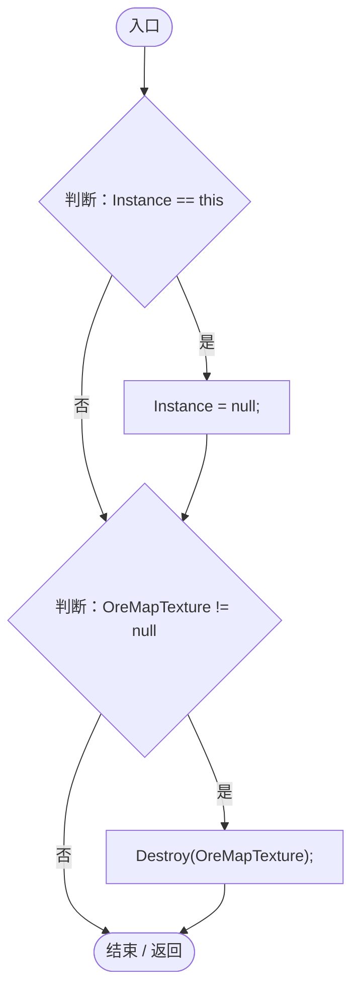

项目内调用/回调引用：

- [PlanetOreSystem.Instance.get · L8](86b3fbb4d9436121.md#m53f6a6af4b6dc252)（访问器）
- [PlanetOreSystem.Instance.set · L8](86b3fbb4d9436121.md#m1b5f0ec7c88e20d4)（访问器）
- [PlanetOreSystem.OreMapTexture.get · L17](86b3fbb4d9436121.md#ma477eb055a23d504)（访问器）

## Start · L35

`private void Start()`

### Editor / Player · Roslyn编译器控制流

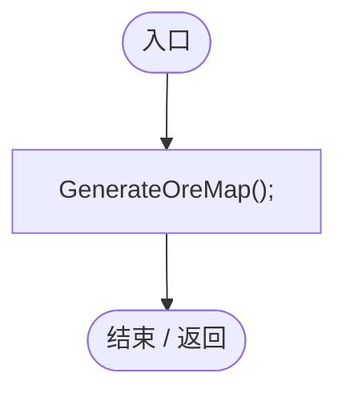

项目内调用/回调引用：

- [PlanetOreSystem.GenerateOreMap · L40](86b3fbb4d9436121.md#m0449775dd894020c)（方法）

## GenerateOreMap · L40

`private void GenerateOreMap()`

### Editor / Player · Roslyn编译器控制流

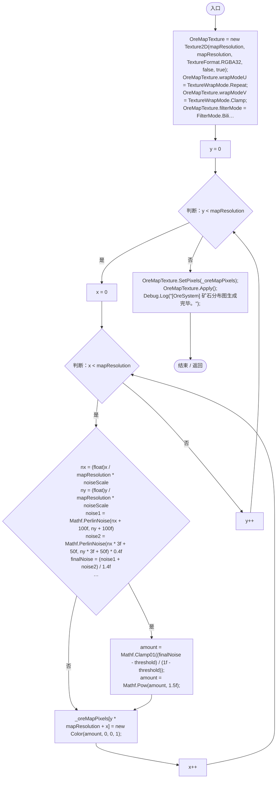

项目内调用/回调引用：

- [PlanetOreSystem.OreMapTexture.set · L17](86b3fbb4d9436121.md#mbf709d1893d86165)（访问器）
- [PlanetOreSystem.OreMapTexture.get · L17](86b3fbb4d9436121.md#ma477eb055a23d504)（访问器）

## Update · L81

`private void Update()`

### Editor / Player · Roslyn编译器控制流

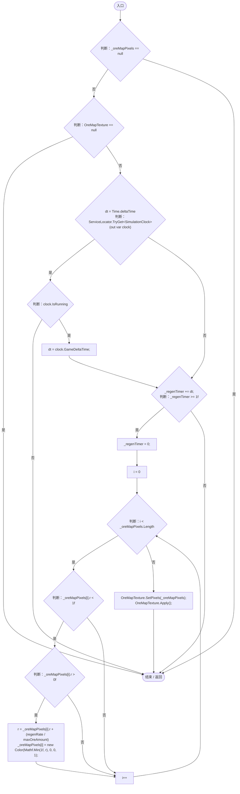

项目内调用/回调引用：

- [PlanetOreSystem.OreMapTexture.get · L17](86b3fbb4d9436121.md#ma477eb055a23d504)（访问器）
- [ServiceLocator.TryGet · L26](f2fdbe9f9ccd93cb.md#m143b24e6d58471b0)（方法）
- [SimulationClock.IsRunning.get · L22](a8f444aec9614b0a.md#m10f4fe307faca0f0)（访问器）
- [SimulationClock.GameDeltaTime.get · L26](a8f444aec9614b0a.md#me7f11abae18a4f2d)（访问器）

## CaptureAmounts · L109

`public float[] CaptureAmounts()`

★ 适配：矿脉消耗与再生状态必须存档，不能只按种子重建资源。

### Editor / Player · Roslyn编译器控制流

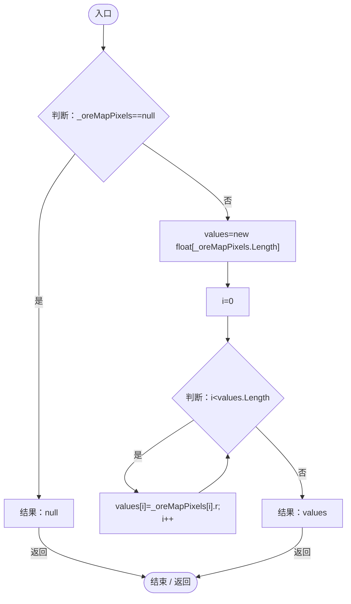

## RegenTimer.get · L110

`get`

### Editor / Player · Roslyn编译器控制流

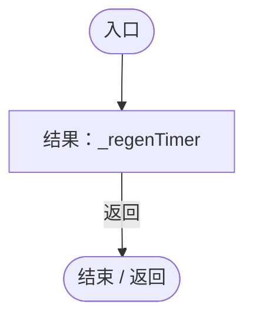

## RegenTimer.set · L110

`set`

### Editor / Player · Roslyn编译器控制流

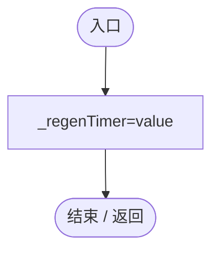

## RestoreAmounts · L111

`public void RestoreAmounts(float[] values,int resolution)`

### Editor / Player · Roslyn编译器控制流

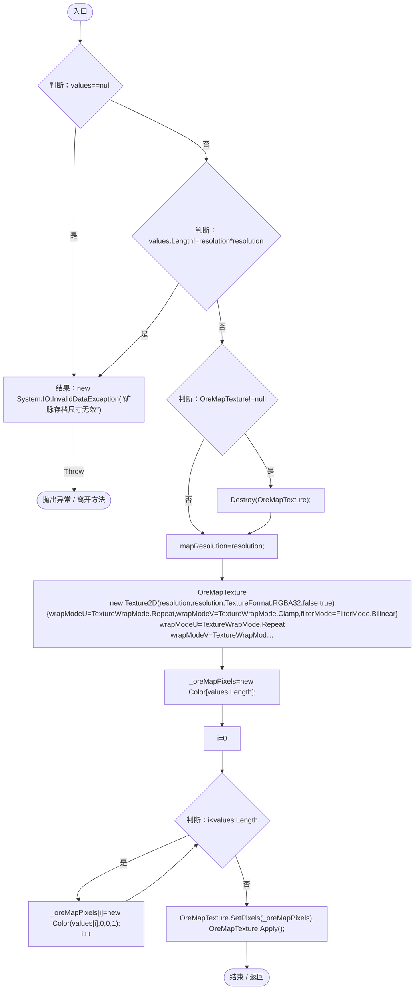

项目内调用/回调引用：

- [PlanetOreSystem.OreMapTexture.get · L17](86b3fbb4d9436121.md#ma477eb055a23d504)（访问器）
- [PlanetOreSystem.OreMapTexture.set · L17](86b3fbb4d9436121.md#mbf709d1893d86165)（访问器）

## ResetWorld · L119

`public void ResetWorld()`

### Editor / Player · Roslyn编译器控制流

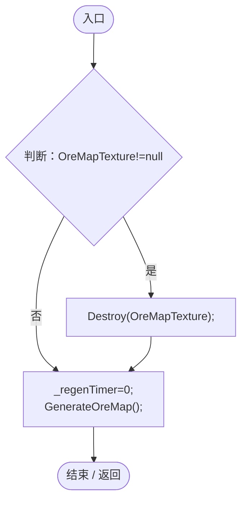

项目内调用/回调引用：

- [PlanetOreSystem.OreMapTexture.get · L17](86b3fbb4d9436121.md#ma477eb055a23d504)（访问器）
- [PlanetOreSystem.GenerateOreMap · L40](86b3fbb4d9436121.md#m0449775dd894020c)（方法）

## WorldToUV · L123

`private Vector2 WorldToUV(Vector3 worldPos)`

  世界坐标转 UV  

### Editor / Player · Roslyn编译器控制流

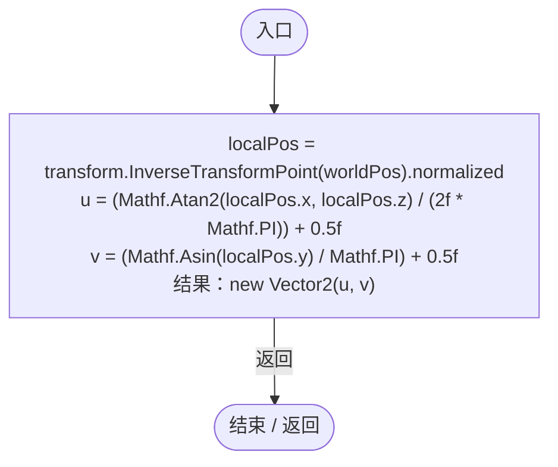

## GetOreAmount · L131

`public float GetOreAmount(Vector3 worldPos)`

### Editor / Player · Roslyn编译器控制流

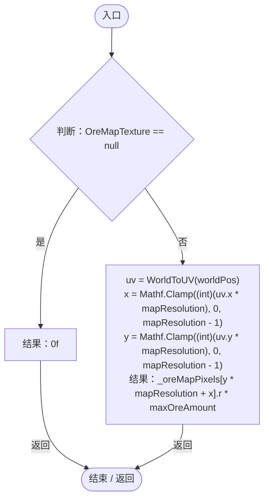

项目内调用/回调引用：

- [PlanetOreSystem.OreMapTexture.get · L17](86b3fbb4d9436121.md#ma477eb055a23d504)（访问器）
- [PlanetOreSystem.WorldToUV · L123](86b3fbb4d9436121.md#m41f5c5aa50aa99fe)（方法）

## ConsumeOre · L140

`public float ConsumeOre(Vector3 worldPos, float amount)`

### Editor / Player · Roslyn编译器控制流

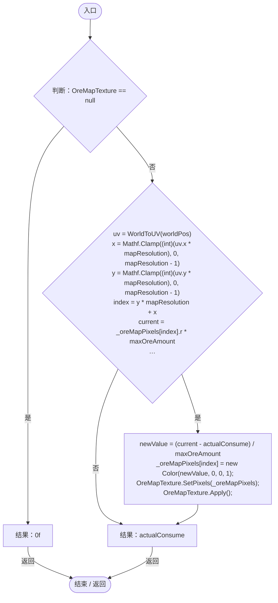

项目内调用/回调引用：

- [PlanetOreSystem.OreMapTexture.get · L17](86b3fbb4d9436121.md#ma477eb055a23d504)（访问器）
- [PlanetOreSystem.WorldToUV · L123](86b3fbb4d9436121.md#m41f5c5aa50aa99fe)（方法）
