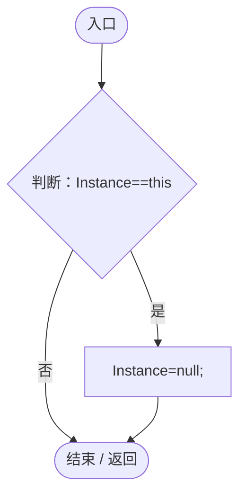

```mermaid
flowchart TD
  b0(["入口"])
  b1{"判断：_armed"}
  b2{"判断：WorldRuntimeGate.Ready"}
  b3{"判断：WorldRuntimeGate.Loading"}
  b4{"判断：_menu==null"}
  b5{"判断：_menu.Visible"}
  b6["_armed=false;"]
  b7["_session=new PerformanceSampleSession();<br/>_foodHits=ColonyFoodQueryCache.Hits;<br/>_foodSearches=ColonyFoodQueryCache.Searches;<br/>_groundDirect=EntityGroundProbe.DirectSamples;<br/>_groundReused=EntityGroundProbe.CrossStepReused;<br/>_resourceRebuilds=…"]
  b8["(Exception ex)<br/>Status=&quot;采样无法启动：&quot;+ex.Message;<br/>_notice.Show(Status);"]
  b9{"判断：_session==null"}
  b10{"_session.RecordFrame(Time.unscaledDeltaTime*1000d);<br/>判断：Time.unscaledTime-_began&lt;sampleSeconds"}
  b11["report=_session.Finish(&quot;entities=&quot;+EntityRegistry.All.Count+&quot; resources=&quot;+ColonyResource.All.Count()+&quot; resolution=&quot;+Screen.width+&quot;x&quot;+Screen.height+&quot; graphics=&quot;+SystemInfo.graphicsDeviceType+&quot; limit=&quot;+FramePacingSettings.Limit)<br/>report.con…"]
  b12{"判断：string.IsNullOrEmpty(RuntimeFileLog.DirectoryPath)"}
  b13["Application.persistentDataPath"]
  b14["RuntimeFileLog.DirectoryPath"]
  b15["root=Path.Combine(string.IsNullOrEmpty(RuntimeFileLog.DirectoryPath)?Application.persistentDataPath:RuntimeFileLog.DirectoryPath,&quot;performance&quot;)"]
  b16["Directory.CreateDirectory(root);<br/>ReportPath=Path.Combine(root,&quot;performance-&quot;+DateTime.UtcNow.ToString(&quot;yyyyMMdd-HHmmss-fff&quot;)+&quot;.json&quot;);<br/>File.WriteAllText(ReportPath,JsonUtility.ToJson(report,true));"]
  b17["new DirectoryInfo(root).GetFiles(&quot;performance-*.json&quot;).OrderByDescending(f=&gt;f.LastWriteTimeUtc).Skip(5)"]
  b18{"判断：new DirectoryInfo(root).GetFiles(&quot;performance-*.json&quot;).OrderByDescending(f=&gt;f.LastWriteTimeUtc).Skip(5)"}
  b19["var<br/>old.Delete();"]
  b20{"判断：new DirectoryInfo(root).GetFiles(&quot;performance-*.json&quot;).OrderByDescending(f=&gt;f.LastWriteTimeUtc).Skip(5)"}
  b21["new DirectoryInfo(root).GetFiles(&quot;performance-*.json&quot;).OrderByDescending(f=&gt;f.LastWriteTimeUtc).Skip(5)"]
  b22["连接 / 离开区域"]
  b23["Status=&quot;采样完成：&quot;+ReportPath;<br/>_notice.Show(&quot;游戏性能采样完成\n报告已保存：\n&quot;+ReportPath);<br/>Debug.Log(&quot;[性能采样] &quot;+Status);"]
  b24["(Exception ex)<br/>Status=&quot;性能报告保存失败：&quot;+ex.Message;<br/>_notice.Show(Status);<br/>Debug.LogWarning(Status);"]
  b25["_session.Dispose();<br/>_session=null;"]
  b26(["结束 / 返回"])
  b0 --> b1
  b1 -->|"是"| b2
  b1 -->|"否"| b9
  b2 -->|"是"| b3
  b2 -->|"否"| b9
  b3 -->|"否"| b4
  b3 -->|"是"| b9
  b4 -->|"否"| b5
  b4 -->|"是"| b6
  b5 -->|"否"| b6
  b5 -->|"是"| b9
  b6 --> b7
  b7 --> b9
  b8 --> b9
  b9 -->|"是"| b26
  b9 -->|"否"| b10
  b10 -->|"是"| b26
  b10 -->|"否"| b11
  b11 --> b12
  b12 -->|"是"| b13
  b12 -->|"否"| b14
  b13 --> b15
  b14 --> b15
  b15 --> b16
  b16 --> b17
  b17 --> b18
  b18 -->|"是"| b19
  b18 -->|"否 · 经过finally 20"| b23
  b19 --> b18
  b20 -->|"否"| b21
  b20 -->|"是"| b22
  b21 --> b22
  b23 -->|"经过finally 25"| b26
  b24 -->|"经过finally 25"| b26
  b7 -. "保护区可能异常（示意）" .-> b8
  b18 -. "退出保护区时 finally（示意）" .-> b20
  b11 -. "保护区可能异常（示意）" .-> b24
  b11 -. "退出保护区时 finally（示意）" .-> b25

```

# RuntimePerformanceCapture.cs

[返回总索引](../README.md) · `Runtime` · `Assets/DarwinPark/UI/RuntimePerformanceCapture.cs`

[源文件](../../../Assets/DarwinPark/UI/RuntimePerformanceCapture.cs) · 源码校验：`a995b5a419023edebda08261f9f297d886cffb15afe10bc03e1d7a03feaa23da`

方法按源文件位置排列。事件/回调引用不表示立即执行；分支与异常说明见总索引。完整源码与可点击关系图请打开离线手册。

## Instance.get · L13

`get`

### Editor / Player · 语法控制结构 / 声明（非CFG）

## Instance.set · L13

`private set`

### Editor / Player · 语法控制结构 / 声明（非CFG）

## Status.get · L14

`get`

### Editor / Player · 语法控制结构 / 声明（非CFG）

## Status.set · L14

`private set`

### Editor / Player · 语法控制结构 / 声明（非CFG）

## ReportPath.get · L14

`get`

### Editor / Player · 语法控制结构 / 声明（非CFG）

## ReportPath.set · L14

`private set`

### Editor / Player · 语法控制结构 / 声明（非CFG）

## Awake · L19

`private void Awake()`

### Editor / Player · Roslyn编译器控制流

项目内调用/回调引用：

- [RuntimePerformanceCapture.Instance.set · L13](8709e073518085cd.md#m3cc7d799c14c1301)（访问器）

## Ensure · L20

`public static void Ensure(GameMainMenu owner)`

### Editor / Player · Roslyn编译器控制流

## Request · L21

`public void Request()`

### Editor / Player · Roslyn编译器控制流

项目内调用/回调引用：

- [RuntimePerformanceCapture.ReportPath.set · L14](8709e073518085cd.md#mad3908f9da3376a7)（访问器）
- [RuntimePerformanceCapture.Status.set · L14](8709e073518085cd.md#mac0e08101c494b88)（访问器）

## LateUpdate · L22

`private void LateUpdate()`

### Editor / Player · Roslyn编译器控制流

项目内调用/回调引用：

- [PerformanceSampleSession.PerformanceSampleSession.ctor · L42](a8403a4c7503726d.md#mdb6c2d364ec2e182)（构造函数）
- [ColonyFoodQueryCache.Hits.get · L16](63cd90165719dbff.md#m871ae7a0cf96f22d)（访问器）
- [ColonyFoodQueryCache.Searches.get · L16](63cd90165719dbff.md#m2faafc4a4fd9a504)（访问器）
- [ResourceCoordinates.Rebuilds.get · L24](93d731ac01e3af48.md#m8d7daf91ba26e421)（访问器）
- [CorpseInstanceRenderer.InstanceWrites.get · L47](29964f1f6c300ac9.md#m9330ca4e2a209288)（访问器）
- [RuntimePerformanceCapture.Status.set · L14](8709e073518085cd.md#mac0e08101c494b88)（访问器）
- [PerformanceCaptureNotice.Show · L12](9586755aef05e502.md#me4c6989a5b377bd5)（方法）
- [RuntimePerformanceCapture.Status.get · L14](8709e073518085cd.md#mcd3802a7cb34e000)（访问器）
- [PerformanceSampleSession.RecordFrame · L50](a8403a4c7503726d.md#mffe46035e5d5ed6a)（方法）
- [PerformanceSampleSession.Finish · L54](a8403a4c7503726d.md#md4418226b9a88150)（方法）
- [FramePacingSettings.Limit.get · L11](8a946f816b77d4b6.md#m30a0a118e57b6343)（访问器）
- [CorpseInstanceRenderer.LastInstances.get · L50](29964f1f6c300ac9.md#mc48fbcf8c606dd25)（访问器）
- [CorpseInstanceRenderer.LastBatches.get · L49](29964f1f6c300ac9.md#mb8773097c387985e)（访问器）
- [RuntimePerformanceCapture.ReportPath.set · L14](8709e073518085cd.md#mad3908f9da3376a7)（访问器）
- [RuntimePerformanceCapture.ReportPath.get · L14](8709e073518085cd.md#m97ef8f0e87bc3653)（访问器）
- [PerformanceSampleSession.Dispose · L65](a8403a4c7503726d.md#med137773564d08fe)（方法）
- [RuntimePerformanceCapture.回调@32 · L32](8709e073518085cd.md#ma90c561897067fc2)（回调/委托）

## 回调@32 · L32

`f … => 回调`

### Editor / Player · Roslyn编译器控制流

## OnDisable · L38

`private void OnDisable()`

### Editor / Player · Roslyn编译器控制流

项目内调用/回调引用：

- [PerformanceSampleSession.Dispose · L65](a8403a4c7503726d.md#med137773564d08fe)（方法）

## OnDestroy · L39

`private void OnDestroy()`

### Editor / Player · Roslyn编译器控制流

项目内调用/回调引用：

- [RuntimePerformanceCapture.Instance.get · L13](8709e073518085cd.md#me90ed541f78af673)（访问器）
- [RuntimePerformanceCapture.Instance.set · L13](8709e073518085cd.md#m3cc7d799c14c1301)（访问器）

## Draw · L40

`public static void Draw()`

### Editor / Player · Roslyn编译器控制流

项目内调用/回调引用：

- [RuntimePerformanceCapture.Instance.get · L13](8709e073518085cd.md#me90ed541f78af673)（访问器）
- [RuntimeMenuTheme.Button · L90](b9d8455882f2a532.md#mc7e1580ab0f51b0b)（方法）
- [RuntimePerformanceCapture.Request · L21](8709e073518085cd.md#mc1518dd98c38fe82)（方法）
- [RuntimePerformanceCapture.Status.get · L14](8709e073518085cd.md#mcd3802a7cb34e000)（访问器）
- [RuntimeMenuTheme.Muted.get · L13](b9d8455882f2a532.md#meeaba271eb4ad2ed)（访问器）
